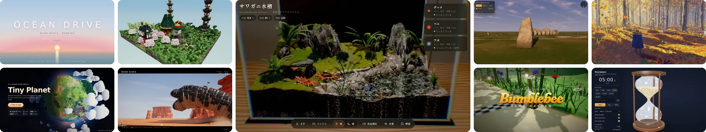
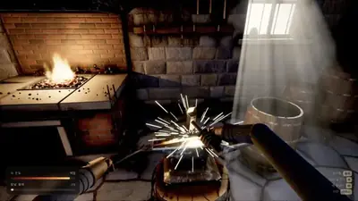

<a href="README.md"><picture><source media="(prefers-color-scheme: dark)" srcset="assets/logo-dark.svg"></picture></a>

<b>Open 3D Worlds Made with Code</b>

<b>Home</b> · <a href="games/README.md">Games</a> · <a href="videos/README.md">Videos</a> · <a href="scenes/README.md">Scenes</a> · <a href="wallpapers/README.md">Wallpapers</a> · <a href="tools/README.md">Tools</a> · <a href="visualizations/README.md">Visualizations</a> <b>English</b> · <a href="README.zh-CN.md">简体中文</a>

Terrarium is a non-commercial open-source community that collects 3D works generated mainly by code: interactive scenes, games and videos. This repository lists every work with its source, its creator, its license and its files.

<b>443</b> entries · <b>389</b> with public code · <b>321</b> with an open-source license

## Categories

<table>
<tr>
<td width="33.33%" valign="top"> <b><a href="games/README.md">Games</a></b> · 228 entries Works that a player plays, with a goal, rules or a score.</td>
<td width="33.33%" valign="top"> <b><a href="videos/README.md">Videos</a></b> · 17 entries Works whose main content is one video, including videos rendered by code.</td>
<td width="33.33%" valign="top"> <b><a href="scenes/README.md">Scenes</a></b> · 109 entries 3D places and objects to look at or move through.</td>
</tr>
<tr>
<td width="33.33%" valign="top"> <b><a href="wallpapers/README.md">Wallpapers</a></b> · 3 entries Moving backgrounds for a screen.</td>
<td width="33.33%" valign="top"> <b><a href="tools/README.md">Tools</a></b> · 53 entries Small apps that do one task in 3D.</td>
<td width="33.33%" valign="top"> <b><a href="visualizations/README.md">Visualizations</a></b> · 33 entries Works that show data, science or a process in 3D.</td>
</tr>
</table>

## Recently published

<table>
<tr>
<td width="25%" valign="top"> <b><a href="https://topway-ai.github.io/harbor-blackout-gemini/">HARBOR BLACKOUT (Gemini Edition)</a></b> <a href="https://github.com/topway-ai">Jack</a> MIT · <a href="https://github.com/topway-ai/harbor-blackout-gemini">Code</a> · <a href="https://huggingface.co/datasets/awesome-fable-5-2/terrarium-open-works/tree/main/games/harbor-blackout-gemini-edition">Files</a></td>
<td width="25%" valign="top"> <b><a href="https://huggingface.co/spaces/JohnVeds15/browser-3d-mini-games">3D Mini Games: play free in your browser</a></b> <a href="https://huggingface.co/JohnVeds15">John Vedovino</a> Collection of 25 works MIT · <a href="https://huggingface.co/spaces/JohnVeds15/browser-3d-mini-games">Code</a> · <a href="https://huggingface.co/datasets/awesome-fable-5-2/terrarium-open-works/tree/main/games/browser-3d-mini-games">Files</a></td>
<td width="25%" valign="top"> <b><a href="https://vaquitas-de-bloque.vercel.app">Vaquitas de Bloque</a></b> <a href="https://github.com/ivolivares">Iván Olivares Rojas</a> MIT · <a href="https://github.com/ivolivares/vaquitas-de-bloque">Code</a> · <a href="https://huggingface.co/datasets/awesome-fable-5-2/terrarium-open-works/tree/main/games/vaquitas-de-bloque">Files</a></td>
<td width="25%" valign="top"> <b><a href="https://basemazab.github.io/tuktuk/">توك توك: وسّع يا باشا</a></b> <a href="https://github.com/basemazab">basemazab</a> MIT · <a href="https://github.com/basemazab/tuktuk">Code</a> · <a href="https://huggingface.co/datasets/awesome-fable-5-2/terrarium-open-works/tree/main/games/tuktuk">Files</a></td>
</tr>
<tr>
<td width="25%" valign="top"> <b><a href="https://pelicanride.vercel.app">鹈鹕骑单车 · 海岸大冒险（Pelican Ride）</a></b> <a href="https://github.com/Xiobio">Xony</a> MIT · <a href="https://github.com/Xiobio/pelican-ride">Code</a> · <a href="https://huggingface.co/datasets/awesome-fable-5-2/terrarium-open-works/tree/main/games/pelican-ride">Files</a></td>
<td width="25%" valign="top"> <b><a href="https://github.com/bigerbigernerd/fiat-ludus">Fiat Ludus · 言出法随</a></b> <a href="https://github.com/bigerbigernerd">bigerbigernerd</a> MIT · <a href="https://github.com/bigerbigernerd/fiat-ludus">Code</a> · <a href="https://huggingface.co/datasets/awesome-fable-5-2/terrarium-open-works/tree/main/tools/fiat-ludus">Files</a></td>
<td width="25%" valign="top"> <b><a href="https://cyancity.github.io/yolo-mini-fps/">零号码头 DOCK ZERO</a></b> <a href="https://github.com/cyancity">YOLO</a> MIT · <a href="https://github.com/cyancity/yolo-mini-fps">Code</a> · <a href="https://huggingface.co/datasets/awesome-fable-5-2/terrarium-open-works/tree/main/games/dock-zero">Files</a></td>
<td width="25%" valign="top"> <b><a href="https://arjunreddy91100.github.io/bumblebee-echo-garden/">Bumblebee — Echo Garden</a></b> <a href="https://github.com/arjunreddy91100">Arjun</a> MIT · <a href="https://github.com/arjunreddy91100/bumblebee-echo-garden">Code</a> · <a href="https://huggingface.co/datasets/awesome-fable-5-2/terrarium-open-works/tree/main/games/bumblebee-echo-garden">Files</a></td>
</tr>
</table>

## What an entry shows

- The picture and the title open the page where the creator published the work.
- The name under the title opens one account of the creator. A name without a link means that the account is unknown.
- The last line starts with the license that the creator gave the work. "License unknown" means that no license was found, so the creator must be asked before the code is reused.
- <b>Code</b> opens the public source code. An entry without this link has no public code.
- <b>Files</b> opens the folder of the work in the Hugging Face dataset <a href="https://huggingface.co/datasets/awesome-fable-5-2/terrarium-open-works">awesome-fable-5-2/terrarium-open-works</a>. The dataset keeps the files of the works with an open-source license.
- "Collection" marks one repository or page by one creator that holds several works.
- A work without a preview image is in the table under the pictures of its section, with the same links.

A link can stop working when a creator moves or removes a work.

## Community

The community channels of Terrarium are not open yet. This section will link to each channel when it opens.

## Add or correct a work

To add a work, to correct an entry or to have an entry removed, open an issue in this repository. Give the link to the work and the link to its code. The pages are generated from the data of Terrarium, so changes are made in that data and not in these files.

## License

The works belong to their creators, and each work keeps its own license. The pictures are screenshots of the works. The text of these pages is released under CC0 1.0.

---

<a href="README.md">Home</a> · <a href="games/README.md">Games</a> · <a href="videos/README.md">Videos</a> · <a href="scenes/README.md">Scenes</a> · <a href="wallpapers/README.md">Wallpapers</a> · <a href="tools/README.md">Tools</a> · <a href="visualizations/README.md">Visualizations</a> · <a href="#top">Back to the top</a> Terrarium: Open 3D Worlds Made with Code · Data of 2026-11-14

