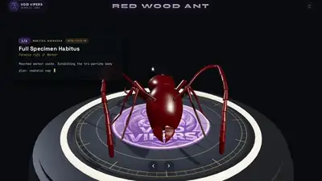
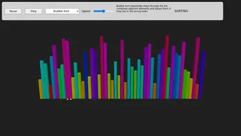

<a name="top"></a>

<p align="center"><a href="https://dbiewzjg1b9r0.cloudfront.net/index.html?license=yes"></a></p>

<h1 align="center">Terrarium</h1>

<p align="center"><b>A comprehensive showcase of the latest 3D games, interactive worlds and videos, with complete open-source code collected for you to explore, learn from and build on.</b></p>

<p align="center"><a href="https://dbiewzjg1b9r0.cloudfront.net/index.html?license=yes"></a>
<a href="https://huggingface.co/datasets/awesome-fable-5-2/terrarium-open-works"></a></p>

<p align="center"><sub><b>English</b> · <a href="README.zh-CN.md">简体中文</a> · <a href="README.zh-TW.md">繁體中文</a> · <a href="README.ja.md">日本語</a> · <a href="README.ko.md">한국어</a><br><a href="README.es.md">Español</a> · <a href="README.pt-BR.md">Português</a> · <a href="README.fr.md">Français</a> · <a href="README.de.md">Deutsch</a> · <a href="README.ru.md">Русский</a></sub></p>

<p align="center"><a href="#trending">Trending</a> · <a href="#latest">Latest</a> · <a href="#contents">Contents</a></p>

<!-- SHOWCASE:START -->
<p align="center"><b>443</b> curated entries · <b>6</b> creative categories · <b>389</b> with public code · <b>321</b> source archives<br><sub>Catalog data: 2026-11-14</sub></p>

<a name="trending"></a>

## Trending

<p align="center"><a href="#showcase-links"><picture><source media="(prefers-reduced-motion: reduce)" srcset="assets/showcase.webp"></picture></a></p>

<p align="center"><sub>Updated: 2026-11-15 19:08 UTC · Refresh scheduled every 6 hours</sub></p>

<a name="showcase-links"></a>

<table><tr>
<td width="25%" valign="top"><b>01 · <a href="https://starrynightrider.com/">Starry Nightrider</a></b><br><sub><a href="https://x.com/i/status/2120284261089673376">X · Likes: 17,887 · Comments: 499</a></sub></td>
<td width="25%" valign="top"><b>02 · <a href="https://claude.ai/artifact/BGY1SztrAYcJQHSsnHHGmp">Saltline</a></b><br><sub><a href="https://x.com/i/status/2119925633564463609">X · Likes: 14,809 · Comments: 846</a></sub></td>
<td width="25%" valign="top"><b>03 · <a href="https://patch.gg/blendi/oil-paint">Oil paint</a></b><br><sub><a href="https://x.com/i/status/2120341251178594532">X · Likes: 7,967 · Comments: 386</a></sub></td>
<td width="25%" valign="top"><b>04 · <a href="https://x.com/mattshumer_/status/2120282133503820150">Untitled open-world driving game</a></b><br><sub><a href="https://x.com/i/status/2120282133503820150">X · Likes: 7,515 · Comments: 678</a></sub></td>
</tr></table>

<details><summary>Sources &amp; ordering</summary>

Ordered by public likes, stars and other support. Comments and shares break ties; views are shown separately. The strongest post per platform contributes, and shared sources appear once. 65 sources · 3 platforms · 332 unmeasured <a href="data/showcase.json">View data</a> · <a href="scripts/SHOWCASE.md">Methodology</a>

</details>

<!-- SHOWCASE:END -->

<a name="latest"></a>

## Latest

<table>
<tr>
<td width="25%" valign="top"><a href="https://topway-ai.github.io/harbor-blackout-gemini/"></a><br><b><a href="https://topway-ai.github.io/harbor-blackout-gemini/">HARBOR BLACKOUT (Gemini Edition)</a></b><br><sub><a href="https://github.com/topway-ai">Jack</a><br>MIT · <a href="https://github.com/topway-ai/harbor-blackout-gemini">Code</a> · <a href="https://huggingface.co/datasets/awesome-fable-5-2/terrarium-open-works/tree/main/games/harbor-blackout-gemini-edition">Files</a></sub></td>
<td width="25%" valign="top"><a href="https://huggingface.co/spaces/JohnVeds15/browser-3d-mini-games"></a><br><b><a href="https://huggingface.co/spaces/JohnVeds15/browser-3d-mini-games">3D Mini Games: play free in your browser</a></b><br><sub><a href="https://huggingface.co/JohnVeds15">John Vedovino</a><br>Collection of 25 works<br>MIT · <a href="https://huggingface.co/spaces/JohnVeds15/browser-3d-mini-games">Code</a> · <a href="https://huggingface.co/datasets/awesome-fable-5-2/terrarium-open-works/tree/main/games/browser-3d-mini-games">Files</a></sub></td>
<td width="25%" valign="top"><a href="https://vaquitas-de-bloque.vercel.app"></a><br><b><a href="https://vaquitas-de-bloque.vercel.app">Vaquitas de Bloque</a></b><br><sub><a href="https://github.com/ivolivares">Iván Olivares Rojas</a><br>MIT · <a href="https://github.com/ivolivares/vaquitas-de-bloque">Code</a> · <a href="https://huggingface.co/datasets/awesome-fable-5-2/terrarium-open-works/tree/main/games/vaquitas-de-bloque">Files</a></sub></td>
<td width="25%" valign="top"><a href="https://basemazab.github.io/tuktuk/"></a><br><b><a href="https://basemazab.github.io/tuktuk/">توك توك: وسّع يا باشا</a></b><br><sub><a href="https://github.com/basemazab">basemazab</a><br>MIT · <a href="https://github.com/basemazab/tuktuk">Code</a> · <a href="https://huggingface.co/datasets/awesome-fable-5-2/terrarium-open-works/tree/main/games/tuktuk">Files</a></sub></td>
</tr>
<tr>
<td width="25%" valign="top"><a href="https://pelicanride.vercel.app"></a><br><b><a href="https://pelicanride.vercel.app">鹈鹕骑单车 · 海岸大冒险（Pelican Ride）</a></b><br><sub><a href="https://github.com/Xiobio">Xony</a><br>MIT · <a href="https://github.com/Xiobio/pelican-ride">Code</a> · <a href="https://huggingface.co/datasets/awesome-fable-5-2/terrarium-open-works/tree/main/games/pelican-ride">Files</a></sub></td>
<td width="25%" valign="top"><a href="https://github.com/bigerbigernerd/fiat-ludus"></a><br><b><a href="https://github.com/bigerbigernerd/fiat-ludus">Fiat Ludus · 言出法随</a></b><br><sub><a href="https://github.com/bigerbigernerd">bigerbigernerd</a><br>MIT · <a href="https://github.com/bigerbigernerd/fiat-ludus">Code</a> · <a href="https://huggingface.co/datasets/awesome-fable-5-2/terrarium-open-works/tree/main/tools/fiat-ludus">Files</a></sub></td>
<td width="25%" valign="top"><a href="https://cyancity.github.io/yolo-mini-fps/"></a><br><b><a href="https://cyancity.github.io/yolo-mini-fps/">零号码头 DOCK ZERO</a></b><br><sub><a href="https://github.com/cyancity">YOLO</a><br>MIT · <a href="https://github.com/cyancity/yolo-mini-fps">Code</a> · <a href="https://huggingface.co/datasets/awesome-fable-5-2/terrarium-open-works/tree/main/games/dock-zero">Files</a></sub></td>
<td width="25%" valign="top"><a href="https://arjunreddy91100.github.io/bumblebee-echo-garden/"></a><br><b><a href="https://arjunreddy91100.github.io/bumblebee-echo-garden/">Bumblebee — Echo Garden</a></b><br><sub><a href="https://github.com/arjunreddy91100">Arjun</a><br>MIT · <a href="https://github.com/arjunreddy91100/bumblebee-echo-garden">Code</a> · <a href="https://huggingface.co/datasets/awesome-fable-5-2/terrarium-open-works/tree/main/games/bumblebee-echo-garden">Files</a></sub></td>
</tr>
</table>

<a name="contents"></a>

<a name="categories"></a>

## Contents

Explore selected works, jump to a genre, or open the full collection.

<table>

<tr>

<td width="33.33%"><b><a href="#contents-games">🎮 Games</a> · 228</b><br><sub>191 with public code · 150 source archives</sub></td>

<td width="33.33%"><b><a href="#contents-scenes">🌍 Worlds &amp; Scenes</a> · 109</b><br><sub>101 with public code · 74 source archives</sub></td>

<td width="33.33%"><b><a href="#contents-videos">🎬 Videos</a> · 17</b><br><sub>8 with public code · 8 source archives</sub></td>

</tr>

<tr>

<td width="33.33%"><b><a href="#contents-tools">🛠️ Tools</a> · 53</b><br><sub>53 with public code · 53 source archives</sub></td>

<td width="33.33%"><b><a href="#contents-visualizations">📊 Visualizations</a> · 33</b><br><sub>33 with public code · 33 source archives</sub></td>

<td width="33.33%"><b><a href="#contents-wallpapers">🖥️ Wallpapers</a> · 3</b><br><sub>3 with public code · 3 source archives</sub></td>

</tr>

</table>

<a name="contents-games"></a>

### 🎮 Games · 228

Shooters, driving, flight, puzzles and everything in between.

<p><a href="games/README.md#genre-shooter">Shooter</a> <b>46</b> · <a href="games/README.md#genre-action-and-combat">Action &amp; combat</a> <b>20</b> · <a href="games/README.md#genre-platformer-and-runner">Platformer &amp; runner</a> <b>9</b> · <a href="games/README.md#genre-racing-and-driving">Racing &amp; driving</a> <b>35</b> · <a href="games/README.md#genre-flight">Flight</a> <b>14</b> · <a href="games/README.md#genre-sports">Sports</a> <b>11</b> · <a href="games/README.md#genre-adventure-and-exploration">Adventure &amp; exploration</a> <b>27</b> · <a href="games/README.md#genre-puzzle">Puzzle</a> <b>10</b> · <a href="games/README.md#genre-strategy-and-management">Strategy &amp; management</a> <b>20</b> · <a href="games/README.md#genre-sandbox">Sandbox</a> <b>6</b> · <a href="games/README.md#genre-casual-and-arcade">Casual &amp; arcade</a> <b>19</b> · <a href="games/README.md#genre-interactive-story">Interactive story</a> <b>2</b> · <a href="games/README.md#genre-simulation-and-visualization">Simulation &amp; visualization</a> <b>1</b> · <a href="games/README.md#genre-other-games">Other games</a> <b>8</b></p>

<table>
<tr>
<td width="33.33%" valign="top"><a href="https://theredstapler.github.io/orb-shooter/"></a><br><b><a href="https://theredstapler.github.io/orb-shooter/">Orb Shooter FPS Demo (Vibe Coded)</a></b><br><sub><a href="https://github.com/theredstapler">Red Stapler</a><br>MIT · <a href="https://github.com/theredstapler/orb-shooter">Code</a> · <a href="https://huggingface.co/datasets/awesome-fable-5-2/terrarium-open-works/tree/main/games/orb-shooter-fps-demo-vibe-coded">Files</a></sub></td>
<td width="33.33%" valign="top"><a href="https://arjunreddy91100.github.io/bumblebee-echo-garden/"></a><br><b><a href="https://arjunreddy91100.github.io/bumblebee-echo-garden/">Bumblebee — Echo Garden</a></b><br><sub><a href="https://github.com/arjunreddy91100">Arjun</a><br>MIT · <a href="https://github.com/arjunreddy91100/bumblebee-echo-garden">Code</a> · <a href="https://huggingface.co/datasets/awesome-fable-5-2/terrarium-open-works/tree/main/games/bumblebee-echo-garden">Files</a></sub></td>
<td width="33.33%" valign="top"><a href="https://pelicanride.vercel.app"></a><br><b><a href="https://pelicanride.vercel.app">鹈鹕骑单车 · 海岸大冒险（Pelican Ride）</a></b><br><sub><a href="https://github.com/Xiobio">Xony</a><br>MIT · <a href="https://github.com/Xiobio/pelican-ride">Code</a> · <a href="https://huggingface.co/datasets/awesome-fable-5-2/terrarium-open-works/tree/main/games/pelican-ride">Files</a></sub></td>
</tr>
</table>

<p><b><a href="games/README.md">Browse all 228 →</a></b> · <a href="#contents">↑ Contents</a></p>

<a name="contents-scenes"></a>

### 🌍 Worlds & Scenes · 109

Walk through imagined places, explore nature and inspect intricate objects.

<table>
<tr>
<td width="33.33%" valign="top"><a href="https://github.com/NineTigers/emberfall-forge-claude-fable-5.2"></a><br><b><a href="https://github.com/NineTigers/emberfall-forge-claude-fable-5.2">Emberfall Forge</a></b><br><sub><a href="https://github.com/NineTigers">NineTigers</a><br>MIT · <a href="https://github.com/NineTigers/emberfall-forge-claude-fable-5.2">Code</a> · <a href="https://huggingface.co/datasets/awesome-fable-5-2/terrarium-open-works/tree/main/scenes/emberfall-forge">Files</a></sub></td>
<td width="33.33%" valign="top"><a href="https://patch.gg/blendi/oil-paint"></a><br><b><a href="https://patch.gg/blendi/oil-paint">Oil paint</a></b><br><sub>Blendi Byl<br>MIT · <a href="https://git.patch.gg/blendi/oil-paint.git">Code</a> · <a href="https://huggingface.co/datasets/awesome-fable-5-2/terrarium-open-works/tree/main/scenes/oil-paint">Files</a></sub></td>
<td width="33.33%" valign="top"><a href="https://starknightt.github.io/tiny-planet/"></a><br><b><a href="https://starknightt.github.io/tiny-planet/">Tiny Planet</a></b><br><sub><a href="https://github.com/StarKnightt">Prasenjit</a><br>MIT · <a href="https://github.com/StarKnightt/tiny-planet">Code</a> · <a href="https://huggingface.co/datasets/awesome-fable-5-2/terrarium-open-works/tree/main/scenes/tiny-planet">Files</a></sub></td>
</tr>
</table>

<p><b><a href="scenes/README.md">Browse all 109 →</a></b> · <a href="#contents">↑ Contents</a></p>

<a name="contents-videos"></a>

### 🎬 Videos · 17

Films, animations and visual experiments rendered with code.

<table>
<tr>
<td width="33.33%" valign="top"><a href="https://x.com/fuoeba/status/2119906486017307074"></a><br><b><a href="https://x.com/fuoeba/status/2119906486017307074">Path-traced voxel creature</a></b><br><sub><a href="https://x.com/fuoeba">fuoeba</a><br>License unknown</sub></td>
<td width="33.33%" valign="top"><a href="https://x.com/rileybrown/status/2119902109709537708"></a><br><b><a href="https://x.com/rileybrown/status/2119902109709537708">The Edge</a></b><br><sub><a href="https://x.com/rileybrown">Riley Brown</a><br>License unknown</sub></td>
<td width="33.33%" valign="top"><a href="https://github.com/anstapnever/colossus"></a><br><b><a href="https://github.com/anstapnever/colossus">COLOSSUS · 巨像</a></b><br><sub><a href="https://github.com/anstapnever">anstap</a><br>MIT · <a href="https://github.com/anstapnever/colossus">Code</a> · <a href="https://huggingface.co/datasets/awesome-fable-5-2/terrarium-open-works/tree/main/videos/colossus">Files</a></sub></td>
</tr>
</table>

<p><b><a href="videos/README.md">Browse all 17 →</a></b> · <a href="#contents">↑ Contents</a></p>

<a name="contents-tools"></a>

### 🛠️ Tools · 53

Useful 3D apps for creating, inspecting and getting things done.

<table>
<tr>
<td width="33.33%" valign="top"><a href="https://github.com/harshitkhandelwal208/3D-engine-Visualiser"></a><br><b><a href="https://github.com/harshitkhandelwal208/3D-engine-Visualiser">MgCO₂ V6 Compression Engine — Interactive 3D Viewer</a></b><br><sub><a href="https://github.com/harshitkhandelwal208">Harshit Khandelwal</a><br>MIT · <a href="https://github.com/harshitkhandelwal208/3D-engine-Visualiser">Code</a> · <a href="https://huggingface.co/datasets/awesome-fable-5-2/terrarium-open-works/tree/main/tools/mgco2-v6-compression-engine-interactive-3d-viewer">Files</a></sub></td>
<td width="33.33%" valign="top"><a href="https://khanmjk.github.io/Fable51_Hourglass/"></a><br><b><a href="https://khanmjk.github.io/Fable51_Hourglass/">Hourglass · Digital Twin</a></b><br><sub><a href="https://github.com/khanmjk">khanmjk</a><br>MIT · <a href="https://github.com/khanmjk/Fable51_Hourglass">Code</a> · <a href="https://huggingface.co/datasets/awesome-fable-5-2/terrarium-open-works/tree/main/tools/hourglass-digital-twin">Files</a></sub></td>
<td width="33.33%" valign="top"><a href="https://github.com/bigerbigernerd/fiat-ludus"></a><br><b><a href="https://github.com/bigerbigernerd/fiat-ludus">Fiat Ludus · 言出法随</a></b><br><sub><a href="https://github.com/bigerbigernerd">bigerbigernerd</a><br>MIT · <a href="https://github.com/bigerbigernerd/fiat-ludus">Code</a> · <a href="https://huggingface.co/datasets/awesome-fable-5-2/terrarium-open-works/tree/main/tools/fiat-ludus">Files</a></sub></td>
</tr>
</table>

<p><b><a href="tools/README.md">Browse all 53 →</a></b> · <a href="#contents">↑ Contents</a></p>

<a name="contents-visualizations"></a>

### 📊 Visualizations · 33

Explore science, data and ideas through interactive 3D.

<table>
<tr>
<td width="33.33%" valign="top"><a href="https://codexparadise.github.io/insects/"></a><br><b><a href="https://codexparadise.github.io/insects/">ENTOMIA // 3D MICRO-MORPHOLOGY</a></b><br><sub><a href="https://github.com/codeXparadise">Vishal Prajapati</a><br>MIT · <a href="https://github.com/codeXparadise/insects">Code</a> · <a href="https://huggingface.co/datasets/awesome-fable-5-2/terrarium-open-works/tree/main/visualizations/entomia-3d-micro-morphology">Files</a></sub></td>
<td width="33.33%" valign="top"><a href="https://atoomnetmarc.github.io/3D-Sorting-Algorithm-Visualizer/"></a><br><b><a href="https://atoomnetmarc.github.io/3D-Sorting-Algorithm-Visualizer/">3D Sorting Algorithm Visualizer</a></b><br><sub><a href="https://github.com/atoomnetmarc">Marc Ketel</a><br>Apache-2.0 · <a href="https://github.com/atoomnetmarc/3D-Sorting-Algorithm-Visualizer">Code</a> · <a href="https://huggingface.co/datasets/awesome-fable-5-2/terrarium-open-works/tree/main/visualizations/3d-sorting-algorithm-visualizer">Files</a></sub></td>
<td width="33.33%" valign="top"><a href="https://github.com/AralimNGA/cube-physics-simulation"></a><br><b><a href="https://github.com/AralimNGA/cube-physics-simulation">Cube Physics Simulation</a></b><br><sub><a href="https://github.com/AralimNGA">Aralim</a><br>MIT · <a href="https://github.com/AralimNGA/cube-physics-simulation">Code</a> · <a href="https://huggingface.co/datasets/awesome-fable-5-2/terrarium-open-works/tree/main/visualizations/cube-physics-simulation">Files</a></sub></td>
</tr>
</table>

<p><b><a href="visualizations/README.md">Browse all 33 →</a></b> · <a href="#contents">↑ Contents</a></p>

<a name="contents-wallpapers"></a>

### 🖥️ Wallpapers · 3

Screensavers, desktop companions and ambient 3D experiences.

<table>
<tr>
<td width="50%" valign="top"><a href="https://github.com/Sabrina-creater/claude-pet"></a><br><b><a href="https://github.com/Sabrina-creater/claude-pet">Claude Pet 🐾</a></b><br><sub><a href="https://github.com/Sabrina-creater">Sabrina-creater</a><br>MIT · <a href="https://github.com/Sabrina-creater/claude-pet">Code</a> · <a href="https://huggingface.co/datasets/awesome-fable-5-2/terrarium-open-works/tree/main/wallpapers/claude-pet">Files</a></sub></td>
<td width="50%" valign="top"><a href="https://github.com/yohhoy/vibe-screensaver"></a><br><b><a href="https://github.com/yohhoy/vibe-screensaver">vibe-screensaver — Web スクリーンセーバ集</a></b><br><sub><a href="https://github.com/yohhoy">yoh</a><br>Collection of 14 works<br>MIT · <a href="https://github.com/yohhoy/vibe-screensaver">Code</a> · <a href="https://huggingface.co/datasets/awesome-fable-5-2/terrarium-open-works/tree/main/wallpapers/vibe-screensaver">Files</a></sub></td>
</tr>
</table>

<p><b><a href="wallpapers/README.md">Browse all 3 →</a></b> · <a href="#contents">↑ Contents</a></p>

<p align="center"><a href="https://dbiewzjg1b9r0.cloudfront.net/index.html?license=yes">Explore the full website →</a> · <a href="https://huggingface.co/datasets/awesome-fable-5-2/terrarium-open-works">Get the source archives →</a></p>

<details><summary>Source code, curation &amp; contributions</summary>

Works come from GitHub, Hugging Face Spaces, itch.io, X, Bilibili and more, spanning 324 creators. Previews open the original publication; Code links to public source; Files opens the HF archive. 227 works run in the browser, and 346 use Three.js.

Source for 321 openly licensed entries is archived by category and work, with original license files where available. Download the collection:

```sh
git clone https://huggingface.co/datasets/awesome-fable-5-2/terrarium-open-works
```

Large files require Git LFS. Works retain their own licenses; page text is CC0 1.0. Catalog and popularity timestamps are separate.

<a href="scripts/SHOWCASE.md">Methodology</a> · <a href="https://github.com/AI-Terrarium/terrarium/issues/new">Submit a work, correction or removal request →</a>

</details>

---

<p align="center"><a href="README.md"></a><br><sub><a href="README.md">Home</a> · <a href="games/README.md">Games</a> · <a href="scenes/README.md">Worlds &amp; Scenes</a> · <a href="videos/README.md">Videos</a> · <a href="tools/README.md">Tools</a> · <a href="visualizations/README.md">Visualizations</a> · <a href="wallpapers/README.md">Wallpapers</a> · <a href="#top">Back to top</a><br>Catalog data: 2026-11-14</sub></p>
