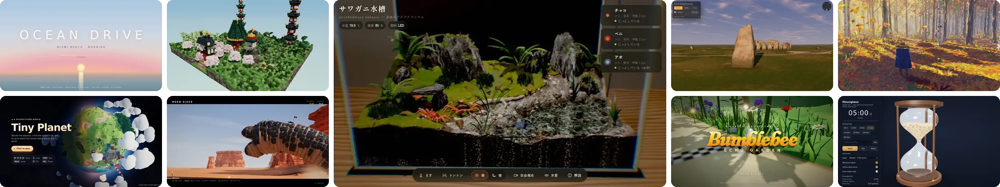

<a href="README.zh-CN.md"><picture><source media="(prefers-color-scheme: dark)" srcset="assets/logo-dark.svg"></picture></a>

<b>Open 3D Worlds Made with Code</b>

<b>首页</b> · <a href="games/README.zh-CN.md">游戏</a> · <a href="videos/README.zh-CN.md">视频</a> · <a href="scenes/README.zh-CN.md">场景</a> · <a href="wallpapers/README.zh-CN.md">壁纸</a> · <a href="tools/README.zh-CN.md">工具</a> · <a href="visualizations/README.zh-CN.md">可视化</a> <a href="README.md">English</a> · <b>简体中文</b>

Terrarium 列出主要用代码生成的 3D 作品：游戏、场景、工具、可视化、视频和壁纸。413 个作品里有 346 个用 Three.js 写成。点图片打开作者发布作品的页面。227 个作品可直接在浏览器里运行。每个条目写明作者和许可证。代码公开的条目附代码链接，方便开发者阅读和复用。

共 <b>443</b> 个条目：<b>413</b> 个作品、<b>30</b> 个合集，出自 <b>324</b> 位作者。其中 <b>389</b> 个代码公开，<b>321</b> 个有开源许可证。

## 类别

<table>
<tr>
<td width="33.33%" valign="top"> <b><a href="games/README.zh-CN.md">游戏</a></b> · 228 个条目 有目标、规则或分数的 3D 游戏，按玩法分小节：射击、竞速、飞行、解谜等。</td>
<td width="33.33%" valign="top"> <b><a href="videos/README.zh-CN.md">视频</a></b> · 17 个条目 以视频为主的作品，例如用代码渲染的短片。</td>
<td width="33.33%" valign="top"> <b><a href="scenes/README.zh-CN.md">场景</a></b> · 109 个条目 可以观看或在里面走动的 3D 场所和物体，例如城堡、公路、星球和水族箱。</td>
</tr>
<tr>
<td width="33.33%" valign="top"> <b><a href="wallpapers/README.zh-CN.md">壁纸</a></b> · 3 个条目 放在桌面上的动态 3D 画面，例如屏幕保护程序和桌面宠物。</td>
<td width="33.33%" valign="top"> <b><a href="tools/README.zh-CN.md">工具</a></b> · 53 个条目 完成具体任务的 3D 小应用，例如查看户型、解魔方和计时。</td>
<td width="33.33%" valign="top"> <b><a href="visualizations/README.zh-CN.md">可视化</a></b> · 33 个条目 用 3D 展示数据、科学知识或过程的作品，例如太阳系、排序算法和地震记录。</td>
</tr>
</table>

## 最近发布

<table>
<tr>
<td width="25%" valign="top"> <b><a href="https://topway-ai.github.io/harbor-blackout-gemini/">HARBOR BLACKOUT (Gemini Edition)</a></b> <a href="https://github.com/topway-ai">Jack</a> MIT · <a href="https://github.com/topway-ai/harbor-blackout-gemini">代码</a> · <a href="https://huggingface.co/datasets/awesome-fable-5-2/terrarium-open-works/tree/main/games/harbor-blackout-gemini-edition">文件</a></td>
<td width="25%" valign="top"> <b><a href="https://huggingface.co/spaces/JohnVeds15/browser-3d-mini-games">3D Mini Games: play free in your browser</a></b> <a href="https://huggingface.co/JohnVeds15">John Vedovino</a> 合集，25 个作品 MIT · <a href="https://huggingface.co/spaces/JohnVeds15/browser-3d-mini-games">代码</a> · <a href="https://huggingface.co/datasets/awesome-fable-5-2/terrarium-open-works/tree/main/games/browser-3d-mini-games">文件</a></td>
<td width="25%" valign="top"> <b><a href="https://vaquitas-de-bloque.vercel.app">Vaquitas de Bloque</a></b> <a href="https://github.com/ivolivares">Iván Olivares Rojas</a> MIT · <a href="https://github.com/ivolivares/vaquitas-de-bloque">代码</a> · <a href="https://huggingface.co/datasets/awesome-fable-5-2/terrarium-open-works/tree/main/games/vaquitas-de-bloque">文件</a></td>
<td width="25%" valign="top"> <b><a href="https://basemazab.github.io/tuktuk/">توك توك: وسّع يا باشا</a></b> <a href="https://github.com/basemazab">basemazab</a> MIT · <a href="https://github.com/basemazab/tuktuk">代码</a> · <a href="https://huggingface.co/datasets/awesome-fable-5-2/terrarium-open-works/tree/main/games/tuktuk">文件</a></td>
</tr>
<tr>
<td width="25%" valign="top"> <b><a href="https://pelicanride.vercel.app">鹈鹕骑单车 · 海岸大冒险（Pelican Ride）</a></b> <a href="https://github.com/Xiobio">Xony</a> MIT · <a href="https://github.com/Xiobio/pelican-ride">代码</a> · <a href="https://huggingface.co/datasets/awesome-fable-5-2/terrarium-open-works/tree/main/games/pelican-ride">文件</a></td>
<td width="25%" valign="top"> <b><a href="https://github.com/bigerbigernerd/fiat-ludus">Fiat Ludus · 言出法随</a></b> <a href="https://github.com/bigerbigernerd">bigerbigernerd</a> MIT · <a href="https://github.com/bigerbigernerd/fiat-ludus">代码</a> · <a href="https://huggingface.co/datasets/awesome-fable-5-2/terrarium-open-works/tree/main/tools/fiat-ludus">文件</a></td>
<td width="25%" valign="top"> <b><a href="https://cyancity.github.io/yolo-mini-fps/">零号码头 DOCK ZERO</a></b> <a href="https://github.com/cyancity">YOLO</a> MIT · <a href="https://github.com/cyancity/yolo-mini-fps">代码</a> · <a href="https://huggingface.co/datasets/awesome-fable-5-2/terrarium-open-works/tree/main/games/dock-zero">文件</a></td>
<td width="25%" valign="top"> <b><a href="https://arjunreddy91100.github.io/bumblebee-echo-garden/">Bumblebee — Echo Garden</a></b> <a href="https://github.com/arjunreddy91100">Arjun</a> MIT · <a href="https://github.com/arjunreddy91100/bumblebee-echo-garden">代码</a> · <a href="https://huggingface.co/datasets/awesome-fable-5-2/terrarium-open-works/tree/main/games/bumblebee-echo-garden">文件</a></td>
</tr>
</table>

## 每个条目有什么

- <b>图片和名称</b>链接到作者发布作品的页面。
- <b>作者</b>的名字链接到作者的账号。没有找到账号时，名字不带链接。
- <b>许可证</b>由作者指定。没有找到许可证时显示「许可证未知」，复用代码前请先询问作者。
- <b>代码</b>链接到公开的源代码。没有这个链接表示代码未公开。
- <b>文件</b>链接到这个作品在 Hugging Face 数据集 <a href="https://huggingface.co/datasets/awesome-fable-5-2/terrarium-open-works">awesome-fable-5-2/terrarium-open-works</a> 里的文件夹。有开源许可证的作品才有这个链接。
- <b>合集</b>是同一位作者放在一个仓库或页面里的一组作品。条目上标明作品数量。

在类别页上，没有预览图的作品列在图片下方的表格里。作者移动或删除作品后，链接可能失效。

## 列表如何制作

- <b>来源。</b>作品来自 GitHub、Hugging Face Spaces、itch.io、X、Bilibili 等处。
- <b>副本。</b>有开源许可证的 321 个条目，文件另存在 Hugging Face 数据集 <a href="https://huggingface.co/datasets/awesome-fable-5-2/terrarium-open-works">awesome-fable-5-2/terrarium-open-works</a> 中。每个条目一个文件夹，原仓库有许可证文件的，一并保留。
- <b>更新。</b>这些页面由程序根据 Terrarium 的数据生成。数据日期见页脚。

## 社区

Terrarium 是非商业的开源社区。社区渠道尚未开放，开放后会在这里列出链接。目前，问题和建议请在本仓库提交 issue。

## 增加、更正或删除条目

增加作品、更正或删除条目，请在本仓库提交 issue，并附作品链接。增加作品时请同时附代码链接。这些页面由程序生成，直接修改文件的内容会在下次生成时丢失。

## 许可证

作品版权归各自的作者所有。每个作品使用各自的许可证，见条目。图片为作品截图。页面文字采用 CC0 1.0 许可。

---

<a href="README.zh-CN.md">首页</a> · <a href="games/README.zh-CN.md">游戏</a> · <a href="videos/README.zh-CN.md">视频</a> · <a href="scenes/README.zh-CN.md">场景</a> · <a href="wallpapers/README.zh-CN.md">壁纸</a> · <a href="tools/README.zh-CN.md">工具</a> · <a href="visualizations/README.zh-CN.md">可视化</a> · <a href="#top">返回顶部</a> Terrarium: Open 3D Worlds Made with Code · 数据日期：2026-11-14

