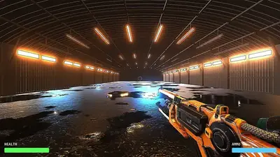

<a name="top"></a>

<p align="center"><a href="https://terraium.ai/"></a></p>

<h1 align="center">Terrarium</h1>

<p align="center"><b>Entdecke über 1.000 KI-erstellte 3D-Spiele, interaktive Welten, Videos und Visualisierungen: eine alle 8 Stunden aktualisierte Sammlung mit kostenlosen Archiven vollständigen Open-Source-Codes und veröffentlichter Generierungs-Prompts zum Lernen und Weiterentwickeln.</b></p>

<p align="center"><a href="https://terraium.ai/"></a>
<a href="https://github.com/AI-Terrarium/terrarium"></a>
<a href="https://huggingface.co/datasets/AI-Terrarium/terrarium-open-works"></a>
<a href="https://discord.com/invite/bJqy7ev7WD"></a></p>

<p align="center"><sub><a href="../../README.md">English</a> · <a href="README.zh-CN.md">简体中文</a> · <a href="README.zh-TW.md">繁體中文</a> · <a href="README.ja.md">日本語</a> · <a href="README.ko.md">한국어</a> · <a href="README.es.md">Español</a> · <a href="README.pt-BR.md">Português</a> · <a href="README.fr.md">Français</a> · <b>Deutsch</b> · <a href="README.ru.md">Русский</a></sub></p>

<p align="center"><a href="#trending">Beliebt</a> · <a href="#latest">Neu</a> · <a href="#contents">Inhalt</a></p>

<!-- SHOWCASE:START -->
<p align="center"><b>1065</b> Einträge · <b>6</b> Kategorien · <b>972</b> mit öffentlichem Code · <b>425</b> Codearchive<br><sub>Katalogdaten: 2026-11-24</sub></p>

<a name="trending"></a>

## Beliebt

<p align="center"><a href="#showcase-links"><picture><source media="(prefers-reduced-motion: reduce)" srcset="../../assets/showcase.webp"></picture></a></p>

<p align="center"><sub>Aktualisiert: 2026-11-24 10:46 UTC · Aktualisierung alle 8 Stunden geplant</sub></p>

<a name="showcase-links"></a>

<table><tr>
<td width="25%" valign="top"><b>01 · <a href="https://starrynightrider.com/">Starry Nightrider</a></b><br><sub><a href="https://x.com/i/status/2120284261089673376">X · Likes: 17.946 · Kommentare: 503</a></sub></td>
<td width="25%" valign="top"><b>02 · <a href="https://claude.ai/artifact/BGY1SztrAYcJQHSsnHHGmp">Saltline</a></b><br><sub><a href="https://x.com/i/status/2119925633564463609">X · Likes: 15.052 · Kommentare: 861</a></sub></td>
<td width="25%" valign="top"><b>03 · <a href="https://patch.gg/blendi/oil-paint">Oil paint</a></b><br><sub><a href="https://x.com/i/status/2120341251178594532">X · Likes: 8.020 · Kommentare: 393</a></sub></td>
<td width="25%" valign="top"><b>04 · <a href="https://x.com/mattshumer_/status/2120282133503820150">CROSSTOWN</a></b><br><sub><a href="https://x.com/i/status/2120282133503820150">X · Likes: 7.515 · Kommentare: 676</a></sub></td>
</tr></table>

<details><summary>Quellen und Sortierung</summary>

Sortiert nach öffentlichen Likes, Sternen und ähnlicher Zustimmung. Kommentare und geteilte Beiträge entscheiden bei Gleichstand; Aufrufe werden getrennt angezeigt. Pro Plattform zählt der meistunterstützte Beitrag, jede Quelle erscheint nur einmal. 844 Quellen · 4 Plattformen · 14 nicht erfasst <a href="../../data/showcase.json">Daten ansehen</a> · <a href="../../scripts/SHOWCASE.md">Methode</a>

</details>

<!-- SHOWCASE:END -->

<a name="latest"></a>

## Neu

<table>
<tr>
<td width="25%" valign="top"><a href="https://elpq.itch.io/zofe12367"></a><br><b><a href="https://elpq.itch.io/zofe12367">ZONBIE APOCALYPSE 3D | ENG \ RU</a></b><br><sub><a href="https://elpq.itch.io">elpq</a><br>Lizenz unbekannt · <a href="https://elpq.itch.io/zofe12367">Code</a></sub></td>
<td width="25%" valign="top"><a href="https://hahaha10001.itch.io/zero-diorama-wreckers"></a><br><b><a href="https://hahaha10001.itch.io/zero-diorama-wreckers">Zero: Diorama Wreckers</a></b><br><sub><a href="https://hahaha10001.itch.io">hahaha10001</a><br>CC0-1.0 · <a href="https://hahaha10001.itch.io/zero-diorama-wreckers">Code</a></sub></td>
<td width="25%" valign="top"><a href="https://abdeninho.itch.io/weather-world"></a><br><b><a href="https://abdeninho.itch.io/weather-world">Weather World</a></b><br><sub><a href="https://abdeninho.itch.io">abdeninho</a><br>Lizenz unbekannt · <a href="https://abdeninho.itch.io/weather-world">Code</a></sub></td>
<td width="25%" valign="top"><a href="https://theusefulstack.itch.io/veld"></a><br><b><a href="https://theusefulstack.itch.io/veld">Veld — an AI-built voxel sandbox (GPT-6.1 Sol)</a></b><br><sub><a href="https://theusefulstack.itch.io">theusefulstack</a><br>MIT · <a href="https://theusefulstack.itch.io/veld">Code</a></sub></td>
</tr>
<tr>
<td width="25%" valign="top"><a href="https://thenfan.itch.io/vector-rush"></a><br><b><a href="https://thenfan.itch.io/vector-rush">Vector Rush</a></b><br><sub><a href="https://thenfan.itch.io">thenfan</a><br>Lizenz unbekannt · <a href="https://thenfan.itch.io/vector-rush">Code</a></sub></td>
<td width="25%" valign="top"><a href="https://rafael-mogger.itch.io/ultima-ronda"></a><br><b><a href="https://rafael-mogger.itch.io/ultima-ronda">Ultima-ronda</a></b><br><sub><a href="https://rafael-mogger.itch.io">rafael-mogger</a><br>Lizenz unbekannt · <a href="https://rafael-mogger.itch.io/ultima-ronda">Code</a></sub></td>
<td width="25%" valign="top"><a href="https://lek-vob.itch.io/tunnel-z"></a><br><b><a href="https://lek-vob.itch.io/tunnel-z">Tunnel-Z</a></b><br><sub><a href="https://lek-vob.itch.io">lek-vob</a><br>Lizenz unbekannt · <a href="https://lek-vob.itch.io/tunnel-z">Code</a></sub></td>
<td width="25%" valign="top"><a href="https://giii3-game.itch.io/tscaveen"></a><br><b><a href="https://giii3-game.itch.io/tscaveen">TSF CAVE — Bill the Warrior and the Crest Curse</a></b><br><sub><a href="https://giii3-game.itch.io">giii3-game</a><br>Lizenz unbekannt · <a href="https://giii3-game.itch.io/tscaveen">Code</a></sub></td>
</tr>
</table>

<a name="contents"></a>

<a name="categories"></a>

## Inhalt

Entdecke ausgewählte Werke, wähle ein Genre oder öffne die gesamte Sammlung.

<table>

<tr>

<td width="33.33%"><b><a href="#contents-games">🎮 Spiele</a> · 605</b><br><sub>529 mit öffentlichem Code · 190 Codearchive</sub></td>

<td width="33.33%"><b><a href="#contents-scenes">🌍 Welten und Szenen</a> · 211</b><br><sub>203 mit öffentlichem Code · 94 Codearchive</sub></td>

<td width="33.33%"><b><a href="#contents-videos">🎬 Videos</a> · 32</b><br><sub>23 mit öffentlichem Code · 15 Codearchive</sub></td>

</tr>

<tr>

<td width="33.33%"><b><a href="#contents-tools">🛠️ Werkzeuge</a> · 115</b><br><sub>115 mit öffentlichem Code · 75 Codearchive</sub></td>

<td width="33.33%"><b><a href="#contents-visualizations">📊 Visualisierungen</a> · 99</b><br><sub>99 mit öffentlichem Code · 48 Codearchive</sub></td>

<td width="33.33%"><b><a href="#contents-wallpapers">🖥️ Hintergrundbilder</a> · 3</b><br><sub>3 mit öffentlichem Code · 3 Codearchive</sub></td>

</tr>

</table>

<a name="contents-games"></a>

### 🎮 Spiele · 605

Shooter, Rennen, Flugsimulationen, Rätsel und vieles mehr.

<p><a href="../../games/README.de.md#genre-shooter">Shooter</a> <b>111</b> · <a href="../../games/README.de.md#genre-action-and-combat">Action und Kampf</a> <b>57</b> · <a href="../../games/README.de.md#genre-platformer-and-runner">Plattform und Runner</a> <b>38</b> · <a href="../../games/README.de.md#genre-racing-and-driving">Rennen und Fahren</a> <b>75</b> · <a href="../../games/README.de.md#genre-flight">Flug</a> <b>28</b> · <a href="../../games/README.de.md#genre-sports">Sport</a> <b>15</b> · <a href="../../games/README.de.md#genre-adventure-and-exploration">Abenteuer und Erkundung</a> <b>77</b> · <a href="../../games/README.de.md#genre-puzzle">Rätsel</a> <b>23</b> · <a href="../../games/README.de.md#genre-strategy-and-management">Strategie und Aufbau</a> <b>47</b> · <a href="../../games/README.de.md#genre-sandbox">Sandbox</a> <b>27</b> · <a href="../../games/README.de.md#genre-casual-and-arcade">Casual und Arcade</a> <b>35</b> · <a href="../../games/README.de.md#genre-interactive-story">Interaktive Geschichten</a> <b>3</b> · <a href="../../games/README.de.md#genre-simulation-and-visualization">Simulation und Visualisierung</a> <b>4</b> · <a href="../../games/README.de.md#genre-other-games">Weitere Spiele</a> <b>65</b></p>

<table>
<tr>
<td width="33.33%" valign="top"><a href="https://theredstapler.github.io/orb-shooter/"></a><br><b><a href="https://theredstapler.github.io/orb-shooter/">Orb Shooter FPS Demo (Vibe Coded)</a></b><br><sub><a href="https://github.com/theredstapler">Red Stapler</a><br>MIT · <a href="https://github.com/theredstapler/orb-shooter">Code</a> · <a href="https://huggingface.co/datasets/AI-Terrarium/terrarium-open-works/tree/main/games/orb-shooter-fps-demo-vibe-coded">Dateien</a></sub></td>
<td width="33.33%" valign="top"><a href="https://arjunreddy91100.github.io/bumblebee-echo-garden/"></a><br><b><a href="https://arjunreddy91100.github.io/bumblebee-echo-garden/">Bumblebee — Echo Garden</a></b><br><sub><a href="https://github.com/arjunreddy91100">Arjun</a><br>MIT · <a href="https://github.com/arjunreddy91100/bumblebee-echo-garden">Code</a> · <a href="https://huggingface.co/datasets/AI-Terrarium/terrarium-open-works/tree/main/games/bumblebee-echo-garden">Dateien</a></sub></td>
<td width="33.33%" valign="top"><a href="https://pelicanride.vercel.app"></a><br><b><a href="https://pelicanride.vercel.app">鹈鹕骑单车 · 海岸大冒险（Pelican Ride）</a></b><br><sub><a href="https://github.com/Xiobio">Xony</a><br>MIT · <a href="https://github.com/Xiobio/pelican-ride">Code</a> · <a href="https://huggingface.co/datasets/AI-Terrarium/terrarium-open-works/tree/main/games/pelican-ride">Dateien</a></sub></td>
</tr>
</table>

<p><b><a href="../../games/README.de.md">Alle 605 Einträge ansehen →</a></b> · <a href="#contents">↑ Inhalt</a></p>

<a name="contents-scenes"></a>

### 🌍 Welten und Szenen · 211

Erkunde erdachte Orte, Naturlandschaften und detailreiche 3D-Objekte.

<table>
<tr>
<td width="33.33%" valign="top"><a href="https://github.com/NineTigers/emberfall-forge-claude-fable-5.2"></a><br><b><a href="https://github.com/NineTigers/emberfall-forge-claude-fable-5.2">Emberfall Forge</a></b><br><sub><a href="https://github.com/NineTigers">NineTigers</a><br>MIT · <a href="https://github.com/NineTigers/emberfall-forge-claude-fable-5.2">Code</a> · <a href="https://huggingface.co/datasets/AI-Terrarium/terrarium-open-works/tree/main/scenes/emberfall-forge">Dateien</a></sub></td>
<td width="33.33%" valign="top"><a href="https://patch.gg/blendi/oil-paint"></a><br><b><a href="https://patch.gg/blendi/oil-paint">Oil paint</a></b><br><sub>Blendi Byl<br>MIT · <a href="https://git.patch.gg/blendi/oil-paint.git">Code</a> · <a href="https://huggingface.co/datasets/AI-Terrarium/terrarium-open-works/tree/main/scenes/oil-paint">Dateien</a></sub></td>
<td width="33.33%" valign="top"><a href="https://starknightt.github.io/tiny-planet/"></a><br><b><a href="https://starknightt.github.io/tiny-planet/">Tiny Planet</a></b><br><sub><a href="https://github.com/StarKnightt">Prasenjit</a><br>MIT · <a href="https://github.com/StarKnightt/tiny-planet">Code</a> · <a href="https://huggingface.co/datasets/AI-Terrarium/terrarium-open-works/tree/main/scenes/tiny-planet">Dateien</a></sub></td>
</tr>
</table>

<p><b><a href="../../scenes/README.de.md">Alle 211 Einträge ansehen →</a></b> · <a href="#contents">↑ Inhalt</a></p>

<a name="contents-videos"></a>

### 🎬 Videos · 32

Kurzfilme, Animationen und visuelle Experimente, mit Code gerendert.

<table>
<tr>
<td width="33.33%" valign="top"><a href="https://x.com/fuoeba/status/2119906486017307074"></a><br><b><a href="https://x.com/fuoeba/status/2119906486017307074">Path-traced voxel creature</a></b><br><sub><a href="https://x.com/fuoeba">fuoeba</a><br>Lizenz unbekannt</sub></td>
<td width="33.33%" valign="top"><a href="https://x.com/rileybrown/status/2119902109709537708"></a><br><b><a href="https://x.com/rileybrown/status/2119902109709537708">The Edge</a></b><br><sub><a href="https://x.com/rileybrown">Riley Brown</a><br>Lizenz unbekannt</sub></td>
<td width="33.33%" valign="top"><a href="https://github.com/anstapnever/colossus"></a><br><b><a href="https://github.com/anstapnever/colossus">COLOSSUS · 巨像</a></b><br><sub><a href="https://github.com/anstapnever">anstap</a><br>MIT · <a href="https://github.com/anstapnever/colossus">Code</a> · <a href="https://huggingface.co/datasets/AI-Terrarium/terrarium-open-works/tree/main/videos/colossus">Dateien</a></sub></td>
</tr>
</table>

<p><b><a href="../../videos/README.de.md">Alle 32 Einträge ansehen →</a></b> · <a href="#contents">↑ Inhalt</a></p>

<a name="contents-tools"></a>

### 🛠️ Werkzeuge · 115

3D-Anwendungen zum Gestalten, Erkunden, Simulieren und Arbeiten.

<table>
<tr>
<td width="33.33%" valign="top"><a href="https://github.com/harshitkhandelwal208/3D-engine-Visualiser"></a><br><b><a href="https://github.com/harshitkhandelwal208/3D-engine-Visualiser">MgCO₂ V6 Compression Engine — Interactive 3D Viewer</a></b><br><sub><a href="https://github.com/harshitkhandelwal208">Harshit Khandelwal</a><br>MIT · <a href="https://github.com/harshitkhandelwal208/3D-engine-Visualiser">Code</a> · <a href="https://huggingface.co/datasets/AI-Terrarium/terrarium-open-works/tree/main/tools/mgco2-v6-compression-engine-interactive-3d-viewer">Dateien</a></sub></td>
<td width="33.33%" valign="top"><a href="https://khanmjk.github.io/Fable51_Hourglass/"></a><br><b><a href="https://khanmjk.github.io/Fable51_Hourglass/">Hourglass · Digital Twin</a></b><br><sub><a href="https://github.com/khanmjk">khanmjk</a><br>MIT · <a href="https://github.com/khanmjk/Fable51_Hourglass">Code</a> · <a href="https://huggingface.co/datasets/AI-Terrarium/terrarium-open-works/tree/main/tools/hourglass-digital-twin">Dateien</a></sub></td>
<td width="33.33%" valign="top"><a href="https://github.com/bigerbigernerd/fiat-ludus"></a><br><b><a href="https://github.com/bigerbigernerd/fiat-ludus">Fiat Ludus · 言出法随</a></b><br><sub><a href="https://github.com/bigerbigernerd">bigerbigernerd</a><br>MIT · <a href="https://github.com/bigerbigernerd/fiat-ludus">Code</a> · <a href="https://huggingface.co/datasets/AI-Terrarium/terrarium-open-works/tree/main/tools/fiat-ludus">Dateien</a></sub></td>
</tr>
</table>

<p><b><a href="../../tools/README.de.md">Alle 115 Einträge ansehen →</a></b> · <a href="#contents">↑ Inhalt</a></p>

<a name="contents-visualizations"></a>

### 📊 Visualisierungen · 99

Erkunde Wissenschaft, Daten und Ideen mit interaktivem 3D.

<table>
<tr>
<td width="33.33%" valign="top"><a href="https://codexparadise.github.io/insects/"></a><br><b><a href="https://codexparadise.github.io/insects/">ENTOMIA // 3D MICRO-MORPHOLOGY</a></b><br><sub><a href="https://github.com/codeXparadise">Vishal Prajapati</a><br>MIT · <a href="https://github.com/codeXparadise/insects">Code</a> · <a href="https://huggingface.co/datasets/AI-Terrarium/terrarium-open-works/tree/main/visualizations/entomia-3d-micro-morphology">Dateien</a></sub></td>
<td width="33.33%" valign="top"><a href="https://atoomnetmarc.github.io/3D-Sorting-Algorithm-Visualizer/"></a><br><b><a href="https://atoomnetmarc.github.io/3D-Sorting-Algorithm-Visualizer/">3D Sorting Algorithm Visualizer</a></b><br><sub><a href="https://github.com/atoomnetmarc">Marc Ketel</a><br>Apache-2.0 · <a href="https://github.com/atoomnetmarc/3D-Sorting-Algorithm-Visualizer">Code</a> · <a href="https://huggingface.co/datasets/AI-Terrarium/terrarium-open-works/tree/main/visualizations/3d-sorting-algorithm-visualizer">Dateien</a></sub></td>
<td width="33.33%" valign="top"><a href="https://github.com/AralimNGA/cube-physics-simulation"></a><br><b><a href="https://github.com/AralimNGA/cube-physics-simulation">Cube Physics Simulation</a></b><br><sub><a href="https://github.com/AralimNGA">Aralim</a><br>MIT · <a href="https://github.com/AralimNGA/cube-physics-simulation">Code</a> · <a href="https://huggingface.co/datasets/AI-Terrarium/terrarium-open-works/tree/main/visualizations/cube-physics-simulation">Dateien</a></sub></td>
</tr>
</table>

<p><b><a href="../../visualizations/README.de.md">Alle 99 Einträge ansehen →</a></b> · <a href="#contents">↑ Inhalt</a></p>

<a name="contents-wallpapers"></a>

### 🖥️ Hintergrundbilder · 3

Bildschirmschoner, Desktop-Begleiter und stimmungsvolle 3D-Ansichten.

<table>
<tr>
<td width="33.33%" valign="top"><a href="https://github.com/Sabrina-creater/claude-pet"></a><br><b><a href="https://github.com/Sabrina-creater/claude-pet">Claude Pet 🐾</a></b><br><sub><a href="https://github.com/Sabrina-creater">Sabrina-creater</a><br>MIT · <a href="https://github.com/Sabrina-creater/claude-pet">Code</a> · <a href="https://huggingface.co/datasets/AI-Terrarium/terrarium-open-works/tree/main/wallpapers/claude-pet">Dateien</a></sub></td>
<td width="33.33%" valign="top"><a href="https://yohhoy.github.io/vibe-screensaver/"></a><br><b><a href="https://yohhoy.github.io/vibe-screensaver/">vibe-screensaver — Web スクリーンセーバ集</a></b><br><sub><a href="https://github.com/yohhoy">yoh</a><br>Sammlung mit 14 Werken<br>MIT · <a href="https://github.com/yohhoy/vibe-screensaver">Code</a> · <a href="https://huggingface.co/datasets/AI-Terrarium/terrarium-open-works/tree/main/wallpapers/vibe-screensaver">Dateien</a></sub></td>
<td width="33.33%" valign="top"><a href="https://biswajitdasb4-oss.github.io/prompt-paws/"></a><br><b><a href="https://biswajitdasb4-oss.github.io/prompt-paws/">Prompt Paws</a></b><br><sub><a href="https://github.com/biswajitdasb4-oss">biswajitdasb4-oss</a><br>MIT · <a href="https://github.com/biswajitdasb4-oss/prompt-paws">Code</a> · <a href="https://huggingface.co/datasets/AI-Terrarium/terrarium-open-works/tree/main/wallpapers/prompt-paws">Dateien</a></sub></td>
</tr>
</table>

<p><b><a href="../../wallpapers/README.de.md">Alle 3 Einträge ansehen →</a></b> · <a href="#contents">↑ Inhalt</a></p>

<p align="center"><a href="https://terraium.ai/">Die vollständige Website entdecken →</a> · <a href="https://huggingface.co/datasets/AI-Terrarium/terrarium-open-works">Quellcodearchive herunterladen →</a></p>

<details><summary>Quellcode, Auswahl und Beiträge</summary>

Werke von 324 Kreativen aus GitHub, Hugging Face Spaces, itch.io, X, Bilibili und weiteren Plattformen. Vorschaubilder öffnen die Originalveröffentlichung; Code führt zum öffentlichen Quellcode und Dateien zum HF-Archiv. 227 Werke laufen im Browser und 346 verwenden Three.js.

Der Quellcode von 425 offen lizenzierten Einträgen ist nach Kategorie und Werk archiviert, einschließlich der ursprünglichen Lizenzdateien, soweit vorhanden. Gesamtdownload:

```sh
git clone https://huggingface.co/datasets/AI-Terrarium/terrarium-open-works
```

Große Dateien erfordern Git LFS. Jedes Werk behält seine eigene Lizenz; die Seitentexte stehen unter CC0 1.0. Katalog- und Beliebtheitsdaten haben getrennte Zeitstempel.

<a href="../../scripts/SHOWCASE.md">Methode</a> · <a href="https://github.com/AI-Terrarium/terrarium/issues/new">Werk, Korrektur oder Entfernung vorschlagen →</a>

</details>

---

<p align="center"><a href="README.de.md"></a><br><sub><a href="README.de.md">Startseite</a> · <a href="../../games/README.de.md">Spiele</a> · <a href="../../scenes/README.de.md">Welten und Szenen</a> · <a href="../../videos/README.de.md">Videos</a> · <a href="../../tools/README.de.md">Werkzeuge</a> · <a href="../../visualizations/README.de.md">Visualisierungen</a> · <a href="../../wallpapers/README.de.md">Hintergrundbilder</a> · <a href="#top">Nach oben</a><br>Katalogdaten: 2026-11-24</sub></p>
