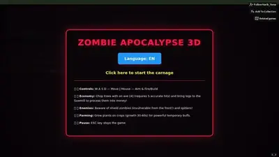
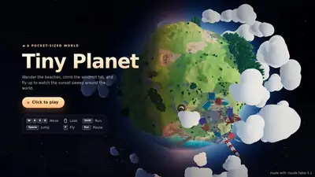

<a name="top"></a>

<p align="center"><a href="https://terraium.ai/"></a></p>

<h1 align="center">Terrarium</h1>

<p align="center"><b>Descubre más de 1.000 juegos 3D, mundos interactivos, vídeos y visualizaciones creados con IA: una colección actualizada cada 8 horas, con archivos gratuitos de código abierto completo y prompts de generación publicados para aprender y crear.</b></p>

<p align="center"><a href="https://terraium.ai/"></a>
<a href="https://github.com/AI-Terrarium/terrarium"></a>
<a href="https://huggingface.co/datasets/AI-Terrarium/terrarium-open-works"></a>
<a href="https://discord.com/invite/bJqy7ev7WD"></a></p>

<p align="center"><sub><a href="../../README.md">English</a> · <a href="README.zh-CN.md">简体中文</a> · <a href="README.zh-TW.md">繁體中文</a> · <a href="README.ja.md">日本語</a> · <a href="README.ko.md">한국어</a> · <b>Español</b> · <a href="README.pt-BR.md">Português</a> · <a href="README.fr.md">Français</a> · <a href="README.de.md">Deutsch</a> · <a href="README.ru.md">Русский</a></sub></p>

<p align="center"><a href="#trending">Popular</a> · <a href="#latest">Novedades</a> · <a href="#contents">Contenido</a></p>

<!-- SHOWCASE:START -->
<p align="center"><b>1046</b> entradas · <b>6</b> categorías · <b>953</b> con código público · <b>425</b> archivos de código<br><sub>Datos del catálogo: 2026-11-21</sub></p>

<a name="trending"></a>

## Popular

<p align="center"><a href="#showcase-links"><picture><source media="(prefers-reduced-motion: reduce)" srcset="../../assets/showcase.webp"></picture></a></p>

<p align="center"><sub>Actualizado: 2026-11-21 16:41 UTC · Actualización programada cada 8 horas</sub></p>

<a name="showcase-links"></a>

<table><tr>
<td width="25%" valign="top"><b>01 · <a href="https://starrynightrider.com/">Starry Nightrider</a></b><br><sub><a href="https://x.com/i/status/2120284261089673376">X · Me gusta: 17.949 · Comentarios: 503</a></sub></td>
<td width="25%" valign="top"><b>02 · <a href="https://claude.ai/artifact/BGY1SztrAYcJQHSsnHHGmp">Saltline</a></b><br><sub><a href="https://x.com/i/status/2119925633564463609">X · Me gusta: 15.034 · Comentarios: 861</a></sub></td>
<td width="25%" valign="top"><b>03 · <a href="https://patch.gg/blendi/oil-paint">Oil paint</a></b><br><sub><a href="https://x.com/i/status/2120341251178594532">X · Me gusta: 8.018 · Comentarios: 393</a></sub></td>
<td width="25%" valign="top"><b>04 · <a href="https://x.com/mattshumer_/status/2120282133503820150">CROSSTOWN</a></b><br><sub><a href="https://x.com/i/status/2120282133503820150">X · Me gusta: 7.519 · Comentarios: 676</a></sub></td>
</tr></table>

<details><summary>Fuentes y ordenación</summary>

Ordenadas por apoyos públicos, como Me gusta y estrellas. Los comentarios y las veces compartidas desempatan; las visualizaciones se muestran aparte. Se usa la publicación con más apoyo por plataforma y cada fuente aparece una sola vez. 827 fuentes · 4 plataformas · 12 sin medir <a href="../../data/showcase.json">Ver datos</a> · <a href="../../scripts/SHOWCASE.md">Metodología</a>

</details>

<!-- SHOWCASE:END -->

<a name="latest"></a>

## Novedades

<table>
<tr>
<td width="25%" valign="top"><a href="https://elpq.itch.io/zofe12367"></a><br><b><a href="https://elpq.itch.io/zofe12367">ZONBIE APOCALYPSE 3D | ENG \ RU</a></b><br><sub><a href="https://elpq.itch.io">elpq</a><br>Licencia desconocida · <a href="https://elpq.itch.io/zofe12367">Código</a></sub></td>
<td width="25%" valign="top"><a href="https://hahaha10001.itch.io/zero-diorama-wreckers"></a><br><b><a href="https://hahaha10001.itch.io/zero-diorama-wreckers">Zero: Diorama Wreckers</a></b><br><sub><a href="https://hahaha10001.itch.io">hahaha10001</a><br>CC0-1.0 · <a href="https://hahaha10001.itch.io/zero-diorama-wreckers">Código</a></sub></td>
<td width="25%" valign="top"><a href="https://abdeninho.itch.io/weather-world"></a><br><b><a href="https://abdeninho.itch.io/weather-world">Weather World</a></b><br><sub><a href="https://abdeninho.itch.io">abdeninho</a><br>Licencia desconocida · <a href="https://abdeninho.itch.io/weather-world">Código</a></sub></td>
<td width="25%" valign="top"><a href="https://theusefulstack.itch.io/veld"></a><br><b><a href="https://theusefulstack.itch.io/veld">Veld — an AI-built voxel sandbox (GPT-6.1 Sol)</a></b><br><sub><a href="https://theusefulstack.itch.io">theusefulstack</a><br>MIT · <a href="https://theusefulstack.itch.io/veld">Código</a></sub></td>
</tr>
<tr>
<td width="25%" valign="top"><a href="https://thenfan.itch.io/vector-rush"></a><br><b><a href="https://thenfan.itch.io/vector-rush">Vector Rush</a></b><br><sub><a href="https://thenfan.itch.io">thenfan</a><br>Licencia desconocida · <a href="https://thenfan.itch.io/vector-rush">Código</a></sub></td>
<td width="25%" valign="top"><a href="https://rafael-mogger.itch.io/ultima-ronda"></a><br><b><a href="https://rafael-mogger.itch.io/ultima-ronda">Ultima-ronda</a></b><br><sub><a href="https://rafael-mogger.itch.io">rafael-mogger</a><br>Licencia desconocida · <a href="https://rafael-mogger.itch.io/ultima-ronda">Código</a></sub></td>
<td width="25%" valign="top"><a href="https://lek-vob.itch.io/tunnel-z"></a><br><b><a href="https://lek-vob.itch.io/tunnel-z">Tunnel-Z</a></b><br><sub><a href="https://lek-vob.itch.io">lek-vob</a><br>Licencia desconocida · <a href="https://lek-vob.itch.io/tunnel-z">Código</a></sub></td>
<td width="25%" valign="top"><a href="https://giii3-game.itch.io/tscaveen"></a><br><b><a href="https://giii3-game.itch.io/tscaveen">TSF CAVE — Bill the Warrior and the Crest Curse</a></b><br><sub><a href="https://giii3-game.itch.io">giii3-game</a><br>Licencia desconocida · <a href="https://giii3-game.itch.io/tscaveen">Código</a></sub></td>
</tr>
</table>

<a name="contents"></a>

<a name="categories"></a>

## Contenido

Explora las obras destacadas, elige un género o consulta la colección completa.

<table>

<tr>

<td width="33.33%"><b><a href="#contents-games">🎮 Juegos</a> · 586</b><br><sub>510 con código público · 190 archivos de código</sub></td>

<td width="33.33%"><b><a href="#contents-scenes">🌍 Mundos y escenas</a> · 211</b><br><sub>203 con código público · 94 archivos de código</sub></td>

<td width="33.33%"><b><a href="#contents-videos">🎬 Vídeos</a> · 32</b><br><sub>23 con código público · 15 archivos de código</sub></td>

</tr>

<tr>

<td width="33.33%"><b><a href="#contents-tools">🛠️ Herramientas</a> · 115</b><br><sub>115 con código público · 75 archivos de código</sub></td>

<td width="33.33%"><b><a href="#contents-visualizations">📊 Visualizaciones</a> · 99</b><br><sub>99 con código público · 48 archivos de código</sub></td>

<td width="33.33%"><b><a href="#contents-wallpapers">🖥️ Fondos de pantalla</a> · 3</b><br><sub>3 con código público · 3 archivos de código</sub></td>

</tr>

</table>

<a name="contents-games"></a>

### 🎮 Juegos · 586

Disparos, conducción, vuelo, puzles y mucho más.

<p><a href="../../games/README.es.md#genre-shooter">Disparos</a> <b>111</b> · <a href="../../games/README.es.md#genre-action-and-combat">Acción y combate</a> <b>57</b> · <a href="../../games/README.es.md#genre-platformer-and-runner">Plataformas y carreras sin fin</a> <b>38</b> · <a href="../../games/README.es.md#genre-racing-and-driving">Carreras y conducción</a> <b>75</b> · <a href="../../games/README.es.md#genre-flight">Vuelo</a> <b>28</b> · <a href="../../games/README.es.md#genre-sports">Deportes</a> <b>15</b> · <a href="../../games/README.es.md#genre-adventure-and-exploration">Aventura y exploración</a> <b>77</b> · <a href="../../games/README.es.md#genre-puzzle">Puzles</a> <b>23</b> · <a href="../../games/README.es.md#genre-strategy-and-management">Estrategia y gestión</a> <b>47</b> · <a href="../../games/README.es.md#genre-sandbox">Sandbox</a> <b>27</b> · <a href="../../games/README.es.md#genre-casual-and-arcade">Casuales y arcade</a> <b>35</b> · <a href="../../games/README.es.md#genre-interactive-story">Historia interactiva</a> <b>3</b> · <a href="../../games/README.es.md#genre-simulation-and-visualization">Simulación y visualización</a> <b>4</b> · <a href="../../games/README.es.md#genre-other-games">Otros juegos</a> <b>46</b></p>

<table>
<tr>
<td width="33.33%" valign="top"><a href="https://theredstapler.github.io/orb-shooter/"></a><br><b><a href="https://theredstapler.github.io/orb-shooter/">Orb Shooter FPS Demo (Vibe Coded)</a></b><br><sub><a href="https://github.com/theredstapler">Red Stapler</a><br>MIT · <a href="https://github.com/theredstapler/orb-shooter">Código</a> · <a href="https://huggingface.co/datasets/AI-Terrarium/terrarium-open-works/tree/main/games/orb-shooter-fps-demo-vibe-coded">Archivos</a></sub></td>
<td width="33.33%" valign="top"><a href="https://arjunreddy91100.github.io/bumblebee-echo-garden/"></a><br><b><a href="https://arjunreddy91100.github.io/bumblebee-echo-garden/">Bumblebee — Echo Garden</a></b><br><sub><a href="https://github.com/arjunreddy91100">Arjun</a><br>MIT · <a href="https://github.com/arjunreddy91100/bumblebee-echo-garden">Código</a> · <a href="https://huggingface.co/datasets/AI-Terrarium/terrarium-open-works/tree/main/games/bumblebee-echo-garden">Archivos</a></sub></td>
<td width="33.33%" valign="top"><a href="https://pelicanride.vercel.app"></a><br><b><a href="https://pelicanride.vercel.app">鹈鹕骑单车 · 海岸大冒险（Pelican Ride）</a></b><br><sub><a href="https://github.com/Xiobio">Xony</a><br>MIT · <a href="https://github.com/Xiobio/pelican-ride">Código</a> · <a href="https://huggingface.co/datasets/AI-Terrarium/terrarium-open-works/tree/main/games/pelican-ride">Archivos</a></sub></td>
</tr>
</table>

<p><b><a href="../../games/README.es.md">Ver las 586 entradas →</a></b> · <a href="#contents">↑ Contenido</a></p>

<a name="contents-scenes"></a>

### 🌍 Mundos y escenas · 211

Recorre lugares imaginarios, explora paisajes y examina objetos 3D.

<table>
<tr>
<td width="33.33%" valign="top"><a href="https://github.com/NineTigers/emberfall-forge-claude-fable-5.2"></a><br><b><a href="https://github.com/NineTigers/emberfall-forge-claude-fable-5.2">Emberfall Forge</a></b><br><sub><a href="https://github.com/NineTigers">NineTigers</a><br>MIT · <a href="https://github.com/NineTigers/emberfall-forge-claude-fable-5.2">Código</a> · <a href="https://huggingface.co/datasets/AI-Terrarium/terrarium-open-works/tree/main/scenes/emberfall-forge">Archivos</a></sub></td>
<td width="33.33%" valign="top"><a href="https://patch.gg/blendi/oil-paint"></a><br><b><a href="https://patch.gg/blendi/oil-paint">Oil paint</a></b><br><sub>Blendi Byl<br>MIT · <a href="https://git.patch.gg/blendi/oil-paint.git">Código</a> · <a href="https://huggingface.co/datasets/AI-Terrarium/terrarium-open-works/tree/main/scenes/oil-paint">Archivos</a></sub></td>
<td width="33.33%" valign="top"><a href="https://starknightt.github.io/tiny-planet/"></a><br><b><a href="https://starknightt.github.io/tiny-planet/">Tiny Planet</a></b><br><sub><a href="https://github.com/StarKnightt">Prasenjit</a><br>MIT · <a href="https://github.com/StarKnightt/tiny-planet">Código</a> · <a href="https://huggingface.co/datasets/AI-Terrarium/terrarium-open-works/tree/main/scenes/tiny-planet">Archivos</a></sub></td>
</tr>
</table>

<p><b><a href="../../scenes/README.es.md">Ver las 211 entradas →</a></b> · <a href="#contents">↑ Contenido</a></p>

<a name="contents-videos"></a>

### 🎬 Vídeos · 32

Cortos, animaciones y experimentos visuales renderizados con código.

<table>
<tr>
<td width="33.33%" valign="top"><a href="https://x.com/fuoeba/status/2119906486017307074"></a><br><b><a href="https://x.com/fuoeba/status/2119906486017307074">Path-traced voxel creature</a></b><br><sub><a href="https://x.com/fuoeba">fuoeba</a><br>Licencia desconocida</sub></td>
<td width="33.33%" valign="top"><a href="https://x.com/rileybrown/status/2119902109709537708"></a><br><b><a href="https://x.com/rileybrown/status/2119902109709537708">The Edge</a></b><br><sub><a href="https://x.com/rileybrown">Riley Brown</a><br>Licencia desconocida</sub></td>
<td width="33.33%" valign="top"><a href="https://github.com/anstapnever/colossus"></a><br><b><a href="https://github.com/anstapnever/colossus">COLOSSUS · 巨像</a></b><br><sub><a href="https://github.com/anstapnever">anstap</a><br>MIT · <a href="https://github.com/anstapnever/colossus">Código</a> · <a href="https://huggingface.co/datasets/AI-Terrarium/terrarium-open-works/tree/main/videos/colossus">Archivos</a></sub></td>
</tr>
</table>

<p><b><a href="../../videos/README.es.md">Ver las 32 entradas →</a></b> · <a href="#contents">↑ Contenido</a></p>

<a name="contents-tools"></a>

### 🛠️ Herramientas · 115

Aplicaciones 3D para crear, explorar, simular y realizar tareas.

<table>
<tr>
<td width="33.33%" valign="top"><a href="https://github.com/harshitkhandelwal208/3D-engine-Visualiser"></a><br><b><a href="https://github.com/harshitkhandelwal208/3D-engine-Visualiser">MgCO₂ V6 Compression Engine — Interactive 3D Viewer</a></b><br><sub><a href="https://github.com/harshitkhandelwal208">Harshit Khandelwal</a><br>MIT · <a href="https://github.com/harshitkhandelwal208/3D-engine-Visualiser">Código</a> · <a href="https://huggingface.co/datasets/AI-Terrarium/terrarium-open-works/tree/main/tools/mgco2-v6-compression-engine-interactive-3d-viewer">Archivos</a></sub></td>
<td width="33.33%" valign="top"><a href="https://khanmjk.github.io/Fable51_Hourglass/"></a><br><b><a href="https://khanmjk.github.io/Fable51_Hourglass/">Hourglass · Digital Twin</a></b><br><sub><a href="https://github.com/khanmjk">khanmjk</a><br>MIT · <a href="https://github.com/khanmjk/Fable51_Hourglass">Código</a> · <a href="https://huggingface.co/datasets/AI-Terrarium/terrarium-open-works/tree/main/tools/hourglass-digital-twin">Archivos</a></sub></td>
<td width="33.33%" valign="top"><a href="https://github.com/bigerbigernerd/fiat-ludus"></a><br><b><a href="https://github.com/bigerbigernerd/fiat-ludus">Fiat Ludus · 言出法随</a></b><br><sub><a href="https://github.com/bigerbigernerd">bigerbigernerd</a><br>MIT · <a href="https://github.com/bigerbigernerd/fiat-ludus">Código</a> · <a href="https://huggingface.co/datasets/AI-Terrarium/terrarium-open-works/tree/main/tools/fiat-ludus">Archivos</a></sub></td>
</tr>
</table>

<p><b><a href="../../tools/README.es.md">Ver las 115 entradas →</a></b> · <a href="#contents">↑ Contenido</a></p>

<a name="contents-visualizations"></a>

### 📊 Visualizaciones · 99

Explora ciencia, datos e ideas mediante 3D interactivo.

<table>
<tr>
<td width="33.33%" valign="top"><a href="https://codexparadise.github.io/insects/"></a><br><b><a href="https://codexparadise.github.io/insects/">ENTOMIA // 3D MICRO-MORPHOLOGY</a></b><br><sub><a href="https://github.com/codeXparadise">Vishal Prajapati</a><br>MIT · <a href="https://github.com/codeXparadise/insects">Código</a> · <a href="https://huggingface.co/datasets/AI-Terrarium/terrarium-open-works/tree/main/visualizations/entomia-3d-micro-morphology">Archivos</a></sub></td>
<td width="33.33%" valign="top"><a href="https://atoomnetmarc.github.io/3D-Sorting-Algorithm-Visualizer/"></a><br><b><a href="https://atoomnetmarc.github.io/3D-Sorting-Algorithm-Visualizer/">3D Sorting Algorithm Visualizer</a></b><br><sub><a href="https://github.com/atoomnetmarc">Marc Ketel</a><br>Apache-2.0 · <a href="https://github.com/atoomnetmarc/3D-Sorting-Algorithm-Visualizer">Código</a> · <a href="https://huggingface.co/datasets/AI-Terrarium/terrarium-open-works/tree/main/visualizations/3d-sorting-algorithm-visualizer">Archivos</a></sub></td>
<td width="33.33%" valign="top"><a href="https://github.com/AralimNGA/cube-physics-simulation"></a><br><b><a href="https://github.com/AralimNGA/cube-physics-simulation">Cube Physics Simulation</a></b><br><sub><a href="https://github.com/AralimNGA">Aralim</a><br>MIT · <a href="https://github.com/AralimNGA/cube-physics-simulation">Código</a> · <a href="https://huggingface.co/datasets/AI-Terrarium/terrarium-open-works/tree/main/visualizations/cube-physics-simulation">Archivos</a></sub></td>
</tr>
</table>

<p><b><a href="../../visualizations/README.es.md">Ver las 99 entradas →</a></b> · <a href="#contents">↑ Contenido</a></p>

<a name="contents-wallpapers"></a>

### 🖥️ Fondos de pantalla · 3

Salvapantallas, compañeros de escritorio y ambientes en 3D.

<table>
<tr>
<td width="33.33%" valign="top"><a href="https://github.com/Sabrina-creater/claude-pet"></a><br><b><a href="https://github.com/Sabrina-creater/claude-pet">Claude Pet 🐾</a></b><br><sub><a href="https://github.com/Sabrina-creater">Sabrina-creater</a><br>MIT · <a href="https://github.com/Sabrina-creater/claude-pet">Código</a> · <a href="https://huggingface.co/datasets/AI-Terrarium/terrarium-open-works/tree/main/wallpapers/claude-pet">Archivos</a></sub></td>
<td width="33.33%" valign="top"><a href="https://yohhoy.github.io/vibe-screensaver/"></a><br><b><a href="https://yohhoy.github.io/vibe-screensaver/">vibe-screensaver — Web スクリーンセーバ集</a></b><br><sub><a href="https://github.com/yohhoy">yoh</a><br>Colección de 14 obras<br>MIT · <a href="https://github.com/yohhoy/vibe-screensaver">Código</a> · <a href="https://huggingface.co/datasets/AI-Terrarium/terrarium-open-works/tree/main/wallpapers/vibe-screensaver">Archivos</a></sub></td>
<td width="33.33%" valign="top"><a href="https://biswajitdasb4-oss.github.io/prompt-paws/"></a><br><b><a href="https://biswajitdasb4-oss.github.io/prompt-paws/">Prompt Paws</a></b><br><sub><a href="https://github.com/biswajitdasb4-oss">biswajitdasb4-oss</a><br>MIT · <a href="https://github.com/biswajitdasb4-oss/prompt-paws">Código</a> · <a href="https://huggingface.co/datasets/AI-Terrarium/terrarium-open-works/tree/main/wallpapers/prompt-paws">Archivos</a></sub></td>
</tr>
</table>

<p><b><a href="../../wallpapers/README.es.md">Ver las 3 entradas →</a></b> · <a href="#contents">↑ Contenido</a></p>

<p align="center"><a href="https://terraium.ai/">Explorar la web completa →</a> · <a href="https://huggingface.co/datasets/AI-Terrarium/terrarium-open-works">Obtener los archivos de código →</a></p>

<details><summary>Código, selección y contribuciones</summary>

Obras de 324 creadores, procedentes de GitHub, Hugging Face Spaces, itch.io, X, Bilibili y más. Las imágenes abren la publicación original; Código enlaza al código público y Archivos al archivo de HF. 227 obras funcionan en el navegador y 346 usan Three.js.

Se conservan 425 entradas con licencia de código abierto, organizadas por categoría y obra, con las licencias originales cuando están disponibles. Descarga conjunta:

```sh
git clone https://huggingface.co/datasets/AI-Terrarium/terrarium-open-works
```

Los archivos grandes requieren Git LFS. Cada obra conserva su licencia; el texto de estas páginas es CC0 1.0. Las fechas del catálogo y de popularidad se muestran por separado.

<a href="../../scripts/SHOWCASE.md">Metodología</a> · <a href="https://github.com/AI-Terrarium/terrarium/issues/new">Proponer una obra, corrección o retirada →</a>

</details>

---

<p align="center"><a href="README.es.md"></a><br><sub><a href="README.es.md">Inicio</a> · <a href="../../games/README.es.md">Juegos</a> · <a href="../../scenes/README.es.md">Mundos y escenas</a> · <a href="../../videos/README.es.md">Vídeos</a> · <a href="../../tools/README.es.md">Herramientas</a> · <a href="../../visualizations/README.es.md">Visualizaciones</a> · <a href="../../wallpapers/README.es.md">Fondos de pantalla</a> · <a href="#top">Volver arriba</a><br>Datos del catálogo: 2026-11-21</sub></p>
