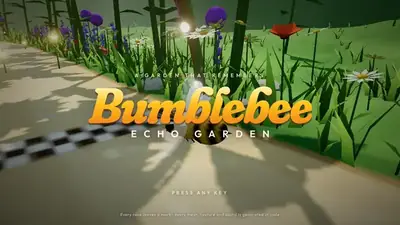

<a name="top"></a>

<p align="center"><a href="https://terraium.ai/"></a></p>

<h1 align="center">Terrarium</h1>

<p align="center"><b>AI が制作した 1,000 件以上の 3D ゲーム、インタラクティブなワールド、動画、可視化作品を発見。作品集は 8 時間ごとに更新され、完全なオープンソースコードと公開された生成プロンプトを学習や創作に使える無料アーカイブとして提供します。</b></p>

<p align="center"><a href="https://terraium.ai/"></a>
<a href="https://github.com/AI-Terrarium/terrarium"></a>
<a href="https://huggingface.co/datasets/AI-Terrarium/terrarium-open-works"></a>
<a href="https://discord.com/invite/bJqy7ev7WD"></a></p>

<p align="center"><sub><a href="../../README.md">English</a> · <a href="README.zh-CN.md">简体中文</a> · <a href="README.zh-TW.md">繁體中文</a> · <b>日本語</b> · <a href="README.ko.md">한국어</a> · <a href="README.es.md">Español</a> · <a href="README.pt-BR.md">Português</a> · <a href="README.fr.md">Français</a> · <a href="README.de.md">Deutsch</a> · <a href="README.ru.md">Русский</a></sub></p>

<p align="center"><a href="#trending">人気</a> · <a href="#latest">新着</a> · <a href="#contents">目次</a></p>

<!-- SHOWCASE:START -->
<p align="center"><b>1074</b> 収録項目 · <b>6</b> カテゴリー · <b>981</b> ソース公開 · <b>425</b> ソースアーカイブ<br><sub>カタログのデータ：2026-11-26</sub></p>

<a name="trending"></a>

## 人気

<p align="center"><a href="#showcase-links"><picture><source media="(prefers-reduced-motion: reduce)" srcset="../../assets/showcase.webp"></picture></a></p>

<p align="center"><sub>人気データ更新：2026-11-25 19:04 UTC · 8 時間ごとに更新予定</sub></p>

<a name="showcase-links"></a>

<table><tr>
<td width="25%" valign="top"><b>01 · <a href="https://starrynightrider.com/">Starry Nightrider</a></b><br><sub><a href="https://x.com/i/status/2120284261089673376">X · 17,943 いいね · 505 コメント</a></sub></td>
<td width="25%" valign="top"><b>02 · <a href="https://anipixels.itch.io/crisp-icons-free">magictools</a></b><br><sub><a href="https://github.com/ellisonleao/magictools">GitHub · 17,872 Star · 1,380 Fork</a></sub></td>
<td width="25%" valign="top"><b>03 · <a href="https://claude.ai/artifact/BGY1SztrAYcJQHSsnHHGmp">Saltline</a></b><br><sub><a href="https://x.com/i/status/2119925633564463609">X · 15,055 いいね · 861 コメント</a></sub></td>
<td width="25%" valign="top"><b>04 · <a href="https://dsh-market.com">dsh-web</a></b><br><sub><a href="https://github.com/zhu1090093659/dsh-web">GitHub · 10,640 Star · 657 Fork</a></sub></td>
</tr></table>

<details><summary>データの出典と並び順</summary>

公開の「いいね」や Star などの支持数で並べ、同数の場合のみコメントや共有数を使います。再生数は別に表示。各プラットフォームで最も支持された投稿を採用し、同じ出典は重複表示しません。 853 件の出典 · 4 プラットフォーム · 14 件は未取得 <a href="../../data/showcase.json">データを見る</a> · <a href="../../scripts/SHOWCASE.md">集計方法</a>

</details>

<!-- SHOWCASE:END -->

<a name="latest"></a>

## 新着

<table>
<tr>
<td width="25%" valign="top"><a href="https://elpq.itch.io/zofe12367"></a><br><b><a href="https://elpq.itch.io/zofe12367">ZONBIE APOCALYPSE 3D | ENG \ RU</a></b><br><sub><a href="https://elpq.itch.io">elpq</a><br>ライセンス不明 · <a href="https://elpq.itch.io/zofe12367">ソース</a></sub></td>
<td width="25%" valign="top"><a href="https://hahaha10001.itch.io/zero-diorama-wreckers"></a><br><b><a href="https://hahaha10001.itch.io/zero-diorama-wreckers">Zero: Diorama Wreckers</a></b><br><sub><a href="https://hahaha10001.itch.io">hahaha10001</a><br>CC0-1.0 · <a href="https://hahaha10001.itch.io/zero-diorama-wreckers">ソース</a></sub></td>
<td width="25%" valign="top"><a href="https://abdeninho.itch.io/weather-world"></a><br><b><a href="https://abdeninho.itch.io/weather-world">Weather World</a></b><br><sub><a href="https://abdeninho.itch.io">abdeninho</a><br>ライセンス不明 · <a href="https://abdeninho.itch.io/weather-world">ソース</a></sub></td>
<td width="25%" valign="top"><a href="https://theusefulstack.itch.io/veld"></a><br><b><a href="https://theusefulstack.itch.io/veld">Veld — an AI-built voxel sandbox (GPT-6.1 Sol)</a></b><br><sub><a href="https://theusefulstack.itch.io">theusefulstack</a><br>MIT · <a href="https://theusefulstack.itch.io/veld">ソース</a></sub></td>
</tr>
<tr>
<td width="25%" valign="top"><a href="https://thenfan.itch.io/vector-rush"></a><br><b><a href="https://thenfan.itch.io/vector-rush">Vector Rush</a></b><br><sub><a href="https://thenfan.itch.io">thenfan</a><br>ライセンス不明 · <a href="https://thenfan.itch.io/vector-rush">ソース</a></sub></td>
<td width="25%" valign="top"><a href="https://rafael-mogger.itch.io/ultima-ronda"></a><br><b><a href="https://rafael-mogger.itch.io/ultima-ronda">Ultima-ronda</a></b><br><sub><a href="https://rafael-mogger.itch.io">rafael-mogger</a><br>ライセンス不明 · <a href="https://rafael-mogger.itch.io/ultima-ronda">ソース</a></sub></td>
<td width="25%" valign="top"><a href="https://lek-vob.itch.io/tunnel-z"></a><br><b><a href="https://lek-vob.itch.io/tunnel-z">Tunnel-Z</a></b><br><sub><a href="https://lek-vob.itch.io">lek-vob</a><br>ライセンス不明 · <a href="https://lek-vob.itch.io/tunnel-z">ソース</a></sub></td>
<td width="25%" valign="top"><a href="https://giii3-game.itch.io/tscaveen"></a><br><b><a href="https://giii3-game.itch.io/tscaveen">TSF CAVE — Bill the Warrior and the Crest Curse</a></b><br><sub><a href="https://giii3-game.itch.io">giii3-game</a><br>ライセンス不明 · <a href="https://giii3-game.itch.io/tscaveen">ソース</a></sub></td>
</tr>
</table>

<a name="contents"></a>

<a name="categories"></a>

## 目次

代表作品を見たり、ジャンルから選んだり、全作品の一覧へ進めます。

<table>

<tr>

<td width="33.33%"><b><a href="#contents-games">🎮 ゲーム</a> · 614</b><br><sub>538 ソース公開 · 190 ソースアーカイブ</sub></td>

<td width="33.33%"><b><a href="#contents-scenes">🌍 ワールドとシーン</a> · 211</b><br><sub>203 ソース公開 · 94 ソースアーカイブ</sub></td>

<td width="33.33%"><b><a href="#contents-videos">🎬 動画</a> · 32</b><br><sub>23 ソース公開 · 15 ソースアーカイブ</sub></td>

</tr>

<tr>

<td width="33.33%"><b><a href="#contents-tools">🛠️ ツール</a> · 115</b><br><sub>115 ソース公開 · 75 ソースアーカイブ</sub></td>

<td width="33.33%"><b><a href="#contents-visualizations">📊 可視化</a> · 99</b><br><sub>99 ソース公開 · 48 ソースアーカイブ</sub></td>

<td width="33.33%"><b><a href="#contents-wallpapers">🖥️ 壁紙</a> · 3</b><br><sub>3 ソース公開 · 3 ソースアーカイブ</sub></td>

</tr>

</table>

<a name="contents-games"></a>

### 🎮 ゲーム · 614

シューティング、レース、フライト、パズルなど多彩なゲーム。

<p><a href="../../games/README.ja.md#genre-shooter">シューティング</a> <b>111</b> · <a href="../../games/README.ja.md#genre-action-and-combat">アクション・戦闘</a> <b>57</b> · <a href="../../games/README.ja.md#genre-platformer-and-runner">プラットフォーマー・ランナー</a> <b>38</b> · <a href="../../games/README.ja.md#genre-racing-and-driving">レース・ドライブ</a> <b>75</b> · <a href="../../games/README.ja.md#genre-flight">フライト</a> <b>28</b> · <a href="../../games/README.ja.md#genre-sports">スポーツ</a> <b>15</b> · <a href="../../games/README.ja.md#genre-adventure-and-exploration">アドベンチャー・探索</a> <b>77</b> · <a href="../../games/README.ja.md#genre-puzzle">パズル</a> <b>23</b> · <a href="../../games/README.ja.md#genre-strategy-and-management">戦略・経営</a> <b>47</b> · <a href="../../games/README.ja.md#genre-sandbox">サンドボックス</a> <b>27</b> · <a href="../../games/README.ja.md#genre-casual-and-arcade">カジュアル・アーケード</a> <b>35</b> · <a href="../../games/README.ja.md#genre-interactive-story">インタラクティブストーリー</a> <b>3</b> · <a href="../../games/README.ja.md#genre-simulation-and-visualization">シミュレーション・可視化</a> <b>4</b> · <a href="../../games/README.ja.md#genre-other-games">その他</a> <b>74</b></p>

<table>
<tr>
<td width="33.33%" valign="top"><a href="https://theredstapler.github.io/orb-shooter/"></a><br><b><a href="https://theredstapler.github.io/orb-shooter/">Orb Shooter FPS Demo (Vibe Coded)</a></b><br><sub><a href="https://github.com/theredstapler">Red Stapler</a><br>MIT · <a href="https://github.com/theredstapler/orb-shooter">ソース</a> · <a href="https://huggingface.co/datasets/AI-Terrarium/terrarium-open-works/tree/main/games/orb-shooter-fps-demo-vibe-coded">ファイル</a></sub></td>
<td width="33.33%" valign="top"><a href="https://arjunreddy91100.github.io/bumblebee-echo-garden/"></a><br><b><a href="https://arjunreddy91100.github.io/bumblebee-echo-garden/">Bumblebee — Echo Garden</a></b><br><sub><a href="https://github.com/arjunreddy91100">Arjun</a><br>MIT · <a href="https://github.com/arjunreddy91100/bumblebee-echo-garden">ソース</a> · <a href="https://huggingface.co/datasets/AI-Terrarium/terrarium-open-works/tree/main/games/bumblebee-echo-garden">ファイル</a></sub></td>
<td width="33.33%" valign="top"><a href="https://pelicanride.vercel.app"></a><br><b><a href="https://pelicanride.vercel.app">鹈鹕骑单车 · 海岸大冒险（Pelican Ride）</a></b><br><sub><a href="https://github.com/Xiobio">Xony</a><br>MIT · <a href="https://github.com/Xiobio/pelican-ride">ソース</a> · <a href="https://huggingface.co/datasets/AI-Terrarium/terrarium-open-works/tree/main/games/pelican-ride">ファイル</a></sub></td>
</tr>
</table>

<p><b><a href="../../games/README.ja.md">全 614 件を見る →</a></b> · <a href="#contents">↑ 目次</a></p>

<a name="contents-scenes"></a>

### 🌍 ワールドとシーン · 211

架空の世界や自然の風景を歩き、精巧な 3D オブジェクトを探索。

<table>
<tr>
<td width="33.33%" valign="top"><a href="https://github.com/NineTigers/emberfall-forge-claude-fable-5.2"></a><br><b><a href="https://github.com/NineTigers/emberfall-forge-claude-fable-5.2">Emberfall Forge</a></b><br><sub><a href="https://github.com/NineTigers">NineTigers</a><br>MIT · <a href="https://github.com/NineTigers/emberfall-forge-claude-fable-5.2">ソース</a> · <a href="https://huggingface.co/datasets/AI-Terrarium/terrarium-open-works/tree/main/scenes/emberfall-forge">ファイル</a></sub></td>
<td width="33.33%" valign="top"><a href="https://patch.gg/blendi/oil-paint"></a><br><b><a href="https://patch.gg/blendi/oil-paint">Oil paint</a></b><br><sub>Blendi Byl<br>MIT · <a href="https://git.patch.gg/blendi/oil-paint.git">ソース</a> · <a href="https://huggingface.co/datasets/AI-Terrarium/terrarium-open-works/tree/main/scenes/oil-paint">ファイル</a></sub></td>
<td width="33.33%" valign="top"><a href="https://starknightt.github.io/tiny-planet/"></a><br><b><a href="https://starknightt.github.io/tiny-planet/">Tiny Planet</a></b><br><sub><a href="https://github.com/StarKnightt">Prasenjit</a><br>MIT · <a href="https://github.com/StarKnightt/tiny-planet">ソース</a> · <a href="https://huggingface.co/datasets/AI-Terrarium/terrarium-open-works/tree/main/scenes/tiny-planet">ファイル</a></sub></td>
</tr>
</table>

<p><b><a href="../../scenes/README.ja.md">全 211 件を見る →</a></b> · <a href="#contents">↑ 目次</a></p>

<a name="contents-videos"></a>

### 🎬 動画 · 32

コードで描かれた短編映像、アニメーション、ビジュアル実験。

<table>
<tr>
<td width="33.33%" valign="top"><a href="https://x.com/fuoeba/status/2119906486017307074"></a><br><b><a href="https://x.com/fuoeba/status/2119906486017307074">Path-traced voxel creature</a></b><br><sub><a href="https://x.com/fuoeba">fuoeba</a><br>ライセンス不明</sub></td>
<td width="33.33%" valign="top"><a href="https://x.com/rileybrown/status/2119902109709537708"></a><br><b><a href="https://x.com/rileybrown/status/2119902109709537708">The Edge</a></b><br><sub><a href="https://x.com/rileybrown">Riley Brown</a><br>ライセンス不明</sub></td>
<td width="33.33%" valign="top"><a href="https://github.com/anstapnever/colossus"></a><br><b><a href="https://github.com/anstapnever/colossus">COLOSSUS · 巨像</a></b><br><sub><a href="https://github.com/anstapnever">anstap</a><br>MIT · <a href="https://github.com/anstapnever/colossus">ソース</a> · <a href="https://huggingface.co/datasets/AI-Terrarium/terrarium-open-works/tree/main/videos/colossus">ファイル</a></sub></td>
</tr>
</table>

<p><b><a href="../../videos/README.ja.md">全 32 件を見る →</a></b> · <a href="#contents">↑ 目次</a></p>

<a name="contents-tools"></a>

### 🛠️ ツール · 115

制作、閲覧、シミュレーションや日常の作業に役立つ 3D アプリ。

<table>
<tr>
<td width="33.33%" valign="top"><a href="https://github.com/harshitkhandelwal208/3D-engine-Visualiser"></a><br><b><a href="https://github.com/harshitkhandelwal208/3D-engine-Visualiser">MgCO₂ V6 Compression Engine — Interactive 3D Viewer</a></b><br><sub><a href="https://github.com/harshitkhandelwal208">Harshit Khandelwal</a><br>MIT · <a href="https://github.com/harshitkhandelwal208/3D-engine-Visualiser">ソース</a> · <a href="https://huggingface.co/datasets/AI-Terrarium/terrarium-open-works/tree/main/tools/mgco2-v6-compression-engine-interactive-3d-viewer">ファイル</a></sub></td>
<td width="33.33%" valign="top"><a href="https://khanmjk.github.io/Fable51_Hourglass/"></a><br><b><a href="https://khanmjk.github.io/Fable51_Hourglass/">Hourglass · Digital Twin</a></b><br><sub><a href="https://github.com/khanmjk">khanmjk</a><br>MIT · <a href="https://github.com/khanmjk/Fable51_Hourglass">ソース</a> · <a href="https://huggingface.co/datasets/AI-Terrarium/terrarium-open-works/tree/main/tools/hourglass-digital-twin">ファイル</a></sub></td>
<td width="33.33%" valign="top"><a href="https://github.com/bigerbigernerd/fiat-ludus"></a><br><b><a href="https://github.com/bigerbigernerd/fiat-ludus">Fiat Ludus · 言出法随</a></b><br><sub><a href="https://github.com/bigerbigernerd">bigerbigernerd</a><br>MIT · <a href="https://github.com/bigerbigernerd/fiat-ludus">ソース</a> · <a href="https://huggingface.co/datasets/AI-Terrarium/terrarium-open-works/tree/main/tools/fiat-ludus">ファイル</a></sub></td>
</tr>
</table>

<p><b><a href="../../tools/README.ja.md">全 115 件を見る →</a></b> · <a href="#contents">↑ 目次</a></p>

<a name="contents-visualizations"></a>

### 📊 可視化 · 99

インタラクティブな 3D で科学、データ、アイデアを理解。

<table>
<tr>
<td width="33.33%" valign="top"><a href="https://codexparadise.github.io/insects/"></a><br><b><a href="https://codexparadise.github.io/insects/">ENTOMIA // 3D MICRO-MORPHOLOGY</a></b><br><sub><a href="https://github.com/codeXparadise">Vishal Prajapati</a><br>MIT · <a href="https://github.com/codeXparadise/insects">ソース</a> · <a href="https://huggingface.co/datasets/AI-Terrarium/terrarium-open-works/tree/main/visualizations/entomia-3d-micro-morphology">ファイル</a></sub></td>
<td width="33.33%" valign="top"><a href="https://atoomnetmarc.github.io/3D-Sorting-Algorithm-Visualizer/"></a><br><b><a href="https://atoomnetmarc.github.io/3D-Sorting-Algorithm-Visualizer/">3D Sorting Algorithm Visualizer</a></b><br><sub><a href="https://github.com/atoomnetmarc">Marc Ketel</a><br>Apache-2.0 · <a href="https://github.com/atoomnetmarc/3D-Sorting-Algorithm-Visualizer">ソース</a> · <a href="https://huggingface.co/datasets/AI-Terrarium/terrarium-open-works/tree/main/visualizations/3d-sorting-algorithm-visualizer">ファイル</a></sub></td>
<td width="33.33%" valign="top"><a href="https://github.com/AralimNGA/cube-physics-simulation"></a><br><b><a href="https://github.com/AralimNGA/cube-physics-simulation">Cube Physics Simulation</a></b><br><sub><a href="https://github.com/AralimNGA">Aralim</a><br>MIT · <a href="https://github.com/AralimNGA/cube-physics-simulation">ソース</a> · <a href="https://huggingface.co/datasets/AI-Terrarium/terrarium-open-works/tree/main/visualizations/cube-physics-simulation">ファイル</a></sub></td>
</tr>
</table>

<p><b><a href="../../visualizations/README.ja.md">全 99 件を見る →</a></b> · <a href="#contents">↑ 目次</a></p>

<a name="contents-wallpapers"></a>

### 🖥️ 壁紙 · 3

スクリーンセーバー、デスクトップの仲間、環境演出の 3D。

<table>
<tr>
<td width="33.33%" valign="top"><a href="https://github.com/Sabrina-creater/claude-pet"></a><br><b><a href="https://github.com/Sabrina-creater/claude-pet">Claude Pet 🐾</a></b><br><sub><a href="https://github.com/Sabrina-creater">Sabrina-creater</a><br>MIT · <a href="https://github.com/Sabrina-creater/claude-pet">ソース</a> · <a href="https://huggingface.co/datasets/AI-Terrarium/terrarium-open-works/tree/main/wallpapers/claude-pet">ファイル</a></sub></td>
<td width="33.33%" valign="top"><a href="https://yohhoy.github.io/vibe-screensaver/"></a><br><b><a href="https://yohhoy.github.io/vibe-screensaver/">vibe-screensaver — Web スクリーンセーバ集</a></b><br><sub><a href="https://github.com/yohhoy">yoh</a><br>コレクション・14 作品<br>MIT · <a href="https://github.com/yohhoy/vibe-screensaver">ソース</a> · <a href="https://huggingface.co/datasets/AI-Terrarium/terrarium-open-works/tree/main/wallpapers/vibe-screensaver">ファイル</a></sub></td>
<td width="33.33%" valign="top"><a href="https://biswajitdasb4-oss.github.io/prompt-paws/"></a><br><b><a href="https://biswajitdasb4-oss.github.io/prompt-paws/">Prompt Paws</a></b><br><sub><a href="https://github.com/biswajitdasb4-oss">biswajitdasb4-oss</a><br>MIT · <a href="https://github.com/biswajitdasb4-oss/prompt-paws">ソース</a> · <a href="https://huggingface.co/datasets/AI-Terrarium/terrarium-open-works/tree/main/wallpapers/prompt-paws">ファイル</a></sub></td>
</tr>
</table>

<p><b><a href="../../wallpapers/README.ja.md">全 3 件を見る →</a></b> · <a href="#contents">↑ 目次</a></p>

<p align="center"><a href="https://terraium.ai/">公式サイトですべて見る →</a> · <a href="https://huggingface.co/datasets/AI-Terrarium/terrarium-open-works">ソースコードを入手 →</a></p>

<details><summary>ソースコード・収集方針・参加方法</summary>

GitHub、Hugging Face Spaces、itch.io、X、Bilibili などから、324 人のクリエイターの作品を収録。画像は元の公開ページ、ソースは公開コード、ファイルは HF のアーカイブにリンクします。227 作品はブラウザーで動作し、346 作品は Three.js を使用しています。

オープンソースライセンスのある 425 項目をカテゴリーと作品ごとに保存し、元のライセンスファイルがあれば同梱しています。一括取得：

```sh
git clone https://huggingface.co/datasets/AI-Terrarium/terrarium-open-works
```

大きなファイルには Git LFS が必要です。各作品のライセンスに従ってください。ページ本文は CC0 1.0 です。カタログと人気データの更新日時は別々に表示します。

<a href="../../scripts/SHOWCASE.md">集計方法</a> · <a href="https://github.com/AI-Terrarium/terrarium/issues/new">作品の追加・修正・削除を提案 →</a>

</details>

---

<p align="center"><a href="README.ja.md"></a><br><sub><a href="README.ja.md">ホーム</a> · <a href="../../games/README.ja.md">ゲーム</a> · <a href="../../scenes/README.ja.md">ワールドとシーン</a> · <a href="../../videos/README.ja.md">動画</a> · <a href="../../tools/README.ja.md">ツール</a> · <a href="../../visualizations/README.ja.md">可視化</a> · <a href="../../wallpapers/README.ja.md">壁紙</a> · <a href="#top">トップへ</a><br>カタログのデータ：2026-11-26</sub></p>
