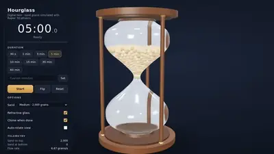
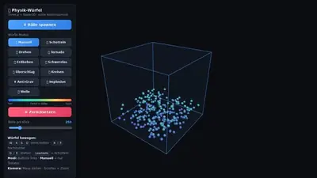

<a name="top"></a>

<p align="center"><a href="https://dbiewzjg1b9r0.cloudfront.net/index.html?license=yes"></a></p>

<h1 align="center">Terrarium</h1>

<p align="center"><b>최신 3D 게임, 인터랙티브 월드와 영상을 폭넓게 수집·소개하고, 완전한 오픈 소스 코드를 모아 체험·학습·재창작으로 이어 줍니다.</b></p>

<p align="center"><a href="https://dbiewzjg1b9r0.cloudfront.net/index.html?license=yes"></a>
<a href="https://huggingface.co/datasets/awesome-fable-5-2/terrarium-open-works"></a></p>

<p align="center"><sub><a href="../../README.md">English</a> · <a href="README.zh-CN.md">简体中文</a> · <a href="README.zh-TW.md">繁體中文</a> · <a href="README.ja.md">日本語</a> · <b>한국어</b> · <a href="README.es.md">Español</a> · <a href="README.pt-BR.md">Português</a> · <a href="README.fr.md">Français</a> · <a href="README.de.md">Deutsch</a> · <a href="README.ru.md">Русский</a></sub></p>

<p align="center"><a href="#trending">인기</a> · <a href="#latest">최신</a> · <a href="#contents">목차</a></p>

<!-- SHOWCASE:START -->
<p align="center"><b>443</b> 수록 항목 · <b>6</b> 카테고리 · <b>389</b> 공개 코드 · <b>321</b> 소스 아카이브<br><sub>목록 데이터: 2026-11-14</sub></p>

<a name="trending"></a>

## 인기

<p align="center"><a href="#showcase-links"><picture><source media="(prefers-reduced-motion: reduce)" srcset="../../assets/showcase.webp"></picture></a></p>

<p align="center"><sub>인기 데이터 갱신: 2026-11-15 19:45 UTC · 8시간마다 갱신 예정</sub></p>

<a name="showcase-links"></a>

<table><tr>
<td width="25%" valign="top"><b>01 · <a href="https://starrynightrider.com/">Starry Nightrider</a></b><br><sub><a href="https://x.com/i/status/2120284261089673376">X · 17,888 좋아요 · 499 댓글</a></sub></td>
<td width="25%" valign="top"><b>02 · <a href="https://claude.ai/artifact/BGY1SztrAYcJQHSsnHHGmp">Saltline</a></b><br><sub><a href="https://x.com/i/status/2119925633564463609">X · 14,810 좋아요 · 846 댓글</a></sub></td>
<td width="25%" valign="top"><b>03 · <a href="https://patch.gg/blendi/oil-paint">Oil paint</a></b><br><sub><a href="https://x.com/i/status/2120341251178594532">X · 7,968 좋아요 · 386 댓글</a></sub></td>
<td width="25%" valign="top"><b>04 · <a href="https://x.com/mattshumer_/status/2120282133503820150">Untitled open-world driving game</a></b><br><sub><a href="https://x.com/i/status/2120282133503820150">X · 7,515 좋아요 · 678 댓글</a></sub></td>
</tr></table>

<details><summary>출처와 정렬 기준</summary>

공개 좋아요와 Star 등 지지 수로 정렬하고, 동점일 때만 댓글과 공유 수를 사용합니다. 조회 수는 별도로 표시합니다. 플랫폼별 최고 지지 게시물을 사용하며 같은 출처는 한 번만 표시합니다. 출처 392개 · 플랫폼 4개 · 미수집 5개 <a href="../../data/showcase.json">데이터 보기</a> · <a href="../../scripts/SHOWCASE.md">집계 방식</a>

</details>

<!-- SHOWCASE:END -->

<a name="latest"></a>

## 최신

<table>
<tr>
<td width="25%" valign="top"><a href="https://topway-ai.github.io/harbor-blackout-gemini/"></a><br><b><a href="https://topway-ai.github.io/harbor-blackout-gemini/">HARBOR BLACKOUT (Gemini Edition)</a></b><br><sub><a href="https://github.com/topway-ai">Jack</a><br>MIT · <a href="https://github.com/topway-ai/harbor-blackout-gemini">코드</a> · <a href="https://huggingface.co/datasets/awesome-fable-5-2/terrarium-open-works/tree/main/games/harbor-blackout-gemini-edition">파일</a></sub></td>
<td width="25%" valign="top"><a href="https://huggingface.co/spaces/JohnVeds15/browser-3d-mini-games"></a><br><b><a href="https://huggingface.co/spaces/JohnVeds15/browser-3d-mini-games">3D Mini Games: play free in your browser</a></b><br><sub><a href="https://huggingface.co/JohnVeds15">John Vedovino</a><br>모음집 · 작품 25개<br>MIT · <a href="https://huggingface.co/spaces/JohnVeds15/browser-3d-mini-games">코드</a> · <a href="https://huggingface.co/datasets/awesome-fable-5-2/terrarium-open-works/tree/main/games/browser-3d-mini-games">파일</a></sub></td>
<td width="25%" valign="top"><a href="https://vaquitas-de-bloque.vercel.app"></a><br><b><a href="https://vaquitas-de-bloque.vercel.app">Vaquitas de Bloque</a></b><br><sub><a href="https://github.com/ivolivares">Iván Olivares Rojas</a><br>MIT · <a href="https://github.com/ivolivares/vaquitas-de-bloque">코드</a> · <a href="https://huggingface.co/datasets/awesome-fable-5-2/terrarium-open-works/tree/main/games/vaquitas-de-bloque">파일</a></sub></td>
<td width="25%" valign="top"><a href="https://basemazab.github.io/tuktuk/"></a><br><b><a href="https://basemazab.github.io/tuktuk/">توك توك: وسّع يا باشا</a></b><br><sub><a href="https://github.com/basemazab">basemazab</a><br>MIT · <a href="https://github.com/basemazab/tuktuk">코드</a> · <a href="https://huggingface.co/datasets/awesome-fable-5-2/terrarium-open-works/tree/main/games/tuktuk">파일</a></sub></td>
</tr>
<tr>
<td width="25%" valign="top"><a href="https://pelicanride.vercel.app"></a><br><b><a href="https://pelicanride.vercel.app">鹈鹕骑单车 · 海岸大冒险（Pelican Ride）</a></b><br><sub><a href="https://github.com/Xiobio">Xony</a><br>MIT · <a href="https://github.com/Xiobio/pelican-ride">코드</a> · <a href="https://huggingface.co/datasets/awesome-fable-5-2/terrarium-open-works/tree/main/games/pelican-ride">파일</a></sub></td>
<td width="25%" valign="top"><a href="https://github.com/bigerbigernerd/fiat-ludus"></a><br><b><a href="https://github.com/bigerbigernerd/fiat-ludus">Fiat Ludus · 言出法随</a></b><br><sub><a href="https://github.com/bigerbigernerd">bigerbigernerd</a><br>MIT · <a href="https://github.com/bigerbigernerd/fiat-ludus">코드</a> · <a href="https://huggingface.co/datasets/awesome-fable-5-2/terrarium-open-works/tree/main/tools/fiat-ludus">파일</a></sub></td>
<td width="25%" valign="top"><a href="https://cyancity.github.io/yolo-mini-fps/"></a><br><b><a href="https://cyancity.github.io/yolo-mini-fps/">零号码头 DOCK ZERO</a></b><br><sub><a href="https://github.com/cyancity">YOLO</a><br>MIT · <a href="https://github.com/cyancity/yolo-mini-fps">코드</a> · <a href="https://huggingface.co/datasets/awesome-fable-5-2/terrarium-open-works/tree/main/games/dock-zero">파일</a></sub></td>
<td width="25%" valign="top"><a href="https://arjunreddy91100.github.io/bumblebee-echo-garden/"></a><br><b><a href="https://arjunreddy91100.github.io/bumblebee-echo-garden/">Bumblebee — Echo Garden</a></b><br><sub><a href="https://github.com/arjunreddy91100">Arjun</a><br>MIT · <a href="https://github.com/arjunreddy91100/bumblebee-echo-garden">코드</a> · <a href="https://huggingface.co/datasets/awesome-fable-5-2/terrarium-open-works/tree/main/games/bumblebee-echo-garden">파일</a></sub></td>
</tr>
</table>

<a name="contents"></a>

<a name="categories"></a>

## 목차

대표 작품을 살펴보고, 장르로 이동하거나 전체 목록을 열어 보세요.

<table>

<tr>

<td width="33.33%"><b><a href="#contents-games">🎮 게임</a> · 228</b><br><sub>191 공개 코드 · 150 소스 아카이브</sub></td>

<td width="33.33%"><b><a href="#contents-scenes">🌍 월드와 장면</a> · 109</b><br><sub>101 공개 코드 · 74 소스 아카이브</sub></td>

<td width="33.33%"><b><a href="#contents-videos">🎬 영상</a> · 17</b><br><sub>8 공개 코드 · 8 소스 아카이브</sub></td>

</tr>

<tr>

<td width="33.33%"><b><a href="#contents-tools">🛠️ 도구</a> · 53</b><br><sub>53 공개 코드 · 53 소스 아카이브</sub></td>

<td width="33.33%"><b><a href="#contents-visualizations">📊 시각화</a> · 33</b><br><sub>33 공개 코드 · 33 소스 아카이브</sub></td>

<td width="33.33%"><b><a href="#contents-wallpapers">🖥️ 배경화면</a> · 3</b><br><sub>3 공개 코드 · 3 소스 아카이브</sub></td>

</tr>

</table>

<a name="contents-games"></a>

### 🎮 게임 · 228

슈팅, 레이싱, 비행, 퍼즐 등 다양한 게임.

<p><a href="../../games/README.ko.md#genre-shooter">슈팅</a> <b>46</b> · <a href="../../games/README.ko.md#genre-action-and-combat">액션·전투</a> <b>20</b> · <a href="../../games/README.ko.md#genre-platformer-and-runner">플랫포머·러너</a> <b>9</b> · <a href="../../games/README.ko.md#genre-racing-and-driving">레이싱·운전</a> <b>35</b> · <a href="../../games/README.ko.md#genre-flight">비행</a> <b>14</b> · <a href="../../games/README.ko.md#genre-sports">스포츠</a> <b>11</b> · <a href="../../games/README.ko.md#genre-adventure-and-exploration">모험·탐험</a> <b>27</b> · <a href="../../games/README.ko.md#genre-puzzle">퍼즐</a> <b>10</b> · <a href="../../games/README.ko.md#genre-strategy-and-management">전략·경영</a> <b>20</b> · <a href="../../games/README.ko.md#genre-sandbox">샌드박스</a> <b>6</b> · <a href="../../games/README.ko.md#genre-casual-and-arcade">캐주얼·아케이드</a> <b>19</b> · <a href="../../games/README.ko.md#genre-interactive-story">인터랙티브 스토리</a> <b>2</b> · <a href="../../games/README.ko.md#genre-simulation-and-visualization">시뮬레이션·시각화</a> <b>1</b> · <a href="../../games/README.ko.md#genre-other-games">기타 게임</a> <b>8</b></p>

<table>
<tr>
<td width="33.33%" valign="top"><a href="https://theredstapler.github.io/orb-shooter/"></a><br><b><a href="https://theredstapler.github.io/orb-shooter/">Orb Shooter FPS Demo (Vibe Coded)</a></b><br><sub><a href="https://github.com/theredstapler">Red Stapler</a><br>MIT · <a href="https://github.com/theredstapler/orb-shooter">코드</a> · <a href="https://huggingface.co/datasets/awesome-fable-5-2/terrarium-open-works/tree/main/games/orb-shooter-fps-demo-vibe-coded">파일</a></sub></td>
<td width="33.33%" valign="top"><a href="https://arjunreddy91100.github.io/bumblebee-echo-garden/"></a><br><b><a href="https://arjunreddy91100.github.io/bumblebee-echo-garden/">Bumblebee — Echo Garden</a></b><br><sub><a href="https://github.com/arjunreddy91100">Arjun</a><br>MIT · <a href="https://github.com/arjunreddy91100/bumblebee-echo-garden">코드</a> · <a href="https://huggingface.co/datasets/awesome-fable-5-2/terrarium-open-works/tree/main/games/bumblebee-echo-garden">파일</a></sub></td>
<td width="33.33%" valign="top"><a href="https://pelicanride.vercel.app"></a><br><b><a href="https://pelicanride.vercel.app">鹈鹕骑单车 · 海岸大冒险（Pelican Ride）</a></b><br><sub><a href="https://github.com/Xiobio">Xony</a><br>MIT · <a href="https://github.com/Xiobio/pelican-ride">코드</a> · <a href="https://huggingface.co/datasets/awesome-fable-5-2/terrarium-open-works/tree/main/games/pelican-ride">파일</a></sub></td>
</tr>
</table>

<p><b><a href="../../games/README.ko.md">전체 228개 보기 →</a></b> · <a href="#contents">↑ 목차</a></p>

<a name="contents-scenes"></a>

### 🌍 월드와 장면 · 109

상상 속 세계와 자연 풍경을 걷고 정교한 3D 사물을 탐색합니다.

<table>
<tr>
<td width="33.33%" valign="top"><a href="https://github.com/NineTigers/emberfall-forge-claude-fable-5.2"></a><br><b><a href="https://github.com/NineTigers/emberfall-forge-claude-fable-5.2">Emberfall Forge</a></b><br><sub><a href="https://github.com/NineTigers">NineTigers</a><br>MIT · <a href="https://github.com/NineTigers/emberfall-forge-claude-fable-5.2">코드</a> · <a href="https://huggingface.co/datasets/awesome-fable-5-2/terrarium-open-works/tree/main/scenes/emberfall-forge">파일</a></sub></td>
<td width="33.33%" valign="top"><a href="https://patch.gg/blendi/oil-paint"></a><br><b><a href="https://patch.gg/blendi/oil-paint">Oil paint</a></b><br><sub>Blendi Byl<br>MIT · <a href="https://git.patch.gg/blendi/oil-paint.git">코드</a> · <a href="https://huggingface.co/datasets/awesome-fable-5-2/terrarium-open-works/tree/main/scenes/oil-paint">파일</a></sub></td>
<td width="33.33%" valign="top"><a href="https://starknightt.github.io/tiny-planet/"></a><br><b><a href="https://starknightt.github.io/tiny-planet/">Tiny Planet</a></b><br><sub><a href="https://github.com/StarKnightt">Prasenjit</a><br>MIT · <a href="https://github.com/StarKnightt/tiny-planet">코드</a> · <a href="https://huggingface.co/datasets/awesome-fable-5-2/terrarium-open-works/tree/main/scenes/tiny-planet">파일</a></sub></td>
</tr>
</table>

<p><b><a href="../../scenes/README.ko.md">전체 109개 보기 →</a></b> · <a href="#contents">↑ 목차</a></p>

<a name="contents-videos"></a>

### 🎬 영상 · 17

코드로 렌더링한 단편 영상, 애니메이션과 시각 실험.

<table>
<tr>
<td width="33.33%" valign="top"><a href="https://x.com/fuoeba/status/2119906486017307074"></a><br><b><a href="https://x.com/fuoeba/status/2119906486017307074">Path-traced voxel creature</a></b><br><sub><a href="https://x.com/fuoeba">fuoeba</a><br>라이선스 미확인</sub></td>
<td width="33.33%" valign="top"><a href="https://x.com/rileybrown/status/2119902109709537708"></a><br><b><a href="https://x.com/rileybrown/status/2119902109709537708">The Edge</a></b><br><sub><a href="https://x.com/rileybrown">Riley Brown</a><br>라이선스 미확인</sub></td>
<td width="33.33%" valign="top"><a href="https://github.com/anstapnever/colossus"></a><br><b><a href="https://github.com/anstapnever/colossus">COLOSSUS · 巨像</a></b><br><sub><a href="https://github.com/anstapnever">anstap</a><br>MIT · <a href="https://github.com/anstapnever/colossus">코드</a> · <a href="https://huggingface.co/datasets/awesome-fable-5-2/terrarium-open-works/tree/main/videos/colossus">파일</a></sub></td>
</tr>
</table>

<p><b><a href="../../videos/README.ko.md">전체 17개 보기 →</a></b> · <a href="#contents">↑ 목차</a></p>

<a name="contents-tools"></a>

### 🛠️ 도구 · 53

제작, 감상, 시뮬레이션과 일상 작업에 유용한 3D 앱.

<table>
<tr>
<td width="33.33%" valign="top"><a href="https://github.com/harshitkhandelwal208/3D-engine-Visualiser"></a><br><b><a href="https://github.com/harshitkhandelwal208/3D-engine-Visualiser">MgCO₂ V6 Compression Engine — Interactive 3D Viewer</a></b><br><sub><a href="https://github.com/harshitkhandelwal208">Harshit Khandelwal</a><br>MIT · <a href="https://github.com/harshitkhandelwal208/3D-engine-Visualiser">코드</a> · <a href="https://huggingface.co/datasets/awesome-fable-5-2/terrarium-open-works/tree/main/tools/mgco2-v6-compression-engine-interactive-3d-viewer">파일</a></sub></td>
<td width="33.33%" valign="top"><a href="https://khanmjk.github.io/Fable51_Hourglass/"></a><br><b><a href="https://khanmjk.github.io/Fable51_Hourglass/">Hourglass · Digital Twin</a></b><br><sub><a href="https://github.com/khanmjk">khanmjk</a><br>MIT · <a href="https://github.com/khanmjk/Fable51_Hourglass">코드</a> · <a href="https://huggingface.co/datasets/awesome-fable-5-2/terrarium-open-works/tree/main/tools/hourglass-digital-twin">파일</a></sub></td>
<td width="33.33%" valign="top"><a href="https://github.com/bigerbigernerd/fiat-ludus"></a><br><b><a href="https://github.com/bigerbigernerd/fiat-ludus">Fiat Ludus · 言出法随</a></b><br><sub><a href="https://github.com/bigerbigernerd">bigerbigernerd</a><br>MIT · <a href="https://github.com/bigerbigernerd/fiat-ludus">코드</a> · <a href="https://huggingface.co/datasets/awesome-fable-5-2/terrarium-open-works/tree/main/tools/fiat-ludus">파일</a></sub></td>
</tr>
</table>

<p><b><a href="../../tools/README.ko.md">전체 53개 보기 →</a></b> · <a href="#contents">↑ 목차</a></p>

<a name="contents-visualizations"></a>

### 📊 시각화 · 33

인터랙티브 3D로 과학, 데이터와 아이디어를 탐구합니다.

<table>
<tr>
<td width="33.33%" valign="top"><a href="https://codexparadise.github.io/insects/"></a><br><b><a href="https://codexparadise.github.io/insects/">ENTOMIA // 3D MICRO-MORPHOLOGY</a></b><br><sub><a href="https://github.com/codeXparadise">Vishal Prajapati</a><br>MIT · <a href="https://github.com/codeXparadise/insects">코드</a> · <a href="https://huggingface.co/datasets/awesome-fable-5-2/terrarium-open-works/tree/main/visualizations/entomia-3d-micro-morphology">파일</a></sub></td>
<td width="33.33%" valign="top"><a href="https://atoomnetmarc.github.io/3D-Sorting-Algorithm-Visualizer/"></a><br><b><a href="https://atoomnetmarc.github.io/3D-Sorting-Algorithm-Visualizer/">3D Sorting Algorithm Visualizer</a></b><br><sub><a href="https://github.com/atoomnetmarc">Marc Ketel</a><br>Apache-2.0 · <a href="https://github.com/atoomnetmarc/3D-Sorting-Algorithm-Visualizer">코드</a> · <a href="https://huggingface.co/datasets/awesome-fable-5-2/terrarium-open-works/tree/main/visualizations/3d-sorting-algorithm-visualizer">파일</a></sub></td>
<td width="33.33%" valign="top"><a href="https://github.com/AralimNGA/cube-physics-simulation"></a><br><b><a href="https://github.com/AralimNGA/cube-physics-simulation">Cube Physics Simulation</a></b><br><sub><a href="https://github.com/AralimNGA">Aralim</a><br>MIT · <a href="https://github.com/AralimNGA/cube-physics-simulation">코드</a> · <a href="https://huggingface.co/datasets/awesome-fable-5-2/terrarium-open-works/tree/main/visualizations/cube-physics-simulation">파일</a></sub></td>
</tr>
</table>

<p><b><a href="../../visualizations/README.ko.md">전체 33개 보기 →</a></b> · <a href="#contents">↑ 목차</a></p>

<a name="contents-wallpapers"></a>

### 🖥️ 배경화면 · 3

화면 보호기, 데스크톱 친구와 분위기 있는 3D 화면.

<table>
<tr>
<td width="50%" valign="top"><a href="https://github.com/Sabrina-creater/claude-pet"></a><br><b><a href="https://github.com/Sabrina-creater/claude-pet">Claude Pet 🐾</a></b><br><sub><a href="https://github.com/Sabrina-creater">Sabrina-creater</a><br>MIT · <a href="https://github.com/Sabrina-creater/claude-pet">코드</a> · <a href="https://huggingface.co/datasets/awesome-fable-5-2/terrarium-open-works/tree/main/wallpapers/claude-pet">파일</a></sub></td>
<td width="50%" valign="top"><a href="https://github.com/yohhoy/vibe-screensaver"></a><br><b><a href="https://github.com/yohhoy/vibe-screensaver">vibe-screensaver — Web スクリーンセーバ集</a></b><br><sub><a href="https://github.com/yohhoy">yoh</a><br>모음집 · 작품 14개<br>MIT · <a href="https://github.com/yohhoy/vibe-screensaver">코드</a> · <a href="https://huggingface.co/datasets/awesome-fable-5-2/terrarium-open-works/tree/main/wallpapers/vibe-screensaver">파일</a></sub></td>
</tr>
</table>

<p><b><a href="../../wallpapers/README.ko.md">전체 3개 보기 →</a></b> · <a href="#contents">↑ 목차</a></p>

<p align="center"><a href="https://dbiewzjg1b9r0.cloudfront.net/index.html?license=yes">웹사이트에서 전체 보기 →</a> · <a href="https://huggingface.co/datasets/awesome-fable-5-2/terrarium-open-works">소스 코드 받기 →</a></p>

<details><summary>소스 코드·수집·기여 안내</summary>

GitHub, Hugging Face Spaces, itch.io, X, Bilibili 등에서 324명의 창작자가 만든 작품을 모았습니다. 이미지는 원본 게시물, 코드는 공개 소스, 파일은 HF 아카이브로 연결됩니다. 227개 작품은 브라우저에서 실행되며 346개는 Three.js를 사용합니다.

오픈 소스 라이선스가 있는 321개 항목을 카테고리와 작품별로 보관하며, 원본 라이선스 파일이 있으면 함께 제공합니다. 일괄 다운로드:

```sh
git clone https://huggingface.co/datasets/awesome-fable-5-2/terrarium-open-works
```

대용량 파일에는 Git LFS가 필요합니다. 각 작품의 라이선스를 따르세요. 페이지 본문은 CC0 1.0입니다. 목록과 인기 데이터의 갱신 시간은 별도로 표시합니다.

<a href="../../scripts/SHOWCASE.md">집계 방식</a> · <a href="https://github.com/AI-Terrarium/terrarium/issues/new">작품 추가·수정·삭제 제안 →</a>

</details>

---

<p align="center"><a href="README.ko.md"></a><br><sub><a href="README.ko.md">홈</a> · <a href="../../games/README.ko.md">게임</a> · <a href="../../scenes/README.ko.md">월드와 장면</a> · <a href="../../videos/README.ko.md">영상</a> · <a href="../../tools/README.ko.md">도구</a> · <a href="../../visualizations/README.ko.md">시각화</a> · <a href="../../wallpapers/README.ko.md">배경화면</a> · <a href="#top">맨 위로</a><br>목록 데이터: 2026-11-14</sub></p>
