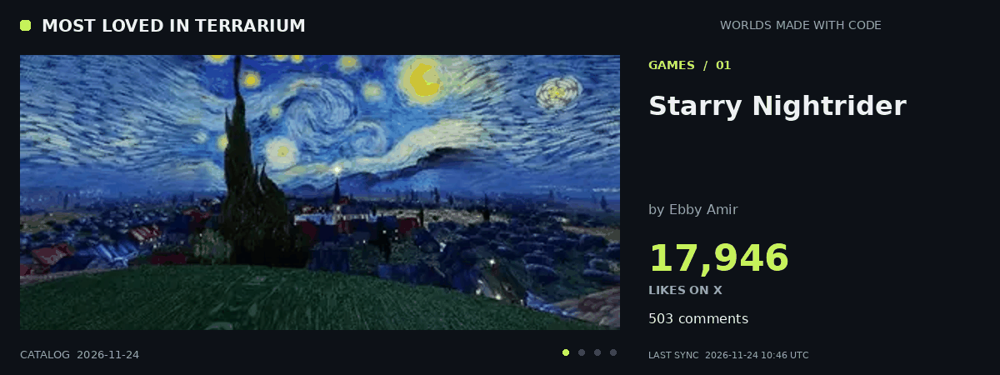
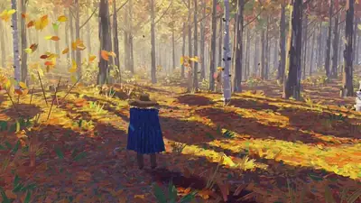

<a name="top"></a>

<p align="center"><a href="https://dbiewzjg1b9r0.cloudfront.net/index.html?license=yes"></a></p>

<h1 align="center">Terrarium</h1>

<p align="center"><b>Uma coleção abrangente dos mais recentes jogos 3D, mundos interativos e vídeos, com código aberto completo reunido para explorar, aprender e criar suas próprias versões.</b></p>

<p align="center"><a href="https://dbiewzjg1b9r0.cloudfront.net/index.html?license=yes"></a>
<a href="https://huggingface.co/datasets/awesome-fable-5-2/terrarium-open-works"></a></p>

<p align="center"><sub><a href="../../README.md">English</a> · <a href="README.zh-CN.md">简体中文</a> · <a href="README.zh-TW.md">繁體中文</a> · <a href="README.ja.md">日本語</a> · <a href="README.ko.md">한국어</a> · <a href="README.es.md">Español</a> · <b>Português</b> · <a href="README.fr.md">Français</a> · <a href="README.de.md">Deutsch</a> · <a href="README.ru.md">Русский</a></sub></p>

<p align="center"><a href="#trending">Em alta</a> · <a href="#latest">Novidades</a> · <a href="#contents">Índice</a></p>

<!-- SHOWCASE:START -->
<p align="center"><b>443</b> itens · <b>6</b> categorias · <b>389</b> com código público · <b>321</b> arquivos de código<br><sub>Dados do catálogo: 2026-11-14</sub></p>

<a name="trending"></a>

## Em alta

<p align="center"><a href="#showcase-links"><picture><source media="(prefers-reduced-motion: reduce)" srcset="../../assets/showcase.webp"></picture></a></p>

<p align="center"><sub>Atualizado: 2026-11-15 19:38 UTC · Atualização programada a cada 8 horas</sub></p>

<a name="showcase-links"></a>

<table><tr>
<td width="25%" valign="top"><b>01 · <a href="https://starrynightrider.com/">Starry Nightrider</a></b><br><sub><a href="https://x.com/i/status/2120284261089673376">X · Curtidas: 17.888 · Comentários: 499</a></sub></td>
<td width="25%" valign="top"><b>02 · <a href="https://claude.ai/artifact/BGY1SztrAYcJQHSsnHHGmp">Saltline</a></b><br><sub><a href="https://x.com/i/status/2119925633564463609">X · Curtidas: 14.810 · Comentários: 846</a></sub></td>
<td width="25%" valign="top"><b>03 · <a href="https://patch.gg/blendi/oil-paint">Oil paint</a></b><br><sub><a href="https://x.com/i/status/2120341251178594532">X · Curtidas: 7.968 · Comentários: 386</a></sub></td>
<td width="25%" valign="top"><b>04 · <a href="https://x.com/mattshumer_/status/2120282133503820150">Untitled open-world driving game</a></b><br><sub><a href="https://x.com/i/status/2120282133503820150">X · Curtidas: 7.515 · Comentários: 678</a></sub></td>
</tr></table>

<details><summary>Fontes e ordenação</summary>

Ordenação por apoios públicos, como curtidas e estrelas. Comentários e compartilhamentos desempatam; visualizações aparecem à parte. Usa-se a publicação mais apoiada de cada plataforma, sem repetir fontes. 392 fontes · 4 plataformas · 5 sem medição <a href="../../data/showcase.json">Ver dados</a> · <a href="../../scripts/SHOWCASE.md">Metodologia</a>

</details>

<!-- SHOWCASE:END -->

<a name="latest"></a>

## Novidades

<table>
<tr>
<td width="25%" valign="top"><a href="https://topway-ai.github.io/harbor-blackout-gemini/"></a><br><b><a href="https://topway-ai.github.io/harbor-blackout-gemini/">HARBOR BLACKOUT (Gemini Edition)</a></b><br><sub><a href="https://github.com/topway-ai">Jack</a><br>MIT · <a href="https://github.com/topway-ai/harbor-blackout-gemini">Código</a> · <a href="https://huggingface.co/datasets/awesome-fable-5-2/terrarium-open-works/tree/main/games/harbor-blackout-gemini-edition">Arquivos</a></sub></td>
<td width="25%" valign="top"><a href="https://huggingface.co/spaces/JohnVeds15/browser-3d-mini-games"></a><br><b><a href="https://huggingface.co/spaces/JohnVeds15/browser-3d-mini-games">3D Mini Games: play free in your browser</a></b><br><sub><a href="https://huggingface.co/JohnVeds15">John Vedovino</a><br>Coleção de 25 obras<br>MIT · <a href="https://huggingface.co/spaces/JohnVeds15/browser-3d-mini-games">Código</a> · <a href="https://huggingface.co/datasets/awesome-fable-5-2/terrarium-open-works/tree/main/games/browser-3d-mini-games">Arquivos</a></sub></td>
<td width="25%" valign="top"><a href="https://vaquitas-de-bloque.vercel.app"></a><br><b><a href="https://vaquitas-de-bloque.vercel.app">Vaquitas de Bloque</a></b><br><sub><a href="https://github.com/ivolivares">Iván Olivares Rojas</a><br>MIT · <a href="https://github.com/ivolivares/vaquitas-de-bloque">Código</a> · <a href="https://huggingface.co/datasets/awesome-fable-5-2/terrarium-open-works/tree/main/games/vaquitas-de-bloque">Arquivos</a></sub></td>
<td width="25%" valign="top"><a href="https://basemazab.github.io/tuktuk/"></a><br><b><a href="https://basemazab.github.io/tuktuk/">توك توك: وسّع يا باشا</a></b><br><sub><a href="https://github.com/basemazab">basemazab</a><br>MIT · <a href="https://github.com/basemazab/tuktuk">Código</a> · <a href="https://huggingface.co/datasets/awesome-fable-5-2/terrarium-open-works/tree/main/games/tuktuk">Arquivos</a></sub></td>
</tr>
<tr>
<td width="25%" valign="top"><a href="https://pelicanride.vercel.app"></a><br><b><a href="https://pelicanride.vercel.app">鹈鹕骑单车 · 海岸大冒险（Pelican Ride）</a></b><br><sub><a href="https://github.com/Xiobio">Xony</a><br>MIT · <a href="https://github.com/Xiobio/pelican-ride">Código</a> · <a href="https://huggingface.co/datasets/awesome-fable-5-2/terrarium-open-works/tree/main/games/pelican-ride">Arquivos</a></sub></td>
<td width="25%" valign="top"><a href="https://github.com/bigerbigernerd/fiat-ludus"></a><br><b><a href="https://github.com/bigerbigernerd/fiat-ludus">Fiat Ludus · 言出法随</a></b><br><sub><a href="https://github.com/bigerbigernerd">bigerbigernerd</a><br>MIT · <a href="https://github.com/bigerbigernerd/fiat-ludus">Código</a> · <a href="https://huggingface.co/datasets/awesome-fable-5-2/terrarium-open-works/tree/main/tools/fiat-ludus">Arquivos</a></sub></td>
<td width="25%" valign="top"><a href="https://cyancity.github.io/yolo-mini-fps/"></a><br><b><a href="https://cyancity.github.io/yolo-mini-fps/">零号码头 DOCK ZERO</a></b><br><sub><a href="https://github.com/cyancity">YOLO</a><br>MIT · <a href="https://github.com/cyancity/yolo-mini-fps">Código</a> · <a href="https://huggingface.co/datasets/awesome-fable-5-2/terrarium-open-works/tree/main/games/dock-zero">Arquivos</a></sub></td>
<td width="25%" valign="top"><a href="https://arjunreddy91100.github.io/bumblebee-echo-garden/"></a><br><b><a href="https://arjunreddy91100.github.io/bumblebee-echo-garden/">Bumblebee — Echo Garden</a></b><br><sub><a href="https://github.com/arjunreddy91100">Arjun</a><br>MIT · <a href="https://github.com/arjunreddy91100/bumblebee-echo-garden">Código</a> · <a href="https://huggingface.co/datasets/awesome-fable-5-2/terrarium-open-works/tree/main/games/bumblebee-echo-garden">Arquivos</a></sub></td>
</tr>
</table>

<a name="contents"></a>

<a name="categories"></a>

## Índice

Explore os destaques, escolha um gênero ou abra a coleção completa.

<table>

<tr>

<td width="33.33%"><b><a href="#contents-games">🎮 Jogos</a> · 228</b><br><sub>191 com código público · 150 arquivos de código</sub></td>

<td width="33.33%"><b><a href="#contents-scenes">🌍 Mundos e cenas</a> · 109</b><br><sub>101 com código público · 74 arquivos de código</sub></td>

<td width="33.33%"><b><a href="#contents-videos">🎬 Vídeos</a> · 17</b><br><sub>8 com código público · 8 arquivos de código</sub></td>

</tr>

<tr>

<td width="33.33%"><b><a href="#contents-tools">🛠️ Ferramentas</a> · 53</b><br><sub>53 com código público · 53 arquivos de código</sub></td>

<td width="33.33%"><b><a href="#contents-visualizations">📊 Visualizações</a> · 33</b><br><sub>33 com código público · 33 arquivos de código</sub></td>

<td width="33.33%"><b><a href="#contents-wallpapers">🖥️ Papéis de parede</a> · 3</b><br><sub>3 com código público · 3 arquivos de código</sub></td>

</tr>

</table>

<a name="contents-games"></a>

### 🎮 Jogos · 228

Tiro, corrida, voo, quebra-cabeças e muito mais.

<p><a href="../../games/README.pt-BR.md#genre-shooter">Tiro</a> <b>46</b> · <a href="../../games/README.pt-BR.md#genre-action-and-combat">Ação e combate</a> <b>20</b> · <a href="../../games/README.pt-BR.md#genre-platformer-and-runner">Plataforma e corrida infinita</a> <b>9</b> · <a href="../../games/README.pt-BR.md#genre-racing-and-driving">Corrida e direção</a> <b>35</b> · <a href="../../games/README.pt-BR.md#genre-flight">Voo</a> <b>14</b> · <a href="../../games/README.pt-BR.md#genre-sports">Esportes</a> <b>11</b> · <a href="../../games/README.pt-BR.md#genre-adventure-and-exploration">Aventura e exploração</a> <b>27</b> · <a href="../../games/README.pt-BR.md#genre-puzzle">Quebra-cabeças</a> <b>10</b> · <a href="../../games/README.pt-BR.md#genre-strategy-and-management">Estratégia e gestão</a> <b>20</b> · <a href="../../games/README.pt-BR.md#genre-sandbox">Sandbox</a> <b>6</b> · <a href="../../games/README.pt-BR.md#genre-casual-and-arcade">Casual e arcade</a> <b>19</b> · <a href="../../games/README.pt-BR.md#genre-interactive-story">História interativa</a> <b>2</b> · <a href="../../games/README.pt-BR.md#genre-simulation-and-visualization">Simulação e visualização</a> <b>1</b> · <a href="../../games/README.pt-BR.md#genre-other-games">Outros jogos</a> <b>8</b></p>

<table>
<tr>
<td width="33.33%" valign="top"><a href="https://theredstapler.github.io/orb-shooter/"></a><br><b><a href="https://theredstapler.github.io/orb-shooter/">Orb Shooter FPS Demo (Vibe Coded)</a></b><br><sub><a href="https://github.com/theredstapler">Red Stapler</a><br>MIT · <a href="https://github.com/theredstapler/orb-shooter">Código</a> · <a href="https://huggingface.co/datasets/awesome-fable-5-2/terrarium-open-works/tree/main/games/orb-shooter-fps-demo-vibe-coded">Arquivos</a></sub></td>
<td width="33.33%" valign="top"><a href="https://arjunreddy91100.github.io/bumblebee-echo-garden/"></a><br><b><a href="https://arjunreddy91100.github.io/bumblebee-echo-garden/">Bumblebee — Echo Garden</a></b><br><sub><a href="https://github.com/arjunreddy91100">Arjun</a><br>MIT · <a href="https://github.com/arjunreddy91100/bumblebee-echo-garden">Código</a> · <a href="https://huggingface.co/datasets/awesome-fable-5-2/terrarium-open-works/tree/main/games/bumblebee-echo-garden">Arquivos</a></sub></td>
<td width="33.33%" valign="top"><a href="https://pelicanride.vercel.app"></a><br><b><a href="https://pelicanride.vercel.app">鹈鹕骑单车 · 海岸大冒险（Pelican Ride）</a></b><br><sub><a href="https://github.com/Xiobio">Xony</a><br>MIT · <a href="https://github.com/Xiobio/pelican-ride">Código</a> · <a href="https://huggingface.co/datasets/awesome-fable-5-2/terrarium-open-works/tree/main/games/pelican-ride">Arquivos</a></sub></td>
</tr>
</table>

<p><b><a href="../../games/README.pt-BR.md">Ver todos os 228 itens →</a></b> · <a href="#contents">↑ Índice</a></p>

<a name="contents-scenes"></a>

### 🌍 Mundos e cenas · 109

Passeie por lugares imaginários, explore paisagens e examine objetos 3D.

<table>
<tr>
<td width="33.33%" valign="top"><a href="https://github.com/NineTigers/emberfall-forge-claude-fable-5.2"></a><br><b><a href="https://github.com/NineTigers/emberfall-forge-claude-fable-5.2">Emberfall Forge</a></b><br><sub><a href="https://github.com/NineTigers">NineTigers</a><br>MIT · <a href="https://github.com/NineTigers/emberfall-forge-claude-fable-5.2">Código</a> · <a href="https://huggingface.co/datasets/awesome-fable-5-2/terrarium-open-works/tree/main/scenes/emberfall-forge">Arquivos</a></sub></td>
<td width="33.33%" valign="top"><a href="https://patch.gg/blendi/oil-paint"></a><br><b><a href="https://patch.gg/blendi/oil-paint">Oil paint</a></b><br><sub>Blendi Byl<br>MIT · <a href="https://git.patch.gg/blendi/oil-paint.git">Código</a> · <a href="https://huggingface.co/datasets/awesome-fable-5-2/terrarium-open-works/tree/main/scenes/oil-paint">Arquivos</a></sub></td>
<td width="33.33%" valign="top"><a href="https://starknightt.github.io/tiny-planet/"></a><br><b><a href="https://starknightt.github.io/tiny-planet/">Tiny Planet</a></b><br><sub><a href="https://github.com/StarKnightt">Prasenjit</a><br>MIT · <a href="https://github.com/StarKnightt/tiny-planet">Código</a> · <a href="https://huggingface.co/datasets/awesome-fable-5-2/terrarium-open-works/tree/main/scenes/tiny-planet">Arquivos</a></sub></td>
</tr>
</table>

<p><b><a href="../../scenes/README.pt-BR.md">Ver todos os 109 itens →</a></b> · <a href="#contents">↑ Índice</a></p>

<a name="contents-videos"></a>

### 🎬 Vídeos · 17

Curtas, animações e experimentos visuais renderizados com código.

<table>
<tr>
<td width="33.33%" valign="top"><a href="https://x.com/fuoeba/status/2119906486017307074"></a><br><b><a href="https://x.com/fuoeba/status/2119906486017307074">Path-traced voxel creature</a></b><br><sub><a href="https://x.com/fuoeba">fuoeba</a><br>Licença desconhecida</sub></td>
<td width="33.33%" valign="top"><a href="https://x.com/rileybrown/status/2119902109709537708"></a><br><b><a href="https://x.com/rileybrown/status/2119902109709537708">The Edge</a></b><br><sub><a href="https://x.com/rileybrown">Riley Brown</a><br>Licença desconhecida</sub></td>
<td width="33.33%" valign="top"><a href="https://github.com/anstapnever/colossus"></a><br><b><a href="https://github.com/anstapnever/colossus">COLOSSUS · 巨像</a></b><br><sub><a href="https://github.com/anstapnever">anstap</a><br>MIT · <a href="https://github.com/anstapnever/colossus">Código</a> · <a href="https://huggingface.co/datasets/awesome-fable-5-2/terrarium-open-works/tree/main/videos/colossus">Arquivos</a></sub></td>
</tr>
</table>

<p><b><a href="../../videos/README.pt-BR.md">Ver todos os 17 itens →</a></b> · <a href="#contents">↑ Índice</a></p>

<a name="contents-tools"></a>

### 🛠️ Ferramentas · 53

Aplicativos 3D para criar, explorar, simular e realizar tarefas.

<table>
<tr>
<td width="33.33%" valign="top"><a href="https://github.com/harshitkhandelwal208/3D-engine-Visualiser"></a><br><b><a href="https://github.com/harshitkhandelwal208/3D-engine-Visualiser">MgCO₂ V6 Compression Engine — Interactive 3D Viewer</a></b><br><sub><a href="https://github.com/harshitkhandelwal208">Harshit Khandelwal</a><br>MIT · <a href="https://github.com/harshitkhandelwal208/3D-engine-Visualiser">Código</a> · <a href="https://huggingface.co/datasets/awesome-fable-5-2/terrarium-open-works/tree/main/tools/mgco2-v6-compression-engine-interactive-3d-viewer">Arquivos</a></sub></td>
<td width="33.33%" valign="top"><a href="https://khanmjk.github.io/Fable51_Hourglass/"></a><br><b><a href="https://khanmjk.github.io/Fable51_Hourglass/">Hourglass · Digital Twin</a></b><br><sub><a href="https://github.com/khanmjk">khanmjk</a><br>MIT · <a href="https://github.com/khanmjk/Fable51_Hourglass">Código</a> · <a href="https://huggingface.co/datasets/awesome-fable-5-2/terrarium-open-works/tree/main/tools/hourglass-digital-twin">Arquivos</a></sub></td>
<td width="33.33%" valign="top"><a href="https://github.com/bigerbigernerd/fiat-ludus"></a><br><b><a href="https://github.com/bigerbigernerd/fiat-ludus">Fiat Ludus · 言出法随</a></b><br><sub><a href="https://github.com/bigerbigernerd">bigerbigernerd</a><br>MIT · <a href="https://github.com/bigerbigernerd/fiat-ludus">Código</a> · <a href="https://huggingface.co/datasets/awesome-fable-5-2/terrarium-open-works/tree/main/tools/fiat-ludus">Arquivos</a></sub></td>
</tr>
</table>

<p><b><a href="../../tools/README.pt-BR.md">Ver todos os 53 itens →</a></b> · <a href="#contents">↑ Índice</a></p>

<a name="contents-visualizations"></a>

### 📊 Visualizações · 33

Explore ciência, dados e ideias por meio de 3D interativo.

<table>
<tr>
<td width="33.33%" valign="top"><a href="https://codexparadise.github.io/insects/"></a><br><b><a href="https://codexparadise.github.io/insects/">ENTOMIA // 3D MICRO-MORPHOLOGY</a></b><br><sub><a href="https://github.com/codeXparadise">Vishal Prajapati</a><br>MIT · <a href="https://github.com/codeXparadise/insects">Código</a> · <a href="https://huggingface.co/datasets/awesome-fable-5-2/terrarium-open-works/tree/main/visualizations/entomia-3d-micro-morphology">Arquivos</a></sub></td>
<td width="33.33%" valign="top"><a href="https://atoomnetmarc.github.io/3D-Sorting-Algorithm-Visualizer/"></a><br><b><a href="https://atoomnetmarc.github.io/3D-Sorting-Algorithm-Visualizer/">3D Sorting Algorithm Visualizer</a></b><br><sub><a href="https://github.com/atoomnetmarc">Marc Ketel</a><br>Apache-2.0 · <a href="https://github.com/atoomnetmarc/3D-Sorting-Algorithm-Visualizer">Código</a> · <a href="https://huggingface.co/datasets/awesome-fable-5-2/terrarium-open-works/tree/main/visualizations/3d-sorting-algorithm-visualizer">Arquivos</a></sub></td>
<td width="33.33%" valign="top"><a href="https://github.com/AralimNGA/cube-physics-simulation"></a><br><b><a href="https://github.com/AralimNGA/cube-physics-simulation">Cube Physics Simulation</a></b><br><sub><a href="https://github.com/AralimNGA">Aralim</a><br>MIT · <a href="https://github.com/AralimNGA/cube-physics-simulation">Código</a> · <a href="https://huggingface.co/datasets/awesome-fable-5-2/terrarium-open-works/tree/main/visualizations/cube-physics-simulation">Arquivos</a></sub></td>
</tr>
</table>

<p><b><a href="../../visualizations/README.pt-BR.md">Ver todos os 33 itens →</a></b> · <a href="#contents">↑ Índice</a></p>

<a name="contents-wallpapers"></a>

### 🖥️ Papéis de parede · 3

Protetores de tela, companheiros de desktop e ambientes 3D.

<table>
<tr>
<td width="50%" valign="top"><a href="https://github.com/Sabrina-creater/claude-pet"></a><br><b><a href="https://github.com/Sabrina-creater/claude-pet">Claude Pet 🐾</a></b><br><sub><a href="https://github.com/Sabrina-creater">Sabrina-creater</a><br>MIT · <a href="https://github.com/Sabrina-creater/claude-pet">Código</a> · <a href="https://huggingface.co/datasets/awesome-fable-5-2/terrarium-open-works/tree/main/wallpapers/claude-pet">Arquivos</a></sub></td>
<td width="50%" valign="top"><a href="https://github.com/yohhoy/vibe-screensaver"></a><br><b><a href="https://github.com/yohhoy/vibe-screensaver">vibe-screensaver — Web スクリーンセーバ集</a></b><br><sub><a href="https://github.com/yohhoy">yoh</a><br>Coleção de 14 obras<br>MIT · <a href="https://github.com/yohhoy/vibe-screensaver">Código</a> · <a href="https://huggingface.co/datasets/awesome-fable-5-2/terrarium-open-works/tree/main/wallpapers/vibe-screensaver">Arquivos</a></sub></td>
</tr>
</table>

<p><b><a href="../../wallpapers/README.pt-BR.md">Ver todos os 3 itens →</a></b> · <a href="#contents">↑ Índice</a></p>

<p align="center"><a href="https://dbiewzjg1b9r0.cloudfront.net/index.html?license=yes">Explorar o site completo →</a> · <a href="https://huggingface.co/datasets/awesome-fable-5-2/terrarium-open-works">Obter os arquivos de código →</a></p>

<details><summary>Código, curadoria e contribuições</summary>

Obras de 324 criadores, vindas de GitHub, Hugging Face Spaces, itch.io, X, Bilibili e outras plataformas. As imagens abrem a publicação original; Código leva ao código público e Arquivos ao arquivo no HF. 227 obras funcionam no navegador e 346 usam Three.js.

Há 321 itens com licença de código aberto arquivados por categoria e obra, com as licenças originais quando disponíveis. Download em lote:

```sh
git clone https://huggingface.co/datasets/awesome-fable-5-2/terrarium-open-works
```

Arquivos grandes exigem Git LFS. Cada obra mantém sua própria licença; o texto destas páginas é CC0 1.0. As datas do catálogo e da popularidade são exibidas separadamente.

<a href="../../scripts/SHOWCASE.md">Metodologia</a> · <a href="https://github.com/AI-Terrarium/terrarium/issues/new">Sugerir uma obra, correção ou remoção →</a>

</details>

---

<p align="center"><a href="README.pt-BR.md"></a><br><sub><a href="README.pt-BR.md">Início</a> · <a href="../../games/README.pt-BR.md">Jogos</a> · <a href="../../scenes/README.pt-BR.md">Mundos e cenas</a> · <a href="../../videos/README.pt-BR.md">Vídeos</a> · <a href="../../tools/README.pt-BR.md">Ferramentas</a> · <a href="../../visualizations/README.pt-BR.md">Visualizações</a> · <a href="../../wallpapers/README.pt-BR.md">Papéis de parede</a> · <a href="#top">Voltar ao topo</a><br>Dados do catálogo: 2026-11-14</sub></p>
