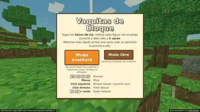

<a name="top"></a>

<p align="center"><a href="https://dbiewzjg1b9r0.cloudfront.net/index.html?license=yes"></a></p>

<h1 align="center">Terrarium</h1>

<p align="center"><b>Обширная коллекция новых 3D-игр, интерактивных миров и видео с обновляемой каждые 8 часов подборкой популярных работ и полным открытым исходным кодом для знакомства, обучения и создания собственных версий.</b></p>

<p align="center"><a href="https://dbiewzjg1b9r0.cloudfront.net/index.html?license=yes"></a>
<a href="https://huggingface.co/datasets/awesome-fable-5-2/terrarium-open-works"></a></p>

<p align="center"><sub><a href="../../README.md">English</a> · <a href="README.zh-CN.md">简体中文</a> · <a href="README.zh-TW.md">繁體中文</a> · <a href="README.ja.md">日本語</a> · <a href="README.ko.md">한국어</a> · <a href="README.es.md">Español</a> · <a href="README.pt-BR.md">Português</a> · <a href="README.fr.md">Français</a> · <a href="README.de.md">Deutsch</a> · <b>Русский</b></sub></p>

<p align="center"><a href="#trending">Популярное</a> · <a href="#latest">Новое</a> · <a href="#contents">Содержание</a></p>

<!-- SHOWCASE:START -->
<p align="center"><b>443</b> записей · <b>6</b> категорий · <b>389</b> с открытым кодом · <b>321</b> архивов кода<br><sub>Данные каталога: 2026-11-14</sub></p>

<a name="trending"></a>

## Популярное

<p align="center"><a href="#showcase-links"><picture><source media="(prefers-reduced-motion: reduce)" srcset="../../assets/showcase.webp"></picture></a></p>

<p align="center"><sub>Обновлено: 2026-11-15 19:51 UTC · Обновление запланировано каждые 8 часов</sub></p>

<a name="showcase-links"></a>

<table><tr>
<td width="25%" valign="top"><b>01 · <a href="https://starrynightrider.com/">Starry Nightrider</a></b><br><sub><a href="https://x.com/i/status/2120284261089673376">X · Нравится: 17 888 · Комментарии: 499</a></sub></td>
<td width="25%" valign="top"><b>02 · <a href="https://claude.ai/artifact/BGY1SztrAYcJQHSsnHHGmp">Saltline</a></b><br><sub><a href="https://x.com/i/status/2119925633564463609">X · Нравится: 14 810 · Комментарии: 846</a></sub></td>
<td width="25%" valign="top"><b>03 · <a href="https://patch.gg/blendi/oil-paint">Oil paint</a></b><br><sub><a href="https://x.com/i/status/2120341251178594532">X · Нравится: 7 968 · Комментарии: 386</a></sub></td>
<td width="25%" valign="top"><b>04 · <a href="https://x.com/mattshumer_/status/2120282133503820150">Untitled open-world driving game</a></b><br><sub><a href="https://x.com/i/status/2120282133503820150">X · Нравится: 7 515 · Комментарии: 678</a></sub></td>
</tr></table>

<details><summary>Источники и порядок</summary>

Сортировка по открытым отметкам «Нравится», звёздам и другим откликам поддержки. Комментарии и репосты используются при равенстве, просмотры показаны отдельно. Учитывается самая поддержанная публикация с каждой платформы; источники не дублируются. Источники: 392 · платформы: 4 · без данных: 5 <a href="../../data/showcase.json">Посмотреть данные</a> · <a href="../../scripts/SHOWCASE.md">Методика</a>

</details>

<!-- SHOWCASE:END -->

<a name="latest"></a>

## Новое

<table>
<tr>
<td width="25%" valign="top"><a href="https://topway-ai.github.io/harbor-blackout-gemini/"></a><br><b><a href="https://topway-ai.github.io/harbor-blackout-gemini/">HARBOR BLACKOUT (Gemini Edition)</a></b><br><sub><a href="https://github.com/topway-ai">Jack</a><br>MIT · <a href="https://github.com/topway-ai/harbor-blackout-gemini">Код</a> · <a href="https://huggingface.co/datasets/awesome-fable-5-2/terrarium-open-works/tree/main/games/harbor-blackout-gemini-edition">Файлы</a></sub></td>
<td width="25%" valign="top"><a href="https://huggingface.co/spaces/JohnVeds15/browser-3d-mini-games"></a><br><b><a href="https://huggingface.co/spaces/JohnVeds15/browser-3d-mini-games">3D Mini Games: play free in your browser</a></b><br><sub><a href="https://huggingface.co/JohnVeds15">John Vedovino</a><br>Коллекция: 25 работ<br>MIT · <a href="https://huggingface.co/spaces/JohnVeds15/browser-3d-mini-games">Код</a> · <a href="https://huggingface.co/datasets/awesome-fable-5-2/terrarium-open-works/tree/main/games/browser-3d-mini-games">Файлы</a></sub></td>
<td width="25%" valign="top"><a href="https://vaquitas-de-bloque.vercel.app"></a><br><b><a href="https://vaquitas-de-bloque.vercel.app">Vaquitas de Bloque</a></b><br><sub><a href="https://github.com/ivolivares">Iván Olivares Rojas</a><br>MIT · <a href="https://github.com/ivolivares/vaquitas-de-bloque">Код</a> · <a href="https://huggingface.co/datasets/awesome-fable-5-2/terrarium-open-works/tree/main/games/vaquitas-de-bloque">Файлы</a></sub></td>
<td width="25%" valign="top"><a href="https://basemazab.github.io/tuktuk/"></a><br><b><a href="https://basemazab.github.io/tuktuk/">توك توك: وسّع يا باشا</a></b><br><sub><a href="https://github.com/basemazab">basemazab</a><br>MIT · <a href="https://github.com/basemazab/tuktuk">Код</a> · <a href="https://huggingface.co/datasets/awesome-fable-5-2/terrarium-open-works/tree/main/games/tuktuk">Файлы</a></sub></td>
</tr>
<tr>
<td width="25%" valign="top"><a href="https://pelicanride.vercel.app"></a><br><b><a href="https://pelicanride.vercel.app">鹈鹕骑单车 · 海岸大冒险（Pelican Ride）</a></b><br><sub><a href="https://github.com/Xiobio">Xony</a><br>MIT · <a href="https://github.com/Xiobio/pelican-ride">Код</a> · <a href="https://huggingface.co/datasets/awesome-fable-5-2/terrarium-open-works/tree/main/games/pelican-ride">Файлы</a></sub></td>
<td width="25%" valign="top"><a href="https://github.com/bigerbigernerd/fiat-ludus"></a><br><b><a href="https://github.com/bigerbigernerd/fiat-ludus">Fiat Ludus · 言出法随</a></b><br><sub><a href="https://github.com/bigerbigernerd">bigerbigernerd</a><br>MIT · <a href="https://github.com/bigerbigernerd/fiat-ludus">Код</a> · <a href="https://huggingface.co/datasets/awesome-fable-5-2/terrarium-open-works/tree/main/tools/fiat-ludus">Файлы</a></sub></td>
<td width="25%" valign="top"><a href="https://cyancity.github.io/yolo-mini-fps/"></a><br><b><a href="https://cyancity.github.io/yolo-mini-fps/">零号码头 DOCK ZERO</a></b><br><sub><a href="https://github.com/cyancity">YOLO</a><br>MIT · <a href="https://github.com/cyancity/yolo-mini-fps">Код</a> · <a href="https://huggingface.co/datasets/awesome-fable-5-2/terrarium-open-works/tree/main/games/dock-zero">Файлы</a></sub></td>
<td width="25%" valign="top"><a href="https://arjunreddy91100.github.io/bumblebee-echo-garden/"></a><br><b><a href="https://arjunreddy91100.github.io/bumblebee-echo-garden/">Bumblebee — Echo Garden</a></b><br><sub><a href="https://github.com/arjunreddy91100">Arjun</a><br>MIT · <a href="https://github.com/arjunreddy91100/bumblebee-echo-garden">Код</a> · <a href="https://huggingface.co/datasets/awesome-fable-5-2/terrarium-open-works/tree/main/games/bumblebee-echo-garden">Файлы</a></sub></td>
</tr>
</table>

<a name="contents"></a>

<a name="categories"></a>

## Содержание

Посмотрите избранные работы, выберите жанр или откройте полную коллекцию.

<table>

<tr>

<td width="33.33%"><b><a href="#contents-games">🎮 Игры</a> · 228</b><br><sub>191 с открытым кодом · 150 архивов кода</sub></td>

<td width="33.33%"><b><a href="#contents-scenes">🌍 Миры и сцены</a> · 109</b><br><sub>101 с открытым кодом · 74 архивов кода</sub></td>

<td width="33.33%"><b><a href="#contents-videos">🎬 Видео</a> · 17</b><br><sub>8 с открытым кодом · 8 архивов кода</sub></td>

</tr>

<tr>

<td width="33.33%"><b><a href="#contents-tools">🛠️ Инструменты</a> · 53</b><br><sub>53 с открытым кодом · 53 архивов кода</sub></td>

<td width="33.33%"><b><a href="#contents-visualizations">📊 Визуализации</a> · 33</b><br><sub>33 с открытым кодом · 33 архивов кода</sub></td>

<td width="33.33%"><b><a href="#contents-wallpapers">🖥️ Обои</a> · 3</b><br><sub>3 с открытым кодом · 3 архивов кода</sub></td>

</tr>

</table>

<a name="contents-games"></a>

### 🎮 Игры · 228

Шутеры, гонки, полёты, головоломки и многое другое.

<p><a href="../../games/README.ru.md#genre-shooter">Шутеры</a> <b>46</b> · <a href="../../games/README.ru.md#genre-action-and-combat">Экшен и сражения</a> <b>20</b> · <a href="../../games/README.ru.md#genre-platformer-and-runner">Платформеры и раннеры</a> <b>9</b> · <a href="../../games/README.ru.md#genre-racing-and-driving">Гонки и вождение</a> <b>35</b> · <a href="../../games/README.ru.md#genre-flight">Полёты</a> <b>14</b> · <a href="../../games/README.ru.md#genre-sports">Спорт</a> <b>11</b> · <a href="../../games/README.ru.md#genre-adventure-and-exploration">Приключения и исследование</a> <b>27</b> · <a href="../../games/README.ru.md#genre-puzzle">Головоломки</a> <b>10</b> · <a href="../../games/README.ru.md#genre-strategy-and-management">Стратегии и управление</a> <b>20</b> · <a href="../../games/README.ru.md#genre-sandbox">Песочницы</a> <b>6</b> · <a href="../../games/README.ru.md#genre-casual-and-arcade">Казуальные и аркадные игры</a> <b>19</b> · <a href="../../games/README.ru.md#genre-interactive-story">Интерактивные истории</a> <b>2</b> · <a href="../../games/README.ru.md#genre-simulation-and-visualization">Моделирование и визуализация</a> <b>1</b> · <a href="../../games/README.ru.md#genre-other-games">Другие игры</a> <b>8</b></p>

<table>
<tr>
<td width="33.33%" valign="top"><a href="https://theredstapler.github.io/orb-shooter/"></a><br><b><a href="https://theredstapler.github.io/orb-shooter/">Orb Shooter FPS Demo (Vibe Coded)</a></b><br><sub><a href="https://github.com/theredstapler">Red Stapler</a><br>MIT · <a href="https://github.com/theredstapler/orb-shooter">Код</a> · <a href="https://huggingface.co/datasets/awesome-fable-5-2/terrarium-open-works/tree/main/games/orb-shooter-fps-demo-vibe-coded">Файлы</a></sub></td>
<td width="33.33%" valign="top"><a href="https://arjunreddy91100.github.io/bumblebee-echo-garden/"></a><br><b><a href="https://arjunreddy91100.github.io/bumblebee-echo-garden/">Bumblebee — Echo Garden</a></b><br><sub><a href="https://github.com/arjunreddy91100">Arjun</a><br>MIT · <a href="https://github.com/arjunreddy91100/bumblebee-echo-garden">Код</a> · <a href="https://huggingface.co/datasets/awesome-fable-5-2/terrarium-open-works/tree/main/games/bumblebee-echo-garden">Файлы</a></sub></td>
<td width="33.33%" valign="top"><a href="https://pelicanride.vercel.app"></a><br><b><a href="https://pelicanride.vercel.app">鹈鹕骑单车 · 海岸大冒险（Pelican Ride）</a></b><br><sub><a href="https://github.com/Xiobio">Xony</a><br>MIT · <a href="https://github.com/Xiobio/pelican-ride">Код</a> · <a href="https://huggingface.co/datasets/awesome-fable-5-2/terrarium-open-works/tree/main/games/pelican-ride">Файлы</a></sub></td>
</tr>
</table>

<p><b><a href="../../games/README.ru.md">Все записи: 228 →</a></b> · <a href="#contents">↑ Содержание</a></p>

<a name="contents-scenes"></a>

### 🌍 Миры и сцены · 109

Исследуйте вымышленные места, природные пейзажи и подробные 3D-объекты.

<table>
<tr>
<td width="33.33%" valign="top"><a href="https://github.com/NineTigers/emberfall-forge-claude-fable-5.2"></a><br><b><a href="https://github.com/NineTigers/emberfall-forge-claude-fable-5.2">Emberfall Forge</a></b><br><sub><a href="https://github.com/NineTigers">NineTigers</a><br>MIT · <a href="https://github.com/NineTigers/emberfall-forge-claude-fable-5.2">Код</a> · <a href="https://huggingface.co/datasets/awesome-fable-5-2/terrarium-open-works/tree/main/scenes/emberfall-forge">Файлы</a></sub></td>
<td width="33.33%" valign="top"><a href="https://patch.gg/blendi/oil-paint"></a><br><b><a href="https://patch.gg/blendi/oil-paint">Oil paint</a></b><br><sub>Blendi Byl<br>MIT · <a href="https://git.patch.gg/blendi/oil-paint.git">Код</a> · <a href="https://huggingface.co/datasets/awesome-fable-5-2/terrarium-open-works/tree/main/scenes/oil-paint">Файлы</a></sub></td>
<td width="33.33%" valign="top"><a href="https://starknightt.github.io/tiny-planet/"></a><br><b><a href="https://starknightt.github.io/tiny-planet/">Tiny Planet</a></b><br><sub><a href="https://github.com/StarKnightt">Prasenjit</a><br>MIT · <a href="https://github.com/StarKnightt/tiny-planet">Код</a> · <a href="https://huggingface.co/datasets/awesome-fable-5-2/terrarium-open-works/tree/main/scenes/tiny-planet">Файлы</a></sub></td>
</tr>
</table>

<p><b><a href="../../scenes/README.ru.md">Все записи: 109 →</a></b> · <a href="#contents">↑ Содержание</a></p>

<a name="contents-videos"></a>

### 🎬 Видео · 17

Короткие фильмы, анимация и визуальные эксперименты, созданные кодом.

<table>
<tr>
<td width="33.33%" valign="top"><a href="https://x.com/fuoeba/status/2119906486017307074"></a><br><b><a href="https://x.com/fuoeba/status/2119906486017307074">Path-traced voxel creature</a></b><br><sub><a href="https://x.com/fuoeba">fuoeba</a><br>Лицензия неизвестна</sub></td>
<td width="33.33%" valign="top"><a href="https://x.com/rileybrown/status/2119902109709537708"></a><br><b><a href="https://x.com/rileybrown/status/2119902109709537708">The Edge</a></b><br><sub><a href="https://x.com/rileybrown">Riley Brown</a><br>Лицензия неизвестна</sub></td>
<td width="33.33%" valign="top"><a href="https://github.com/anstapnever/colossus"></a><br><b><a href="https://github.com/anstapnever/colossus">COLOSSUS · 巨像</a></b><br><sub><a href="https://github.com/anstapnever">anstap</a><br>MIT · <a href="https://github.com/anstapnever/colossus">Код</a> · <a href="https://huggingface.co/datasets/awesome-fable-5-2/terrarium-open-works/tree/main/videos/colossus">Файлы</a></sub></td>
</tr>
</table>

<p><b><a href="../../videos/README.ru.md">Все записи: 17 →</a></b> · <a href="#contents">↑ Содержание</a></p>

<a name="contents-tools"></a>

### 🛠️ Инструменты · 53

3D-приложения для творчества, просмотра, моделирования и повседневных задач.

<table>
<tr>
<td width="33.33%" valign="top"><a href="https://github.com/harshitkhandelwal208/3D-engine-Visualiser"></a><br><b><a href="https://github.com/harshitkhandelwal208/3D-engine-Visualiser">MgCO₂ V6 Compression Engine — Interactive 3D Viewer</a></b><br><sub><a href="https://github.com/harshitkhandelwal208">Harshit Khandelwal</a><br>MIT · <a href="https://github.com/harshitkhandelwal208/3D-engine-Visualiser">Код</a> · <a href="https://huggingface.co/datasets/awesome-fable-5-2/terrarium-open-works/tree/main/tools/mgco2-v6-compression-engine-interactive-3d-viewer">Файлы</a></sub></td>
<td width="33.33%" valign="top"><a href="https://khanmjk.github.io/Fable51_Hourglass/"></a><br><b><a href="https://khanmjk.github.io/Fable51_Hourglass/">Hourglass · Digital Twin</a></b><br><sub><a href="https://github.com/khanmjk">khanmjk</a><br>MIT · <a href="https://github.com/khanmjk/Fable51_Hourglass">Код</a> · <a href="https://huggingface.co/datasets/awesome-fable-5-2/terrarium-open-works/tree/main/tools/hourglass-digital-twin">Файлы</a></sub></td>
<td width="33.33%" valign="top"><a href="https://github.com/bigerbigernerd/fiat-ludus"></a><br><b><a href="https://github.com/bigerbigernerd/fiat-ludus">Fiat Ludus · 言出法随</a></b><br><sub><a href="https://github.com/bigerbigernerd">bigerbigernerd</a><br>MIT · <a href="https://github.com/bigerbigernerd/fiat-ludus">Код</a> · <a href="https://huggingface.co/datasets/awesome-fable-5-2/terrarium-open-works/tree/main/tools/fiat-ludus">Файлы</a></sub></td>
</tr>
</table>

<p><b><a href="../../tools/README.ru.md">Все записи: 53 →</a></b> · <a href="#contents">↑ Содержание</a></p>

<a name="contents-visualizations"></a>

### 📊 Визуализации · 33

Изучайте науку, данные и идеи с помощью интерактивного 3D.

<table>
<tr>
<td width="33.33%" valign="top"><a href="https://codexparadise.github.io/insects/"></a><br><b><a href="https://codexparadise.github.io/insects/">ENTOMIA // 3D MICRO-MORPHOLOGY</a></b><br><sub><a href="https://github.com/codeXparadise">Vishal Prajapati</a><br>MIT · <a href="https://github.com/codeXparadise/insects">Код</a> · <a href="https://huggingface.co/datasets/awesome-fable-5-2/terrarium-open-works/tree/main/visualizations/entomia-3d-micro-morphology">Файлы</a></sub></td>
<td width="33.33%" valign="top"><a href="https://atoomnetmarc.github.io/3D-Sorting-Algorithm-Visualizer/"></a><br><b><a href="https://atoomnetmarc.github.io/3D-Sorting-Algorithm-Visualizer/">3D Sorting Algorithm Visualizer</a></b><br><sub><a href="https://github.com/atoomnetmarc">Marc Ketel</a><br>Apache-2.0 · <a href="https://github.com/atoomnetmarc/3D-Sorting-Algorithm-Visualizer">Код</a> · <a href="https://huggingface.co/datasets/awesome-fable-5-2/terrarium-open-works/tree/main/visualizations/3d-sorting-algorithm-visualizer">Файлы</a></sub></td>
<td width="33.33%" valign="top"><a href="https://github.com/AralimNGA/cube-physics-simulation"></a><br><b><a href="https://github.com/AralimNGA/cube-physics-simulation">Cube Physics Simulation</a></b><br><sub><a href="https://github.com/AralimNGA">Aralim</a><br>MIT · <a href="https://github.com/AralimNGA/cube-physics-simulation">Код</a> · <a href="https://huggingface.co/datasets/awesome-fable-5-2/terrarium-open-works/tree/main/visualizations/cube-physics-simulation">Файлы</a></sub></td>
</tr>
</table>

<p><b><a href="../../visualizations/README.ru.md">Все записи: 33 →</a></b> · <a href="#contents">↑ Содержание</a></p>

<a name="contents-wallpapers"></a>

### 🖥️ Обои · 3

Заставки, настольные помощники и атмосферные 3D-сцены.

<table>
<tr>
<td width="50%" valign="top"><a href="https://github.com/Sabrina-creater/claude-pet"></a><br><b><a href="https://github.com/Sabrina-creater/claude-pet">Claude Pet 🐾</a></b><br><sub><a href="https://github.com/Sabrina-creater">Sabrina-creater</a><br>MIT · <a href="https://github.com/Sabrina-creater/claude-pet">Код</a> · <a href="https://huggingface.co/datasets/awesome-fable-5-2/terrarium-open-works/tree/main/wallpapers/claude-pet">Файлы</a></sub></td>
<td width="50%" valign="top"><a href="https://github.com/yohhoy/vibe-screensaver"></a><br><b><a href="https://github.com/yohhoy/vibe-screensaver">vibe-screensaver — Web スクリーンセーバ集</a></b><br><sub><a href="https://github.com/yohhoy">yoh</a><br>Коллекция: 14 работ<br>MIT · <a href="https://github.com/yohhoy/vibe-screensaver">Код</a> · <a href="https://huggingface.co/datasets/awesome-fable-5-2/terrarium-open-works/tree/main/wallpapers/vibe-screensaver">Файлы</a></sub></td>
</tr>
</table>

<p><b><a href="../../wallpapers/README.ru.md">Все записи: 3 →</a></b> · <a href="#contents">↑ Содержание</a></p>

<p align="center"><a href="https://dbiewzjg1b9r0.cloudfront.net/index.html?license=yes">Перейти на полный сайт →</a> · <a href="https://huggingface.co/datasets/awesome-fable-5-2/terrarium-open-works">Скачать архивы исходного кода →</a></p>

<details><summary>Код, отбор и участие</summary>

Работы 324 авторов из GitHub, Hugging Face Spaces, itch.io, X, Bilibili и других платформ. Изображения ведут к оригинальной публикации, Код — к общедоступным исходникам, Файлы — к архиву HF. 227 работ запускаются в браузере, 346 используют Three.js.

Исходники 321 записи с открытой лицензией сохранены по категориям и работам вместе с оригинальными файлами лицензий, если они есть. Скачать всё:

```sh
git clone https://huggingface.co/datasets/awesome-fable-5-2/terrarium-open-works
```

Для больших файлов нужен Git LFS. У каждой работы своя лицензия; тексты страниц доступны по CC0 1.0. Даты каталога и данных популярности указаны отдельно.

<a href="../../scripts/SHOWCASE.md">Методика</a> · <a href="https://github.com/AI-Terrarium/terrarium/issues/new">Предложить работу, исправление или удаление →</a>

</details>

---

<p align="center"><a href="README.ru.md"></a><br><sub><a href="README.ru.md">Главная</a> · <a href="../../games/README.ru.md">Игры</a> · <a href="../../scenes/README.ru.md">Миры и сцены</a> · <a href="../../videos/README.ru.md">Видео</a> · <a href="../../tools/README.ru.md">Инструменты</a> · <a href="../../visualizations/README.ru.md">Визуализации</a> · <a href="../../wallpapers/README.ru.md">Обои</a> · <a href="#top">Наверх</a><br>Данные каталога: 2026-11-14</sub></p>
