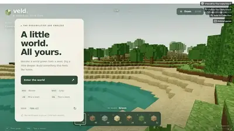
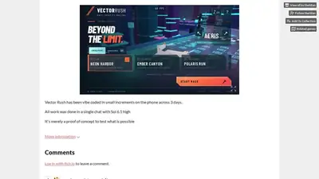

<a name="top"></a>

<p align="center"><a href="https://terraium.ai/"></a></p>

<h1 align="center">Terrarium</h1>

<p align="center"><b>探索 1,000+ AI 创作的 3D 游戏、交互世界、视频与可视化作品，作品库每 8 小时更新，完整开源代码与公开生成提示词免费归档，供你学习、复现与再创作。</b></p>

<p align="center"><a href="https://terraium.ai/"></a>
<a href="https://github.com/AI-Terrarium/terrarium"></a>
<a href="https://huggingface.co/datasets/AI-Terrarium/terrarium-open-works"></a>
<a href="https://discord.com/invite/bJqy7ev7WD"></a></p>

<p align="center"><sub><a href="../../README.md">English</a> · <b>简体中文</b> · <a href="README.zh-TW.md">繁體中文</a> · <a href="README.ja.md">日本語</a> · <a href="README.ko.md">한국어</a> · <a href="README.es.md">Español</a> · <a href="README.pt-BR.md">Português</a> · <a href="README.fr.md">Français</a> · <a href="README.de.md">Deutsch</a> · <a href="README.ru.md">Русский</a></sub></p>

<p align="center"><a href="#trending">最热</a> · <a href="#latest">最新</a> · <a href="#contents">目录</a></p>

<!-- SHOWCASE:START -->
<p align="center"><b>1070</b> 收录条目 · <b>6</b> 创作类别 · <b>977</b> 公开代码 · <b>425</b> 源码归档<br><sub>目录数据：2026-11-25</sub></p>

<a name="trending"></a>

## 最热

<p align="center"><a href="#showcase-links"><picture><source media="(prefers-reduced-motion: reduce)" srcset="../../assets/showcase.webp"></picture></a></p>

<p align="center"><sub>热度同步：2026-11-25 01:23 UTC · 计划每 8 小时刷新</sub></p>

<a name="showcase-links"></a>

<table><tr>
<td width="25%" valign="top"><b>01 · <a href="https://starrynightrider.com/">Starry Nightrider</a></b><br><sub><a href="https://x.com/i/status/2120284261089673376">X · 17,941 赞 · 503 评论</a></sub></td>
<td width="25%" valign="top"><b>02 · <a href="https://claude.ai/artifact/BGY1SztrAYcJQHSsnHHGmp">Saltline</a></b><br><sub><a href="https://x.com/i/status/2119925633564463609">X · 15,056 赞 · 861 评论</a></sub></td>
<td width="25%" valign="top"><b>03 · <a href="https://patch.gg/blendi/oil-paint">Oil paint</a></b><br><sub><a href="https://x.com/i/status/2120341251178594532">X · 8,021 赞 · 393 评论</a></sub></td>
<td width="25%" valign="top"><b>04 · <a href="https://x.com/mattshumer_/status/2120282133503820150">CROSSTOWN</a></b><br><sub><a href="https://x.com/i/status/2120282133503820150">X · 7,515 赞 · 676 评论</a></sub></td>
</tr></table>

<details><summary>榜单来源与排序</summary>

按公开点赞、Star 等支持数排序；评论、转发等仅用于同分排序，播放量单独展示。同一平台取支持数最高的帖子，同一来源不重复展示。 845 个来源 · 4 个平台 · 14 个来源未获取 <a href="../../data/showcase.json">查看数据</a> · <a href="../../scripts/SHOWCASE.md">计算说明</a>

</details>

<!-- SHOWCASE:END -->

<a name="latest"></a>

## 最新

<table>
<tr>
<td width="25%" valign="top"><a href="https://elpq.itch.io/zofe12367"></a><br><b><a href="https://elpq.itch.io/zofe12367">ZONBIE APOCALYPSE 3D | ENG \ RU</a></b><br><sub><a href="https://elpq.itch.io">elpq</a><br>许可证未知 · <a href="https://elpq.itch.io/zofe12367">代码</a></sub></td>
<td width="25%" valign="top"><a href="https://hahaha10001.itch.io/zero-diorama-wreckers"></a><br><b><a href="https://hahaha10001.itch.io/zero-diorama-wreckers">Zero: Diorama Wreckers</a></b><br><sub><a href="https://hahaha10001.itch.io">hahaha10001</a><br>CC0-1.0 · <a href="https://hahaha10001.itch.io/zero-diorama-wreckers">代码</a></sub></td>
<td width="25%" valign="top"><a href="https://abdeninho.itch.io/weather-world"></a><br><b><a href="https://abdeninho.itch.io/weather-world">Weather World</a></b><br><sub><a href="https://abdeninho.itch.io">abdeninho</a><br>许可证未知 · <a href="https://abdeninho.itch.io/weather-world">代码</a></sub></td>
<td width="25%" valign="top"><a href="https://theusefulstack.itch.io/veld"></a><br><b><a href="https://theusefulstack.itch.io/veld">Veld — an AI-built voxel sandbox (GPT-6.1 Sol)</a></b><br><sub><a href="https://theusefulstack.itch.io">theusefulstack</a><br>MIT · <a href="https://theusefulstack.itch.io/veld">代码</a></sub></td>
</tr>
<tr>
<td width="25%" valign="top"><a href="https://thenfan.itch.io/vector-rush"></a><br><b><a href="https://thenfan.itch.io/vector-rush">Vector Rush</a></b><br><sub><a href="https://thenfan.itch.io">thenfan</a><br>许可证未知 · <a href="https://thenfan.itch.io/vector-rush">代码</a></sub></td>
<td width="25%" valign="top"><a href="https://rafael-mogger.itch.io/ultima-ronda"></a><br><b><a href="https://rafael-mogger.itch.io/ultima-ronda">Ultima-ronda</a></b><br><sub><a href="https://rafael-mogger.itch.io">rafael-mogger</a><br>许可证未知 · <a href="https://rafael-mogger.itch.io/ultima-ronda">代码</a></sub></td>
<td width="25%" valign="top"><a href="https://lek-vob.itch.io/tunnel-z"></a><br><b><a href="https://lek-vob.itch.io/tunnel-z">Tunnel-Z</a></b><br><sub><a href="https://lek-vob.itch.io">lek-vob</a><br>许可证未知 · <a href="https://lek-vob.itch.io/tunnel-z">代码</a></sub></td>
<td width="25%" valign="top"><a href="https://giii3-game.itch.io/tscaveen"></a><br><b><a href="https://giii3-game.itch.io/tscaveen">TSF CAVE — Bill the Warrior and the Crest Curse</a></b><br><sub><a href="https://giii3-game.itch.io">giii3-game</a><br>许可证未知 · <a href="https://giii3-game.itch.io/tscaveen">代码</a></sub></td>
</tr>
</table>

<a name="contents"></a>

<a name="categories"></a>

## 目录

先看代表作品，也可以按玩法跳转，或进入完整作品库。

<table>

<tr>

<td width="33.33%"><b><a href="#contents-games">🎮 游戏</a> · 610</b><br><sub>534 公开代码 · 190 源码归档</sub></td>

<td width="33.33%"><b><a href="#contents-scenes">🌍 世界与场景</a> · 211</b><br><sub>203 公开代码 · 94 源码归档</sub></td>

<td width="33.33%"><b><a href="#contents-videos">🎬 视频</a> · 32</b><br><sub>23 公开代码 · 15 源码归档</sub></td>

</tr>

<tr>

<td width="33.33%"><b><a href="#contents-tools">🛠️ 工具</a> · 115</b><br><sub>115 公开代码 · 75 源码归档</sub></td>

<td width="33.33%"><b><a href="#contents-visualizations">📊 可视化</a> · 99</b><br><sub>99 公开代码 · 48 源码归档</sub></td>

<td width="33.33%"><b><a href="#contents-wallpapers">🖥️ 壁纸</a> · 3</b><br><sub>3 公开代码 · 3 源码归档</sub></td>

</tr>

</table>

<a name="contents-games"></a>

### 🎮 游戏 · 610

从射击、竞速与飞行，到冒险、解谜和沙盒。

<p><a href="../../games/README.zh-CN.md#genre-shooter">射击</a> <b>111</b> · <a href="../../games/README.zh-CN.md#genre-action-and-combat">动作与战斗</a> <b>57</b> · <a href="../../games/README.zh-CN.md#genre-platformer-and-runner">平台跳跃与跑酷</a> <b>38</b> · <a href="../../games/README.zh-CN.md#genre-racing-and-driving">竞速与驾驶</a> <b>75</b> · <a href="../../games/README.zh-CN.md#genre-flight">飞行</a> <b>28</b> · <a href="../../games/README.zh-CN.md#genre-sports">体育</a> <b>15</b> · <a href="../../games/README.zh-CN.md#genre-adventure-and-exploration">冒险与探索</a> <b>77</b> · <a href="../../games/README.zh-CN.md#genre-puzzle">解谜</a> <b>23</b> · <a href="../../games/README.zh-CN.md#genre-strategy-and-management">策略与经营</a> <b>47</b> · <a href="../../games/README.zh-CN.md#genre-sandbox">沙盒</a> <b>27</b> · <a href="../../games/README.zh-CN.md#genre-casual-and-arcade">休闲与街机</a> <b>35</b> · <a href="../../games/README.zh-CN.md#genre-interactive-story">互动叙事</a> <b>3</b> · <a href="../../games/README.zh-CN.md#genre-simulation-and-visualization">模拟与可视化</a> <b>4</b> · <a href="../../games/README.zh-CN.md#genre-other-games">其他游戏</a> <b>70</b></p>

<table>
<tr>
<td width="33.33%" valign="top"><a href="https://theredstapler.github.io/orb-shooter/"></a><br><b><a href="https://theredstapler.github.io/orb-shooter/">Orb Shooter FPS Demo (Vibe Coded)</a></b><br><sub><a href="https://github.com/theredstapler">Red Stapler</a><br>MIT · <a href="https://github.com/theredstapler/orb-shooter">代码</a> · <a href="https://huggingface.co/datasets/AI-Terrarium/terrarium-open-works/tree/main/games/orb-shooter-fps-demo-vibe-coded">文件</a></sub></td>
<td width="33.33%" valign="top"><a href="https://arjunreddy91100.github.io/bumblebee-echo-garden/"></a><br><b><a href="https://arjunreddy91100.github.io/bumblebee-echo-garden/">Bumblebee — Echo Garden</a></b><br><sub><a href="https://github.com/arjunreddy91100">Arjun</a><br>MIT · <a href="https://github.com/arjunreddy91100/bumblebee-echo-garden">代码</a> · <a href="https://huggingface.co/datasets/AI-Terrarium/terrarium-open-works/tree/main/games/bumblebee-echo-garden">文件</a></sub></td>
<td width="33.33%" valign="top"><a href="https://pelicanride.vercel.app"></a><br><b><a href="https://pelicanride.vercel.app">鹈鹕骑单车 · 海岸大冒险（Pelican Ride）</a></b><br><sub><a href="https://github.com/Xiobio">Xony</a><br>MIT · <a href="https://github.com/Xiobio/pelican-ride">代码</a> · <a href="https://huggingface.co/datasets/AI-Terrarium/terrarium-open-works/tree/main/games/pelican-ride">文件</a></sub></td>
</tr>
</table>

<p><b><a href="../../games/README.zh-CN.md">浏览全部 610 个条目 →</a></b> · <a href="#contents">↑ 目录</a></p>

<a name="contents-scenes"></a>

### 🌍 世界与场景 · 211

漫游虚构世界、探索自然场景，或细看精巧的 3D 物件。

<table>
<tr>
<td width="33.33%" valign="top"><a href="https://github.com/NineTigers/emberfall-forge-claude-fable-5.2"></a><br><b><a href="https://github.com/NineTigers/emberfall-forge-claude-fable-5.2">Emberfall Forge</a></b><br><sub><a href="https://github.com/NineTigers">NineTigers</a><br>MIT · <a href="https://github.com/NineTigers/emberfall-forge-claude-fable-5.2">代码</a> · <a href="https://huggingface.co/datasets/AI-Terrarium/terrarium-open-works/tree/main/scenes/emberfall-forge">文件</a></sub></td>
<td width="33.33%" valign="top"><a href="https://patch.gg/blendi/oil-paint"></a><br><b><a href="https://patch.gg/blendi/oil-paint">Oil paint</a></b><br><sub>Blendi Byl<br>MIT · <a href="https://git.patch.gg/blendi/oil-paint.git">代码</a> · <a href="https://huggingface.co/datasets/AI-Terrarium/terrarium-open-works/tree/main/scenes/oil-paint">文件</a></sub></td>
<td width="33.33%" valign="top"><a href="https://starknightt.github.io/tiny-planet/"></a><br><b><a href="https://starknightt.github.io/tiny-planet/">Tiny Planet</a></b><br><sub><a href="https://github.com/StarKnightt">Prasenjit</a><br>MIT · <a href="https://github.com/StarKnightt/tiny-planet">代码</a> · <a href="https://huggingface.co/datasets/AI-Terrarium/terrarium-open-works/tree/main/scenes/tiny-planet">文件</a></sub></td>
</tr>
</table>

<p><b><a href="../../scenes/README.zh-CN.md">浏览全部 211 个条目 →</a></b> · <a href="#contents">↑ 目录</a></p>

<a name="contents-videos"></a>

### 🎬 视频 · 32

用代码渲染的短片、动画与视觉实验。

<table>
<tr>
<td width="33.33%" valign="top"><a href="https://x.com/fuoeba/status/2119906486017307074"></a><br><b><a href="https://x.com/fuoeba/status/2119906486017307074">Path-traced voxel creature</a></b><br><sub><a href="https://x.com/fuoeba">fuoeba</a><br>许可证未知</sub></td>
<td width="33.33%" valign="top"><a href="https://x.com/rileybrown/status/2119902109709537708"></a><br><b><a href="https://x.com/rileybrown/status/2119902109709537708">The Edge</a></b><br><sub><a href="https://x.com/rileybrown">Riley Brown</a><br>许可证未知</sub></td>
<td width="33.33%" valign="top"><a href="https://github.com/anstapnever/colossus"></a><br><b><a href="https://github.com/anstapnever/colossus">COLOSSUS · 巨像</a></b><br><sub><a href="https://github.com/anstapnever">anstap</a><br>MIT · <a href="https://github.com/anstapnever/colossus">代码</a> · <a href="https://huggingface.co/datasets/AI-Terrarium/terrarium-open-works/tree/main/videos/colossus">文件</a></sub></td>
</tr>
</table>

<p><b><a href="../../videos/README.zh-CN.md">浏览全部 32 个条目 →</a></b> · <a href="#contents">↑ 目录</a></p>

<a name="contents-tools"></a>

### 🛠️ 工具 · 115

用于创作、查看、模拟和日常任务的 3D 小应用。

<table>
<tr>
<td width="33.33%" valign="top"><a href="https://github.com/harshitkhandelwal208/3D-engine-Visualiser"></a><br><b><a href="https://github.com/harshitkhandelwal208/3D-engine-Visualiser">MgCO₂ V6 Compression Engine — Interactive 3D Viewer</a></b><br><sub><a href="https://github.com/harshitkhandelwal208">Harshit Khandelwal</a><br>MIT · <a href="https://github.com/harshitkhandelwal208/3D-engine-Visualiser">代码</a> · <a href="https://huggingface.co/datasets/AI-Terrarium/terrarium-open-works/tree/main/tools/mgco2-v6-compression-engine-interactive-3d-viewer">文件</a></sub></td>
<td width="33.33%" valign="top"><a href="https://khanmjk.github.io/Fable51_Hourglass/"></a><br><b><a href="https://khanmjk.github.io/Fable51_Hourglass/">Hourglass · Digital Twin</a></b><br><sub><a href="https://github.com/khanmjk">khanmjk</a><br>MIT · <a href="https://github.com/khanmjk/Fable51_Hourglass">代码</a> · <a href="https://huggingface.co/datasets/AI-Terrarium/terrarium-open-works/tree/main/tools/hourglass-digital-twin">文件</a></sub></td>
<td width="33.33%" valign="top"><a href="https://github.com/bigerbigernerd/fiat-ludus"></a><br><b><a href="https://github.com/bigerbigernerd/fiat-ludus">Fiat Ludus · 言出法随</a></b><br><sub><a href="https://github.com/bigerbigernerd">bigerbigernerd</a><br>MIT · <a href="https://github.com/bigerbigernerd/fiat-ludus">代码</a> · <a href="https://huggingface.co/datasets/AI-Terrarium/terrarium-open-works/tree/main/tools/fiat-ludus">文件</a></sub></td>
</tr>
</table>

<p><b><a href="../../tools/README.zh-CN.md">浏览全部 115 个条目 →</a></b> · <a href="#contents">↑ 目录</a></p>

<a name="contents-visualizations"></a>

### 📊 可视化 · 99

用交互式 3D 探索科学、数据与抽象概念。

<table>
<tr>
<td width="33.33%" valign="top"><a href="https://codexparadise.github.io/insects/"></a><br><b><a href="https://codexparadise.github.io/insects/">ENTOMIA // 3D MICRO-MORPHOLOGY</a></b><br><sub><a href="https://github.com/codeXparadise">Vishal Prajapati</a><br>MIT · <a href="https://github.com/codeXparadise/insects">代码</a> · <a href="https://huggingface.co/datasets/AI-Terrarium/terrarium-open-works/tree/main/visualizations/entomia-3d-micro-morphology">文件</a></sub></td>
<td width="33.33%" valign="top"><a href="https://atoomnetmarc.github.io/3D-Sorting-Algorithm-Visualizer/"></a><br><b><a href="https://atoomnetmarc.github.io/3D-Sorting-Algorithm-Visualizer/">3D Sorting Algorithm Visualizer</a></b><br><sub><a href="https://github.com/atoomnetmarc">Marc Ketel</a><br>Apache-2.0 · <a href="https://github.com/atoomnetmarc/3D-Sorting-Algorithm-Visualizer">代码</a> · <a href="https://huggingface.co/datasets/AI-Terrarium/terrarium-open-works/tree/main/visualizations/3d-sorting-algorithm-visualizer">文件</a></sub></td>
<td width="33.33%" valign="top"><a href="https://github.com/AralimNGA/cube-physics-simulation"></a><br><b><a href="https://github.com/AralimNGA/cube-physics-simulation">Cube Physics Simulation</a></b><br><sub><a href="https://github.com/AralimNGA">Aralim</a><br>MIT · <a href="https://github.com/AralimNGA/cube-physics-simulation">代码</a> · <a href="https://huggingface.co/datasets/AI-Terrarium/terrarium-open-works/tree/main/visualizations/cube-physics-simulation">文件</a></sub></td>
</tr>
</table>

<p><b><a href="../../visualizations/README.zh-CN.md">浏览全部 99 个条目 →</a></b> · <a href="#contents">↑ 目录</a></p>

<a name="contents-wallpapers"></a>

### 🖥️ 壁纸 · 3

屏幕保护程序、桌面伙伴与氛围感 3D 画面。

<table>
<tr>
<td width="33.33%" valign="top"><a href="https://github.com/Sabrina-creater/claude-pet"></a><br><b><a href="https://github.com/Sabrina-creater/claude-pet">Claude Pet 🐾</a></b><br><sub><a href="https://github.com/Sabrina-creater">Sabrina-creater</a><br>MIT · <a href="https://github.com/Sabrina-creater/claude-pet">代码</a> · <a href="https://huggingface.co/datasets/AI-Terrarium/terrarium-open-works/tree/main/wallpapers/claude-pet">文件</a></sub></td>
<td width="33.33%" valign="top"><a href="https://yohhoy.github.io/vibe-screensaver/"></a><br><b><a href="https://yohhoy.github.io/vibe-screensaver/">vibe-screensaver — Web スクリーンセーバ集</a></b><br><sub><a href="https://github.com/yohhoy">yoh</a><br>合集，14 个作品<br>MIT · <a href="https://github.com/yohhoy/vibe-screensaver">代码</a> · <a href="https://huggingface.co/datasets/AI-Terrarium/terrarium-open-works/tree/main/wallpapers/vibe-screensaver">文件</a></sub></td>
<td width="33.33%" valign="top"><a href="https://biswajitdasb4-oss.github.io/prompt-paws/"></a><br><b><a href="https://biswajitdasb4-oss.github.io/prompt-paws/">Prompt Paws</a></b><br><sub><a href="https://github.com/biswajitdasb4-oss">biswajitdasb4-oss</a><br>MIT · <a href="https://github.com/biswajitdasb4-oss/prompt-paws">代码</a> · <a href="https://huggingface.co/datasets/AI-Terrarium/terrarium-open-works/tree/main/wallpapers/prompt-paws">文件</a></sub></td>
</tr>
</table>

<p><b><a href="../../wallpapers/README.zh-CN.md">浏览全部 3 个条目 →</a></b> · <a href="#contents">↑ 目录</a></p>

<p align="center"><a href="https://terraium.ai/">前往官网，完整浏览作品 →</a> · <a href="https://huggingface.co/datasets/AI-Terrarium/terrarium-open-works">获取开源代码 →</a></p>

<details><summary>源码、收录与贡献</summary>

作品来自 GitHub、Hugging Face Spaces、itch.io、X、Bilibili 等平台，覆盖 324 位作者。图片链接原始发布页；「代码」链接公开源码；「文件」打开 HF 归档。227 个作品可在浏览器运行，346 个使用 Three.js。

425 个有开源许可证的条目已按类别与作品集中归档，保留原仓库许可证文件（如有）。批量获取：

```sh
git clone https://huggingface.co/datasets/AI-Terrarium/terrarium-open-works
```

大文件需要 Git LFS。作品遵循各自许可证；页面文字采用 CC0 1.0。目录和热度分别标注更新时间。

<a href="../../scripts/SHOWCASE.md">计算说明</a> · <a href="https://github.com/AI-Terrarium/terrarium/issues/new">提交作品、建议更正或移除条目 →</a>

</details>

---

<p align="center"><a href="README.zh-CN.md"></a><br><sub><a href="README.zh-CN.md">首页</a> · <a href="../../games/README.zh-CN.md">游戏</a> · <a href="../../scenes/README.zh-CN.md">世界与场景</a> · <a href="../../videos/README.zh-CN.md">视频</a> · <a href="../../tools/README.zh-CN.md">工具</a> · <a href="../../visualizations/README.zh-CN.md">可视化</a> · <a href="../../wallpapers/README.zh-CN.md">壁纸</a> · <a href="#top">返回顶部</a><br>目录数据：2026-11-25</sub></p>
