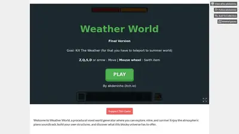
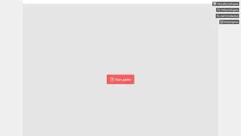
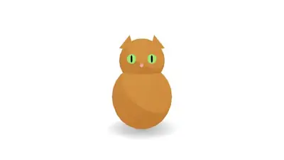

<a name="top"></a>

<p align="center"><a href="https://terraium.ai/"></a></p>

<h1 align="center">Terrarium</h1>

<p align="center"><b>探索 1,000+ AI 創作的 3D 遊戲、互動世界、影片與視覺化作品，作品庫每 8 小時更新，完整開源原始碼與公開生成提示詞免費封存，供你學習、重現與再創作。</b></p>

<p align="center"><a href="https://terraium.ai/"></a>
<a href="https://github.com/AI-Terrarium/terrarium"></a>
<a href="https://huggingface.co/datasets/AI-Terrarium/terrarium-open-works"></a>
<a href="https://discord.com/invite/bJqy7ev7WD"></a></p>

<p align="center"><sub><a href="../../README.md">English</a> · <a href="README.zh-CN.md">简体中文</a> · <b>繁體中文</b> · <a href="README.ja.md">日本語</a> · <a href="README.ko.md">한국어</a> · <a href="README.es.md">Español</a> · <a href="README.pt-BR.md">Português</a> · <a href="README.fr.md">Français</a> · <a href="README.de.md">Deutsch</a> · <a href="README.ru.md">Русский</a></sub></p>

<p align="center"><a href="#trending">熱門</a> · <a href="#latest">最新</a> · <a href="#contents">目錄</a></p>

<!-- SHOWCASE:START -->
<p align="center"><b>1030</b> 收錄項目 · <b>6</b> 創作類別 · <b>937</b> 公開原始碼 · <b>425</b> 原始碼封存<br><sub>目錄資料：2026-11-18</sub></p>

<a name="trending"></a>

## 熱門

<p align="center"><a href="#showcase-links"><picture><source media="(prefers-reduced-motion: reduce)" srcset="../../assets/showcase.webp"></picture></a></p>

<p align="center"><sub>熱門資料同步：2026-11-18 18:00 UTC · 預計每 8 小時更新</sub></p>

<a name="showcase-links"></a>

<table><tr>
<td width="25%" valign="top"><b>01 · <a href="https://starrynightrider.com/">Starry Nightrider</a></b><br><sub><a href="https://x.com/i/status/2120284261089673376">X · 17,948 讚 · 503 留言</a></sub></td>
<td width="25%" valign="top"><b>02 · <a href="https://claude.ai/artifact/BGY1SztrAYcJQHSsnHHGmp">Saltline</a></b><br><sub><a href="https://x.com/i/status/2119925633564463609">X · 14,979 讚 · 858 留言</a></sub></td>
<td width="25%" valign="top"><b>03 · <a href="https://patch.gg/blendi/oil-paint">Oil paint</a></b><br><sub><a href="https://x.com/i/status/2120341251178594532">X · 8,012 讚 · 389 留言</a></sub></td>
<td width="25%" valign="top"><b>04 · <a href="https://x.com/mattshumer_/status/2120282133503820150">CROSSTOWN</a></b><br><sub><a href="https://x.com/i/status/2120282133503820150">X · 7,522 讚 · 676 留言</a></sub></td>
</tr></table>

<details><summary>榜單來源與排序</summary>

依公開按讚、Star 等支持數排序；留言與分享只用於同分排序，觀看次數另外顯示。每個平台採支持數最高的貼文，相同來源不重複展示。 815 個來源 · 4 個平台 · 8 個來源未取得 <a href="../../data/showcase.json">查看資料</a> · <a href="../../scripts/SHOWCASE.md">計算方式</a>

</details>

<!-- SHOWCASE:END -->

<a name="latest"></a>

## 最新

<table>
<tr>
<td width="25%" valign="top"><a href="https://elpq.itch.io/zofe12367"></a><br><b><a href="https://elpq.itch.io/zofe12367">ZONBIE APOCALYPSE 3D | ENG \ RU</a></b><br><sub><a href="https://elpq.itch.io">elpq</a><br>授權條款不明 · <a href="https://elpq.itch.io/zofe12367">原始碼</a></sub></td>
<td width="25%" valign="top"><a href="https://hahaha10001.itch.io/zero-diorama-wreckers"></a><br><b><a href="https://hahaha10001.itch.io/zero-diorama-wreckers">Zero: Diorama Wreckers</a></b><br><sub><a href="https://hahaha10001.itch.io">hahaha10001</a><br>CC0-1.0 · <a href="https://hahaha10001.itch.io/zero-diorama-wreckers">原始碼</a></sub></td>
<td width="25%" valign="top"><a href="https://abdeninho.itch.io/weather-world"></a><br><b><a href="https://abdeninho.itch.io/weather-world">Weather World</a></b><br><sub><a href="https://abdeninho.itch.io">abdeninho</a><br>授權條款不明 · <a href="https://abdeninho.itch.io/weather-world">原始碼</a></sub></td>
<td width="25%" valign="top"><a href="https://theusefulstack.itch.io/veld"></a><br><b><a href="https://theusefulstack.itch.io/veld">Veld — an AI-built voxel sandbox (GPT-6.1 Sol)</a></b><br><sub><a href="https://theusefulstack.itch.io">theusefulstack</a><br>MIT · <a href="https://theusefulstack.itch.io/veld">原始碼</a></sub></td>
</tr>
<tr>
<td width="25%" valign="top"><a href="https://thenfan.itch.io/vector-rush"></a><br><b><a href="https://thenfan.itch.io/vector-rush">Vector Rush</a></b><br><sub><a href="https://thenfan.itch.io">thenfan</a><br>授權條款不明 · <a href="https://thenfan.itch.io/vector-rush">原始碼</a></sub></td>
<td width="25%" valign="top"><a href="https://rafael-mogger.itch.io/ultima-ronda"></a><br><b><a href="https://rafael-mogger.itch.io/ultima-ronda">Ultima-ronda</a></b><br><sub><a href="https://rafael-mogger.itch.io">rafael-mogger</a><br>授權條款不明 · <a href="https://rafael-mogger.itch.io/ultima-ronda">原始碼</a></sub></td>
<td width="25%" valign="top"><a href="https://lek-vob.itch.io/tunnel-z"></a><br><b><a href="https://lek-vob.itch.io/tunnel-z">Tunnel-Z</a></b><br><sub><a href="https://lek-vob.itch.io">lek-vob</a><br>授權條款不明 · <a href="https://lek-vob.itch.io/tunnel-z">原始碼</a></sub></td>
<td width="25%" valign="top"><a href="https://giii3-game.itch.io/tscaveen"></a><br><b><a href="https://giii3-game.itch.io/tscaveen">TSF CAVE — Bill the Warrior and the Crest Curse</a></b><br><sub><a href="https://giii3-game.itch.io">giii3-game</a><br>授權條款不明 · <a href="https://giii3-game.itch.io/tscaveen">原始碼</a></sub></td>
</tr>
</table>

<a name="contents"></a>

<a name="categories"></a>

## 目錄

先看代表作品，也可依玩法跳轉，或進入完整作品庫。

<table>

<tr>

<td width="33.33%"><b><a href="#contents-games">🎮 遊戲</a> · 570</b><br><sub>494 公開原始碼 · 190 原始碼封存</sub></td>

<td width="33.33%"><b><a href="#contents-scenes">🌍 世界與場景</a> · 211</b><br><sub>203 公開原始碼 · 94 原始碼封存</sub></td>

<td width="33.33%"><b><a href="#contents-videos">🎬 影片</a> · 32</b><br><sub>23 公開原始碼 · 15 原始碼封存</sub></td>

</tr>

<tr>

<td width="33.33%"><b><a href="#contents-tools">🛠️ 工具</a> · 115</b><br><sub>115 公開原始碼 · 75 原始碼封存</sub></td>

<td width="33.33%"><b><a href="#contents-visualizations">📊 視覺化</a> · 99</b><br><sub>99 公開原始碼 · 48 原始碼封存</sub></td>

<td width="33.33%"><b><a href="#contents-wallpapers">🖥️ 桌布</a> · 3</b><br><sub>3 公開原始碼 · 3 原始碼封存</sub></td>

</tr>

</table>

<a name="contents-games"></a>

### 🎮 遊戲 · 570

從射擊、競速與飛行，到冒險、解謎和沙盒。

<p><a href="../../games/README.zh-TW.md#genre-shooter">射擊</a> <b>111</b> · <a href="../../games/README.zh-TW.md#genre-action-and-combat">動作與戰鬥</a> <b>57</b> · <a href="../../games/README.zh-TW.md#genre-platformer-and-runner">平台跳躍與跑酷</a> <b>38</b> · <a href="../../games/README.zh-TW.md#genre-racing-and-driving">競速與駕駛</a> <b>75</b> · <a href="../../games/README.zh-TW.md#genre-flight">飛行</a> <b>28</b> · <a href="../../games/README.zh-TW.md#genre-sports">運動</a> <b>15</b> · <a href="../../games/README.zh-TW.md#genre-adventure-and-exploration">冒險與探索</a> <b>77</b> · <a href="../../games/README.zh-TW.md#genre-puzzle">解謎</a> <b>23</b> · <a href="../../games/README.zh-TW.md#genre-strategy-and-management">策略與經營</a> <b>47</b> · <a href="../../games/README.zh-TW.md#genre-sandbox">沙盒</a> <b>27</b> · <a href="../../games/README.zh-TW.md#genre-casual-and-arcade">休閒與街機</a> <b>35</b> · <a href="../../games/README.zh-TW.md#genre-interactive-story">互動敘事</a> <b>3</b> · <a href="../../games/README.zh-TW.md#genre-simulation-and-visualization">模擬與視覺化</a> <b>4</b> · <a href="../../games/README.zh-TW.md#genre-other-games">其他遊戲</a> <b>30</b></p>

<table>
<tr>
<td width="33.33%" valign="top"><a href="https://theredstapler.github.io/orb-shooter/"></a><br><b><a href="https://theredstapler.github.io/orb-shooter/">Orb Shooter FPS Demo (Vibe Coded)</a></b><br><sub><a href="https://github.com/theredstapler">Red Stapler</a><br>MIT · <a href="https://github.com/theredstapler/orb-shooter">原始碼</a> · <a href="https://huggingface.co/datasets/AI-Terrarium/terrarium-open-works/tree/main/games/orb-shooter-fps-demo-vibe-coded">檔案</a></sub></td>
<td width="33.33%" valign="top"><a href="https://arjunreddy91100.github.io/bumblebee-echo-garden/"></a><br><b><a href="https://arjunreddy91100.github.io/bumblebee-echo-garden/">Bumblebee — Echo Garden</a></b><br><sub><a href="https://github.com/arjunreddy91100">Arjun</a><br>MIT · <a href="https://github.com/arjunreddy91100/bumblebee-echo-garden">原始碼</a> · <a href="https://huggingface.co/datasets/AI-Terrarium/terrarium-open-works/tree/main/games/bumblebee-echo-garden">檔案</a></sub></td>
<td width="33.33%" valign="top"><a href="https://pelicanride.vercel.app"></a><br><b><a href="https://pelicanride.vercel.app">鹈鹕骑单车 · 海岸大冒险（Pelican Ride）</a></b><br><sub><a href="https://github.com/Xiobio">Xony</a><br>MIT · <a href="https://github.com/Xiobio/pelican-ride">原始碼</a> · <a href="https://huggingface.co/datasets/AI-Terrarium/terrarium-open-works/tree/main/games/pelican-ride">檔案</a></sub></td>
</tr>
</table>

<p><b><a href="../../games/README.zh-TW.md">瀏覽全部 570 個項目 →</a></b> · <a href="#contents">↑ 目錄</a></p>

<a name="contents-scenes"></a>

### 🌍 世界與場景 · 211

漫遊想像世界、探索自然場景，或細看精巧的 3D 物件。

<table>
<tr>
<td width="33.33%" valign="top"><a href="https://github.com/NineTigers/emberfall-forge-claude-fable-5.2"></a><br><b><a href="https://github.com/NineTigers/emberfall-forge-claude-fable-5.2">Emberfall Forge</a></b><br><sub><a href="https://github.com/NineTigers">NineTigers</a><br>MIT · <a href="https://github.com/NineTigers/emberfall-forge-claude-fable-5.2">原始碼</a> · <a href="https://huggingface.co/datasets/AI-Terrarium/terrarium-open-works/tree/main/scenes/emberfall-forge">檔案</a></sub></td>
<td width="33.33%" valign="top"><a href="https://patch.gg/blendi/oil-paint"></a><br><b><a href="https://patch.gg/blendi/oil-paint">Oil paint</a></b><br><sub>Blendi Byl<br>MIT · <a href="https://git.patch.gg/blendi/oil-paint.git">原始碼</a> · <a href="https://huggingface.co/datasets/AI-Terrarium/terrarium-open-works/tree/main/scenes/oil-paint">檔案</a></sub></td>
<td width="33.33%" valign="top"><a href="https://starknightt.github.io/tiny-planet/"></a><br><b><a href="https://starknightt.github.io/tiny-planet/">Tiny Planet</a></b><br><sub><a href="https://github.com/StarKnightt">Prasenjit</a><br>MIT · <a href="https://github.com/StarKnightt/tiny-planet">原始碼</a> · <a href="https://huggingface.co/datasets/AI-Terrarium/terrarium-open-works/tree/main/scenes/tiny-planet">檔案</a></sub></td>
</tr>
</table>

<p><b><a href="../../scenes/README.zh-TW.md">瀏覽全部 211 個項目 →</a></b> · <a href="#contents">↑ 目錄</a></p>

<a name="contents-videos"></a>

### 🎬 影片 · 32

以程式碼算繪的短片、動畫與視覺實驗。

<table>
<tr>
<td width="33.33%" valign="top"><a href="https://x.com/fuoeba/status/2119906486017307074"></a><br><b><a href="https://x.com/fuoeba/status/2119906486017307074">Path-traced voxel creature</a></b><br><sub><a href="https://x.com/fuoeba">fuoeba</a><br>授權條款不明</sub></td>
<td width="33.33%" valign="top"><a href="https://x.com/rileybrown/status/2119902109709537708"></a><br><b><a href="https://x.com/rileybrown/status/2119902109709537708">The Edge</a></b><br><sub><a href="https://x.com/rileybrown">Riley Brown</a><br>授權條款不明</sub></td>
<td width="33.33%" valign="top"><a href="https://github.com/anstapnever/colossus"></a><br><b><a href="https://github.com/anstapnever/colossus">COLOSSUS · 巨像</a></b><br><sub><a href="https://github.com/anstapnever">anstap</a><br>MIT · <a href="https://github.com/anstapnever/colossus">原始碼</a> · <a href="https://huggingface.co/datasets/AI-Terrarium/terrarium-open-works/tree/main/videos/colossus">檔案</a></sub></td>
</tr>
</table>

<p><b><a href="../../videos/README.zh-TW.md">瀏覽全部 32 個項目 →</a></b> · <a href="#contents">↑ 目錄</a></p>

<a name="contents-tools"></a>

### 🛠️ 工具 · 115

用於創作、檢視、模擬與日常工作的 3D 應用。

<table>
<tr>
<td width="33.33%" valign="top"><a href="https://github.com/harshitkhandelwal208/3D-engine-Visualiser"></a><br><b><a href="https://github.com/harshitkhandelwal208/3D-engine-Visualiser">MgCO₂ V6 Compression Engine — Interactive 3D Viewer</a></b><br><sub><a href="https://github.com/harshitkhandelwal208">Harshit Khandelwal</a><br>MIT · <a href="https://github.com/harshitkhandelwal208/3D-engine-Visualiser">原始碼</a> · <a href="https://huggingface.co/datasets/AI-Terrarium/terrarium-open-works/tree/main/tools/mgco2-v6-compression-engine-interactive-3d-viewer">檔案</a></sub></td>
<td width="33.33%" valign="top"><a href="https://khanmjk.github.io/Fable51_Hourglass/"></a><br><b><a href="https://khanmjk.github.io/Fable51_Hourglass/">Hourglass · Digital Twin</a></b><br><sub><a href="https://github.com/khanmjk">khanmjk</a><br>MIT · <a href="https://github.com/khanmjk/Fable51_Hourglass">原始碼</a> · <a href="https://huggingface.co/datasets/AI-Terrarium/terrarium-open-works/tree/main/tools/hourglass-digital-twin">檔案</a></sub></td>
<td width="33.33%" valign="top"><a href="https://github.com/bigerbigernerd/fiat-ludus"></a><br><b><a href="https://github.com/bigerbigernerd/fiat-ludus">Fiat Ludus · 言出法随</a></b><br><sub><a href="https://github.com/bigerbigernerd">bigerbigernerd</a><br>MIT · <a href="https://github.com/bigerbigernerd/fiat-ludus">原始碼</a> · <a href="https://huggingface.co/datasets/AI-Terrarium/terrarium-open-works/tree/main/tools/fiat-ludus">檔案</a></sub></td>
</tr>
</table>

<p><b><a href="../../tools/README.zh-TW.md">瀏覽全部 115 個項目 →</a></b> · <a href="#contents">↑ 目錄</a></p>

<a name="contents-visualizations"></a>

### 📊 視覺化 · 99

透過互動式 3D 探索科學、資料與抽象概念。

<table>
<tr>
<td width="33.33%" valign="top"><a href="https://codexparadise.github.io/insects/"></a><br><b><a href="https://codexparadise.github.io/insects/">ENTOMIA // 3D MICRO-MORPHOLOGY</a></b><br><sub><a href="https://github.com/codeXparadise">Vishal Prajapati</a><br>MIT · <a href="https://github.com/codeXparadise/insects">原始碼</a> · <a href="https://huggingface.co/datasets/AI-Terrarium/terrarium-open-works/tree/main/visualizations/entomia-3d-micro-morphology">檔案</a></sub></td>
<td width="33.33%" valign="top"><a href="https://atoomnetmarc.github.io/3D-Sorting-Algorithm-Visualizer/"></a><br><b><a href="https://atoomnetmarc.github.io/3D-Sorting-Algorithm-Visualizer/">3D Sorting Algorithm Visualizer</a></b><br><sub><a href="https://github.com/atoomnetmarc">Marc Ketel</a><br>Apache-2.0 · <a href="https://github.com/atoomnetmarc/3D-Sorting-Algorithm-Visualizer">原始碼</a> · <a href="https://huggingface.co/datasets/AI-Terrarium/terrarium-open-works/tree/main/visualizations/3d-sorting-algorithm-visualizer">檔案</a></sub></td>
<td width="33.33%" valign="top"><a href="https://github.com/AralimNGA/cube-physics-simulation"></a><br><b><a href="https://github.com/AralimNGA/cube-physics-simulation">Cube Physics Simulation</a></b><br><sub><a href="https://github.com/AralimNGA">Aralim</a><br>MIT · <a href="https://github.com/AralimNGA/cube-physics-simulation">原始碼</a> · <a href="https://huggingface.co/datasets/AI-Terrarium/terrarium-open-works/tree/main/visualizations/cube-physics-simulation">檔案</a></sub></td>
</tr>
</table>

<p><b><a href="../../visualizations/README.zh-TW.md">瀏覽全部 99 個項目 →</a></b> · <a href="#contents">↑ 目錄</a></p>

<a name="contents-wallpapers"></a>

### 🖥️ 桌布 · 3

螢幕保護程式、桌面夥伴與充滿氛圍的 3D 畫面。

<table>
<tr>
<td width="33.33%" valign="top"><a href="https://github.com/Sabrina-creater/claude-pet"></a><br><b><a href="https://github.com/Sabrina-creater/claude-pet">Claude Pet 🐾</a></b><br><sub><a href="https://github.com/Sabrina-creater">Sabrina-creater</a><br>MIT · <a href="https://github.com/Sabrina-creater/claude-pet">原始碼</a> · <a href="https://huggingface.co/datasets/AI-Terrarium/terrarium-open-works/tree/main/wallpapers/claude-pet">檔案</a></sub></td>
<td width="33.33%" valign="top"><a href="https://yohhoy.github.io/vibe-screensaver/"></a><br><b><a href="https://yohhoy.github.io/vibe-screensaver/">vibe-screensaver — Web スクリーンセーバ集</a></b><br><sub><a href="https://github.com/yohhoy">yoh</a><br>合集，14 個作品<br>MIT · <a href="https://github.com/yohhoy/vibe-screensaver">原始碼</a> · <a href="https://huggingface.co/datasets/AI-Terrarium/terrarium-open-works/tree/main/wallpapers/vibe-screensaver">檔案</a></sub></td>
<td width="33.33%" valign="top"><a href="https://biswajitdasb4-oss.github.io/prompt-paws/"></a><br><b><a href="https://biswajitdasb4-oss.github.io/prompt-paws/">Prompt Paws</a></b><br><sub><a href="https://github.com/biswajitdasb4-oss">biswajitdasb4-oss</a><br>MIT · <a href="https://github.com/biswajitdasb4-oss/prompt-paws">原始碼</a> · <a href="https://huggingface.co/datasets/AI-Terrarium/terrarium-open-works/tree/main/wallpapers/prompt-paws">檔案</a></sub></td>
</tr>
</table>

<p><b><a href="../../wallpapers/README.zh-TW.md">瀏覽全部 3 個項目 →</a></b> · <a href="#contents">↑ 目錄</a></p>

<p align="center"><a href="https://terraium.ai/">前往官網瀏覽完整作品 →</a> · <a href="https://huggingface.co/datasets/AI-Terrarium/terrarium-open-works">取得開源原始碼 →</a></p>

<details><summary>原始碼、收錄與貢獻</summary>

作品來自 GitHub、Hugging Face Spaces、itch.io、X、Bilibili 等平台，涵蓋 324 位創作者。預覽圖連至原始發布頁；原始碼連至公開程式碼；檔案開啟 HF 封存。227 個作品可在瀏覽器執行，346 個使用 Three.js。

425 個具開源授權的項目已按類別與作品集中封存，並保留原始授權檔案（如有）。批次下載：

```sh
git clone https://huggingface.co/datasets/AI-Terrarium/terrarium-open-works
```

大型檔案需要 Git LFS。作品保留各自的授權條款；頁面文字採 CC0 1.0。目錄與熱門資料分別標示更新時間。

<a href="../../scripts/SHOWCASE.md">計算方式</a> · <a href="https://github.com/AI-Terrarium/terrarium/issues/new">提交作品、更正或移除建議 →</a>

</details>

---

<p align="center"><a href="README.zh-TW.md"></a><br><sub><a href="README.zh-TW.md">首頁</a> · <a href="../../games/README.zh-TW.md">遊戲</a> · <a href="../../scenes/README.zh-TW.md">世界與場景</a> · <a href="../../videos/README.zh-TW.md">影片</a> · <a href="../../tools/README.zh-TW.md">工具</a> · <a href="../../visualizations/README.zh-TW.md">視覺化</a> · <a href="../../wallpapers/README.zh-TW.md">桌布</a> · <a href="#top">返回頂端</a><br>目錄資料：2026-11-18</sub></p>
