

<b>Terrarium</b>

<a href="README.md">English</a> · <a href="README.zh-CN.md">简体中文</a> · <a href="README.zh-TW.md">繁體中文</a> · <a href="README.ja.md">日本語</a> · <a href="README.ko.md">한국어</a> · <a href="README.es.md">Español</a> · <a href="README.pt-BR.md">Português</a> · <a href="README.fr.md">Français</a> · <b>Deutsch</b> · <a href="README.ru.md">Русский</a>

<a href="../docs/i18n/README.de.md#trending">Beliebt</a> · <a href="../docs/i18n/README.de.md#latest">Neu</a> · <a href="../docs/i18n/README.de.md#contents">Inhalt</a>

<h1 align="center">Spiele</h1>

606 Einträge. Shooter, Rennen, Flugsimulationen, Rätsel und vieles mehr.

<a href="#genre-shooter">Shooter</a> <b>111</b> · <a href="#genre-action-and-combat">Action und Kampf</a> <b>57</b> · <a href="#genre-platformer-and-runner">Plattform und Runner</a> <b>38</b> · <a href="#genre-racing-and-driving">Rennen und Fahren</a> <b>75</b> · <a href="#genre-flight">Flug</a> <b>28</b> · <a href="#genre-sports">Sport</a> <b>15</b> · <a href="#genre-adventure-and-exploration">Abenteuer und Erkundung</a> <b>77</b> · <a href="#genre-puzzle">Rätsel</a> <b>23</b> · <a href="#genre-strategy-and-management">Strategie und Aufbau</a> <b>47</b> · <a href="#genre-sandbox">Sandbox</a> <b>27</b> · <a href="#genre-casual-and-arcade">Casual und Arcade</a> <b>35</b> · <a href="#genre-interactive-story">Interaktive Geschichten</a> <b>3</b> · <a href="#genre-simulation-and-visualization">Simulation und Visualisierung</a> <b>4</b> · <a href="#genre-other-games">Weitere Spiele</a> <b>66</b>

<!-- CATALOG:START -->

## Shooter

<table>
<tr>
<td width="25%" valign="top"><a href="https://3d-game-smoky.vercel.app">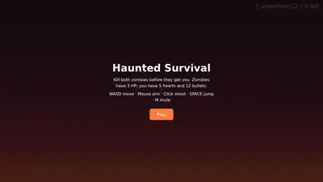</a> <b><a href="https://3d-game-smoky.vercel.app">3d-game</a></b> <a href="https://github.com/MUNISH983">MUNISH983</a> Lizenz unbekannt · <a href="https://github.com/MUNISH983/3d-game">Code</a></td>
<td width="25%" valign="top"><a href="https://ptfrey.github.io/abyssal-drift/">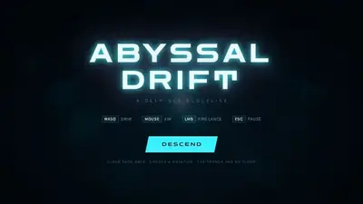</a> <b><a href="https://ptfrey.github.io/abyssal-drift/">abyssal-drift</a></b> <a href="https://github.com/ptfrey">ptfrey</a> Lizenz unbekannt · <a href="https://github.com/ptfrey/abyssal-drift">Code</a></td>
<td width="25%" valign="top"> <b><a href="https://agenthot.erom.cloud/">agenthot-the-game</a></b> <a href="https://github.com/eRom">eRom</a> Lizenz unbekannt · <a href="https://github.com/eRom/agenthot-the-game">Code</a></td>
<td width="25%" valign="top"> <b><a href="https://github.com/minetsh/ai-web-playground">ai-web-playground</a></b> <a href="https://github.com/minetsh">minetsh</a> Lizenz unbekannt · <a href="https://github.com/minetsh/ai-web-playground">Code</a></td>
</tr>
<tr>
<td width="25%" valign="top"><a href="https://x.com/_sholtodouglas/status/2119935331499925557">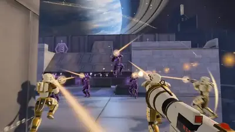</a> <b><a href="https://x.com/_sholtodouglas/status/2119935331499925557">Arena FPS with Portals</a></b> <a href="https://x.com/_sholtodouglas">Sholto Douglas</a> Lizenz unbekannt</td>
<td width="25%" valign="top"> <b><a href="https://calebschalesky-ops.github.io/ascent/">Ascent Flight</a></b> <a href="https://github.com/calebschalesky-ops">Caleb Schalesky</a> MIT · <a href="https://github.com/calebschalesky-ops/ascent">Code</a> · <a href="https://huggingface.co/datasets/AI-Terrarium/terrarium-open-works/tree/main/games/ascent-flight">Dateien</a></td>
<td width="25%" valign="top"><a href="https://beestake.itch.io/astrawatch">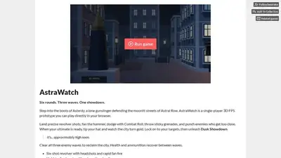</a> <b><a href="https://beestake.itch.io/astrawatch">Astrawatch</a></b> <a href="https://beestake.itch.io">beestake</a> Lizenz unbekannt · <a href="https://beestake.itch.io/astrawatch">Code</a></td>
<td width="25%" valign="top"><a href="https://green-workshop.github.io/black-door/">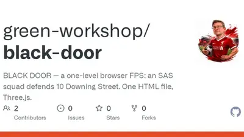</a> <b><a href="https://green-workshop.github.io/black-door/">black-door</a></b> <a href="https://github.com/green-workshop">green-workshop</a> Lizenz unbekannt · <a href="https://github.com/green-workshop/black-door">Code</a></td>
</tr>
<tr>
<td width="25%" valign="top"><a href="https://github.com/nizomiddindev/gemini-of-duty">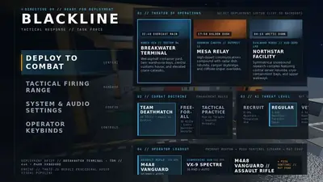</a> <b><a href="https://github.com/nizomiddindev/gemini-of-duty">BLACKLINE // TACTICAL RESPONSE</a></b> <a href="https://github.com/nizomiddindev">Nizomiddin</a> MIT · <a href="https://github.com/nizomiddindev/gemini-of-duty">Code</a> · <a href="https://huggingface.co/datasets/AI-Terrarium/terrarium-open-works/tree/main/games/blackline-tactical-response">Dateien</a></td>
<td width="25%" valign="top"> <b><a href="https://github.com/lompendans/blacksite-download/releases/tag/v1.0.0">BLACKSITE</a></b> <a href="https://github.com/lompendans">lompendans</a> Lizenz unbekannt</td>
<td width="25%" valign="top"> <b><a href="https://blameless.petruha.ge">Blameless</a></b> <a href="https://github.com/Petyok">Petyok</a> MIT · <a href="https://github.com/Petyok/blameless">Code</a> · <a href="https://huggingface.co/datasets/AI-Terrarium/terrarium-open-works/tree/main/games/blameless">Dateien</a></td>
<td width="25%" valign="top"> <b><a href="https://github.com/Ashalinux/block-shooter">Block Shooter</a></b> <a href="https://github.com/Ashalinux">Ashalinux</a> MIT · <a href="https://github.com/Ashalinux/block-shooter">Code</a> · <a href="https://huggingface.co/datasets/AI-Terrarium/terrarium-open-works/tree/main/games/block-shooter">Dateien</a></td>
</tr>
<tr>
<td width="25%" valign="top"> <b><a href="https://nipale-ai.github.io/blocks-openworld/">blocks-openworld</a></b> <a href="https://github.com/Nipale-ai">Nipale-ai</a> Lizenz unbekannt · <a href="https://github.com/Nipale-ai/blocks-openworld">Code</a></td>
<td width="25%" valign="top"><a href="https://aleks9.itch.io/breach-and-clear">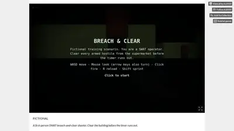</a> <b><a href="https://aleks9.itch.io/breach-and-clear">breach and clear</a></b> <a href="https://aleks9.itch.io">aleks9</a> Lizenz unbekannt · <a href="https://aleks9.itch.io/breach-and-clear">Code</a></td>
<td width="25%" valign="top"><a href="https://wjhooch.itch.io/canyon">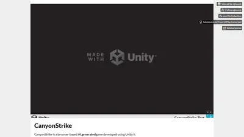</a> <b><a href="https://wjhooch.itch.io/canyon">CanyonStrike</a></b> <a href="https://wjhooch.itch.io">wjhooch</a> Lizenz unbekannt · <a href="https://wjhooch.itch.io/canyon">Code</a></td>
<td width="25%" valign="top"> <b><a href="https://riddhibose.github.io/CHRONOS-STRIKE/">CHRONOS-STRIKE</a></b> <a href="https://github.com/RiddhiBose">RiddhiBose</a> Lizenz unbekannt · <a href="https://github.com/RiddhiBose/CHRONOS-STRIKE">Code</a></td>
</tr>
<tr>
<td width="25%" valign="top"> <b><a href="https://amoreo140.github.io/cinderbelt/">Cinderbelt</a></b> <a href="https://github.com/amoreo140">amoreo140</a> MIT · <a href="https://github.com/amoreo140/cinderbelt">Code</a> · <a href="https://huggingface.co/datasets/AI-Terrarium/terrarium-open-works/tree/main/games/cinderbelt">Dateien</a></td>
<td width="25%" valign="top"> <b><a href="https://wongh26.github.io/claude_fps/">claude_fps</a></b> <a href="https://github.com/wongh26">wongh26</a> Lizenz unbekannt · <a href="https://github.com/wongh26/claude_fps">Code</a></td>
<td width="25%" valign="top"><a href="https://silasedel.github.io/claude-heist/">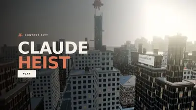</a> <b><a href="https://silasedel.github.io/claude-heist/">claude-heist</a></b> <a href="https://github.com/silasedel">silasedel</a> CC0-1.0 · <a href="https://github.com/silasedel/claude-heist">Code</a> · <a href="https://huggingface.co/datasets/AI-Terrarium/terrarium-open-works/tree/main/games/claude-heist">Dateien</a></td>
<td width="25%" valign="top"> <b><a href="https://promptengineer48.github.io/claude-opus-5.5-games/">claude-opus-5.5-games</a></b> <a href="https://github.com/PromptEngineer48">PromptEngineer48</a> Lizenz unbekannt · <a href="https://github.com/PromptEngineer48/claude-opus-5.5-games">Code</a></td>
</tr>
<tr>
<td width="25%" valign="top"> <b><a href="https://www.corosolto.com.br">client</a></b> <a href="https://github.com/corosolto">corosolto</a> AGPL-3.0 · <a href="https://github.com/corosolto/client">Code</a> · <a href="https://huggingface.co/datasets/AI-Terrarium/terrarium-open-works/tree/main/games/client">Dateien</a></td>
<td width="25%" valign="top"> <b><a href="https://comic-zombies.vercel.app">comic-zombies</a></b> <a href="https://github.com/elberacasa">elberacasa</a> Lizenz unbekannt · <a href="https://github.com/elberacasa/comic-zombies">Code</a></td>
<td width="25%" valign="top"><a href="https://edmancunningham.itch.io/crimson-forgeexe">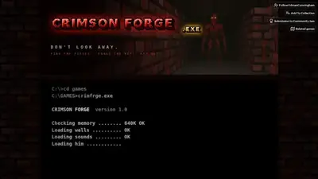</a> <b><a href="https://edmancunningham.itch.io/crimson-forgeexe">Crimson Forge.EXE</a></b> <a href="https://edmancunningham.itch.io">edmancunningham</a> Lizenz unbekannt · <a href="https://edmancunningham.itch.io/crimson-forgeexe">Code</a></td>
<td width="25%" valign="top"><a href="https://github.com/Gabry9110/CS-Clone-Fable5">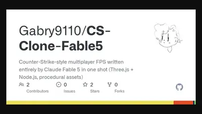</a> <b><a href="https://github.com/Gabry9110/CS-Clone-Fable5">CS-Clone-Fable5</a></b> <a href="https://github.com/Gabry9110">Gabry9110</a> MIT · <a href="https://github.com/Gabry9110/CS-Clone-Fable5">Code</a> · <a href="https://huggingface.co/datasets/AI-Terrarium/terrarium-open-works/tree/main/games/cs-clone-fable5">Dateien</a></td>
</tr>
<tr>
<td width="25%" valign="top"> <b><a href="https://deadraid.com/">Dead Raid</a></b> u/Sweaty_Breakfast2822 Lizenz unbekannt</td>
<td width="25%" valign="top"><a href="https://nooby0780.itch.io/dead-sector-9">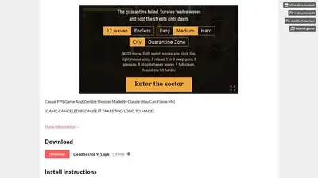</a> <b><a href="https://nooby0780.itch.io/dead-sector-9">Dead Sector 9</a></b> <a href="https://nooby0780.itch.io">nooby0780</a> Lizenz unbekannt · <a href="https://nooby0780.itch.io/dead-sector-9">Code</a></td>
<td width="25%" valign="top"> <b><a href="https://github.com/bridge-mind/claude-opus-5.5-zombies-game">DEAD SIGNAL: EXCLUSION ZONE</a></b> <a href="https://github.com/bridge-mind">BridgeMind</a> MIT · <a href="https://github.com/bridge-mind/claude-opus-5.5-zombies-game">Code</a> · <a href="https://huggingface.co/datasets/AI-Terrarium/terrarium-open-works/tree/main/games/dead-signal-exclusion-zone-claude-opus-5-5-zombies-game">Dateien</a></td>
<td width="25%" valign="top"> <b><a href="https://github.com/bridge-mind/sonnet-5-5-zombies-game">DEAD SIGNAL: EXCLUSION ZONE</a></b> <a href="https://github.com/bridge-mind">BridgeMind</a> MIT · <a href="https://github.com/bridge-mind/sonnet-5-5-zombies-game">Code</a> · <a href="https://huggingface.co/datasets/AI-Terrarium/terrarium-open-works/tree/main/games/dead-signal-exclusion-zone-sonnet-5-5-zombies-game">Dateien</a></td>
</tr>
<tr>
<td width="25%" valign="top"> <b><a href="https://www.spawn.co/@robot/frontline-warfare-deathmatch">Desert-town FPS</a></b> <a href="https://x.com/alightinastorm">alightinastorm</a> Lizenz unbekannt</td>
<td width="25%" valign="top"> <b><a href="https://cyancity.github.io/yolo-mini-fps/">零号码头 DOCK ZERO</a></b> <a href="https://github.com/cyancity">YOLO</a> MIT · <a href="https://github.com/cyancity/yolo-mini-fps">Code</a> · <a href="https://huggingface.co/datasets/AI-Terrarium/terrarium-open-works/tree/main/games/dock-zero">Dateien</a></td>
<td width="25%" valign="top"> <b><a href="https://megawinner9.itch.io/eggzone">Eggzone</a></b> <a href="https://megawinner9.itch.io">megawinner9</a> Lizenz unbekannt · <a href="https://megawinner9.itch.io/eggzone">Code</a></td>
<td width="25%" valign="top"> <b><a href="https://nipale-ai.github.io/fable-5-1-one-prompt-game/">fable-5-1-one-prompt-game</a></b> <a href="https://github.com/Nipale-ai">Nipale-ai</a> Lizenz unbekannt · <a href="https://github.com/Nipale-ai/fable-5-1-one-prompt-game">Code</a></td>
</tr>
<tr>
<td width="25%" valign="top"> <b><a href="https://wquguru.github.io/fable52-fps-repro/">Fable 5.2 FPS Reproduction</a></b> <a href="https://github.com/wquguru">wquguru</a> MIT · <a href="https://github.com/wquguru/fable52-fps-repro/blob/main/demos/04-fps/index.html">Code</a> · <a href="https://huggingface.co/datasets/AI-Terrarium/terrarium-open-works/tree/main/games/fable-5-2-fps-reproduction">Dateien</a></td>
<td width="25%" valign="top"> <b><a href="https://sc8z35a-collab.github.io/Fables5.2/">Fables5.2</a></b> <a href="https://github.com/sc8z35a-collab">sc8z35a-collab</a> Lizenz unbekannt · <a href="https://github.com/sc8z35a-collab/Fables5.2">Code</a></td>
<td width="25%" valign="top"><a href="https://x.com/jarrodwatts/status/2120030097004777937">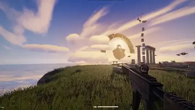</a> <b><a href="https://x.com/jarrodwatts/status/2120030097004777937">Floating-island FPS</a></b> <a href="https://x.com/jarrodwatts">Jarrod Watts</a> Lizenz unbekannt</td>
<td width="25%" valign="top"> <b><a href="https://tanuu5.github.io/foxfire-kagura/">foxfire-kagura</a></b> <a href="https://github.com/tanuu5">tanuu5</a> MIT · <a href="https://github.com/tanuu5/foxfire-kagura">Code</a> · <a href="https://huggingface.co/datasets/AI-Terrarium/terrarium-open-works/tree/main/games/foxfire-kagura">Dateien</a></td>
</tr>
<tr>
<td width="25%" valign="top"> <b><a href="https://awacke1-galaga-88-3d-game.static.hf.space/index.html">Galaga 88 3D Game</a></b> <a href="https://huggingface.co/awacke1">Aaron C Wacker</a> MIT · <a href="https://huggingface.co/spaces/awacke1/Galaga-88-3D-Game">Code</a> · <a href="https://huggingface.co/datasets/AI-Terrarium/terrarium-open-works/tree/main/games/galaga-88-3d-game">Dateien</a></td>
<td width="25%" valign="top"> <b><a href="https://x.com/MatthewBerman/status/2119868629491789992">Gears of War-style shooter</a></b> <a href="https://x.com/MatthewBerman">Matthew Berman</a> Lizenz unbekannt</td>
<td width="25%" valign="top"> <b><a href="https://gilt-and-gutter.vercel.app/">Gilt &amp; Gutter</a></b> Kevin Ngo Lizenz unbekannt · <a href="https://gilt-and-gutter.vercel.app/">Code</a></td>
<td width="25%" valign="top"> <b><a href="https://zombies.ethanplus.ai">Graveyard Shift</a></b> <a href="https://github.com/ethanplusai">Ethan+</a> MIT · <a href="https://github.com/ethanplusai/zombies">Code</a> · <a href="https://huggingface.co/datasets/AI-Terrarium/terrarium-open-works/tree/main/games/graveyard-shift">Dateien</a></td>
</tr>
<tr>
<td width="25%" valign="top"> <b><a href="https://jarvis-llm-codec.github.io/gridx/">GRIDX</a></b> <a href="https://github.com/jarvis-llm-codec">Kim jun</a> Apache-2.0 · <a href="https://github.com/jarvis-llm-codec/gridx">Code</a> · <a href="https://huggingface.co/datasets/AI-Terrarium/terrarium-open-works/tree/main/games/gridx">Dateien</a></td>
<td width="25%" valign="top"> <b><a href="https://topway-ai.github.io/harbor-blackout-gemini/">HARBOR BLACKOUT (Gemini Edition)</a></b> <a href="https://github.com/topway-ai">Jack</a> MIT · <a href="https://github.com/topway-ai/harbor-blackout-gemini">Code</a> · <a href="https://huggingface.co/datasets/AI-Terrarium/terrarium-open-works/tree/main/games/harbor-blackout-gemini-edition">Dateien</a></td>
<td width="25%" valign="top"> <b><a href="https://homie-wu.github.io/hideaway/">HIDEAWAY · Voxel Prop Hunt</a></b> <a href="https://github.com/Homie-Wu">Homie-Wu</a> MIT · <a href="https://github.com/Homie-Wu/hideaway">Code</a> · <a href="https://huggingface.co/datasets/AI-Terrarium/terrarium-open-works/tree/main/games/hideaway-voxel-prop-hunt">Dateien</a></td>
<td width="25%" valign="top"> <b><a href="https://tanuu5.github.io/ink-arcade/ink-dash.html">INK DASH</a></b> <a href="https://github.com/tanuu5">たぬ（tanu）</a> MIT · <a href="https://github.com/tanuu5/ink-arcade">Code</a> · <a href="https://huggingface.co/datasets/AI-Terrarium/terrarium-open-works/tree/main/games/ink-dash">Dateien</a></td>
</tr>
<tr>
<td width="25%" valign="top"> <b><a href="https://rookieracing.itch.io/invasion-station-demo">INVASION STATION: Demo</a></b> <a href="https://rookieracing.itch.io">rookieracing</a> Lizenz unbekannt · <a href="https://rookieracing.itch.io/invasion-station-demo">Code</a></td>
<td width="25%" valign="top"> <b><a href="https://mahdi-dev.itch.io/iron-dawn">IRON DAWN</a></b> <a href="https://mahdi-dev.itch.io">mahdi-dev</a> Lizenz unbekannt · <a href="https://mahdi-dev.itch.io/iron-dawn">Code</a></td>
<td width="25%" valign="top"><a href="https://iron-man-fable-5.vercel.app">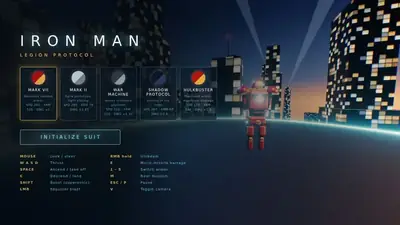</a> <b><a href="https://iron-man-fable-5.vercel.app">Iron-Man-Fable-5</a></b> <a href="https://github.com/Aaryan-Kapoor">Aaryan-Kapoor</a> Lizenz unbekannt · <a href="https://github.com/Aaryan-Kapoor/Iron-Man-Fable-5">Code</a></td>
<td width="25%" valign="top"> <b><a href="https://evals.ag/outputs/out_18S2MGB2ZVFFX7HX842YNWYCF2">IRON TIDE: Terminal 7</a></b> Evan Cha / Evals Lizenz unbekannt · <a href="https://evals.ag/api/v1/media/assets/ast_0JAMNBYNJNTMAM502JBG09HY48/content">Code</a></td>
</tr>
<tr>
<td width="25%" valign="top"><a href="https://qiaomu.t5t6.com/irondusk-yard-7/">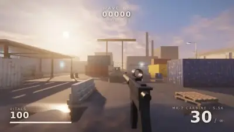</a> <b><a href="https://qiaomu.t5t6.com/irondusk-yard-7/">IRONDUSK — Yard 7</a></b> 向阳乔木 (@vista8) Lizenz unbekannt · <a href="https://qiaomu.t5t6.com/irondusk-yard-7/">Code</a></td>
<td width="25%" valign="top"><a href="https://babyboy8483.itch.io/island-battle">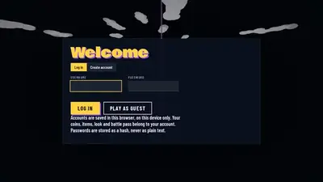</a> <b><a href="https://babyboy8483.itch.io/island-battle">Island battle</a></b> <a href="https://babyboy8483.itch.io">babyboy8483</a> Lizenz unbekannt · <a href="https://babyboy8483.itch.io/island-battle">Code</a></td>
<td width="25%" valign="top"> <b><a href="https://github.com/gretchenboria/jester-deadline">jester-deadline</a></b> <a href="https://github.com/gretchenboria">gretchenboria</a> Lizenz unbekannt · <a href="https://github.com/gretchenboria/jester-deadline">Code</a></td>
<td width="25%" valign="top"><a href="https://evals.ag/outputs/out_32XV66QX3Q8088XDCG15YQ2R19">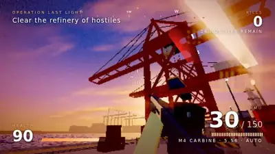</a> <b><a href="https://evals.ag/outputs/out_32XV66QX3Q8088XDCG15YQ2R19">LAST LIGHT: Dockside Refinery</a></b> Evan Cha / Evals Lizenz unbekannt · <a href="https://evals.ag/api/v1/media/assets/ast_1AZW7W4223G2KWGJVR9WF54K3F/content">Code</a></td>
</tr>
<tr>
<td width="25%" valign="top"> <b><a href="https://albertoit-23.github.io/meridian-line/">Meridian Line</a></b> <a href="https://github.com/AlbertoIT-23">AlbertoIT</a> MIT · <a href="https://github.com/AlbertoIT-23/meridian-line">Code</a> · <a href="https://huggingface.co/datasets/AI-Terrarium/terrarium-open-works/tree/main/games/meridian-line">Dateien</a></td>
<td width="25%" valign="top"> <b><a href="https://www.bilibili.com/video/BV1yJW168ENZ/">Metal Slug in 3D</a></b> 阿达的AI思辩 Lizenz unbekannt</td>
<td width="25%" valign="top"><a href="https://neon-arena-dun.vercel.app">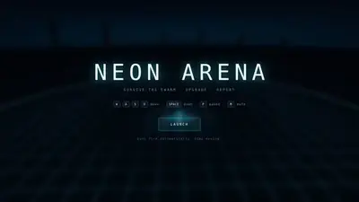</a> <b><a href="https://neon-arena-dun.vercel.app">neon-arena</a></b> <a href="https://github.com/Shafiur0">Shafiur0</a> Lizenz unbekannt · <a href="https://github.com/Shafiur0/neon-arena">Code</a></td>
<td width="25%" valign="top"><a href="https://ekkh1300.github.io/neon-city-strike/">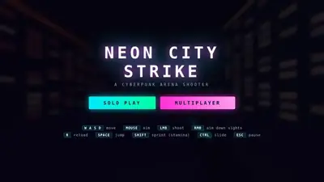</a> <b><a href="https://ekkh1300.github.io/neon-city-strike/">neon-city-strike</a></b> <a href="https://github.com/Ekkh1300">Ekkh1300</a> Lizenz unbekannt · <a href="https://github.com/Ekkh1300/neon-city-strike">Code</a></td>
</tr>
<tr>
<td width="25%" valign="top"> <b><a href="https://8bitvapor.itch.io/neon-city-strike-2">Neon City Strike 2</a></b> <a href="https://8bitvapor.itch.io">8bitvapor</a> Lizenz unbekannt · <a href="https://8bitvapor.itch.io/neon-city-strike-2">Code</a></td>
<td width="25%" valign="top"> <b><a href="https://nnnnnnnnnke.github.io/neon-surge/">NEON SURGE</a></b> <a href="https://github.com/nnnnnnnnnke">Kinukui</a> MIT · <a href="https://github.com/nnnnnnnnnke/neon-surge">Code</a> · <a href="https://huggingface.co/datasets/AI-Terrarium/terrarium-open-works/tree/main/games/neon-surge">Dateien</a></td>
<td width="25%" valign="top"> <b><a href="https://tanuu5.github.io/nova-lancer/">NOVA LANCER（ノヴァ・ランサー）</a></b> <a href="https://github.com/tanuu5">たぬ（tanu）</a> MIT · <a href="https://github.com/tanuu5/nova-lancer">Code</a> · <a href="https://huggingface.co/datasets/AI-Terrarium/terrarium-open-works/tree/main/games/nova-lancer">Dateien</a></td>
<td width="25%" valign="top"> <b><a href="https://github.com/bobbyt-stack/nuke-3d">nuke-3d</a></b> <a href="https://github.com/bobbyt-stack">bobbyt-stack</a> MIT · <a href="https://github.com/bobbyt-stack/nuke-3d">Code</a> · <a href="https://huggingface.co/datasets/AI-Terrarium/terrarium-open-works/tree/main/games/nuke-3d">Dateien</a></td>
</tr>
<tr>
<td width="25%" valign="top"><a href="https://www.reddit.com/r/ClaudeAI/comments/1xt2kax/i_gave_claude_fable_52_one_prompt_and_got_a/">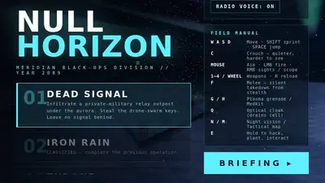</a> <b><a href="https://www.reddit.com/r/ClaudeAI/comments/1xt2kax/i_gave_claude_fable_52_one_prompt_and_got_a/">Null Horizon</a></b> <a href="https://github.com/dantecomedia">dantecomedia</a> Lizenz unbekannt · <a href="https://github.com/dantecomedia/null-horizon">Code</a></td>
<td width="25%" valign="top"><a href="https://8digo.itch.io/oblivion-rooms">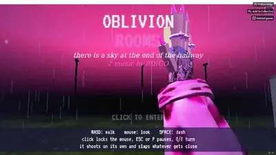</a> <b><a href="https://8digo.itch.io/oblivion-rooms">Oblivion Rooms</a></b> <a href="https://8digo.itch.io">8digo</a> Lizenz unbekannt · <a href="https://8digo.itch.io/oblivion-rooms">Code</a></td>
<td width="25%" valign="top"> <b><a href="https://theredstapler.github.io/orb-shooter/">Orb Shooter FPS Demo (Vibe Coded)</a></b> <a href="https://github.com/theredstapler">Red Stapler</a> MIT · <a href="https://github.com/theredstapler/orb-shooter">Code</a> · <a href="https://huggingface.co/datasets/AI-Terrarium/terrarium-open-works/tree/main/games/orb-shooter-fps-demo-vibe-coded">Dateien</a></td>
<td width="25%" valign="top"> <b><a href="https://ultraviolet-01.itch.io/overclock">Overclock</a></b> <a href="https://ultraviolet-01.itch.io">ultraviolet-01</a> Lizenz unbekannt · <a href="https://ultraviolet-01.itch.io/overclock">Code</a></td>
</tr>
<tr>
<td width="25%" valign="top"> <b><a href="https://code-yeongyu.github.io/overwatch-omo-native-fable/">overwatch-omo-native-fable</a></b> <a href="https://github.com/code-yeongyu">code-yeongyu</a> Lizenz unbekannt · <a href="https://github.com/code-yeongyu/overwatch-omo-native-fable">Code</a></td>
<td width="25%" valign="top"><a href="https://github.com/JugPanda/Paintball-FPS">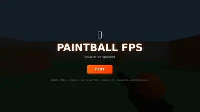</a> <b><a href="https://github.com/JugPanda/Paintball-FPS">Paintball-FPS</a></b> <a href="https://github.com/JugPanda">JugPanda</a> Lizenz unbekannt · <a href="https://github.com/JugPanda/Paintball-FPS">Code</a></td>
<td width="25%" valign="top"><a href="https://pholab.itch.io/papersnipes">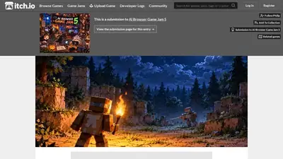</a> <b><a href="https://pholab.itch.io/papersnipes">PAPER SNIPES</a></b> <a href="https://pholab.itch.io">pholab</a> Lizenz unbekannt · <a href="https://pholab.itch.io/papersnipes">Code</a></td>
<td width="25%" valign="top"><a href="https://patch.gg/play/rehan/ringfall">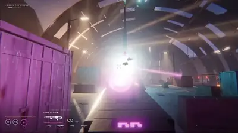</a> <b><a href="https://patch.gg/play/rehan/ringfall">ringfall</a></b> Rehan Sheikh Lizenz unbekannt · <a href="https://git.patch.gg/rehan/ringfall.git">Code</a></td>
</tr>
<tr>
<td width="25%" valign="top"> <b><a href="https://alexsmb2.itch.io/robot-war-shooter">Robot war shooter</a></b> <a href="https://alexsmb2.itch.io">alexsmb2</a> Lizenz unbekannt · <a href="https://alexsmb2.itch.io/robot-war-shooter">Code</a></td>
<td width="25%" valign="top"> <b><a href="https://michaelcrosato.github.io/robot-warrior/">RobotWarrior</a></b> <a href="https://github.com/michaelcrosato">Michael</a> MIT · <a href="https://github.com/michaelcrosato/robot-warrior">Code</a> · <a href="https://huggingface.co/datasets/AI-Terrarium/terrarium-open-works/tree/main/games/robotwarrior">Dateien</a></td>
<td width="25%" valign="top"><a href="https://claude.ai/artifact/BGY1SztrAYcJQHSsnHHGmp">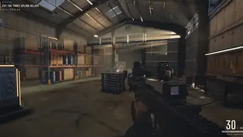</a> <b><a href="https://claude.ai/artifact/BGY1SztrAYcJQHSsnHHGmp">Saltline</a></b> Felix Rieseberg Lizenz unbekannt · <a href="https://claude.ai/artifact/BGY1SztrAYcJQHSsnHHGmp">Code</a></td>
<td width="25%" valign="top"> <b><a href="http://wuduoyi.com/saltline-asset/">saltline-asset</a></b> <a href="https://github.com/nwind">nwind</a> Lizenz unbekannt · <a href="https://github.com/nwind/saltline-asset">Code</a></td>
</tr>
<tr>
<td width="25%" valign="top"><a href="https://realcodebear.github.io/saltline-fable-5.2/">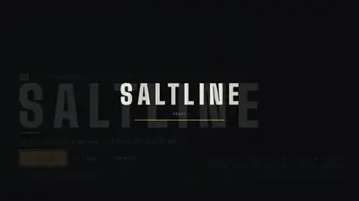</a> <b><a href="https://realcodebear.github.io/saltline-fable-5.2/">saltline_chen</a></b> <a href="https://github.com/chenduanyun091216">chenduanyun091216</a> Lizenz unbekannt · <a href="https://github.com/chenduanyun091216/saltline_chen">Code</a></td>
<td width="25%" valign="top"> <b><a href="https://github.com/guozl-dev/saltline-ext">saltline-ext</a></b> <a href="https://github.com/guozl-dev">guozl-dev</a> Lizenz unbekannt · <a href="https://github.com/guozl-dev/saltline-ext">Code</a></td>
<td width="25%" valign="top"> <b><a href="https://1873575791.github.io/saltline-fable-5.2/">saltline-fable-5.2</a></b> <a href="https://github.com/1873575791">1873575791</a> Lizenz unbekannt · <a href="https://github.com/1873575791/saltline-fable-5.2">Code</a></td>
<td width="25%" valign="top"> <b><a href="https://2727345589.github.io/saltline-fable-5.2/">saltline-fable-5.2</a></b> <a href="https://github.com/2727345589">2727345589</a> Lizenz unbekannt · <a href="https://github.com/2727345589/saltline-fable-5.2">Code</a></td>
</tr>
<tr>
<td width="25%" valign="top"><a href="https://realcodebear.github.io/saltline-fable-5.2/">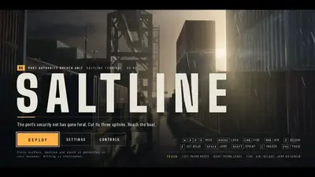</a> <b><a href="https://realcodebear.github.io/saltline-fable-5.2/">saltline-fable-5.2</a></b> <a href="https://github.com/KDayInSummer">KDayInSummer</a> Lizenz unbekannt · <a href="https://github.com/KDayInSummer/saltline-fable-5.2">Code</a></td>
<td width="25%" valign="top"> <b><a href="https://realcodebear.github.io/saltline-fable-5.2/">saltline-fable-5.2</a></b> <a href="https://github.com/MON724">MON724</a> Lizenz unbekannt · <a href="https://github.com/MON724/saltline-fable-5.2">Code</a></td>
<td width="25%" valign="top"> <b><a href="https://realcodebear.github.io/saltline-fable-5.2/">saltline-fable-5.2</a></b> <a href="https://github.com/realcodebear">realcodebear</a> Lizenz unbekannt · <a href="https://github.com/realcodebear/saltline-fable-5.2">Code</a></td>
<td width="25%" valign="top"> <b><a href="https://yuyang2230.github.io/saltline-resort-island/">saltline-resort-island</a></b> <a href="https://github.com/yuyang2230">yuyang2230</a> Lizenz unbekannt · <a href="https://github.com/yuyang2230/saltline-resort-island">Code</a></td>
</tr>
<tr>
<td width="25%" valign="top"> <b><a href="https://github.com/lyfe42/saltline-study-copy">saltline-study-copy</a></b> <a href="https://github.com/lyfe42">lyfe42</a> Lizenz unbekannt · <a href="https://github.com/lyfe42/saltline-study-copy">Code</a></td>
<td width="25%" valign="top"> <b><a href="https://realcodebear.github.io/saltline-fable-5.2/">SaltLineClone</a></b> <a href="https://github.com/PacificaStarlight">PacificaStarlight</a> Lizenz unbekannt · <a href="https://github.com/PacificaStarlight/SaltLineClone">Code</a></td>
<td width="25%" valign="top"><a href="https://github.com/ConjureGanja/slug-force-69">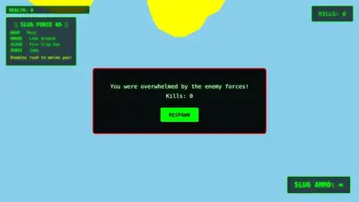</a> <b><a href="https://github.com/ConjureGanja/slug-force-69">slug-force-69</a></b> <a href="https://github.com/ConjureGanja">ConjureGanja</a> Lizenz unbekannt · <a href="https://github.com/ConjureGanja/slug-force-69">Code</a></td>
<td width="25%" valign="top"> <b><a href="https://x.com/higgsfield_ai/status/2119897113534529605">Space-station shooter</a></b> <a href="https://x.com/higgsfield_ai">Higgsfield</a> Lizenz unbekannt</td>
</tr>
<tr>
<td width="25%" valign="top"> <b><a href="https://evals.ag/outputs/out_64YQ9Y1C28PS2M09T05JV39Z2S">SPIREFALL: Assault on the Terraforming Spire</a></b> Evan Cha / Evals Lizenz unbekannt · <a href="https://evals.ag/api/v1/media/assets/ast_7G3X8N7GY5TX46BAE1H7HBFW99/content">Code</a></td>
<td width="25%" valign="top"> <b><a href="https://damijjj.github.io/Status-1/">STATUS 1 — browser FPS</a></b> <a href="https://github.com/DamiJJJ">Dami</a> MIT · <a href="https://github.com/DamiJJJ/Status-1">Code</a> · <a href="https://huggingface.co/datasets/AI-Terrarium/terrarium-open-works/tree/main/games/status-1-browser-fps">Dateien</a></td>
<td width="25%" valign="top"> <b><a href="https://fps-fable52-7d7eb4.surge.sh/">SUBLEVEL 03</a></b> Leohuan Lizenz unbekannt · <a href="https://fps-fable52-7d7eb4.surge.sh/">Code</a></td>
<td width="25%" valign="top"> <b><a href="https://macrochel.itch.io/tankops">TankOps</a></b> <a href="https://macrochel.itch.io">macrochel</a> Lizenz unbekannt · <a href="https://macrochel.itch.io/tankops">Code</a></td>
</tr>
<tr>
<td width="25%" valign="top"> <b><a href="https://haruka-apps-games.itch.io/terminal-shooter-machine-soul">TERMINAL SHOOTER: Machine Soul</a></b> <a href="https://haruka-apps-games.itch.io">haruka-apps-games</a> Lizenz unbekannt · <a href="https://haruka-apps-games.itch.io/terminal-shooter-machine-soul">Code</a></td>
<td width="25%" valign="top"><a href="https://mihaibulic2.github.io/test-game-claude-4.8/">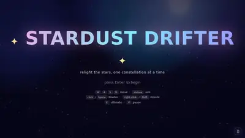</a> <b><a href="https://mihaibulic2.github.io/test-game-claude-4.8/">test-game-claude-4.8</a></b> <a href="https://github.com/mihaibulic2">mihaibulic2</a> Lizenz unbekannt · <a href="https://github.com/mihaibulic2/test-game-claude-4.8">Code</a></td>
<td width="25%" valign="top"> <b><a href="https://github.com/Hrithin-30/thing-game">THING HUNTER</a></b> <a href="https://github.com/Hrithin-30">Brahmadevu Hrithin kumar</a> MIT · <a href="https://github.com/Hrithin-30/thing-game">Code</a> · <a href="https://huggingface.co/datasets/AI-Terrarium/terrarium-open-works/tree/main/games/thing-hunter">Dateien</a></td>
<td width="25%" valign="top"><a href="https://github.com/Alwin936/Three.Js-FPS-Game---Vibe-Coded-w-Codex">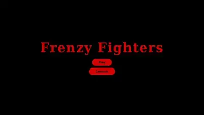</a> <b><a href="https://github.com/Alwin936/Three.Js-FPS-Game---Vibe-Coded-w-Codex">Three.Js-FPS-Game---Vibe-Coded-w-Codex</a></b> <a href="https://github.com/Alwin936">Alwin936</a> Lizenz unbekannt · <a href="https://github.com/Alwin936/Three.Js-FPS-Game---Vibe-Coded-w-Codex">Code</a></td>
</tr>
<tr>
<td width="25%" valign="top"> <b><a href="https://github.com/WWWillems/threejs-shooter">threejs-shooter</a></b> <a href="https://github.com/WWWillems">WWWillems</a> MIT · <a href="https://github.com/WWWillems/threejs-shooter">Code</a> · <a href="https://huggingface.co/datasets/AI-Terrarium/terrarium-open-works/tree/main/games/threejs-shooter">Dateien</a></td>
<td width="25%" valign="top"> <b><a href="https://tinyarena.online">TINY ARENA</a></b> <a href="https://github.com/tpoxa">Maksym Trofimenko</a> MIT · <a href="https://github.com/tpoxa/tinyarena">Code</a> · <a href="https://huggingface.co/datasets/AI-Terrarium/terrarium-open-works/tree/main/games/tiny-arena">Dateien</a></td>
<td width="25%" valign="top"><a href="https://ai-games-are-fun.itch.io/slop-raiders">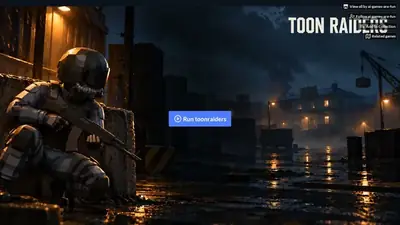</a> <b><a href="https://ai-games-are-fun.itch.io/slop-raiders">Toon Raiders</a></b> <a href="https://ai-games-are-fun.itch.io">ai-games-are-fun</a> Lizenz unbekannt · <a href="https://ai-games-are-fun.itch.io/slop-raiders">Code</a></td>
<td width="25%" valign="top"> <b><a href="https://gigabitgamelab.com/arcade/play/tsuranuki-kai/">TSURANUKI KAI</a></b> Gigabit Game Lab Lizenz unbekannt</td>
</tr>
<tr>
<td width="25%" valign="top"> <b><a href="https://lek-vob.itch.io/tunnel-z">Tunnel-Z</a></b> <a href="https://lek-vob.itch.io">lek-vob</a> Lizenz unbekannt · <a href="https://lek-vob.itch.io/tunnel-z">Code</a></td>
<td width="25%" valign="top"><a href="https://github.com/jimtoy/udemy_claude_code">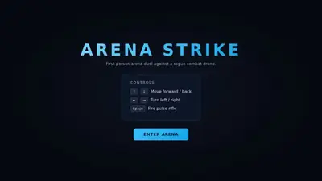</a> <b><a href="https://github.com/jimtoy/udemy_claude_code">udemy_claude_code</a></b> <a href="https://github.com/jimtoy">jimtoy</a> Lizenz unbekannt · <a href="https://github.com/jimtoy/udemy_claude_code">Code</a></td>
<td width="25%" valign="top"> <b><a href="https://rafael-mogger.itch.io/ultima-ronda">Ultima-ronda</a></b> <a href="https://rafael-mogger.itch.io">rafael-mogger</a> Lizenz unbekannt · <a href="https://rafael-mogger.itch.io/ultima-ronda">Code</a></td>
<td width="25%" valign="top"> <b><a href="https://shain1912.github.io/vanguard-arena/">vanguard-arena</a></b> <a href="https://github.com/shain1912">shain1912</a> Lizenz unbekannt · <a href="https://github.com/shain1912/vanguard-arena">Code</a></td>
</tr>
<tr>
<td width="25%" valign="top"> <b><a href="https://madhurjyabharadwaj.github.io/virtua-justice-rail-shooter/">virtua-justice-rail-shooter</a></b> <a href="https://github.com/madhurjyabharadwaj">madhurjyabharadwaj</a> MIT · <a href="https://github.com/madhurjyabharadwaj/virtua-justice-rail-shooter">Code</a> · <a href="https://huggingface.co/datasets/AI-Terrarium/terrarium-open-works/tree/main/games/virtua-justice-rail-shooter">Dateien</a></td>
<td width="25%" valign="top"><a href="https://github.com/KiranMohan-92/warsaw-downtown-game">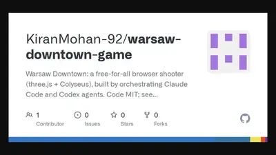</a> <b><a href="https://github.com/KiranMohan-92/warsaw-downtown-game">WARSAW DOWNTOWN</a></b> <a href="https://github.com/KiranMohan-92">Kiran Mohan</a> MIT · <a href="https://github.com/KiranMohan-92/warsaw-downtown-game">Code</a> · <a href="https://huggingface.co/datasets/AI-Terrarium/terrarium-open-works/tree/main/games/warsaw-downtown">Dateien</a></td>
<td width="25%" valign="top"><a href="https://workmelt.com">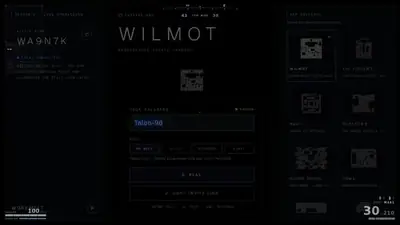</a> <b><a href="https://workmelt.com">Workmelt</a></b> <a href="https://github.com/eriknomitch">Erik Nomitch</a> MIT · <a href="https://github.com/eriknomitch/workmelt">Code</a> · <a href="https://huggingface.co/datasets/AI-Terrarium/terrarium-open-works/tree/main/games/workmelt">Dateien</a></td>
<td width="25%" valign="top"><a href="https://xo-beta.pages.dev/">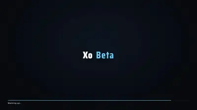</a> <b><a href="https://xo-beta.pages.dev/">Xo Beta</a></b> <a href="https://github.com/TKY-27">Ana</a> MIT · <a href="https://github.com/TKY-27/Xo-Beta">Code</a> · <a href="https://huggingface.co/datasets/AI-Terrarium/terrarium-open-works/tree/main/games/xo-beta">Dateien</a></td>
</tr>
<tr>
<td width="25%" valign="top"> <b><a href="https://neurorich.ru/projects/claude-fable-5-2-proekty/">Zombie FPS: AK-47</a></b> Нейро Рич Lizenz unbekannt · <a href="https://neurorich.ru/files/claude-fable-5-2-proekty.zip">Code</a></td>
<td width="25%" valign="top"> <b><a href="https://elpq.itch.io/zofe12367">ZONBIE APOCALYPSE 3D | ENG \ RU</a></b> <a href="https://elpq.itch.io">elpq</a> Lizenz unbekannt · <a href="https://elpq.itch.io/zofe12367">Code</a></td>
<td width="25%"></td>
<td width="25%"></td>
</tr>
</table>

Werke ohne Vorschaubild:

<table>

<tr><th align="left">Werk</th><th align="left">Urheber</th><th align="left">Lizenz</th><th align="left">Links</th></tr>

<tr><td><a href="https://clashraider02-ctrl.github.io/breach-protocol/">breach-protocol</a></td><td><a href="https://github.com/clashraider02-ctrl">clashraider02-ctrl</a></td><td>Lizenz unbekannt</td><td><a href="https://github.com/clashraider02-ctrl/breach-protocol">Code</a></td></tr>

<tr><td><a href="https://luminazombies.com/">Lumina Zombies</a></td><td>@LuminaBench</td><td>All rights reserved</td><td>—</td></tr>

<tr><td><a href="https://github.com/Aasiya-au/Nova-strike">Nova-strike</a></td><td><a href="https://github.com/Aasiya-au">Aasiya-au</a></td><td>Lizenz unbekannt</td><td><a href="https://github.com/Aasiya-au/Nova-strike">Code</a></td></tr>

<tr><td><a href="https://www.spawn.co/@abbidabbi/pogo-riot">Pogo Riot</a></td><td>@Pumpnasterr</td><td>Lizenz unbekannt</td><td>—</td></tr>

<tr><td><a href="https://claude.ai/artifact/MXxb36zKgN261ckbGhmNin">Three Games (Saltline · The Clockmaker&#x27;s Heart · Tidewright)</a></td><td>@felixrieseberg</td><td>Lizenz unbekannt</td><td>—</td></tr>

</table>

## Action und Kampf

<table>
<tr>
<td width="25%" valign="top"><a href="https://github.com/GavinLOrio/Fable-5.2-random-game/commit/55838a1f7565dc713edb3f985187338368fe6a81">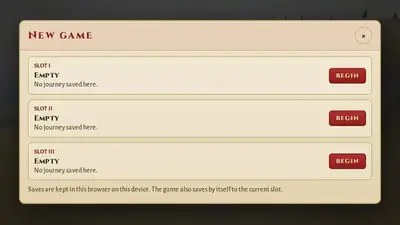</a> <b><a href="https://github.com/GavinLOrio/Fable-5.2-random-game/commit/55838a1f7565dc713edb3f985187338368fe6a81">Aquila</a></b> <a href="https://github.com/GavinLOrio">GavinLOrio</a> Lizenz unbekannt · <a href="https://github.com/GavinLOrio/Fable-5.2-random-game/blob/55838a1f7565dc713edb3f985187338368fe6a81/rome/index.html">Code</a></td>
<td width="25%" valign="top"> <b><a href="https://tanuu5.github.io/astra-potato-farm/">アストラのじゃがいも畑 — Astra&#x27;s Potato Farm</a></b> <a href="https://github.com/tanuu5">たぬ（tanu）</a> MIT · <a href="https://github.com/tanuu5/astra-potato-farm">Code</a> · <a href="https://huggingface.co/datasets/AI-Terrarium/terrarium-open-works/tree/main/games/astra-s-potato-farm-tanuu5">Dateien</a></td>
<td width="25%" valign="top"> <b><a href="https://bunesky.itch.io/avalon-1">Avalon 1</a></b> <a href="https://bunesky.itch.io">bunesky</a> Lizenz unbekannt · <a href="https://bunesky.itch.io/avalon-1">Code</a></td>
<td width="25%" valign="top"><a href="https://justanormalchurro.itch.io/brawl">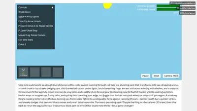</a> <b><a href="https://justanormalchurro.itch.io/brawl">Brawl!</a></b> <a href="https://justanormalchurro.itch.io">justanormalchurro</a> Lizenz unbekannt · <a href="https://justanormalchurro.itch.io/brawl">Code</a></td>
</tr>
<tr>
<td width="25%" valign="top"><a href="https://thebenn.me/Chains-of-Hera/">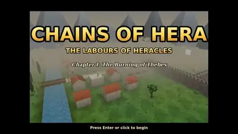</a> <b><a href="https://thebenn.me/Chains-of-Hera/">Chains-of-Hera</a></b> <a href="https://github.com/BMKoscak">BMKoscak</a> MIT · <a href="https://github.com/BMKoscak/Chains-of-Hera">Code</a> · <a href="https://huggingface.co/datasets/AI-Terrarium/terrarium-open-works/tree/main/games/chains-of-hera">Dateien</a></td>
<td width="25%" valign="top"><a href="https://neobrothers.itch.io/speedrun-prototype">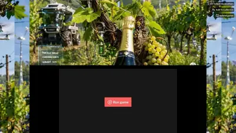</a> <b><a href="https://neobrothers.itch.io/speedrun-prototype">Champagne Gardet Vision 2175</a></b> <a href="https://neobrothers.itch.io">neobrothers</a> Lizenz unbekannt · <a href="https://neobrothers.itch.io/speedrun-prototype">Code</a></td>
<td width="25%" valign="top"> <b><a href="https://www.aigameshare.com/games/falling-sand-roguelike">CinderDeep</a></b> Nil Ni Lizenz unbekannt</td>
<td width="25%" valign="top"> <b><a href="https://usama-shiranai90.github.io/Claude-of-Iron/">Claude of Iron</a></b> <a href="https://github.com/usama-shiranai90">Sama</a> MIT · <a href="https://github.com/usama-shiranai90/Claude-of-Iron">Code</a> · <a href="https://huggingface.co/datasets/AI-Terrarium/terrarium-open-works/tree/main/games/claude-of-iron">Dateien</a></td>
</tr>
<tr>
<td width="25%" valign="top"><a href="https://github.com/elberacasa/claudeage">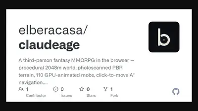</a> <b><a href="https://github.com/elberacasa/claudeage">claudeage</a></b> <a href="https://github.com/elberacasa">elberacasa</a> MIT · <a href="https://github.com/elberacasa/claudeage">Code</a> · <a href="https://huggingface.co/datasets/AI-Terrarium/terrarium-open-works/tree/main/games/claudeage">Dateien</a></td>
<td width="25%" valign="top"><a href="https://pablitofernandez.github.io/coinkeep/">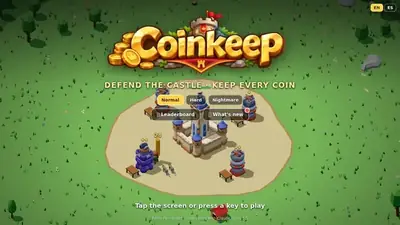</a> <b><a href="https://pablitofernandez.github.io/coinkeep/">Coinkeep</a></b> <a href="https://github.com/pablitofernandez">pablitofernandez</a> MIT · <a href="https://github.com/pablitofernandez/coinkeep">Code</a> · <a href="https://huggingface.co/datasets/AI-Terrarium/terrarium-open-works/tree/main/games/coinkeep">Dateien</a></td>
<td width="25%" valign="top"><a href="https://github.com/GavinLOrio/Fable-5.2-random-game/commit/6051b625701c68e9fcef4bef30f2476f287830e5">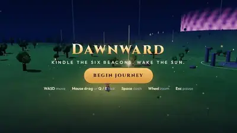</a> <b><a href="https://github.com/GavinLOrio/Fable-5.2-random-game/commit/6051b625701c68e9fcef4bef30f2476f287830e5">Dawnward</a></b> <a href="https://github.com/GavinLOrio">GavinLOrio</a> Lizenz unbekannt · <a href="https://github.com/GavinLOrio/Fable-5.2-random-game/blob/6051b625701c68e9fcef4bef30f2476f287830e5/index.html">Code</a></td>
<td width="25%" valign="top"> <b><a href="https://ahmaddentist30.itch.io/dino-jungle-survival-3d">Dino Jungle Survival 3D</a></b> <a href="https://ahmaddentist30.itch.io">ahmaddentist30</a> Lizenz unbekannt · <a href="https://html-classic.itch.zone/html/20412026/index.html?v=1794293623">Code</a></td>
</tr>
<tr>
<td width="25%" valign="top"> <b><a href="https://djinnpunk.itch.io/djinnpunk">DjinnPunk</a></b> <a href="https://djinnpunk.itch.io">djinnpunk</a> Lizenz unbekannt · <a href="https://djinnpunk.itch.io/djinnpunk">Code</a></td>
<td width="25%" valign="top"><a href="http://dragonraiders.goblingames.gg/">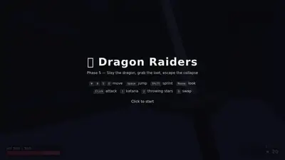</a> <b><a href="http://dragonraiders.goblingames.gg/">dragon-raiders</a></b> <a href="https://github.com/zillabunny">zillabunny</a> Lizenz unbekannt · <a href="https://github.com/zillabunny/dragon-raiders">Code</a></td>
<td width="25%" valign="top"> <b><a href="https://github.com/SaiAmartya/DungeonofDoom">DungeonofDoom</a></b> <a href="https://github.com/SaiAmartya">SaiAmartya</a> Lizenz unbekannt · <a href="https://github.com/SaiAmartya/DungeonofDoom">Code</a></td>
<td width="25%" valign="top"> <b><a href="https://eldor.pages.dev">Eldor</a></b> <a href="https://github.com/alan890104">Yu Lun Hsu</a> MIT · <a href="https://github.com/alan890104/Eldor">Code</a> · <a href="https://huggingface.co/datasets/AI-Terrarium/terrarium-open-works/tree/main/games/eldor">Dateien</a></td>
</tr>
<tr>
<td width="25%" valign="top"><a href="https://jpdupree.github.io/emberwood/">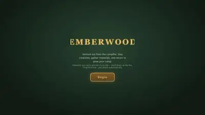</a> <b><a href="https://jpdupree.github.io/emberwood/">emberwood</a></b> <a href="https://github.com/jpdupree">jpdupree</a> All rights reserved · <a href="https://github.com/jpdupree/emberwood">Code</a></td>
<td width="25%" valign="top"> <b><a href="https://evensong-phi.vercel.app/">Evensong</a></b> Kevin Ngo Lizenz unbekannt · <a href="https://evensong-phi.vercel.app/">Code</a></td>
<td width="25%" valign="top"> <b><a href="https://fable.wawasensei.dev">fable-lite</a></b> <a href="https://github.com/wass08">wass08</a> Lizenz unbekannt · <a href="https://github.com/wass08/fable-lite">Code</a></td>
<td width="25%" valign="top"><a href="https://fable-survival.vercel.app">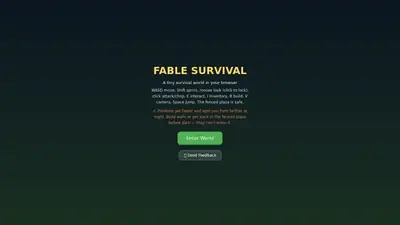</a> <b><a href="https://fable-survival.vercel.app">fable-survival</a></b> <a href="https://github.com/JaronKBragg7337">JaronKBragg7337</a> Lizenz unbekannt · <a href="https://github.com/JaronKBragg7337/fable-survival">Code</a></td>
</tr>
<tr>
<td width="25%" valign="top"> <b><a href="https://feed-backrooms.vercel.app/">FEED</a></b> <a href="https://github.com/Leonxlnx">Leon Lin</a> Lizenz unbekannt · <a href="https://feed-backrooms.vercel.app/">Code</a></td>
<td width="25%" valign="top"> <b><a href="https://www.spawn.co/@mattshumer/hogwarts-royale">Hogwarts Royale</a></b> <a href="https://x.com/mattshumer_">Matt Shumer</a> Lizenz unbekannt</td>
<td width="25%" valign="top"><a href="https://asshauster.itch.io/fourzones">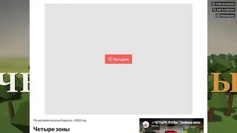</a> <b><a href="https://asshauster.itch.io/fourzones">Четыре Зоны</a></b> <a href="https://asshauster.itch.io">asshauster</a> Lizenz unbekannt · <a href="https://asshauster.itch.io/fourzones">Code</a></td>
<td width="25%" valign="top"> <b><a href="https://tanuu5.github.io/kaiju-dokan/">怪獣ドカン！ KAIJU DOKAN!</a></b> <a href="https://github.com/tanuu5">たぬ（tanu）</a> MIT · <a href="https://github.com/tanuu5/kaiju-dokan">Code</a> · <a href="https://huggingface.co/datasets/AI-Terrarium/terrarium-open-works/tree/main/games/kaiju-dokan">Dateien</a></td>
</tr>
<tr>
<td width="25%" valign="top"><a href="http://krestnikov.org/korovany/">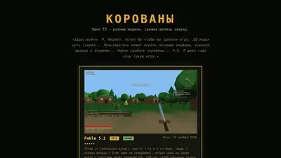</a> <b><a href="http://krestnikov.org/korovany/">korovany</a></b> <a href="https://github.com/Rai220">Rai220</a> Lizenz unbekannt · <a href="https://github.com/Rai220/korovany">Code</a></td>
<td width="25%" valign="top"> <b><a href="https://siganai-jp.itch.io/liminal-crawler">Liminal Crawler</a></b> <a href="https://siganai-jp.itch.io">siganai-jp</a> Lizenz unbekannt · <a href="https://siganai-jp.itch.io/liminal-crawler">Code</a></td>
<td width="25%" valign="top"><a href="https://jbang2004.github.io/long-wind/">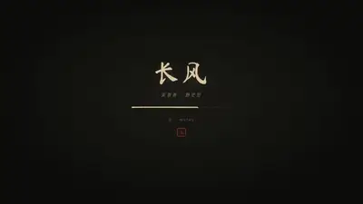</a> <b><a href="https://jbang2004.github.io/long-wind/">long-wind</a></b> <a href="https://github.com/jbang2004">jbang2004</a> MIT · <a href="https://github.com/jbang2004/long-wind">Code</a> · <a href="https://huggingface.co/datasets/AI-Terrarium/terrarium-open-works/tree/main/games/long-wind">Dateien</a></td>
<td width="25%" valign="top"> <b><a href="https://sh1rom1k.itch.io/nekyou">NEKYOU</a></b> <a href="https://sh1rom1k.itch.io">sh1rom1k</a> Lizenz unbekannt · <a href="https://sh1rom1k.itch.io/nekyou">Code</a></td>
</tr>
<tr>
<td width="25%" valign="top"><a href="https://nordheim.vercel.app">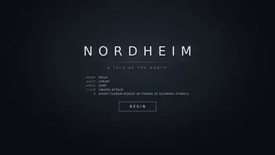</a> <b><a href="https://nordheim.vercel.app">nordheim</a></b> <a href="https://github.com/Diocal">Diocal</a> Lizenz unbekannt · <a href="https://github.com/Diocal/nordheim">Code</a></td>
<td width="25%" valign="top"> <b><a href="https://js-gamestudio.itch.io/shroom-therapy">Out-of-Office</a></b> <a href="https://js-gamestudio.itch.io">js-gamestudio</a> Lizenz unbekannt · <a href="https://js-gamestudio.itch.io/shroom-therapy">Code</a></td>
<td width="25%" valign="top"><a href="https://leo454353434.itch.io/pigs-war">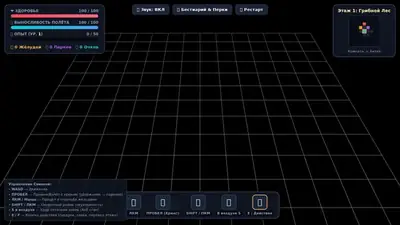</a> <b><a href="https://leo454353434.itch.io/pigs-war">pigs war</a></b> <a href="https://leo454353434.itch.io">leo454353434</a> Lizenz unbekannt · <a href="https://leo454353434.itch.io/pigs-war">Code</a></td>
<td width="25%" valign="top"> <b><a href="https://igoraidiary.itch.io/prilyag-wars">PRILYAG Wars</a></b> <a href="https://igoraidiary.itch.io">igoraidiary</a> Lizenz unbekannt · <a href="https://igoraidiary.itch.io/prilyag-wars">Code</a></td>
</tr>
<tr>
<td width="25%" valign="top"> <b><a href="https://psychosimsala.itch.io/reactionary-fighters">Reactionary Fighters!</a></b> <a href="https://psychosimsala.itch.io">psychosimsala</a> Lizenz unbekannt · <a href="https://psychosimsala.itch.io/reactionary-fighters">Code</a></td>
<td width="25%" valign="top"> <b><a href="https://rottensouls.com">Rotten Souls</a></b> <a href="https://github.com/igorjohn">Igor John</a> MIT · <a href="https://github.com/igorjohn/rotten-souls">Code</a> · <a href="https://huggingface.co/datasets/AI-Terrarium/terrarium-open-works/tree/main/games/rotten-souls">Dateien</a></td>
<td width="25%" valign="top"> <b><a href="https://aifootman.itch.io/sandfront">Sandfront</a></b> <a href="https://aifootman.itch.io">aifootman</a> Lizenz unbekannt · <a href="https://aifootman.itch.io/sandfront">Code</a></td>
<td width="25%" valign="top"> <b><a href="https://evals.ag/outputs/out_42WRTRNWM70860K7FE8W5H4JYE">Sands of the Black Sun</a></b> Evan Cha / Evals Lizenz unbekannt · <a href="https://evals.ag/api/v1/media/assets/ast_01K0N55YXGZGDV24CGYHFWPR7P/content">Code</a></td>
</tr>
<tr>
<td width="25%" valign="top"> <b><a href="https://alexmorrison12.github.io/sevenshard/">sevenshard</a></b> <a href="https://github.com/alexmorrison12">alexmorrison12</a> Lizenz unbekannt · <a href="https://github.com/alexmorrison12/sevenshard">Code</a></td>
<td width="25%" valign="top"> <b><a href="https://ayushhl.github.io/Shadow-Ascent-3D/">Shadow-Ascent-3D</a></b> <a href="https://github.com/AyushHL">AyushHL</a> MIT · <a href="https://github.com/AyushHL/Shadow-Ascent-3D">Code</a> · <a href="https://huggingface.co/datasets/AI-Terrarium/terrarium-open-works/tree/main/games/shadow-ascent-3d">Dateien</a></td>
<td width="25%" valign="top"> <b><a href="https://www.youtube.com/watch?v=2TM8W66NI_8&amp;t=566s">Shard Storm</a></b> Matt Wolfe Lizenz unbekannt</td>
<td width="25%" valign="top"> <b><a href="https://gigabitgamelab.com/arcade/play/tensen-fable/">TENSEN NO KOJIN / FABLE</a></b> Gigabit Game Lab Lizenz unbekannt</td>
</tr>
<tr>
<td width="25%" valign="top"> <b><a href="https://edgegap.github.io/netcode-sample-threejs-thin-ice-tussle/">Thin Ice Tussle</a></b> <a href="https://github.com/edgegap">Edgegap</a> MIT · <a href="https://github.com/edgegap/netcode-sample-threejs-thin-ice-tussle">Code</a> · <a href="https://huggingface.co/datasets/AI-Terrarium/terrarium-open-works/tree/main/games/thin-ice-tussle">Dateien</a></td>
<td width="25%" valign="top"> <b><a href="https://ryogaaaaaaaaaaa.github.io/ToiletGame/">ToiletGame</a></b> <a href="https://github.com/ryogaaaaaaaaaaa">ryogaaaaaaaaaaa</a> Lizenz unbekannt · <a href="https://github.com/ryogaaaaaaaaaaa/ToiletGame">Code</a></td>
<td width="25%" valign="top"> <b><a href="https://quocvietvi.itch.io/vesper-keep">Vesper Keep</a></b> <a href="https://quocvietvi.itch.io">quocvietvi</a> Lizenz unbekannt · <a href="https://quocvietvi.itch.io/vesper-keep">Code</a></td>
<td width="25%" valign="top"> <b><a href="https://x.com/AmirMushich/status/2119937977426338283">Worm Rider</a></b> <a href="https://github.com/amirmushichge">Amir Mušić</a> MIT · <a href="https://github.com/amirmushichge/worm-rider">Code</a> · <a href="https://huggingface.co/datasets/AI-Terrarium/terrarium-open-works/tree/main/games/worm-rider">Dateien</a></td>
</tr>
</table>

Werke ohne Vorschaubild:

<table>

<tr><th align="left">Werk</th><th align="left">Urheber</th><th align="left">Lizenz</th><th align="left">Links</th></tr>

<tr><td><a href="https://claude.ai/artifact/QvSjL7Hexf3nKdUP9Zerr7">Fighting game (plays on phones)</a></td><td>@s_shigel</td><td>Lizenz unbekannt</td><td>—</td></tr>

<tr><td><a href="https://claude.ai/artifact/1QGGhB68jMCjjjeeKtKNUo">Four-character fighting game</a></td><td>@promodenstudio</td><td>Lizenz unbekannt</td><td>—</td></tr>

<tr><td><a href="https://github.com/mdhPHoenixVBcodes/games">games</a></td><td><a href="https://github.com/mdhPHoenixVBcodes">mdhPHoenixVBcodes</a></td><td>Lizenz unbekannt</td><td><a href="https://github.com/mdhPHoenixVBcodes/games">Code</a></td></tr>

<tr><td><a href="https://fighting-game-ignition.saito-931.workers.dev">IGNITION fighting game</a></td><td>@s_shigel</td><td>Lizenz unbekannt</td><td>—</td></tr>

<tr><td><a href="https://x.com/FaridaNever/status/2119910055990505730">Ink swordsman</a></td><td><a href="https://x.com/FaridaNever">FaridaNever</a></td><td>Lizenz unbekannt</td><td>—</td></tr>

<tr><td><a href="https://app.usecrayon.ai/play/0cd7624e-1297-417e-a5be-b3c3036a496a">KUMOKIRI</a></td><td>@aniketjart</td><td>Lizenz unbekannt</td><td>—</td></tr>

<tr><td><a href="https://maad-maxxing.vercel.app/">MAAD MAXXING</a></td><td>@Andrew_Blumson</td><td>Lizenz unbekannt</td><td>—</td></tr>

<tr><td><a href="https://op7418.github.io/guizang-game-skill/">Mist-Locked Mountain Gate — 3D action game</a></td><td>@op7418</td><td>All rights reserved</td><td><a href="https://github.com/op7418/guizang-game-skill/tree/gh-pages">Code</a></td></tr>

<tr><td><a href="https://save-the-world-fable.vercel.app/">Save the World</a></td><td>@global_techgirl</td><td>Lizenz unbekannt</td><td>—</td></tr>

<tr><td><a href="https://sanwan.ai/games/xingyun-moba/">Starfall — a browser MOBA</a></td><td>@FuSheng_0306</td><td>Lizenz unbekannt</td><td>—</td></tr>

<tr><td><a href="https://remix.gg/g/survivors">Survivors</a></td><td>@BLACKST0CK</td><td>Lizenz unbekannt</td><td>—</td></tr>

<tr><td><a href="https://valsera-game.vercel.app/">Valsera — side-scrolling RPG</a></td><td>@kevin_t_ngo</td><td>Lizenz unbekannt</td><td>—</td></tr>

<tr><td><a href="https://higgsfield.ai/@higgsfield.studio/blogs/fable-5-2-built-this-rpg-from-pure-code-here-s-every-step">VOWLORN</a></td><td>@higgsfield_ai</td><td>Lizenz unbekannt</td><td>—</td></tr>

</table>

## Plattform und Runner

<table>
<tr>
<td width="25%" valign="top"> <b><a href="https://batdev0869.itch.io/2009-roblox-obby">2009 Roblox Obby (AI Assisted)</a></b> <a href="https://batdev0869.itch.io">batdev0869</a> Lizenz unbekannt · <a href="https://batdev0869.itch.io/2009-roblox-obby">Code</a></td>
<td width="25%" valign="top"> <b><a href="http://1oth3r.com/3D-HTML-Game/">3D-HTML-Game</a></b> <a href="https://github.com/1OTH3R">1OTH3R</a> Unlicense · <a href="https://github.com/1OTH3R/3D-HTML-Game">Code</a> · <a href="https://huggingface.co/datasets/AI-Terrarium/terrarium-open-works/tree/main/games/3d-html-game">Dateien</a></td>
<td width="25%" valign="top"> <b><a href="https://ayeshh899-creator.github.io/3d-sphere-runner/">3d-sphere-runner</a></b> <a href="https://github.com/ayeshh899-creator">ayeshh899-creator</a> Lizenz unbekannt · <a href="https://github.com/ayeshh899-creator/3d-sphere-runner">Code</a></td>
<td width="25%" valign="top"> <b><a href="https://sono-sore.itch.io/a-3d-fun-cube-game">a 3D fun cube run game</a></b> <a href="https://sono-sore.itch.io">sono-sore</a> Lizenz unbekannt · <a href="https://sono-sore.itch.io/a-3d-fun-cube-game">Code</a></td>
</tr>
<tr>
<td width="25%" valign="top"> <b><a href="https://marr59.github.io/alpine-rush/">alpine-rush</a></b> <a href="https://github.com/marr59">marr59</a> Lizenz unbekannt · <a href="https://github.com/marr59/alpine-rush">Code</a></td>
<td width="25%" valign="top"> <b><a href="https://gnomtregym.itch.io/amoeba-run">Amoeba Run</a></b> <a href="https://gnomtregym.itch.io">gnomtregym</a> Lizenz unbekannt · <a href="https://gnomtregym.itch.io/amoeba-run">Code</a></td>
<td width="25%" valign="top"> <b><a href="https://furkiozknn.github.io/carsi-kacisi/">Çarşı Kaçışı</a></b> <a href="https://github.com/Furkiozknn">Furki Özkan</a> MIT · <a href="https://github.com/Furkiozknn/carsi-kacisi">Code</a> · <a href="https://huggingface.co/datasets/AI-Terrarium/terrarium-open-works/tree/main/games/carsi-kacisi">Dateien</a></td>
<td width="25%" valign="top"> <b><a href="https://ebruuu-ozennn.github.io/cowboy-game/">cowboy-game</a></b> <a href="https://github.com/ebruuu-ozennn">ebruuu-ozennn</a> Lizenz unbekannt · <a href="https://github.com/ebruuu-ozennn/cowboy-game">Code</a></td>
</tr>
<tr>
<td width="25%" valign="top"> <b><a href="https://noclipepe.pages.dev/dino/">Dino Run: Locked In</a></b> noclipepe Lizenz unbekannt</td>
<td width="25%" valign="top"> <b><a href="https://jaydemks.github.io/ImADragon_onepromptcode_game/">Dragon&#x27;s Reach</a></b> <a href="https://github.com/jaydemks">Giovanni &quot;Giò&quot; De Miccoli</a> MIT · <a href="https://github.com/jaydemks/ImADragon_onepromptcode_game">Code</a> · <a href="https://huggingface.co/datasets/AI-Terrarium/terrarium-open-works/tree/main/games/dragon-s-reach">Dateien</a></td>
<td width="25%" valign="top"> <b><a href="https://olivernaix.itch.io/eggsroadchallenge">EggsRoadChallenge</a></b> <a href="https://olivernaix.itch.io">olivernaix</a> Lizenz unbekannt · <a href="https://olivernaix.itch.io/eggsroadchallenge">Code</a></td>
<td width="25%" valign="top"> <b><a href="https://www.reddit.com/r/vibecoding/comments/1xsuqwm/fable_52_oneshot_a_super_nintendo_game_overnight/">Emberwake</a></b> u/shiny_guruw (ppu.toys) Lizenz unbekannt</td>
</tr>
<tr>
<td width="25%" valign="top"> <b><a href="https://bosswhatsnew.itch.io/finger-rush-3d-castle-assault">Finger Rush 3D: Castle Assault</a></b> <a href="https://bosswhatsnew.itch.io">bosswhatsnew</a> MIT · <a href="https://bosswhatsnew.itch.io/finger-rush-3d-castle-assault">Code</a></td>
<td width="25%" valign="top"> <b><a href="https://aaronorelup.com/games/grind-and-grimoire/">Grind-Grimoire</a></b> <a href="https://github.com/aaronorelup">aaronorelup</a> Lizenz unbekannt · <a href="https://github.com/aaronorelup/Grind-Grimoire">Code</a></td>
<td width="25%" valign="top"> <b><a href="https://shubhu121.github.io/hitdude/play/">HITOFUDE 一筆</a></b> <a href="https://github.com/shubhu121">@positronx_</a> Lizenz unbekannt</td>
<td width="25%" valign="top"> <b><a href="https://github.com/ohylli/indys-adventure-3d">Indy’s Adventure 3D: Näsinneula</a></b> <a href="https://github.com/ohylli">ohylli</a> Lizenz unbekannt · <a href="https://github.com/ohylli/indys-adventure-3d">Code</a></td>
</tr>
<tr>
<td width="25%" valign="top"> <b><a href="https://github.com/octavian-ilie/jingle-dash">jingle-dash</a></b> <a href="https://github.com/octavian-ilie">octavian-ilie</a> Lizenz unbekannt · <a href="https://github.com/octavian-ilie/jingle-dash">Code</a></td>
<td width="25%" valign="top"> <b><a href="https://munansa1003.github.io/jump-quiz-island/">jump-quiz-island</a></b> <a href="https://github.com/munansa1003">munansa1003</a> Lizenz unbekannt · <a href="https://github.com/munansa1003/jump-quiz-island">Code</a></td>
<td width="25%" valign="top"> <b><a href="https://glowmoose.itch.io/neon-lanes">Neon Lanes</a></b> <a href="https://glowmoose.itch.io">glowmoose</a> Lizenz unbekannt · <a href="https://glowmoose.itch.io/neon-lanes">Code</a></td>
<td width="25%" valign="top"> <b><a href="https://ayyarham.github.io/Neon_runner/">Neon_runner</a></b> <a href="https://github.com/ayyarham">ayyarham</a> Lizenz unbekannt · <a href="https://github.com/ayyarham/Neon_runner">Code</a></td>
</tr>
<tr>
<td width="25%" valign="top"> <b><a href="https://mirulismat-bit.github.io/neon-sky-runner/">neon-sky-runner</a></b> <a href="https://github.com/mirulismat-bit">mirulismat-bit</a> Lizenz unbekannt · <a href="https://github.com/mirulismat-bit/neon-sky-runner">Code</a></td>
<td width="25%" valign="top"> <b><a href="https://kit-basher.itch.io/neon-wisp">Neon Wisp</a></b> <a href="https://kit-basher.itch.io">kit-basher</a> Lizenz unbekannt · <a href="https://kit-basher.itch.io/neon-wisp">Code</a></td>
<td width="25%" valign="top"> <b><a href="https://neonrunner-snowy.vercel.app">neonrunner</a></b> <a href="https://github.com/kabillanta">kabillanta</a> Lizenz unbekannt · <a href="https://github.com/kabillanta/neonrunner">Code</a></td>
<td width="25%" valign="top"> <b><a href="https://freebotdeveloper.itch.io/obby-openiq">Obby OpenIQ</a></b> <a href="https://freebotdeveloper.itch.io">freebotdeveloper</a> Lizenz unbekannt · <a href="https://freebotdeveloper.itch.io/obby-openiq">Code</a></td>
</tr>
<tr>
<td width="25%" valign="top"> <b><a href="https://stupssy.itch.io/obstacle-dodger">Obstacle Dodger</a></b> <a href="https://stupssy.itch.io">stupssy</a> Lizenz unbekannt · <a href="https://stupssy.itch.io/obstacle-dodger">Code</a></td>
<td width="25%" valign="top"> <b><a href="https://pelicanride.vercel.app">鹈鹕骑单车 · 海岸大冒险（Pelican Ride）</a></b> <a href="https://github.com/Xiobio">Xony</a> MIT · <a href="https://github.com/Xiobio/pelican-ride">Code</a> · <a href="https://huggingface.co/datasets/AI-Terrarium/terrarium-open-works/tree/main/games/pelican-ride">Dateien</a></td>
<td width="25%" valign="top"> <b><a href="https://pratham-temple-escape.vercel.app">pratham-temple-escape</a></b> <a href="https://github.com/JashwanthsaiKamatham">JashwanthsaiKamatham</a> Lizenz unbekannt · <a href="https://github.com/JashwanthsaiKamatham/pratham-temple-escape">Code</a></td>
<td width="25%" valign="top"> <b><a href="https://theusefulstack.itch.io/quayshift">Quayshift — an AI-built endless runner (GPT-6.1 Sol)</a></b> <a href="https://theusefulstack.itch.io">theusefulstack</a> MIT · <a href="https://theusefulstack.itch.io/quayshift">Code</a></td>
</tr>
<tr>
<td width="25%" valign="top"> <b><a href="https://theusefulstack.itch.io/scramble-yard">Scramble Yard — an AI-built endless runner (Claude Opus 5.5)</a></b> <a href="https://theusefulstack.itch.io">theusefulstack</a> MIT · <a href="https://theusefulstack.itch.io/scramble-yard">Code</a></td>
<td width="25%" valign="top"> <b><a href="https://tanuu5.github.io/shippo-express/">shippo-express</a></b> <a href="https://github.com/tanuu5">tanuu5</a> MIT · <a href="https://github.com/tanuu5/shippo-express">Code</a> · <a href="https://huggingface.co/datasets/AI-Terrarium/terrarium-open-works/tree/main/games/shippo-express">Dateien</a></td>
<td width="25%" valign="top"> <b><a href="https://big-vacuum-studio.itch.io/spire-climber">Spire Climber</a></b> <a href="https://big-vacuum-studio.itch.io">big-vacuum-studio</a> Lizenz unbekannt · <a href="https://big-vacuum-studio.itch.io/spire-climber">Code</a></td>
<td width="25%" valign="top"> <b><a href="https://t-sumu.itch.io/spring-mag-adventure">Spring Mag Adventure: Magnetic Mine</a></b> <a href="https://t-sumu.itch.io">t-sumu</a> Lizenz unbekannt · <a href="https://t-sumu.itch.io/spring-mag-adventure">Code</a></td>
</tr>
<tr>
<td width="25%" valign="top"> <b><a href="https://muye666.itch.io/star-ring-run">Star Ring Run</a></b> <a href="https://muye666.itch.io">muye666</a> Lizenz unbekannt · <a href="https://muye666.itch.io/star-ring-run">Code</a></td>
<td width="25%" valign="top"> <b><a href="https://dgeisert.itch.io/starry-meows">Starry Meows</a></b> <a href="https://dgeisert.itch.io">dgeisert</a> Lizenz unbekannt · <a href="https://dgeisert.itch.io/starry-meows">Code</a></td>
<td width="25%" valign="top"> <b><a href="https://kaschtanov.github.io/tidelight/">tidelight</a></b> <a href="https://github.com/kaschtanov">kaschtanov</a> Lizenz unbekannt · <a href="https://github.com/kaschtanov/tidelight">Code</a></td>
<td width="25%" valign="top"> <b><a href="https://www.youtube.com/watch?v=0vNyVMDFdkg&amp;t=364s">Tumble Beans</a></b> <a href="https://x.com/MatthewBerman">Matthew Berman</a> Lizenz unbekannt</td>
</tr>
</table>

Werke ohne Vorschaubild:

<table>

<tr><th align="left">Werk</th><th align="left">Urheber</th><th align="left">Lizenz</th><th align="left">Links</th></tr>

<tr><td><a href="https://giant-leap.vercel.app">Giant Leap</a></td><td>@handsher_NGU</td><td>Lizenz unbekannt</td><td>—</td></tr>

<tr><td><a href="https://remix.gg/g/hoppy-meadow">Hoppy Meadow</a></td><td>@0xChuckstock</td><td>Lizenz unbekannt</td><td>—</td></tr>

</table>

## Rennen und Fahren

<table>
<tr>
<td width="25%" valign="top"> <b><a href="https://github.com/tlejay/145-korat-cyberpunk">145-korat-cyberpunk</a></b> <a href="https://github.com/tlejay">tlejay</a> CC0-1.0 · <a href="https://github.com/tlejay/145-korat-cyberpunk">Code</a> · <a href="https://huggingface.co/datasets/AI-Terrarium/terrarium-open-works/tree/main/games/145-korat-cyberpunk">Dateien</a></td>
<td width="25%" valign="top"> <b><a href="https://gemini-3d-car-racing-game.onrender.com/">🏎️ 3D Browser Racer</a></b> <a href="https://github.com/wayneeffect">Dr. Elden Wayne Whalen III, ShD</a> MIT · <a href="https://github.com/wayneeffect/Gemini-3D-Car-Racing-Game">Code</a> · <a href="https://huggingface.co/datasets/AI-Terrarium/terrarium-open-works/tree/main/games/3d-browser-racer">Dateien</a></td>
<td width="25%" valign="top"> <b><a href="https://yaminahgames.itch.io/3d-racing-game">3D Racing Game</a></b> <a href="https://yaminahgames.itch.io">yaminahgames</a> Lizenz unbekannt · <a href="https://yaminahgames.itch.io/3d-racing-game">Code</a></td>
<td width="25%" valign="top"> <b><a href="https://redyagames.itch.io/adrifti">ADRIFTI</a></b> <a href="https://redyagames.itch.io">redyagames</a> Lizenz unbekannt · <a href="https://redyagames.itch.io/adrifti">Code</a></td>
</tr>
<tr>
<td width="25%" valign="top"> <b><a href="https://bridge-mind.github.io/apex-formula/">APEX FORMULA</a></b> <a href="https://github.com/bridge-mind">BridgeMind</a> MIT · <a href="https://github.com/bridge-mind/apex-formula">Code</a> · <a href="https://huggingface.co/datasets/AI-Terrarium/terrarium-open-works/tree/main/games/apex-formula">Dateien</a></td>
<td width="25%" valign="top"> <b><a href="https://github.com/sbrooks2026/apex-rush">apex-rush</a></b> <a href="https://github.com/sbrooks2026">sbrooks2026</a> Lizenz unbekannt · <a href="https://github.com/sbrooks2026/apex-rush">Code</a></td>
<td width="25%" valign="top"> <b><a href="https://vibe-f1-racing.pages.dev">Aurora Grand Prix — F1 Simulator</a></b> <a href="https://github.com/hirosichen">hirosichen</a> MIT · <a href="https://github.com/hirosichen/ai-f1-racing-game">Code</a> · <a href="https://huggingface.co/datasets/AI-Terrarium/terrarium-open-works/tree/main/games/aurora-grand-prix-f1-simulator">Dateien</a></td>
<td width="25%" valign="top"> <b><a href="https://jason-c-dev.github.io/backroad-rally/">backroad rally</a></b> <a href="https://github.com/jason-c-dev">jason-c-dev</a> MIT · <a href="https://github.com/jason-c-dev/backroad-rally">Code</a> · <a href="https://huggingface.co/datasets/AI-Terrarium/terrarium-open-works/tree/main/games/backroad-rally">Dateien</a></td>
</tr>
<tr>
<td width="25%" valign="top"> <b><a href="https://furkiozknn.github.io/bogaz-vapuru/">Boğaz Vapuru</a></b> <a href="https://github.com/Furkiozknn">Furki Özkan</a> MIT · <a href="https://github.com/Furkiozknn/bogaz-vapuru">Code</a> · <a href="https://huggingface.co/datasets/AI-Terrarium/terrarium-open-works/tree/main/games/bogaz-vapuru">Dateien</a></td>
<td width="25%" valign="top"> <b><a href="https://arjunreddy91100.github.io/bumblebee-echo-garden/">Bumblebee — Echo Garden</a></b> <a href="https://github.com/arjunreddy91100">Arjun</a> MIT · <a href="https://github.com/arjunreddy91100/bumblebee-echo-garden">Code</a> · <a href="https://huggingface.co/datasets/AI-Terrarium/terrarium-open-works/tree/main/games/bumblebee-echo-garden">Dateien</a></td>
<td width="25%" valign="top"> <b><a href="https://arhs-circuit-rush-three-js-car-racing-game.static.hf.space/index.html">Circuit Rush — three.js Car Racing Game</a></b> <a href="https://huggingface.co/arhs">arhs</a> Lizenz unbekannt · <a href="https://huggingface.co/spaces/arhs/circuit-rush-three-js-car-racing-game">Code</a></td>
<td width="25%" valign="top"> <b><a href="https://mutaafaziz.com/coldgas/">COLD GAS</a></b> <a href="https://github.com/mutaaf">Mutaaf Aziz</a> MIT · <a href="https://github.com/mutaaf/cold-gas">Code</a> · <a href="https://huggingface.co/datasets/AI-Terrarium/terrarium-open-works/tree/main/games/cold-gas">Dateien</a></td>
</tr>
<tr>
<td width="25%" valign="top"> <b><a href="https://amanndev.com/criar-projeto-3d-com-um-prompt-no-claude">Cyberpunk Tokyo Motorcycle</a></b> Luca Amann Lizenz unbekannt · <a href="https://amanndev.com/_next/static/chunks/2gdq495c_bsx_.js">Code</a></td>
<td width="25%" valign="top"> <b><a href="https://nicostuff356.itch.io/deformz">DeformZ</a></b> <a href="https://nicostuff356.itch.io">nicostuff356</a> Lizenz unbekannt · <a href="https://nicostuff356.itch.io/deformz">Code</a></td>
<td width="25%" valign="top"> <b><a href="https://drcollect.github.io/demolition-derby/">Demolition Derby</a></b> <a href="https://github.com/drcollect">drcollect</a> MIT · <a href="https://github.com/drcollect/demolition-derby">Code</a> · <a href="https://huggingface.co/datasets/AI-Terrarium/terrarium-open-works/tree/main/games/demolition-derby">Dateien</a></td>
<td width="25%" valign="top"> <b><a href="https://furkiozknn.github.io/dolmus/">Dolmuş</a></b> <a href="https://github.com/Furkiozknn">Furki Özkan</a> MIT · <a href="https://github.com/Furkiozknn/dolmus">Code</a> · <a href="https://huggingface.co/datasets/AI-Terrarium/terrarium-open-works/tree/main/games/dolmus">Dateien</a></td>
</tr>
<tr>
<td width="25%" valign="top"> <b><a href="https://github.com/SparshMishra09/drift-temple">drift-temple</a></b> <a href="https://github.com/SparshMishra09">SparshMishra09</a> Lizenz unbekannt · <a href="https://github.com/SparshMishra09/drift-temple">Code</a></td>
<td width="25%" valign="top"> <b><a href="https://thelabratdon.itch.io/drifty-drifters">Drifty Drifters</a></b> <a href="https://thelabratdon.itch.io">thelabratdon</a> Lizenz unbekannt · <a href="https://thelabratdon.itch.io/drifty-drifters">Code</a></td>
<td width="25%" valign="top"> <b><a href="https://github.com/Chenxy1986/fable5_balloon_battle_mk3">fable5_balloon_battle_mk3</a></b> <a href="https://github.com/Chenxy1986">Chenxy1986</a> Lizenz unbekannt · <a href="https://github.com/Chenxy1986/fable5_balloon_battle_mk3">Code</a></td>
<td width="25%" valign="top"> <b><a href="https://n1ghtk1n.github.io/fablerace/">fablerace</a></b> <a href="https://github.com/N1ghtk1n">N1ghtk1n</a> CC0-1.0 · <a href="https://github.com/N1ghtk1n/fablerace">Code</a> · <a href="https://huggingface.co/datasets/AI-Terrarium/terrarium-open-works/tree/main/games/fablerace">Dateien</a></td>
</tr>
<tr>
<td width="25%" valign="top"> <b><a href="https://github.com/CodingFreeze/Fable_GTA">GTA-2W — GTA 2 Web Clone (Three.js)</a></b> <a href="https://github.com/CodingFreeze">CodingFreeze</a> MIT · <a href="https://github.com/CodingFreeze/Fable_GTA">Code</a> · <a href="https://huggingface.co/datasets/AI-Terrarium/terrarium-open-works/tree/main/games/gta-2w-gta-2-web-clone-three-js">Dateien</a></td>
<td width="25%" valign="top"> <b><a href="https://vibe-harbor-master.pages.dev">Harbor Master — Superyacht Docking</a></b> <a href="https://github.com/hirosichen">hirosichen</a> MIT · <a href="https://github.com/hirosichen/ai-harbor-master-game">Code</a> · <a href="https://huggingface.co/datasets/AI-Terrarium/terrarium-open-works/tree/main/games/harbor-master-superyacht-docking">Dateien</a></td>
<td width="25%" valign="top"> <b><a href="https://olagon.github.io/holua/">HŌLUA — the slide at Keauhou</a></b> <a href="https://github.com/olagon">Olin Lagon</a> MIT · <a href="https://github.com/olagon/holua">Code</a> · <a href="https://huggingface.co/datasets/AI-Terrarium/terrarium-open-works/tree/main/games/holua-the-slide-at-keauhou">Dateien</a></td>
<td width="25%" valign="top"> <b><a href="https://xiubia.github.io/HorseLegend/">HorseLegend</a></b> <a href="https://github.com/xiubia">xiubia</a> Lizenz unbekannt · <a href="https://github.com/xiubia/HorseLegend">Code</a></td>
</tr>
<tr>
<td width="25%" valign="top"> <b><a href="https://akotch.github.io/kekenon-cotonou/">Kekenon: Cotonou</a></b> <a href="https://github.com/Akotch">Akotch</a> Lizenz unbekannt · <a href="https://github.com/Akotch/kekenon-cotonou">Code</a></td>
<td width="25%" valign="top"> <b><a href="https://kostikoneuro.github.io/kimi-vs-astra/">kimi-vs-astra</a></b> <a href="https://github.com/KostiKoNeuro">KostiKoNeuro</a> Lizenz unbekannt · <a href="https://github.com/KostiKoNeuro/kimi-vs-astra">Code</a></td>
<td width="25%" valign="top"> <b><a href="https://landingpage-five-dun.vercel.app">landingpage_circuit</a></b> <a href="https://github.com/GuilhermeYm">GuilhermeYm</a> Lizenz unbekannt · <a href="https://github.com/GuilhermeYm/landingpage_circuit">Code</a></td>
<td width="25%" valign="top"> <b><a href="https://luminal-game.web.app">Luminal</a></b> <a href="https://github.com/Scotho">Craig Smith</a> MIT · <a href="https://github.com/Scotho/luminal">Code</a> · <a href="https://huggingface.co/datasets/AI-Terrarium/terrarium-open-works/tree/main/games/luminal">Dateien</a></td>
</tr>
<tr>
<td width="25%" valign="top"> <b><a href="https://jediconcepts.com/mcl64/">MCL-64 — Papaya Grand Prix</a></b> <a href="https://github.com/JediConcepts">Jedi Concepts</a> MIT · <a href="https://github.com/JediConcepts/J1-racing">Code</a> · <a href="https://huggingface.co/datasets/AI-Terrarium/terrarium-open-works/tree/main/games/mcl-64-papaya-grand-prix">Dateien</a></td>
<td width="25%" valign="top"> <b><a href="https://x.com/ericmaskfr/status/2119910195325481026">Miami-style crime game</a></b> <a href="https://x.com/ericmaskfr">@ericmaskfr</a> Lizenz unbekannt</td>
<td width="25%" valign="top"> <b><a href="https://siddqamar.github.io/midnight-shuto/">Midnight Shuto</a></b> <a href="https://github.com/siddqamar">Siddiqui Qamar</a> Apache-2.0 · <a href="https://github.com/siddqamar/midnight-shuto">Code</a> · <a href="https://huggingface.co/datasets/AI-Terrarium/terrarium-open-works/tree/main/games/midnight-shuto">Dateien</a></td>
<td width="25%" valign="top"> <b><a href="https://github.com/hahaliu1029/fable5.2demo">MOTHLIGHT: Vesper-9</a></b> <a href="https://github.com/hahaliu1029">hahaliu1029</a> Apache-2.0 · <a href="https://github.com/hahaliu1029/fable5.2demo/tree/main/mothlight">Code</a> · <a href="https://huggingface.co/datasets/AI-Terrarium/terrarium-open-works/tree/main/games/mothlight-vesper-9">Dateien</a></td>
</tr>
<tr>
<td width="25%" valign="top"> <b><a href="https://madouki.github.io/neo-velocity/">neo-velocity</a></b> <a href="https://github.com/madouki">madouki</a> Lizenz unbekannt · <a href="https://github.com/madouki/neo-velocity">Code</a></td>
<td width="25%" valign="top"> <b><a href="https://kostikoneuro.github.io/gemini-carbon-vs-fable-5-2/">Neon Night Racer: Fable build</a></b> <a href="https://github.com/KostiKoNeuro">KostiKoNeuro</a> Lizenz unbekannt · <a href="https://github.com/KostiKoNeuro/gemini-carbon-vs-fable-5-2/tree/main/1-race/fable">Code</a></td>
<td width="25%" valign="top"> <b><a href="https://mrisfox.itch.io/night-dashcam">Night Dashcam</a></b> <a href="https://mrisfox.itch.io">mrisfox</a> Lizenz unbekannt · <a href="https://mrisfox.itch.io/night-dashcam">Code</a></td>
<td width="25%" valign="top"> <b><a href="https://github.com/StarKnightt/nightdrive">nightdrive</a></b> <a href="https://github.com/StarKnightt">StarKnightt</a> Lizenz unbekannt · <a href="https://github.com/StarKnightt/nightdrive">Code</a></td>
</tr>
<tr>
<td width="25%" valign="top"> <b><a href="https://eddizege.github.io/nightshift/">nightshift</a></b> <a href="https://github.com/EddizEge">EddizEge</a> MIT · <a href="https://github.com/EddizEge/nightshift">Code</a> · <a href="https://huggingface.co/datasets/AI-Terrarium/terrarium-open-works/tree/main/games/nightshift">Dateien</a></td>
<td width="25%" valign="top"> <b><a href="https://diprohaque.github.io/office-jabo-bhai/">office-jabo-bhai</a></b> <a href="https://github.com/DiproHaque">DiproHaque</a> Lizenz unbekannt · <a href="https://github.com/DiproHaque/office-jabo-bhai">Code</a></td>
<td width="25%" valign="top"> <b><a href="https://mutaafaziz.com/outatime/">OUTATIME 88</a></b> <a href="https://github.com/mutaaf">Mutaaf Aziz</a> MIT · <a href="https://github.com/mutaaf/outatime-88">Code</a> · <a href="https://huggingface.co/datasets/AI-Terrarium/terrarium-open-works/tree/main/games/outatime-88">Dateien</a></td>
<td width="25%" valign="top"> <b><a href="https://netanelyan.github.io/outbound/">OUTBOUND</a></b> <a href="https://github.com/netanelyan">Natanel Yanchevsky</a> MIT · <a href="https://github.com/netanelyan/outbound">Code</a> · <a href="https://huggingface.co/datasets/AI-Terrarium/terrarium-open-works/tree/main/games/outbound">Dateien</a></td>
</tr>
<tr>
<td width="25%" valign="top"> <b><a href="https://aadil6971.github.io/PaperWorld/">PaperWorld</a></b> <a href="https://github.com/aadil6971">aadil6971</a> Lizenz unbekannt · <a href="https://github.com/aadil6971/PaperWorld">Code</a></td>
<td width="25%" valign="top"> <b><a href="https://bhanu2006-24.github.io/racing-game/">Poly City Racer: Turbo</a></b> <a href="https://github.com/bhanu2006-24">Bhanu Pratap Saini</a> MIT · <a href="https://github.com/bhanu2006-24/racing-game">Code</a> · <a href="https://huggingface.co/datasets/AI-Terrarium/terrarium-open-works/tree/main/games/poly-city-racer-turbo">Dateien</a></td>
<td width="25%" valign="top"> <b><a href="https://tanuu5.github.io/ponpoko-kart/">ぽんぽこカート 〜ニッポン爆走グランプリ〜</a></b> <a href="https://github.com/tanuu5">たぬ（tanu）</a> MIT · <a href="https://github.com/tanuu5/ponpoko-kart">Code</a> · <a href="https://huggingface.co/datasets/AI-Terrarium/terrarium-open-works/tree/main/games/ponpoko-kart">Dateien</a></td>
<td width="25%" valign="top"> <b><a href="https://minaigames.itch.io/public-kart">Public Kart</a></b> <a href="https://minaigames.itch.io">minaigames</a> Lizenz unbekannt · <a href="https://minaigames.itch.io/public-kart">Code</a></td>
</tr>
<tr>
<td width="25%" valign="top"> <b><a href="https://purchaseway-fire-wheels.vercel.app">purchaseway-fire-wheels</a></b> <a href="https://github.com/KevinWillyan456">KevinWillyan456</a> Lizenz unbekannt · <a href="https://github.com/KevinWillyan456/purchaseway-fire-wheels">Code</a></td>
<td width="25%" valign="top"> <b><a href="https://wuwochen.github.io/racing-game/">racing-game</a></b> <a href="https://github.com/wuwochen">wuwochen</a> Lizenz unbekannt · <a href="https://github.com/wuwochen/racing-game">Code</a></td>
<td width="25%" valign="top"> <b><a href="https://road-to-el-salvador.vercel.app">🛻₿ Road to El Salvador — Bitcoin Road Trip</a></b> <a href="https://github.com/william89971">William Menjivar</a> MIT · <a href="https://github.com/william89971/Road-to-El-Salvador">Code</a> · <a href="https://huggingface.co/datasets/AI-Terrarium/terrarium-open-works/tree/main/games/road-to-el-salvador-bitcoin-road-trip">Dateien</a></td>
<td width="25%" valign="top"> <b><a href="https://extremeai-labs.github.io/rocky-grid/">ROCKY GRID</a></b> <a href="https://github.com/ExtremeAI-Labs">ExtremeAI-Labs</a> MIT · <a href="https://github.com/ExtremeAI-Labs/rocky-grid">Code</a> · <a href="https://huggingface.co/datasets/AI-Terrarium/terrarium-open-works/tree/main/games/rocky-grid">Dateien</a></td>
</tr>
<tr>
<td width="25%" valign="top"> <b><a href="https://noclipepe.pages.dev/rug/">Rug Racers</a></b> noclipepe Lizenz unbekannt · <a href="https://noclipepe.pages.dev/rug/">Code</a></td>
<td width="25%" valign="top"> <b><a href="https://saltfire.higgsfield.app/">Saltfire</a></b> <a href="https://x.com/higgsfield_ai">Higgsfield</a> Lizenz unbekannt · <a href="https://d2ol7oe51mr4n9.cloudfront.net/user_3GXbZB0UVQ4VNLix2xrfj28xkQu/096b9953-ca50-4858-80f0-3b7d427d1897.html">Code</a></td>
<td width="25%" valign="top"> <b><a href="https://weskao.github.io/skyline-rush/">skyline-rush</a></b> <a href="https://github.com/weskao">weskao</a> Lizenz unbekannt · <a href="https://github.com/weskao/skyline-rush">Code</a></td>
<td width="25%" valign="top"> <b><a href="https://hellosanders.itch.io/smokin-rubber">Smokin&#x27; Rubber</a></b> <a href="https://hellosanders.itch.io">hellosanders</a> Lizenz unbekannt · <a href="https://hellosanders.itch.io/smokin-rubber">Code</a></td>
</tr>
<tr>
<td width="25%" valign="top"> <b><a href="https://neofito-corp.itch.io/storm-run">STORM RUN Conducción Extrema</a></b> <a href="https://neofito-corp.itch.io">neofito-corp</a> Lizenz unbekannt · <a href="https://neofito-corp.itch.io/storm-run">Code</a></td>
<td width="25%" valign="top"> <b><a href="https://tanuu5.github.io/tanuki-rush/">TANUKI RUSH</a></b> <a href="https://github.com/tanuu5">たぬ（tanu）</a> MIT · <a href="https://github.com/tanuu5/tanuki-rush">Code</a> · <a href="https://huggingface.co/datasets/AI-Terrarium/terrarium-open-works/tree/main/games/tanuki-rush">Dateien</a></td>
<td width="25%" valign="top"> <b><a href="https://bankaino.github.io/timber-rush-3d-playable/">timber-rush-3d-playable</a></b> <a href="https://github.com/bankaino">bankaino</a> Lizenz unbekannt · <a href="https://github.com/bankaino/timber-rush-3d-playable">Code</a></td>
<td width="25%" valign="top"> <b><a href="https://alexkli.github.io/toon-prix/">toon-prix</a></b> <a href="https://github.com/alexkli">alexkli</a> Lizenz unbekannt · <a href="https://github.com/alexkli/toon-prix">Code</a></td>
</tr>
<tr>
<td width="25%" valign="top"> <b><a href="https://sammyvaughan86.itch.io/toy-charge">Toy Charge</a></b> <a href="https://sammyvaughan86.itch.io">sammyvaughan86</a> Lizenz unbekannt · <a href="https://sammyvaughan86.itch.io/toy-charge">Code</a></td>
<td width="25%" valign="top"> <b><a href="https://basemazab.github.io/tuktuk/">توك توك: وسّع يا باشا</a></b> <a href="https://github.com/basemazab">basemazab</a> Lizenz unbekannt · <a href="https://github.com/basemazab/tuktuk">Code</a> · <a href="https://huggingface.co/datasets/AI-Terrarium/terrarium-open-works/tree/main/games/tuktuk">Dateien</a></td>
<td width="25%" valign="top"> <b><a href="https://bridge-mind.github.io/turbo-kart-rally/">Turbo Kart Rally</a></b> <a href="https://github.com/bridge-mind">BridgeMind</a> MIT · <a href="https://github.com/bridge-mind/turbo-kart-rally">Code</a> · <a href="https://huggingface.co/datasets/AI-Terrarium/terrarium-open-works/tree/main/games/turbo-kart-rally">Dateien</a></td>
<td width="25%" valign="top"> <b><a href="https://github.com/exclusiveabhi/turbo-kart-rally-game">turbo-kart-rally-game</a></b> <a href="https://github.com/exclusiveabhi">exclusiveabhi</a> Lizenz unbekannt · <a href="https://github.com/exclusiveabhi/turbo-kart-rally-game">Code</a></td>
</tr>
<tr>
<td width="25%" valign="top"> <b><a href="https://bridge-mind.github.io/turbo-kart-rush/">Turbo Kart Rush</a></b> <a href="https://github.com/bridge-mind">BridgeMind</a> MIT · <a href="https://github.com/bridge-mind/turbo-kart-rush">Code</a> · <a href="https://huggingface.co/datasets/AI-Terrarium/terrarium-open-works/tree/main/games/turbo-kart-rush">Dateien</a></td>
<td width="25%" valign="top"> <b><a href="https://turbo-tails.vercel.app/">Turbo Tails</a></b> Peter Yang Lizenz unbekannt · <a href="https://turbo-tails.vercel.app/">Code</a></td>
<td width="25%" valign="top"> <b><a href="https://x.com/mattshumer_/status/2120282133503820150">CROSSTOWN</a></b> <a href="https://x.com/mattshumer_">Matt Shumer</a> Lizenz unbekannt</td>
<td width="25%" valign="top"> <b><a href="https://thenfan.itch.io/vector-rush">Vector Rush</a></b> <a href="https://thenfan.itch.io">thenfan</a> Lizenz unbekannt · <a href="https://thenfan.itch.io/vector-rush">Code</a></td>
</tr>
<tr>
<td width="25%" valign="top"> <b><a href="https://github30.github.io/fable52-gta6/">VELA BAY</a></b> <a href="https://github.com/GitHub30">7mpy / GitHub30</a> Lizenz unbekannt · <a href="https://github.com/GitHub30/fable52-gta6">Code</a></td>
<td width="25%" valign="top"> <b><a href="https://wftf1gaming.nl/game">wft-kart-gp</a></b> <a href="https://github.com/richardvinger">richardvinger</a> Lizenz unbekannt · <a href="https://github.com/richardvinger/wft-kart-gp">Code</a></td>
<td width="25%"></td>
<td width="25%"></td>
</tr>
</table>

Werke ohne Vorschaubild:

<table>

<tr><th align="left">Werk</th><th align="left">Urheber</th><th align="left">Lizenz</th><th align="left">Links</th></tr>

<tr><td><a href="https://rust4x4.com/">Aussie Outback 4x4</a></td><td>@SamGCoder</td><td>Lizenz unbekannt</td><td>—</td></tr>

<tr><td><a href="https://remix.gg/g/banana-mine-rush">Banana Mine Rush</a></td><td>@0xChuckstock</td><td>Lizenz unbekannt</td><td>—</td></tr>

<tr><td><a href="https://tetriss22.github.io/harbor-gp/">Harbor Lights Grand Prix</a></td><td>@Tetriss112</td><td>Lizenz unbekannt</td><td><a href="https://github.com/Tetriss22/harbor-gp">Code</a></td></tr>

<tr><td><a href="https://samg-coder.github.io/solstice-racing/">Kestrel Head — Solstice racing</a></td><td>@SamGCoder</td><td>MIT</td><td><a href="https://github.com/SamG-Coder/solstice-racing">Code</a></td></tr>

<tr><td><a href="https://claude.ai/artifact/UD9pGEN4QFA8F5EadRw8eL">Midnight Pass</a></td><td>@andreysuperior</td><td>Lizenz unbekannt</td><td>—</td></tr>

<tr><td><a href="https://www.nightclub-driftspeed.xyz/">NightClub: Drift &amp; Speed</a></td><td>@Story91_</td><td>Lizenz unbekannt</td><td>—</td></tr>

<tr><td><a href="https://claude.ai/artifact/FpdQ81sJs1KiV1a6JCY4jj">Open-world kart adventure</a></td><td>@realWeZZard</td><td>Lizenz unbekannt</td><td>—</td></tr>

<tr><td><a href="https://aashishgtbit.github.io/PaletteRider/">PaletteRider — cycle through famous paintings</a></td><td>@Aashish_Tiwari_</td><td>Lizenz unbekannt</td><td><a href="https://github.com/Aashishgtbit/PaletteRider">Code</a></td></tr>

<tr><td><a href="https://claude.ai/artifact/DLnFodkTwvawCNwurDmSZK?sk=5N6PtC07f1niB7h3I6clZQ">Roost</a></td><td>@tejas3732</td><td>Lizenz unbekannt</td><td>—</td></tr>

</table>

## Flug

<table>
<tr>
<td width="25%" valign="top"> <b><a href="https://astropilot.mikekasberg.com">Astropilot VR</a></b> <a href="https://github.com/mkasberg">Mike Kasberg</a> MIT · <a href="https://github.com/mkasberg/astropilot-vr">Code</a> · <a href="https://huggingface.co/datasets/AI-Terrarium/terrarium-open-works/tree/main/games/astropilot-vr">Dateien</a></td>
<td width="25%" valign="top"> <b><a href="https://kylebuildsai.github.io/driftwing/">driftwing</a></b> <a href="https://github.com/KyleBuildsAI">KyleBuildsAI</a> Lizenz unbekannt · <a href="https://github.com/KyleBuildsAI/driftwing">Code</a></td>
<td width="25%" valign="top"> <b><a href="https://github.com/Para-FR/claude-fable-5.2-flight-sim">Fable 5.2 Flight Simulator</a></b> <a href="https://github.com/Para-FR">Para-FR</a> Lizenz unbekannt · <a href="https://github.com/Para-FR/claude-fable-5.2-flight-sim">Code</a></td>
<td width="25%" valign="top"> <b><a href="https://flight-sim-sandy.vercel.app">flight-simulator-fable5</a></b> <a href="https://github.com/Arnie016">Arnie016</a> CC-BY-4.0 · <a href="https://github.com/Arnie016/flight-simulator-fable5">Code</a> · <a href="https://huggingface.co/datasets/AI-Terrarium/terrarium-open-works/tree/main/games/flight-simulator-fable5">Dateien</a></td>
</tr>
<tr>
<td width="25%" valign="top"> <b><a href="https://stpulleyking.github.io/horizonRipples/">horizonRipples</a></b> <a href="https://github.com/stpulleyking">stpulleyking</a> GPL-3.0 · <a href="https://github.com/stpulleyking/horizonRipples">Code</a> · <a href="https://huggingface.co/datasets/AI-Terrarium/terrarium-open-works/tree/main/games/horizonripples">Dateien</a></td>
<td width="25%" valign="top"> <b><a href="https://furkiozknn.github.io/kapadokya-balonu/">Kapadokya Balonu</a></b> <a href="https://github.com/Furkiozknn">Furki Özkan</a> MIT · <a href="https://github.com/Furkiozknn/kapadokya-balonu">Code</a> · <a href="https://huggingface.co/datasets/AI-Terrarium/terrarium-open-works/tree/main/games/kapadokya-balonu">Dateien</a></td>
<td width="25%" valign="top"> <b><a href="https://zerometts.itch.io/lord-of-the-cranes">Lord of the Cranes</a></b> <a href="https://zerometts.itch.io">zerometts</a> Lizenz unbekannt · <a href="https://zerometts.itch.io/lord-of-the-cranes">Code</a></td>
<td width="25%" valign="top"> <b><a href="https://furkiozknn.github.io/marti/">Martı · Seagull Run</a></b> <a href="https://github.com/Furkiozknn">Furki Özkan</a> MIT · <a href="https://github.com/Furkiozknn/marti">Code</a> · <a href="https://huggingface.co/datasets/AI-Terrarium/terrarium-open-works/tree/main/games/marti-seagull-run">Dateien</a></td>
</tr>
<tr>
<td width="25%" valign="top"> <b><a href="https://github.com/DavidGartenberg/openhorizon">OpenHorizon</a></b> <a href="https://github.com/DavidGartenberg">DavidGartenberg</a> MIT · <a href="https://github.com/DavidGartenberg/openhorizon">Code</a> · <a href="https://huggingface.co/datasets/AI-Terrarium/terrarium-open-works/tree/main/games/openhorizon">Dateien</a></td>
<td width="25%" valign="top"> <b><a href="https://evals.ag/outputs/out_0SR0RR6CS7SGRQXMX3BS7G4RVF">Paper Dusk</a></b> tamburins / Evals Lizenz unbekannt · <a href="https://evals.ag/api/v1/media/assets/ast_2QF9TYAX7FEA4H8Y3Y838M8ZA3/content">Code</a></td>
<td width="25%" valign="top"> <b><a href="https://x.com/ShipOnGamejam/status/2120184709732823356">Paper Skies</a></b> <a href="https://x.com/ShipOnGamejam">Gamejam</a> Lizenz unbekannt</td>
<td width="25%" valign="top"> <b><a href="https://petalwake.non.io/v2">Petalwake</a></b> <a href="https://github.com/jjcm">Jacob Miller</a> MIT · <a href="https://github.com/jjcm/petalwake">Code</a> · <a href="https://huggingface.co/datasets/AI-Terrarium/terrarium-open-works/tree/main/games/petalwake">Dateien</a></td>
</tr>
<tr>
<td width="25%" valign="top"> <b><a href="https://nikmlnkr.itch.io/pigeon-logistics">Pigeon Logistics</a></b> <a href="https://nikmlnkr.itch.io">nikmlnkr</a> MIT · <a href="https://nikmlnkr.itch.io/pigeon-logistics">Code</a></td>
<td width="25%" valign="top"> <b><a href="https://github.com/hahaliu1029/fable5.2demo">Qingyun Sword Flight</a></b> <a href="https://github.com/hahaliu1029">hahaliu1029</a> Apache-2.0 · <a href="https://github.com/hahaliu1029/fable5.2demo/tree/main/game">Code</a> · <a href="https://huggingface.co/datasets/AI-Terrarium/terrarium-open-works/tree/main/games/qingyun-sword-flight">Dateien</a></td>
<td width="25%" valign="top"> <b><a href="https://github.com/agentculture/ship-game-v1">ship-game-v1</a></b> <a href="https://github.com/agentculture">agentculture</a> Lizenz unbekannt · <a href="https://github.com/agentculture/ship-game-v1">Code</a></td>
<td width="25%" valign="top"> <b><a href="https://bannerfall.itch.io/siege-wing">Siege Wing</a></b> <a href="https://bannerfall.itch.io">bannerfall</a> Lizenz unbekannt · <a href="https://html-classic.itch.zone/html/20442416/index.html?v=1794407879">Code</a></td>
</tr>
<tr>
<td width="25%" valign="top"> <b><a href="https://vibe-sky-rings.pages.dev">Sky Rings — Island Air Race</a></b> <a href="https://github.com/hirosichen">hirosichen</a> MIT · <a href="https://github.com/hirosichen/ai-sky-rings-game">Code</a> · <a href="https://huggingface.co/datasets/AI-Terrarium/terrarium-open-works/tree/main/games/sky-rings-island-air-race">Dateien</a></td>
<td width="25%" valign="top"> <b><a href="https://fabva77.itch.io/skydive">Skydive</a></b> <a href="https://fabva77.itch.io">fabva77</a> Lizenz unbekannt · <a href="https://fabva77.itch.io/skydive">Code</a></td>
<td width="25%" valign="top"> <b><a href="https://skyflare-game.vercel.app/">Skyflare</a></b> August Castillo Lizenz unbekannt · <a href="https://skyflare-game.vercel.app/assets/index-DI975xOs.js">Code</a></td>
<td width="25%" valign="top"> <b><a href="https://app.usecrayon.ai/play/992c2130-43da-416b-a577-aed9514d3057">Skywake</a></b> usecrayonai Lizenz unbekannt</td>
</tr>
<tr>
<td width="25%" valign="top"> <b><a href="https://arjunemirchandani.github.io/skyward-flight-simulator/">Skyward</a></b> <a href="https://github.com/arjunemirchandani">Arjune Mirchandani</a> MIT · <a href="https://github.com/arjunemirchandani/skyward-flight-simulator">Code</a> · <a href="https://huggingface.co/datasets/AI-Terrarium/terrarium-open-works/tree/main/games/skyward">Dateien</a></td>
<td width="25%" valign="top"> <b><a href="https://elivoronov-ctrl.github.io/skyward-glide/">skyward-glide</a></b> <a href="https://github.com/elivoronov-ctrl">elivoronov-ctrl</a> Lizenz unbekannt · <a href="https://github.com/elivoronov-ctrl/skyward-glide">Code</a></td>
<td width="25%" valign="top"> <b><a href="https://thumm110.github.io/SpaceSuck/">SpaceSuck</a></b> <a href="https://github.com/thumm110">thumm110</a> Lizenz unbekannt · <a href="https://github.com/thumm110/SpaceSuck">Code</a></td>
<td width="25%" valign="top"> <b><a href="https://arecibo-sys.github.io/voidwell-2/">voidwell-2</a></b> <a href="https://github.com/arecibo-sys">arecibo-sys</a> Lizenz unbekannt · <a href="https://github.com/arecibo-sys/voidwell-2">Code</a></td>
</tr>
</table>

Werke ohne Vorschaubild:

<table>

<tr><th align="left">Werk</th><th align="left">Urheber</th><th align="left">Lizenz</th><th align="left">Links</th></tr>

<tr><td><a href="https://lauramionel.github.io/cayley-flight-simulator/">Cayley flight simulator</a></td><td>@lionel_mora</td><td>MIT</td><td><a href="https://github.com/lauramionel/cayley-flight-simulator">Code</a></td></tr>

<tr><td><a href="https://cozylisbon.vercel.app">Cozy Lisbon</a></td><td>@goncalo_canhoto</td><td>Lizenz unbekannt</td><td>—</td></tr>

<tr><td><a href="https://clockendbader.github.io/fable-builds/go-for-launch/">Go for Launch</a></td><td>@clockendbader</td><td>Lizenz unbekannt</td><td><a href="https://github.com/clockendbader/fable-builds/tree/main/go-for-launch">Code</a></td></tr>

<tr><td><a href="https://loktar00.github.io/llm-test-pages/fable52-hang-glider/">Thermal</a></td><td>@loktar00</td><td>Lizenz unbekannt</td><td><a href="https://github.com/loktar00/llm-test-pages/tree/main/fable52-hang-glider">Code</a></td></tr>

</table>

## Sport

<table>
<tr>
<td width="25%" valign="top"> <b><a href="https://3d-golf-fable.vercel.app">3d-golf-fable</a></b> <a href="https://github.com/leonvanzyl">leonvanzyl</a> Lizenz unbekannt · <a href="https://github.com/leonvanzyl/3d-golf-fable">Code</a></td>
<td width="25%" valign="top"> <b><a href="https://playblueline.pages.dev/">Blueline</a></b> Alex St Louis All rights reserved · <a href="https://playblueline.pages.dev/game.js">Code</a></td>
<td width="25%" valign="top"> <b><a href="https://github.com/kuehn-lars/CouchCourt">CouchCourt</a></b> <a href="https://github.com/kuehn-lars">Lars Kühn</a> MIT · <a href="https://github.com/kuehn-lars/CouchCourt">Code</a> · <a href="https://huggingface.co/datasets/AI-Terrarium/terrarium-open-works/tree/main/games/couchcourt">Dateien</a></td>
<td width="25%" valign="top"> <b><a href="https://x.com/joshvlc/status/2119894656221958575">Harbor City Arena</a></b> <a href="https://x.com/joshvlc">Josh VLC</a> Lizenz unbekannt</td>
</tr>
<tr>
<td width="25%" valign="top"> <b><a href="https://furkiozknn.github.io/kirkpinar/">Kırkpınar</a></b> <a href="https://github.com/Furkiozknn">Furki Özkan</a> MIT · <a href="https://github.com/Furkiozknn/kirkpinar">Code</a> · <a href="https://huggingface.co/datasets/AI-Terrarium/terrarium-open-works/tree/main/games/kirkpinar">Dateien</a></td>
<td width="25%" valign="top"> <b><a href="https://edgegap.github.io/netcode-sample-threejs-vibe-coded/">Orb Herders</a></b> <a href="https://github.com/edgegap">Edgegap</a> MIT · <a href="https://github.com/edgegap/netcode-sample-threejs-vibe-coded">Code</a> · <a href="https://huggingface.co/datasets/AI-Terrarium/terrarium-open-works/tree/main/games/orb-herders">Dateien</a></td>
<td width="25%" valign="top"> <b><a href="https://furkiozknn.github.io/peri-golf/">Peri Golf</a></b> <a href="https://github.com/Furkiozknn">Furki Özkan</a> MIT · <a href="https://github.com/Furkiozknn/peri-golf">Code</a> · <a href="https://huggingface.co/datasets/AI-Terrarium/terrarium-open-works/tree/main/games/peri-golf">Dateien</a></td>
<td width="25%" valign="top"> <b><a href="https://siddqamar.github.io/cricket-doodle-inspired/">Pitch Bugs</a></b> <a href="https://github.com/siddqamar">Siddiqui Qamar</a> MIT · <a href="https://github.com/siddqamar/cricket-doodle-inspired">Code</a> · <a href="https://huggingface.co/datasets/AI-Terrarium/terrarium-open-works/tree/main/games/pitch-bugs">Dateien</a></td>
</tr>
<tr>
<td width="25%" valign="top"> <b><a href="https://wavedash.com/games/rooftop-rally">Rooftop Rally</a></b> Chong-U Lizenz unbekannt</td>
<td width="25%" valign="top"> <b><a href="https://github.com/fedifianto/shuttlestrike">ShuttleStrike</a></b> <a href="https://github.com/fedifianto">fedifianto</a> Lizenz unbekannt · <a href="https://github.com/fedifianto/shuttlestrike">Code</a></td>
<td width="25%" valign="top"> <b><a href="https://shaunprice.github.io/soccer-3d/">Soccer 3D</a></b> <a href="https://github.com/ShaunPrice">Shaun Price</a> Lizenz unbekannt · <a href="https://github.com/ShaunPrice/soccer-3d">Code</a></td>
<td width="25%" valign="top"> <b><a href="https://x.com/alightinastorm/status/2120010936584945922">Vibes vs Luddites</a></b> <a href="https://x.com/alightinastorm">alightinastorm</a> Lizenz unbekannt</td>
</tr>
</table>

Werke ohne Vorschaubild:

<table>

<tr><th align="left">Werk</th><th align="left">Urheber</th><th align="left">Lizenz</th><th align="left">Links</th></tr>

<tr><td><a href="https://poke-jam.vercel.app">Poke Dodge</a></td><td>@crtvTeknologist</td><td>Lizenz unbekannt</td><td>—</td></tr>

<tr><td><a href="https://tennis.sixfingerpunch.com/">Tennis</a></td><td>@photonstorm</td><td>Lizenz unbekannt</td><td>—</td></tr>

<tr><td><a href="https://the-vast-horizon.vercel.app">The Vast Horizon</a></td><td>@OdinLovis</td><td>Lizenz unbekannt</td><td>—</td></tr>

</table>

## Abenteuer und Erkundung

<table>
<tr>
<td width="25%" valign="top"> <b><a href="https://nitch-game.itch.io/abyss-harvest">ABYSS HARVEST</a></b> <a href="https://nitch-game.itch.io">nitch-game</a> Lizenz unbekannt · <a href="https://nitch-game.itch.io/abyss-harvest">Code</a></td>
<td width="25%" valign="top"> <b><a href="https://github.com/sserrot/ai-slop-game">ai-slop-game</a></b> <a href="https://github.com/sserrot">sserrot</a> Lizenz unbekannt · <a href="https://github.com/sserrot/ai-slop-game">Code</a></td>
<td width="25%" valign="top"> <b><a href="http://justinhou.me/backrooms/">backrooms</a></b> <a href="https://github.com/boovines">boovines</a> Lizenz unbekannt · <a href="https://github.com/boovines/backrooms">Code</a></td>
<td width="25%" valign="top"> <b><a href="https://coeurnix.itch.io/bawk-to-the-future">Bawk to the Future</a></b> <a href="https://coeurnix.itch.io">coeurnix</a> Lizenz unbekannt · <a href="https://coeurnix.itch.io/bawk-to-the-future">Code</a></td>
</tr>
<tr>
<td width="25%" valign="top"> <b><a href="https://fablestar.games/watch.html">Bayhaven</a></b> <a href="https://github.com/fablestar">Fablestar Games</a> MIT · <a href="https://github.com/fablestar/bayhaven">Code</a> · <a href="https://huggingface.co/datasets/AI-Terrarium/terrarium-open-works/tree/main/games/bayhaven">Dateien</a></td>
<td width="25%" valign="top"> <b><a href="https://arnicas.github.io/bee-garden-game/">Bee Garden</a></b> <a href="https://github.com/arnicas">Lynn Cherny</a> MIT · <a href="https://github.com/arnicas/bee-garden-game">Code</a> · <a href="https://huggingface.co/datasets/AI-Terrarium/terrarium-open-works/tree/main/games/bee-garden">Dateien</a></td>
<td width="25%" valign="top"> <b><a href="https://github.com/rezaulhreza/before-the-divine-wind">Before the Divine Wind</a></b> <a href="https://github.com/rezaulhreza">Rezaul H Reza</a> MIT · <a href="https://github.com/rezaulhreza/before-the-divine-wind">Code</a> · <a href="https://huggingface.co/datasets/AI-Terrarium/terrarium-open-works/tree/main/games/before-the-divine-wind">Dateien</a></td>
<td width="25%" valign="top"> <b><a href="https://thmllw.itch.io/bonkmonsters">BonkMonsters</a></b> <a href="https://thmllw.itch.io">thmllw</a> Lizenz unbekannt · <a href="https://thmllw.itch.io/bonkmonsters">Code</a></td>
</tr>
<tr>
<td width="25%" valign="top"> <b><a href="https://github.com/yopazerbot/brieltje">brieltje</a></b> <a href="https://github.com/yopazerbot">yopazerbot</a> CC-BY-NC-4.0 · <a href="https://github.com/yopazerbot/brieltje">Code</a> · <a href="https://huggingface.co/datasets/AI-Terrarium/terrarium-open-works/tree/main/games/brieltje">Dateien</a></td>
<td width="25%" valign="top"> <b><a href="https://texanology.itch.io/bunkers-badasses">Bunkers &amp; Badasses</a></b> <a href="https://texanology.itch.io">texanology</a> Lizenz unbekannt · <a href="https://texanology.itch.io/bunkers-badasses">Code</a></td>
<td width="25%" valign="top"> <b><a href="https://heimdallo.itch.io/buttleflys-forest">Buttlefly&#x27;s Forest</a></b> <a href="https://heimdallo.itch.io">heimdallo</a> Lizenz unbekannt · <a href="https://heimdallo.itch.io/buttleflys-forest">Code</a></td>
<td width="25%" valign="top"> <b><a href="https://gavilanbe.github.io/ceba/">CEBA</a></b> <a href="https://github.com/gavilanbe">gavilanbe</a> Lizenz unbekannt · <a href="https://github.com/gavilanbe/ceba">Code</a></td>
</tr>
<tr>
<td width="25%" valign="top"> <b><a href="https://sepivip.github.io/ClaudeNautica/">ClaudeNautica</a></b> <a href="https://github.com/sepivip">sepivip</a> Lizenz unbekannt · <a href="https://github.com/sepivip/ClaudeNautica">Code</a></td>
<td width="25%" valign="top"> <b><a href="https://floor0.itch.io/crimson-corridor">Crimson Corridor</a></b> <a href="https://floor0.itch.io">floor0</a> Lizenz unbekannt · <a href="https://floor0.itch.io/crimson-corridor">Code</a></td>
<td width="25%" valign="top"> <b><a href="https://pserovsk.itch.io/criptadascinzas">Cripta das Cinzas</a></b> <a href="https://pserovsk.itch.io">pserovsk</a> Lizenz unbekannt · <a href="https://pserovsk.itch.io/criptadascinzas">Code</a></td>
<td width="25%" valign="top"> <b><a href="https://rpg.grok.me">Crypt of the Ancients</a></b> <a href="https://github.com/serejaris">Sereja Ris</a> MIT · <a href="https://github.com/serejaris/rpg">Code</a> · <a href="https://huggingface.co/datasets/AI-Terrarium/terrarium-open-works/tree/main/games/crypt-of-the-ancients">Dateien</a></td>
</tr>
<tr>
<td width="25%" valign="top"> <b><a href="https://titou-du-33.itch.io/cubo-rea">CUBO-réa</a></b> <a href="https://titou-du-33.itch.io">titou-du-33</a> Lizenz unbekannt · <a href="https://titou-du-33.itch.io/cubo-rea">Code</a></td>
<td width="25%" valign="top"> <b><a href="https://techgendm.github.io/DEAD-AIR/">DEAD AIR — The Last Frequency</a></b> <a href="https://github.com/TechGenDM">Devasish Mishra</a> MIT · <a href="https://github.com/TechGenDM/DEAD-AIR">Code</a> · <a href="https://huggingface.co/datasets/AI-Terrarium/terrarium-open-works/tree/main/games/dead-air-the-last-frequency">Dateien</a></td>
<td width="25%" valign="top"> <b><a href="https://dustfalls.netlify.app/">Dustfall</a></b> <a href="https://github.com/webKing021">webKing021</a> Lizenz unbekannt · <a href="https://github.com/webKing021/dustfall">Code</a></td>
<td width="25%" valign="top"> <b><a href="https://amael-alt.github.io/elelhem/">elelhem</a></b> <a href="https://github.com/Amael-alt">Amael-alt</a> All rights reserved · <a href="https://github.com/Amael-alt/elelhem">Code</a></td>
</tr>
<tr>
<td width="25%" valign="top"> <b><a href="https://ross-code.github.io/elvis-fpv/">elvis-fpv</a></b> <a href="https://github.com/ross-code">ross-code</a> Lizenz unbekannt · <a href="https://github.com/ross-code/elvis-fpv">Code</a></td>
<td width="25%" valign="top"> <b><a href="https://dndnoob.github.io/EmberDeep/">EmberDeep</a></b> <a href="https://github.com/DNDNoob">DNDNoob</a> Lizenz unbekannt · <a href="https://github.com/DNDNoob/EmberDeep">Code</a></td>
<td width="25%" valign="top"> <b><a href="https://github.com/RafiulM/fable-52-game-3d">fable-52-game-3d</a></b> <a href="https://github.com/RafiulM">RafiulM</a> Lizenz unbekannt · <a href="https://github.com/RafiulM/fable-52-game-3d">Code</a></td>
<td width="25%" valign="top"> <b><a href="https://tanuu5.github.io/fossil-horihori/">化石ほりほり — Fossil Horihori</a></b> <a href="https://github.com/tanuu5">たぬ（tanu）</a> MIT · <a href="https://github.com/tanuu5/fossil-horihori">Code</a> · <a href="https://huggingface.co/datasets/AI-Terrarium/terrarium-open-works/tree/main/games/fossil-horihori">Dateien</a></td>
</tr>
<tr>
<td width="25%" valign="top"> <b><a href="https://michalyair.itch.io/fu">Fu</a></b> <a href="https://michalyair.itch.io">michalyair</a> Lizenz unbekannt · <a href="https://michalyair.itch.io/fu">Code</a></td>
<td width="25%" valign="top"> <b><a href="https://ev1lgeneral.itch.io/basicminecraft">GoogleGeminiAIMinecraft</a></b> <a href="https://ev1lgeneral.itch.io">ev1lgeneral</a> Lizenz unbekannt · <a href="https://ev1lgeneral.itch.io/basicminecraft">Code</a></td>
<td width="25%" valign="top"> <b><a href="https://andyhuo520.github.io/grandma-gta/">grandma-gta</a></b> <a href="https://github.com/andyhuo520">andyhuo520</a> MIT · <a href="https://github.com/andyhuo520/grandma-gta">Code</a> · <a href="https://huggingface.co/datasets/AI-Terrarium/terrarium-open-works/tree/main/games/grandma-gta">Dateien</a></td>
<td width="25%" valign="top"> <b><a href="https://crmfordata.github.io/gta-violetovo/">gta-violetovo</a></b> <a href="https://github.com/crmfordata">crmfordata</a> Lizenz unbekannt · <a href="https://github.com/crmfordata/gta-violetovo">Code</a></td>
</tr>
<tr>
<td width="25%" valign="top"> <b><a href="https://humayun-07.github.io/-haunted-manor/">Haunted Manor</a></b> <a href="https://github.com/Humayun-07">Humayun-07</a> MIT · <a href="https://github.com/Humayun-07/-haunted-manor">Code</a> · <a href="https://huggingface.co/datasets/AI-Terrarium/terrarium-open-works/tree/main/games/haunted-manor">Dateien</a></td>
<td width="25%" valign="top"> <b><a href="https://jschuller.github.io/hoboken-santacon/">hoboken-santacon</a></b> <a href="https://github.com/jschuller">jschuller</a> MIT · <a href="https://github.com/jschuller/hoboken-santacon">Code</a> · <a href="https://huggingface.co/datasets/AI-Terrarium/terrarium-open-works/tree/main/games/hoboken-santacon">Dateien</a></td>
<td width="25%" valign="top"> <b><a href="https://mesotracker.github.io/LabyrinthBox/">LabyrinthBox</a></b> <a href="https://github.com/Mesotracker">Mesotracker</a> Lizenz unbekannt · <a href="https://github.com/Mesotracker/LabyrinthBox">Code</a></td>
<td width="25%" valign="top"> <b><a href="https://tanuu5.github.io/lantern-night/">Lantern Night — 灯りの夜</a></b> <a href="https://github.com/tanuu5">たぬ（tanu）</a> MIT · <a href="https://github.com/tanuu5/lantern-night">Code</a> · <a href="https://huggingface.co/datasets/AI-Terrarium/terrarium-open-works/tree/main/games/lantern-night">Dateien</a></td>
</tr>
<tr>
<td width="25%" valign="top"> <b><a href="https://aad-im.github.io/lantern-vale/">lantern-vale</a></b> <a href="https://github.com/Aad-im">Aad-im</a> Lizenz unbekannt · <a href="https://github.com/Aad-im/lantern-vale">Code</a></td>
<td width="25%" valign="top"> <b><a href="https://tanuu5.github.io/last-courier/">LAST COURIER（ラスト・クーリエ）</a></b> <a href="https://github.com/tanuu5">たぬ（tanu）</a> MIT · <a href="https://github.com/tanuu5/last-courier">Code</a> · <a href="https://huggingface.co/datasets/AI-Terrarium/terrarium-open-works/tree/main/games/last-courier">Dateien</a></td>
<td width="25%" valign="top"> <b><a href="https://dososo.github.io/little-rain-cloud/">小雨云 · Little Rain Cloud</a></b> <a href="https://github.com/dososo">BLCaptain</a> Apache-2.0 · <a href="https://github.com/dososo/little-rain-cloud">Code</a> · <a href="https://huggingface.co/datasets/AI-Terrarium/terrarium-open-works/tree/main/games/little-rain-cloud">Dateien</a></td>
<td width="25%" valign="top"> <b><a href="https://skye-cqu.github.io/long-night-inn/">long-night-inn</a></b> <a href="https://github.com/skye-cqu">skye-cqu</a> Lizenz unbekannt · <a href="https://github.com/skye-cqu/long-night-inn">Code</a></td>
</tr>
<tr>
<td width="25%" valign="top"> <b><a href="https://slisstudios.itch.io/no-saints-here">NO SAINTS HERE (demo)</a></b> <a href="https://slisstudios.itch.io">slisstudios</a> Lizenz unbekannt · <a href="https://slisstudios.itch.io/no-saints-here">Code</a></td>
<td width="25%" valign="top"> <b><a href="https://escape-room-aj2q.onrender.com/">Northbridge — AI-Powered Escape Room (College Murder Mystery)</a></b> <a href="https://github.com/anshujain1">Jain_anshu</a> MIT · <a href="https://github.com/anshujain1/Escape_room">Code</a> · <a href="https://huggingface.co/datasets/AI-Terrarium/terrarium-open-works/tree/main/games/northbridge-ai-powered-escape-room-college-murder-mystery">Dateien</a></td>
<td width="25%" valign="top"> <b><a href="https://mkvision0.itch.io/objekt-62">OBJEKT-62</a></b> <a href="https://mkvision0.itch.io">mkvision0</a> Lizenz unbekannt · <a href="https://mkvision0.itch.io/objekt-62">Code</a></td>
<td width="25%" valign="top"> <b><a href="https://pengqianhan.github.io/open-sky-mirage-world/">海市蜃楼 · 登州与空中蜃景</a></b> <a href="https://github.com/pengqianhan">PengqianHan</a> MIT · <a href="https://github.com/pengqianhan/open-sky-mirage-world">Code</a> · <a href="https://huggingface.co/datasets/AI-Terrarium/terrarium-open-works/tree/main/games/open-sky-mirage-world">Dateien</a></td>
</tr>
<tr>
<td width="25%" valign="top"> <b><a href="https://tanuu5.github.io/out-of-the-box/">OUT OF THE BOX（アウト・オブ・ザ・ボックス）</a></b> <a href="https://github.com/tanuu5">たぬ（tanu）</a> MIT · <a href="https://github.com/tanuu5/out-of-the-box">Code</a> · <a href="https://huggingface.co/datasets/AI-Terrarium/terrarium-open-works/tree/main/games/out-of-the-box">Dateien</a></td>
<td width="25%" valign="top"> <b><a href="https://tonydowney.github.io/periplus/">PERIPLUS</a></b> <a href="https://github.com/TonyDowney">Tony Downey</a> MIT · <a href="https://github.com/TonyDowney/periplus">Code</a> · <a href="https://huggingface.co/datasets/AI-Terrarium/terrarium-open-works/tree/main/games/periplus">Dateien</a></td>
<td width="25%" valign="top"> <b><a href="https://az9713.github.io/pirate-adventure/">pirate-adventure</a></b> <a href="https://github.com/az9713">az9713</a> CC0-1.0 · <a href="https://github.com/az9713/pirate-adventure">Code</a> · <a href="https://huggingface.co/datasets/AI-Terrarium/terrarium-open-works/tree/main/games/pirate-adventure">Dateien</a></td>
<td width="25%" valign="top"> <b><a href="https://yenfu-rustychen.github.io/red-dust/">red-dust</a></b> <a href="https://github.com/yenfu-rustychen">yenfu-rustychen</a> Lizenz unbekannt · <a href="https://github.com/yenfu-rustychen/red-dust">Code</a></td>
</tr>
<tr>
<td width="25%" valign="top"> <b><a href="https://cecejiao.itch.io/rolling-duck">Rolling Duck</a></b> <a href="https://cecejiao.itch.io">cecejiao</a> Lizenz unbekannt · <a href="https://cecejiao.itch.io/rolling-duck">Code</a></td>
<td width="25%" valign="top"> <b><a href="https://kashafs98.github.io/sangeet-nights/">Sangeet Nights</a></b> <a href="https://github.com/KashafS98">kashaf</a> MIT · <a href="https://github.com/KashafS98/sangeet-nights">Code</a> · <a href="https://huggingface.co/datasets/AI-Terrarium/terrarium-open-works/tree/main/games/sangeet-nights">Dateien</a></td>
<td width="25%" valign="top"> <b><a href="https://evdokimov.itch.io/sentinel">Sentinel</a></b> <a href="https://evdokimov.itch.io">evdokimov</a> Lizenz unbekannt · <a href="https://evdokimov.itch.io/sentinel">Code</a></td>
<td width="25%" valign="top"> <b><a href="https://precidobos.itch.io/shadowoverward">SHADOW OVER WARD B</a></b> <a href="https://precidobos.itch.io">precidobos</a> Lizenz unbekannt · <a href="https://precidobos.itch.io/shadowoverward">Code</a></td>
</tr>
<tr>
<td width="25%" valign="top"> <b><a href="https://spacefield-beryl.vercel.app">SpaceField — Outpost Kestrel-7</a></b> <a href="https://github.com/CodingFreeze">CodingFreeze</a> MIT · <a href="https://github.com/CodingFreeze/SpaceField">Code</a> · <a href="https://huggingface.co/datasets/AI-Terrarium/terrarium-open-works/tree/main/games/spacefield-outpost-kestrel-7">Dateien</a></td>
<td width="25%" valign="top"> <b><a href="https://dustishthedust.itch.io/subjective">SUBJECTIVE</a></b> <a href="https://dustishthedust.itch.io">dustishthedust</a> Lizenz unbekannt · <a href="https://dustishthedust.itch.io/subjective">Code</a></td>
<td width="25%" valign="top"> <b><a href="https://fxrcred.github.io/surveyors-cabin/">surveyors-cabin</a></b> <a href="https://github.com/FxrcRed">FxrcRed</a> MIT · <a href="https://github.com/FxrcRed/surveyors-cabin">Code</a> · <a href="https://huggingface.co/datasets/AI-Terrarium/terrarium-open-works/tree/main/games/surveyors-cabin">Dateien</a></td>
<td width="25%" valign="top"> <b><a href="https://ralphbutler.github.io/survival-island/">survival-island</a></b> <a href="https://github.com/ralphbutler">ralphbutler</a> MIT · <a href="https://github.com/ralphbutler/survival-island">Code</a> · <a href="https://huggingface.co/datasets/AI-Terrarium/terrarium-open-works/tree/main/games/survival-island">Dateien</a></td>
</tr>
<tr>
<td width="25%" valign="top"> <b><a href="https://finalhope487.github.io/the-deep-end/">the-deep-end</a></b> <a href="https://github.com/FinalHope487">FinalHope487</a> Lizenz unbekannt · <a href="https://github.com/FinalHope487/the-deep-end">Code</a></td>
<td width="25%" valign="top"> <b><a href="https://hallucinatedgames.itch.io/the-last-light">The Last Light</a></b> <a href="https://hallucinatedgames.itch.io">hallucinatedgames</a> Lizenz unbekannt · <a href="https://hallucinatedgames.itch.io/the-last-light">Code</a></td>
<td width="25%" valign="top"> <b><a href="https://the-thing-that-learns.vercel.app">The-Thing-That-learns</a></b> <a href="https://github.com/arpit379">arpit379</a> Lizenz unbekannt · <a href="https://github.com/arpit379/The-Thing-That-learns">Code</a></td>
<td width="25%" valign="top"> <b><a href="https://github.com/hahaliu1029/fable5.2demo">Tidebell</a></b> <a href="https://github.com/hahaliu1029">hahaliu1029</a> Apache-2.0 · <a href="https://github.com/hahaliu1029/fable5.2demo/tree/main/tidebell">Code</a> · <a href="https://huggingface.co/datasets/AI-Terrarium/terrarium-open-works/tree/main/games/tidebell">Dateien</a></td>
</tr>
<tr>
<td width="25%" valign="top"> <b><a href="https://higgsfield.ai/@higgsfield.studio/blogs/one-drawing-fable-5-2-turned-it-into-a-horror-game">Tin Knight: After Dark</a></b> <a href="https://x.com/higgsfield_ai">Higgsfield</a> Lizenz unbekannt</td>
<td width="25%" valign="top"> <b><a href="https://furkiozknn.github.io/topkapi-gecesi/">Topkapı Gecesi</a></b> <a href="https://github.com/Furkiozknn">Furki Özkan</a> MIT · <a href="https://github.com/Furkiozknn/topkapi-gecesi">Code</a> · <a href="https://huggingface.co/datasets/AI-Terrarium/terrarium-open-works/tree/main/games/topkapi-gecesi">Dateien</a></td>
<td width="25%" valign="top"> <b><a href="https://x.com/itssotsot/status/2119909017216491720">Toy-room adventure</a></b> <a href="https://x.com/itssotsot">itssotsot</a> Lizenz unbekannt</td>
<td width="25%" valign="top"> <b><a href="https://winchxyz.github.io/tria-prima/">Tria Prima</a></b> <a href="https://github.com/winchxyz">winchxyz</a> MIT · <a href="https://github.com/winchxyz/tria-prima">Code</a> · <a href="https://huggingface.co/datasets/AI-Terrarium/terrarium-open-works/tree/main/games/tria-prima">Dateien</a></td>
</tr>
<tr>
<td width="25%" valign="top"> <b><a href="https://giii3-game.itch.io/tscaveen">TSF CAVE — Bill the Warrior and the Crest Curse</a></b> <a href="https://giii3-game.itch.io">giii3-game</a> Lizenz unbekannt · <a href="https://giii3-game.itch.io/tscaveen">Code</a></td>
<td width="25%" valign="top"> <b><a href="https://vaquitas-de-bloque.vercel.app">Vaquitas de Bloque</a></b> <a href="https://github.com/ivolivares">Iván Olivares Rojas</a> MIT · <a href="https://github.com/ivolivares/vaquitas-de-bloque">Code</a> · <a href="https://huggingface.co/datasets/AI-Terrarium/terrarium-open-works/tree/main/games/vaquitas-de-bloque">Dateien</a></td>
<td width="25%" valign="top"> <b><a href="https://tpetedb.github.io/vibe-map/">Vibe Code Camp</a></b> <a href="https://github.com/tpetedb">tpetedb</a> MIT · <a href="https://github.com/tpetedb/vibe-map">Code</a> · <a href="https://huggingface.co/datasets/AI-Terrarium/terrarium-open-works/tree/main/games/vibe-code-camp">Dateien</a></td>
<td width="25%" valign="top"> <b><a href="https://tanuu5.github.io/wasuremono-station/">わすれもの駅 — Wasuremono Station</a></b> <a href="https://github.com/tanuu5">たぬ（tanu）</a> MIT · <a href="https://github.com/tanuu5/wasuremono-station">Code</a> · <a href="https://huggingface.co/datasets/AI-Terrarium/terrarium-open-works/tree/main/games/wasuremono-station">Dateien</a></td>
</tr>
<tr>
<td width="25%" valign="top"> <b><a href="https://abdeninho.itch.io/weather-world">Weather World</a></b> <a href="https://abdeninho.itch.io">abdeninho</a> Lizenz unbekannt · <a href="https://abdeninho.itch.io/weather-world">Code</a></td>
<td width="25%" valign="top"> <b><a href="https://yarn.ynot.games/">毛线星球 · Yarn Planet</a></b> <a href="https://github.com/makerjackie">MakerJackie</a> MIT · <a href="https://github.com/makerjackie/yarn-planet">Code</a> · <a href="https://huggingface.co/datasets/AI-Terrarium/terrarium-open-works/tree/main/games/yarn-planet">Dateien</a></td>
<td width="25%"></td>
<td width="25%"></td>
</tr>
</table>

Werke ohne Vorschaubild:

<table>

<tr><th align="left">Werk</th><th align="left">Urheber</th><th align="left">Lizenz</th><th align="left">Links</th></tr>

<tr><td><a href="https://github.com/xiangRose/body-journey">body-journey</a></td><td><a href="https://github.com/xiangRose">xiangRose</a></td><td>Apache-2.0</td><td><a href="https://github.com/xiangRose/body-journey">Code</a> · <a href="https://huggingface.co/datasets/AI-Terrarium/terrarium-open-works/tree/main/games/body-journey">Dateien</a></td></tr>

<tr><td><a href="https://patch.gg/blendi/coloured-pencil">Coloured Pencil</a></td><td>@BlendiByl</td><td>MIT</td><td><a href="https://git.patch.gg/blendi/coloured-pencil.git">Code</a></td></tr>

<tr><td><a href="https://sael.net/demo/farewell-light/">Farewell Light</a></td><td>@RyanSael</td><td>All rights reserved</td><td>—</td></tr>

<tr><td><a href="https://www.aigameshare.com/games/great-wave-off-kanagawa?play=1&amp;mode=fullscreen">Great Wave</a></td><td>@_nilni</td><td>Lizenz unbekannt</td><td>—</td></tr>

<tr><td><a href="https://patch.gg/blendi/patchwork-quilt">Patchwork Quilt</a></td><td>@BlendiByl</td><td>MIT</td><td><a href="https://git.patch.gg/blendi/patchwork-quilt.git">Code</a></td></tr>

<tr><td><a href="https://wavedash.com/games/reef-dive">Reef Dive</a></td><td>@boona11</td><td>Lizenz unbekannt</td><td>—</td></tr>

<tr><td><a href="https://silicon-seduction.vercel.app/">Silicon Seduction</a></td><td>@ZryMiller</td><td>Lizenz unbekannt</td><td>—</td></tr>

<tr><td><a href="https://claude.ai/artifact/4nPXUKJjQWNsZEHVNmXXCt">Stray Cat</a></td><td>@aimikoda</td><td>Lizenz unbekannt</td><td>—</td></tr>

<tr><td><a href="https://rivergame-kappa.vercel.app">The Waking River</a></td><td>@flxrnc</td><td>Lizenz unbekannt</td><td>—</td></tr>

<tr><td><a href="https://work4you.org/trek/">trek-nebula-community</a></td><td><a href="https://github.com/msocko420">msocko420</a></td><td>All rights reserved</td><td><a href="https://github.com/msocko420/trek-nebula-community">Code</a></td></tr>

<tr><td><a href="https://unsung-vale.vercel.app/">Unsung Vale — open-world RPG</a></td><td>@LexnLin</td><td>MIT</td><td><a href="https://github.com/Leonxlnx/unsung-vale">Code</a></td></tr>

</table>

## Rätsel

<table>
<tr>
<td width="25%" valign="top"> <b><a href="https://gemini-tic-tac-toe-3d.vercel.app">3D Tic Tac Toe | Premium Edition</a></b> <a href="https://github.com/sharma-prawal">Prawal Sharma</a> MIT · <a href="https://github.com/sharma-prawal/gemini-tic-tac-toe-3d">Code</a> · <a href="https://huggingface.co/datasets/AI-Terrarium/terrarium-open-works/tree/main/games/3d-tic-tac-toe-premium-edition">Dateien</a></td>
<td width="25%" valign="top"> <b><a href="https://hasa92.itch.io/aurora-chess">Aurora Chess</a></b> <a href="https://hasa92.itch.io">hasa92</a> Lizenz unbekannt · <a href="https://hasa92.itch.io/aurora-chess">Code</a></td>
<td width="25%" valign="top"> <b><a href="https://github.com/moshoutegong/baoshi-house">baoshi-house</a></b> <a href="https://github.com/moshoutegong">moshoutegong</a> Lizenz unbekannt · <a href="https://github.com/moshoutegong/baoshi-house">Code</a></td>
<td width="25%" valign="top"> <b><a href="https://furkiozknn.github.io/cini-ustasi/">Çini Ustası</a></b> <a href="https://github.com/Furkiozknn">Furki Özkan</a> MIT · <a href="https://github.com/Furkiozknn/cini-ustasi">Code</a> · <a href="https://huggingface.co/datasets/AI-Terrarium/terrarium-open-works/tree/main/games/cini-ustasi">Dateien</a></td>
</tr>
<tr>
<td width="25%" valign="top"> <b><a href="https://shikharuniyal.github.io/cognitive-3d-learning-ai/">cognitive-3d-learning-ai</a></b> <a href="https://github.com/shikharuniyal">shikharuniyal</a> Lizenz unbekannt · <a href="https://github.com/shikharuniyal/cognitive-3d-learning-ai">Code</a></td>
<td width="25%" valign="top"> <b><a href="https://furkiozknn.github.io/ebru/">Ebru</a></b> <a href="https://github.com/Furkiozknn">Furki Özkan</a> MIT · <a href="https://github.com/Furkiozknn/ebru">Code</a> · <a href="https://huggingface.co/datasets/AI-Terrarium/terrarium-open-works/tree/main/games/ebru">Dateien</a></td>
<td width="25%" valign="top"> <b><a href="https://chkwebrothersco.itch.io/husz">HUSZ</a></b> <a href="https://chkwebrothersco.itch.io">chkwebrothersco</a> Lizenz unbekannt · <a href="https://chkwebrothersco.itch.io/husz">Code</a></td>
<td width="25%" valign="top"> <b><a href="https://furkiozknn.github.io/karagoz/">Karagöz</a></b> <a href="https://github.com/Furkiozknn">Furki Özkan</a> MIT · <a href="https://github.com/Furkiozknn/karagoz">Code</a> · <a href="https://huggingface.co/datasets/AI-Terrarium/terrarium-open-works/tree/main/games/karagoz">Dateien</a></td>
</tr>
<tr>
<td width="25%" valign="top"> <b><a href="https://norinori1.itch.io/layertrace">LayerTrace</a></b> <a href="https://norinori1.itch.io">norinori1</a> Lizenz unbekannt · <a href="https://norinori1.itch.io/layertrace">Code</a></td>
<td width="25%" valign="top"> <b><a href="https://bfalans.itch.io/mergingmagic">MergingMagic</a></b> <a href="https://bfalans.itch.io">bfalans</a> Lizenz unbekannt · <a href="https://bfalans.itch.io/mergingmagic">Code</a></td>
<td width="25%" valign="top"> <b><a href="https://furkiozknn.github.io/mimar-sinan/">Mimar Sinan</a></b> <a href="https://github.com/Furkiozknn">Furki Özkan</a> MIT · <a href="https://github.com/Furkiozknn/mimar-sinan">Code</a> · <a href="https://huggingface.co/datasets/AI-Terrarium/terrarium-open-works/tree/main/games/mimar-sinan">Dateien</a></td>
<td width="25%" valign="top"> <b><a href="https://michyox.itch.io/neon-dream">NEON DREAM</a></b> <a href="https://michyox.itch.io">michyox</a> Lizenz unbekannt · <a href="https://michyox.itch.io/neon-dream">Code</a></td>
</tr>
<tr>
<td width="25%" valign="top"> <b><a href="https://cocosmos72-ahn.github.io/neon-tetris/">neon-tetris</a></b> <a href="https://github.com/cocosmos72-ahn">cocosmos72-ahn</a> Lizenz unbekannt · <a href="https://github.com/cocosmos72-ahn/neon-tetris">Code</a></td>
<td width="25%" valign="top"> <b><a href="https://vzstuff.itch.io/none-shall-get-through-save-cappuccina">None Shall Get Through: Save Cappuccina!</a></b> <a href="https://vzstuff.itch.io">vzstuff</a> Lizenz unbekannt · <a href="https://vzstuff.itch.io/none-shall-get-through-save-cappuccina">Code</a></td>
<td width="25%" valign="top"> <b><a href="https://furkiozknn.github.io/pamukkale/">Pamukkale</a></b> <a href="https://github.com/Furkiozknn">Furki Özkan</a> MIT · <a href="https://github.com/Furkiozknn/pamukkale">Code</a> · <a href="https://huggingface.co/datasets/AI-Terrarium/terrarium-open-works/tree/main/games/pamukkale">Dateien</a></td>
<td width="25%" valign="top"> <b><a href="https://priceofquality.itch.io/gok-quarto">Quarto: Game of Kings</a></b> <a href="https://priceofquality.itch.io">priceofquality</a> Unlicense · <a href="https://priceofquality.itch.io/gok-quarto">Code</a></td>
</tr>
<tr>
<td width="25%" valign="top"> <b><a href="https://github.com/krowawui/3D-Rubik-s-Cube-game">Rubik&#x27;s Cube 3D Premium</a></b> <a href="https://github.com/krowawui">krowawui</a> MIT · <a href="https://github.com/krowawui/3D-Rubik-s-Cube-game">Code</a> · <a href="https://huggingface.co/datasets/AI-Terrarium/terrarium-open-works/tree/main/games/rubik-s-cube-3d-premium">Dateien</a></td>
<td width="25%" valign="top"> <b><a href="https://weird-demon-games.itch.io/spot-the-cow">Spot the Cow</a></b> <a href="https://weird-demon-games.itch.io">weird-demon-games</a> Lizenz unbekannt · <a href="https://weird-demon-games.itch.io/spot-the-cow">Code</a></td>
<td width="25%" valign="top"> <b><a href="https://github.com/MiaAI-Lab/Claude-Fable-5.2-HTML-Files/blob/369dae7fe4102988676f07f147c4bbaefee3ff3a/056-the-combination.txt">The Combination</a></b> <a href="https://github.com/MiaAI-Lab">MiaAI-Lab collection; individual creator unknown</a> Lizenz unbekannt · <a href="https://github.com/MiaAI-Lab/Claude-Fable-5.2-HTML-Files/blob/369dae7fe4102988676f07f147c4bbaefee3ff3a/056-the-combination.html">Code</a></td>
<td width="25%" valign="top"> <b><a href="https://shibotyee.itch.io/the-looping-light">The Looping Light</a></b> <a href="https://shibotyee.itch.io">shibotyee</a> Lizenz unbekannt · <a href="https://shibotyee.itch.io/the-looping-light">Code</a></td>
</tr>
<tr>
<td width="25%" valign="top"> <b><a href="https://puzzlegamesbyvk.github.io/vPegSolitaire/">vPegSolitaire</a></b> <a href="https://github.com/PuzzleGamesByVK">Vasilis Kroupas</a> MIT · <a href="https://github.com/PuzzleGamesByVK/vPegSolitaire">Code</a> · <a href="https://huggingface.co/datasets/AI-Terrarium/terrarium-open-works/tree/main/games/vpegsolitaire">Dateien</a></td>
<td width="25%" valign="top"> <b><a href="https://tanuu5.github.io/water-game/">ウォーターゲーム — Water Ring Toss 3D</a></b> <a href="https://github.com/tanuu5">たぬ（tanu）</a> MIT · <a href="https://github.com/tanuu5/water-game">Code</a> · <a href="https://huggingface.co/datasets/AI-Terrarium/terrarium-open-works/tree/main/games/water-ring-toss-3d">Dateien</a></td>
<td width="25%"></td>
<td width="25%"></td>
</tr>
</table>

Werke ohne Vorschaubild:

<table>

<tr><th align="left">Werk</th><th align="left">Urheber</th><th align="left">Lizenz</th><th align="left">Links</th></tr>

<tr><td><a href="https://blog.silencestar.com/posts/tilt-labyrinth/play/">Tilt Labyrinth</a></td><td>@mylifcc</td><td>Lizenz unbekannt</td><td>—</td></tr>

</table>

## Strategie und Aufbau

<table>
<tr>
<td width="25%" valign="top"> <b><a href="https://tnvr.itch.io/3d-mast">3D Master Chess Game</a></b> <a href="https://tnvr.itch.io">tnvr</a> Lizenz unbekannt · <a href="https://tnvr.itch.io/3d-mast">Code</a></td>
<td width="25%" valign="top"> <b><a href="https://github.com/cyraxblogs/ai-mafia">AI MAFIA</a></b> <a href="https://github.com/cyraxblogs">cyrax</a> MIT · <a href="https://github.com/cyraxblogs/ai-mafia">Code</a> · <a href="https://huggingface.co/datasets/AI-Terrarium/terrarium-open-works/tree/main/games/ai-mafia">Dateien</a></td>
<td width="25%" valign="top"> <b><a href="https://tanuu5.github.io/astra-potato-farm/">アストラのじゃがいも畑 — Astra&#x27;s Potato Farm</a></b> <a href="https://github.com/Theicd">Theicd</a> MIT · <a href="https://github.com/Theicd/ASTRAFARM">Code</a> · <a href="https://huggingface.co/datasets/AI-Terrarium/terrarium-open-works/tree/main/games/astra-s-potato-farm-theicd">Dateien</a></td>
<td width="25%" valign="top"> <b><a href="https://github.com/jakozaur/sf_bay_area_transit_fable_5_2_game">Boring Game</a></b> <a href="https://github.com/jakozaur">jakozaur</a> Lizenz unbekannt · <a href="https://github.com/jakozaur/sf_bay_area_transit_fable_5_2_game/tree/main/apps/game">Code</a></td>
</tr>
<tr>
<td width="25%" valign="top"> <b><a href="https://nervouna.github.io/fable-chess/">楚漢爭鋒 · Chu–Han Contention</a></b> <a href="https://github.com/nervouna">大毛</a> MIT · <a href="https://github.com/nervouna/fable-chess">Code</a> · <a href="https://huggingface.co/datasets/AI-Terrarium/terrarium-open-works/tree/main/games/chuhan-contention">Dateien</a></td>
<td width="25%" valign="top"> <b><a href="https://github.com/JerzySukiennik/civ-game">civ-game</a></b> <a href="https://github.com/JerzySukiennik">JerzySukiennik</a> Lizenz unbekannt · <a href="https://github.com/JerzySukiennik/civ-game">Code</a></td>
<td width="25%" valign="top"> <b><a href="https://tanuu5.github.io/clawd-collection/">clawd-collection</a></b> <a href="https://github.com/tanuu5">tanuu5</a> MIT · <a href="https://github.com/tanuu5/clawd-collection">Code</a> · <a href="https://huggingface.co/datasets/AI-Terrarium/terrarium-open-works/tree/main/games/clawd-collection">Dateien</a></td>
<td width="25%" valign="top"> <b><a href="https://hakhyun-kim.github.io/defenehero/">defenehero</a></b> <a href="https://github.com/Hakhyun-Kim">Hakhyun-Kim</a> Lizenz unbekannt · <a href="https://github.com/Hakhyun-Kim/defenehero">Code</a></td>
</tr>
<tr>
<td width="25%" valign="top"> <b><a href="https://dread-and-district.netlify.app/">Dread &amp; District</a></b> <a href="https://github.com/emollick">Ethan Mollick</a> Lizenz unbekannt</td>
<td width="25%" valign="top"> <b><a href="https://aishsingh752-endless-farm-3d-mobile-farming-game.static.hf.space/index.html">Endless Farm 3D — Mobile Farming Game</a></b> <a href="https://huggingface.co/aishsingh752">aishsingh752</a> Lizenz unbekannt · <a href="https://huggingface.co/spaces/aishsingh752/endless-farm-3d-mobile-farming-game">Code</a></td>
<td width="25%" valign="top"> <b><a href="https://simrefinery.netlify.app">Fable Refinery</a></b> <a href="https://github.com/emollick">emollick</a> MIT · <a href="https://github.com/emollick/fable-refinery">Code</a> · <a href="https://huggingface.co/datasets/AI-Terrarium/terrarium-open-works/tree/main/games/fable-refinery">Dateien</a></td>
<td width="25%" valign="top"> <b><a href="https://bml.itch.io/fantasy-tower-defense">Fantasy Tower Defense</a></b> <a href="https://bml.itch.io">bml</a> Lizenz unbekannt · <a href="https://bml.itch.io/fantasy-tower-defense">Code</a></td>
</tr>
<tr>
<td width="25%" valign="top"> <b><a href="https://chefcontrol.github.io/floe-market/">floe-market</a></b> <a href="https://github.com/ChefControl">ChefControl</a> All rights reserved · <a href="https://github.com/ChefControl/floe-market">Code</a></td>
<td width="25%" valign="top"> <b><a href="https://tanuu5.github.io/hakobi-algorithm/">ハコビ・アルゴリズム — Hakobi Algorithm</a></b> <a href="https://github.com/tanuu5">たぬ（tanu）</a> MIT · <a href="https://github.com/tanuu5/hakobi-algorithm">Code</a> · <a href="https://huggingface.co/datasets/AI-Terrarium/terrarium-open-works/tree/main/games/hakobi-algorithm">Dateien</a></td>
<td width="25%" valign="top"> <b><a href="https://furkiozknn.github.io/hamsi/">Hamsi</a></b> <a href="https://github.com/Furkiozknn">Furki Özkan</a> MIT · <a href="https://github.com/Furkiozknn/hamsi">Code</a> · <a href="https://huggingface.co/datasets/AI-Terrarium/terrarium-open-works/tree/main/games/hamsi">Dateien</a></td>
<td width="25%" valign="top"> <b><a href="https://harvest-hollow.up.railway.app">Harness Hollow</a></b> <a href="https://github.com/KrasimirKralev">Krasimir Kralev</a> MIT · <a href="https://github.com/KrasimirKralev/harvest-hollow">Code</a> · <a href="https://huggingface.co/datasets/AI-Terrarium/terrarium-open-works/tree/main/games/harness-hollow">Dateien</a></td>
</tr>
<tr>
<td width="25%" valign="top"> <b><a href="https://furkiozknn.github.io/kale-savunmasi/">Hisar · Kale Savunması</a></b> <a href="https://github.com/Furkiozknn">Furki Özkan</a> MIT · <a href="https://github.com/Furkiozknn/kale-savunmasi">Code</a> · <a href="https://huggingface.co/datasets/AI-Terrarium/terrarium-open-works/tree/main/games/hisar-kale-savunmasi">Dateien</a></td>
<td width="25%" valign="top"> <b><a href="https://interstellarg0.itch.io/interstellar-ants">Interstellar Ants</a></b> <a href="https://interstellarg0.itch.io">interstellarg0</a> Lizenz unbekannt · <a href="https://interstellarg0.itch.io/interstellar-ants">Code</a></td>
<td width="25%" valign="top"> <b><a href="https://sharpwizard.github.io/ironvale/">ironvale</a></b> <a href="https://github.com/SharpWizard">SharpWizard</a> CC0-1.0 · <a href="https://github.com/SharpWizard/ironvale">Code</a> · <a href="https://huggingface.co/datasets/AI-Terrarium/terrarium-open-works/tree/main/games/ironvale">Dateien</a></td>
<td width="25%" valign="top"> <b><a href="https://fabbo-games.itch.io/kara-masa">Kara Masa</a></b> <a href="https://fabbo-games.itch.io">fabbo-games</a> Lizenz unbekannt · <a href="https://fabbo-games.itch.io/kara-masa">Code</a></td>
</tr>
<tr>
<td width="25%" valign="top"> <b><a href="https://furkiozknn.github.io/kervan/">Kervan</a></b> <a href="https://github.com/Furkiozknn">Furki Özkan</a> MIT · <a href="https://github.com/Furkiozknn/kervan">Code</a> · <a href="https://huggingface.co/datasets/AI-Terrarium/terrarium-open-works/tree/main/games/kervan">Dateien</a></td>
<td width="25%" valign="top"> <b><a href="https://furkiozknn.github.io/lale-bahcesi/">Lale Bahçesi</a></b> <a href="https://github.com/Furkiozknn">Furki Özkan</a> MIT · <a href="https://github.com/Furkiozknn/lale-bahcesi">Code</a> · <a href="https://huggingface.co/datasets/AI-Terrarium/terrarium-open-works/tree/main/games/lale-bahcesi">Dateien</a></td>
<td width="25%" valign="top"> <b><a href="https://loktar00.github.io/lanternfall/">LANTERNFALL</a></b> <a href="https://github.com/loktar00">Loktar</a> Lizenz unbekannt · <a href="https://github.com/loktar00/lanternfall">Code</a></td>
<td width="25%" valign="top"> <b><a href="https://claude.ai/artifact/D8t6NHbpDJXtCovZU6KADP">Larkhollow</a></b> @lucian__03 (credited in Reddit write-up) Lizenz unbekannt</td>
</tr>
<tr>
<td width="25%" valign="top"> <b><a href="https://kamilch1k.github.io/LLMia/">LLMia</a></b> <a href="https://github.com/kamilch1k">kamilch1k</a> Lizenz unbekannt · <a href="https://github.com/kamilch1k/LLMia">Code</a></td>
<td width="25%" valign="top"> <b><a href="https://vordzi.itch.io/long-live-the-emperor">Long Live the Emperor</a></b> <a href="https://vordzi.itch.io">vordzi</a> Lizenz unbekannt · <a href="https://vordzi.itch.io/long-live-the-emperor">Code</a></td>
<td width="25%" valign="top"> <b><a href="https://github.com/tmc5csxr9m-cpu/night-shift/releases">night-shift</a></b> <a href="https://github.com/tmc5csxr9m-cpu">tmc5csxr9m-cpu</a> AGPL-3.0 · <a href="https://github.com/tmc5csxr9m-cpu/night-shift">Code</a> · <a href="https://huggingface.co/datasets/AI-Terrarium/terrarium-open-works/tree/main/games/night-shift">Dateien</a></td>
<td width="25%" valign="top"> <b><a href="https://smokeyai.itch.io/ore-to-orbit">Ore to Orbit</a></b> <a href="https://smokeyai.itch.io">smokeyai</a> Lizenz unbekannt · <a href="https://smokeyai.itch.io/ore-to-orbit">Code</a></td>
</tr>
<tr>
<td width="25%" valign="top"> <b><a href="https://iebb.github.io/railfever/">railfever</a></b> <a href="https://github.com/iebb">iebb</a> Lizenz unbekannt · <a href="https://github.com/iebb/railfever">Code</a></td>
<td width="25%" valign="top"> <b><a href="https://labyricorn.itch.io/rawrchon">Rawrchon</a></b> <a href="https://labyricorn.itch.io">Labyricorn</a> Lizenz unbekannt</td>
<td width="25%" valign="top"> <b><a href="https://jbondy007-realm-wars-3d-rts-game.static.hf.space/index.html">Realm Wars — 3D RTS Game</a></b> <a href="https://huggingface.co/jbondy007">jbondy007</a> Lizenz unbekannt · <a href="https://huggingface.co/spaces/jbondy007/realm-wars-3d-rts-game">Code</a></td>
<td width="25%" valign="top"> <b><a href="https://github.com/codex-lm/runes-de-commandement">runes-de-commandement</a></b> <a href="https://github.com/codex-lm">codex-lm</a> MIT · <a href="https://github.com/codex-lm/runes-de-commandement">Code</a> · <a href="https://huggingface.co/datasets/AI-Terrarium/terrarium-open-works/tree/main/games/runes-de-commandement">Dateien</a></td>
</tr>
<tr>
<td width="25%" valign="top"> <b><a href="https://tanuu5.github.io/signal-dilemma/">シグナル・ジレンマ — SIGNAL DILEMMA</a></b> <a href="https://github.com/tanuu5">たぬ（tanu）</a> MIT · <a href="https://github.com/tanuu5/signal-dilemma">Code</a> · <a href="https://huggingface.co/datasets/AI-Terrarium/terrarium-open-works/tree/main/games/signal-dilemma">Dateien</a></td>
<td width="25%" valign="top"> <b><a href="https://furkiozknn.github.io/simit-firini/">Simit Fırını</a></b> <a href="https://github.com/Furkiozknn">Furki Özkan</a> MIT · <a href="https://github.com/Furkiozknn/simit-firini">Code</a> · <a href="https://huggingface.co/datasets/AI-Terrarium/terrarium-open-works/tree/main/games/simit-firini">Dateien</a></td>
<td width="25%" valign="top"> <b><a href="https://kezno.itch.io/simulated-company">Simulated company</a></b> <a href="https://kezno.itch.io">kezno</a> Lizenz unbekannt · <a href="https://kezno.itch.io/simulated-company">Code</a></td>
<td width="25%" valign="top"> <b><a href="https://feeblefruits.github.io/sketch-chess/">sketch-chess</a></b> <a href="https://github.com/feeblefruits">feeblefruits</a> Lizenz unbekannt · <a href="https://github.com/feeblefruits/sketch-chess">Code</a></td>
</tr>
<tr>
<td width="25%" valign="top"> <b><a href="https://scglt.itch.io/terra-mercantile">Terra Mercantile V1.2</a></b> <a href="https://scglt.itch.io">scglt</a> Lizenz unbekannt · <a href="https://scglt.itch.io/terra-mercantile">Code</a></td>
<td width="25%" valign="top"> <b><a href="https://acidcow.itch.io/tesschess">TessChess</a></b> <a href="https://acidcow.itch.io">acidcow</a> Lizenz unbekannt · <a href="https://acidcow.itch.io/tesschess">Code</a></td>
<td width="25%" valign="top"> <b><a href="https://johnhandsome.itch.io/texas-holdem-godot-poker">Texas Hold&#x27;em: Godot Poker</a></b> <a href="https://johnhandsome.itch.io">johnhandsome</a> Lizenz unbekannt · <a href="https://johnhandsome.itch.io/texas-holdem-godot-poker">Code</a></td>
<td width="25%" valign="top"> <b><a href="https://themizeguy.github.io/fable-5.2-potatobench/">The County</a></b> <a href="https://github.com/TheMizeGuy">TheMizeGuy</a> MIT · <a href="https://github.com/TheMizeGuy/fable-5.2-potatobench">Code</a> · <a href="https://huggingface.co/datasets/AI-Terrarium/terrarium-open-works/tree/main/games/the-county">Dateien</a></td>
</tr>
<tr>
<td width="25%" valign="top"> <b><a href="https://aruche.itch.io/the-daily-ledger">The Daily Ledger</a></b> <a href="https://aruche.itch.io">aruche</a> Lizenz unbekannt · <a href="https://aruche.itch.io/the-daily-ledger">Code</a></td>
<td width="25%" valign="top"> <b><a href="https://datoway.github.io/TheTerminal/">TheTerminal</a></b> <a href="https://github.com/Datoway">Datoway Technology - OpenSource</a> MIT · <a href="https://github.com/Datoway/TheTerminal">Code</a> · <a href="https://huggingface.co/datasets/AI-Terrarium/terrarium-open-works/tree/main/games/theterminal">Dateien</a></td>
<td width="25%" valign="top"> <b><a href="https://br3nt.github.io/tribal-gods/">tribal-gods</a></b> <a href="https://github.com/br3nt">br3nt</a> Lizenz unbekannt · <a href="https://github.com/br3nt/tribal-gods">Code</a></td>
<td width="25%"></td>
</tr>
</table>

Werke ohne Vorschaubild:

<table>

<tr><th align="left">Werk</th><th align="left">Urheber</th><th align="left">Lizenz</th><th align="left">Links</th></tr>

<tr><td><a href="https://github.com/Ujjwalathub/Chess-with-AI">Chess-with-AI</a></td><td><a href="https://github.com/Ujjwalathub">Ujjwalathub</a></td><td>Lizenz unbekannt</td><td><a href="https://github.com/Ujjwalathub/Chess-with-AI">Code</a></td></tr>

<tr><td><a href="https://cozybakery.vercel.app">Cozy Bakery</a></td><td>@goncalo_canhoto</td><td>Lizenz unbekannt</td><td>—</td></tr>

<tr><td><a href="https://frontier.every.to/experiments/first-crush">First Crush</a></td><td>@kieranklaassen</td><td>Lizenz unbekannt</td><td>—</td></tr>

<tr><td><a href="https://www.aigameshare.com/games/animal-card-battle-game?play=1&amp;mode=fullscreen">Thimble Knights</a></td><td>@_nilni</td><td>Lizenz unbekannt</td><td>—</td></tr>

</table>

## Sandbox

<table>
<tr>
<td width="25%" valign="top"> <b><a href="https://github.com/bpbenpatterson/blockbound">Blockbound</a></b> <a href="https://github.com/bpbenpatterson">Ben</a> MIT · <a href="https://github.com/bpbenpatterson/blockbound">Code</a> · <a href="https://huggingface.co/datasets/AI-Terrarium/terrarium-open-works/tree/main/games/blockbound">Dateien</a></td>
<td width="25%" valign="top"> <b><a href="https://ramadan-dev.itch.io/blockwild-fable">BLOCKWILD (Fable 5.2 build)</a></b> <a href="https://ramadan-dev.itch.io">Ramadan_dev</a> Lizenz unbekannt</td>
<td width="25%" valign="top"> <b><a href="https://tront.xyz/breakmass/">breakmass</a></b> <a href="https://github.com/TrentSterling">TrentSterling</a> Lizenz unbekannt · <a href="https://github.com/TrentSterling/breakmass">Code</a></td>
<td width="25%" valign="top"> <b><a href="https://github.com/Mariusfaitducode/claude-craft">claude-craft</a></b> <a href="https://github.com/Mariusfaitducode">Mariusfaitducode</a> Lizenz unbekannt · <a href="https://github.com/Mariusfaitducode/claude-craft">Code</a></td>
</tr>
<tr>
<td width="25%" valign="top"> <b><a href="https://dnouri.github.io/DineCraft/">DineCraft</a></b> <a href="https://github.com/dnouri">dnouri</a> Lizenz unbekannt · <a href="https://github.com/dnouri/DineCraft">Code</a></td>
<td width="25%" valign="top"> <b><a href="https://neshanjo.github.io/einhornzoo/">einhornzoo</a></b> <a href="https://github.com/neshanjo">neshanjo</a> Lizenz unbekannt · <a href="https://github.com/neshanjo/einhornzoo">Code</a></td>
<td width="25%" valign="top"> <b><a href="https://omgithub.com/mrbeastbrasiltiktok-droid/fable-sandbox">fable-sandbox</a></b> <a href="https://github.com/mrbeastbrasiltiktok-droid">mrbeastbrasiltiktok-droid</a> Lizenz unbekannt · <a href="https://github.com/mrbeastbrasiltiktok-droid/fable-sandbox">Code</a></td>
<td width="25%" valign="top"> <b><a href="https://github.com/sisuo3039/kadu-build-game">kadu-build-game</a></b> <a href="https://github.com/sisuo3039">sisuo3039</a> MIT · <a href="https://github.com/sisuo3039/kadu-build-game">Code</a> · <a href="https://huggingface.co/datasets/AI-Terrarium/terrarium-open-works/tree/main/games/kadu-build-game">Dateien</a></td>
</tr>
<tr>
<td width="25%" valign="top"> <b><a href="https://jerahmeel-design.github.io/Minecraft-AI-Clone/">Minecraft-AI-Clone</a></b> <a href="https://github.com/jerahmeel-design">jerahmeel-design</a> MIT · <a href="https://github.com/jerahmeel-design/Minecraft-AI-Clone">Code</a> · <a href="https://huggingface.co/datasets/AI-Terrarium/terrarium-open-works/tree/main/games/minecraft-ai-clone">Dateien</a></td>
<td width="25%" valign="top"> <b><a href="https://minecraft-clone-chi-one.vercel.app">minecraft-clone</a></b> <a href="https://github.com/jason8607">jason8607</a> Lizenz unbekannt · <a href="https://github.com/jason8607/minecraft-clone">Code</a></td>
<td width="25%" valign="top"> <b><a href="https://hoan12-minicraft-3d-voxel-spiel.static.hf.space/index.html">MiniCraft – 3D Voxel Spiel</a></b> <a href="https://huggingface.co/Hoan12">Hoan12</a> Lizenz unbekannt · <a href="https://huggingface.co/spaces/Hoan12/minicraft-3d-voxel-spiel">Code</a></td>
<td width="25%" valign="top"> <b><a href="https://preetanshmgohil-sketch.github.io/open-world-3d/play.html">Open World 3D — Enhanced Edition</a></b> <a href="https://github.com/preetanshmgohil-sketch">Preetansh Gohil</a> MIT · <a href="https://github.com/preetanshmgohil-sketch/open-world-3d">Code</a> · <a href="https://huggingface.co/datasets/AI-Terrarium/terrarium-open-works/tree/main/games/open-world-3d-enhanced-edition">Dateien</a></td>
</tr>
<tr>
<td width="25%" valign="top"> <b><a href="https://re-build-re-break.vercel.app">ReBuildReBreak</a></b> <a href="https://github.com/kutluhangil">kutluhangil</a> Lizenz unbekannt · <a href="https://github.com/kutluhangil/ReBuildReBreak">Code</a></td>
<td width="25%" valign="top"> <b><a href="https://guo12240131.github.io/shierwei-game/">shierwei-game</a></b> <a href="https://github.com/Guo12240131">Guo12240131</a> All rights reserved · <a href="https://github.com/Guo12240131/shierwei-game">Code</a></td>
<td width="25%" valign="top"> <b><a href="https://pawde-yt.itch.io/tritenhtml">Triten</a></b> <a href="https://pawde-yt.itch.io">pawde-yt</a> Lizenz unbekannt · <a href="https://pawde-yt.itch.io/tritenhtml">Code</a></td>
<td width="25%" valign="top"> <b><a href="https://retrocodes12.github.io/ultracraft/">Ultracraft</a></b> <a href="https://github.com/retrocodes12">retrocodes</a> MIT · <a href="https://github.com/retrocodes12/ultracraft">Code</a> · <a href="https://huggingface.co/datasets/AI-Terrarium/terrarium-open-works/tree/main/games/ultracraft">Dateien</a></td>
</tr>
<tr>
<td width="25%" valign="top"> <b><a href="https://theusefulstack.itch.io/veld">Veld — an AI-built voxel sandbox (GPT-6.1 Sol)</a></b> <a href="https://theusefulstack.itch.io">theusefulstack</a> MIT · <a href="https://theusefulstack.itch.io/veld">Code</a></td>
<td width="25%" valign="top"> <b><a href="https://vibecraftland.vercel.app">vibecraft</a></b> <a href="https://github.com/Uzzoper">Uzzoper</a> Lizenz unbekannt · <a href="https://github.com/Uzzoper/vibecraft">Code</a></td>
<td width="25%" valign="top"> <b><a href="https://github.com/bridge-mind/voxelcraft">Voxelcraft</a></b> <a href="https://github.com/bridge-mind">BridgeMind</a> MIT · <a href="https://github.com/bridge-mind/voxelcraft">Code</a> · <a href="https://huggingface.co/datasets/AI-Terrarium/terrarium-open-works/tree/main/games/voxelcraft-bridge-mind">Dateien</a></td>
<td width="25%" valign="top"> <b><a href="https://ddown325.github.io/voxelcraft/">VoxelCraft</a></b> <a href="https://github.com/ddown325">Kantasu</a> MIT · <a href="https://github.com/ddown325/voxelcraft">Code</a> · <a href="https://huggingface.co/datasets/AI-Terrarium/terrarium-open-works/tree/main/games/voxelcraft-ddown325">Dateien</a></td>
</tr>
<tr>
<td width="25%" valign="top"> <b><a href="https://investpr-voxelverse-3d-craft.static.hf.space/index.html">VoxelVerse 3D Craft 🎮</a></b> <a href="https://huggingface.co/investpr">investpr</a> Lizenz unbekannt · <a href="https://huggingface.co/spaces/investpr/voxelverse-3d-craft">Code</a></td>
<td width="25%" valign="top"> <b><a href="https://dfjkghdjkf-voxelverse-craft.static.hf.space/index.html">VoxelVerse Craft 🎮</a></b> <a href="https://huggingface.co/dfjkghdjkf">dfjkghdjkf</a> Lizenz unbekannt · <a href="https://huggingface.co/spaces/dfjkghdjkf/voxelverse-craft">Code</a></td>
<td width="25%" valign="top"> <b><a href="https://hahaha10001.itch.io/zero-diorama-wreckers">Zero: Diorama Wreckers</a></b> <a href="https://hahaha10001.itch.io">hahaha10001</a> CC0-1.0 · <a href="https://hahaha10001.itch.io/zero-diorama-wreckers">Code</a></td>
<td width="25%"></td>
</tr>
</table>

Werke ohne Vorschaubild:

<table>

<tr><th align="left">Werk</th><th align="left">Urheber</th><th align="left">Lizenz</th><th align="left">Links</th></tr>

<tr><td><a href="https://fowllabs.com/fable-5-2/chairmageddon/">Chairmageddon</a></td><td>@argofowl</td><td>Lizenz unbekannt</td><td>—</td></tr>

<tr><td><a href="https://creature-grow-co.itch.io/creature-grow">Creature grow</a></td><td><a href="https://creature-grow-co.itch.io">creature-grow-co</a></td><td>Lizenz unbekannt</td><td><a href="https://creature-grow-co.itch.io/creature-grow">Code</a></td></tr>

<tr><td><a href="https://www.aigameshare.com/games/island-god-game?play=1&amp;mode=fullscreen">Handful: Island God</a></td><td>@_nilni</td><td>Lizenz unbekannt</td><td>—</td></tr>

<tr><td><a href="https://patch.gg/play/blendi/small-magic">Small Magic — wizard sandbox</a></td><td>@BlendiByl</td><td>MIT</td><td><a href="https://git.patch.gg/blendi/small-magic.git">Code</a></td></tr>

</table>

## Casual und Arcade

<table>
<tr>
<td width="25%" valign="top"> <b><a href="https://beaglechomp.nunoamorim.dev">beagle-chomp</a></b> <a href="https://github.com/nunoamorim99">Nuno Amorim</a> MIT · <a href="https://github.com/nunoamorim99/beagle-chomp">Code</a> · <a href="https://huggingface.co/datasets/AI-Terrarium/terrarium-open-works/tree/main/games/beagle-chomp">Dateien</a></td>
<td width="25%" valign="top"> <b><a href="https://bone-typing.vercel.app">뼈쟁이 타자연습 · Bone Name Typing</a></b> <a href="https://github.com/sy059922">sy059922</a> MIT · <a href="https://github.com/sy059922/bone-typing">Code</a> · <a href="https://huggingface.co/datasets/AI-Terrarium/terrarium-open-works/tree/main/games/bone-name-typing">Dateien</a></td>
<td width="25%" valign="top"> <b><a href="https://github.com/raphy78626/bridge-walker">Bridge Walker 🌉</a></b> <a href="https://github.com/raphy78626">raphy78626</a> MIT · <a href="https://github.com/raphy78626/bridge-walker">Code</a> · <a href="https://huggingface.co/datasets/AI-Terrarium/terrarium-open-works/tree/main/games/bridge-walker">Dateien</a></td>
<td width="25%" valign="top"> <b><a href="https://tanuu5.github.io/bunbetsu-beat/">ぶんべつビート — Bunbetsu Beat</a></b> <a href="https://github.com/tanuu5">たぬ（tanu）</a> MIT · <a href="https://github.com/tanuu5/bunbetsu-beat">Code</a> · <a href="https://huggingface.co/datasets/AI-Terrarium/terrarium-open-works/tree/main/games/bunbetsu-beat">Dateien</a></td>
</tr>
<tr>
<td width="25%" valign="top"> <b><a href="https://note.com/nanami_leo/n/n0a7648629704">Cat catches fish</a></b> 七深麗音 (@singa_44) Lizenz unbekannt</td>
<td width="25%" valign="top"> <b><a href="https://jungkunkim-glitch.github.io/cbti-3d-game/">CBTI — Car Buying Type Indicator</a></b> <a href="https://github.com/jungkunkim-glitch">jungkunkim-glitch</a> MIT · <a href="https://github.com/jungkunkim-glitch/cbti-3d-game">Code</a> · <a href="https://huggingface.co/datasets/AI-Terrarium/terrarium-open-works/tree/main/games/cbti-car-buying-type-indicator">Dateien</a></td>
<td width="25%" valign="top"> <b><a href="https://tanuu5.github.io/clawd-7-8/">Clawd 7/8</a></b> <a href="https://github.com/tanuu5">たぬ（tanu）</a> MIT · <a href="https://github.com/tanuu5/clawd-7-8">Code</a> · <a href="https://huggingface.co/datasets/AI-Terrarium/terrarium-open-works/tree/main/games/clawd-7-8">Dateien</a></td>
<td width="25%" valign="top"> <b><a href="https://luojw5566.github.io/cloud-kitchen/">cloud-kitchen</a></b> <a href="https://github.com/LUOJW5566">LUOJW5566</a> Lizenz unbekannt · <a href="https://github.com/LUOJW5566/cloud-kitchen">Code</a></td>
</tr>
<tr>
<td width="25%" valign="top"> <b><a href="https://tanuu5.github.io/coin-lagoon/">coin-lagoon</a></b> <a href="https://github.com/tanuu5">tanuu5</a> MIT · <a href="https://github.com/tanuu5/coin-lagoon">Code</a> · <a href="https://huggingface.co/datasets/AI-Terrarium/terrarium-open-works/tree/main/games/coin-lagoon">Dateien</a></td>
<td width="25%" valign="top"> <b><a href="https://frankilito.github.io/dance-prism/">dance-prism</a></b> <a href="https://github.com/frankilito">frankilito</a> Lizenz unbekannt · <a href="https://github.com/frankilito/dance-prism">Code</a></td>
<td width="25%" valign="top"> <b><a href="https://github.com/XucroYuri/dinosaur-ocean-paradise">恐龙海底乐园</a></b> <a href="https://github.com/XucroYuri">XucroYuri</a> MIT · <a href="https://github.com/XucroYuri/dinosaur-ocean-paradise">Code</a> · <a href="https://huggingface.co/datasets/AI-Terrarium/terrarium-open-works/tree/main/games/dinosaur-ocean-paradise">Dateien</a></td>
<td width="25%" valign="top"> <b><a href="https://punitpritam788.github.io/doodle-snakes-and-ladders/">doodle-snakes-and-ladders</a></b> <a href="https://github.com/Punitpritam788">Punitpritam788</a> Lizenz unbekannt · <a href="https://github.com/Punitpritam788/doodle-snakes-and-ladders">Code</a></td>
</tr>
<tr>
<td width="25%" valign="top"> <b><a href="https://daiyu3659.github.io/fish/">fish</a></b> <a href="https://github.com/daiyu3659">daiyu3659</a> AGPL-3.0 · <a href="https://github.com/daiyu3659/fish">Code</a> · <a href="https://huggingface.co/datasets/AI-Terrarium/terrarium-open-works/tree/main/games/fish">Dateien</a></td>
<td width="25%" valign="top"> <b><a href="https://flappy-bird-3d-omega.vercel.app">flappy-bird-3D</a></b> <a href="https://github.com/SaiAmartya">SaiAmartya</a> Lizenz unbekannt · <a href="https://github.com/SaiAmartya/flappy-bird-3D">Code</a></td>
<td width="25%" valign="top"> <b><a href="https://vanmillion-studios.itch.io/fluffy-bird-3d">Fluffy Bird 3D</a></b> <a href="https://vanmillion-studios.itch.io">vanmillion-studios</a> Lizenz unbekannt · <a href="https://vanmillion-studios.itch.io/fluffy-bird-3d">Code</a></td>
<td width="25%" valign="top"> <b><a href="https://learnprompt.github.io/fowl-fortress/">Fowl Fortress · 鸟堡攻防</a></b> <a href="https://github.com/LearnPrompt">卡尔的AI沃茨</a> MIT · <a href="https://github.com/LearnPrompt/fowl-fortress">Code</a> · <a href="https://huggingface.co/datasets/AI-Terrarium/terrarium-open-works/tree/main/games/fowl-fortress">Dateien</a></td>
</tr>
<tr>
<td width="25%" valign="top"> <b><a href="https://i-would-have-gotten-away-with-it.netlify.app/">I Would Have Gotten Away With It</a></b> <a href="https://github.com/emollick">Ethan Mollick</a> Lizenz unbekannt · <a href="https://i-would-have-gotten-away-with-it.netlify.app/">Code</a></td>
<td width="25%" valign="top"> <b><a href="https://tanuu5.github.io/ice-morimori/">アイスもりもり — Ice Mori-Mori</a></b> <a href="https://github.com/tanuu5">たぬ（tanu）</a> MIT · <a href="https://github.com/tanuu5/ice-morimori">Code</a> · <a href="https://huggingface.co/datasets/AI-Terrarium/terrarium-open-works/tree/main/games/ice-mori-mori">Dateien</a></td>
<td width="25%" valign="top"> <b><a href="https://ciskje.github.io/ISOSnake/">ISO SNAKE</a></b> <a href="https://github.com/ciskje">Francesco Ferrara</a> MIT · <a href="https://github.com/ciskje/ISOSnake">Code</a> · <a href="https://huggingface.co/datasets/AI-Terrarium/terrarium-open-works/tree/main/games/iso-snake">Dateien</a></td>
<td width="25%" valign="top"> <b><a href="https://furkiozknn.github.io/mehter/">Mehter</a></b> <a href="https://github.com/Furkiozknn">Furki Özkan</a> MIT · <a href="https://github.com/Furkiozknn/mehter">Code</a> · <a href="https://huggingface.co/datasets/AI-Terrarium/terrarium-open-works/tree/main/games/mehter">Dateien</a></td>
</tr>
<tr>
<td width="25%" valign="top"> <b><a href="https://qiaomu.t5t6.com/3d/">霓虹对撞 3D 打砖块</a></b> 向阳乔木 (@vista8) Lizenz unbekannt · <a href="https://qiaomu.t5t6.com/3d/">Code</a></td>
<td width="25%" valign="top"> <b><a href="https://github.com/DIA16/NL-Ludo-Challenge">NL-Ludo-Challenge</a></b> <a href="https://github.com/DIA16">DIA16</a> Lizenz unbekannt · <a href="https://github.com/DIA16/NL-Ludo-Challenge">Code</a></td>
<td width="25%" valign="top"> <b><a href="https://ggtechsup.itch.io/shiba-crossing">Shiba crossing</a></b> <a href="https://ggtechsup.itch.io">ggtechsup</a> Lizenz unbekannt</td>
<td width="25%" valign="top"> <b><a href="https://github.com/Zilk102/spherio">Sphere3D</a></b> <a href="https://github.com/Zilk102">Ivan Moskvichev</a> MIT · <a href="https://github.com/Zilk102/spherio">Code</a> · <a href="https://huggingface.co/datasets/AI-Terrarium/terrarium-open-works/tree/main/games/sphere3d">Dateien</a></td>
</tr>
<tr>
<td width="25%" valign="top"> <b><a href="https://frankilito.github.io/star-dance-party/">star-dance-party</a></b> <a href="https://github.com/frankilito">frankilito</a> Lizenz unbekannt · <a href="https://github.com/frankilito/star-dance-party">Code</a></td>
<td width="25%" valign="top"> <b><a href="https://starrynightrider.com/">Starry Nightrider</a></b> Ebby Amir Lizenz unbekannt · <a href="https://starrynightrider.com/">Code</a></td>
<td width="25%" valign="top"> <b><a href="https://gigabitgamelab.com/arcade/play/supernova-gacha/">SUPERNOVA GACHA / ASTRA NOVA</a></b> Gigabit Game Lab Lizenz unbekannt</td>
<td width="25%" valign="top"> <b><a href="https://hopper-rouge.vercel.app">The Hopper</a></b> <a href="https://github.com/tmoody1973">Tarik Moody</a> MIT · <a href="https://github.com/tmoody1973/hopper">Code</a> · <a href="https://huggingface.co/datasets/AI-Terrarium/terrarium-open-works/tree/main/games/the-hopper">Dateien</a></td>
</tr>
<tr>
<td width="25%" valign="top"> <b><a href="https://akhaliq-threejsgame.static.hf.space/index.html">Threejsgame</a></b> <a href="https://huggingface.co/akhaliq">akhaliq</a> Lizenz unbekannt · <a href="https://huggingface.co/spaces/akhaliq/threejsgame">Code</a></td>
<td width="25%" valign="top"> <b><a href="https://alp555.itch.io/trains-in-jar">Trains in Jar</a></b> <a href="https://alp555.itch.io">alp555</a> Lizenz unbekannt · <a href="https://alp555.itch.io/trains-in-jar">Code</a></td>
<td width="25%" valign="top"> <b><a href="https://vibe.aimar.dev">vibe-gambling</a></b> <a href="https://github.com/Aimarmndz">Aimarmndz</a> AGPL-3.0 · <a href="https://github.com/Aimarmndz/vibe-gambling">Code</a> · <a href="https://huggingface.co/datasets/AI-Terrarium/terrarium-open-works/tree/main/games/vibe-gambling">Dateien</a></td>
<td width="25%" valign="top"> <b><a href="https://mikevalverde.itch.io/viboard">Viboard</a></b> <a href="https://mikevalverde.itch.io">mikevalverde</a> CC0-1.0 · <a href="https://mikevalverde.itch.io/viboard">Code</a></td>
</tr>
</table>

Werke ohne Vorschaubild:

<table>

<tr><th align="left">Werk</th><th align="left">Urheber</th><th align="left">Lizenz</th><th align="left">Links</th></tr>

<tr><td><a href="https://remix.gg/g/brix-84">BRIX &#x27;84</a></td><td>@0xChuckstock</td><td>Lizenz unbekannt</td><td>—</td></tr>

<tr><td><a href="https://infall-game.vercel.app">INFALL — you are the black hole</a></td><td>@AugustCastilIo</td><td>Lizenz unbekannt</td><td>—</td></tr>

<tr><td><a href="https://fowllabs.com/fable-5-2/knock-it-off/">Knock It Off</a></td><td>@argofowl</td><td>Lizenz unbekannt</td><td>—</td></tr>

</table>

## Interaktive Geschichten

<table>
<tr>
<td width="25%" valign="top"> <b><a href="https://versking.itch.io/debrief">Debrief</a></b> <a href="https://versking.itch.io">versking</a> GPL-3.0 · <a href="https://versking.itch.io/debrief">Code</a></td>
<td width="25%" valign="top"> <b><a href="https://x.com/mrdejie/status/2120010028073771323">Reina Scares Hiro</a></b> <a href="https://x.com/mrdejie">MrDejie</a> Lizenz unbekannt</td>
<td width="25%" valign="top"> <b><a href="https://miaochen.me/building/al-andalus-game/">The Ruler&#x27;s Chair</a></b> <a href="https://github.com/growthwithmiao">Miao</a> MIT · <a href="https://github.com/growthwithmiao/the-rulers-chair">Code</a> · <a href="https://huggingface.co/datasets/AI-Terrarium/terrarium-open-works/tree/main/games/the-ruler-s-chair">Dateien</a></td>
<td width="25%"></td>
</tr>
</table>

## Simulation und Visualisierung

<table>
<tr>
<td width="25%" valign="top"> <b><a href="https://brianops1.itch.io/armor-simulation-3d">Armor Sim 100</a></b> <a href="https://brianops1.itch.io">brianops1</a> Lizenz unbekannt · <a href="https://brianops1.itch.io/armor-simulation-3d">Code</a></td>
<td width="25%" valign="top"> <b><a href="https://tanuu5.github.io/dystopia-meshi/">ディストピア飯 — COOKING SIMULATOR</a></b> <a href="https://github.com/tanuu5">たぬ（tanu）</a> MIT · <a href="https://github.com/tanuu5/dystopia-meshi">Code</a> · <a href="https://huggingface.co/datasets/AI-Terrarium/terrarium-open-works/tree/main/games/cooking-simulator">Dateien</a></td>
<td width="25%" valign="top"> <b><a href="https://2d-creator.itch.io/earth-atmosphere-control-realistic-planet-management">Earth Atmosphere Control – Realistic Planet Management</a></b> <a href="https://2d-creator.itch.io">2d-creator</a> Lizenz unbekannt · <a href="https://2d-creator.itch.io/earth-atmosphere-control-realistic-planet-management">Code</a></td>
<td width="25%" valign="top"> <b><a href="https://vzstuff.itch.io/ultimate-hole-digging-simulator">Ultimate Hole Digging Simulator</a></b> <a href="https://vzstuff.itch.io">vzstuff</a> Lizenz unbekannt · <a href="https://vzstuff.itch.io/ultimate-hole-digging-simulator">Code</a></td>
</tr>
</table>

## Weitere Spiele

<table>
<tr>
<td width="25%" valign="top"> <b><a href="https://nuklered.itch.io/broken-webcam1">Broken WebCam</a></b> <a href="https://nuklered.itch.io">nuklered</a> Lizenz unbekannt · <a href="https://nuklered.itch.io/broken-webcam1">Code</a></td>
<td width="25%" valign="top"> <b><a href="https://tanuu5.github.io/clawd-plushies/">clawd-plushies</a></b> <a href="https://github.com/tanuu5">tanuu5</a> MIT · <a href="https://github.com/tanuu5/clawd-plushies">Code</a> · <a href="https://huggingface.co/datasets/AI-Terrarium/terrarium-open-works/tree/main/games/clawd-plushies">Dateien</a></td>
<td width="25%" valign="top"> <b><a href="https://nuklered.itch.io/freak-webcam">Freak Webcam</a></b> <a href="https://nuklered.itch.io">nuklered</a> Lizenz unbekannt · <a href="https://nuklered.itch.io/freak-webcam">Code</a></td>
<td width="25%" valign="top"> <b><a href="https://github.com/yiwili/3A-Games">3A-Games</a></b> <a href="https://github.com/yiwili">Koi</a> Sammlung mit 6 Werken MIT · <a href="https://github.com/yiwili/3A-Games">Code</a> · <a href="https://huggingface.co/datasets/AI-Terrarium/terrarium-open-works/tree/main/games/3a-games">Dateien</a></td>
</tr>
<tr>
<td width="25%" valign="top"> <b><a href="https://1441662404.github.io/ai-arcade/">AI Arcade</a></b> <a href="https://github.com/1441662404">1441662404</a> Sammlung mit 6 Werken MIT · <a href="https://github.com/1441662404/ai-arcade">Code</a> · <a href="https://huggingface.co/datasets/AI-Terrarium/terrarium-open-works/tree/main/games/ai-arcade">Dateien</a></td>
<td width="25%" valign="top"> <b><a href="https://johnveds15-arcade-3d-games.static.hf.space/index.html">Arcade 3D</a></b> <a href="https://huggingface.co/JohnVeds15">John Vedovino</a> Sammlung mit 3 Werken MIT · <a href="https://huggingface.co/spaces/JohnVeds15/arcade-3d-games">Code</a> · <a href="https://huggingface.co/datasets/AI-Terrarium/terrarium-open-works/tree/main/games/arcade-3d-games">Dateien</a></td>
<td width="25%" valign="top"> <b><a href="https://8gsean.github.io/brick-heroes/">Brick Arcade</a></b> <a href="https://github.com/8GSean">Sean Grace</a> Sammlung mit 7 Werken MIT · <a href="https://github.com/8GSean/brick-heroes">Code</a> · <a href="https://huggingface.co/datasets/AI-Terrarium/terrarium-open-works/tree/main/games/brick-heroes">Dateien</a></td>
<td width="25%" valign="top"> <b><a href="https://johnveds15-browser-3d-mini-games.static.hf.space/index.html">3D Mini Games: play free in your browser</a></b> <a href="https://huggingface.co/JohnVeds15">John Vedovino</a> Sammlung mit 25 Werken MIT · <a href="https://huggingface.co/spaces/JohnVeds15/browser-3d-mini-games">Code</a> · <a href="https://huggingface.co/datasets/AI-Terrarium/terrarium-open-works/tree/main/games/browser-3d-mini-games">Dateien</a></td>
</tr>
<tr>
<td width="25%" valign="top"> <b><a href="https://game-board-pi.vercel.app">Game Board</a></b> <a href="https://github.com/trankhanh040147">trankhanh040147</a> Sammlung mit 3 Werken MIT · <a href="https://github.com/trankhanh040147/game-board">Code</a> · <a href="https://huggingface.co/datasets/AI-Terrarium/terrarium-open-works/tree/main/games/game-board">Dateien</a></td>
<td width="25%" valign="top"> <b><a href="https://lelelilo-studios.github.io/gamedev-showcase/">The Cartridge Shelf</a></b> <a href="https://github.com/lelelilo-studios">lelelilo-studios</a> Sammlung mit 10 Werken MIT · <a href="https://github.com/lelelilo-studios/gamedev-showcase">Code</a> · <a href="https://huggingface.co/datasets/AI-Terrarium/terrarium-open-works/tree/main/games/the-cartridge-shelf">Dateien</a></td>
<td width="25%"></td>
<td width="25%"></td>
</tr>
</table>

Werke ohne Vorschaubild:

<table>

<tr><th align="left">Werk</th><th align="left">Urheber</th><th align="left">Lizenz</th><th align="left">Links</th></tr>

<tr><td><a href="https://eighty.tonytheyang.com/">80-fen-shengji</a></td><td><a href="https://github.com/tonyyunyang">tonyyunyang</a></td><td>Apache-2.0</td><td><a href="https://github.com/tonyyunyang/80-fen-shengji">Code</a></td></tr>

<tr><td><a href="https://ssrjkk.github.io/agent-skills/">agent-skills</a></td><td><a href="https://github.com/ssrjkk">ssrjkk</a></td><td>MIT</td><td><a href="https://github.com/ssrjkk/agent-skills">Code</a></td></tr>

<tr><td><a href="https://aifight.wangnov-ai.com/">AI-fight</a></td><td><a href="https://github.com/Wangnov">Wangnov</a></td><td>MIT</td><td><a href="https://github.com/wangnov/ai-fight">Code</a></td></tr>

<tr><td><a href="https://fusheng.qiaomu.ai/">ai-fushengji</a></td><td><a href="https://github.com/joeseesun">joeseesun</a></td><td>MIT</td><td><a href="https://github.com/joeseesun/ai-fushengji">Code</a></td></tr>

<tr><td><a href="https://nebulakit.itch.io/nebula-forge">app</a></td><td><a href="https://github.com/rockysai781">rockysai781</a></td><td>MIT</td><td><a href="https://github.com/rockysai781/app">Code</a></td></tr>

<tr><td><a href="https://arcade-racing.onrender.com/">arcade-racing</a></td><td><a href="https://github.com/StackOverflowIsBetterThanAnyAI">StackOverflowIsBetterThanAnyAI</a></td><td>MIT</td><td><a href="https://github.com/stackoverflowisbetterthananyai/arcade-racing">Code</a> · <a href="https://huggingface.co/datasets/AI-Terrarium/terrarium-open-works/tree/main/games/arcade-racing-932a5c9a">Dateien</a></td></tr>

<tr><td><a href="https://hamzaali0911.github.io/astra-mission-trainer/">astra-mission-trainer</a></td><td><a href="https://github.com/HamzaAli0911">HamzaAli0911</a></td><td>MIT</td><td><a href="https://github.com/hamzaali0911/astra-mission-trainer">Code</a></td></tr>

<tr><td><a href="https://shokhanasser1.github.io/astravan-nasa-space-app-challenge/">astravan-nasa-space-app-challenge</a></td><td><a href="https://github.com/Shokhanasser1">Shokhanasser1</a></td><td>MIT</td><td><a href="https://github.com/shokhanasser1/astravan-nasa-space-app-challenge">Code</a></td></tr>

<tr><td><a href="https://beat-the-moment-35-211-225-40.sslip.io/c/HmsnOy2aqRm6UEcSCUR10_ME">beat-this-moment</a></td><td><a href="https://github.com/0xtigerclaw">0xtigerclaw</a></td><td>MIT</td><td><a href="https://github.com/0xtigerclaw/beat-this-moment">Code</a></td></tr>

<tr><td><a href="https://raunakpatil.com/radar">best-ai-tools</a></td><td><a href="https://github.com/raunakpatil">raunakpatil</a></td><td>MIT</td><td><a href="https://github.com/raunakpatil/best-ai-tools">Code</a></td></tr>

<tr><td><a href="https://archestack.com/best-of-vibe-coding/">best-of-vibe-coding</a></td><td><a href="https://github.com/archestack">archestack</a></td><td>MIT</td><td><a href="https://github.com/archestack/best-of-vibe-coding">Code</a></td></tr>

<tr><td><a href="https://21cabbagee.github.io/capybara-delivery-3d/">capybara-delivery-3d</a></td><td><a href="https://github.com/21cabbagee">21cabbagee</a></td><td>MIT</td><td><a href="https://github.com/21cabbagee/capybara-delivery-3d">Code</a></td></tr>

<tr><td><a href="https://1xaispark.com/games/casa-de-gemas">casadegema</a></td><td><a href="https://github.com/deepujain">deepujain</a></td><td>MIT</td><td><a href="https://github.com/deepujain/casadegema">Code</a> · <a href="https://huggingface.co/datasets/AI-Terrarium/terrarium-open-works/tree/main/games/casadegema-e0e0cb69">Dateien</a></td></tr>

<tr><td><a href="https://manaiakalani.github.io/CatchBugsWithMax/">CatchBugsWithMax</a></td><td><a href="https://github.com/Manaiakalani">Manaiakalani</a></td><td>MIT</td><td><a href="https://github.com/manaiakalani/catchbugswithmax">Code</a></td></tr>

<tr><td><a href="https://sartaj1995.github.io/classic_snake__v2/">classic_snake__v2</a></td><td><a href="https://github.com/sartaj1995">sartaj1995</a></td><td>MIT</td><td><a href="https://github.com/sartaj1995/classic_snake__v2">Code</a></td></tr>

<tr><td><a href="https://modelbehavioryt.github.io/claude-vs-chatgpt-ai-games/browser/claude/">claude-vs-chatgpt-ai-games</a></td><td><a href="https://github.com/ModelBehaviorYT">ModelBehaviorYT</a></td><td>MIT</td><td><a href="https://github.com/modelbehavioryt/claude-vs-chatgpt-ai-games">Code</a></td></tr>

<tr><td><a href="https://denova-ai.com/zh-CN">denova</a></td><td><a href="https://github.com/alfredxw">alfredxw</a></td><td>Apache-2.0</td><td><a href="https://github.com/alfredxw/denova">Code</a></td></tr>

<tr><td><a href="https://freitasvarejo.github.io/five-sols-on-mars/">five-sols-on-mars</a></td><td><a href="https://github.com/FreitasVarejo">FreitasVarejo</a></td><td>MIT</td><td><a href="https://github.com/freitasvarejo/five-sols-on-mars">Code</a></td></tr>

<tr><td><a href="https://fruit-fling.fly.dev">fruit-fling</a></td><td><a href="https://github.com/buildatscale-tv">buildatscale-tv</a></td><td>MIT</td><td><a href="https://github.com/buildatscale-tv/fruit-fling">Code</a></td></tr>

<tr><td><a href="https://ggbot.itch.io/bitrimus-font">futureglimpses</a></td><td><a href="https://github.com/sewave">sewave</a></td><td>MIT</td><td><a href="https://github.com/sewave/futureglimpses">Code</a></td></tr>

<tr><td><a href="https://forfunerai.com">game-assets-maker</a></td><td><a href="https://github.com/hyhy111">hyhy111</a></td><td>MIT</td><td><a href="https://github.com/hyhy111/game-assets-maker">Code</a></td></tr>

<tr><td><a href="https://ywan033.github.io/game-recreations/play/rainlane-blades.html">game-recreations</a></td><td><a href="https://github.com/Ywan033">Ywan033</a></td><td>MIT</td><td><a href="https://github.com/ywan033/game-recreations">Code</a></td></tr>

<tr><td><a href="https://www.glitchless.gg">glitchless</a></td><td><a href="https://github.com/glitchless-gg">glitchless-gg</a></td><td>MIT</td><td><a href="https://github.com/glitchless-gg/glitchless">Code</a></td></tr>

<tr><td><a href="https://greendefense.space">greendefense</a></td><td><a href="https://github.com/LEstradioto">LEstradioto</a></td><td>MIT</td><td><a href="https://github.com/lestradioto/greendefense">Code</a></td></tr>

<tr><td><a href="https://tbirdpower3000.github.io/hand-control-training/">hand-control-training</a></td><td><a href="https://github.com/tbirdpower3000">tbirdpower3000</a></td><td>Apache-2.0</td><td><a href="https://github.com/tbirdpower3000/hand-control-training">Code</a></td></tr>

<tr><td><a href="https://airt-gallery.github.io/hotwire-port-larrikin/">hotwire-port-larrikin</a></td><td><a href="https://github.com/airt-gallery">airt-gallery</a></td><td>MIT</td><td><a href="https://github.com/airt-gallery/hotwire-port-larrikin">Code</a></td></tr>

<tr><td><a href="https://francodeyvison183-collab.github.io/iClock/">iClock</a></td><td><a href="https://github.com/francodeyvison183-collab">francodeyvison183-collab</a></td><td>MIT</td><td><a href="https://github.com/francodeyvison183-collab/iclock">Code</a></td></tr>

<tr><td><a href="https://playroom.mmonoo.com/en/games/ink-fill/#play">ink-fill</a></td><td><a href="https://github.com/simpleusername96">simpleusername96</a></td><td>MIT</td><td><a href="https://github.com/simpleusername96/ink-fill">Code</a> · <a href="https://huggingface.co/datasets/AI-Terrarium/terrarium-open-works/tree/main/games/ink-fill-7a4f8a3d">Dateien</a></td></tr>

<tr><td><a href="https://kotoba-lang.org">kotoba</a></td><td><a href="https://github.com/kotoba-lang">kotoba-lang</a></td><td>Apache-2.0</td><td><a href="https://github.com/kotoba-lang/kotoba">Code</a></td></tr>

<tr><td><a href="https://lighting1130.github.io/level-layout-designer/">level-layout-designer</a></td><td><a href="https://github.com/lighting1130">lighting1130</a></td><td>MIT</td><td><a href="https://github.com/lighting1130/level-layout-designer">Code</a></td></tr>

<tr><td><a href="https://link-sekai-ot4mp9chy59.qoder.zone">LINK-SEKAI</a></td><td><a href="https://github.com/EliasNeko">EliasNeko</a></td><td>MIT</td><td><a href="https://github.com/eliasneko/link-sekai">Code</a></td></tr>

<tr><td><a href="https://munimv2.itch.io/little-ember">little-ember</a></td><td><a href="https://github.com/munimtechnologies">munimtechnologies</a></td><td>Apache-2.0</td><td><a href="https://github.com/munimtechnologies/little-ember">Code</a> · <a href="https://huggingface.co/datasets/AI-Terrarium/terrarium-open-works/tree/main/games/little-ember-33221b54">Dateien</a></td></tr>

<tr><td><a href="https://liuzhanrui30-boop.github.io/lost-memory-park/">lost-memory-park</a></td><td><a href="https://github.com/liuzhanrui30-boop">liuzhanrui30-boop</a></td><td>MIT</td><td><a href="https://github.com/liuzhanrui30-boop/lost-memory-park">Code</a></td></tr>

<tr><td><a href="https://metropolix-city.vercel.app">metropolix</a></td><td><a href="https://github.com/theodhorex">theodhorex</a></td><td>MIT</td><td><a href="https://github.com/theodhorex/metropolix">Code</a></td></tr>

<tr><td><a href="https://cn3ko.github.io/nogatron/">nogatron</a></td><td><a href="https://github.com/cn3ko">cn3ko</a></td><td>MIT</td><td><a href="https://github.com/cn3ko/nogatron">Code</a></td></tr>

<tr><td><a href="https://davidandreasson.com/othello/">othello</a></td><td><a href="https://github.com/skogdoom">skogdoom</a></td><td>MIT</td><td><a href="https://github.com/skogdoom/othello">Code</a></td></tr>

<tr><td><a href="https://otaniyan-ai.github.io/pixel-survivor-by-ai/">pixel-survivor-by-ai</a></td><td><a href="https://github.com/otaniyan-ai">otaniyan-ai</a></td><td>MIT</td><td><a href="https://github.com/otaniyan-ai/pixel-survivor-by-ai">Code</a></td></tr>

<tr><td><a href="https://ferbin12.github.io/preaim/">preaim</a></td><td><a href="https://github.com/FERBIN12">FERBIN12</a></td><td>MIT</td><td><a href="https://github.com/ferbin12/preaim">Code</a></td></tr>

<tr><td><a href="https://pulp-panic.fly.dev">pulp-panic</a></td><td><a href="https://github.com/buildatscale-tv">buildatscale-tv</a></td><td>MIT</td><td><a href="https://github.com/buildatscale-tv/pulp-panic">Code</a> · <a href="https://huggingface.co/datasets/AI-Terrarium/terrarium-open-works/tree/main/games/pulp-panic-a592ed39">Dateien</a></td></tr>

<tr><td><a href="https://pixelfrog-assets.itch.io/tiny-swords">pyquest</a></td><td><a href="https://github.com/linan7788626">linan7788626</a></td><td>MIT</td><td><a href="https://github.com/linan7788626/pyquest">Code</a></td></tr>

<tr><td><a href="https://davidaugustat.github.io/rail-jumper-game/">rail-jumper-game</a></td><td><a href="https://github.com/davidaugustat">davidaugustat</a></td><td>MIT</td><td><a href="https://github.com/davidaugustat/rail-jumper-game">Code</a></td></tr>

<tr><td><a href="https://atheeralgh1990.github.io/red-planet-outpost/">red-planet-outpost</a></td><td><a href="https://github.com/AtheerAlgh1990">AtheerAlgh1990</a></td><td>MIT</td><td><a href="https://github.com/atheeralgh1990/red-planet-outpost">Code</a></td></tr>

<tr><td><a href="https://lejiazhibo.asia">rou-rou-night-market-defense</a></td><td><a href="https://github.com/epochjdaily">epochjdaily</a></td><td>MIT</td><td><a href="https://github.com/epochjdaily/rou-rou-night-market-defense">Code</a></td></tr>

<tr><td><a href="https://rover-engineer.vercel.app/">rover-engineer</a></td><td><a href="https://github.com/chieri518">chieri518</a></td><td>MIT</td><td><a href="https://github.com/chieri518/rover-engineer">Code</a></td></tr>

<tr><td><a href="https://freaktopus.github.io/sadak/">sadak</a></td><td><a href="https://github.com/freaktopus">freaktopus</a></td><td>MIT</td><td><a href="https://github.com/freaktopus/sadak">Code</a></td></tr>

<tr><td><a href="https://www.sanshengai.top/tools/disk-cleanup/">sansheng-disk-cleanup</a></td><td><a href="https://github.com/sanshengai">sanshengai</a></td><td>MIT</td><td><a href="https://github.com/sanshengai/sansheng-disk-cleanup">Code</a></td></tr>

<tr><td><a href="https://saidbilaldariyemez.github.io/seyir-defteri/">seyir-defteri</a></td><td><a href="https://github.com/SAIDBILALDARIYEMEZ">SAIDBILALDARIYEMEZ</a></td><td>MIT</td><td><a href="https://github.com/saidbilaldariyemez/seyir-defteri">Code</a></td></tr>

<tr><td><a href="https://claude.ai/artifact/JyV3HBAgFuCkhDnzzM6NGt">SHADE</a></td><td><a href="https://github.com/zaynabtauqeer">zaynabtauqeer</a></td><td>MIT</td><td><a href="https://github.com/zaynabtauqeer/shade">Code</a></td></tr>

<tr><td><a href="https://souranyp-stack.github.io/solar-drift/">solar-drift</a></td><td><a href="https://github.com/souranyp-stack">souranyp-stack</a></td><td>MIT</td><td><a href="https://github.com/souranyp-stack/solar-drift">Code</a></td></tr>

<tr><td><a href="https://fabriziosalmi.github.io/space23/">space23</a></td><td><a href="https://github.com/fabriziosalmi">fabriziosalmi</a></td><td>MIT</td><td><a href="https://github.com/fabriziosalmi/space23">Code</a></td></tr>

<tr><td><a href="https://yaohanbo1-hue.github.io/tangping-game/">tangping-game</a></td><td><a href="https://github.com/yaohanbo1-hue">yaohanbo1-hue</a></td><td>Apache-2.0</td><td><a href="https://github.com/yaohanbo1-hue/tangping-game">Code</a></td></tr>

<tr><td><a href="https://smallteddygames.github.io/trade-war/">trade-war</a></td><td><a href="https://github.com/SmallTeddyGames">SmallTeddyGames</a></td><td>MIT</td><td><a href="https://github.com/smallteddygames/trade-war">Code</a></td></tr>

<tr><td><a href="https://joeysalmons.github.io/vibe-coded-games/Ambient%20Engine%20v3.2.html">vibe-coded-games</a></td><td><a href="https://github.com/JoeySalmons">JoeySalmons</a></td><td>MIT</td><td><a href="https://github.com/joeysalmons/vibe-coded-games">Code</a></td></tr>

<tr><td><a href="https://vippi.vercel.app/">Vippi</a></td><td>@Shrit1401</td><td>Lizenz unbekannt</td><td>—</td></tr>

<tr><td><a href="https://chenzihong-gavin.github.io/weekly-vibe-coding/">weekly-vibe-coding</a></td><td><a href="https://github.com/ChenZiHong-Gavin">ChenZiHong-Gavin</a></td><td>Apache-2.0</td><td><a href="https://github.com/chenzihong-gavin/weekly-vibe-coding">Code</a></td></tr>

<tr><td><a href="https://github.com/cucarol/moyu">moyu</a> Sammlung mit 3 Werken</td><td><a href="https://github.com/cucarol">cuca</a></td><td>MIT</td><td><a href="https://github.com/cucarol/moyu">Code</a> · <a href="https://huggingface.co/datasets/AI-Terrarium/terrarium-open-works/tree/main/games/moyu">Dateien</a></td></tr>

</table>

<!-- CATALOG:END -->

---

 <a href="../docs/i18n/README.de.md">Startseite</a> · <a href="README.de.md">Spiele</a> · <a href="../scenes/README.de.md">Welten und Szenen</a> · <a href="../videos/README.de.md">Videos</a> · <a href="../tools/README.de.md">Werkzeuge</a> · <a href="../visualizations/README.de.md">Visualisierungen</a> · <a href="../wallpapers/README.de.md">Hintergrundbilder</a> · <a href="#top">Nach oben</a> Katalogdaten: 2026-11-25

