

<b>Terrarium</b>

<a href="README.md">English</a> · <a href="README.zh-CN.md">简体中文</a> · <a href="README.zh-TW.md">繁體中文</a> · <a href="README.ja.md">日本語</a> · <a href="README.ko.md">한국어</a> · <a href="README.es.md">Español</a> · <a href="README.pt-BR.md">Português</a> · <a href="README.fr.md">Français</a> · <b>Deutsch</b> · <a href="README.ru.md">Русский</a>

<a href="../docs/i18n/README.de.md#trending">Beliebt</a> · <a href="../docs/i18n/README.de.md#latest">Neu</a> · <a href="../docs/i18n/README.de.md#contents">Inhalt</a>

<h1 align="center">Spiele</h1>

228 Einträge. Shooter, Rennen, Flugsimulationen, Rätsel und vieles mehr.

<a href="#genre-shooter">Shooter</a> <b>46</b> · <a href="#genre-action-and-combat">Action und Kampf</a> <b>20</b> · <a href="#genre-platformer-and-runner">Plattform und Runner</a> <b>9</b> · <a href="#genre-racing-and-driving">Rennen und Fahren</a> <b>35</b> · <a href="#genre-flight">Flug</a> <b>14</b> · <a href="#genre-sports">Sport</a> <b>11</b> · <a href="#genre-adventure-and-exploration">Abenteuer und Erkundung</a> <b>27</b> · <a href="#genre-puzzle">Rätsel</a> <b>10</b> · <a href="#genre-strategy-and-management">Strategie und Aufbau</a> <b>20</b> · <a href="#genre-sandbox">Sandbox</a> <b>6</b> · <a href="#genre-casual-and-arcade">Casual und Arcade</a> <b>19</b> · <a href="#genre-interactive-story">Interaktive Geschichten</a> <b>2</b> · <a href="#genre-simulation-and-visualization">Simulation und Visualisierung</a> <b>1</b> · <a href="#genre-other-games">Weitere Spiele</a> <b>8</b>

<!-- CATALOG:START -->

## Shooter

<table>
<tr>
<td width="25%" valign="top"> <b><a href="https://x.com/_sholtodouglas/status/2119935331499925557">Arena FPS with Portals</a></b> <a href="https://x.com/_sholtodouglas">Sholto Douglas</a> Lizenz unbekannt</td>
<td width="25%" valign="top"><a href="https://calebschalesky-ops.github.io/ascent/">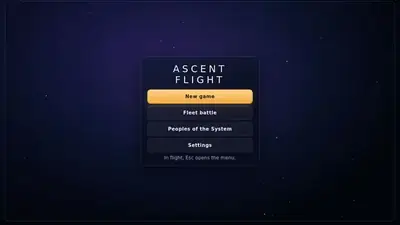</a> <b><a href="https://calebschalesky-ops.github.io/ascent/">Ascent Flight</a></b> <a href="https://github.com/calebschalesky-ops">Caleb Schalesky</a> MIT · <a href="https://github.com/calebschalesky-ops/ascent">Code</a> · <a href="https://huggingface.co/datasets/awesome-fable-5-2/terrarium-open-works/tree/main/games/ascent-flight">Dateien</a></td>
<td width="25%" valign="top"> <b><a href="https://github.com/nizomiddindev/gemini-of-duty">BLACKLINE // TACTICAL RESPONSE</a></b> <a href="https://github.com/nizomiddindev">Nizomiddin</a> MIT · <a href="https://github.com/nizomiddindev/gemini-of-duty">Code</a> · <a href="https://huggingface.co/datasets/awesome-fable-5-2/terrarium-open-works/tree/main/games/blackline-tactical-response">Dateien</a></td>
<td width="25%" valign="top"><a href="https://github.com/lompendans/blacksite-download/releases/tag/v1.0.0">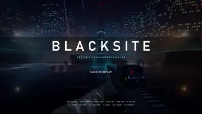</a> <b><a href="https://github.com/lompendans/blacksite-download/releases/tag/v1.0.0">BLACKSITE</a></b> <a href="https://github.com/lompendans">lompendans</a> Lizenz unbekannt</td>
</tr>
<tr>
<td width="25%" valign="top"><a href="https://blameless.petruha.ge">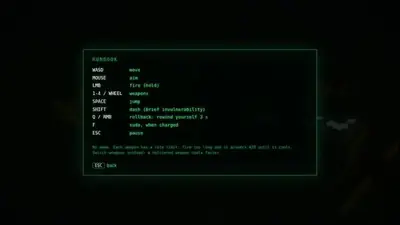</a> <b><a href="https://blameless.petruha.ge">Blameless</a></b> <a href="https://github.com/Petyok">Petyok</a> MIT · <a href="https://github.com/Petyok/blameless">Code</a> · <a href="https://huggingface.co/datasets/awesome-fable-5-2/terrarium-open-works/tree/main/games/blameless">Dateien</a></td>
<td width="25%" valign="top"><a href="https://github.com/Ashalinux/block-shooter">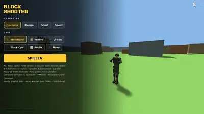</a> <b><a href="https://github.com/Ashalinux/block-shooter">Block Shooter</a></b> <a href="https://github.com/Ashalinux">Ashalinux</a> MIT · <a href="https://github.com/Ashalinux/block-shooter">Code</a> · <a href="https://huggingface.co/datasets/awesome-fable-5-2/terrarium-open-works/tree/main/games/block-shooter">Dateien</a></td>
<td width="25%" valign="top"><a href="https://amoreo140.github.io/cinderbelt/">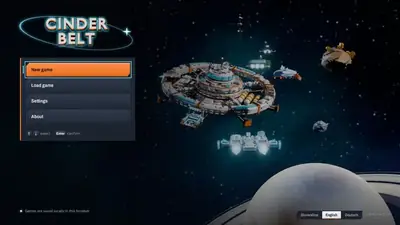</a> <b><a href="https://amoreo140.github.io/cinderbelt/">Cinderbelt</a></b> <a href="https://github.com/amoreo140">amoreo140</a> MIT · <a href="https://github.com/amoreo140/cinderbelt">Code</a> · <a href="https://huggingface.co/datasets/awesome-fable-5-2/terrarium-open-works/tree/main/games/cinderbelt">Dateien</a></td>
<td width="25%" valign="top"><a href="https://deadraid.com/">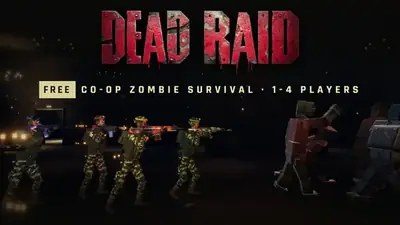</a> <b><a href="https://deadraid.com/">Dead Raid</a></b> u/Sweaty_Breakfast2822 Lizenz unbekannt</td>
</tr>
<tr>
<td width="25%" valign="top"><a href="https://github.com/bridge-mind/claude-opus-5.5-zombies-game">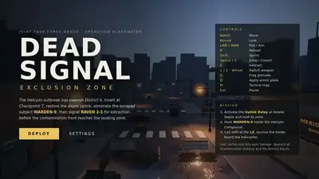</a> <b><a href="https://github.com/bridge-mind/claude-opus-5.5-zombies-game">DEAD SIGNAL: EXCLUSION ZONE</a></b> <a href="https://github.com/bridge-mind">BridgeMind</a> MIT · <a href="https://github.com/bridge-mind/claude-opus-5.5-zombies-game">Code</a> · <a href="https://huggingface.co/datasets/awesome-fable-5-2/terrarium-open-works/tree/main/games/dead-signal-exclusion-zone-claude-opus-5-5-zombies-game">Dateien</a></td>
<td width="25%" valign="top"><a href="https://github.com/bridge-mind/sonnet-5-5-zombies-game">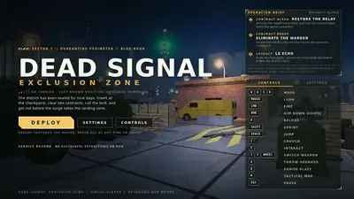</a> <b><a href="https://github.com/bridge-mind/sonnet-5-5-zombies-game">DEAD SIGNAL: EXCLUSION ZONE</a></b> <a href="https://github.com/bridge-mind">BridgeMind</a> MIT · <a href="https://github.com/bridge-mind/sonnet-5-5-zombies-game">Code</a> · <a href="https://huggingface.co/datasets/awesome-fable-5-2/terrarium-open-works/tree/main/games/dead-signal-exclusion-zone-sonnet-5-5-zombies-game">Dateien</a></td>
<td width="25%" valign="top"><a href="https://www.spawn.co/@robot/frontline-warfare-deathmatch">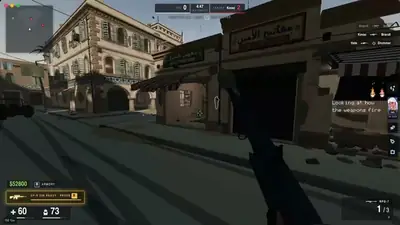</a> <b><a href="https://www.spawn.co/@robot/frontline-warfare-deathmatch">Desert-town FPS</a></b> alightinastorm Lizenz unbekannt</td>
<td width="25%" valign="top"><a href="https://wquguru.github.io/fable52-fps-repro/">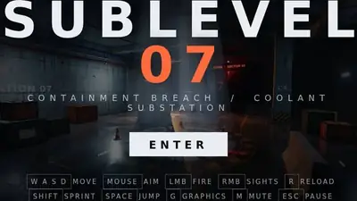</a> <b><a href="https://wquguru.github.io/fable52-fps-repro/">Fable 5.2 FPS Reproduction</a></b> <a href="https://github.com/wquguru">wquguru</a> MIT · <a href="https://github.com/wquguru/fable52-fps-repro/blob/main/demos/04-fps/index.html">Code</a> · <a href="https://huggingface.co/datasets/awesome-fable-5-2/terrarium-open-works/tree/main/games/fable-5-2-fps-reproduction">Dateien</a></td>
</tr>
<tr>
<td width="25%" valign="top"> <b><a href="https://x.com/jarrodwatts/status/2120030097004777937">Floating-island FPS</a></b> <a href="https://x.com/jarrodwatts">Jarrod Watts</a> Lizenz unbekannt</td>
<td width="25%" valign="top"><a href="https://awacke1-galaga-88-3d-game.static.hf.space/index.html">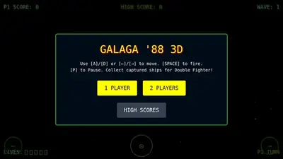</a> <b><a href="https://awacke1-galaga-88-3d-game.static.hf.space/index.html">Galaga 88 3D Game</a></b> <a href="https://huggingface.co/awacke1">Aaron C Wacker</a> MIT · <a href="https://huggingface.co/spaces/awacke1/Galaga-88-3D-Game">Code</a> · <a href="https://huggingface.co/datasets/awesome-fable-5-2/terrarium-open-works/tree/main/games/galaga-88-3d-game">Dateien</a></td>
<td width="25%" valign="top"><a href="https://x.com/MatthewBerman/status/2119868629491789992">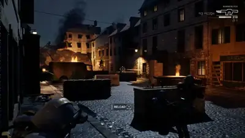</a> <b><a href="https://x.com/MatthewBerman/status/2119868629491789992">Gears of War-style shooter</a></b> <a href="https://x.com/MatthewBerman">Matthew Berman</a> Lizenz unbekannt</td>
<td width="25%" valign="top"><a href="https://gilt-and-gutter.vercel.app/">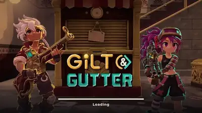</a> <b><a href="https://gilt-and-gutter.vercel.app/">Gilt &amp; Gutter</a></b> Kevin Ngo Lizenz unbekannt · <a href="https://gilt-and-gutter.vercel.app/">Code</a></td>
</tr>
<tr>
<td width="25%" valign="top"><a href="https://zombies.ethanplus.ai">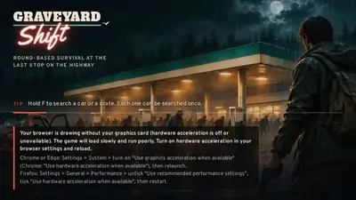</a> <b><a href="https://zombies.ethanplus.ai">Graveyard Shift</a></b> <a href="https://github.com/ethanplusai">Ethan+</a> MIT · <a href="https://github.com/ethanplusai/zombies">Code</a> · <a href="https://huggingface.co/datasets/awesome-fable-5-2/terrarium-open-works/tree/main/games/graveyard-shift">Dateien</a></td>
<td width="25%" valign="top"><a href="https://jarvis-llm-codec.github.io/gridx/">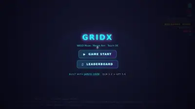</a> <b><a href="https://jarvis-llm-codec.github.io/gridx/">GRIDX</a></b> <a href="https://github.com/jarvis-llm-codec">Kim jun</a> Apache-2.0 · <a href="https://github.com/jarvis-llm-codec/gridx">Code</a> · <a href="https://huggingface.co/datasets/awesome-fable-5-2/terrarium-open-works/tree/main/games/gridx">Dateien</a></td>
<td width="25%" valign="top"><a href="https://topway-ai.github.io/harbor-blackout-gemini/">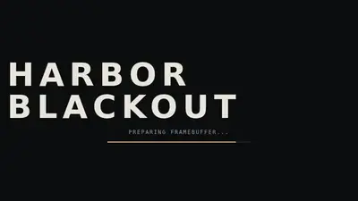</a> <b><a href="https://topway-ai.github.io/harbor-blackout-gemini/">HARBOR BLACKOUT (Gemini Edition)</a></b> <a href="https://github.com/topway-ai">Jack</a> MIT · <a href="https://github.com/topway-ai/harbor-blackout-gemini">Code</a> · <a href="https://huggingface.co/datasets/awesome-fable-5-2/terrarium-open-works/tree/main/games/harbor-blackout-gemini-edition">Dateien</a></td>
<td width="25%" valign="top"><a href="https://homie-wu.github.io/hideaway/">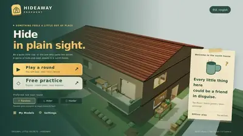</a> <b><a href="https://homie-wu.github.io/hideaway/">HIDEAWAY · Voxel Prop Hunt</a></b> <a href="https://github.com/Homie-Wu">Homie-Wu</a> MIT · <a href="https://github.com/Homie-Wu/hideaway">Code</a> · <a href="https://huggingface.co/datasets/awesome-fable-5-2/terrarium-open-works/tree/main/games/hideaway-voxel-prop-hunt">Dateien</a></td>
</tr>
<tr>
<td width="25%" valign="top"><a href="https://tanuu5.github.io/ink-arcade/ink-dash.html">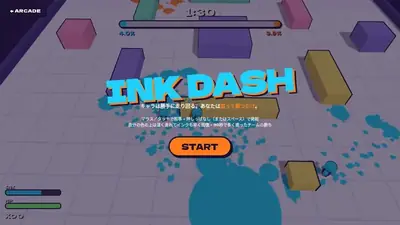</a> <b><a href="https://tanuu5.github.io/ink-arcade/ink-dash.html">INK DASH</a></b> <a href="https://github.com/tanuu5">たぬ（tanu）</a> MIT · <a href="https://github.com/tanuu5/ink-arcade">Code</a> · <a href="https://huggingface.co/datasets/awesome-fable-5-2/terrarium-open-works/tree/main/games/ink-dash">Dateien</a></td>
<td width="25%" valign="top"><a href="https://evals.ag/outputs/out_18S2MGB2ZVFFX7HX842YNWYCF2">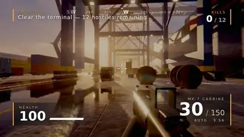</a> <b><a href="https://evals.ag/outputs/out_18S2MGB2ZVFFX7HX842YNWYCF2">IRON TIDE: Terminal 7</a></b> Evan Cha / Evals Lizenz unbekannt · <a href="https://evals.ag/api/v1/media/assets/ast_0JAMNBYNJNTMAM502JBG09HY48/content">Code</a></td>
<td width="25%" valign="top"> <b><a href="https://qiaomu.t5t6.com/irondusk-yard-7/">IRONDUSK — Yard 7</a></b> 向阳乔木 (@vista8) Lizenz unbekannt · <a href="https://qiaomu.t5t6.com/irondusk-yard-7/">Code</a></td>
<td width="25%" valign="top"> <b><a href="https://evals.ag/outputs/out_32XV66QX3Q8088XDCG15YQ2R19">LAST LIGHT: Dockside Refinery</a></b> Evan Cha / Evals Lizenz unbekannt · <a href="https://evals.ag/api/v1/media/assets/ast_1AZW7W4223G2KWGJVR9WF54K3F/content">Code</a></td>
</tr>
<tr>
<td width="25%" valign="top"><a href="https://albertoit-23.github.io/meridian-line/">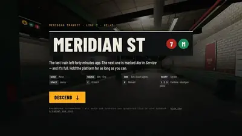</a> <b><a href="https://albertoit-23.github.io/meridian-line/">Meridian Line</a></b> <a href="https://github.com/AlbertoIT-23">AlbertoIT</a> MIT · <a href="https://github.com/AlbertoIT-23/meridian-line">Code</a> · <a href="https://huggingface.co/datasets/awesome-fable-5-2/terrarium-open-works/tree/main/games/meridian-line">Dateien</a></td>
<td width="25%" valign="top"><a href="https://nnnnnnnnnke.github.io/neon-surge/">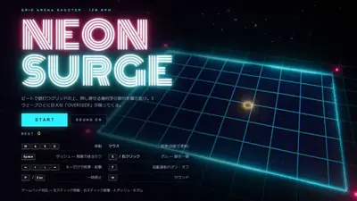</a> <b><a href="https://nnnnnnnnnke.github.io/neon-surge/">NEON SURGE</a></b> <a href="https://github.com/nnnnnnnnnke">Kinukui</a> MIT · <a href="https://github.com/nnnnnnnnnke/neon-surge">Code</a> · <a href="https://huggingface.co/datasets/awesome-fable-5-2/terrarium-open-works/tree/main/games/neon-surge">Dateien</a></td>
<td width="25%" valign="top"><a href="https://tanuu5.github.io/nova-lancer/">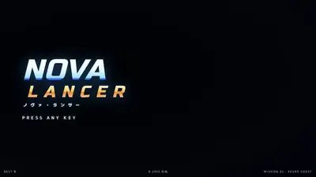</a> <b><a href="https://tanuu5.github.io/nova-lancer/">NOVA LANCER（ノヴァ・ランサー）</a></b> <a href="https://github.com/tanuu5">たぬ（tanu）</a> MIT · <a href="https://github.com/tanuu5/nova-lancer">Code</a> · <a href="https://huggingface.co/datasets/awesome-fable-5-2/terrarium-open-works/tree/main/games/nova-lancer">Dateien</a></td>
<td width="25%" valign="top"> <b><a href="https://www.reddit.com/r/ClaudeAI/comments/1xt2kax/i_gave_claude_fable_52_one_prompt_and_got_a/">Null Horizon</a></b> <a href="https://github.com/dantecomedia">dantecomedia</a> Lizenz unbekannt · <a href="https://github.com/dantecomedia/null-horizon">Code</a></td>
</tr>
<tr>
<td width="25%" valign="top"> <b><a href="https://theredstapler.github.io/orb-shooter/">Orb Shooter FPS Demo (Vibe Coded)</a></b> <a href="https://github.com/theredstapler">Red Stapler</a> MIT · <a href="https://github.com/theredstapler/orb-shooter">Code</a> · <a href="https://huggingface.co/datasets/awesome-fable-5-2/terrarium-open-works/tree/main/games/orb-shooter-fps-demo-vibe-coded">Dateien</a></td>
<td width="25%" valign="top"> <b><a href="https://patch.gg/play/rehan/ringfall">ringfall</a></b> Rehan Sheikh Lizenz unbekannt · <a href="https://git.patch.gg/rehan/ringfall.git">Code</a></td>
<td width="25%" valign="top"><a href="https://michaelcrosato.github.io/robot-warrior/">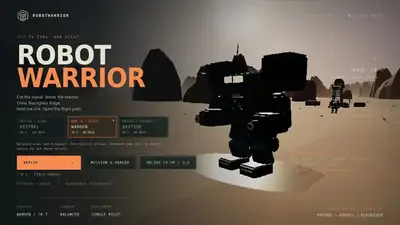</a> <b><a href="https://michaelcrosato.github.io/robot-warrior/">RobotWarrior</a></b> <a href="https://github.com/michaelcrosato">Michael</a> MIT · <a href="https://github.com/michaelcrosato/robot-warrior">Code</a> · <a href="https://huggingface.co/datasets/awesome-fable-5-2/terrarium-open-works/tree/main/games/robotwarrior">Dateien</a></td>
<td width="25%" valign="top"> <b><a href="https://claude.ai/artifact/BGY1SztrAYcJQHSsnHHGmp">Saltline</a></b> Felix Rieseberg Lizenz unbekannt · <a href="https://claude.ai/artifact/BGY1SztrAYcJQHSsnHHGmp">Code</a></td>
</tr>
<tr>
<td width="25%" valign="top"><a href="https://x.com/higgsfield_ai/status/2119897113534529605">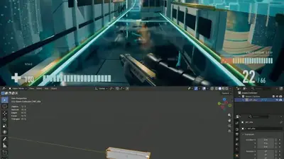</a> <b><a href="https://x.com/higgsfield_ai/status/2119897113534529605">Space-station shooter</a></b> <a href="https://x.com/higgsfield_ai">Higgsfield</a> Lizenz unbekannt</td>
<td width="25%" valign="top"><a href="https://evals.ag/outputs/out_64YQ9Y1C28PS2M09T05JV39Z2S">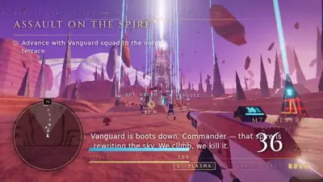</a> <b><a href="https://evals.ag/outputs/out_64YQ9Y1C28PS2M09T05JV39Z2S">SPIREFALL: Assault on the Terraforming Spire</a></b> Evan Cha / Evals Lizenz unbekannt · <a href="https://evals.ag/api/v1/media/assets/ast_7G3X8N7GY5TX46BAE1H7HBFW99/content">Code</a></td>
<td width="25%" valign="top"><a href="https://damijjj.github.io/Status-1/">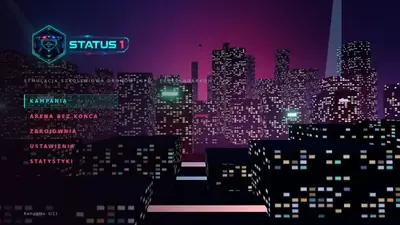</a> <b><a href="https://damijjj.github.io/Status-1/">STATUS 1 — browser FPS</a></b> <a href="https://github.com/DamiJJJ">Dami</a> MIT · <a href="https://github.com/DamiJJJ/Status-1">Code</a> · <a href="https://huggingface.co/datasets/awesome-fable-5-2/terrarium-open-works/tree/main/games/status-1-browser-fps">Dateien</a></td>
<td width="25%" valign="top"><a href="https://fps-fable52-7d7eb4.surge.sh/">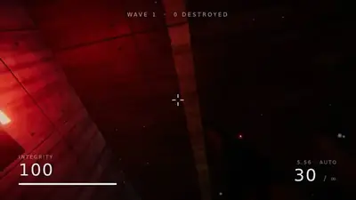</a> <b><a href="https://fps-fable52-7d7eb4.surge.sh/">SUBLEVEL 03</a></b> Leohuan Lizenz unbekannt · <a href="https://fps-fable52-7d7eb4.surge.sh/">Code</a></td>
</tr>
<tr>
<td width="25%" valign="top"><a href="https://github.com/Hrithin-30/thing-game">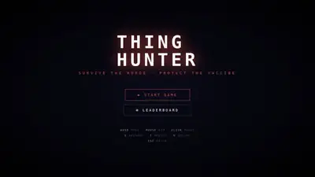</a> <b><a href="https://github.com/Hrithin-30/thing-game">THING HUNTER</a></b> <a href="https://github.com/Hrithin-30">Brahmadevu Hrithin kumar</a> MIT · <a href="https://github.com/Hrithin-30/thing-game">Code</a> · <a href="https://huggingface.co/datasets/awesome-fable-5-2/terrarium-open-works/tree/main/games/thing-hunter">Dateien</a></td>
<td width="25%" valign="top"><a href="https://gigabitgamelab.com/arcade/play/tsuranuki-kai/">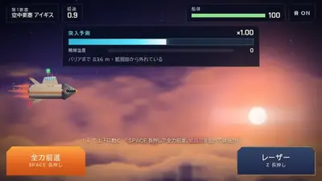</a> <b><a href="https://gigabitgamelab.com/arcade/play/tsuranuki-kai/">TSURANUKI KAI</a></b> Gigabit Game Lab Lizenz unbekannt</td>
<td width="25%" valign="top"> <b><a href="https://xo-beta.pages.dev/">Xo Beta</a></b> <a href="https://github.com/TKY-27">Ana</a> MIT · <a href="https://github.com/TKY-27/Xo-Beta">Code</a> · <a href="https://huggingface.co/datasets/awesome-fable-5-2/terrarium-open-works/tree/main/games/xo-beta">Dateien</a></td>
<td width="25%" valign="top"><a href="https://neurorich.ru/projects/claude-fable-5-2-proekty/">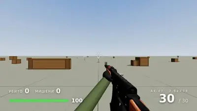</a> <b><a href="https://neurorich.ru/projects/claude-fable-5-2-proekty/">Zombie FPS: AK-47</a></b> Нейро Рич Lizenz unbekannt · <a href="https://neurorich.ru/files/claude-fable-5-2-proekty.zip">Code</a></td>
</tr>
<tr>
<td width="25%" valign="top"> <b><a href="https://cyancity.github.io/yolo-mini-fps/">零号码头 DOCK ZERO</a></b> <a href="https://github.com/cyancity">YOLO</a> MIT · <a href="https://github.com/cyancity/yolo-mini-fps">Code</a> · <a href="https://huggingface.co/datasets/awesome-fable-5-2/terrarium-open-works/tree/main/games/dock-zero">Dateien</a></td>
<td width="25%"></td>
<td width="25%"></td>
<td width="25%"></td>
</tr>
</table>

Werke ohne Vorschaubild:

<table>
<tr><th align="left">Werk</th><th align="left">Urheber</th><th align="left">Lizenz</th><th align="left">Links</th></tr>
<tr><td><a href="https://claude.ai/artifact/3tX4R1U95SUxKUQ2Dkz3m3">Contra recreation</a></td><td>Prasad Pilla</td><td>Lizenz unbekannt</td><td>—</td></tr>
<tr><td><a href="https://www.bilibili.com/video/BV1yJW168ENZ/">Metal Slug in 3D</a></td><td>阿达的AI思辩</td><td>Lizenz unbekannt</td><td>—</td></tr>
<tr><td><a href="https://tinyarena.online">TINY ARENA</a></td><td><a href="https://github.com/tpoxa">Maksym Trofimenko</a></td><td>MIT</td><td><a href="https://github.com/tpoxa/tinyarena">Code</a> · <a href="https://huggingface.co/datasets/awesome-fable-5-2/terrarium-open-works/tree/main/games/tiny-arena">Dateien</a></td></tr>
<tr><td><a href="https://github.com/KiranMohan-92/warsaw-downtown-game">WARSAW DOWNTOWN</a></td><td><a href="https://github.com/KiranMohan-92">Kiran Mohan</a></td><td>MIT</td><td><a href="https://github.com/KiranMohan-92/warsaw-downtown-game">Code</a> · <a href="https://huggingface.co/datasets/awesome-fable-5-2/terrarium-open-works/tree/main/games/warsaw-downtown">Dateien</a></td></tr>
<tr><td><a href="https://workmelt.com">Workmelt</a></td><td><a href="https://github.com/eriknomitch">Erik Nomitch</a></td><td>MIT</td><td><a href="https://github.com/eriknomitch/workmelt">Code</a> · <a href="https://huggingface.co/datasets/awesome-fable-5-2/terrarium-open-works/tree/main/games/workmelt">Dateien</a></td></tr>
</table>

## Action und Kampf

<table>
<tr>
<td width="25%" valign="top"><a href="https://aidens-revenge.pages.dev/">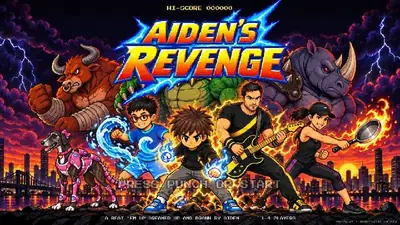</a> <b><a href="https://aidens-revenge.pages.dev/">Aiden&#x27;s Revenge</a></b> Lex Toumbourou Lizenz unbekannt · <a href="https://aidens-revenge.pages.dev/">Code</a></td>
<td width="25%" valign="top"> <b><a href="https://github.com/GavinLOrio/Fable-5.2-random-game/commit/55838a1f7565dc713edb3f985187338368fe6a81">Aquila</a></b> <a href="https://github.com/GavinLOrio">GavinLOrio</a> Lizenz unbekannt · <a href="https://github.com/GavinLOrio/Fable-5.2-random-game/blob/55838a1f7565dc713edb3f985187338368fe6a81/rome/index.html">Code</a></td>
<td width="25%" valign="top"><a href="https://www.aigameshare.com/games/falling-sand-roguelike">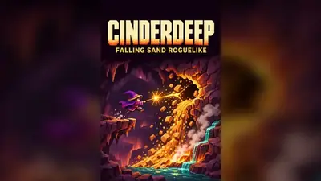</a> <b><a href="https://www.aigameshare.com/games/falling-sand-roguelike">CinderDeep</a></b> Nil Ni Lizenz unbekannt</td>
<td width="25%" valign="top"><a href="https://usama-shiranai90.github.io/Claude-of-Iron/">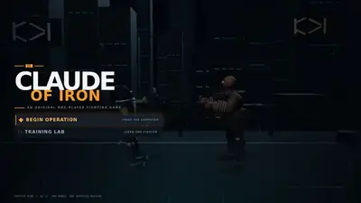</a> <b><a href="https://usama-shiranai90.github.io/Claude-of-Iron/">Claude of Iron</a></b> <a href="https://github.com/usama-shiranai90">Sama</a> MIT · <a href="https://github.com/usama-shiranai90/Claude-of-Iron">Code</a> · <a href="https://huggingface.co/datasets/awesome-fable-5-2/terrarium-open-works/tree/main/games/claude-of-iron">Dateien</a></td>
</tr>
<tr>
<td width="25%" valign="top"> <b><a href="https://pablitofernandez.github.io/coinkeep/">Coinkeep</a></b> <a href="https://github.com/pablitofernandez">pablitofernandez</a> MIT · <a href="https://github.com/pablitofernandez/coinkeep">Code</a> · <a href="https://huggingface.co/datasets/awesome-fable-5-2/terrarium-open-works/tree/main/games/coinkeep">Dateien</a></td>
<td width="25%" valign="top"> <b><a href="https://github.com/GavinLOrio/Fable-5.2-random-game/commit/6051b625701c68e9fcef4bef30f2476f287830e5">Dawnward</a></b> <a href="https://github.com/GavinLOrio">GavinLOrio</a> Lizenz unbekannt · <a href="https://github.com/GavinLOrio/Fable-5.2-random-game/blob/6051b625701c68e9fcef4bef30f2476f287830e5/index.html">Code</a></td>
<td width="25%" valign="top"><a href="https://ahmaddentist30.itch.io/dino-jungle-survival-3d">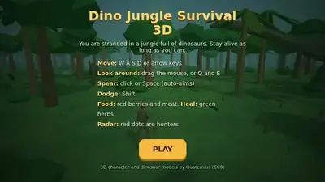</a> <b><a href="https://ahmaddentist30.itch.io/dino-jungle-survival-3d">Dino Jungle Survival 3D</a></b> <a href="https://ahmaddentist30.itch.io">ahmaddentist30</a> Lizenz unbekannt · <a href="https://html-classic.itch.zone/html/20412026/index.html?v=1794293623">Code</a></td>
<td width="25%" valign="top"><a href="https://eldor.pages.dev">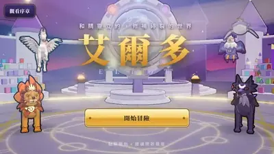</a> <b><a href="https://eldor.pages.dev">Eldor</a></b> <a href="https://github.com/alan890104">Yu Lun Hsu</a> MIT · <a href="https://github.com/alan890104/Eldor">Code</a> · <a href="https://huggingface.co/datasets/awesome-fable-5-2/terrarium-open-works/tree/main/games/eldor">Dateien</a></td>
</tr>
<tr>
<td width="25%" valign="top"><a href="https://evensong-phi.vercel.app/">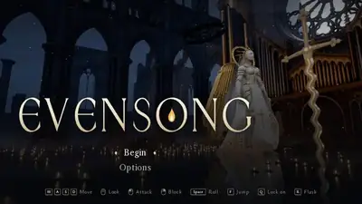</a> <b><a href="https://evensong-phi.vercel.app/">Evensong</a></b> Kevin Ngo Lizenz unbekannt · <a href="https://evensong-phi.vercel.app/">Code</a></td>
<td width="25%" valign="top"><a href="https://feed-backrooms.vercel.app/">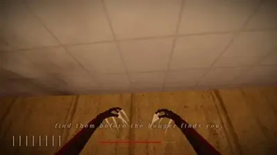</a> <b><a href="https://feed-backrooms.vercel.app/">FEED</a></b> Leon Lin Lizenz unbekannt · <a href="https://feed-backrooms.vercel.app/">Code</a></td>
<td width="25%" valign="top"><a href="https://www.spawn.co/@mattshumer/hogwarts-royale">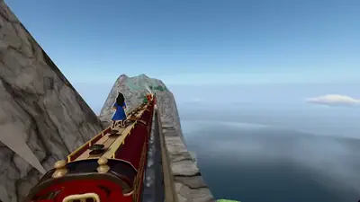</a> <b><a href="https://www.spawn.co/@mattshumer/hogwarts-royale">Hogwarts Royale</a></b> Matt Shumer Lizenz unbekannt</td>
<td width="25%" valign="top"> <b><a href="https://evals.ag/outputs/out_42WRTRNWM70860K7FE8W5H4JYE">Sands of the Black Sun</a></b> Evan Cha / Evals Lizenz unbekannt · <a href="https://evals.ag/api/v1/media/assets/ast_01K0N55YXGZGDV24CGYHFWPR7P/content">Code</a></td>
</tr>
<tr>
<td width="25%" valign="top"><a href="https://gigabitgamelab.com/arcade/play/tensen-fable/">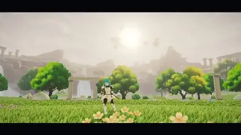</a> <b><a href="https://gigabitgamelab.com/arcade/play/tensen-fable/">TENSEN NO KOJIN / FABLE</a></b> Gigabit Game Lab Lizenz unbekannt</td>
<td width="25%" valign="top"> <b><a href="https://edgegap.github.io/netcode-sample-threejs-thin-ice-tussle/">Thin Ice Tussle</a></b> <a href="https://github.com/edgegap">Edgegap</a> MIT · <a href="https://github.com/edgegap/netcode-sample-threejs-thin-ice-tussle">Code</a> · <a href="https://huggingface.co/datasets/awesome-fable-5-2/terrarium-open-works/tree/main/games/thin-ice-tussle">Dateien</a></td>
<td width="25%" valign="top"><a href="https://x.com/AmirMushich/status/2119937977426338283">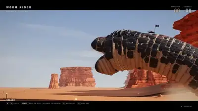</a> <b><a href="https://x.com/AmirMushich/status/2119937977426338283">Worm Rider</a></b> <a href="https://github.com/amirmushichge">Amir Mušić</a> MIT · <a href="https://github.com/amirmushichge/worm-rider">Code</a> · <a href="https://huggingface.co/datasets/awesome-fable-5-2/terrarium-open-works/tree/main/games/worm-rider">Dateien</a></td>
<td width="25%" valign="top"><a href="https://tanuu5.github.io/astra-potato-farm/">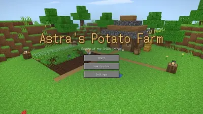</a> <b><a href="https://tanuu5.github.io/astra-potato-farm/">アストラのじゃがいも畑 — Astra&#x27;s Potato Farm</a></b> <a href="https://github.com/tanuu5">たぬ（tanu）</a> MIT · <a href="https://github.com/tanuu5/astra-potato-farm">Code</a> · <a href="https://huggingface.co/datasets/awesome-fable-5-2/terrarium-open-works/tree/main/games/astra-s-potato-farm-tanuu5">Dateien</a></td>
</tr>
<tr>
<td width="25%" valign="top"><a href="https://tanuu5.github.io/kaiju-dokan/">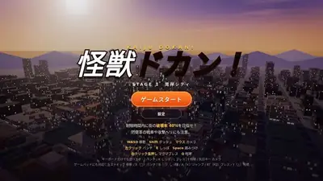</a> <b><a href="https://tanuu5.github.io/kaiju-dokan/">怪獣ドカン！ KAIJU DOKAN!</a></b> <a href="https://github.com/tanuu5">たぬ（tanu）</a> MIT · <a href="https://github.com/tanuu5/kaiju-dokan">Code</a> · <a href="https://huggingface.co/datasets/awesome-fable-5-2/terrarium-open-works/tree/main/games/kaiju-dokan">Dateien</a></td>
<td width="25%"></td>
<td width="25%"></td>
<td width="25%"></td>
</tr>
</table>

Werke ohne Vorschaubild:

<table>
<tr><th align="left">Werk</th><th align="left">Urheber</th><th align="left">Lizenz</th><th align="left">Links</th></tr>
<tr><td><a href="https://x.com/FaridaNever/status/2119910055990505730">Ink swordsman</a></td><td><a href="https://x.com/FaridaNever">FaridaNever</a></td><td>Lizenz unbekannt</td><td>—</td></tr>
<tr><td><a href="https://rottensouls.com">Rotten Souls</a></td><td><a href="https://github.com/igorjohn">Igor John</a></td><td>MIT</td><td><a href="https://github.com/igorjohn/rotten-souls">Code</a> · <a href="https://huggingface.co/datasets/awesome-fable-5-2/terrarium-open-works/tree/main/games/rotten-souls">Dateien</a></td></tr>
<tr><td><a href="https://www.youtube.com/watch?v=2TM8W66NI_8&amp;t=566s">Shard Storm</a></td><td>Matt Wolfe</td><td>Lizenz unbekannt</td><td>—</td></tr>
</table>

## Plattform und Runner

<table>
<tr>
<td width="25%" valign="top"><a href="https://noclipepe.pages.dev/dino/">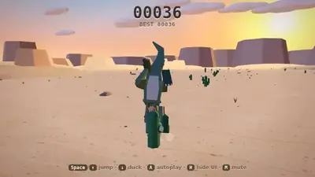</a> <b><a href="https://noclipepe.pages.dev/dino/">Dino Run: Locked In</a></b> noclipepe Lizenz unbekannt</td>
<td width="25%" valign="top"><a href="https://jaydemks.github.io/ImADragon_onepromptcode_game/">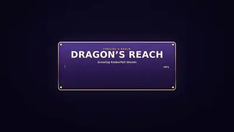</a> <b><a href="https://jaydemks.github.io/ImADragon_onepromptcode_game/">Dragon&#x27;s Reach</a></b> <a href="https://github.com/jaydemks">Giovanni &quot;Giò&quot; De Miccoli</a> MIT · <a href="https://github.com/jaydemks/ImADragon_onepromptcode_game">Code</a> · <a href="https://huggingface.co/datasets/awesome-fable-5-2/terrarium-open-works/tree/main/games/dragon-s-reach">Dateien</a></td>
<td width="25%" valign="top"> <b><a href="https://shubhu121.github.io/hitdude/play/">HITOFUDE 一筆</a></b> <a href="https://github.com/shubhu121">@positronx_</a> Lizenz unbekannt</td>
<td width="25%" valign="top"><a href="https://hundred-ghosts.vercel.app/">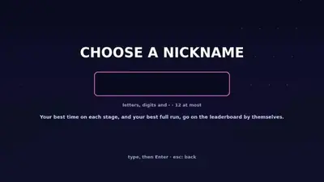</a> <b><a href="https://hundred-ghosts.vercel.app/">Hundred Ghosts</a></b> <a href="https://github.com/koumpas">koumpas</a> Lizenz unbekannt · <a href="https://github.com/koumpas/hundred-ghosts">Code</a></td>
</tr>
<tr>
<td width="25%" valign="top"> <b><a href="https://github.com/ohylli/indys-adventure-3d">Indy’s Adventure 3D: Näsinneula</a></b> <a href="https://github.com/ohylli">ohylli</a> Lizenz unbekannt · <a href="https://github.com/ohylli/indys-adventure-3d">Code</a></td>
<td width="25%" valign="top"><a href="https://furkiozknn.github.io/carsi-kacisi/">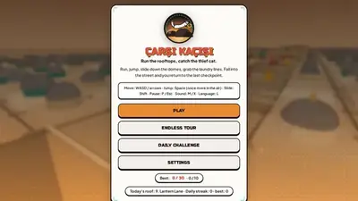</a> <b><a href="https://furkiozknn.github.io/carsi-kacisi/">Çarşı Kaçışı</a></b> <a href="https://github.com/Furkiozknn">Furki Özkan</a> MIT · <a href="https://github.com/Furkiozknn/carsi-kacisi">Code</a> · <a href="https://huggingface.co/datasets/awesome-fable-5-2/terrarium-open-works/tree/main/games/carsi-kacisi">Dateien</a></td>
<td width="25%" valign="top"><a href="https://pelicanride.vercel.app">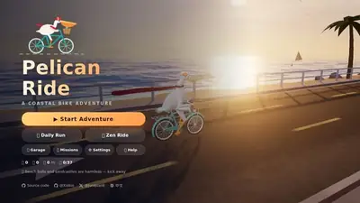</a> <b><a href="https://pelicanride.vercel.app">鹈鹕骑单车 · 海岸大冒险（Pelican Ride）</a></b> <a href="https://github.com/Xiobio">Xony</a> MIT · <a href="https://github.com/Xiobio/pelican-ride">Code</a> · <a href="https://huggingface.co/datasets/awesome-fable-5-2/terrarium-open-works/tree/main/games/pelican-ride">Dateien</a></td>
<td width="25%"></td>
</tr>
</table>

Werke ohne Vorschaubild:

<table>
<tr><th align="left">Werk</th><th align="left">Urheber</th><th align="left">Lizenz</th><th align="left">Links</th></tr>
<tr><td><a href="https://www.reddit.com/r/vibecoding/comments/1xsuqwm/fable_52_oneshot_a_super_nintendo_game_overnight/">Emberwake</a></td><td>u/shiny_guruw (ppu.toys)</td><td>Lizenz unbekannt</td><td>—</td></tr>
<tr><td><a href="https://www.youtube.com/watch?v=0vNyVMDFdkg&amp;t=364s">Tumble Beans</a></td><td>Matthew Berman</td><td>Lizenz unbekannt</td><td>—</td></tr>
</table>

## Rennen und Fahren

<table>
<tr>
<td width="25%" valign="top"><a href="https://gemini-3d-car-racing-game.onrender.com/">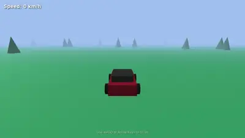</a> <b><a href="https://gemini-3d-car-racing-game.onrender.com/">🏎️ 3D Browser Racer</a></b> <a href="https://github.com/wayneeffect">Dr. Elden Wayne Whalen III, ShD</a> MIT · <a href="https://github.com/wayneeffect/Gemini-3D-Car-Racing-Game">Code</a> · <a href="https://huggingface.co/datasets/awesome-fable-5-2/terrarium-open-works/tree/main/games/3d-browser-racer">Dateien</a></td>
<td width="25%" valign="top"><a href="https://bridge-mind.github.io/apex-formula/">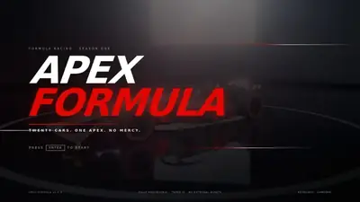</a> <b><a href="https://bridge-mind.github.io/apex-formula/">APEX FORMULA</a></b> <a href="https://github.com/bridge-mind">BridgeMind</a> MIT · <a href="https://github.com/bridge-mind/apex-formula">Code</a> · <a href="https://huggingface.co/datasets/awesome-fable-5-2/terrarium-open-works/tree/main/games/apex-formula">Dateien</a></td>
<td width="25%" valign="top"><a href="https://vibe-f1-racing.pages.dev">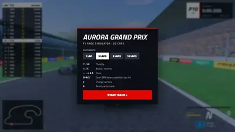</a> <b><a href="https://vibe-f1-racing.pages.dev">Aurora Grand Prix — F1 Simulator</a></b> <a href="https://github.com/hirosichen">hirosichen</a> MIT · <a href="https://github.com/hirosichen/ai-f1-racing-game">Code</a> · <a href="https://huggingface.co/datasets/awesome-fable-5-2/terrarium-open-works/tree/main/games/aurora-grand-prix-f1-simulator">Dateien</a></td>
<td width="25%" valign="top"> <b><a href="https://jason-c-dev.github.io/backroad-rally/">backroad rally</a></b> <a href="https://github.com/jason-c-dev">jason-c-dev</a> MIT · <a href="https://github.com/jason-c-dev/backroad-rally">Code</a> · <a href="https://huggingface.co/datasets/awesome-fable-5-2/terrarium-open-works/tree/main/games/backroad-rally">Dateien</a></td>
</tr>
<tr>
<td width="25%" valign="top"> <b><a href="https://furkiozknn.github.io/bogaz-vapuru/">Boğaz Vapuru</a></b> <a href="https://github.com/Furkiozknn">Furki Özkan</a> MIT · <a href="https://github.com/Furkiozknn/bogaz-vapuru">Code</a> · <a href="https://huggingface.co/datasets/awesome-fable-5-2/terrarium-open-works/tree/main/games/bogaz-vapuru">Dateien</a></td>
<td width="25%" valign="top"> <b><a href="https://arjunreddy91100.github.io/bumblebee-echo-garden/">Bumblebee — Echo Garden</a></b> <a href="https://github.com/arjunreddy91100">Arjun</a> MIT · <a href="https://github.com/arjunreddy91100/bumblebee-echo-garden">Code</a> · <a href="https://huggingface.co/datasets/awesome-fable-5-2/terrarium-open-works/tree/main/games/bumblebee-echo-garden">Dateien</a></td>
<td width="25%" valign="top"> <b><a href="https://mutaafaziz.com/coldgas/">COLD GAS</a></b> <a href="https://github.com/mutaaf">Mutaaf Aziz</a> MIT · <a href="https://github.com/mutaaf/cold-gas">Code</a> · <a href="https://huggingface.co/datasets/awesome-fable-5-2/terrarium-open-works/tree/main/games/cold-gas">Dateien</a></td>
<td width="25%" valign="top"> <b><a href="https://amanndev.com/criar-projeto-3d-com-um-prompt-no-claude">Cyberpunk Tokyo Motorcycle</a></b> Luca Amann Lizenz unbekannt · <a href="https://amanndev.com/_next/static/chunks/2gdq495c_bsx_.js">Code</a></td>
</tr>
<tr>
<td width="25%" valign="top"> <b><a href="https://furkiozknn.github.io/dolmus/">Dolmuş</a></b> <a href="https://github.com/Furkiozknn">Furki Özkan</a> MIT · <a href="https://github.com/Furkiozknn/dolmus">Code</a> · <a href="https://huggingface.co/datasets/awesome-fable-5-2/terrarium-open-works/tree/main/games/dolmus">Dateien</a></td>
<td width="25%" valign="top"> <b><a href="https://github.com/CodingFreeze/Fable_GTA">GTA-2W — GTA 2 Web Clone (Three.js)</a></b> <a href="https://github.com/CodingFreeze">CodingFreeze</a> MIT · <a href="https://github.com/CodingFreeze/Fable_GTA">Code</a> · <a href="https://huggingface.co/datasets/awesome-fable-5-2/terrarium-open-works/tree/main/games/gta-2w-gta-2-web-clone-three-js">Dateien</a></td>
<td width="25%" valign="top"> <b><a href="https://vibe-harbor-master.pages.dev">Harbor Master — Superyacht Docking</a></b> <a href="https://github.com/hirosichen">hirosichen</a> MIT · <a href="https://github.com/hirosichen/ai-harbor-master-game">Code</a> · <a href="https://huggingface.co/datasets/awesome-fable-5-2/terrarium-open-works/tree/main/games/harbor-master-superyacht-docking">Dateien</a></td>
<td width="25%" valign="top"> <b><a href="https://olagon.github.io/holua/">HŌLUA — the slide at Keauhou</a></b> <a href="https://github.com/olagon">Olin Lagon</a> MIT · <a href="https://github.com/olagon/holua">Code</a> · <a href="https://huggingface.co/datasets/awesome-fable-5-2/terrarium-open-works/tree/main/games/holua-the-slide-at-keauhou">Dateien</a></td>
</tr>
<tr>
<td width="25%" valign="top"> <b><a href="https://akotch.github.io/kekenon-cotonou/">Kekenon: Cotonou</a></b> <a href="https://github.com/Akotch">Akotch</a> Lizenz unbekannt · <a href="https://github.com/Akotch/kekenon-cotonou">Code</a></td>
<td width="25%" valign="top"> <b><a href="https://jediconcepts.com/mcl64/">MCL-64 — Papaya Grand Prix</a></b> <a href="https://github.com/JediConcepts">Jedi Concepts</a> MIT · <a href="https://github.com/JediConcepts/J1-racing">Code</a> · <a href="https://huggingface.co/datasets/awesome-fable-5-2/terrarium-open-works/tree/main/games/mcl-64-papaya-grand-prix">Dateien</a></td>
<td width="25%" valign="top"> <b><a href="https://x.com/ericmaskfr/status/2119910195325481026">Miami-style crime game</a></b> <a href="https://x.com/ericmaskfr">@ericmaskfr</a> Lizenz unbekannt</td>
<td width="25%" valign="top"> <b><a href="https://siddqamar.github.io/midnight-shuto/">Midnight Shuto</a></b> <a href="https://github.com/siddqamar">Siddiqui Qamar</a> Apache-2.0 · <a href="https://github.com/siddqamar/midnight-shuto">Code</a> · <a href="https://huggingface.co/datasets/awesome-fable-5-2/terrarium-open-works/tree/main/games/midnight-shuto">Dateien</a></td>
</tr>
<tr>
<td width="25%" valign="top"> <b><a href="https://github.com/hahaliu1029/fable5.2demo">MOTHLIGHT: Vesper-9</a></b> <a href="https://github.com/hahaliu1029">hahaliu1029</a> Apache-2.0 · <a href="https://github.com/hahaliu1029/fable5.2demo/tree/main/mothlight">Code</a> · <a href="https://huggingface.co/datasets/awesome-fable-5-2/terrarium-open-works/tree/main/games/mothlight-vesper-9">Dateien</a></td>
<td width="25%" valign="top"> <b><a href="https://kostikoneuro.github.io/gemini-carbon-vs-fable-5-2/">Neon Night Racer: Fable build</a></b> <a href="https://github.com/KostiKoNeuro">KostiKoNeuro</a> Lizenz unbekannt · <a href="https://github.com/KostiKoNeuro/gemini-carbon-vs-fable-5-2/tree/main/1-race/fable">Code</a></td>
<td width="25%" valign="top"> <b><a href="https://mutaafaziz.com/outatime/">OUTATIME 88</a></b> <a href="https://github.com/mutaaf">Mutaaf Aziz</a> MIT · <a href="https://github.com/mutaaf/outatime-88">Code</a> · <a href="https://huggingface.co/datasets/awesome-fable-5-2/terrarium-open-works/tree/main/games/outatime-88">Dateien</a></td>
<td width="25%" valign="top"> <b><a href="https://netanelyan.github.io/outbound/">OUTBOUND</a></b> <a href="https://github.com/netanelyan">Natanel Yanchevsky</a> MIT · <a href="https://github.com/netanelyan/outbound">Code</a> · <a href="https://huggingface.co/datasets/awesome-fable-5-2/terrarium-open-works/tree/main/games/outbound">Dateien</a></td>
</tr>
<tr>
<td width="25%" valign="top"> <b><a href="https://bhanu2006-24.github.io/racing-game/">Poly City Racer: Turbo</a></b> <a href="https://github.com/bhanu2006-24">Bhanu Pratap Saini</a> MIT · <a href="https://github.com/bhanu2006-24/racing-game">Code</a> · <a href="https://huggingface.co/datasets/awesome-fable-5-2/terrarium-open-works/tree/main/games/poly-city-racer-turbo">Dateien</a></td>
<td width="25%" valign="top"> <b><a href="https://road-to-el-salvador.vercel.app">🛻₿ Road to El Salvador — Bitcoin Road Trip</a></b> <a href="https://github.com/william89971">William Menjivar</a> MIT · <a href="https://github.com/william89971/Road-to-El-Salvador">Code</a> · <a href="https://huggingface.co/datasets/awesome-fable-5-2/terrarium-open-works/tree/main/games/road-to-el-salvador-bitcoin-road-trip">Dateien</a></td>
<td width="25%" valign="top"> <b><a href="https://extremeai-labs.github.io/rocky-grid/">ROCKY GRID</a></b> <a href="https://github.com/ExtremeAI-Labs">ExtremeAI-Labs</a> MIT · <a href="https://github.com/ExtremeAI-Labs/rocky-grid">Code</a> · <a href="https://huggingface.co/datasets/awesome-fable-5-2/terrarium-open-works/tree/main/games/rocky-grid">Dateien</a></td>
<td width="25%" valign="top"> <b><a href="https://noclipepe.pages.dev/rug/">Rug Racers</a></b> noclipepe Lizenz unbekannt · <a href="https://noclipepe.pages.dev/rug/">Code</a></td>
</tr>
<tr>
<td width="25%" valign="top"> <b><a href="https://saltfire.higgsfield.app/">Saltfire</a></b> Higgsfield Lizenz unbekannt · <a href="https://d2ol7oe51mr4n9.cloudfront.net/user_3GXbZB0UVQ4VNLix2xrfj28xkQu/096b9953-ca50-4858-80f0-3b7d427d1897.html">Code</a></td>
<td width="25%" valign="top"> <b><a href="https://tanuu5.github.io/tanuki-rush/">TANUKI RUSH</a></b> <a href="https://github.com/tanuu5">たぬ（tanu）</a> MIT · <a href="https://github.com/tanuu5/tanuki-rush">Code</a> · <a href="https://huggingface.co/datasets/awesome-fable-5-2/terrarium-open-works/tree/main/games/tanuki-rush">Dateien</a></td>
<td width="25%" valign="top"> <b><a href="https://bridge-mind.github.io/turbo-kart-rally/">Turbo Kart Rally</a></b> <a href="https://github.com/bridge-mind">BridgeMind</a> MIT · <a href="https://github.com/bridge-mind/turbo-kart-rally">Code</a> · <a href="https://huggingface.co/datasets/awesome-fable-5-2/terrarium-open-works/tree/main/games/turbo-kart-rally">Dateien</a></td>
<td width="25%" valign="top"> <b><a href="https://bridge-mind.github.io/turbo-kart-rush/">Turbo Kart Rush</a></b> <a href="https://github.com/bridge-mind">BridgeMind</a> MIT · <a href="https://github.com/bridge-mind/turbo-kart-rush">Code</a> · <a href="https://huggingface.co/datasets/awesome-fable-5-2/terrarium-open-works/tree/main/games/turbo-kart-rush">Dateien</a></td>
</tr>
<tr>
<td width="25%" valign="top"> <b><a href="https://turbo-tails.vercel.app/">Turbo Tails</a></b> Peter Yang Lizenz unbekannt · <a href="https://turbo-tails.vercel.app/">Code</a></td>
<td width="25%" valign="top"> <b><a href="https://x.com/mattshumer_/status/2120282133503820150">Untitled open-world driving game</a></b> <a href="https://x.com/mattshumer_">Matt Shumer</a> Lizenz unbekannt</td>
<td width="25%" valign="top"> <b><a href="https://github30.github.io/fable52-gta6/">VELA BAY</a></b> <a href="https://github.com/GitHub30">7mpy / GitHub30</a> Lizenz unbekannt · <a href="https://github.com/GitHub30/fable52-gta6">Code</a></td>
<td width="25%" valign="top"> <b><a href="https://basemazab.github.io/tuktuk/">توك توك: وسّع يا باشا</a></b> <a href="https://github.com/basemazab">basemazab</a> MIT · <a href="https://github.com/basemazab/tuktuk">Code</a> · <a href="https://huggingface.co/datasets/awesome-fable-5-2/terrarium-open-works/tree/main/games/tuktuk">Dateien</a></td>
</tr>
<tr>
<td width="25%" valign="top"> <b><a href="https://tanuu5.github.io/ponpoko-kart/">ぽんぽこカート 〜ニッポン爆走グランプリ〜</a></b> <a href="https://github.com/tanuu5">たぬ（tanu）</a> MIT · <a href="https://github.com/tanuu5/ponpoko-kart">Code</a> · <a href="https://huggingface.co/datasets/awesome-fable-5-2/terrarium-open-works/tree/main/games/ponpoko-kart">Dateien</a></td>
<td width="25%"></td>
<td width="25%"></td>
<td width="25%"></td>
</tr>
</table>

Werke ohne Vorschaubild:

<table>
<tr><th align="left">Werk</th><th align="left">Urheber</th><th align="left">Lizenz</th><th align="left">Links</th></tr>
<tr><td><a href="https://drcollect.github.io/demolition-derby/">Demolition Derby</a></td><td><a href="https://github.com/drcollect">drcollect</a></td><td>MIT</td><td><a href="https://github.com/drcollect/demolition-derby">Code</a> · <a href="https://huggingface.co/datasets/awesome-fable-5-2/terrarium-open-works/tree/main/games/demolition-derby">Dateien</a></td></tr>
<tr><td><a href="https://luminal-game.web.app">Luminal</a></td><td><a href="https://github.com/Scotho">Craig Smith</a></td><td>MIT</td><td><a href="https://github.com/Scotho/luminal">Code</a> · <a href="https://huggingface.co/datasets/awesome-fable-5-2/terrarium-open-works/tree/main/games/luminal">Dateien</a></td></tr>
</table>

## Flug

<table>
<tr>
<td width="25%" valign="top"> <b><a href="https://astropilot.mikekasberg.com">Astropilot VR</a></b> <a href="https://github.com/mkasberg">Mike Kasberg</a> MIT · <a href="https://github.com/mkasberg/astropilot-vr">Code</a> · <a href="https://huggingface.co/datasets/awesome-fable-5-2/terrarium-open-works/tree/main/games/astropilot-vr">Dateien</a></td>
<td width="25%" valign="top"> <b><a href="https://github.com/Para-FR/claude-fable-5.2-flight-sim">Fable 5.2 Flight Simulator</a></b> <a href="https://github.com/Para-FR">Para-FR</a> Lizenz unbekannt · <a href="https://github.com/Para-FR/claude-fable-5.2-flight-sim">Code</a></td>
<td width="25%" valign="top"> <b><a href="https://furkiozknn.github.io/kapadokya-balonu/">Kapadokya Balonu</a></b> <a href="https://github.com/Furkiozknn">Furki Özkan</a> MIT · <a href="https://github.com/Furkiozknn/kapadokya-balonu">Code</a> · <a href="https://huggingface.co/datasets/awesome-fable-5-2/terrarium-open-works/tree/main/games/kapadokya-balonu">Dateien</a></td>
<td width="25%" valign="top"> <b><a href="https://furkiozknn.github.io/marti/">Martı · Seagull Run</a></b> <a href="https://github.com/Furkiozknn">Furki Özkan</a> MIT · <a href="https://github.com/Furkiozknn/marti">Code</a> · <a href="https://huggingface.co/datasets/awesome-fable-5-2/terrarium-open-works/tree/main/games/marti-seagull-run">Dateien</a></td>
</tr>
<tr>
<td width="25%" valign="top"> <b><a href="https://evals.ag/outputs/out_0SR0RR6CS7SGRQXMX3BS7G4RVF">Paper Dusk</a></b> tamburins / Evals Lizenz unbekannt · <a href="https://evals.ag/api/v1/media/assets/ast_2QF9TYAX7FEA4H8Y3Y838M8ZA3/content">Code</a></td>
<td width="25%" valign="top"> <b><a href="https://x.com/ShipOnGamejam/status/2120184709732823356">Paper Skies</a></b> <a href="https://x.com/ShipOnGamejam">Gamejam</a> Lizenz unbekannt</td>
<td width="25%" valign="top"> <b><a href="https://petalwake.non.io/v2">Petalwake</a></b> <a href="https://github.com/jjcm">Jacob Miller</a> MIT · <a href="https://github.com/jjcm/petalwake">Code</a> · <a href="https://huggingface.co/datasets/awesome-fable-5-2/terrarium-open-works/tree/main/games/petalwake">Dateien</a></td>
<td width="25%" valign="top"> <b><a href="https://github.com/hahaliu1029/fable5.2demo">Qingyun Sword Flight</a></b> <a href="https://github.com/hahaliu1029">hahaliu1029</a> Apache-2.0 · <a href="https://github.com/hahaliu1029/fable5.2demo/tree/main/game">Code</a> · <a href="https://huggingface.co/datasets/awesome-fable-5-2/terrarium-open-works/tree/main/games/qingyun-sword-flight">Dateien</a></td>
</tr>
<tr>
<td width="25%" valign="top"> <b><a href="https://bannerfall.itch.io/siege-wing">Siege Wing</a></b> <a href="https://bannerfall.itch.io">bannerfall</a> Lizenz unbekannt · <a href="https://html-classic.itch.zone/html/20442416/index.html?v=1794407879">Code</a></td>
<td width="25%" valign="top"> <b><a href="https://vibe-sky-rings.pages.dev">Sky Rings — Island Air Race</a></b> <a href="https://github.com/hirosichen">hirosichen</a> MIT · <a href="https://github.com/hirosichen/ai-sky-rings-game">Code</a> · <a href="https://huggingface.co/datasets/awesome-fable-5-2/terrarium-open-works/tree/main/games/sky-rings-island-air-race">Dateien</a></td>
<td width="25%" valign="top"> <b><a href="https://skyflare-game.vercel.app/">Skyflare</a></b> August Castillo Lizenz unbekannt · <a href="https://skyflare-game.vercel.app/assets/index-DI975xOs.js">Code</a></td>
<td width="25%" valign="top"> <b><a href="https://app.usecrayon.ai/play/992c2130-43da-416b-a577-aed9514d3057">Skywake</a></b> usecrayonai Lizenz unbekannt</td>
</tr>
<tr>
<td width="25%" valign="top"> <b><a href="https://arjunemirchandani.github.io/skyward-flight-simulator/">Skyward</a></b> <a href="https://github.com/arjunemirchandani">Arjune Mirchandani</a> MIT · <a href="https://github.com/arjunemirchandani/skyward-flight-simulator">Code</a> · <a href="https://huggingface.co/datasets/awesome-fable-5-2/terrarium-open-works/tree/main/games/skyward">Dateien</a></td>
<td width="25%"></td>
<td width="25%"></td>
<td width="25%"></td>
</tr>
</table>

Werke ohne Vorschaubild:

<table>
<tr><th align="left">Werk</th><th align="left">Urheber</th><th align="left">Lizenz</th><th align="left">Links</th></tr>
<tr><td><a href="https://github.com/DavidGartenberg/openhorizon">OpenHorizon</a></td><td><a href="https://github.com/DavidGartenberg">DavidGartenberg</a></td><td>MIT</td><td><a href="https://github.com/DavidGartenberg/openhorizon">Code</a> · <a href="https://huggingface.co/datasets/awesome-fable-5-2/terrarium-open-works/tree/main/games/openhorizon">Dateien</a></td></tr>
</table>

## Sport

<table>
<tr>
<td width="25%" valign="top"> <b><a href="https://playblueline.pages.dev/">Blueline</a></b> Alex St Louis All rights reserved · <a href="https://playblueline.pages.dev/game.js">Code</a></td>
<td width="25%" valign="top"> <b><a href="https://x.com/joshvlc/status/2119894656221958575">Harbor City Arena</a></b> <a href="https://x.com/joshvlc">Josh VLC</a> Lizenz unbekannt</td>
<td width="25%" valign="top"> <b><a href="https://furkiozknn.github.io/kirkpinar/">Kırkpınar</a></b> <a href="https://github.com/Furkiozknn">Furki Özkan</a> MIT · <a href="https://github.com/Furkiozknn/kirkpinar">Code</a> · <a href="https://huggingface.co/datasets/awesome-fable-5-2/terrarium-open-works/tree/main/games/kirkpinar">Dateien</a></td>
<td width="25%" valign="top"> <b><a href="https://edgegap.github.io/netcode-sample-threejs-vibe-coded/">Orb Herders</a></b> <a href="https://github.com/edgegap">Edgegap</a> MIT · <a href="https://github.com/edgegap/netcode-sample-threejs-vibe-coded">Code</a> · <a href="https://huggingface.co/datasets/awesome-fable-5-2/terrarium-open-works/tree/main/games/orb-herders">Dateien</a></td>
</tr>
<tr>
<td width="25%" valign="top"> <b><a href="https://furkiozknn.github.io/peri-golf/">Peri Golf</a></b> <a href="https://github.com/Furkiozknn">Furki Özkan</a> MIT · <a href="https://github.com/Furkiozknn/peri-golf">Code</a> · <a href="https://huggingface.co/datasets/awesome-fable-5-2/terrarium-open-works/tree/main/games/peri-golf">Dateien</a></td>
<td width="25%" valign="top"> <b><a href="https://siddqamar.github.io/cricket-doodle-inspired/">Pitch Bugs</a></b> <a href="https://github.com/siddqamar">Siddiqui Qamar</a> MIT · <a href="https://github.com/siddqamar/cricket-doodle-inspired">Code</a> · <a href="https://huggingface.co/datasets/awesome-fable-5-2/terrarium-open-works/tree/main/games/pitch-bugs">Dateien</a></td>
<td width="25%" valign="top"> <b><a href="https://wavedash.com/games/rooftop-rally">Rooftop Rally</a></b> Chong-U Lizenz unbekannt</td>
<td width="25%" valign="top"> <b><a href="https://github.com/fedifianto/shuttlestrike">ShuttleStrike</a></b> <a href="https://github.com/fedifianto">fedifianto</a> Lizenz unbekannt · <a href="https://github.com/fedifianto/shuttlestrike">Code</a></td>
</tr>
<tr>
<td width="25%" valign="top"> <b><a href="https://shaunprice.github.io/soccer-3d/">Soccer 3D</a></b> <a href="https://github.com/ShaunPrice">Shaun Price</a> Lizenz unbekannt · <a href="https://github.com/ShaunPrice/soccer-3d">Code</a></td>
<td width="25%" valign="top"> <b><a href="https://x.com/alightinastorm/status/2120010936584945922">Vibes vs Luddites</a></b> <a href="https://x.com/alightinastorm">alightinastorm</a> Lizenz unbekannt</td>
<td width="25%"></td>
<td width="25%"></td>
</tr>
</table>

Werke ohne Vorschaubild:

<table>
<tr><th align="left">Werk</th><th align="left">Urheber</th><th align="left">Lizenz</th><th align="left">Links</th></tr>
<tr><td><a href="https://github.com/kuehn-lars/CouchCourt">CouchCourt</a></td><td><a href="https://github.com/kuehn-lars">Lars Kühn</a></td><td>MIT</td><td><a href="https://github.com/kuehn-lars/CouchCourt">Code</a> · <a href="https://huggingface.co/datasets/awesome-fable-5-2/terrarium-open-works/tree/main/games/couchcourt">Dateien</a></td></tr>
</table>

## Abenteuer und Erkundung

<table>
<tr>
<td width="25%" valign="top"> <b><a href="https://github.com/fablestar/bayhaven">Bayhaven</a></b> <a href="https://github.com/fablestar">Fablestar Games</a> MIT · <a href="https://github.com/fablestar/bayhaven">Code</a> · <a href="https://huggingface.co/datasets/awesome-fable-5-2/terrarium-open-works/tree/main/games/bayhaven">Dateien</a></td>
<td width="25%" valign="top"> <b><a href="https://arnicas.github.io/bee-garden-game/">Bee Garden</a></b> <a href="https://github.com/arnicas">Lynn Cherny</a> MIT · <a href="https://github.com/arnicas/bee-garden-game">Code</a> · <a href="https://huggingface.co/datasets/awesome-fable-5-2/terrarium-open-works/tree/main/games/bee-garden">Dateien</a></td>
<td width="25%" valign="top"> <b><a href="https://github.com/rezaulhreza/before-the-divine-wind">Before the Divine Wind</a></b> <a href="https://github.com/rezaulhreza">Rezaul H Reza</a> MIT · <a href="https://github.com/rezaulhreza/before-the-divine-wind">Code</a> · <a href="https://huggingface.co/datasets/awesome-fable-5-2/terrarium-open-works/tree/main/games/before-the-divine-wind">Dateien</a></td>
<td width="25%" valign="top"> <b><a href="https://gavilanbe.github.io/ceba/">CEBA</a></b> <a href="https://github.com/gavilanbe">gavilanbe</a> Lizenz unbekannt · <a href="https://github.com/gavilanbe/ceba">Code</a></td>
</tr>
<tr>
<td width="25%" valign="top"> <b><a href="https://rpg.grok.me">Crypt of the Ancients</a></b> <a href="https://github.com/serejaris">Sereja Ris</a> MIT · <a href="https://github.com/serejaris/rpg">Code</a> · <a href="https://huggingface.co/datasets/awesome-fable-5-2/terrarium-open-works/tree/main/games/crypt-of-the-ancients">Dateien</a></td>
<td width="25%" valign="top"> <b><a href="https://techgendm.github.io/DEAD-AIR/">DEAD AIR — The Last Frequency</a></b> <a href="https://github.com/TechGenDM">Devasish Mishra</a> MIT · <a href="https://github.com/TechGenDM/DEAD-AIR">Code</a> · <a href="https://huggingface.co/datasets/awesome-fable-5-2/terrarium-open-works/tree/main/games/dead-air-the-last-frequency">Dateien</a></td>
<td width="25%" valign="top"> <b><a href="https://dustfalls.netlify.app/">Dustfall</a></b> <a href="https://github.com/webKing021">webKing021</a> Lizenz unbekannt · <a href="https://github.com/webKing021/dustfall">Code</a></td>
<td width="25%" valign="top"> <b><a href="https://tanuu5.github.io/lantern-night/">Lantern Night — 灯りの夜</a></b> <a href="https://github.com/tanuu5">たぬ（tanu）</a> MIT · <a href="https://github.com/tanuu5/lantern-night">Code</a> · <a href="https://huggingface.co/datasets/awesome-fable-5-2/terrarium-open-works/tree/main/games/lantern-night">Dateien</a></td>
</tr>
<tr>
<td width="25%" valign="top"> <b><a href="https://tanuu5.github.io/out-of-the-box/">OUT OF THE BOX（アウト・オブ・ザ・ボックス）</a></b> <a href="https://github.com/tanuu5">たぬ（tanu）</a> MIT · <a href="https://github.com/tanuu5/out-of-the-box">Code</a> · <a href="https://huggingface.co/datasets/awesome-fable-5-2/terrarium-open-works/tree/main/games/out-of-the-box">Dateien</a></td>
<td width="25%" valign="top"> <b><a href="https://kashafs98.github.io/sangeet-nights/">Sangeet Nights</a></b> <a href="https://github.com/KashafS98">kashaf</a> MIT · <a href="https://github.com/KashafS98/sangeet-nights">Code</a> · <a href="https://huggingface.co/datasets/awesome-fable-5-2/terrarium-open-works/tree/main/games/sangeet-nights">Dateien</a></td>
<td width="25%" valign="top"> <b><a href="https://spacefield-beryl.vercel.app">SpaceField — Outpost Kestrel-7</a></b> <a href="https://github.com/CodingFreeze">CodingFreeze</a> MIT · <a href="https://github.com/CodingFreeze/SpaceField">Code</a> · <a href="https://huggingface.co/datasets/awesome-fable-5-2/terrarium-open-works/tree/main/games/spacefield-outpost-kestrel-7">Dateien</a></td>
<td width="25%" valign="top"> <b><a href="https://github.com/hahaliu1029/fable5.2demo">Tidebell</a></b> <a href="https://github.com/hahaliu1029">hahaliu1029</a> Apache-2.0 · <a href="https://github.com/hahaliu1029/fable5.2demo/tree/main/tidebell">Code</a> · <a href="https://huggingface.co/datasets/awesome-fable-5-2/terrarium-open-works/tree/main/games/tidebell">Dateien</a></td>
</tr>
<tr>
<td width="25%" valign="top"> <b><a href="https://furkiozknn.github.io/topkapi-gecesi/">Topkapı Gecesi</a></b> <a href="https://github.com/Furkiozknn">Furki Özkan</a> MIT · <a href="https://github.com/Furkiozknn/topkapi-gecesi">Code</a> · <a href="https://huggingface.co/datasets/awesome-fable-5-2/terrarium-open-works/tree/main/games/topkapi-gecesi">Dateien</a></td>
<td width="25%" valign="top"> <b><a href="https://x.com/itssotsot/status/2119909017216491720">Toy-room adventure</a></b> <a href="https://x.com/itssotsot">itssotsot</a> Lizenz unbekannt</td>
<td width="25%" valign="top"> <b><a href="https://winchxyz.github.io/tria-prima/">Tria Prima</a></b> <a href="https://github.com/winchxyz">winchxyz</a> MIT · <a href="https://github.com/winchxyz/tria-prima">Code</a> · <a href="https://huggingface.co/datasets/awesome-fable-5-2/terrarium-open-works/tree/main/games/tria-prima">Dateien</a></td>
<td width="25%" valign="top"> <b><a href="https://vaquitas-de-bloque.vercel.app">Vaquitas de Bloque</a></b> <a href="https://github.com/ivolivares">Iván Olivares Rojas</a> MIT · <a href="https://github.com/ivolivares/vaquitas-de-bloque">Code</a> · <a href="https://huggingface.co/datasets/awesome-fable-5-2/terrarium-open-works/tree/main/games/vaquitas-de-bloque">Dateien</a></td>
</tr>
<tr>
<td width="25%" valign="top"> <b><a href="https://tpetedb.github.io/vibe-map/">Vibe Code Camp</a></b> <a href="https://github.com/tpetedb">tpetedb</a> MIT · <a href="https://github.com/tpetedb/vibe-map">Code</a> · <a href="https://huggingface.co/datasets/awesome-fable-5-2/terrarium-open-works/tree/main/games/vibe-code-camp">Dateien</a></td>
<td width="25%" valign="top"> <b><a href="https://tanuu5.github.io/wasuremono-station/">わすれもの駅 — Wasuremono Station</a></b> <a href="https://github.com/tanuu5">たぬ（tanu）</a> MIT · <a href="https://github.com/tanuu5/wasuremono-station">Code</a> · <a href="https://huggingface.co/datasets/awesome-fable-5-2/terrarium-open-works/tree/main/games/wasuremono-station">Dateien</a></td>
<td width="25%" valign="top"> <b><a href="https://tanuu5.github.io/fossil-horihori/">化石ほりほり — Fossil Horihori</a></b> <a href="https://github.com/tanuu5">たぬ（tanu）</a> MIT · <a href="https://github.com/tanuu5/fossil-horihori">Code</a> · <a href="https://huggingface.co/datasets/awesome-fable-5-2/terrarium-open-works/tree/main/games/fossil-horihori">Dateien</a></td>
<td width="25%" valign="top"> <b><a href="https://dososo.github.io/little-rain-cloud/">小雨云 · Little Rain Cloud</a></b> <a href="https://github.com/dososo">BLCaptain</a> Apache-2.0 · <a href="https://github.com/dososo/little-rain-cloud">Code</a> · <a href="https://huggingface.co/datasets/awesome-fable-5-2/terrarium-open-works/tree/main/games/little-rain-cloud">Dateien</a></td>
</tr>
<tr>
<td width="25%" valign="top"> <b><a href="https://yarn.ynot.games/">毛线星球 · Yarn Planet</a></b> <a href="https://github.com/makerjackie">MakerJackie</a> MIT · <a href="https://github.com/makerjackie/yarn-planet">Code</a> · <a href="https://huggingface.co/datasets/awesome-fable-5-2/terrarium-open-works/tree/main/games/yarn-planet">Dateien</a></td>
<td width="25%" valign="top"> <b><a href="https://pengqianhan.github.io/open-sky-mirage-world/">海市蜃楼 · 登州与空中蜃景</a></b> <a href="https://github.com/pengqianhan">PengqianHan</a> MIT · <a href="https://github.com/pengqianhan/open-sky-mirage-world">Code</a> · <a href="https://huggingface.co/datasets/awesome-fable-5-2/terrarium-open-works/tree/main/games/open-sky-mirage-world">Dateien</a></td>
<td width="25%"></td>
<td width="25%"></td>
</tr>
</table>

Werke ohne Vorschaubild:

<table>
<tr><th align="left">Werk</th><th align="left">Urheber</th><th align="left">Lizenz</th><th align="left">Links</th></tr>
<tr><td><a href="https://humayun-07.github.io/-haunted-manor/">Haunted Manor</a></td><td><a href="https://github.com/Humayun-07">Humayun-07</a></td><td>MIT</td><td><a href="https://github.com/Humayun-07/-haunted-manor">Code</a> · <a href="https://huggingface.co/datasets/awesome-fable-5-2/terrarium-open-works/tree/main/games/haunted-manor">Dateien</a></td></tr>
<tr><td><a href="https://tanuu5.github.io/last-courier/">LAST COURIER（ラスト・クーリエ）</a></td><td><a href="https://github.com/tanuu5">たぬ（tanu）</a></td><td>MIT</td><td><a href="https://github.com/tanuu5/last-courier">Code</a> · <a href="https://huggingface.co/datasets/awesome-fable-5-2/terrarium-open-works/tree/main/games/last-courier">Dateien</a></td></tr>
<tr><td><a href="https://escape-room-aj2q.onrender.com/">Northbridge — AI-Powered Escape Room (College Murder Mystery)</a></td><td><a href="https://github.com/anshujain1">Jain_anshu</a></td><td>MIT</td><td><a href="https://github.com/anshujain1/Escape_room">Code</a> · <a href="https://huggingface.co/datasets/awesome-fable-5-2/terrarium-open-works/tree/main/games/northbridge-ai-powered-escape-room-college-murder-mystery">Dateien</a></td></tr>
<tr><td><a href="https://tonydowney.github.io/periplus/">PERIPLUS</a></td><td><a href="https://github.com/TonyDowney">Tony Downey</a></td><td>MIT</td><td><a href="https://github.com/TonyDowney/periplus">Code</a> · <a href="https://huggingface.co/datasets/awesome-fable-5-2/terrarium-open-works/tree/main/games/periplus">Dateien</a></td></tr>
<tr><td><a href="https://higgsfield.ai/@higgsfield.studio/blogs/one-drawing-fable-5-2-turned-it-into-a-horror-game">Tin Knight: After Dark</a></td><td>Higgsfield</td><td>Lizenz unbekannt</td><td>—</td></tr>
</table>

## Rätsel

<table>
<tr>
<td width="25%" valign="top"> <b><a href="https://gemini-tic-tac-toe-3d.vercel.app">3D Tic Tac Toe | Premium Edition</a></b> <a href="https://github.com/sharma-prawal">Prawal Sharma</a> MIT · <a href="https://github.com/sharma-prawal/gemini-tic-tac-toe-3d">Code</a> · <a href="https://huggingface.co/datasets/awesome-fable-5-2/terrarium-open-works/tree/main/games/3d-tic-tac-toe-premium-edition">Dateien</a></td>
<td width="25%" valign="top"> <b><a href="https://furkiozknn.github.io/ebru/">Ebru</a></b> <a href="https://github.com/Furkiozknn">Furki Özkan</a> MIT · <a href="https://github.com/Furkiozknn/ebru">Code</a> · <a href="https://huggingface.co/datasets/awesome-fable-5-2/terrarium-open-works/tree/main/games/ebru">Dateien</a></td>
<td width="25%" valign="top"> <b><a href="https://furkiozknn.github.io/karagoz/">Karagöz</a></b> <a href="https://github.com/Furkiozknn">Furki Özkan</a> MIT · <a href="https://github.com/Furkiozknn/karagoz">Code</a> · <a href="https://huggingface.co/datasets/awesome-fable-5-2/terrarium-open-works/tree/main/games/karagoz">Dateien</a></td>
<td width="25%" valign="top"> <b><a href="https://furkiozknn.github.io/mimar-sinan/">Mimar Sinan</a></b> <a href="https://github.com/Furkiozknn">Furki Özkan</a> MIT · <a href="https://github.com/Furkiozknn/mimar-sinan">Code</a> · <a href="https://huggingface.co/datasets/awesome-fable-5-2/terrarium-open-works/tree/main/games/mimar-sinan">Dateien</a></td>
</tr>
<tr>
<td width="25%" valign="top"> <b><a href="https://furkiozknn.github.io/pamukkale/">Pamukkale</a></b> <a href="https://github.com/Furkiozknn">Furki Özkan</a> MIT · <a href="https://github.com/Furkiozknn/pamukkale">Code</a> · <a href="https://huggingface.co/datasets/awesome-fable-5-2/terrarium-open-works/tree/main/games/pamukkale">Dateien</a></td>
<td width="25%" valign="top"> <b><a href="https://github.com/krowawui/3D-Rubik-s-Cube-game">Rubik&#x27;s Cube 3D Premium</a></b> <a href="https://github.com/krowawui">krowawui</a> MIT · <a href="https://github.com/krowawui/3D-Rubik-s-Cube-game">Code</a> · <a href="https://huggingface.co/datasets/awesome-fable-5-2/terrarium-open-works/tree/main/games/rubik-s-cube-3d-premium">Dateien</a></td>
<td width="25%" valign="top"> <b><a href="https://github.com/MiaAI-Lab/Claude-Fable-5.2-HTML-Files/blob/369dae7fe4102988676f07f147c4bbaefee3ff3a/056-the-combination.txt">The Combination</a></b> <a href="https://github.com/MiaAI-Lab">MiaAI-Lab collection; individual creator unknown</a> Lizenz unbekannt · <a href="https://github.com/MiaAI-Lab/Claude-Fable-5.2-HTML-Files/blob/369dae7fe4102988676f07f147c4bbaefee3ff3a/056-the-combination.html">Code</a></td>
<td width="25%" valign="top"> <b><a href="https://puzzlegamesbyvk.github.io/vPegSolitaire/">vPegSolitaire</a></b> <a href="https://github.com/PuzzleGamesByVK">Vasilis Kroupas</a> MIT · <a href="https://github.com/PuzzleGamesByVK/vPegSolitaire">Code</a> · <a href="https://huggingface.co/datasets/awesome-fable-5-2/terrarium-open-works/tree/main/games/vpegsolitaire">Dateien</a></td>
</tr>
<tr>
<td width="25%" valign="top"> <b><a href="https://furkiozknn.github.io/cini-ustasi/">Çini Ustası</a></b> <a href="https://github.com/Furkiozknn">Furki Özkan</a> MIT · <a href="https://github.com/Furkiozknn/cini-ustasi">Code</a> · <a href="https://huggingface.co/datasets/awesome-fable-5-2/terrarium-open-works/tree/main/games/cini-ustasi">Dateien</a></td>
<td width="25%" valign="top"> <b><a href="https://tanuu5.github.io/water-game/">ウォーターゲーム — Water Ring Toss 3D</a></b> <a href="https://github.com/tanuu5">たぬ（tanu）</a> MIT · <a href="https://github.com/tanuu5/water-game">Code</a> · <a href="https://huggingface.co/datasets/awesome-fable-5-2/terrarium-open-works/tree/main/games/water-ring-toss-3d">Dateien</a></td>
<td width="25%"></td>
<td width="25%"></td>
</tr>
</table>

## Strategie und Aufbau

<table>
<tr>
<td width="25%" valign="top"> <b><a href="https://tanks.madebyshubham.in/">Crater Clash</a></b> Shubham Lizenz unbekannt</td>
<td width="25%" valign="top"> <b><a href="https://dread-and-district.netlify.app/">Dread &amp; District</a></b> Ethan Mollick Lizenz unbekannt</td>
<td width="25%" valign="top"> <b><a href="https://simrefinery.netlify.app">Fable Refinery</a></b> <a href="https://github.com/emollick">emollick</a> MIT · <a href="https://github.com/emollick/fable-refinery">Code</a> · <a href="https://huggingface.co/datasets/awesome-fable-5-2/terrarium-open-works/tree/main/games/fable-refinery">Dateien</a></td>
<td width="25%" valign="top"> <b><a href="https://furkiozknn.github.io/hamsi/">Hamsi</a></b> <a href="https://github.com/Furkiozknn">Furki Özkan</a> MIT · <a href="https://github.com/Furkiozknn/hamsi">Code</a> · <a href="https://huggingface.co/datasets/awesome-fable-5-2/terrarium-open-works/tree/main/games/hamsi">Dateien</a></td>
</tr>
<tr>
<td width="25%" valign="top"> <b><a href="https://furkiozknn.github.io/kale-savunmasi/">Hisar · Kale Savunması</a></b> <a href="https://github.com/Furkiozknn">Furki Özkan</a> MIT · <a href="https://github.com/Furkiozknn/kale-savunmasi">Code</a> · <a href="https://huggingface.co/datasets/awesome-fable-5-2/terrarium-open-works/tree/main/games/hisar-kale-savunmasi">Dateien</a></td>
<td width="25%" valign="top"> <b><a href="https://furkiozknn.github.io/kervan/">Kervan</a></b> <a href="https://github.com/Furkiozknn">Furki Özkan</a> MIT · <a href="https://github.com/Furkiozknn/kervan">Code</a> · <a href="https://huggingface.co/datasets/awesome-fable-5-2/terrarium-open-works/tree/main/games/kervan">Dateien</a></td>
<td width="25%" valign="top"> <b><a href="https://furkiozknn.github.io/lale-bahcesi/">Lale Bahçesi</a></b> <a href="https://github.com/Furkiozknn">Furki Özkan</a> MIT · <a href="https://github.com/Furkiozknn/lale-bahcesi">Code</a> · <a href="https://huggingface.co/datasets/awesome-fable-5-2/terrarium-open-works/tree/main/games/lale-bahcesi">Dateien</a></td>
<td width="25%" valign="top"> <b><a href="https://loktar00.github.io/lanternfall/">LANTERNFALL</a></b> <a href="https://github.com/loktar00">Loktar</a> Lizenz unbekannt · <a href="https://github.com/loktar00/lanternfall">Code</a></td>
</tr>
<tr>
<td width="25%" valign="top"> <b><a href="https://labyricorn.itch.io/rawrchon">Rawrchon</a></b> <a href="https://labyricorn.itch.io">Labyricorn</a> Lizenz unbekannt</td>
<td width="25%" valign="top"> <b><a href="https://furkiozknn.github.io/simit-firini/">Simit Fırını</a></b> <a href="https://github.com/Furkiozknn">Furki Özkan</a> MIT · <a href="https://github.com/Furkiozknn/simit-firini">Code</a> · <a href="https://huggingface.co/datasets/awesome-fable-5-2/terrarium-open-works/tree/main/games/simit-firini">Dateien</a></td>
<td width="25%" valign="top"> <b><a href="https://themizeguy.github.io/fable-5.2-potatobench/">The County</a></b> <a href="https://github.com/TheMizeGuy">TheMizeGuy</a> MIT · <a href="https://github.com/TheMizeGuy/fable-5.2-potatobench">Code</a> · <a href="https://huggingface.co/datasets/awesome-fable-5-2/terrarium-open-works/tree/main/games/the-county">Dateien</a></td>
<td width="25%" valign="top"> <b><a href="https://datoway.github.io/TheTerminal/">TheTerminal</a></b> <a href="https://github.com/Datoway">Datoway Technology - OpenSource</a> MIT · <a href="https://github.com/Datoway/TheTerminal">Code</a> · <a href="https://huggingface.co/datasets/awesome-fable-5-2/terrarium-open-works/tree/main/games/theterminal">Dateien</a></td>
</tr>
<tr>
<td width="25%" valign="top"> <b><a href="https://tanuu5.github.io/astra-potato-farm/">アストラのじゃがいも畑 — Astra&#x27;s Potato Farm</a></b> <a href="https://github.com/Theicd">Theicd</a> MIT · <a href="https://github.com/Theicd/ASTRAFARM">Code</a> · <a href="https://huggingface.co/datasets/awesome-fable-5-2/terrarium-open-works/tree/main/games/astra-s-potato-farm-theicd">Dateien</a></td>
<td width="25%" valign="top"> <b><a href="https://tanuu5.github.io/signal-dilemma/">シグナル・ジレンマ — SIGNAL DILEMMA</a></b> <a href="https://github.com/tanuu5">たぬ（tanu）</a> MIT · <a href="https://github.com/tanuu5/signal-dilemma">Code</a> · <a href="https://huggingface.co/datasets/awesome-fable-5-2/terrarium-open-works/tree/main/games/signal-dilemma">Dateien</a></td>
<td width="25%" valign="top"> <b><a href="https://tanuu5.github.io/hakobi-algorithm/">ハコビ・アルゴリズム — Hakobi Algorithm</a></b> <a href="https://github.com/tanuu5">たぬ（tanu）</a> MIT · <a href="https://github.com/tanuu5/hakobi-algorithm">Code</a> · <a href="https://huggingface.co/datasets/awesome-fable-5-2/terrarium-open-works/tree/main/games/hakobi-algorithm">Dateien</a></td>
<td width="25%" valign="top"> <b><a href="https://nervouna.github.io/fable-chess/">楚漢爭鋒 · Chu–Han Contention</a></b> <a href="https://github.com/nervouna">大毛</a> MIT · <a href="https://github.com/nervouna/fable-chess">Code</a> · <a href="https://huggingface.co/datasets/awesome-fable-5-2/terrarium-open-works/tree/main/games/chuhan-contention">Dateien</a></td>
</tr>
</table>

Werke ohne Vorschaubild:

<table>
<tr><th align="left">Werk</th><th align="left">Urheber</th><th align="left">Lizenz</th><th align="left">Links</th></tr>
<tr><td><a href="https://github.com/cyraxblogs/ai-mafia">AI MAFIA</a></td><td><a href="https://github.com/cyraxblogs">cyrax</a></td><td>MIT</td><td><a href="https://github.com/cyraxblogs/ai-mafia">Code</a> · <a href="https://huggingface.co/datasets/awesome-fable-5-2/terrarium-open-works/tree/main/games/ai-mafia">Dateien</a></td></tr>
<tr><td><a href="https://github.com/jakozaur/sf_bay_area_transit_fable_5_2_game">Boring Game</a></td><td><a href="https://github.com/jakozaur">jakozaur</a></td><td>Lizenz unbekannt</td><td><a href="https://github.com/jakozaur/sf_bay_area_transit_fable_5_2_game/tree/main/apps/game">Code</a></td></tr>
<tr><td><a href="https://harvest-hollow.up.railway.app">Harness Hollow</a></td><td><a href="https://github.com/KrasimirKralev">Krasimir Kralev</a></td><td>MIT</td><td><a href="https://github.com/KrasimirKralev/harvest-hollow">Code</a> · <a href="https://huggingface.co/datasets/awesome-fable-5-2/terrarium-open-works/tree/main/games/harness-hollow">Dateien</a></td></tr>
<tr><td><a href="https://claude.ai/artifact/D8t6NHbpDJXtCovZU6KADP">Larkhollow</a></td><td>@lucian__03 (credited in Reddit write-up)</td><td>Lizenz unbekannt</td><td>—</td></tr>
</table>

## Sandbox

<table>
<tr>
<td width="25%" valign="top"> <b><a href="https://github.com/bpbenpatterson/blockbound">Blockbound</a></b> <a href="https://github.com/bpbenpatterson">Ben</a> MIT · <a href="https://github.com/bpbenpatterson/blockbound">Code</a> · <a href="https://huggingface.co/datasets/awesome-fable-5-2/terrarium-open-works/tree/main/games/blockbound">Dateien</a></td>
<td width="25%" valign="top"> <b><a href="https://ramadan-dev.itch.io/blockwild-fable">BLOCKWILD (Fable 5.2 build)</a></b> <a href="https://ramadan-dev.itch.io">Ramadan_dev</a> Lizenz unbekannt</td>
<td width="25%" valign="top"> <b><a href="https://preetanshmgohil-sketch.github.io/open-world-3d/play.html">Open World 3D — Enhanced Edition</a></b> <a href="https://github.com/preetanshmgohil-sketch">Preetansh Gohil</a> MIT · <a href="https://github.com/preetanshmgohil-sketch/open-world-3d">Code</a> · <a href="https://huggingface.co/datasets/awesome-fable-5-2/terrarium-open-works/tree/main/games/open-world-3d-enhanced-edition">Dateien</a></td>
<td width="25%" valign="top"> <b><a href="https://retrocodes12.github.io/ultracraft/">Ultracraft</a></b> <a href="https://github.com/retrocodes12">retrocodes</a> MIT · <a href="https://github.com/retrocodes12/ultracraft">Code</a> · <a href="https://huggingface.co/datasets/awesome-fable-5-2/terrarium-open-works/tree/main/games/ultracraft">Dateien</a></td>
</tr>
<tr>
<td width="25%" valign="top"> <b><a href="https://github.com/bridge-mind/voxelcraft">Voxelcraft</a></b> <a href="https://github.com/bridge-mind">BridgeMind</a> MIT · <a href="https://github.com/bridge-mind/voxelcraft">Code</a> · <a href="https://huggingface.co/datasets/awesome-fable-5-2/terrarium-open-works/tree/main/games/voxelcraft-bridge-mind">Dateien</a></td>
<td width="25%" valign="top"> <b><a href="https://ddown325.github.io/voxelcraft/">VoxelCraft</a></b> <a href="https://github.com/ddown325">Kantasu</a> MIT · <a href="https://github.com/ddown325/voxelcraft">Code</a> · <a href="https://huggingface.co/datasets/awesome-fable-5-2/terrarium-open-works/tree/main/games/voxelcraft-ddown325">Dateien</a></td>
<td width="25%"></td>
<td width="25%"></td>
</tr>
</table>

## Casual und Arcade

<table>
<tr>
<td width="25%" valign="top"> <b><a href="https://jungkunkim-glitch.github.io/cbti-3d-game/">CBTI — Car Buying Type Indicator</a></b> <a href="https://github.com/jungkunkim-glitch">jungkunkim-glitch</a> MIT · <a href="https://github.com/jungkunkim-glitch/cbti-3d-game">Code</a> · <a href="https://huggingface.co/datasets/awesome-fable-5-2/terrarium-open-works/tree/main/games/cbti-car-buying-type-indicator">Dateien</a></td>
<td width="25%" valign="top"> <b><a href="https://tanuu5.github.io/clawd-7-8/">Clawd 7/8</a></b> <a href="https://github.com/tanuu5">たぬ（tanu）</a> MIT · <a href="https://github.com/tanuu5/clawd-7-8">Code</a> · <a href="https://huggingface.co/datasets/awesome-fable-5-2/terrarium-open-works/tree/main/games/clawd-7-8">Dateien</a></td>
<td width="25%" valign="top"> <b><a href="https://learnprompt.github.io/fowl-fortress/">Fowl Fortress · 鸟堡攻防</a></b> <a href="https://github.com/LearnPrompt">卡尔的AI沃茨</a> MIT · <a href="https://github.com/LearnPrompt/fowl-fortress">Code</a> · <a href="https://huggingface.co/datasets/awesome-fable-5-2/terrarium-open-works/tree/main/games/fowl-fortress">Dateien</a></td>
<td width="25%" valign="top"> <b><a href="https://i-would-have-gotten-away-with-it.netlify.app/">I Would Have Gotten Away With It</a></b> Ethan Mollick Lizenz unbekannt · <a href="https://i-would-have-gotten-away-with-it.netlify.app/">Code</a></td>
</tr>
<tr>
<td width="25%" valign="top"> <b><a href="https://ciskje.github.io/ISOSnake/">ISO SNAKE</a></b> <a href="https://github.com/ciskje">Francesco Ferrara</a> MIT · <a href="https://github.com/ciskje/ISOSnake">Code</a> · <a href="https://huggingface.co/datasets/awesome-fable-5-2/terrarium-open-works/tree/main/games/iso-snake">Dateien</a></td>
<td width="25%" valign="top"> <b><a href="https://furkiozknn.github.io/mehter/">Mehter</a></b> <a href="https://github.com/Furkiozknn">Furki Özkan</a> MIT · <a href="https://github.com/Furkiozknn/mehter">Code</a> · <a href="https://huggingface.co/datasets/awesome-fable-5-2/terrarium-open-works/tree/main/games/mehter">Dateien</a></td>
<td width="25%" valign="top"> <b><a href="https://ggtechsup.itch.io/shiba-crossing">Shiba crossing</a></b> <a href="https://ggtechsup.itch.io">ggtechsup</a> Lizenz unbekannt</td>
<td width="25%" valign="top"> <b><a href="https://starrynightrider.com/">Starry Nightrider</a></b> Ebby Amir Lizenz unbekannt · <a href="https://starrynightrider.com/">Code</a></td>
</tr>
<tr>
<td width="25%" valign="top"> <b><a href="https://gigabitgamelab.com/arcade/play/supernova-gacha/">SUPERNOVA GACHA / ASTRA NOVA</a></b> Gigabit Game Lab Lizenz unbekannt</td>
<td width="25%" valign="top"> <b><a href="https://hopper-rouge.vercel.app">The Hopper</a></b> <a href="https://github.com/tmoody1973">Tarik Moody</a> MIT · <a href="https://github.com/tmoody1973/hopper">Code</a> · <a href="https://huggingface.co/datasets/awesome-fable-5-2/terrarium-open-works/tree/main/games/the-hopper">Dateien</a></td>
<td width="25%" valign="top"> <b><a href="https://tanuu5.github.io/bunbetsu-beat/">ぶんべつビート — Bunbetsu Beat</a></b> <a href="https://github.com/tanuu5">たぬ（tanu）</a> MIT · <a href="https://github.com/tanuu5/bunbetsu-beat">Code</a> · <a href="https://huggingface.co/datasets/awesome-fable-5-2/terrarium-open-works/tree/main/games/bunbetsu-beat">Dateien</a></td>
<td width="25%" valign="top"> <b><a href="https://tanuu5.github.io/ice-morimori/">アイスもりもり — Ice Mori-Mori</a></b> <a href="https://github.com/tanuu5">たぬ（tanu）</a> MIT · <a href="https://github.com/tanuu5/ice-morimori">Code</a> · <a href="https://huggingface.co/datasets/awesome-fable-5-2/terrarium-open-works/tree/main/games/ice-mori-mori">Dateien</a></td>
</tr>
<tr>
<td width="25%" valign="top"> <b><a href="https://github.com/XucroYuri/dinosaur-ocean-paradise">恐龙海底乐园</a></b> <a href="https://github.com/XucroYuri">XucroYuri</a> MIT · <a href="https://github.com/XucroYuri/dinosaur-ocean-paradise">Code</a> · <a href="https://huggingface.co/datasets/awesome-fable-5-2/terrarium-open-works/tree/main/games/dinosaur-ocean-paradise">Dateien</a></td>
<td width="25%" valign="top"> <b><a href="https://qiaomu.t5t6.com/3d/">霓虹对撞 3D 打砖块</a></b> 向阳乔木 (@vista8) Lizenz unbekannt · <a href="https://qiaomu.t5t6.com/3d/">Code</a></td>
<td width="25%" valign="top"> <b><a href="https://bone-typing.vercel.app">뼈쟁이 타자연습 · Bone Name Typing</a></b> <a href="https://github.com/sy059922">sy059922</a> MIT · <a href="https://github.com/sy059922/bone-typing">Code</a> · <a href="https://huggingface.co/datasets/awesome-fable-5-2/terrarium-open-works/tree/main/games/bone-name-typing">Dateien</a></td>
<td width="25%"></td>
</tr>
</table>

Werke ohne Vorschaubild:

<table>
<tr><th align="left">Werk</th><th align="left">Urheber</th><th align="left">Lizenz</th><th align="left">Links</th></tr>
<tr><td><a href="https://beaglechomp.nunoamorim.dev">beagle-chomp</a></td><td><a href="https://github.com/nunoamorim99">Nuno Amorim</a></td><td>MIT</td><td><a href="https://github.com/nunoamorim99/beagle-chomp">Code</a> · <a href="https://huggingface.co/datasets/awesome-fable-5-2/terrarium-open-works/tree/main/games/beagle-chomp">Dateien</a></td></tr>
<tr><td><a href="https://github.com/raphy78626/bridge-walker">Bridge Walker 🌉</a></td><td><a href="https://github.com/raphy78626">raphy78626</a></td><td>MIT</td><td><a href="https://github.com/raphy78626/bridge-walker">Code</a> · <a href="https://huggingface.co/datasets/awesome-fable-5-2/terrarium-open-works/tree/main/games/bridge-walker">Dateien</a></td></tr>
<tr><td><a href="https://note.com/nanami_leo/n/n0a7648629704">Cat catches fish</a></td><td>七深麗音 (@singa_44)</td><td>Lizenz unbekannt</td><td>—</td></tr>
<tr><td><a href="https://github.com/Zilk102/spherio">Sphere3D</a></td><td><a href="https://github.com/Zilk102">Ivan Moskvichev</a></td><td>MIT</td><td><a href="https://github.com/Zilk102/spherio">Code</a> · <a href="https://huggingface.co/datasets/awesome-fable-5-2/terrarium-open-works/tree/main/games/sphere3d">Dateien</a></td></tr>
</table>

## Interaktive Geschichten

<table>
<tr>
<td width="25%" valign="top"> <b><a href="https://x.com/mrdejie/status/2120010028073771323">Reina Scares Hiro</a></b> <a href="https://x.com/mrdejie">MrDejie</a> Lizenz unbekannt</td>
<td width="25%" valign="top"> <b><a href="https://miaochen.me/building/al-andalus-game/">The Ruler&#x27;s Chair</a></b> <a href="https://github.com/growthwithmiao">Miao</a> MIT · <a href="https://github.com/growthwithmiao/the-rulers-chair">Code</a> · <a href="https://huggingface.co/datasets/awesome-fable-5-2/terrarium-open-works/tree/main/games/the-ruler-s-chair">Dateien</a></td>
<td width="25%"></td>
<td width="25%"></td>
</tr>
</table>

## Simulation und Visualisierung

<table>
<tr>
<td width="25%" valign="top"> <b><a href="https://tanuu5.github.io/dystopia-meshi/">ディストピア飯 — COOKING SIMULATOR</a></b> <a href="https://github.com/tanuu5">たぬ（tanu）</a> MIT · <a href="https://github.com/tanuu5/dystopia-meshi">Code</a> · <a href="https://huggingface.co/datasets/awesome-fable-5-2/terrarium-open-works/tree/main/games/cooking-simulator">Dateien</a></td>
<td width="25%"></td>
<td width="25%"></td>
<td width="25%"></td>
</tr>
</table>

## Weitere Spiele

<table>
<tr>
<td width="25%" valign="top"> <b><a href="https://github.com/yiwili/3A-Games">3A-Games</a></b> <a href="https://github.com/yiwili">Koi</a> Sammlung mit 6 Werken MIT · <a href="https://github.com/yiwili/3A-Games">Code</a> · <a href="https://huggingface.co/datasets/awesome-fable-5-2/terrarium-open-works/tree/main/games/3a-games">Dateien</a></td>
<td width="25%" valign="top"> <b><a href="https://huggingface.co/spaces/JohnVeds15/browser-3d-mini-games">3D Mini Games: play free in your browser</a></b> <a href="https://huggingface.co/JohnVeds15">John Vedovino</a> Sammlung mit 25 Werken MIT · <a href="https://huggingface.co/spaces/JohnVeds15/browser-3d-mini-games">Code</a> · <a href="https://huggingface.co/datasets/awesome-fable-5-2/terrarium-open-works/tree/main/games/browser-3d-mini-games">Dateien</a></td>
<td width="25%" valign="top"> <b><a href="https://github.com/1441662404/ai-arcade">AI Arcade</a></b> <a href="https://github.com/1441662404">1441662404</a> Sammlung mit 6 Werken MIT · <a href="https://github.com/1441662404/ai-arcade">Code</a> · <a href="https://huggingface.co/datasets/awesome-fable-5-2/terrarium-open-works/tree/main/games/ai-arcade">Dateien</a></td>
<td width="25%" valign="top"> <b><a href="https://huggingface.co/spaces/JohnVeds15/arcade-3d-games">Arcade 3D</a></b> <a href="https://huggingface.co/JohnVeds15">John Vedovino</a> Sammlung mit 3 Werken MIT · <a href="https://huggingface.co/spaces/JohnVeds15/arcade-3d-games">Code</a> · <a href="https://huggingface.co/datasets/awesome-fable-5-2/terrarium-open-works/tree/main/games/arcade-3d-games">Dateien</a></td>
</tr>
<tr>
<td width="25%" valign="top"> <b><a href="https://github.com/8GSean/brick-heroes">Brick Arcade</a></b> <a href="https://github.com/8GSean">Sean Grace</a> Sammlung mit 7 Werken MIT · <a href="https://github.com/8GSean/brick-heroes">Code</a> · <a href="https://huggingface.co/datasets/awesome-fable-5-2/terrarium-open-works/tree/main/games/brick-heroes">Dateien</a></td>
<td width="25%" valign="top"> <b><a href="https://github.com/trankhanh040147/game-board">Game Board</a></b> <a href="https://github.com/trankhanh040147">trankhanh040147</a> Sammlung mit 3 Werken MIT · <a href="https://github.com/trankhanh040147/game-board">Code</a> · <a href="https://huggingface.co/datasets/awesome-fable-5-2/terrarium-open-works/tree/main/games/game-board">Dateien</a></td>
<td width="25%" valign="top"> <b><a href="https://github.com/lelelilo-studios/gamedev-showcase">The Cartridge Shelf</a></b> <a href="https://github.com/lelelilo-studios">lelelilo-studios</a> Sammlung mit 10 Werken MIT · <a href="https://github.com/lelelilo-studios/gamedev-showcase">Code</a> · <a href="https://huggingface.co/datasets/awesome-fable-5-2/terrarium-open-works/tree/main/games/the-cartridge-shelf">Dateien</a></td>
<td width="25%"></td>
</tr>
</table>

Werke ohne Vorschaubild:

<table>
<tr><th align="left">Werk</th><th align="left">Urheber</th><th align="left">Lizenz</th><th align="left">Links</th></tr>
<tr><td><a href="https://github.com/cucarol/moyu">moyu</a> · Sammlung mit 3 Werken</td><td><a href="https://github.com/cucarol">cuca</a></td><td>MIT</td><td><a href="https://github.com/cucarol/moyu">Code</a> · <a href="https://huggingface.co/datasets/awesome-fable-5-2/terrarium-open-works/tree/main/games/moyu">Dateien</a></td></tr>
</table>

<!-- CATALOG:END -->

---

 <a href="../docs/i18n/README.de.md">Startseite</a> · <a href="README.de.md">Spiele</a> · <a href="../scenes/README.de.md">Welten und Szenen</a> · <a href="../videos/README.de.md">Videos</a> · <a href="../tools/README.de.md">Werkzeuge</a> · <a href="../visualizations/README.de.md">Visualisierungen</a> · <a href="../wallpapers/README.de.md">Hintergrundbilder</a> · <a href="#top">Nach oben</a> Katalogdaten: 2026-11-14

