
<a href="../README.zh-CN.md"><picture><source media="(prefers-color-scheme: dark)" srcset="../assets/logo-dark.svg"></picture></a>

<b>Open 3D Worlds Made with Code</b>

<a href="../README.zh-CN.md">首页</a> · <b>游戏</b> · <a href="../videos/README.zh-CN.md">视频</a> · <a href="../scenes/README.zh-CN.md">场景</a> · <a href="../wallpapers/README.zh-CN.md">壁纸</a> · <a href="../tools/README.zh-CN.md">工具</a> · <a href="../visualizations/README.zh-CN.md">可视化</a> <a href="README.md">English</a> · <b>简体中文</b>

<h1 align="center">游戏</h1>

228 个条目。有目标、规则或分数的 3D 游戏，按玩法分小节：射击、竞速、飞行、解谜等。

<a href="#射击">射击</a> 46 · <a href="#动作与战斗">动作与战斗</a> 20 · <a href="#平台跳跃与跑酷">平台跳跃与跑酷</a> 9 · <a href="#竞速与驾驶">竞速与驾驶</a> 35 · <a href="#飞行">飞行</a> 14 · <a href="#体育">体育</a> 11 · <a href="#冒险与探索">冒险与探索</a> 27 · <a href="#解谜">解谜</a> 10 · <a href="#策略与经营">策略与经营</a> 20 · <a href="#沙盒">沙盒</a> 6 · <a href="#休闲与街机">休闲与街机</a> 19 · <a href="#互动叙事">互动叙事</a> 2 · <a href="#模拟与可视化">模拟与可视化</a> 1 · <a href="#其他游戏">其他游戏</a> 8

## 射击

<table>
<tr>
<td width="25%" valign="top"><a href="https://x.com/_sholtodouglas/status/2119935331499925557">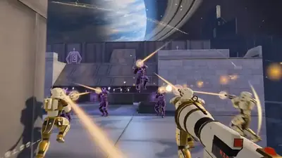</a> <b><a href="https://x.com/_sholtodouglas/status/2119935331499925557">Arena FPS with Portals</a></b> <a href="https://x.com/_sholtodouglas">Sholto Douglas</a> 许可证未知</td>
<td width="25%" valign="top"> <b><a href="https://calebschalesky-ops.github.io/ascent/">Ascent Flight</a></b> <a href="https://github.com/calebschalesky-ops">Caleb Schalesky</a> MIT · <a href="https://github.com/calebschalesky-ops/ascent">代码</a> · <a href="https://huggingface.co/datasets/awesome-fable-5-2/terrarium-open-works/tree/main/games/ascent-flight">文件</a></td>
<td width="25%" valign="top"><a href="https://github.com/nizomiddindev/gemini-of-duty">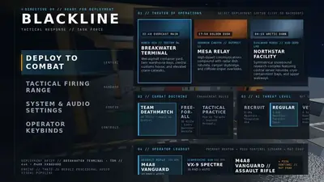</a> <b><a href="https://github.com/nizomiddindev/gemini-of-duty">BLACKLINE // TACTICAL RESPONSE</a></b> <a href="https://github.com/nizomiddindev">Nizomiddin</a> MIT · <a href="https://github.com/nizomiddindev/gemini-of-duty">代码</a> · <a href="https://huggingface.co/datasets/awesome-fable-5-2/terrarium-open-works/tree/main/games/blackline-tactical-response">文件</a></td>
<td width="25%" valign="top"><a href="https://github.com/lompendans/blacksite-download/releases/tag/v1.0.0">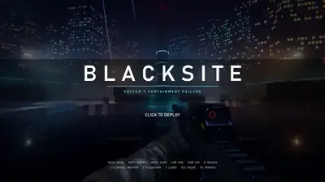</a> <b><a href="https://github.com/lompendans/blacksite-download/releases/tag/v1.0.0">BLACKSITE</a></b> <a href="https://github.com/lompendans">lompendans</a> 许可证未知</td>
</tr>
<tr>
<td width="25%" valign="top"><a href="https://blameless.petruha.ge">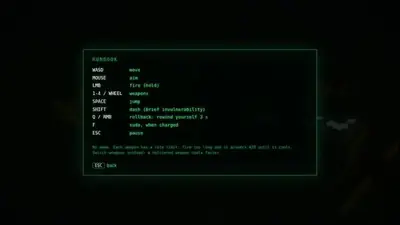</a> <b><a href="https://blameless.petruha.ge">Blameless</a></b> <a href="https://github.com/Petyok">Petyok</a> MIT · <a href="https://github.com/Petyok/blameless">代码</a> · <a href="https://huggingface.co/datasets/awesome-fable-5-2/terrarium-open-works/tree/main/games/blameless">文件</a></td>
<td width="25%" valign="top"><a href="https://github.com/Ashalinux/block-shooter">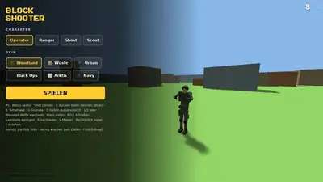</a> <b><a href="https://github.com/Ashalinux/block-shooter">Block Shooter</a></b> <a href="https://github.com/Ashalinux">Ashalinux</a> MIT · <a href="https://github.com/Ashalinux/block-shooter">代码</a> · <a href="https://huggingface.co/datasets/awesome-fable-5-2/terrarium-open-works/tree/main/games/block-shooter">文件</a></td>
<td width="25%" valign="top"><a href="https://amoreo140.github.io/cinderbelt/">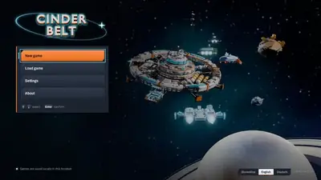</a> <b><a href="https://amoreo140.github.io/cinderbelt/">Cinderbelt</a></b> <a href="https://github.com/amoreo140">amoreo140</a> MIT · <a href="https://github.com/amoreo140/cinderbelt">代码</a> · <a href="https://huggingface.co/datasets/awesome-fable-5-2/terrarium-open-works/tree/main/games/cinderbelt">文件</a></td>
<td width="25%" valign="top"> <b><a href="https://deadraid.com/">Dead Raid</a></b> u/Sweaty_Breakfast2822 许可证未知</td>
</tr>
<tr>
<td width="25%" valign="top"> <b><a href="https://github.com/bridge-mind/claude-opus-5.5-zombies-game">DEAD SIGNAL: EXCLUSION ZONE</a></b> <a href="https://github.com/bridge-mind">BridgeMind</a> MIT · <a href="https://github.com/bridge-mind/claude-opus-5.5-zombies-game">代码</a> · <a href="https://huggingface.co/datasets/awesome-fable-5-2/terrarium-open-works/tree/main/games/dead-signal-exclusion-zone-claude-opus-5-5-zombies-game">文件</a></td>
<td width="25%" valign="top"> <b><a href="https://github.com/bridge-mind/sonnet-5-5-zombies-game">DEAD SIGNAL: EXCLUSION ZONE</a></b> <a href="https://github.com/bridge-mind">BridgeMind</a> MIT · <a href="https://github.com/bridge-mind/sonnet-5-5-zombies-game">代码</a> · <a href="https://huggingface.co/datasets/awesome-fable-5-2/terrarium-open-works/tree/main/games/dead-signal-exclusion-zone-sonnet-5-5-zombies-game">文件</a></td>
<td width="25%" valign="top"> <b><a href="https://www.spawn.co/@robot/frontline-warfare-deathmatch">Desert-town FPS</a></b> alightinastorm 许可证未知</td>
<td width="25%" valign="top"><a href="https://wquguru.github.io/fable52-fps-repro/">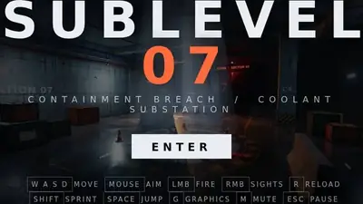</a> <b><a href="https://wquguru.github.io/fable52-fps-repro/">Fable 5.2 FPS Reproduction</a></b> <a href="https://github.com/wquguru">wquguru</a> MIT · <a href="https://github.com/wquguru/fable52-fps-repro/blob/main/demos/04-fps/index.html">代码</a> · <a href="https://huggingface.co/datasets/awesome-fable-5-2/terrarium-open-works/tree/main/games/fable-5-2-fps-reproduction">文件</a></td>
</tr>
<tr>
<td width="25%" valign="top"><a href="https://x.com/jarrodwatts/status/2120030097004777937">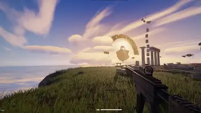</a> <b><a href="https://x.com/jarrodwatts/status/2120030097004777937">Floating-island FPS</a></b> <a href="https://x.com/jarrodwatts">Jarrod Watts</a> 许可证未知</td>
<td width="25%" valign="top"><a href="https://awacke1-galaga-88-3d-game.static.hf.space/index.html">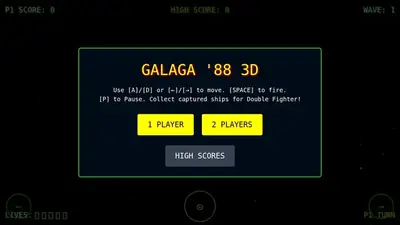</a> <b><a href="https://awacke1-galaga-88-3d-game.static.hf.space/index.html">Galaga 88 3D Game</a></b> <a href="https://huggingface.co/awacke1">Aaron C Wacker</a> MIT · <a href="https://huggingface.co/spaces/awacke1/Galaga-88-3D-Game">代码</a> · <a href="https://huggingface.co/datasets/awesome-fable-5-2/terrarium-open-works/tree/main/games/galaga-88-3d-game">文件</a></td>
<td width="25%" valign="top"> <b><a href="https://x.com/MatthewBerman/status/2119868629491789992">Gears of War-style shooter</a></b> <a href="https://x.com/MatthewBerman">Matthew Berman</a> 许可证未知</td>
<td width="25%" valign="top"><a href="https://gilt-and-gutter.vercel.app/">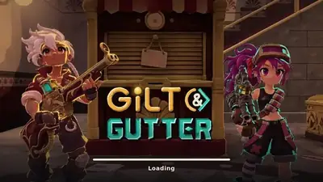</a> <b><a href="https://gilt-and-gutter.vercel.app/">Gilt &amp; Gutter</a></b> Kevin Ngo 许可证未知 · <a href="https://gilt-and-gutter.vercel.app/">代码</a></td>
</tr>
<tr>
<td width="25%" valign="top"><a href="https://zombies.ethanplus.ai">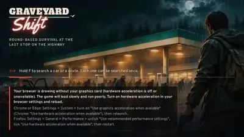</a> <b><a href="https://zombies.ethanplus.ai">Graveyard Shift</a></b> <a href="https://github.com/ethanplusai">Ethan+</a> MIT · <a href="https://github.com/ethanplusai/zombies">代码</a> · <a href="https://huggingface.co/datasets/awesome-fable-5-2/terrarium-open-works/tree/main/games/graveyard-shift">文件</a></td>
<td width="25%" valign="top"><a href="https://jarvis-llm-codec.github.io/gridx/">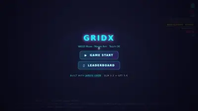</a> <b><a href="https://jarvis-llm-codec.github.io/gridx/">GRIDX</a></b> <a href="https://github.com/jarvis-llm-codec">Kim jun</a> Apache-2.0 · <a href="https://github.com/jarvis-llm-codec/gridx">代码</a> · <a href="https://huggingface.co/datasets/awesome-fable-5-2/terrarium-open-works/tree/main/games/gridx">文件</a></td>
<td width="25%" valign="top"> <b><a href="https://topway-ai.github.io/harbor-blackout-gemini/">HARBOR BLACKOUT (Gemini Edition)</a></b> <a href="https://github.com/topway-ai">Jack</a> MIT · <a href="https://github.com/topway-ai/harbor-blackout-gemini">代码</a> · <a href="https://huggingface.co/datasets/awesome-fable-5-2/terrarium-open-works/tree/main/games/harbor-blackout-gemini-edition">文件</a></td>
<td width="25%" valign="top"><a href="https://homie-wu.github.io/hideaway/">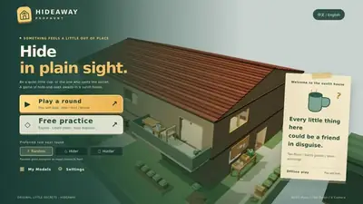</a> <b><a href="https://homie-wu.github.io/hideaway/">HIDEAWAY · Voxel Prop Hunt</a></b> <a href="https://github.com/Homie-Wu">Homie-Wu</a> MIT · <a href="https://github.com/Homie-Wu/hideaway">代码</a> · <a href="https://huggingface.co/datasets/awesome-fable-5-2/terrarium-open-works/tree/main/games/hideaway-voxel-prop-hunt">文件</a></td>
</tr>
<tr>
<td width="25%" valign="top"><a href="https://tanuu5.github.io/ink-arcade/ink-dash.html">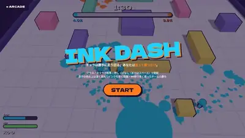</a> <b><a href="https://tanuu5.github.io/ink-arcade/ink-dash.html">INK DASH</a></b> <a href="https://github.com/tanuu5">たぬ（tanu）</a> MIT · <a href="https://github.com/tanuu5/ink-arcade">代码</a> · <a href="https://huggingface.co/datasets/awesome-fable-5-2/terrarium-open-works/tree/main/games/ink-dash">文件</a></td>
<td width="25%" valign="top"> <b><a href="https://evals.ag/outputs/out_18S2MGB2ZVFFX7HX842YNWYCF2">IRON TIDE: Terminal 7</a></b> Evan Cha / Evals 许可证未知 · <a href="https://evals.ag/api/v1/media/assets/ast_0JAMNBYNJNTMAM502JBG09HY48/content">代码</a></td>
<td width="25%" valign="top"><a href="https://qiaomu.t5t6.com/irondusk-yard-7/">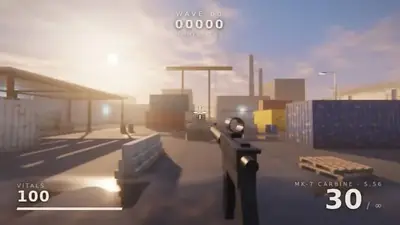</a> <b><a href="https://qiaomu.t5t6.com/irondusk-yard-7/">IRONDUSK — Yard 7</a></b> 向阳乔木 (@vista8) 许可证未知 · <a href="https://qiaomu.t5t6.com/irondusk-yard-7/">代码</a></td>
<td width="25%" valign="top"><a href="https://evals.ag/outputs/out_32XV66QX3Q8088XDCG15YQ2R19">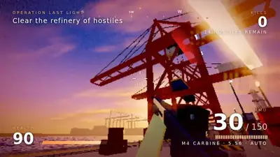</a> <b><a href="https://evals.ag/outputs/out_32XV66QX3Q8088XDCG15YQ2R19">LAST LIGHT: Dockside Refinery</a></b> Evan Cha / Evals 许可证未知 · <a href="https://evals.ag/api/v1/media/assets/ast_1AZW7W4223G2KWGJVR9WF54K3F/content">代码</a></td>
</tr>
<tr>
<td width="25%" valign="top"><a href="https://albertoit-23.github.io/meridian-line/">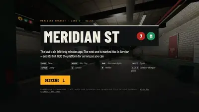</a> <b><a href="https://albertoit-23.github.io/meridian-line/">Meridian Line</a></b> <a href="https://github.com/AlbertoIT-23">AlbertoIT</a> MIT · <a href="https://github.com/AlbertoIT-23/meridian-line">代码</a> · <a href="https://huggingface.co/datasets/awesome-fable-5-2/terrarium-open-works/tree/main/games/meridian-line">文件</a></td>
<td width="25%" valign="top"><a href="https://nnnnnnnnnke.github.io/neon-surge/">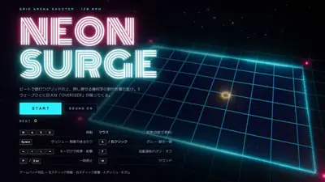</a> <b><a href="https://nnnnnnnnnke.github.io/neon-surge/">NEON SURGE</a></b> <a href="https://github.com/nnnnnnnnnke">Kinukui</a> MIT · <a href="https://github.com/nnnnnnnnnke/neon-surge">代码</a> · <a href="https://huggingface.co/datasets/awesome-fable-5-2/terrarium-open-works/tree/main/games/neon-surge">文件</a></td>
<td width="25%" valign="top"><a href="https://tanuu5.github.io/nova-lancer/">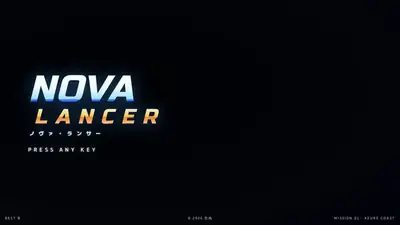</a> <b><a href="https://tanuu5.github.io/nova-lancer/">NOVA LANCER（ノヴァ・ランサー）</a></b> <a href="https://github.com/tanuu5">たぬ（tanu）</a> MIT · <a href="https://github.com/tanuu5/nova-lancer">代码</a> · <a href="https://huggingface.co/datasets/awesome-fable-5-2/terrarium-open-works/tree/main/games/nova-lancer">文件</a></td>
<td width="25%" valign="top"><a href="https://www.reddit.com/r/ClaudeAI/comments/1xt2kax/i_gave_claude_fable_52_one_prompt_and_got_a/">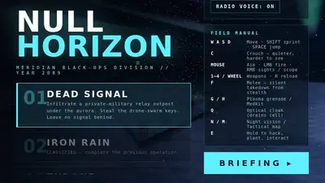</a> <b><a href="https://www.reddit.com/r/ClaudeAI/comments/1xt2kax/i_gave_claude_fable_52_one_prompt_and_got_a/">Null Horizon</a></b> <a href="https://github.com/dantecomedia">dantecomedia</a> 许可证未知 · <a href="https://github.com/dantecomedia/null-horizon">代码</a></td>
</tr>
<tr>
<td width="25%" valign="top"> <b><a href="https://theredstapler.github.io/orb-shooter/">Orb Shooter FPS Demo (Vibe Coded)</a></b> <a href="https://github.com/theredstapler">Red Stapler</a> MIT · <a href="https://github.com/theredstapler/orb-shooter">代码</a> · <a href="https://huggingface.co/datasets/awesome-fable-5-2/terrarium-open-works/tree/main/games/orb-shooter-fps-demo-vibe-coded">文件</a></td>
<td width="25%" valign="top"><a href="https://patch.gg/play/rehan/ringfall">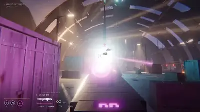</a> <b><a href="https://patch.gg/play/rehan/ringfall">ringfall</a></b> Rehan Sheikh 许可证未知 · <a href="https://git.patch.gg/rehan/ringfall.git">代码</a></td>
<td width="25%" valign="top"><a href="https://michaelcrosato.github.io/robot-warrior/">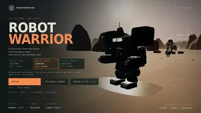</a> <b><a href="https://michaelcrosato.github.io/robot-warrior/">RobotWarrior</a></b> <a href="https://github.com/michaelcrosato">Michael</a> MIT · <a href="https://github.com/michaelcrosato/robot-warrior">代码</a> · <a href="https://huggingface.co/datasets/awesome-fable-5-2/terrarium-open-works/tree/main/games/robotwarrior">文件</a></td>
<td width="25%" valign="top"><a href="https://claude.ai/artifact/BGY1SztrAYcJQHSsnHHGmp">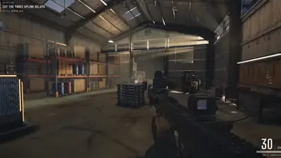</a> <b><a href="https://claude.ai/artifact/BGY1SztrAYcJQHSsnHHGmp">Saltline</a></b> Felix Rieseberg 许可证未知 · <a href="https://claude.ai/artifact/BGY1SztrAYcJQHSsnHHGmp">代码</a></td>
</tr>
<tr>
<td width="25%" valign="top"><a href="https://x.com/higgsfield_ai/status/2119897113534529605">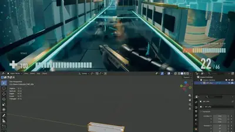</a> <b><a href="https://x.com/higgsfield_ai/status/2119897113534529605">Space-station shooter</a></b> <a href="https://x.com/higgsfield_ai">Higgsfield</a> 许可证未知</td>
<td width="25%" valign="top"><a href="https://evals.ag/outputs/out_64YQ9Y1C28PS2M09T05JV39Z2S">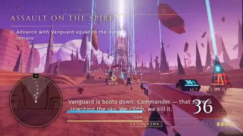</a> <b><a href="https://evals.ag/outputs/out_64YQ9Y1C28PS2M09T05JV39Z2S">SPIREFALL: Assault on the Terraforming Spire</a></b> Evan Cha / Evals 许可证未知 · <a href="https://evals.ag/api/v1/media/assets/ast_7G3X8N7GY5TX46BAE1H7HBFW99/content">代码</a></td>
<td width="25%" valign="top"><a href="https://damijjj.github.io/Status-1/">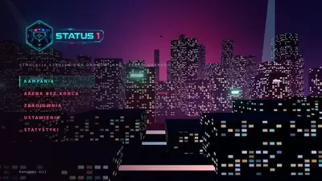</a> <b><a href="https://damijjj.github.io/Status-1/">STATUS 1 — browser FPS</a></b> <a href="https://github.com/DamiJJJ">Dami</a> MIT · <a href="https://github.com/DamiJJJ/Status-1">代码</a> · <a href="https://huggingface.co/datasets/awesome-fable-5-2/terrarium-open-works/tree/main/games/status-1-browser-fps">文件</a></td>
<td width="25%" valign="top"><a href="https://fps-fable52-7d7eb4.surge.sh/">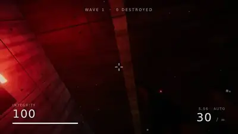</a> <b><a href="https://fps-fable52-7d7eb4.surge.sh/">SUBLEVEL 03</a></b> Leohuan 许可证未知 · <a href="https://fps-fable52-7d7eb4.surge.sh/">代码</a></td>
</tr>
<tr>
<td width="25%" valign="top"><a href="https://github.com/Hrithin-30/thing-game">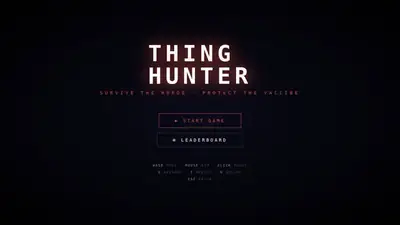</a> <b><a href="https://github.com/Hrithin-30/thing-game">THING HUNTER</a></b> <a href="https://github.com/Hrithin-30">Brahmadevu Hrithin kumar</a> MIT · <a href="https://github.com/Hrithin-30/thing-game">代码</a> · <a href="https://huggingface.co/datasets/awesome-fable-5-2/terrarium-open-works/tree/main/games/thing-hunter">文件</a></td>
<td width="25%" valign="top"><a href="https://gigabitgamelab.com/arcade/play/tsuranuki-kai/">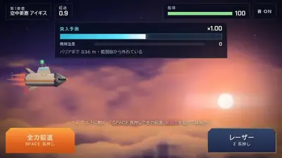</a> <b><a href="https://gigabitgamelab.com/arcade/play/tsuranuki-kai/">TSURANUKI KAI</a></b> Gigabit Game Lab 许可证未知</td>
<td width="25%" valign="top"><a href="https://xo-beta.pages.dev/">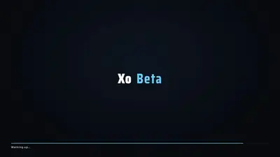</a> <b><a href="https://xo-beta.pages.dev/">Xo Beta</a></b> <a href="https://github.com/TKY-27">Ana</a> MIT · <a href="https://github.com/TKY-27/Xo-Beta">代码</a> · <a href="https://huggingface.co/datasets/awesome-fable-5-2/terrarium-open-works/tree/main/games/xo-beta">文件</a></td>
<td width="25%" valign="top"><a href="https://neurorich.ru/projects/claude-fable-5-2-proekty/">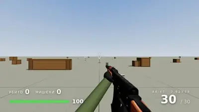</a> <b><a href="https://neurorich.ru/projects/claude-fable-5-2-proekty/">Zombie FPS: AK-47</a></b> Нейро Рич 许可证未知 · <a href="https://neurorich.ru/files/claude-fable-5-2-proekty.zip">代码</a></td>
</tr>
<tr>
<td width="25%" valign="top"><a href="https://cyancity.github.io/yolo-mini-fps/">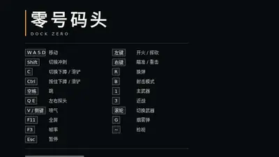</a> <b><a href="https://cyancity.github.io/yolo-mini-fps/">零号码头 DOCK ZERO</a></b> <a href="https://github.com/cyancity">YOLO</a> MIT · <a href="https://github.com/cyancity/yolo-mini-fps">代码</a> · <a href="https://huggingface.co/datasets/awesome-fable-5-2/terrarium-open-works/tree/main/games/dock-zero">文件</a></td>
<td width="25%"></td>
<td width="25%"></td>
<td width="25%"></td>
</tr>
</table>

没有预览图的作品：

<table>
<tr><th align="left">作品</th><th align="left">作者</th><th align="left">许可证</th><th align="left">链接</th></tr>
<tr><td><a href="https://claude.ai/artifact/3tX4R1U95SUxKUQ2Dkz3m3">Contra recreation</a></td><td>Prasad Pilla</td><td>许可证未知</td><td>—</td></tr>
<tr><td><a href="https://www.bilibili.com/video/BV1yJW168ENZ/">Metal Slug in 3D</a></td><td>阿达的AI思辩</td><td>许可证未知</td><td>—</td></tr>
<tr><td><a href="https://tinyarena.online">TINY ARENA</a></td><td><a href="https://github.com/tpoxa">Maksym Trofimenko</a></td><td>MIT</td><td><a href="https://github.com/tpoxa/tinyarena">代码</a> · <a href="https://huggingface.co/datasets/awesome-fable-5-2/terrarium-open-works/tree/main/games/tiny-arena">文件</a></td></tr>
<tr><td><a href="https://github.com/KiranMohan-92/warsaw-downtown-game">WARSAW DOWNTOWN</a></td><td><a href="https://github.com/KiranMohan-92">Kiran Mohan</a></td><td>MIT</td><td><a href="https://github.com/KiranMohan-92/warsaw-downtown-game">代码</a> · <a href="https://huggingface.co/datasets/awesome-fable-5-2/terrarium-open-works/tree/main/games/warsaw-downtown">文件</a></td></tr>
<tr><td><a href="https://workmelt.com">Workmelt</a></td><td><a href="https://github.com/eriknomitch">Erik Nomitch</a></td><td>MIT</td><td><a href="https://github.com/eriknomitch/workmelt">代码</a> · <a href="https://huggingface.co/datasets/awesome-fable-5-2/terrarium-open-works/tree/main/games/workmelt">文件</a></td></tr>
</table>

## 动作与战斗

<table>
<tr>
<td width="25%" valign="top"><a href="https://aidens-revenge.pages.dev/">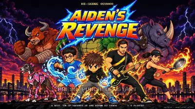</a> <b><a href="https://aidens-revenge.pages.dev/">Aiden&#x27;s Revenge</a></b> Lex Toumbourou 许可证未知 · <a href="https://aidens-revenge.pages.dev/">代码</a></td>
<td width="25%" valign="top"><a href="https://github.com/GavinLOrio/Fable-5.2-random-game/commit/55838a1f7565dc713edb3f985187338368fe6a81">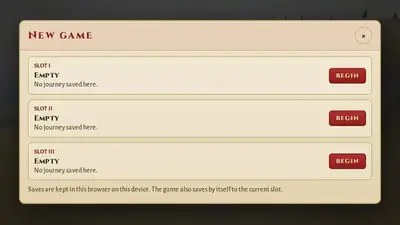</a> <b><a href="https://github.com/GavinLOrio/Fable-5.2-random-game/commit/55838a1f7565dc713edb3f985187338368fe6a81">Aquila</a></b> <a href="https://github.com/GavinLOrio">GavinLOrio</a> 许可证未知 · <a href="https://github.com/GavinLOrio/Fable-5.2-random-game/blob/55838a1f7565dc713edb3f985187338368fe6a81/rome/index.html">代码</a></td>
<td width="25%" valign="top"><a href="https://www.aigameshare.com/games/falling-sand-roguelike">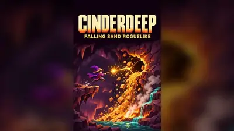</a> <b><a href="https://www.aigameshare.com/games/falling-sand-roguelike">CinderDeep</a></b> Nil Ni 许可证未知</td>
<td width="25%" valign="top"><a href="https://usama-shiranai90.github.io/Claude-of-Iron/">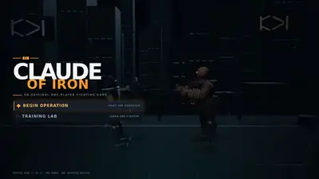</a> <b><a href="https://usama-shiranai90.github.io/Claude-of-Iron/">Claude of Iron</a></b> <a href="https://github.com/usama-shiranai90">Sama</a> MIT · <a href="https://github.com/usama-shiranai90/Claude-of-Iron">代码</a> · <a href="https://huggingface.co/datasets/awesome-fable-5-2/terrarium-open-works/tree/main/games/claude-of-iron">文件</a></td>
</tr>
<tr>
<td width="25%" valign="top"><a href="https://pablitofernandez.github.io/coinkeep/">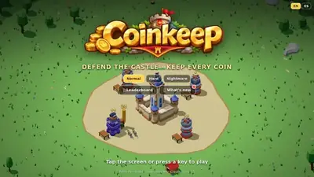</a> <b><a href="https://pablitofernandez.github.io/coinkeep/">Coinkeep</a></b> <a href="https://github.com/pablitofernandez">pablitofernandez</a> MIT · <a href="https://github.com/pablitofernandez/coinkeep">代码</a> · <a href="https://huggingface.co/datasets/awesome-fable-5-2/terrarium-open-works/tree/main/games/coinkeep">文件</a></td>
<td width="25%" valign="top"><a href="https://github.com/GavinLOrio/Fable-5.2-random-game/commit/6051b625701c68e9fcef4bef30f2476f287830e5">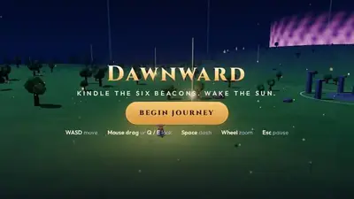</a> <b><a href="https://github.com/GavinLOrio/Fable-5.2-random-game/commit/6051b625701c68e9fcef4bef30f2476f287830e5">Dawnward</a></b> <a href="https://github.com/GavinLOrio">GavinLOrio</a> 许可证未知 · <a href="https://github.com/GavinLOrio/Fable-5.2-random-game/blob/6051b625701c68e9fcef4bef30f2476f287830e5/index.html">代码</a></td>
<td width="25%" valign="top"><a href="https://ahmaddentist30.itch.io/dino-jungle-survival-3d">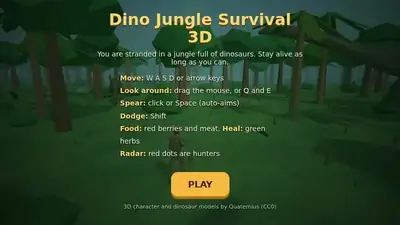</a> <b><a href="https://ahmaddentist30.itch.io/dino-jungle-survival-3d">Dino Jungle Survival 3D</a></b> <a href="https://ahmaddentist30.itch.io">ahmaddentist30</a> 许可证未知 · <a href="https://html-classic.itch.zone/html/20412026/index.html?v=1794293623">代码</a></td>
<td width="25%" valign="top"><a href="https://eldor.pages.dev">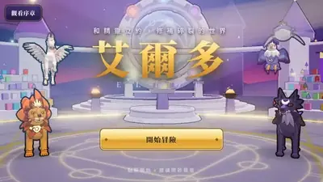</a> <b><a href="https://eldor.pages.dev">Eldor</a></b> <a href="https://github.com/alan890104">Yu Lun Hsu</a> MIT · <a href="https://github.com/alan890104/Eldor">代码</a> · <a href="https://huggingface.co/datasets/awesome-fable-5-2/terrarium-open-works/tree/main/games/eldor">文件</a></td>
</tr>
<tr>
<td width="25%" valign="top"><a href="https://evensong-phi.vercel.app/">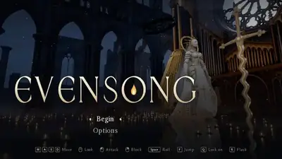</a> <b><a href="https://evensong-phi.vercel.app/">Evensong</a></b> Kevin Ngo 许可证未知 · <a href="https://evensong-phi.vercel.app/">代码</a></td>
<td width="25%" valign="top"><a href="https://feed-backrooms.vercel.app/">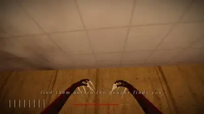</a> <b><a href="https://feed-backrooms.vercel.app/">FEED</a></b> Leon Lin 许可证未知 · <a href="https://feed-backrooms.vercel.app/">代码</a></td>
<td width="25%" valign="top"> <b><a href="https://www.spawn.co/@mattshumer/hogwarts-royale">Hogwarts Royale</a></b> Matt Shumer 许可证未知</td>
<td width="25%" valign="top"><a href="https://evals.ag/outputs/out_42WRTRNWM70860K7FE8W5H4JYE">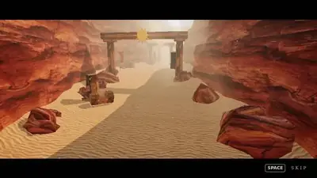</a> <b><a href="https://evals.ag/outputs/out_42WRTRNWM70860K7FE8W5H4JYE">Sands of the Black Sun</a></b> Evan Cha / Evals 许可证未知 · <a href="https://evals.ag/api/v1/media/assets/ast_01K0N55YXGZGDV24CGYHFWPR7P/content">代码</a></td>
</tr>
<tr>
<td width="25%" valign="top"><a href="https://gigabitgamelab.com/arcade/play/tensen-fable/">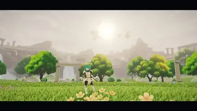</a> <b><a href="https://gigabitgamelab.com/arcade/play/tensen-fable/">TENSEN NO KOJIN / FABLE</a></b> Gigabit Game Lab 许可证未知</td>
<td width="25%" valign="top"><a href="https://edgegap.github.io/netcode-sample-threejs-thin-ice-tussle/">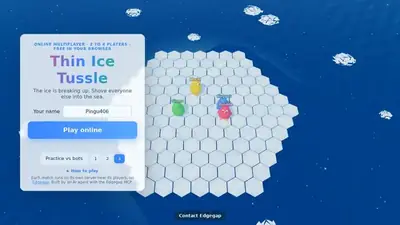</a> <b><a href="https://edgegap.github.io/netcode-sample-threejs-thin-ice-tussle/">Thin Ice Tussle</a></b> <a href="https://github.com/edgegap">Edgegap</a> MIT · <a href="https://github.com/edgegap/netcode-sample-threejs-thin-ice-tussle">代码</a> · <a href="https://huggingface.co/datasets/awesome-fable-5-2/terrarium-open-works/tree/main/games/thin-ice-tussle">文件</a></td>
<td width="25%" valign="top"><a href="https://x.com/AmirMushich/status/2119937977426338283">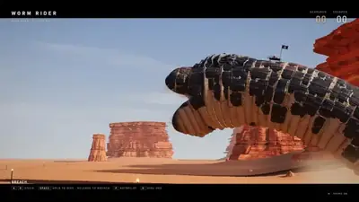</a> <b><a href="https://x.com/AmirMushich/status/2119937977426338283">Worm Rider</a></b> <a href="https://github.com/amirmushichge">Amir Mušić</a> MIT · <a href="https://github.com/amirmushichge/worm-rider">代码</a> · <a href="https://huggingface.co/datasets/awesome-fable-5-2/terrarium-open-works/tree/main/games/worm-rider">文件</a></td>
<td width="25%" valign="top"><a href="https://tanuu5.github.io/astra-potato-farm/">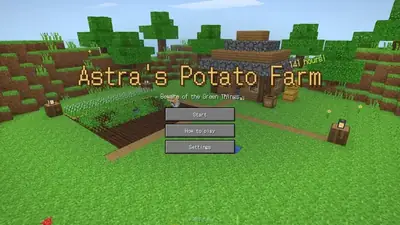</a> <b><a href="https://tanuu5.github.io/astra-potato-farm/">アストラのじゃがいも畑 — Astra&#x27;s Potato Farm</a></b> <a href="https://github.com/tanuu5">たぬ（tanu）</a> MIT · <a href="https://github.com/tanuu5/astra-potato-farm">代码</a> · <a href="https://huggingface.co/datasets/awesome-fable-5-2/terrarium-open-works/tree/main/games/astra-s-potato-farm-tanuu5">文件</a></td>
</tr>
<tr>
<td width="25%" valign="top"><a href="https://tanuu5.github.io/kaiju-dokan/">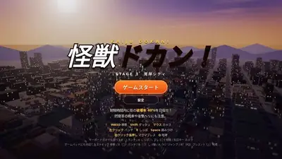</a> <b><a href="https://tanuu5.github.io/kaiju-dokan/">怪獣ドカン！ KAIJU DOKAN!</a></b> <a href="https://github.com/tanuu5">たぬ（tanu）</a> MIT · <a href="https://github.com/tanuu5/kaiju-dokan">代码</a> · <a href="https://huggingface.co/datasets/awesome-fable-5-2/terrarium-open-works/tree/main/games/kaiju-dokan">文件</a></td>
<td width="25%"></td>
<td width="25%"></td>
<td width="25%"></td>
</tr>
</table>

没有预览图的作品：

<table>
<tr><th align="left">作品</th><th align="left">作者</th><th align="left">许可证</th><th align="left">链接</th></tr>
<tr><td><a href="https://x.com/FaridaNever/status/2119910055990505730">Ink swordsman</a></td><td><a href="https://x.com/FaridaNever">FaridaNever</a></td><td>许可证未知</td><td>—</td></tr>
<tr><td><a href="https://rottensouls.com">Rotten Souls</a></td><td><a href="https://github.com/igorjohn">Igor John</a></td><td>MIT</td><td><a href="https://github.com/igorjohn/rotten-souls">代码</a> · <a href="https://huggingface.co/datasets/awesome-fable-5-2/terrarium-open-works/tree/main/games/rotten-souls">文件</a></td></tr>
<tr><td><a href="https://www.youtube.com/watch?v=2TM8W66NI_8&amp;t=566s">Shard Storm</a></td><td>Matt Wolfe</td><td>许可证未知</td><td>—</td></tr>
</table>

## 平台跳跃与跑酷

<table>
<tr>
<td width="25%" valign="top"><a href="https://noclipepe.pages.dev/dino/">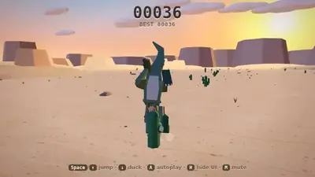</a> <b><a href="https://noclipepe.pages.dev/dino/">Dino Run: Locked In</a></b> noclipepe 许可证未知</td>
<td width="25%" valign="top"> <b><a href="https://jaydemks.github.io/ImADragon_onepromptcode_game/">Dragon&#x27;s Reach</a></b> <a href="https://github.com/jaydemks">Giovanni &quot;Giò&quot; De Miccoli</a> MIT · <a href="https://github.com/jaydemks/ImADragon_onepromptcode_game">代码</a> · <a href="https://huggingface.co/datasets/awesome-fable-5-2/terrarium-open-works/tree/main/games/dragon-s-reach">文件</a></td>
<td width="25%" valign="top"><a href="https://shubhu121.github.io/hitdude/play/">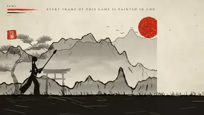</a> <b><a href="https://shubhu121.github.io/hitdude/play/">HITOFUDE 一筆</a></b> <a href="https://github.com/shubhu121">@positronx_</a> 许可证未知</td>
<td width="25%" valign="top"> <b><a href="https://hundred-ghosts.vercel.app/">Hundred Ghosts</a></b> <a href="https://github.com/koumpas">koumpas</a> 许可证未知 · <a href="https://github.com/koumpas/hundred-ghosts">代码</a></td>
</tr>
<tr>
<td width="25%" valign="top"> <b><a href="https://github.com/ohylli/indys-adventure-3d">Indy’s Adventure 3D: Näsinneula</a></b> <a href="https://github.com/ohylli">ohylli</a> 许可证未知 · <a href="https://github.com/ohylli/indys-adventure-3d">代码</a></td>
<td width="25%" valign="top"> <b><a href="https://furkiozknn.github.io/carsi-kacisi/">Çarşı Kaçışı</a></b> <a href="https://github.com/Furkiozknn">Furki Özkan</a> MIT · <a href="https://github.com/Furkiozknn/carsi-kacisi">代码</a> · <a href="https://huggingface.co/datasets/awesome-fable-5-2/terrarium-open-works/tree/main/games/carsi-kacisi">文件</a></td>
<td width="25%" valign="top"> <b><a href="https://pelicanride.vercel.app">鹈鹕骑单车 · 海岸大冒险（Pelican Ride）</a></b> <a href="https://github.com/Xiobio">Xony</a> MIT · <a href="https://github.com/Xiobio/pelican-ride">代码</a> · <a href="https://huggingface.co/datasets/awesome-fable-5-2/terrarium-open-works/tree/main/games/pelican-ride">文件</a></td>
<td width="25%"></td>
</tr>
</table>

没有预览图的作品：

<table>
<tr><th align="left">作品</th><th align="left">作者</th><th align="left">许可证</th><th align="left">链接</th></tr>
<tr><td><a href="https://www.reddit.com/r/vibecoding/comments/1xsuqwm/fable_52_oneshot_a_super_nintendo_game_overnight/">Emberwake</a></td><td>u/shiny_guruw (ppu.toys)</td><td>许可证未知</td><td>—</td></tr>
<tr><td><a href="https://www.youtube.com/watch?v=0vNyVMDFdkg&amp;t=364s">Tumble Beans</a></td><td>Matthew Berman</td><td>许可证未知</td><td>—</td></tr>
</table>

## 竞速与驾驶

<table>
<tr>
<td width="25%" valign="top"> <b><a href="https://gemini-3d-car-racing-game.onrender.com/">🏎️ 3D Browser Racer</a></b> <a href="https://github.com/wayneeffect">Dr. Elden Wayne Whalen III, ShD</a> MIT · <a href="https://github.com/wayneeffect/Gemini-3D-Car-Racing-Game">代码</a> · <a href="https://huggingface.co/datasets/awesome-fable-5-2/terrarium-open-works/tree/main/games/3d-browser-racer">文件</a></td>
<td width="25%" valign="top"> <b><a href="https://bridge-mind.github.io/apex-formula/">APEX FORMULA</a></b> <a href="https://github.com/bridge-mind">BridgeMind</a> MIT · <a href="https://github.com/bridge-mind/apex-formula">代码</a> · <a href="https://huggingface.co/datasets/awesome-fable-5-2/terrarium-open-works/tree/main/games/apex-formula">文件</a></td>
<td width="25%" valign="top"> <b><a href="https://vibe-f1-racing.pages.dev">Aurora Grand Prix — F1 Simulator</a></b> <a href="https://github.com/hirosichen">hirosichen</a> MIT · <a href="https://github.com/hirosichen/ai-f1-racing-game">代码</a> · <a href="https://huggingface.co/datasets/awesome-fable-5-2/terrarium-open-works/tree/main/games/aurora-grand-prix-f1-simulator">文件</a></td>
<td width="25%" valign="top"> <b><a href="https://jason-c-dev.github.io/backroad-rally/">backroad rally</a></b> <a href="https://github.com/jason-c-dev">jason-c-dev</a> MIT · <a href="https://github.com/jason-c-dev/backroad-rally">代码</a> · <a href="https://huggingface.co/datasets/awesome-fable-5-2/terrarium-open-works/tree/main/games/backroad-rally">文件</a></td>
</tr>
<tr>
<td width="25%" valign="top"> <b><a href="https://furkiozknn.github.io/bogaz-vapuru/">Boğaz Vapuru</a></b> <a href="https://github.com/Furkiozknn">Furki Özkan</a> MIT · <a href="https://github.com/Furkiozknn/bogaz-vapuru">代码</a> · <a href="https://huggingface.co/datasets/awesome-fable-5-2/terrarium-open-works/tree/main/games/bogaz-vapuru">文件</a></td>
<td width="25%" valign="top"> <b><a href="https://arjunreddy91100.github.io/bumblebee-echo-garden/">Bumblebee — Echo Garden</a></b> <a href="https://github.com/arjunreddy91100">Arjun</a> MIT · <a href="https://github.com/arjunreddy91100/bumblebee-echo-garden">代码</a> · <a href="https://huggingface.co/datasets/awesome-fable-5-2/terrarium-open-works/tree/main/games/bumblebee-echo-garden">文件</a></td>
<td width="25%" valign="top"> <b><a href="https://mutaafaziz.com/coldgas/">COLD GAS</a></b> <a href="https://github.com/mutaaf">Mutaaf Aziz</a> MIT · <a href="https://github.com/mutaaf/cold-gas">代码</a> · <a href="https://huggingface.co/datasets/awesome-fable-5-2/terrarium-open-works/tree/main/games/cold-gas">文件</a></td>
<td width="25%" valign="top"> <b><a href="https://amanndev.com/criar-projeto-3d-com-um-prompt-no-claude">Cyberpunk Tokyo Motorcycle</a></b> Luca Amann 许可证未知 · <a href="https://amanndev.com/_next/static/chunks/2gdq495c_bsx_.js">代码</a></td>
</tr>
<tr>
<td width="25%" valign="top"> <b><a href="https://furkiozknn.github.io/dolmus/">Dolmuş</a></b> <a href="https://github.com/Furkiozknn">Furki Özkan</a> MIT · <a href="https://github.com/Furkiozknn/dolmus">代码</a> · <a href="https://huggingface.co/datasets/awesome-fable-5-2/terrarium-open-works/tree/main/games/dolmus">文件</a></td>
<td width="25%" valign="top"> <b><a href="https://github.com/CodingFreeze/Fable_GTA">GTA-2W — GTA 2 Web Clone (Three.js)</a></b> <a href="https://github.com/CodingFreeze">CodingFreeze</a> MIT · <a href="https://github.com/CodingFreeze/Fable_GTA">代码</a> · <a href="https://huggingface.co/datasets/awesome-fable-5-2/terrarium-open-works/tree/main/games/gta-2w-gta-2-web-clone-three-js">文件</a></td>
<td width="25%" valign="top"> <b><a href="https://vibe-harbor-master.pages.dev">Harbor Master — Superyacht Docking</a></b> <a href="https://github.com/hirosichen">hirosichen</a> MIT · <a href="https://github.com/hirosichen/ai-harbor-master-game">代码</a> · <a href="https://huggingface.co/datasets/awesome-fable-5-2/terrarium-open-works/tree/main/games/harbor-master-superyacht-docking">文件</a></td>
<td width="25%" valign="top"> <b><a href="https://olagon.github.io/holua/">HŌLUA — the slide at Keauhou</a></b> <a href="https://github.com/olagon">Olin Lagon</a> MIT · <a href="https://github.com/olagon/holua">代码</a> · <a href="https://huggingface.co/datasets/awesome-fable-5-2/terrarium-open-works/tree/main/games/holua-the-slide-at-keauhou">文件</a></td>
</tr>
<tr>
<td width="25%" valign="top"> <b><a href="https://akotch.github.io/kekenon-cotonou/">Kekenon: Cotonou</a></b> <a href="https://github.com/Akotch">Akotch</a> 许可证未知 · <a href="https://github.com/Akotch/kekenon-cotonou">代码</a></td>
<td width="25%" valign="top"> <b><a href="https://jediconcepts.com/mcl64/">MCL-64 — Papaya Grand Prix</a></b> <a href="https://github.com/JediConcepts">Jedi Concepts</a> MIT · <a href="https://github.com/JediConcepts/J1-racing">代码</a> · <a href="https://huggingface.co/datasets/awesome-fable-5-2/terrarium-open-works/tree/main/games/mcl-64-papaya-grand-prix">文件</a></td>
<td width="25%" valign="top"> <b><a href="https://x.com/ericmaskfr/status/2119910195325481026">Miami-style crime game</a></b> <a href="https://x.com/ericmaskfr">@ericmaskfr</a> 许可证未知</td>
<td width="25%" valign="top"> <b><a href="https://siddqamar.github.io/midnight-shuto/">Midnight Shuto</a></b> <a href="https://github.com/siddqamar">Siddiqui Qamar</a> Apache-2.0 · <a href="https://github.com/siddqamar/midnight-shuto">代码</a> · <a href="https://huggingface.co/datasets/awesome-fable-5-2/terrarium-open-works/tree/main/games/midnight-shuto">文件</a></td>
</tr>
<tr>
<td width="25%" valign="top"> <b><a href="https://github.com/hahaliu1029/fable5.2demo">MOTHLIGHT: Vesper-9</a></b> <a href="https://github.com/hahaliu1029">hahaliu1029</a> Apache-2.0 · <a href="https://github.com/hahaliu1029/fable5.2demo/tree/main/mothlight">代码</a> · <a href="https://huggingface.co/datasets/awesome-fable-5-2/terrarium-open-works/tree/main/games/mothlight-vesper-9">文件</a></td>
<td width="25%" valign="top"> <b><a href="https://kostikoneuro.github.io/gemini-carbon-vs-fable-5-2/">Neon Night Racer: Fable build</a></b> <a href="https://github.com/KostiKoNeuro">KostiKoNeuro</a> 许可证未知 · <a href="https://github.com/KostiKoNeuro/gemini-carbon-vs-fable-5-2/tree/main/1-race/fable">代码</a></td>
<td width="25%" valign="top"> <b><a href="https://mutaafaziz.com/outatime/">OUTATIME 88</a></b> <a href="https://github.com/mutaaf">Mutaaf Aziz</a> MIT · <a href="https://github.com/mutaaf/outatime-88">代码</a> · <a href="https://huggingface.co/datasets/awesome-fable-5-2/terrarium-open-works/tree/main/games/outatime-88">文件</a></td>
<td width="25%" valign="top"> <b><a href="https://netanelyan.github.io/outbound/">OUTBOUND</a></b> <a href="https://github.com/netanelyan">Natanel Yanchevsky</a> MIT · <a href="https://github.com/netanelyan/outbound">代码</a> · <a href="https://huggingface.co/datasets/awesome-fable-5-2/terrarium-open-works/tree/main/games/outbound">文件</a></td>
</tr>
<tr>
<td width="25%" valign="top"> <b><a href="https://bhanu2006-24.github.io/racing-game/">Poly City Racer: Turbo</a></b> <a href="https://github.com/bhanu2006-24">Bhanu Pratap Saini</a> MIT · <a href="https://github.com/bhanu2006-24/racing-game">代码</a> · <a href="https://huggingface.co/datasets/awesome-fable-5-2/terrarium-open-works/tree/main/games/poly-city-racer-turbo">文件</a></td>
<td width="25%" valign="top"> <b><a href="https://road-to-el-salvador.vercel.app">🛻₿ Road to El Salvador — Bitcoin Road Trip</a></b> <a href="https://github.com/william89971">William Menjivar</a> MIT · <a href="https://github.com/william89971/Road-to-El-Salvador">代码</a> · <a href="https://huggingface.co/datasets/awesome-fable-5-2/terrarium-open-works/tree/main/games/road-to-el-salvador-bitcoin-road-trip">文件</a></td>
<td width="25%" valign="top"> <b><a href="https://extremeai-labs.github.io/rocky-grid/">ROCKY GRID</a></b> <a href="https://github.com/ExtremeAI-Labs">ExtremeAI-Labs</a> MIT · <a href="https://github.com/ExtremeAI-Labs/rocky-grid">代码</a> · <a href="https://huggingface.co/datasets/awesome-fable-5-2/terrarium-open-works/tree/main/games/rocky-grid">文件</a></td>
<td width="25%" valign="top"> <b><a href="https://noclipepe.pages.dev/rug/">Rug Racers</a></b> noclipepe 许可证未知 · <a href="https://noclipepe.pages.dev/rug/">代码</a></td>
</tr>
<tr>
<td width="25%" valign="top"> <b><a href="https://saltfire.higgsfield.app/">Saltfire</a></b> Higgsfield 许可证未知 · <a href="https://d2ol7oe51mr4n9.cloudfront.net/user_3GXbZB0UVQ4VNLix2xrfj28xkQu/096b9953-ca50-4858-80f0-3b7d427d1897.html">代码</a></td>
<td width="25%" valign="top"> <b><a href="https://tanuu5.github.io/tanuki-rush/">TANUKI RUSH</a></b> <a href="https://github.com/tanuu5">たぬ（tanu）</a> MIT · <a href="https://github.com/tanuu5/tanuki-rush">代码</a> · <a href="https://huggingface.co/datasets/awesome-fable-5-2/terrarium-open-works/tree/main/games/tanuki-rush">文件</a></td>
<td width="25%" valign="top"> <b><a href="https://bridge-mind.github.io/turbo-kart-rally/">Turbo Kart Rally</a></b> <a href="https://github.com/bridge-mind">BridgeMind</a> MIT · <a href="https://github.com/bridge-mind/turbo-kart-rally">代码</a> · <a href="https://huggingface.co/datasets/awesome-fable-5-2/terrarium-open-works/tree/main/games/turbo-kart-rally">文件</a></td>
<td width="25%" valign="top"> <b><a href="https://bridge-mind.github.io/turbo-kart-rush/">Turbo Kart Rush</a></b> <a href="https://github.com/bridge-mind">BridgeMind</a> MIT · <a href="https://github.com/bridge-mind/turbo-kart-rush">代码</a> · <a href="https://huggingface.co/datasets/awesome-fable-5-2/terrarium-open-works/tree/main/games/turbo-kart-rush">文件</a></td>
</tr>
<tr>
<td width="25%" valign="top"> <b><a href="https://turbo-tails.vercel.app/">Turbo Tails</a></b> Peter Yang 许可证未知 · <a href="https://turbo-tails.vercel.app/">代码</a></td>
<td width="25%" valign="top"> <b><a href="https://x.com/mattshumer_/status/2120282133503820150">Untitled open-world driving game</a></b> <a href="https://x.com/mattshumer_">Matt Shumer</a> 许可证未知</td>
<td width="25%" valign="top"> <b><a href="https://github30.github.io/fable52-gta6/">VELA BAY</a></b> <a href="https://github.com/GitHub30">7mpy / GitHub30</a> 许可证未知 · <a href="https://github.com/GitHub30/fable52-gta6">代码</a></td>
<td width="25%" valign="top"> <b><a href="https://basemazab.github.io/tuktuk/">توك توك: وسّع يا باشا</a></b> <a href="https://github.com/basemazab">basemazab</a> MIT · <a href="https://github.com/basemazab/tuktuk">代码</a> · <a href="https://huggingface.co/datasets/awesome-fable-5-2/terrarium-open-works/tree/main/games/tuktuk">文件</a></td>
</tr>
<tr>
<td width="25%" valign="top"> <b><a href="https://tanuu5.github.io/ponpoko-kart/">ぽんぽこカート 〜ニッポン爆走グランプリ〜</a></b> <a href="https://github.com/tanuu5">たぬ（tanu）</a> MIT · <a href="https://github.com/tanuu5/ponpoko-kart">代码</a> · <a href="https://huggingface.co/datasets/awesome-fable-5-2/terrarium-open-works/tree/main/games/ponpoko-kart">文件</a></td>
<td width="25%"></td>
<td width="25%"></td>
<td width="25%"></td>
</tr>
</table>

没有预览图的作品：

<table>
<tr><th align="left">作品</th><th align="left">作者</th><th align="left">许可证</th><th align="left">链接</th></tr>
<tr><td><a href="https://drcollect.github.io/demolition-derby/">Demolition Derby</a></td><td><a href="https://github.com/drcollect">drcollect</a></td><td>MIT</td><td><a href="https://github.com/drcollect/demolition-derby">代码</a> · <a href="https://huggingface.co/datasets/awesome-fable-5-2/terrarium-open-works/tree/main/games/demolition-derby">文件</a></td></tr>
<tr><td><a href="https://luminal-game.web.app">Luminal</a></td><td><a href="https://github.com/Scotho">Craig Smith</a></td><td>MIT</td><td><a href="https://github.com/Scotho/luminal">代码</a> · <a href="https://huggingface.co/datasets/awesome-fable-5-2/terrarium-open-works/tree/main/games/luminal">文件</a></td></tr>
</table>

## 飞行

<table>
<tr>
<td width="25%" valign="top"> <b><a href="https://astropilot.mikekasberg.com">Astropilot VR</a></b> <a href="https://github.com/mkasberg">Mike Kasberg</a> MIT · <a href="https://github.com/mkasberg/astropilot-vr">代码</a> · <a href="https://huggingface.co/datasets/awesome-fable-5-2/terrarium-open-works/tree/main/games/astropilot-vr">文件</a></td>
<td width="25%" valign="top"> <b><a href="https://github.com/Para-FR/claude-fable-5.2-flight-sim">Fable 5.2 Flight Simulator</a></b> <a href="https://github.com/Para-FR">Para-FR</a> 许可证未知 · <a href="https://github.com/Para-FR/claude-fable-5.2-flight-sim">代码</a></td>
<td width="25%" valign="top"> <b><a href="https://furkiozknn.github.io/kapadokya-balonu/">Kapadokya Balonu</a></b> <a href="https://github.com/Furkiozknn">Furki Özkan</a> MIT · <a href="https://github.com/Furkiozknn/kapadokya-balonu">代码</a> · <a href="https://huggingface.co/datasets/awesome-fable-5-2/terrarium-open-works/tree/main/games/kapadokya-balonu">文件</a></td>
<td width="25%" valign="top"> <b><a href="https://furkiozknn.github.io/marti/">Martı · Seagull Run</a></b> <a href="https://github.com/Furkiozknn">Furki Özkan</a> MIT · <a href="https://github.com/Furkiozknn/marti">代码</a> · <a href="https://huggingface.co/datasets/awesome-fable-5-2/terrarium-open-works/tree/main/games/marti-seagull-run">文件</a></td>
</tr>
<tr>
<td width="25%" valign="top"> <b><a href="https://evals.ag/outputs/out_0SR0RR6CS7SGRQXMX3BS7G4RVF">Paper Dusk</a></b> tamburins / Evals 许可证未知 · <a href="https://evals.ag/api/v1/media/assets/ast_2QF9TYAX7FEA4H8Y3Y838M8ZA3/content">代码</a></td>
<td width="25%" valign="top"> <b><a href="https://x.com/ShipOnGamejam/status/2120184709732823356">Paper Skies</a></b> <a href="https://x.com/ShipOnGamejam">Gamejam</a> 许可证未知</td>
<td width="25%" valign="top"> <b><a href="https://petalwake.non.io/v2">Petalwake</a></b> <a href="https://github.com/jjcm">Jacob Miller</a> MIT · <a href="https://github.com/jjcm/petalwake">代码</a> · <a href="https://huggingface.co/datasets/awesome-fable-5-2/terrarium-open-works/tree/main/games/petalwake">文件</a></td>
<td width="25%" valign="top"> <b><a href="https://github.com/hahaliu1029/fable5.2demo">Qingyun Sword Flight</a></b> <a href="https://github.com/hahaliu1029">hahaliu1029</a> Apache-2.0 · <a href="https://github.com/hahaliu1029/fable5.2demo/tree/main/game">代码</a> · <a href="https://huggingface.co/datasets/awesome-fable-5-2/terrarium-open-works/tree/main/games/qingyun-sword-flight">文件</a></td>
</tr>
<tr>
<td width="25%" valign="top"> <b><a href="https://bannerfall.itch.io/siege-wing">Siege Wing</a></b> <a href="https://bannerfall.itch.io">bannerfall</a> 许可证未知 · <a href="https://html-classic.itch.zone/html/20442416/index.html?v=1794407879">代码</a></td>
<td width="25%" valign="top"> <b><a href="https://vibe-sky-rings.pages.dev">Sky Rings — Island Air Race</a></b> <a href="https://github.com/hirosichen">hirosichen</a> MIT · <a href="https://github.com/hirosichen/ai-sky-rings-game">代码</a> · <a href="https://huggingface.co/datasets/awesome-fable-5-2/terrarium-open-works/tree/main/games/sky-rings-island-air-race">文件</a></td>
<td width="25%" valign="top"> <b><a href="https://skyflare-game.vercel.app/">Skyflare</a></b> August Castillo 许可证未知 · <a href="https://skyflare-game.vercel.app/assets/index-DI975xOs.js">代码</a></td>
<td width="25%" valign="top"> <b><a href="https://app.usecrayon.ai/play/992c2130-43da-416b-a577-aed9514d3057">Skywake</a></b> usecrayonai 许可证未知</td>
</tr>
<tr>
<td width="25%" valign="top"> <b><a href="https://arjunemirchandani.github.io/skyward-flight-simulator/">Skyward</a></b> <a href="https://github.com/arjunemirchandani">Arjune Mirchandani</a> MIT · <a href="https://github.com/arjunemirchandani/skyward-flight-simulator">代码</a> · <a href="https://huggingface.co/datasets/awesome-fable-5-2/terrarium-open-works/tree/main/games/skyward">文件</a></td>
<td width="25%"></td>
<td width="25%"></td>
<td width="25%"></td>
</tr>
</table>

没有预览图的作品：

<table>
<tr><th align="left">作品</th><th align="left">作者</th><th align="left">许可证</th><th align="left">链接</th></tr>
<tr><td><a href="https://github.com/DavidGartenberg/openhorizon">OpenHorizon</a></td><td><a href="https://github.com/DavidGartenberg">DavidGartenberg</a></td><td>MIT</td><td><a href="https://github.com/DavidGartenberg/openhorizon">代码</a> · <a href="https://huggingface.co/datasets/awesome-fable-5-2/terrarium-open-works/tree/main/games/openhorizon">文件</a></td></tr>
</table>

## 体育

<table>
<tr>
<td width="25%" valign="top"> <b><a href="https://playblueline.pages.dev/">Blueline</a></b> Alex St Louis 保留所有权利 · <a href="https://playblueline.pages.dev/game.js">代码</a></td>
<td width="25%" valign="top"> <b><a href="https://x.com/joshvlc/status/2119894656221958575">Harbor City Arena</a></b> <a href="https://x.com/joshvlc">Josh VLC</a> 许可证未知</td>
<td width="25%" valign="top"> <b><a href="https://furkiozknn.github.io/kirkpinar/">Kırkpınar</a></b> <a href="https://github.com/Furkiozknn">Furki Özkan</a> MIT · <a href="https://github.com/Furkiozknn/kirkpinar">代码</a> · <a href="https://huggingface.co/datasets/awesome-fable-5-2/terrarium-open-works/tree/main/games/kirkpinar">文件</a></td>
<td width="25%" valign="top"> <b><a href="https://edgegap.github.io/netcode-sample-threejs-vibe-coded/">Orb Herders</a></b> <a href="https://github.com/edgegap">Edgegap</a> MIT · <a href="https://github.com/edgegap/netcode-sample-threejs-vibe-coded">代码</a> · <a href="https://huggingface.co/datasets/awesome-fable-5-2/terrarium-open-works/tree/main/games/orb-herders">文件</a></td>
</tr>
<tr>
<td width="25%" valign="top"> <b><a href="https://furkiozknn.github.io/peri-golf/">Peri Golf</a></b> <a href="https://github.com/Furkiozknn">Furki Özkan</a> MIT · <a href="https://github.com/Furkiozknn/peri-golf">代码</a> · <a href="https://huggingface.co/datasets/awesome-fable-5-2/terrarium-open-works/tree/main/games/peri-golf">文件</a></td>
<td width="25%" valign="top"> <b><a href="https://siddqamar.github.io/cricket-doodle-inspired/">Pitch Bugs</a></b> <a href="https://github.com/siddqamar">Siddiqui Qamar</a> MIT · <a href="https://github.com/siddqamar/cricket-doodle-inspired">代码</a> · <a href="https://huggingface.co/datasets/awesome-fable-5-2/terrarium-open-works/tree/main/games/pitch-bugs">文件</a></td>
<td width="25%" valign="top"> <b><a href="https://wavedash.com/games/rooftop-rally">Rooftop Rally</a></b> Chong-U 许可证未知</td>
<td width="25%" valign="top"> <b><a href="https://github.com/fedifianto/shuttlestrike">ShuttleStrike</a></b> <a href="https://github.com/fedifianto">fedifianto</a> 许可证未知 · <a href="https://github.com/fedifianto/shuttlestrike">代码</a></td>
</tr>
<tr>
<td width="25%" valign="top"> <b><a href="https://shaunprice.github.io/soccer-3d/">Soccer 3D</a></b> <a href="https://github.com/ShaunPrice">Shaun Price</a> 许可证未知 · <a href="https://github.com/ShaunPrice/soccer-3d">代码</a></td>
<td width="25%" valign="top"> <b><a href="https://x.com/alightinastorm/status/2120010936584945922">Vibes vs Luddites</a></b> <a href="https://x.com/alightinastorm">alightinastorm</a> 许可证未知</td>
<td width="25%"></td>
<td width="25%"></td>
</tr>
</table>

没有预览图的作品：

<table>
<tr><th align="left">作品</th><th align="left">作者</th><th align="left">许可证</th><th align="left">链接</th></tr>
<tr><td><a href="https://github.com/kuehn-lars/CouchCourt">CouchCourt</a></td><td><a href="https://github.com/kuehn-lars">Lars Kühn</a></td><td>MIT</td><td><a href="https://github.com/kuehn-lars/CouchCourt">代码</a> · <a href="https://huggingface.co/datasets/awesome-fable-5-2/terrarium-open-works/tree/main/games/couchcourt">文件</a></td></tr>
</table>

## 冒险与探索

<table>
<tr>
<td width="25%" valign="top"> <b><a href="https://github.com/fablestar/bayhaven">Bayhaven</a></b> <a href="https://github.com/fablestar">Fablestar Games</a> MIT · <a href="https://github.com/fablestar/bayhaven">代码</a> · <a href="https://huggingface.co/datasets/awesome-fable-5-2/terrarium-open-works/tree/main/games/bayhaven">文件</a></td>
<td width="25%" valign="top"> <b><a href="https://arnicas.github.io/bee-garden-game/">Bee Garden</a></b> <a href="https://github.com/arnicas">Lynn Cherny</a> MIT · <a href="https://github.com/arnicas/bee-garden-game">代码</a> · <a href="https://huggingface.co/datasets/awesome-fable-5-2/terrarium-open-works/tree/main/games/bee-garden">文件</a></td>
<td width="25%" valign="top"> <b><a href="https://github.com/rezaulhreza/before-the-divine-wind">Before the Divine Wind</a></b> <a href="https://github.com/rezaulhreza">Rezaul H Reza</a> MIT · <a href="https://github.com/rezaulhreza/before-the-divine-wind">代码</a> · <a href="https://huggingface.co/datasets/awesome-fable-5-2/terrarium-open-works/tree/main/games/before-the-divine-wind">文件</a></td>
<td width="25%" valign="top"> <b><a href="https://gavilanbe.github.io/ceba/">CEBA</a></b> <a href="https://github.com/gavilanbe">gavilanbe</a> 许可证未知 · <a href="https://github.com/gavilanbe/ceba">代码</a></td>
</tr>
<tr>
<td width="25%" valign="top"> <b><a href="https://rpg.grok.me">Crypt of the Ancients</a></b> <a href="https://github.com/serejaris">Sereja Ris</a> MIT · <a href="https://github.com/serejaris/rpg">代码</a> · <a href="https://huggingface.co/datasets/awesome-fable-5-2/terrarium-open-works/tree/main/games/crypt-of-the-ancients">文件</a></td>
<td width="25%" valign="top"> <b><a href="https://techgendm.github.io/DEAD-AIR/">DEAD AIR — The Last Frequency</a></b> <a href="https://github.com/TechGenDM">Devasish Mishra</a> MIT · <a href="https://github.com/TechGenDM/DEAD-AIR">代码</a> · <a href="https://huggingface.co/datasets/awesome-fable-5-2/terrarium-open-works/tree/main/games/dead-air-the-last-frequency">文件</a></td>
<td width="25%" valign="top"> <b><a href="https://dustfalls.netlify.app/">Dustfall</a></b> <a href="https://github.com/webKing021">webKing021</a> 许可证未知 · <a href="https://github.com/webKing021/dustfall">代码</a></td>
<td width="25%" valign="top"> <b><a href="https://tanuu5.github.io/lantern-night/">Lantern Night — 灯りの夜</a></b> <a href="https://github.com/tanuu5">たぬ（tanu）</a> MIT · <a href="https://github.com/tanuu5/lantern-night">代码</a> · <a href="https://huggingface.co/datasets/awesome-fable-5-2/terrarium-open-works/tree/main/games/lantern-night">文件</a></td>
</tr>
<tr>
<td width="25%" valign="top"> <b><a href="https://tanuu5.github.io/out-of-the-box/">OUT OF THE BOX（アウト・オブ・ザ・ボックス）</a></b> <a href="https://github.com/tanuu5">たぬ（tanu）</a> MIT · <a href="https://github.com/tanuu5/out-of-the-box">代码</a> · <a href="https://huggingface.co/datasets/awesome-fable-5-2/terrarium-open-works/tree/main/games/out-of-the-box">文件</a></td>
<td width="25%" valign="top"> <b><a href="https://kashafs98.github.io/sangeet-nights/">Sangeet Nights</a></b> <a href="https://github.com/KashafS98">kashaf</a> MIT · <a href="https://github.com/KashafS98/sangeet-nights">代码</a> · <a href="https://huggingface.co/datasets/awesome-fable-5-2/terrarium-open-works/tree/main/games/sangeet-nights">文件</a></td>
<td width="25%" valign="top"> <b><a href="https://spacefield-beryl.vercel.app">SpaceField — Outpost Kestrel-7</a></b> <a href="https://github.com/CodingFreeze">CodingFreeze</a> MIT · <a href="https://github.com/CodingFreeze/SpaceField">代码</a> · <a href="https://huggingface.co/datasets/awesome-fable-5-2/terrarium-open-works/tree/main/games/spacefield-outpost-kestrel-7">文件</a></td>
<td width="25%" valign="top"> <b><a href="https://github.com/hahaliu1029/fable5.2demo">Tidebell</a></b> <a href="https://github.com/hahaliu1029">hahaliu1029</a> Apache-2.0 · <a href="https://github.com/hahaliu1029/fable5.2demo/tree/main/tidebell">代码</a> · <a href="https://huggingface.co/datasets/awesome-fable-5-2/terrarium-open-works/tree/main/games/tidebell">文件</a></td>
</tr>
<tr>
<td width="25%" valign="top"> <b><a href="https://furkiozknn.github.io/topkapi-gecesi/">Topkapı Gecesi</a></b> <a href="https://github.com/Furkiozknn">Furki Özkan</a> MIT · <a href="https://github.com/Furkiozknn/topkapi-gecesi">代码</a> · <a href="https://huggingface.co/datasets/awesome-fable-5-2/terrarium-open-works/tree/main/games/topkapi-gecesi">文件</a></td>
<td width="25%" valign="top"> <b><a href="https://x.com/itssotsot/status/2119909017216491720">Toy-room adventure</a></b> <a href="https://x.com/itssotsot">itssotsot</a> 许可证未知</td>
<td width="25%" valign="top"> <b><a href="https://winchxyz.github.io/tria-prima/">Tria Prima</a></b> <a href="https://github.com/winchxyz">winchxyz</a> MIT · <a href="https://github.com/winchxyz/tria-prima">代码</a> · <a href="https://huggingface.co/datasets/awesome-fable-5-2/terrarium-open-works/tree/main/games/tria-prima">文件</a></td>
<td width="25%" valign="top"> <b><a href="https://vaquitas-de-bloque.vercel.app">Vaquitas de Bloque</a></b> <a href="https://github.com/ivolivares">Iván Olivares Rojas</a> MIT · <a href="https://github.com/ivolivares/vaquitas-de-bloque">代码</a> · <a href="https://huggingface.co/datasets/awesome-fable-5-2/terrarium-open-works/tree/main/games/vaquitas-de-bloque">文件</a></td>
</tr>
<tr>
<td width="25%" valign="top"> <b><a href="https://tpetedb.github.io/vibe-map/">Vibe Code Camp</a></b> <a href="https://github.com/tpetedb">tpetedb</a> MIT · <a href="https://github.com/tpetedb/vibe-map">代码</a> · <a href="https://huggingface.co/datasets/awesome-fable-5-2/terrarium-open-works/tree/main/games/vibe-code-camp">文件</a></td>
<td width="25%" valign="top"> <b><a href="https://tanuu5.github.io/wasuremono-station/">わすれもの駅 — Wasuremono Station</a></b> <a href="https://github.com/tanuu5">たぬ（tanu）</a> MIT · <a href="https://github.com/tanuu5/wasuremono-station">代码</a> · <a href="https://huggingface.co/datasets/awesome-fable-5-2/terrarium-open-works/tree/main/games/wasuremono-station">文件</a></td>
<td width="25%" valign="top"> <b><a href="https://tanuu5.github.io/fossil-horihori/">化石ほりほり — Fossil Horihori</a></b> <a href="https://github.com/tanuu5">たぬ（tanu）</a> MIT · <a href="https://github.com/tanuu5/fossil-horihori">代码</a> · <a href="https://huggingface.co/datasets/awesome-fable-5-2/terrarium-open-works/tree/main/games/fossil-horihori">文件</a></td>
<td width="25%" valign="top"> <b><a href="https://dososo.github.io/little-rain-cloud/">小雨云 · Little Rain Cloud</a></b> <a href="https://github.com/dososo">BLCaptain</a> Apache-2.0 · <a href="https://github.com/dososo/little-rain-cloud">代码</a> · <a href="https://huggingface.co/datasets/awesome-fable-5-2/terrarium-open-works/tree/main/games/little-rain-cloud">文件</a></td>
</tr>
<tr>
<td width="25%" valign="top"> <b><a href="https://yarn.ynot.games/">毛线星球 · Yarn Planet</a></b> <a href="https://github.com/makerjackie">MakerJackie</a> MIT · <a href="https://github.com/makerjackie/yarn-planet">代码</a> · <a href="https://huggingface.co/datasets/awesome-fable-5-2/terrarium-open-works/tree/main/games/yarn-planet">文件</a></td>
<td width="25%" valign="top"> <b><a href="https://pengqianhan.github.io/open-sky-mirage-world/">海市蜃楼 · 登州与空中蜃景</a></b> <a href="https://github.com/pengqianhan">PengqianHan</a> MIT · <a href="https://github.com/pengqianhan/open-sky-mirage-world">代码</a> · <a href="https://huggingface.co/datasets/awesome-fable-5-2/terrarium-open-works/tree/main/games/open-sky-mirage-world">文件</a></td>
<td width="25%"></td>
<td width="25%"></td>
</tr>
</table>

没有预览图的作品：

<table>
<tr><th align="left">作品</th><th align="left">作者</th><th align="left">许可证</th><th align="left">链接</th></tr>
<tr><td><a href="https://humayun-07.github.io/-haunted-manor/">Haunted Manor</a></td><td><a href="https://github.com/Humayun-07">Humayun-07</a></td><td>MIT</td><td><a href="https://github.com/Humayun-07/-haunted-manor">代码</a> · <a href="https://huggingface.co/datasets/awesome-fable-5-2/terrarium-open-works/tree/main/games/haunted-manor">文件</a></td></tr>
<tr><td><a href="https://tanuu5.github.io/last-courier/">LAST COURIER（ラスト・クーリエ）</a></td><td><a href="https://github.com/tanuu5">たぬ（tanu）</a></td><td>MIT</td><td><a href="https://github.com/tanuu5/last-courier">代码</a> · <a href="https://huggingface.co/datasets/awesome-fable-5-2/terrarium-open-works/tree/main/games/last-courier">文件</a></td></tr>
<tr><td><a href="https://escape-room-aj2q.onrender.com/">Northbridge — AI-Powered Escape Room (College Murder Mystery)</a></td><td><a href="https://github.com/anshujain1">Jain_anshu</a></td><td>MIT</td><td><a href="https://github.com/anshujain1/Escape_room">代码</a> · <a href="https://huggingface.co/datasets/awesome-fable-5-2/terrarium-open-works/tree/main/games/northbridge-ai-powered-escape-room-college-murder-mystery">文件</a></td></tr>
<tr><td><a href="https://tonydowney.github.io/periplus/">PERIPLUS</a></td><td><a href="https://github.com/TonyDowney">Tony Downey</a></td><td>MIT</td><td><a href="https://github.com/TonyDowney/periplus">代码</a> · <a href="https://huggingface.co/datasets/awesome-fable-5-2/terrarium-open-works/tree/main/games/periplus">文件</a></td></tr>
<tr><td><a href="https://higgsfield.ai/@higgsfield.studio/blogs/one-drawing-fable-5-2-turned-it-into-a-horror-game">Tin Knight: After Dark</a></td><td>Higgsfield</td><td>许可证未知</td><td>—</td></tr>
</table>

## 解谜

<table>
<tr>
<td width="25%" valign="top"> <b><a href="https://gemini-tic-tac-toe-3d.vercel.app">3D Tic Tac Toe | Premium Edition</a></b> <a href="https://github.com/sharma-prawal">Prawal Sharma</a> MIT · <a href="https://github.com/sharma-prawal/gemini-tic-tac-toe-3d">代码</a> · <a href="https://huggingface.co/datasets/awesome-fable-5-2/terrarium-open-works/tree/main/games/3d-tic-tac-toe-premium-edition">文件</a></td>
<td width="25%" valign="top"> <b><a href="https://furkiozknn.github.io/ebru/">Ebru</a></b> <a href="https://github.com/Furkiozknn">Furki Özkan</a> MIT · <a href="https://github.com/Furkiozknn/ebru">代码</a> · <a href="https://huggingface.co/datasets/awesome-fable-5-2/terrarium-open-works/tree/main/games/ebru">文件</a></td>
<td width="25%" valign="top"> <b><a href="https://furkiozknn.github.io/karagoz/">Karagöz</a></b> <a href="https://github.com/Furkiozknn">Furki Özkan</a> MIT · <a href="https://github.com/Furkiozknn/karagoz">代码</a> · <a href="https://huggingface.co/datasets/awesome-fable-5-2/terrarium-open-works/tree/main/games/karagoz">文件</a></td>
<td width="25%" valign="top"> <b><a href="https://furkiozknn.github.io/mimar-sinan/">Mimar Sinan</a></b> <a href="https://github.com/Furkiozknn">Furki Özkan</a> MIT · <a href="https://github.com/Furkiozknn/mimar-sinan">代码</a> · <a href="https://huggingface.co/datasets/awesome-fable-5-2/terrarium-open-works/tree/main/games/mimar-sinan">文件</a></td>
</tr>
<tr>
<td width="25%" valign="top"> <b><a href="https://furkiozknn.github.io/pamukkale/">Pamukkale</a></b> <a href="https://github.com/Furkiozknn">Furki Özkan</a> MIT · <a href="https://github.com/Furkiozknn/pamukkale">代码</a> · <a href="https://huggingface.co/datasets/awesome-fable-5-2/terrarium-open-works/tree/main/games/pamukkale">文件</a></td>
<td width="25%" valign="top"> <b><a href="https://github.com/krowawui/3D-Rubik-s-Cube-game">Rubik&#x27;s Cube 3D Premium</a></b> <a href="https://github.com/krowawui">krowawui</a> MIT · <a href="https://github.com/krowawui/3D-Rubik-s-Cube-game">代码</a> · <a href="https://huggingface.co/datasets/awesome-fable-5-2/terrarium-open-works/tree/main/games/rubik-s-cube-3d-premium">文件</a></td>
<td width="25%" valign="top"> <b><a href="https://github.com/MiaAI-Lab/Claude-Fable-5.2-HTML-Files/blob/369dae7fe4102988676f07f147c4bbaefee3ff3a/056-the-combination.txt">The Combination</a></b> <a href="https://github.com/MiaAI-Lab">MiaAI-Lab collection; individual creator unknown</a> 许可证未知 · <a href="https://github.com/MiaAI-Lab/Claude-Fable-5.2-HTML-Files/blob/369dae7fe4102988676f07f147c4bbaefee3ff3a/056-the-combination.html">代码</a></td>
<td width="25%" valign="top"> <b><a href="https://puzzlegamesbyvk.github.io/vPegSolitaire/">vPegSolitaire</a></b> <a href="https://github.com/PuzzleGamesByVK">Vasilis Kroupas</a> MIT · <a href="https://github.com/PuzzleGamesByVK/vPegSolitaire">代码</a> · <a href="https://huggingface.co/datasets/awesome-fable-5-2/terrarium-open-works/tree/main/games/vpegsolitaire">文件</a></td>
</tr>
<tr>
<td width="25%" valign="top"> <b><a href="https://furkiozknn.github.io/cini-ustasi/">Çini Ustası</a></b> <a href="https://github.com/Furkiozknn">Furki Özkan</a> MIT · <a href="https://github.com/Furkiozknn/cini-ustasi">代码</a> · <a href="https://huggingface.co/datasets/awesome-fable-5-2/terrarium-open-works/tree/main/games/cini-ustasi">文件</a></td>
<td width="25%" valign="top"> <b><a href="https://tanuu5.github.io/water-game/">ウォーターゲーム — Water Ring Toss 3D</a></b> <a href="https://github.com/tanuu5">たぬ（tanu）</a> MIT · <a href="https://github.com/tanuu5/water-game">代码</a> · <a href="https://huggingface.co/datasets/awesome-fable-5-2/terrarium-open-works/tree/main/games/water-ring-toss-3d">文件</a></td>
<td width="25%"></td>
<td width="25%"></td>
</tr>
</table>

## 策略与经营

<table>
<tr>
<td width="25%" valign="top"> <b><a href="https://tanks.madebyshubham.in/">Crater Clash</a></b> Shubham 许可证未知</td>
<td width="25%" valign="top"> <b><a href="https://dread-and-district.netlify.app/">Dread &amp; District</a></b> Ethan Mollick 许可证未知</td>
<td width="25%" valign="top"> <b><a href="https://simrefinery.netlify.app">Fable Refinery</a></b> <a href="https://github.com/emollick">emollick</a> MIT · <a href="https://github.com/emollick/fable-refinery">代码</a> · <a href="https://huggingface.co/datasets/awesome-fable-5-2/terrarium-open-works/tree/main/games/fable-refinery">文件</a></td>
<td width="25%" valign="top"> <b><a href="https://furkiozknn.github.io/hamsi/">Hamsi</a></b> <a href="https://github.com/Furkiozknn">Furki Özkan</a> MIT · <a href="https://github.com/Furkiozknn/hamsi">代码</a> · <a href="https://huggingface.co/datasets/awesome-fable-5-2/terrarium-open-works/tree/main/games/hamsi">文件</a></td>
</tr>
<tr>
<td width="25%" valign="top"> <b><a href="https://furkiozknn.github.io/kale-savunmasi/">Hisar · Kale Savunması</a></b> <a href="https://github.com/Furkiozknn">Furki Özkan</a> MIT · <a href="https://github.com/Furkiozknn/kale-savunmasi">代码</a> · <a href="https://huggingface.co/datasets/awesome-fable-5-2/terrarium-open-works/tree/main/games/hisar-kale-savunmasi">文件</a></td>
<td width="25%" valign="top"> <b><a href="https://furkiozknn.github.io/kervan/">Kervan</a></b> <a href="https://github.com/Furkiozknn">Furki Özkan</a> MIT · <a href="https://github.com/Furkiozknn/kervan">代码</a> · <a href="https://huggingface.co/datasets/awesome-fable-5-2/terrarium-open-works/tree/main/games/kervan">文件</a></td>
<td width="25%" valign="top"> <b><a href="https://furkiozknn.github.io/lale-bahcesi/">Lale Bahçesi</a></b> <a href="https://github.com/Furkiozknn">Furki Özkan</a> MIT · <a href="https://github.com/Furkiozknn/lale-bahcesi">代码</a> · <a href="https://huggingface.co/datasets/awesome-fable-5-2/terrarium-open-works/tree/main/games/lale-bahcesi">文件</a></td>
<td width="25%" valign="top"> <b><a href="https://loktar00.github.io/lanternfall/">LANTERNFALL</a></b> <a href="https://github.com/loktar00">Loktar</a> 许可证未知 · <a href="https://github.com/loktar00/lanternfall">代码</a></td>
</tr>
<tr>
<td width="25%" valign="top"> <b><a href="https://labyricorn.itch.io/rawrchon">Rawrchon</a></b> <a href="https://labyricorn.itch.io">Labyricorn</a> 许可证未知</td>
<td width="25%" valign="top"> <b><a href="https://furkiozknn.github.io/simit-firini/">Simit Fırını</a></b> <a href="https://github.com/Furkiozknn">Furki Özkan</a> MIT · <a href="https://github.com/Furkiozknn/simit-firini">代码</a> · <a href="https://huggingface.co/datasets/awesome-fable-5-2/terrarium-open-works/tree/main/games/simit-firini">文件</a></td>
<td width="25%" valign="top"> <b><a href="https://themizeguy.github.io/fable-5.2-potatobench/">The County</a></b> <a href="https://github.com/TheMizeGuy">TheMizeGuy</a> MIT · <a href="https://github.com/TheMizeGuy/fable-5.2-potatobench">代码</a> · <a href="https://huggingface.co/datasets/awesome-fable-5-2/terrarium-open-works/tree/main/games/the-county">文件</a></td>
<td width="25%" valign="top"> <b><a href="https://datoway.github.io/TheTerminal/">TheTerminal</a></b> <a href="https://github.com/Datoway">Datoway Technology - OpenSource</a> MIT · <a href="https://github.com/Datoway/TheTerminal">代码</a> · <a href="https://huggingface.co/datasets/awesome-fable-5-2/terrarium-open-works/tree/main/games/theterminal">文件</a></td>
</tr>
<tr>
<td width="25%" valign="top"> <b><a href="https://tanuu5.github.io/astra-potato-farm/">アストラのじゃがいも畑 — Astra&#x27;s Potato Farm</a></b> <a href="https://github.com/Theicd">Theicd</a> MIT · <a href="https://github.com/Theicd/ASTRAFARM">代码</a> · <a href="https://huggingface.co/datasets/awesome-fable-5-2/terrarium-open-works/tree/main/games/astra-s-potato-farm-theicd">文件</a></td>
<td width="25%" valign="top"> <b><a href="https://tanuu5.github.io/signal-dilemma/">シグナル・ジレンマ — SIGNAL DILEMMA</a></b> <a href="https://github.com/tanuu5">たぬ（tanu）</a> MIT · <a href="https://github.com/tanuu5/signal-dilemma">代码</a> · <a href="https://huggingface.co/datasets/awesome-fable-5-2/terrarium-open-works/tree/main/games/signal-dilemma">文件</a></td>
<td width="25%" valign="top"> <b><a href="https://tanuu5.github.io/hakobi-algorithm/">ハコビ・アルゴリズム — Hakobi Algorithm</a></b> <a href="https://github.com/tanuu5">たぬ（tanu）</a> MIT · <a href="https://github.com/tanuu5/hakobi-algorithm">代码</a> · <a href="https://huggingface.co/datasets/awesome-fable-5-2/terrarium-open-works/tree/main/games/hakobi-algorithm">文件</a></td>
<td width="25%" valign="top"> <b><a href="https://nervouna.github.io/fable-chess/">楚漢爭鋒 · Chu–Han Contention</a></b> <a href="https://github.com/nervouna">大毛</a> MIT · <a href="https://github.com/nervouna/fable-chess">代码</a> · <a href="https://huggingface.co/datasets/awesome-fable-5-2/terrarium-open-works/tree/main/games/chuhan-contention">文件</a></td>
</tr>
</table>

没有预览图的作品：

<table>
<tr><th align="left">作品</th><th align="left">作者</th><th align="left">许可证</th><th align="left">链接</th></tr>
<tr><td><a href="https://github.com/cyraxblogs/ai-mafia">AI MAFIA</a></td><td><a href="https://github.com/cyraxblogs">cyrax</a></td><td>MIT</td><td><a href="https://github.com/cyraxblogs/ai-mafia">代码</a> · <a href="https://huggingface.co/datasets/awesome-fable-5-2/terrarium-open-works/tree/main/games/ai-mafia">文件</a></td></tr>
<tr><td><a href="https://github.com/jakozaur/sf_bay_area_transit_fable_5_2_game">Boring Game</a></td><td><a href="https://github.com/jakozaur">jakozaur</a></td><td>许可证未知</td><td><a href="https://github.com/jakozaur/sf_bay_area_transit_fable_5_2_game/tree/main/apps/game">代码</a></td></tr>
<tr><td><a href="https://harvest-hollow.up.railway.app">Harness Hollow</a></td><td><a href="https://github.com/KrasimirKralev">Krasimir Kralev</a></td><td>MIT</td><td><a href="https://github.com/KrasimirKralev/harvest-hollow">代码</a> · <a href="https://huggingface.co/datasets/awesome-fable-5-2/terrarium-open-works/tree/main/games/harness-hollow">文件</a></td></tr>
<tr><td><a href="https://claude.ai/artifact/D8t6NHbpDJXtCovZU6KADP">Larkhollow</a></td><td>@lucian__03 (credited in Reddit write-up)</td><td>许可证未知</td><td>—</td></tr>
</table>

## 沙盒

<table>
<tr>
<td width="25%" valign="top"> <b><a href="https://github.com/bpbenpatterson/blockbound">Blockbound</a></b> <a href="https://github.com/bpbenpatterson">Ben</a> MIT · <a href="https://github.com/bpbenpatterson/blockbound">代码</a> · <a href="https://huggingface.co/datasets/awesome-fable-5-2/terrarium-open-works/tree/main/games/blockbound">文件</a></td>
<td width="25%" valign="top"> <b><a href="https://ramadan-dev.itch.io/blockwild-fable">BLOCKWILD (Fable 5.2 build)</a></b> <a href="https://ramadan-dev.itch.io">Ramadan_dev</a> 许可证未知</td>
<td width="25%" valign="top"> <b><a href="https://preetanshmgohil-sketch.github.io/open-world-3d/play.html">Open World 3D — Enhanced Edition</a></b> <a href="https://github.com/preetanshmgohil-sketch">Preetansh Gohil</a> MIT · <a href="https://github.com/preetanshmgohil-sketch/open-world-3d">代码</a> · <a href="https://huggingface.co/datasets/awesome-fable-5-2/terrarium-open-works/tree/main/games/open-world-3d-enhanced-edition">文件</a></td>
<td width="25%" valign="top"> <b><a href="https://retrocodes12.github.io/ultracraft/">Ultracraft</a></b> <a href="https://github.com/retrocodes12">retrocodes</a> MIT · <a href="https://github.com/retrocodes12/ultracraft">代码</a> · <a href="https://huggingface.co/datasets/awesome-fable-5-2/terrarium-open-works/tree/main/games/ultracraft">文件</a></td>
</tr>
<tr>
<td width="25%" valign="top"> <b><a href="https://github.com/bridge-mind/voxelcraft">Voxelcraft</a></b> <a href="https://github.com/bridge-mind">BridgeMind</a> MIT · <a href="https://github.com/bridge-mind/voxelcraft">代码</a> · <a href="https://huggingface.co/datasets/awesome-fable-5-2/terrarium-open-works/tree/main/games/voxelcraft-bridge-mind">文件</a></td>
<td width="25%" valign="top"> <b><a href="https://ddown325.github.io/voxelcraft/">VoxelCraft</a></b> <a href="https://github.com/ddown325">Kantasu</a> MIT · <a href="https://github.com/ddown325/voxelcraft">代码</a> · <a href="https://huggingface.co/datasets/awesome-fable-5-2/terrarium-open-works/tree/main/games/voxelcraft-ddown325">文件</a></td>
<td width="25%"></td>
<td width="25%"></td>
</tr>
</table>

## 休闲与街机

<table>
<tr>
<td width="25%" valign="top"> <b><a href="https://jungkunkim-glitch.github.io/cbti-3d-game/">CBTI — Car Buying Type Indicator</a></b> <a href="https://github.com/jungkunkim-glitch">jungkunkim-glitch</a> MIT · <a href="https://github.com/jungkunkim-glitch/cbti-3d-game">代码</a> · <a href="https://huggingface.co/datasets/awesome-fable-5-2/terrarium-open-works/tree/main/games/cbti-car-buying-type-indicator">文件</a></td>
<td width="25%" valign="top"> <b><a href="https://tanuu5.github.io/clawd-7-8/">Clawd 7/8</a></b> <a href="https://github.com/tanuu5">たぬ（tanu）</a> MIT · <a href="https://github.com/tanuu5/clawd-7-8">代码</a> · <a href="https://huggingface.co/datasets/awesome-fable-5-2/terrarium-open-works/tree/main/games/clawd-7-8">文件</a></td>
<td width="25%" valign="top"> <b><a href="https://learnprompt.github.io/fowl-fortress/">Fowl Fortress · 鸟堡攻防</a></b> <a href="https://github.com/LearnPrompt">卡尔的AI沃茨</a> MIT · <a href="https://github.com/LearnPrompt/fowl-fortress">代码</a> · <a href="https://huggingface.co/datasets/awesome-fable-5-2/terrarium-open-works/tree/main/games/fowl-fortress">文件</a></td>
<td width="25%" valign="top"> <b><a href="https://i-would-have-gotten-away-with-it.netlify.app/">I Would Have Gotten Away With It</a></b> Ethan Mollick 许可证未知 · <a href="https://i-would-have-gotten-away-with-it.netlify.app/">代码</a></td>
</tr>
<tr>
<td width="25%" valign="top"> <b><a href="https://ciskje.github.io/ISOSnake/">ISO SNAKE</a></b> <a href="https://github.com/ciskje">Francesco Ferrara</a> MIT · <a href="https://github.com/ciskje/ISOSnake">代码</a> · <a href="https://huggingface.co/datasets/awesome-fable-5-2/terrarium-open-works/tree/main/games/iso-snake">文件</a></td>
<td width="25%" valign="top"> <b><a href="https://furkiozknn.github.io/mehter/">Mehter</a></b> <a href="https://github.com/Furkiozknn">Furki Özkan</a> MIT · <a href="https://github.com/Furkiozknn/mehter">代码</a> · <a href="https://huggingface.co/datasets/awesome-fable-5-2/terrarium-open-works/tree/main/games/mehter">文件</a></td>
<td width="25%" valign="top"> <b><a href="https://ggtechsup.itch.io/shiba-crossing">Shiba crossing</a></b> <a href="https://ggtechsup.itch.io">ggtechsup</a> 许可证未知</td>
<td width="25%" valign="top"> <b><a href="https://starrynightrider.com/">Starry Nightrider</a></b> Ebby Amir 许可证未知 · <a href="https://starrynightrider.com/">代码</a></td>
</tr>
<tr>
<td width="25%" valign="top"> <b><a href="https://gigabitgamelab.com/arcade/play/supernova-gacha/">SUPERNOVA GACHA / ASTRA NOVA</a></b> Gigabit Game Lab 许可证未知</td>
<td width="25%" valign="top"> <b><a href="https://hopper-rouge.vercel.app">The Hopper</a></b> <a href="https://github.com/tmoody1973">Tarik Moody</a> MIT · <a href="https://github.com/tmoody1973/hopper">代码</a> · <a href="https://huggingface.co/datasets/awesome-fable-5-2/terrarium-open-works/tree/main/games/the-hopper">文件</a></td>
<td width="25%" valign="top"> <b><a href="https://tanuu5.github.io/bunbetsu-beat/">ぶんべつビート — Bunbetsu Beat</a></b> <a href="https://github.com/tanuu5">たぬ（tanu）</a> MIT · <a href="https://github.com/tanuu5/bunbetsu-beat">代码</a> · <a href="https://huggingface.co/datasets/awesome-fable-5-2/terrarium-open-works/tree/main/games/bunbetsu-beat">文件</a></td>
<td width="25%" valign="top"> <b><a href="https://tanuu5.github.io/ice-morimori/">アイスもりもり — Ice Mori-Mori</a></b> <a href="https://github.com/tanuu5">たぬ（tanu）</a> MIT · <a href="https://github.com/tanuu5/ice-morimori">代码</a> · <a href="https://huggingface.co/datasets/awesome-fable-5-2/terrarium-open-works/tree/main/games/ice-mori-mori">文件</a></td>
</tr>
<tr>
<td width="25%" valign="top"> <b><a href="https://github.com/XucroYuri/dinosaur-ocean-paradise">恐龙海底乐园</a></b> <a href="https://github.com/XucroYuri">XucroYuri</a> MIT · <a href="https://github.com/XucroYuri/dinosaur-ocean-paradise">代码</a> · <a href="https://huggingface.co/datasets/awesome-fable-5-2/terrarium-open-works/tree/main/games/dinosaur-ocean-paradise">文件</a></td>
<td width="25%" valign="top"> <b><a href="https://qiaomu.t5t6.com/3d/">霓虹对撞 3D 打砖块</a></b> 向阳乔木 (@vista8) 许可证未知 · <a href="https://qiaomu.t5t6.com/3d/">代码</a></td>
<td width="25%" valign="top"> <b><a href="https://bone-typing.vercel.app">뼈쟁이 타자연습 · Bone Name Typing</a></b> <a href="https://github.com/sy059922">sy059922</a> MIT · <a href="https://github.com/sy059922/bone-typing">代码</a> · <a href="https://huggingface.co/datasets/awesome-fable-5-2/terrarium-open-works/tree/main/games/bone-name-typing">文件</a></td>
<td width="25%"></td>
</tr>
</table>

没有预览图的作品：

<table>
<tr><th align="left">作品</th><th align="left">作者</th><th align="left">许可证</th><th align="left">链接</th></tr>
<tr><td><a href="https://beaglechomp.nunoamorim.dev">beagle-chomp</a></td><td><a href="https://github.com/nunoamorim99">Nuno Amorim</a></td><td>MIT</td><td><a href="https://github.com/nunoamorim99/beagle-chomp">代码</a> · <a href="https://huggingface.co/datasets/awesome-fable-5-2/terrarium-open-works/tree/main/games/beagle-chomp">文件</a></td></tr>
<tr><td><a href="https://github.com/raphy78626/bridge-walker">Bridge Walker 🌉</a></td><td><a href="https://github.com/raphy78626">raphy78626</a></td><td>MIT</td><td><a href="https://github.com/raphy78626/bridge-walker">代码</a> · <a href="https://huggingface.co/datasets/awesome-fable-5-2/terrarium-open-works/tree/main/games/bridge-walker">文件</a></td></tr>
<tr><td><a href="https://note.com/nanami_leo/n/n0a7648629704">Cat catches fish</a></td><td>七深麗音 (@singa_44)</td><td>许可证未知</td><td>—</td></tr>
<tr><td><a href="https://github.com/Zilk102/spherio">Sphere3D</a></td><td><a href="https://github.com/Zilk102">Ivan Moskvichev</a></td><td>MIT</td><td><a href="https://github.com/Zilk102/spherio">代码</a> · <a href="https://huggingface.co/datasets/awesome-fable-5-2/terrarium-open-works/tree/main/games/sphere3d">文件</a></td></tr>
</table>

## 互动叙事

<table>
<tr>
<td width="25%" valign="top"> <b><a href="https://x.com/mrdejie/status/2120010028073771323">Reina Scares Hiro</a></b> <a href="https://x.com/mrdejie">MrDejie</a> 许可证未知</td>
<td width="25%" valign="top"> <b><a href="https://miaochen.me/building/al-andalus-game/">The Ruler&#x27;s Chair</a></b> <a href="https://github.com/growthwithmiao">Miao</a> MIT · <a href="https://github.com/growthwithmiao/the-rulers-chair">代码</a> · <a href="https://huggingface.co/datasets/awesome-fable-5-2/terrarium-open-works/tree/main/games/the-ruler-s-chair">文件</a></td>
<td width="25%"></td>
<td width="25%"></td>
</tr>
</table>

## 模拟与可视化

<table>
<tr>
<td width="25%" valign="top"> <b><a href="https://tanuu5.github.io/dystopia-meshi/">ディストピア飯 — COOKING SIMULATOR</a></b> <a href="https://github.com/tanuu5">たぬ（tanu）</a> MIT · <a href="https://github.com/tanuu5/dystopia-meshi">代码</a> · <a href="https://huggingface.co/datasets/awesome-fable-5-2/terrarium-open-works/tree/main/games/cooking-simulator">文件</a></td>
<td width="25%"></td>
<td width="25%"></td>
<td width="25%"></td>
</tr>
</table>

## 其他游戏

<table>
<tr>
<td width="25%" valign="top"> <b><a href="https://github.com/yiwili/3A-Games">3A-Games</a></b> <a href="https://github.com/yiwili">Koi</a> 合集，6 个作品 MIT · <a href="https://github.com/yiwili/3A-Games">代码</a> · <a href="https://huggingface.co/datasets/awesome-fable-5-2/terrarium-open-works/tree/main/games/3a-games">文件</a></td>
<td width="25%" valign="top"> <b><a href="https://huggingface.co/spaces/JohnVeds15/browser-3d-mini-games">3D Mini Games: play free in your browser</a></b> <a href="https://huggingface.co/JohnVeds15">John Vedovino</a> 合集，25 个作品 MIT · <a href="https://huggingface.co/spaces/JohnVeds15/browser-3d-mini-games">代码</a> · <a href="https://huggingface.co/datasets/awesome-fable-5-2/terrarium-open-works/tree/main/games/browser-3d-mini-games">文件</a></td>
<td width="25%" valign="top"> <b><a href="https://github.com/1441662404/ai-arcade">AI Arcade</a></b> <a href="https://github.com/1441662404">1441662404</a> 合集，6 个作品 MIT · <a href="https://github.com/1441662404/ai-arcade">代码</a> · <a href="https://huggingface.co/datasets/awesome-fable-5-2/terrarium-open-works/tree/main/games/ai-arcade">文件</a></td>
<td width="25%" valign="top"> <b><a href="https://huggingface.co/spaces/JohnVeds15/arcade-3d-games">Arcade 3D</a></b> <a href="https://huggingface.co/JohnVeds15">John Vedovino</a> 合集，3 个作品 MIT · <a href="https://huggingface.co/spaces/JohnVeds15/arcade-3d-games">代码</a> · <a href="https://huggingface.co/datasets/awesome-fable-5-2/terrarium-open-works/tree/main/games/arcade-3d-games">文件</a></td>
</tr>
<tr>
<td width="25%" valign="top"> <b><a href="https://github.com/8GSean/brick-heroes">Brick Arcade</a></b> <a href="https://github.com/8GSean">Sean Grace</a> 合集，7 个作品 MIT · <a href="https://github.com/8GSean/brick-heroes">代码</a> · <a href="https://huggingface.co/datasets/awesome-fable-5-2/terrarium-open-works/tree/main/games/brick-heroes">文件</a></td>
<td width="25%" valign="top"> <b><a href="https://github.com/trankhanh040147/game-board">Game Board</a></b> <a href="https://github.com/trankhanh040147">trankhanh040147</a> 合集，3 个作品 MIT · <a href="https://github.com/trankhanh040147/game-board">代码</a> · <a href="https://huggingface.co/datasets/awesome-fable-5-2/terrarium-open-works/tree/main/games/game-board">文件</a></td>
<td width="25%" valign="top"> <b><a href="https://github.com/lelelilo-studios/gamedev-showcase">The Cartridge Shelf</a></b> <a href="https://github.com/lelelilo-studios">lelelilo-studios</a> 合集，10 个作品 MIT · <a href="https://github.com/lelelilo-studios/gamedev-showcase">代码</a> · <a href="https://huggingface.co/datasets/awesome-fable-5-2/terrarium-open-works/tree/main/games/the-cartridge-shelf">文件</a></td>
<td width="25%"></td>
</tr>
</table>

没有预览图的作品：

<table>
<tr><th align="left">作品</th><th align="left">作者</th><th align="left">许可证</th><th align="left">链接</th></tr>
<tr><td><a href="https://github.com/cucarol/moyu">moyu</a> · 合集，3 个作品</td><td><a href="https://github.com/cucarol">cuca</a></td><td>MIT</td><td><a href="https://github.com/cucarol/moyu">代码</a> · <a href="https://huggingface.co/datasets/awesome-fable-5-2/terrarium-open-works/tree/main/games/moyu">文件</a></td></tr>
</table>

---

<a href="../README.zh-CN.md">首页</a> · <a href="../games/README.zh-CN.md">游戏</a> · <a href="../videos/README.zh-CN.md">视频</a> · <a href="../scenes/README.zh-CN.md">场景</a> · <a href="../wallpapers/README.zh-CN.md">壁纸</a> · <a href="../tools/README.zh-CN.md">工具</a> · <a href="../visualizations/README.zh-CN.md">可视化</a> · <a href="#top">返回顶部</a> Terrarium: Open 3D Worlds Made with Code · 数据日期：2026-11-14

