
<a href="../README.zh-CN.md"><picture><source media="(prefers-color-scheme: dark)" srcset="../assets/logo-dark.svg"></picture></a>

<b>Open 3D Worlds Made with Code</b>

<a href="../README.zh-CN.md">首页</a> · <a href="../games/README.zh-CN.md">游戏</a> · <a href="../videos/README.zh-CN.md">视频</a> · <b>场景</b> · <a href="../wallpapers/README.zh-CN.md">壁纸</a> · <a href="../tools/README.zh-CN.md">工具</a> · <a href="../visualizations/README.zh-CN.md">可视化</a> <a href="README.md">English</a> · <b>简体中文</b>

<h1 align="center">场景</h1>

109 个条目。可以观看或在里面走动的 3D 场所和物体，例如城堡、公路、星球和水族箱。

<table>
<tr>
<td width="25%" valign="top"><a href="https://github.com/MiaAI-Lab/Claude-Fable-5.2-HTML-Files/blob/369dae7fe4102988676f07f147c4bbaefee3ff3a/049-conchology-cabinet.txt">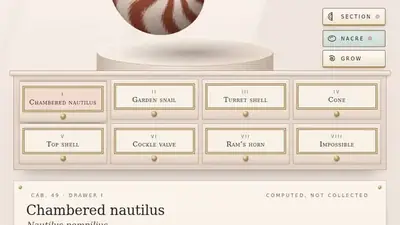</a> <b><a href="https://github.com/MiaAI-Lab/Claude-Fable-5.2-HTML-Files/blob/369dae7fe4102988676f07f147c4bbaefee3ff3a/049-conchology-cabinet.txt">A Cabinet of Computed Shells</a></b> <a href="https://github.com/MiaAI-Lab">MiaAI-Lab collection; individual creator unknown</a> 许可证未知 · <a href="https://github.com/MiaAI-Lab/Claude-Fable-5.2-HTML-Files/blob/369dae7fe4102988676f07f147c4bbaefee3ff3a/049-conchology-cabinet.html">代码</a></td>
<td width="25%" valign="top"> <b><a href="https://squall01337.github.io/abyssal-ocean/">ABYSSAL — spectral FFT ocean</a></b> <a href="https://github.com/squall01337">squall01337</a> MIT · <a href="https://github.com/squall01337/abyssal-ocean">代码</a> · <a href="https://huggingface.co/datasets/awesome-fable-5-2/terrarium-open-works/tree/main/scenes/abyssal-spectral-fft-ocean">文件</a></td>
<td width="25%" valign="top"><a href="https://github.com/satsuki-c6s/ai-3d-amusement-park">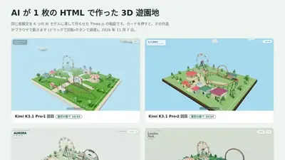</a> <b><a href="https://github.com/satsuki-c6s/ai-3d-amusement-park">AI が 1 枚の HTML で作った 3D 遊園地</a></b> <a href="https://github.com/satsuki-c6s">satsuki-c6s</a> 合集，11 个作品 MIT · <a href="https://github.com/satsuki-c6s/ai-3d-amusement-park">代码</a> · <a href="https://huggingface.co/datasets/awesome-fable-5-2/terrarium-open-works/tree/main/scenes/ai-3d-amusement-park">文件</a></td>
<td width="25%" valign="top"><a href="https://cypherpoet.github.io/THREE-JS-APOD-Air-and-Space-Museum/">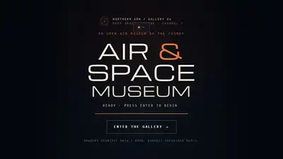</a> <b><a href="https://cypherpoet.github.io/THREE-JS-APOD-Air-and-Space-Museum/">Air &amp; Space Museum · A NASA APOD Showcase</a></b> <a href="https://github.com/CypherPoet">CypherPoet</a> MIT · <a href="https://github.com/CypherPoet/THREE-JS-APOD-Air-and-Space-Museum">代码</a> · <a href="https://huggingface.co/datasets/awesome-fable-5-2/terrarium-open-works/tree/main/scenes/air-space-museum-a-nasa-apod-showcase">文件</a></td>
</tr>
<tr>
<td width="25%" valign="top"><a href="https://nisake.github.io/Anima/">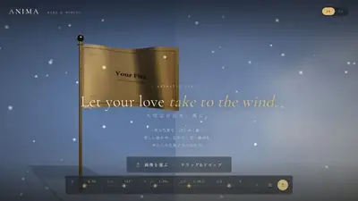</a> <b><a href="https://nisake.github.io/Anima/">Anima — Wind &amp; Memory</a></b> <a href="https://github.com/nisake">NISAKE</a> MIT · <a href="https://github.com/nisake/Anima">代码</a> · <a href="https://huggingface.co/datasets/awesome-fable-5-2/terrarium-open-works/tree/main/scenes/anima-wind-memory">文件</a></td>
<td width="25%" valign="top"><a href="https://toontalk.github.io/ant-playground/">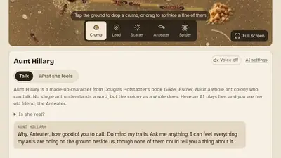</a> <b><a href="https://toontalk.github.io/ant-playground/">Ant Playground</a></b> <a href="https://github.com/ToonTalk">Ken Kahn / ToonTalk</a> MIT · <a href="https://github.com/ToonTalk/ant-playground">代码</a> · <a href="https://huggingface.co/datasets/awesome-fable-5-2/terrarium-open-works/tree/main/scenes/ant-playground">文件</a></td>
<td width="25%" valign="top"> <b><a href="https://evals.ag/outputs/out_36FRTJ5NASW62MZPTYN14F9JX1">Apartment Walkthrough</a></b> tamburins / Evals 许可证未知 · <a href="https://evals.ag/api/v1/media/assets/ast_68MAV57X8V3Z6Y6605HZ755NN7/content">代码</a></td>
<td width="25%" valign="top"><a href="https://github.com/MiaAI-Lab/Claude-Fable-5.2-HTML-Files/blob/369dae7fe4102988676f07f147c4bbaefee3ff3a/047-atelier-vesper-watch.txt">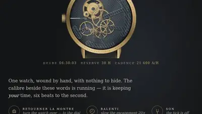</a> <b><a href="https://github.com/MiaAI-Lab/Claude-Fable-5.2-HTML-Files/blob/369dae7fe4102988676f07f147c4bbaefee3ff3a/047-atelier-vesper-watch.txt">Atelier Vesper: Heure Bleue 38</a></b> <a href="https://github.com/MiaAI-Lab">MiaAI-Lab collection; individual creator unknown</a> 许可证未知 · <a href="https://github.com/MiaAI-Lab/Claude-Fable-5.2-HTML-Files/blob/369dae7fe4102988676f07f147c4bbaefee3ff3a/047-atelier-vesper-watch.html">代码</a></td>
</tr>
<tr>
<td width="25%" valign="top"> <b><a href="https://x.com/Shannnu_18/status/2120025125076844785">Aurora 9</a></b> <a href="https://x.com/Shannnu_18">Shannnu</a> 许可证未知</td>
<td width="25%" valign="top"><a href="https://huggingface.co/spaces/victor/fable-5-vs-5-1-boeing-747">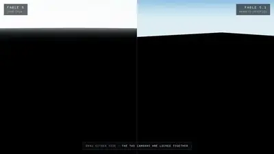</a> <b><a href="https://huggingface.co/spaces/victor/fable-5-vs-5-1-boeing-747">Boeing 747 — Fable 5 vs Fable 5.1</a></b> <a href="https://huggingface.co/victor">Victor Mustar</a> 合集，2 个作品 MIT · <a href="https://huggingface.co/spaces/victor/fable-5-vs-5-1-boeing-747">代码</a> · <a href="https://huggingface.co/datasets/awesome-fable-5-2/terrarium-open-works/tree/main/scenes/fable-5-vs-5-1-boeing-747">文件</a></td>
<td width="25%" valign="top"> <b><a href="https://xiaozhenliu.github.io/boeing-fable-5-2/">Boeing 787-9</a></b> <a href="https://github.com/xiaozhenliu">xiaozhenliu</a> 许可证未知 · <a href="https://github.com/xiaozhenliu/boeing-fable-5-2">代码</a></td>
<td width="25%" valign="top"><a href="https://mrshu-claude-fable-5-bratislava-castle-oneshot.static.hf.space/index.html">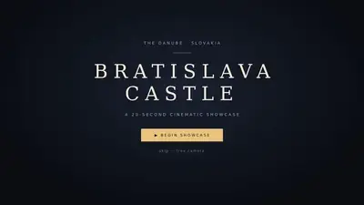</a> <b><a href="https://mrshu-claude-fable-5-bratislava-castle-oneshot.static.hf.space/index.html">Bratislava Castle — a cinematic 3D model</a></b> <a href="https://huggingface.co/mrshu">Marek Suppa</a> MIT · <a href="https://huggingface.co/spaces/mrshu/claude-fable-5-bratislava-castle-oneshot">代码</a> · <a href="https://huggingface.co/datasets/awesome-fable-5-2/terrarium-open-works/tree/main/scenes/bratislava-castle-a-cinematic-3d-model">文件</a></td>
</tr>
<tr>
<td width="25%" valign="top"><a href="https://github.com/MiaAI-Lab/Claude-Fable-5.2-HTML-Files/blob/369dae7fe4102988676f07f147c4bbaefee3ff3a/052-beton-brut-zine.txt">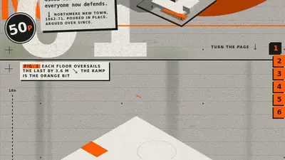</a> <b><a href="https://github.com/MiaAI-Lab/Claude-Fable-5.2-HTML-Files/blob/369dae7fe4102988676f07f147c4bbaefee3ff3a/052-beton-brut-zine.txt">BÉTON BRUT</a></b> <a href="https://github.com/MiaAI-Lab">MiaAI-Lab collection; individual creator unknown</a> 许可证未知 · <a href="https://github.com/MiaAI-Lab/Claude-Fable-5.2-HTML-Files/blob/369dae7fe4102988676f07f147c4bbaefee3ff3a/052-beton-brut-zine.html">代码</a></td>
<td width="25%" valign="top"><a href="https://github.com/MiaAI-Lab/Claude-Fable-5.2-HTML-Files/blob/369dae7fe4102988676f07f147c4bbaefee3ff3a/008-cabinet-of-impossible-minerals.txt">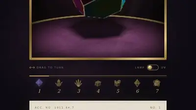</a> <b><a href="https://github.com/MiaAI-Lab/Claude-Fable-5.2-HTML-Files/blob/369dae7fe4102988676f07f147c4bbaefee3ff3a/008-cabinet-of-impossible-minerals.txt">Cabinet of Impossible Minerals</a></b> <a href="https://github.com/MiaAI-Lab">MiaAI-Lab collection; individual creator unknown</a> 许可证未知 · <a href="https://github.com/MiaAI-Lab/Claude-Fable-5.2-HTML-Files/blob/369dae7fe4102988676f07f147c4bbaefee3ff3a/008-cabinet-of-impossible-minerals.html">代码</a></td>
<td width="25%" valign="top"><a href="https://andrianopolino.github.io/drone_simulator/">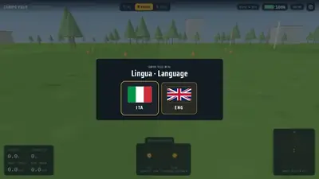</a> <b><a href="https://andrianopolino.github.io/drone_simulator/">Campo Volo Mini</a></b> <a href="https://github.com/andrianopolino">andrianopolino</a> MIT · <a href="https://github.com/andrianopolino/drone_simulator">代码</a> · <a href="https://huggingface.co/datasets/awesome-fable-5-2/terrarium-open-works/tree/main/scenes/campo-volo-mini">文件</a></td>
<td width="25%" valign="top"><a href="https://tanuu5.github.io/clawd-city-pop-lounge/">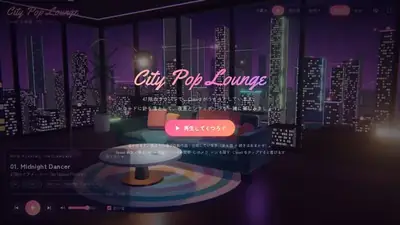</a> <b><a href="https://tanuu5.github.io/clawd-city-pop-lounge/">City Pop Lounge — Clawd のシティポップ・ラウンジ</a></b> <a href="https://github.com/tanuu5">たぬ（tanu）</a> MIT · <a href="https://github.com/tanuu5/clawd-city-pop-lounge">代码</a> · <a href="https://huggingface.co/datasets/awesome-fable-5-2/terrarium-open-works/tree/main/scenes/city-pop-lounge-clawd">文件</a></td>
</tr>
<tr>
<td width="25%" valign="top"><a href="https://tanuu5.github.io/citygrow/">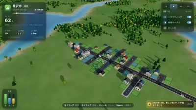</a> <b><a href="https://tanuu5.github.io/citygrow/">CityGrow — 自動で育つ街</a></b> <a href="https://github.com/tanuu5">たぬ（tanu）</a> MIT · <a href="https://github.com/tanuu5/citygrow">代码</a> · <a href="https://huggingface.co/datasets/awesome-fable-5-2/terrarium-open-works/tree/main/scenes/citygrow">文件</a></td>
<td width="25%" valign="top"><a href="https://github.com/AralimNGA/claude-3d-landingpage-evolution">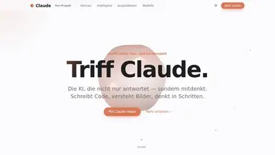</a> <b><a href="https://github.com/AralimNGA/claude-3d-landingpage-evolution">Claude 3D Landing Page</a></b> <a href="https://github.com/AralimNGA">Aralim</a> MIT · <a href="https://github.com/AralimNGA/claude-3d-landingpage-evolution">代码</a> · <a href="https://huggingface.co/datasets/awesome-fable-5-2/terrarium-open-works/tree/main/scenes/claude-3d-landing-page">文件</a></td>
<td width="25%" valign="top"><a href="https://github.com/MusaMisto/claudecraft">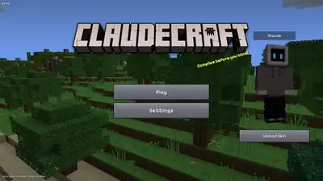</a> <b><a href="https://github.com/MusaMisto/claudecraft">Claudecraft</a></b> <a href="https://github.com/MusaMisto">Musa Misto</a> MIT · <a href="https://github.com/MusaMisto/claudecraft">代码</a> · <a href="https://huggingface.co/datasets/awesome-fable-5-2/terrarium-open-works/tree/main/scenes/claudecraft">文件</a></td>
<td width="25%" valign="top"> <b><a href="https://github.com/KooEmmanuel/custom-suit-studio">Custom Suit Studio</a></b> <a href="https://github.com/KooEmmanuel">KooEmmanuel</a> Apache-2.0 · <a href="https://github.com/KooEmmanuel/custom-suit-studio">代码</a> · <a href="https://huggingface.co/datasets/awesome-fable-5-2/terrarium-open-works/tree/main/scenes/custom-suit-studio">文件</a></td>
</tr>
<tr>
<td width="25%" valign="top"><a href="https://arad1367-dreamy-threejs-spacemusic.static.hf.space/index.html">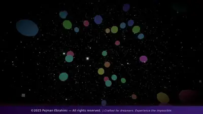</a> <b><a href="https://arad1367-dreamy-threejs-spacemusic.static.hf.space/index.html">Dreamy THreeJS SpaceMusic</a></b> <a href="https://huggingface.co/arad1367">Pejman</a> MIT · <a href="https://huggingface.co/spaces/arad1367/Dreamy-THreeJS-SpaceMusic">代码</a> · <a href="https://huggingface.co/datasets/awesome-fable-5-2/terrarium-open-works/tree/main/scenes/dreamy-threejs-spacemusic">文件</a></td>
<td width="25%" valign="top"> <b><a href="http://earth.maao.cc/">EARTH &amp; MOON - 3D Ultra</a></b> <a href="https://github.com/maoawa">Mars</a> MIT · <a href="https://github.com/maoawa/earth-moon">代码</a> · <a href="https://huggingface.co/datasets/awesome-fable-5-2/terrarium-open-works/tree/main/scenes/earth-moon-3d-ultra">文件</a></td>
<td width="25%" valign="top"><a href="https://neurorich.ru/projects/claude-fable-5-2-proekty/">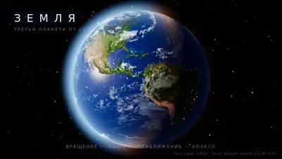</a> <b><a href="https://neurorich.ru/projects/claude-fable-5-2-proekty/">Earth: Neuro Rich</a></b> Нейро Рич 许可证未知 · <a href="https://neurorich.ru/files/claude-fable-5-2-proekty.zip">代码</a></td>
<td width="25%" valign="top"><a href="https://earth-whole-story.pages.dev/">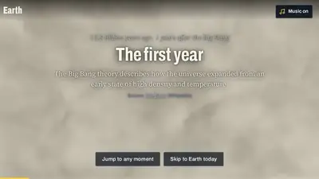</a> <b><a href="https://earth-whole-story.pages.dev/">Earth: The Whole Story</a></b> <a href="https://github.com/arpitpatel25">arpitpatel25</a> 许可证未知 · <a href="https://github.com/arpitpatel25/earth-whole-story">代码</a></td>
</tr>
<tr>
<td width="25%" valign="top"> <b><a href="https://github.com/NineTigers/emberfall-forge-claude-fable-5.2">Emberfall Forge</a></b> <a href="https://github.com/NineTigers">NineTigers</a> MIT · <a href="https://github.com/NineTigers/emberfall-forge-claude-fable-5.2">代码</a> · <a href="https://huggingface.co/datasets/awesome-fable-5-2/terrarium-open-works/tree/main/scenes/emberfall-forge">文件</a></td>
<td width="25%" valign="top"><a href="https://github.com/Khalidabdi1/factory">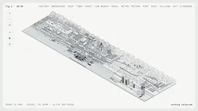</a> <b><a href="https://github.com/Khalidabdi1/factory">Factory Yard</a></b> <a href="https://github.com/Khalidabdi1">Khalidabdi1</a> MIT · <a href="https://github.com/Khalidabdi1/factory">代码</a> · <a href="https://huggingface.co/datasets/awesome-fable-5-2/terrarium-open-works/tree/main/scenes/factory-yard">文件</a></td>
<td width="25%" valign="top"><a href="https://az9713.github.io/opus-5.5-open-world-game/feltworld/">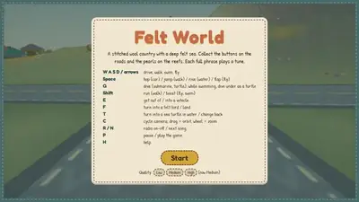</a> <b><a href="https://az9713.github.io/opus-5.5-open-world-game/feltworld/">Felt World</a></b> <a href="https://github.com/az9713">az9713</a> MIT · <a href="https://github.com/az9713/opus-5.5-open-world-game">代码</a> · <a href="https://huggingface.co/datasets/awesome-fable-5-2/terrarium-open-works/tree/main/scenes/felt-world">文件</a></td>
<td width="25%" valign="top"><a href="https://github.com/hubshashwat/flowers">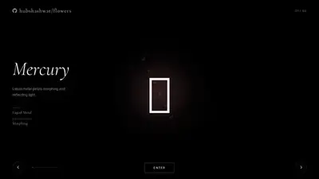</a> <b><a href="https://github.com/hubshashwat/flowers">🌸 Flowers For You</a></b> <a href="https://github.com/hubshashwat">Shashwat</a> 合集，50 个作品 MIT · <a href="https://github.com/hubshashwat/flowers">代码</a> · <a href="https://huggingface.co/datasets/awesome-fable-5-2/terrarium-open-works/tree/main/scenes/flowers">文件</a></td>
</tr>
<tr>
<td width="25%" valign="top"><a href="https://ginipick-3d-game.static.hf.space/index.html">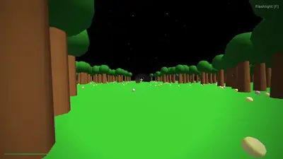</a> <b><a href="https://ginipick-3d-game.static.hf.space/index.html">Forest Explorer</a></b> <a href="https://huggingface.co/ginipick">ginipick</a> MIT · <a href="https://huggingface.co/spaces/ginipick/3D-GAME">代码</a> · <a href="https://huggingface.co/datasets/awesome-fable-5-2/terrarium-open-works/tree/main/scenes/forest-explorer-ginipick">文件</a></td>
<td width="25%" valign="top"><a href="https://www.reddit.com/r/aigamedev/comments/1xs8rut/fable_52_is_improving_this_significantly_but_sooo/">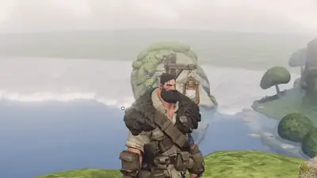</a> <b><a href="https://www.reddit.com/r/aigamedev/comments/1xs8rut/fable_52_is_improving_this_significantly_but_sooo/">Friendly Dragon Ride</a></b> Chetan Ankola (u/Efficient_Ad8214) 许可证未知</td>
<td width="25%" valign="top"><a href="https://github.com/sigco3111/gemini_experience">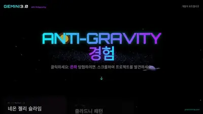</a> <b><a href="https://github.com/sigco3111/gemini_experience">Gemini 3.0 경험 — 안티그래비티</a></b> <a href="https://github.com/sigco3111">sigco3111</a> 合集，13 个作品 MIT · <a href="https://github.com/sigco3111/gemini_experience">代码</a> · <a href="https://huggingface.co/datasets/awesome-fable-5-2/terrarium-open-works/tree/main/scenes/gemini-experience">文件</a></td>
<td width="25%" valign="top"><a href="https://evals.ag/outputs/out_0BWDH0HCNWJS6N6YM8G21C6GYF">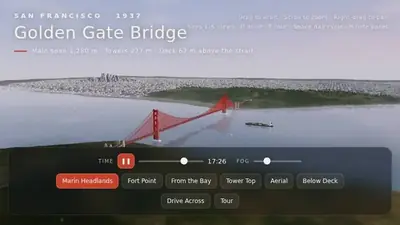</a> <b><a href="https://evals.ag/outputs/out_0BWDH0HCNWJS6N6YM8G21C6GYF">Golden Gate Bridge 3D</a></b> tamburins / Evals 许可证未知 · <a href="https://evals.ag/api/v1/media/assets/ast_6YQT3XG14P12EYXJPWY7PG68V0/content">代码</a></td>
</tr>
<tr>
<td width="25%" valign="top"><a href="https://wquguru.github.io/fable52-fps-repro/demos/03-models/">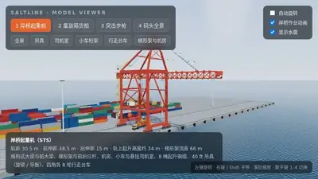</a> <b><a href="https://wquguru.github.io/fable52-fps-repro/demos/03-models/">Hard-Surface Modeling Studio</a></b> <a href="https://github.com/wquguru">wquguru</a> MIT · <a href="https://github.com/wquguru/fable52-fps-repro/blob/main/demos/03-models/index.html">代码</a> · <a href="https://huggingface.co/datasets/awesome-fable-5-2/terrarium-open-works/tree/main/scenes/hard-surface-modeling-studio">文件</a></td>
<td width="25%" valign="top"><a href="https://fable-5-sphere-test.vercel.app">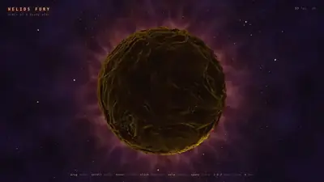</a> <b><a href="https://fable-5-sphere-test.vercel.app">HELIOS FURY — orbit of a dying star</a></b> <a href="https://github.com/grp06">George Pickett</a> MIT · <a href="https://github.com/grp06/Fable-5-sphere-test">代码</a> · <a href="https://huggingface.co/datasets/awesome-fable-5-2/terrarium-open-works/tree/main/scenes/helios-fury-orbit-of-a-dying-star">文件</a></td>
<td width="25%" valign="top"><a href="https://patch.gg/games/blendi/impossible-spaces">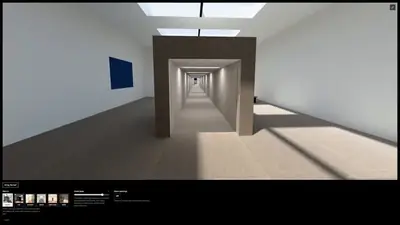</a> <b><a href="https://patch.gg/games/blendi/impossible-spaces">Impossible Spaces</a></b> Blendi Byl MIT · <a href="https://git.patch.gg/blendi/impossible-spaces/raw/a9db30c95ad7bf7805848c85c362d9ecf0c9133a/src/lib/portals.ts">代码</a> · <a href="https://huggingface.co/datasets/awesome-fable-5-2/terrarium-open-works/tree/main/scenes/impossible-spaces">文件</a></td>
<td width="25%" valign="top"> <b><a href="https://fable-jerusalem.vercel.app/">Jerusalem at Passover</a></b> Katie Parrott 许可证未知 · <a href="https://fable-jerusalem.vercel.app/">代码</a></td>
</tr>
<tr>
<td width="25%" valign="top"><a href="https://karakoram-highway.vercel.app/">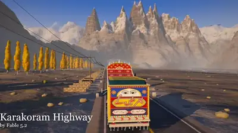</a> <b><a href="https://karakoram-highway.vercel.app/">Karakoram Highway</a></b> Umair 许可证未知 · <a href="https://karakoram-highway.vercel.app/">代码</a></td>
<td width="25%" valign="top"><a href="https://mutaafaziz.com/kin/">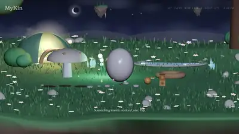</a> <b><a href="https://mutaafaziz.com/kin/">KIN — Living Worlds, Crossing Screens</a></b> <a href="https://github.com/mutaaf">Mutaaf Aziz</a> MIT · <a href="https://github.com/mutaaf/kin">代码</a> · <a href="https://huggingface.co/datasets/awesome-fable-5-2/terrarium-open-works/tree/main/scenes/kin-living-worlds-crossing-screens">文件</a></td>
<td width="25%" valign="top"><a href="https://kelaiem.github.io/timesim/">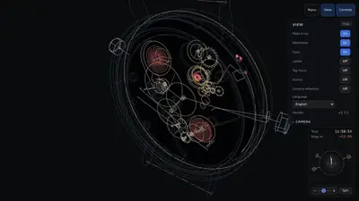</a> <b><a href="https://kelaiem.github.io/timesim/">Lever Escapement — 3D Mechanical Clock Simulation</a></b> <a href="https://github.com/kelaiem">kelaiem</a> Apache-2.0 · <a href="https://github.com/kelaiem/timesim">代码</a> · <a href="https://huggingface.co/datasets/awesome-fable-5-2/terrarium-open-works/tree/main/scenes/lever-escapement-3d-mechanical-clock-simulation">文件</a></td>
<td width="25%" valign="top"><a href="https://matrix-vibe.whoopscope.workers.dev/">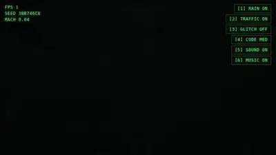</a> <b><a href="https://matrix-vibe.whoopscope.workers.dev/">Matrix</a></b> <a href="https://github.com/tornikegomareli">Tornike Gomareli</a> 许可证未知 · <a href="https://github.com/tornikegomareli/Matrix">代码</a></td>
</tr>
<tr>
<td width="25%" valign="top"><a href="https://x.com/PorisRora/status/2120017467812778053">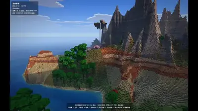</a> <b><a href="https://x.com/PorisRora/status/2120017467812778053">Minecraft-style floating islands</a></b> <a href="https://x.com/PorisRora">PorisRora</a> 许可证未知</td>
<td width="25%" valign="top"><a href="https://soheyltaheri.github.io/modern-house-3d/">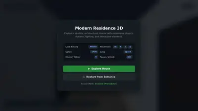</a> <b><a href="https://soheyltaheri.github.io/modern-house-3d/">🏡 Modern House 3D Exploration</a></b> <a href="https://github.com/soheyltaheri">Soheyl Taheri</a> MIT · <a href="https://github.com/soheyltaheri/modern-house-3d">代码</a> · <a href="https://huggingface.co/datasets/awesome-fable-5-2/terrarium-open-works/tree/main/scenes/modern-house-3d-exploration">文件</a></td>
<td width="25%" valign="top"><a href="https://kostikoneuro.github.io/gemini-carbon-vs-fable-5-2/">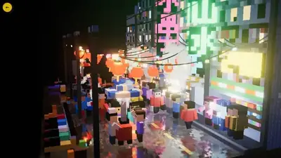</a> <b><a href="https://kostikoneuro.github.io/gemini-carbon-vs-fable-5-2/">Night Market: Fable build</a></b> <a href="https://github.com/KostiKoNeuro">KostiKoNeuro</a> 许可证未知 · <a href="https://github.com/KostiKoNeuro/gemini-carbon-vs-fable-5-2/tree/main/2-diorama/fable">代码</a></td>
<td width="25%" valign="top"><a href="https://x.com/sprinntt/status/2119906202330988961">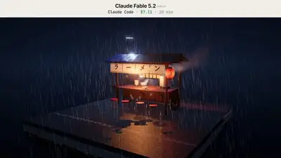</a> <b><a href="https://x.com/sprinntt/status/2119906202330988961">Night Tokyo 04: Ramen Stall</a></b> <a href="https://x.com/sprinntt">sprinntt</a> 许可证未知</td>
</tr>
<tr>
<td width="25%" valign="top"><a href="https://drcollect.github.io/ocean-drive/">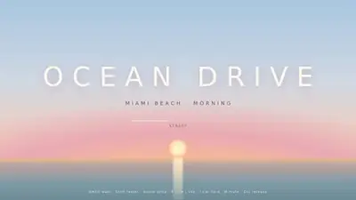</a> <b><a href="https://drcollect.github.io/ocean-drive/">Ocean Drive</a></b> <a href="https://github.com/drcollect">drcollect</a> MIT · <a href="https://github.com/drcollect/ocean-drive">代码</a> · <a href="https://huggingface.co/datasets/awesome-fable-5-2/terrarium-open-works/tree/main/scenes/ocean-drive">文件</a></td>
<td width="25%" valign="top"><a href="https://github.com/ishaaqdev/OceanOS">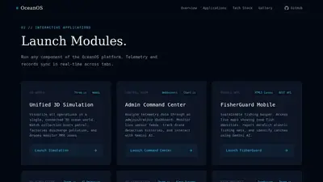</a> <b><a href="https://github.com/ishaaqdev/OceanOS">OceanOS</a></b> <a href="https://github.com/ishaaqdev">Mohammed Ishaaq</a> 合集，5 个作品 MIT · <a href="https://github.com/ishaaqdev/OceanOS">代码</a> · <a href="https://huggingface.co/datasets/awesome-fable-5-2/terrarium-open-works/tree/main/scenes/oceanos">文件</a></td>
<td width="25%" valign="top"> <b><a href="https://patch.gg/blendi/oil-paint">Oil paint</a></b> Blendi Byl MIT · <a href="https://git.patch.gg/blendi/oil-paint.git">代码</a> · <a href="https://huggingface.co/datasets/awesome-fable-5-2/terrarium-open-works/tree/main/scenes/oil-paint">文件</a></td>
<td width="25%" valign="top"><a href="https://akashmakesdesigns.github.io/fable-sites/">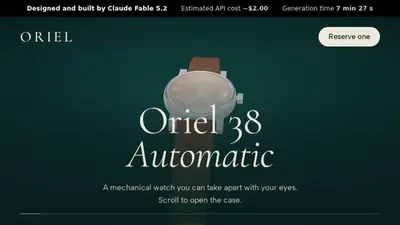</a> <b><a href="https://akashmakesdesigns.github.io/fable-sites/">Oriel 38</a></b> <a href="https://github.com/akashmakesdesigns">akashmakesdesigns</a> 许可证未知 · <a href="https://github.com/akashmakesdesigns/fable-sites/tree/main/sites/04-oriel">代码</a></td>
</tr>
<tr>
<td width="25%" valign="top"><a href="https://github.com/MiaAI-Lab/Claude-Fable-5.2-HTML-Files/blob/369dae7fe4102988676f07f147c4bbaefee3ff3a/064-par-avion.txt">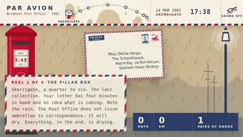</a> <b><a href="https://github.com/MiaAI-Lab/Claude-Fable-5.2-HTML-Files/blob/369dae7fe4102988676f07f147c4bbaefee3ff3a/064-par-avion.txt">Par Avion: The Journey of One Letter</a></b> <a href="https://github.com/MiaAI-Lab">MiaAI-Lab collection; individual creator unknown</a> 许可证未知 · <a href="https://github.com/MiaAI-Lab/Claude-Fable-5.2-HTML-Files/blob/369dae7fe4102988676f07f147c4bbaefee3ff3a/064-par-avion.html">代码</a></td>
<td width="25%" valign="top"><a href="https://github.com/niaonao/pelecanus">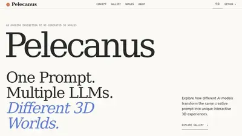</a> <b><a href="https://github.com/niaonao/pelecanus">Pelecanus</a></b> <a href="https://github.com/niaonao">niaonao</a> 合集，21 个作品 Apache-2.0 · <a href="https://github.com/niaonao/pelecanus">代码</a> · <a href="https://huggingface.co/datasets/awesome-fable-5-2/terrarium-open-works/tree/main/scenes/pelecanus">文件</a></td>
<td width="25%" valign="top"><a href="https://github.com/MiaAI-Lab/Claude-Fable-5.2-HTML-Files/blob/369dae7fe4102988676f07f147c4bbaefee3ff3a/051-pinscreen.txt">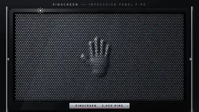</a> <b><a href="https://github.com/MiaAI-Lab/Claude-Fable-5.2-HTML-Files/blob/369dae7fe4102988676f07f147c4bbaefee3ff3a/051-pinscreen.txt">Pinscreen</a></b> <a href="https://github.com/MiaAI-Lab">MiaAI-Lab collection; individual creator unknown</a> 许可证未知 · <a href="https://github.com/MiaAI-Lab/Claude-Fable-5.2-HTML-Files/blob/369dae7fe4102988676f07f147c4bbaefee3ff3a/051-pinscreen.html">代码</a></td>
<td width="25%" valign="top"><a href="https://portals-endless-worlds.netlify.app/">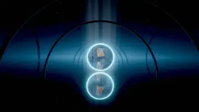</a> <b><a href="https://portals-endless-worlds.netlify.app/">Portals</a></b> <a href="https://github.com/emollick">Ethan Mollick</a> CC BY-NC-SA 4.0 · <a href="https://github.com/emollick/ai-portals">代码</a> · <a href="https://huggingface.co/datasets/awesome-fable-5-2/terrarium-open-works/tree/main/scenes/portals">文件</a></td>
</tr>
<tr>
<td width="25%" valign="top"> <b><a href="https://www.aivi.fyi/games/qingming.html">Qingming: Rainbow Bridge</a></b> AI超元域 许可证未知 · <a href="https://www.aivi.fyi/games/qingming.html">代码</a></td>
<td width="25%" valign="top"> <b><a href="https://wquguru.github.io/fable52-fps-repro/demos/02-materials/">Rainy Dock Materials</a></b> <a href="https://github.com/wquguru">wquguru</a> MIT · <a href="https://github.com/wquguru/fable52-fps-repro/blob/main/demos/02-materials/index.html">代码</a> · <a href="https://huggingface.co/datasets/awesome-fable-5-2/terrarium-open-works/tree/main/scenes/rainy-dock-materials">文件</a></td>
<td width="25%" valign="top"><a href="https://yinchao-jack.github.io/roadster-flight-experience/">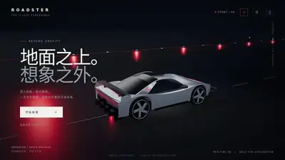</a> <b><a href="https://yinchao-jack.github.io/roadster-flight-experience/">ROADSTER · The Flight Experience</a></b> <a href="https://github.com/yinchao-jack">YC Jack</a> MIT · <a href="https://github.com/yinchao-jack/roadster-flight-experience">代码</a> · <a href="https://huggingface.co/datasets/awesome-fable-5-2/terrarium-open-works/tree/main/scenes/roadster-the-flight-experience">文件</a></td>
<td width="25%" valign="top"> <b><a href="https://fable-rome.surge.sh/">Rome, AD 320</a></b> Peter Gostev 许可证未知 · <a href="https://fable-rome.surge.sh/">代码</a></td>
</tr>
<tr>
<td width="25%" valign="top"><a href="https://room.piabrota.art">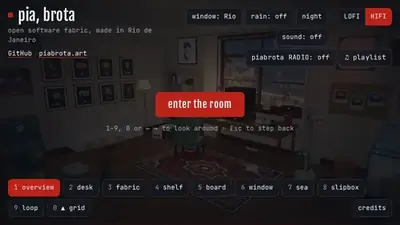</a> <b><a href="https://room.piabrota.art">room</a></b> <a href="https://github.com/piabrota">piabrota</a> MPL-2.0 · <a href="https://github.com/piabrota/room">代码</a> · <a href="https://huggingface.co/datasets/awesome-fable-5-2/terrarium-open-works/tree/main/scenes/room">文件</a></td>
<td width="25%" valign="top"> <b><a href="https://github.com/GarfieldHuang/sakura-river">Sakura River</a></b> <a href="https://github.com/GarfieldHuang">Garfield</a> MIT · <a href="https://github.com/GarfieldHuang/sakura-river">代码</a> · <a href="https://huggingface.co/datasets/awesome-fable-5-2/terrarium-open-works/tree/main/scenes/sakura-river">文件</a></td>
<td width="25%" valign="top"> <b><a href="https://sam1983aing.github.io/senna-800kg/">Senna 800KG</a></b> <a href="https://github.com/Sam1983Aing">Sam1983Aing</a> MIT · <a href="https://github.com/Sam1983Aing/senna-800kg">代码</a> · <a href="https://huggingface.co/datasets/awesome-fable-5-2/terrarium-open-works/tree/main/scenes/senna-800kg">文件</a></td>
<td width="25%" valign="top"> <b><a href="https://github.com/MiaAI-Lab/Claude-Fable-5.2-HTML-Files/blob/369dae7fe4102988676f07f147c4bbaefee3ff3a/023-walnut-turntable.txt">Side A: A Turntable in CSS</a></b> <a href="https://github.com/MiaAI-Lab">MiaAI-Lab collection; individual creator unknown</a> 许可证未知 · <a href="https://github.com/MiaAI-Lab/Claude-Fable-5.2-HTML-Files/blob/369dae7fe4102988676f07f147c4bbaefee3ff3a/023-walnut-turntable.html">代码</a></td>
</tr>
<tr>
<td width="25%" valign="top"><a href="https://x.com/higgsfield_ai/status/2119908486880342326">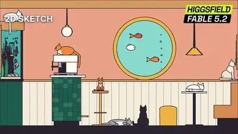</a> <b><a href="https://x.com/higgsfield_ai/status/2119908486880342326">Sketch to 3D café</a></b> <a href="https://x.com/higgsfield_ai">Higgsfield</a> 许可证未知</td>
<td width="25%" valign="top"><a href="https://evals.ag/outputs/out_0HV7B4DPJ948R8NQRHHRKHAM0A">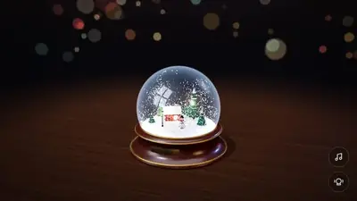</a> <b><a href="https://evals.ag/outputs/out_0HV7B4DPJ948R8NQRHHRKHAM0A">Snow Globe</a></b> tamburins / Evals 许可证未知 · <a href="https://evals.ag/api/v1/media/assets/ast_4FK7HPGSDT7WEGHDGDWXZ0738W/content">代码</a></td>
<td width="25%" valign="top"><a href="https://seawolf0.github.io/Spectra/">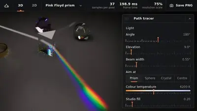</a> <b><a href="https://seawolf0.github.io/Spectra/">Spectra</a></b> <a href="https://github.com/Seawolf0">Seawolf0</a> 许可证未知 · <a href="https://github.com/Seawolf0/Spectra">代码</a></td>
<td width="25%" valign="top"> <b><a href="https://meltthemanual.github.io/stonehenge-solstice/">Stonehenge Solstice</a></b> <a href="https://github.com/MeltTheManual">u/Miyamoto_-_Musashi</a> MIT · <a href="https://github.com/MeltTheManual/stonehenge-solstice">代码</a> · <a href="https://huggingface.co/datasets/awesome-fable-5-2/terrarium-open-works/tree/main/scenes/stonehenge-solstice">文件</a></td>
</tr>
<tr>
<td width="25%" valign="top"><a href="https://github.com/MiaAI-Lab/Claude-Fable-5.2-HTML-Files/blob/369dae7fe4102988676f07f147c4bbaefee3ff3a/069-strange-attractors.txt">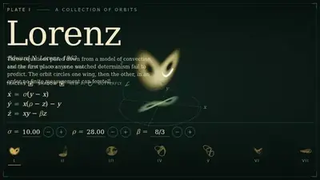</a> <b><a href="https://github.com/MiaAI-Lab/Claude-Fable-5.2-HTML-Files/blob/369dae7fe4102988676f07f147c4bbaefee3ff3a/069-strange-attractors.txt">Strange Attractors</a></b> <a href="https://github.com/MiaAI-Lab">MiaAI-Lab collection; individual creator unknown</a> 许可证未知 · <a href="https://github.com/MiaAI-Lab/Claude-Fable-5.2-HTML-Files/blob/369dae7fe4102988676f07f147c4bbaefee3ff3a/069-strange-attractors.html">代码</a></td>
<td width="25%" valign="top"><a href="https://akashmakesdesigns.github.io/fable-sites/">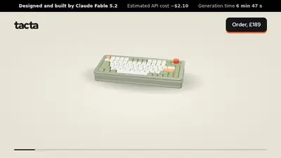</a> <b><a href="https://akashmakesdesigns.github.io/fable-sites/">Tacta 75</a></b> <a href="https://github.com/akashmakesdesigns">akashmakesdesigns</a> 许可证未知 · <a href="https://github.com/akashmakesdesigns/fable-sites/tree/main/sites/05-tacta">代码</a></td>
<td width="25%" valign="top"> <b><a href="https://github.com/MiaAI-Lab/Claude-Fable-5.2-HTML-Files/blob/369dae7fe4102988676f07f147c4bbaefee3ff3a/063-the-astrolabe.txt">The Astrolabe</a></b> <a href="https://github.com/MiaAI-Lab">MiaAI-Lab collection; individual creator unknown</a> 许可证未知 · <a href="https://github.com/MiaAI-Lab/Claude-Fable-5.2-HTML-Files/blob/369dae7fe4102988676f07f147c4bbaefee3ff3a/063-the-astrolabe.html">代码</a></td>
<td width="25%" valign="top"> <b><a href="https://github.com/MiaAI-Lab/Claude-Fable-5.2-HTML-Files/blob/369dae7fe4102988676f07f147c4bbaefee3ff3a/066-night-diner.txt">The Comet Diner, 3 A.M.</a></b> <a href="https://github.com/MiaAI-Lab">MiaAI-Lab collection; individual creator unknown</a> 许可证未知 · <a href="https://github.com/MiaAI-Lab/Claude-Fable-5.2-HTML-Files/blob/369dae7fe4102988676f07f147c4bbaefee3ff3a/066-night-diner.html">代码</a></td>
</tr>
<tr>
<td width="25%" valign="top"> <b><a href="https://therovingoffice.com/office/TEST-0000">The Roving Office</a></b> <a href="https://github.com/atlassian-labs">Atlassian Labs</a> Apache-2.0 · <a href="https://github.com/atlassian-labs/roving-office">代码</a> · <a href="https://huggingface.co/datasets/awesome-fable-5-2/terrarium-open-works/tree/main/scenes/the-roving-office">文件</a></td>
<td width="25%" valign="top"> <b><a href="https://az9713.github.io/fable-5.2-typewriter-demos/?setting=a">Three Writing Desks</a></b> <a href="https://github.com/az9713">az9713</a> 许可证未知 · <a href="https://github.com/az9713/fable-5.2-typewriter-demos">代码</a></td>
<td width="25%" valign="top"> <b><a href="https://jesusgalindez.github.io/threejs-ocean-simulator-skills/">🌊 three.js Ocean Simulator</a></b> <a href="https://github.com/JesusGalindez">JesusGalindez</a> MIT · <a href="https://github.com/JesusGalindez/threejs-ocean-simulator-skills">代码</a> · <a href="https://huggingface.co/datasets/awesome-fable-5-2/terrarium-open-works/tree/main/scenes/three-js-ocean-simulator">文件</a></td>
<td width="25%" valign="top"> <b><a href="https://github.com/AleBrito124356/threejs-hero-collection">threejs-hero-collection</a></b> <a href="https://github.com/AleBrito124356">Alejandro Brito</a> 合集，4 个作品 MIT · <a href="https://github.com/AleBrito124356/threejs-hero-collection">代码</a> · <a href="https://huggingface.co/datasets/awesome-fable-5-2/terrarium-open-works/tree/main/scenes/threejs-hero-collection">文件</a></td>
</tr>
<tr>
<td width="25%" valign="top"> <b><a href="https://starknightt.github.io/tiny-planet/">Tiny Planet</a></b> <a href="https://github.com/StarKnightt">Prasenjit</a> MIT · <a href="https://github.com/StarKnightt/tiny-planet">代码</a> · <a href="https://huggingface.co/datasets/awesome-fable-5-2/terrarium-open-works/tree/main/scenes/tiny-planet">文件</a></td>
<td width="25%" valign="top"> <b><a href="https://build-small-hackathon-toy-room-v3.hf.space/toy-v3">Tiny Toybox — Fire Boy</a></b> <a href="https://github.com/sanjuhs">Sanjay Prasad H S</a> MIT · <a href="https://github.com/sanjuhs/tiny-toybox-fireboy-minicpm">代码</a> · <a href="https://huggingface.co/datasets/awesome-fable-5-2/terrarium-open-works/tree/main/scenes/tiny-toybox-fire-boy">文件</a></td>
<td width="25%" valign="top"> <b><a href="https://orodmorais.github.io/trip-map-3d/">trip-map-3d</a></b> <a href="https://github.com/orodmorais">Rodrigo Morais</a> MIT · <a href="https://github.com/orodmorais/trip-map-3d">代码</a> · <a href="https://huggingface.co/datasets/awesome-fable-5-2/terrarium-open-works/tree/main/scenes/trip-map-3d">文件</a></td>
<td width="25%" valign="top"> <b><a href="https://atostudios.github.io/Universal-A.T.O/">Universal A.T.O. 🌌</a></b> <a href="https://github.com/ATOStudios">Batuhan Kadioglu</a> MIT · <a href="https://github.com/ATOStudios/Universal-A.T.O">代码</a> · <a href="https://huggingface.co/datasets/awesome-fable-5-2/terrarium-open-works/tree/main/scenes/universal-a-t-o">文件</a></td>
</tr>
<tr>
<td width="25%" valign="top"> <b><a href="https://github.com/evangel2022/Urban-FPV-Drone-Simulator">Urban FPV Drone Simulator</a></b> <a href="https://github.com/evangel2022">evangel2022</a> MIT · <a href="https://github.com/evangel2022/Urban-FPV-Drone-Simulator">代码</a> · <a href="https://huggingface.co/datasets/awesome-fable-5-2/terrarium-open-works/tree/main/scenes/urban-fpv-drone-simulator">文件</a></td>
<td width="25%" valign="top"> <b><a href="https://github.com/Platinum04/vibe-coded-xr-biology-lab">Vibe Coded XR Biology Lab</a></b> <a href="https://github.com/Platinum04">Awodi Abdulmujeeb</a> MIT · <a href="https://github.com/Platinum04/vibe-coded-xr-biology-lab">代码</a> · <a href="https://huggingface.co/datasets/awesome-fable-5-2/terrarium-open-works/tree/main/scenes/vibe-coded-xr-biology-lab">文件</a></td>
<td width="25%" valign="top"> <b><a href="https://github.com/Cheng-1023-web/vibe-coding">vibe-coding</a></b> <a href="https://github.com/Cheng-1023-web">Cxmcxm1023</a> 合集，2 个作品 MIT · <a href="https://github.com/Cheng-1023-web/vibe-coding">代码</a> · <a href="https://huggingface.co/datasets/awesome-fable-5-2/terrarium-open-works/tree/main/scenes/vibe-coding">文件</a></td>
<td width="25%" valign="top"> <b><a href="https://y-migita.github.io/villa-savoye-fable/">Villa Savoye — サヴォア邸 3D 再現</a></b> <a href="https://github.com/y-migita">右田 優希</a> MIT · <a href="https://github.com/y-migita/villa-savoye-fable">代码</a> · <a href="https://huggingface.co/datasets/awesome-fable-5-2/terrarium-open-works/tree/main/scenes/villa-savoye-3d">文件</a></td>
</tr>
<tr>
<td width="25%" valign="top"> <b><a href="https://www.spawn.co/@mattshumer/voxel-engine">Voxel Engine</a></b> Matt Shumer 许可证未知</td>
<td width="25%" valign="top"> <b><a href="https://github.com/coder36/trainset">Voxel Train Yard</a></b> <a href="https://github.com/coder36">Mark Middleton</a> 合集，2 个作品 MIT · <a href="https://github.com/coder36/trainset">代码</a> · <a href="https://huggingface.co/datasets/awesome-fable-5-2/terrarium-open-works/tree/main/scenes/voxel-train-yard">文件</a></td>
<td width="25%" valign="top"> <b><a href="https://lukasbialozor.github.io/warszawa-na-sieci-demo/">Warszawa na sieci</a></b> <a href="https://github.com/LukasBialozor">LukasBialozor</a> MIT · <a href="https://github.com/LukasBialozor/warszawa-na-sieci-demo">代码</a> · <a href="https://huggingface.co/datasets/awesome-fable-5-2/terrarium-open-works/tree/main/scenes/warszawa-na-sieci">文件</a></td>
<td width="25%" valign="top"> <b><a href="https://what-the-water-keeps.vercel.app/">What the Water Keeps</a></b> Kevin Ngo 许可证未知 · <a href="https://what-the-water-keeps.vercel.app/">代码</a></td>
</tr>
<tr>
<td width="25%" valign="top"> <b><a href="https://tanuu5.github.io/sawagani-aquaterrarium/">サワガニ水槽</a></b> <a href="https://github.com/tanuu5">たぬ（tanu）</a> MIT · <a href="https://github.com/tanuu5/sawagani-aquaterrarium">代码</a> · <a href="https://huggingface.co/datasets/awesome-fable-5-2/terrarium-open-works/tree/main/scenes/sawagani-aquaterrarium">文件</a></td>
<td width="25%" valign="top"> <b><a href="https://amgainprabesh.github.io/nan-lian-garden-voxel/">南蓮園池 · Nan Lian Garden — Voxel Edition</a></b> <a href="https://github.com/amgainprabesh">Prabesh Amgain</a> MIT · <a href="https://github.com/amgainprabesh/nan-lian-garden-voxel">代码</a> · <a href="https://huggingface.co/datasets/awesome-fable-5-2/terrarium-open-works/tree/main/scenes/nan-lian-garden-voxel-edition">文件</a></td>
<td width="25%" valign="top"> <b><a href="https://3d.dingxiaopi.com/cottage-build/">田园小屋搭建</a></b> <a href="https://github.com/dingxiaopi">丁小屁</a> MIT · <a href="https://github.com/dingxiaopi/3d-pages">代码</a> · <a href="https://huggingface.co/datasets/awesome-fable-5-2/terrarium-open-works/tree/main/scenes/3d-pages">文件</a></td>
<td width="25%" valign="top"> <b><a href="https://tanuu5.github.io/autumn-castle/">秋ノ古城 — The Castle in Autumn</a></b> <a href="https://github.com/tanuu5">たぬ（tanu）</a> MIT · <a href="https://github.com/tanuu5/autumn-castle">代码</a> · <a href="https://huggingface.co/datasets/awesome-fable-5-2/terrarium-open-works/tree/main/scenes/the-castle-in-autumn">文件</a></td>
</tr>
<tr>
<td width="25%" valign="top"> <b><a href="https://tanuu5.github.io/madobe-no-umi/">窓辺の海 — finestra sul mare</a></b> <a href="https://github.com/tanuu5">たぬ（tanu）</a> MIT · <a href="https://github.com/tanuu5/madobe-no-umi">代码</a> · <a href="https://huggingface.co/datasets/awesome-fable-5-2/terrarium-open-works/tree/main/scenes/finestra-sul-mare">文件</a></td>
<td width="25%" valign="top"> <b><a href="https://github.com/zhangyu-gif/particle-planet">粒子星球 · 手势交互 (Particle Planet)</a></b> <a href="https://github.com/zhangyu-gif">zhangyu-gif</a> MIT · <a href="https://github.com/zhangyu-gif/particle-planet">代码</a> · <a href="https://huggingface.co/datasets/awesome-fable-5-2/terrarium-open-works/tree/main/scenes/particle-planet">文件</a></td>
<td width="25%" valign="top"> <b><a href="https://github.com/sidoyu/gaze-cathedral-codex-astra">고요의 성당 · The Still Cathedral</a></b> <a href="https://github.com/sidoyu">sidoyu</a> MIT · <a href="https://github.com/sidoyu/gaze-cathedral-codex-astra">代码</a> · <a href="https://huggingface.co/datasets/awesome-fable-5-2/terrarium-open-works/tree/main/scenes/the-still-cathedral">文件</a></td>
<td width="25%"></td>
</tr>
</table>

没有预览图的作品：

<table>
<tr><th align="left">作品</th><th align="left">作者</th><th align="left">许可证</th><th align="left">链接</th></tr>
<tr><td><a href="https://www.bilibili.com/video/BV1yJW168ENZ/">Ancient machinery in 3D</a></td><td>阿达的AI思辩</td><td>许可证未知</td><td>—</td></tr>
<tr><td><a href="https://haruka8846.github.io/dive-game/">dive-game</a></td><td><a href="https://github.com/haruka8846">haruka8846</a></td><td>MIT</td><td><a href="https://github.com/haruka8846/dive-game">代码</a> · <a href="https://huggingface.co/datasets/awesome-fable-5-2/terrarium-open-works/tree/main/scenes/dive-game">文件</a></td></tr>
<tr><td><a href="https://github.com/codewithmuh/fable5-websites">Fable 5 · 3D Website Showcase</a> · 合集，11 个作品</td><td><a href="https://github.com/codewithmuh">Muhammad Rashid</a></td><td>MIT</td><td><a href="https://github.com/codewithmuh/fable5-websites">代码</a> · <a href="https://huggingface.co/datasets/awesome-fable-5-2/terrarium-open-works/tree/main/scenes/fable-5-3d-website-showcase">文件</a></td></tr>
<tr><td><a href="https://kimhyunwoo-3d-game.static.hf.space/index.html">Forest Explorer</a></td><td><a href="https://huggingface.co/kimhyunwoo">kimhyunwoo</a></td><td>MIT</td><td><a href="https://huggingface.co/spaces/kimhyunwoo/3D-GAME">代码</a> · <a href="https://huggingface.co/datasets/awesome-fable-5-2/terrarium-open-works/tree/main/scenes/forest-explorer-kimhyunwoo">文件</a></td></tr>
<tr><td><a href="https://github.com/marcelomiyake/geotoon">GeoToon</a></td><td><a href="https://github.com/marcelomiyake">Marcelo Miyake</a></td><td>MIT</td><td><a href="https://github.com/marcelomiyake/geotoon">代码</a> · <a href="https://huggingface.co/datasets/awesome-fable-5-2/terrarium-open-works/tree/main/scenes/geotoon">文件</a></td></tr>
<tr><td><a href="https://github.com/hahaliu1029/house-3d">House 3D · GPT6 与 Fable 效果对比</a> · 合集，2 个作品</td><td><a href="https://github.com/hahaliu1029">刘哈哈</a></td><td>Apache-2.0</td><td><a href="https://github.com/hahaliu1029/house-3d">代码</a> · <a href="https://huggingface.co/datasets/awesome-fable-5-2/terrarium-open-works/tree/main/scenes/house-3d-gpt6-fable">文件</a></td></tr>
<tr><td><a href="https://github.com/AnonymousUser1331/Fireworks">Interactive 3D Fireworks &amp; Festive Light Engine</a> · 合集，3 个作品</td><td><a href="https://github.com/AnonymousUser1331">AnonymousUser1331</a></td><td>MIT</td><td><a href="https://github.com/AnonymousUser1331/Fireworks">代码</a> · <a href="https://huggingface.co/datasets/awesome-fable-5-2/terrarium-open-works/tree/main/scenes/interactive-3d-fireworks-festive-light-engine">文件</a></td></tr>
<tr><td><a href="https://www.spawn.co/@mattshumer/earth?room=local">Mirror Earth</a></td><td>Matt Shumer</td><td>许可证未知</td><td>—</td></tr>
<tr><td><a href="https://jeiel85.github.io/nimbus-ring/">NIMBUS RING</a></td><td><a href="https://github.com/jeiel85">jeiel85</a></td><td>MIT</td><td><a href="https://github.com/jeiel85/nimbus-ring">代码</a> · <a href="https://huggingface.co/datasets/awesome-fable-5-2/terrarium-open-works/tree/main/scenes/nimbus-ring">文件</a></td></tr>
<tr><td><a href="https://github.com/Richi2293/palm-royal">Palm Royal</a> · 合集，2 个作品</td><td><a href="https://github.com/Richi2293">Riccardo</a></td><td>MIT</td><td><a href="https://github.com/Richi2293/palm-royal">代码</a> · <a href="https://huggingface.co/datasets/awesome-fable-5-2/terrarium-open-works/tree/main/scenes/palm-royal">文件</a></td></tr>
<tr><td><a href="https://github.com/vladi21k/3DSceneRenderer">Tramline — Cab Ride</a></td><td><a href="https://github.com/vladi21k">vladi21k</a></td><td>MIT</td><td><a href="https://github.com/vladi21k/3DSceneRenderer">代码</a> · <a href="https://huggingface.co/datasets/awesome-fable-5-2/terrarium-open-works/tree/main/scenes/tramline-cab-ride">文件</a></td></tr>
<tr><td><a href="https://github.com/nevasini1/willowbrook-threejs">Willowbrook — Generative AI World Simulation</a></td><td><a href="https://github.com/nevasini1">nevasini1</a></td><td>MIT</td><td><a href="https://github.com/nevasini1/willowbrook-threejs">代码</a> · <a href="https://huggingface.co/datasets/awesome-fable-5-2/terrarium-open-works/tree/main/scenes/willowbrook-generative-ai-world-simulation">文件</a></td></tr>
<tr><td><a href="https://theuws.com/games/cosmos-2026/play/">Zorp&#x27;s Universe</a></td><td><a href="https://github.com/RichardTheuws">Richard Theuws</a></td><td>MIT</td><td><a href="https://github.com/RichardTheuws/cosmos-2026">代码</a> · <a href="https://huggingface.co/datasets/awesome-fable-5-2/terrarium-open-works/tree/main/scenes/zorp-s-universe">文件</a></td></tr>
<tr><td><a href="https://tanuu5.github.io/futari-no-ie/">ふたりの家 — A House for Two</a></td><td><a href="https://github.com/tanuu5">たぬ（tanu）</a></td><td>MIT</td><td><a href="https://github.com/tanuu5/futari-no-ie">代码</a> · <a href="https://huggingface.co/datasets/awesome-fable-5-2/terrarium-open-works/tree/main/scenes/a-house-for-two">文件</a></td></tr>
<tr><td><a href="https://tanuu5.github.io/sofa-ga-aru/">ソファーがある。 — There Is a Sofa.</a></td><td><a href="https://github.com/tanuu5">たぬ（tanu）</a></td><td>MIT</td><td><a href="https://github.com/tanuu5/sofa-ga-aru">代码</a> · <a href="https://huggingface.co/datasets/awesome-fable-5-2/terrarium-open-works/tree/main/scenes/there-is-a-sofa">文件</a></td></tr>
<tr><td><a href="https://claude.ai/artifact/L6dDhAnGZur167TMmp6hdM">鳩の目、京都。</a></td><td><a href="https://github.com/kai-kou">kai kou</a></td><td>MIT</td><td><a href="https://github.com/kai-kou/hato-no-me-kyoto">代码</a> · <a href="https://huggingface.co/datasets/awesome-fable-5-2/terrarium-open-works/tree/main/scenes/hato-no-me-kyoto">文件</a></td></tr>
<tr><td><a href="https://github.com/sidoyu/gaze-cathedral-claude-fable-5.2">눈을 돌린 사이</a></td><td><a href="https://github.com/sidoyu">sidoyu</a></td><td>MIT</td><td><a href="https://github.com/sidoyu/gaze-cathedral-claude-fable-5.2">代码</a> · <a href="https://huggingface.co/datasets/awesome-fable-5-2/terrarium-open-works/tree/main/scenes/gaze-cathedral-claude-fable-5-2">文件</a></td></tr>
<tr><td><a href="https://github.com/NineTigers/quiet-forge-codex-astra">불과 쇠 — The quiet forge</a></td><td><a href="https://github.com/NineTigers">Yin-Goo Yim</a></td><td>MIT</td><td><a href="https://github.com/NineTigers/quiet-forge-codex-astra">代码</a> · <a href="https://huggingface.co/datasets/awesome-fable-5-2/terrarium-open-works/tree/main/scenes/the-quiet-forge">文件</a></td></tr>
</table>

---

<a href="../README.zh-CN.md">首页</a> · <a href="../games/README.zh-CN.md">游戏</a> · <a href="../videos/README.zh-CN.md">视频</a> · <a href="../scenes/README.zh-CN.md">场景</a> · <a href="../wallpapers/README.zh-CN.md">壁纸</a> · <a href="../tools/README.zh-CN.md">工具</a> · <a href="../visualizations/README.zh-CN.md">可视化</a> · <a href="#top">返回顶部</a> Terrarium: Open 3D Worlds Made with Code · 数据日期：2026-11-14

