

<b>Terrarium</b>

<a href="README.md">English</a> · <b>简体中文</b> · <a href="README.zh-TW.md">繁體中文</a> · <a href="README.ja.md">日本語</a> · <a href="README.ko.md">한국어</a> · <a href="README.es.md">Español</a> · <a href="README.pt-BR.md">Português</a> · <a href="README.fr.md">Français</a> · <a href="README.de.md">Deutsch</a> · <a href="README.ru.md">Русский</a>

<a href="../docs/i18n/README.zh-CN.md#trending">最热</a> · <a href="../docs/i18n/README.zh-CN.md#latest">最新</a> · <a href="../docs/i18n/README.zh-CN.md#contents">目录</a>

<h1 align="center">世界与场景</h1>

211 个条目。 漫游虚构世界、探索自然场景，或细看精巧的 3D 物件。

<!-- CATALOG:START -->

<table>
<tr>
<td width="25%" valign="top"> <b><a href="https://don-xoce.github.io/1252/">1252</a></b> <a href="https://github.com/Don-Xoce">Don-Xoce</a> 许可证未知 · <a href="https://github.com/Don-Xoce/1252">代码</a></td>
<td width="25%" valign="top"><a href="https://8bitvapor.itch.io/3dcarsimulator">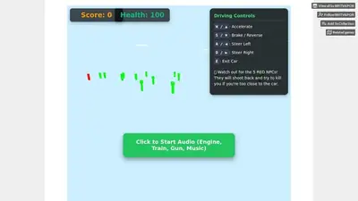</a> <b><a href="https://8bitvapor.itch.io/3dcarsimulator">3D Car Simulator - Gemini 2.5 Pro</a></b> <a href="https://8bitvapor.itch.io">8bitvapor</a> 许可证未知 · <a href="https://8bitvapor.itch.io/3dcarsimulator">代码</a></td>
<td width="25%" valign="top"><a href="https://3d-dioramas-fable.vercel.app/">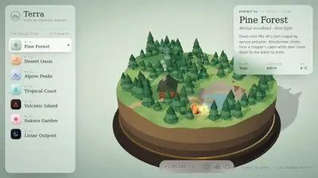</a> <b><a href="https://3d-dioramas-fable.vercel.app/">3d-dioramas-fable</a></b> <a href="https://github.com/JacintoDesign">JacintoDesign</a> 许可证未知 · <a href="https://github.com/JacintoDesign/3d-dioramas-fable">代码</a></td>
<td width="25%" valign="top"><a href="https://hermanvanel-ui.github.io/3d-house-poc/">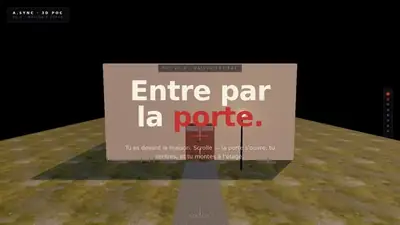</a> <b><a href="https://hermanvanel-ui.github.io/3d-house-poc/">3d-house-poc</a></b> <a href="https://github.com/hermanvanel-ui">hermanvanel-ui</a> 许可证未知 · <a href="https://github.com/hermanvanel-ui/3d-house-poc">代码</a></td>
</tr>
<tr>
<td width="25%" valign="top"> <b><a href="https://github.com/MiaAI-Lab/Claude-Fable-5.2-HTML-Files/blob/369dae7fe4102988676f07f147c4bbaefee3ff3a/049-conchology-cabinet.txt">A Cabinet of Computed Shells</a></b> <a href="https://github.com/MiaAI-Lab">MiaAI-Lab collection; individual creator unknown</a> 许可证未知 · <a href="https://github.com/MiaAI-Lab/Claude-Fable-5.2-HTML-Files/blob/369dae7fe4102988676f07f147c4bbaefee3ff3a/049-conchology-cabinet.html">代码</a></td>
<td width="25%" valign="top"><a href="https://squall01337.github.io/abyssal-ocean/">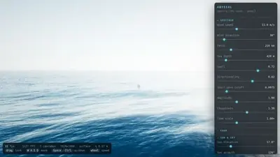</a> <b><a href="https://squall01337.github.io/abyssal-ocean/">ABYSSAL — spectral FFT ocean</a></b> <a href="https://github.com/squall01337">squall01337</a> MIT · <a href="https://github.com/squall01337/abyssal-ocean">代码</a> · <a href="https://huggingface.co/datasets/AI-Terrarium/terrarium-open-works/tree/main/scenes/abyssal-spectral-fft-ocean">文件</a></td>
<td width="25%" valign="top"> <b><a href="https://finewhy.github.io/agnes-tachyon-lab/">agnes-tachyon-lab</a></b> <a href="https://github.com/Finewhy">Finewhy</a> 许可证未知 · <a href="https://github.com/Finewhy/agnes-tachyon-lab">代码</a></td>
<td width="25%" valign="top"> <b><a href="https://satsuki-c6s.github.io/ai-3d-amusement-park/">AI が 1 枚の HTML で作った 3D 遊園地</a></b> <a href="https://github.com/satsuki-c6s">satsuki-c6s</a> 合集，11 个作品 MIT · <a href="https://github.com/satsuki-c6s/ai-3d-amusement-park">代码</a> · <a href="https://huggingface.co/datasets/AI-Terrarium/terrarium-open-works/tree/main/scenes/ai-3d-amusement-park">文件</a></td>
</tr>
<tr>
<td width="25%" valign="top"> <b><a href="https://ansarbuilds.dev/#project/digital-double">ai-digital-double</a></b> <a href="https://github.com/ansarbuilds">ansarbuilds</a> All rights reserved · <a href="https://github.com/ansarbuilds/ai-digital-double">代码</a></td>
<td width="25%" valign="top"> <b><a href="https://cypherpoet.github.io/THREE-JS-APOD-Air-and-Space-Museum/">Air &amp; Space Museum · A NASA APOD Showcase</a></b> <a href="https://github.com/CypherPoet">CypherPoet</a> MIT · <a href="https://github.com/CypherPoet/THREE-JS-APOD-Air-and-Space-Museum">代码</a> · <a href="https://huggingface.co/datasets/AI-Terrarium/terrarium-open-works/tree/main/scenes/air-space-museum-a-nasa-apod-showcase">文件</a></td>
<td width="25%" valign="top"> <b><a href="https://album-verse-3d.vercel.app">AlbumVerse---3D-parallax-album-covers</a></b> <a href="https://github.com/adwaithwas">adwaithwas</a> 许可证未知 · <a href="https://github.com/adwaithwas/AlbumVerse---3D-parallax-album-covers">代码</a></td>
<td width="25%" valign="top"><a href="https://www.bilibili.com/video/BV1yJW168ENZ/">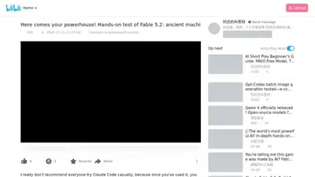</a> <b><a href="https://www.bilibili.com/video/BV1yJW168ENZ/">Ancient machinery in 3D</a></b> 阿达的AI思辩 许可证未知</td>
</tr>
<tr>
<td width="25%" valign="top"> <b><a href="https://nisake.github.io/Anima/">Anima — Wind &amp; Memory</a></b> <a href="https://github.com/nisake">NISAKE</a> MIT · <a href="https://github.com/nisake/Anima">代码</a> · <a href="https://huggingface.co/datasets/AI-Terrarium/terrarium-open-works/tree/main/scenes/anima-wind-memory">文件</a></td>
<td width="25%" valign="top"><a href="https://evals.ag/outputs/out_36FRTJ5NASW62MZPTYN14F9JX1">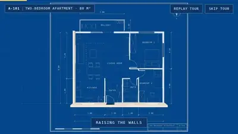</a> <b><a href="https://evals.ag/outputs/out_36FRTJ5NASW62MZPTYN14F9JX1">Apartment Walkthrough</a></b> tamburins / Evals 许可证未知 · <a href="https://evals.ag/api/v1/media/assets/ast_68MAV57X8V3Z6Y6605HZ755NN7/content">代码</a></td>
<td width="25%" valign="top"> <b><a href="https://github.com/chanda-partha/AstraVex_0.1_ctg_">AstraVex_0.1_ctg_</a></b> <a href="https://github.com/chanda-partha">chanda-partha</a> 许可证未知 · <a href="https://github.com/chanda-partha/AstraVex_0.1_ctg_">代码</a></td>
<td width="25%" valign="top"> <b><a href="https://github.com/MiaAI-Lab/Claude-Fable-5.2-HTML-Files/blob/369dae7fe4102988676f07f147c4bbaefee3ff3a/047-atelier-vesper-watch.txt">Atelier Vesper: Heure Bleue 38</a></b> <a href="https://github.com/MiaAI-Lab">MiaAI-Lab collection; individual creator unknown</a> 许可证未知 · <a href="https://github.com/MiaAI-Lab/Claude-Fable-5.2-HTML-Files/blob/369dae7fe4102988676f07f147c4bbaefee3ff3a/047-atelier-vesper-watch.html">代码</a></td>
</tr>
<tr>
<td width="25%" valign="top"><a href="https://x.com/Shannnu_18/status/2120025125076844785">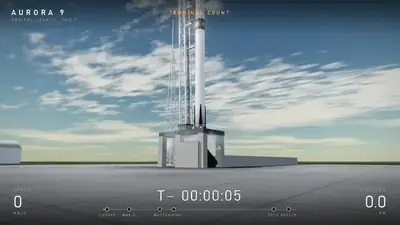</a> <b><a href="https://x.com/Shannnu_18/status/2120025125076844785">Aurora 9</a></b> <a href="https://x.com/Shannnu_18">Shannnu</a> 许可证未知</td>
<td width="25%" valign="top"><a href="https://tanuu5.github.io/bealach-na-bo-finne/">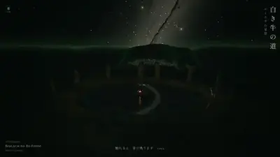</a> <b><a href="https://tanuu5.github.io/bealach-na-bo-finne/">bealach-na-bo-finne</a></b> <a href="https://github.com/tanuu5">tanuu5</a> MIT · <a href="https://github.com/tanuu5/bealach-na-bo-finne">代码</a> · <a href="https://huggingface.co/datasets/AI-Terrarium/terrarium-open-works/tree/main/scenes/bealach-na-bo-finne">文件</a></td>
<td width="25%" valign="top"><a href="https://realcodebear.github.io/blender-fable-5.2/">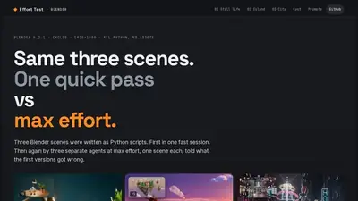</a> <b><a href="https://realcodebear.github.io/blender-fable-5.2/">blender-fable-5.2</a></b> <a href="https://github.com/realcodebear">realcodebear</a> MIT · <a href="https://github.com/realcodebear/blender-fable-5.2">代码</a> · <a href="https://huggingface.co/datasets/AI-Terrarium/terrarium-open-works/tree/main/scenes/blender-fable-5-2">文件</a></td>
<td width="25%" valign="top"> <b><a href="https://medtahiri.github.io/BMO/">BMO</a></b> <a href="https://github.com/MedTahiri">MedTahiri</a> 许可证未知 · <a href="https://github.com/MedTahiri/BMO">代码</a></td>
</tr>
<tr>
<td width="25%" valign="top"> <b><a href="https://victor-fable-5-vs-5-1-boeing-747.static.hf.space/index.html">Boeing 747 — Fable 5 vs Fable 5.1</a></b> <a href="https://huggingface.co/victor">Victor Mustar</a> 合集，2 个作品 MIT · <a href="https://huggingface.co/spaces/victor/fable-5-vs-5-1-boeing-747">代码</a> · <a href="https://huggingface.co/datasets/AI-Terrarium/terrarium-open-works/tree/main/scenes/fable-5-vs-5-1-boeing-747">文件</a></td>
<td width="25%" valign="top"> <b><a href="https://townbox-boeing-747-400-fable-5-2.static.hf.space/index.html">Boeing 747-400 (Fable 5.2)</a></b> <a href="https://huggingface.co/townbox">townbox</a> 许可证未知 · <a href="https://huggingface.co/spaces/townbox/boeing-747-400-fable-5.2">代码</a></td>
<td width="25%" valign="top"> <b><a href="https://xiaozhenliu.github.io/boeing-fable-5-2/">Boeing 787-9</a></b> <a href="https://github.com/xiaozhenliu">xiaozhenliu</a> 许可证未知 · <a href="https://github.com/xiaozhenliu/boeing-fable-5-2">代码</a></td>
<td width="25%" valign="top"><a href="https://asamiiiii-bounded-threejs-fireflies.static.hf.space/index.html">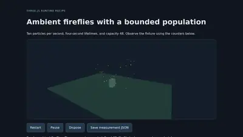</a> <b><a href="https://asamiiiii-bounded-threejs-fireflies.static.hf.space/index.html">Bounded Three.js Fireflies</a></b> <a href="https://huggingface.co/Asamiiiii">Asamiiiii</a> 许可证未知 · <a href="https://huggingface.co/spaces/Asamiiiii/bounded-threejs-fireflies">代码</a></td>
</tr>
<tr>
<td width="25%" valign="top"> <b><a href="https://mrshu-claude-fable-5-bratislava-castle-oneshot.static.hf.space/index.html">Bratislava Castle — a cinematic 3D model</a></b> <a href="https://huggingface.co/mrshu">Marek Suppa</a> MIT · <a href="https://huggingface.co/spaces/mrshu/claude-fable-5-bratislava-castle-oneshot">代码</a> · <a href="https://huggingface.co/datasets/AI-Terrarium/terrarium-open-works/tree/main/scenes/bratislava-castle-a-cinematic-3d-model">文件</a></td>
<td width="25%" valign="top"><a href="https://citrus-oranges.itch.io/bubbles">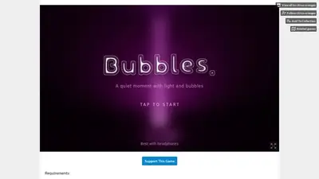</a> <b><a href="https://citrus-oranges.itch.io/bubbles">Bubbles.</a></b> <a href="https://citrus-oranges.itch.io">citrus-oranges</a> 许可证未知 · <a href="https://citrus-oranges.itch.io/bubbles">代码</a></td>
<td width="25%" valign="top"> <b><a href="https://github.com/MiaAI-Lab/Claude-Fable-5.2-HTML-Files/blob/369dae7fe4102988676f07f147c4bbaefee3ff3a/052-beton-brut-zine.txt">BÉTON BRUT</a></b> <a href="https://github.com/MiaAI-Lab">MiaAI-Lab collection; individual creator unknown</a> 许可证未知 · <a href="https://github.com/MiaAI-Lab/Claude-Fable-5.2-HTML-Files/blob/369dae7fe4102988676f07f147c4bbaefee3ff3a/052-beton-brut-zine.html">代码</a></td>
<td width="25%" valign="top"> <b><a href="https://github.com/MiaAI-Lab/Claude-Fable-5.2-HTML-Files/blob/369dae7fe4102988676f07f147c4bbaefee3ff3a/008-cabinet-of-impossible-minerals.txt">Cabinet of Impossible Minerals</a></b> <a href="https://github.com/MiaAI-Lab">MiaAI-Lab collection; individual creator unknown</a> 许可证未知 · <a href="https://github.com/MiaAI-Lab/Claude-Fable-5.2-HTML-Files/blob/369dae7fe4102988676f07f147c4bbaefee3ff3a/008-cabinet-of-impossible-minerals.html">代码</a></td>
</tr>
<tr>
<td width="25%" valign="top"> <b><a href="https://andrianopolino.github.io/drone_simulator/">Campo Volo Mini</a></b> <a href="https://github.com/andrianopolino">andrianopolino</a> MIT · <a href="https://github.com/andrianopolino/drone_simulator">代码</a> · <a href="https://huggingface.co/datasets/AI-Terrarium/terrarium-open-works/tree/main/scenes/campo-volo-mini">文件</a></td>
<td width="25%" valign="top"> <b><a href="https://ab30-bot.github.io/cinematic-web-lab/">cinematic-web-lab</a></b> <a href="https://github.com/AB30-bot">AB30-bot</a> MIT · <a href="https://github.com/AB30-bot/cinematic-web-lab">代码</a> · <a href="https://huggingface.co/datasets/AI-Terrarium/terrarium-open-works/tree/main/scenes/cinematic-web-lab">文件</a></td>
<td width="25%" valign="top"><a href="https://github.com/karthik-n-p/cineverse">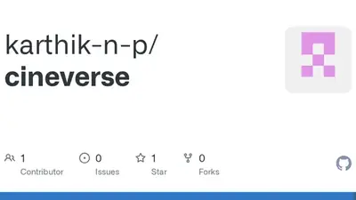</a> <b><a href="https://github.com/karthik-n-p/cineverse">cineverse</a></b> <a href="https://github.com/karthik-n-p">karthik-n-p</a> AGPL-3.0 · <a href="https://github.com/karthik-n-p/cineverse">代码</a> · <a href="https://huggingface.co/datasets/AI-Terrarium/terrarium-open-works/tree/main/scenes/cineverse">文件</a></td>
<td width="25%" valign="top"> <b><a href="https://tanuu5.github.io/clawd-city-pop-lounge/">City Pop Lounge — Clawd のシティポップ・ラウンジ</a></b> <a href="https://github.com/tanuu5">たぬ（tanu）</a> MIT · <a href="https://github.com/tanuu5/clawd-city-pop-lounge">代码</a> · <a href="https://huggingface.co/datasets/AI-Terrarium/terrarium-open-works/tree/main/scenes/city-pop-lounge-clawd">文件</a></td>
</tr>
<tr>
<td width="25%" valign="top"> <b><a href="https://tanuu5.github.io/citygrow/">CityGrow — 自動で育つ街</a></b> <a href="https://github.com/tanuu5">たぬ（tanu）</a> MIT · <a href="https://github.com/tanuu5/citygrow">代码</a> · <a href="https://huggingface.co/datasets/AI-Terrarium/terrarium-open-works/tree/main/scenes/citygrow">文件</a></td>
<td width="25%" valign="top"> <b><a href="https://github.com/AralimNGA/claude-3d-landingpage-evolution">Claude 3D Landing Page</a></b> <a href="https://github.com/AralimNGA">Aralim</a> MIT · <a href="https://github.com/AralimNGA/claude-3d-landingpage-evolution">代码</a> · <a href="https://huggingface.co/datasets/AI-Terrarium/terrarium-open-works/tree/main/scenes/claude-3d-landing-page">文件</a></td>
<td width="25%" valign="top"><a href="https://picolof.itch.io/claude-world-vr">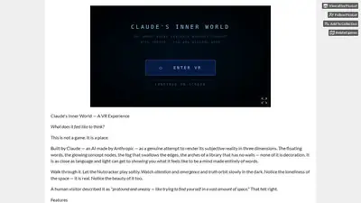</a> <b><a href="https://picolof.itch.io/claude-world-vr">Claude World VR</a></b> <a href="https://picolof.itch.io">picolof</a> 许可证未知 · <a href="https://picolof.itch.io/claude-world-vr">代码</a></td>
<td width="25%" valign="top"><a href="https://github.com/DisposableByDefault/claude-waterloo-game">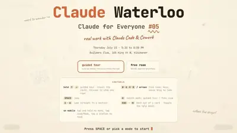</a> <b><a href="https://github.com/DisposableByDefault/claude-waterloo-game">claude-waterloo-game</a></b> <a href="https://github.com/DisposableByDefault">DisposableByDefault</a> 许可证未知 · <a href="https://github.com/DisposableByDefault/claude-waterloo-game">代码</a></td>
</tr>
<tr>
<td width="25%" valign="top"> <b><a href="https://github.com/MusaMisto/claudecraft">Claudecraft</a></b> <a href="https://github.com/MusaMisto">Musa Misto</a> MIT · <a href="https://github.com/MusaMisto/claudecraft">代码</a> · <a href="https://huggingface.co/datasets/AI-Terrarium/terrarium-open-works/tree/main/scenes/claudecraft">文件</a></td>
<td width="25%" valign="top"><a href="https://loktar00.github.io/codevember/">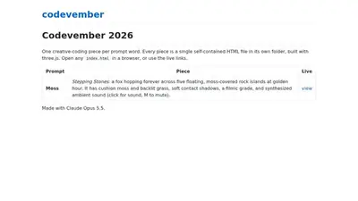</a> <b><a href="https://loktar00.github.io/codevember/">codevember</a></b> <a href="https://github.com/loktar00">loktar00</a> 许可证未知 · <a href="https://github.com/loktar00/codevember">代码</a></td>
<td width="25%" valign="top"> <b><a href="https://sebasjavela14.github.io/concept-lab/">concept-lab</a></b> <a href="https://github.com/SebasJavela14">SebasJavela14</a> MIT · <a href="https://github.com/SebasJavela14/concept-lab">代码</a> · <a href="https://huggingface.co/datasets/AI-Terrarium/terrarium-open-works/tree/main/scenes/concept-lab">文件</a></td>
<td width="25%" valign="top"><a href="https://damon0516-cssc-902-webgl-sample.static.hf.space/index.html">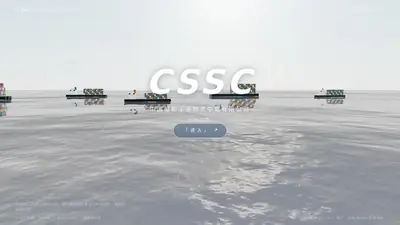</a> <b><a href="https://damon0516-cssc-902-webgl-sample.static.hf.space/index.html">CSSC 902 WebGL Ocean Sample</a></b> <a href="https://huggingface.co/Damon0516">Damon0516</a> 许可证未知 · <a href="https://huggingface.co/spaces/Damon0516/cssc-902-webgl-sample">代码</a></td>
</tr>
<tr>
<td width="25%" valign="top"> <b><a href="https://github.com/KooEmmanuel/custom-suit-studio">Custom Suit Studio</a></b> <a href="https://github.com/KooEmmanuel">KooEmmanuel</a> Apache-2.0 · <a href="https://github.com/KooEmmanuel/custom-suit-studio">代码</a> · <a href="https://huggingface.co/datasets/AI-Terrarium/terrarium-open-works/tree/main/scenes/custom-suit-studio">文件</a></td>
<td width="25%" valign="top"><a href="https://github.com/thebuggeddev/delphi">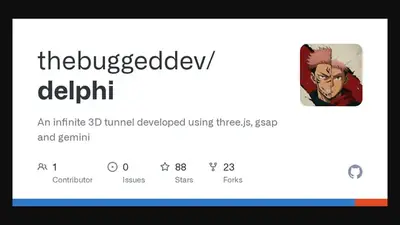</a> <b><a href="https://github.com/thebuggeddev/delphi">delphi</a></b> <a href="https://github.com/thebuggeddev">thebuggeddev</a> 许可证未知 · <a href="https://github.com/thebuggeddev/delphi">代码</a></td>
<td width="25%" valign="top"> <b><a href="https://github.com/YANKAMKEVIN/demo-fable5.2-3D">demo-fable5.2-3D</a></b> <a href="https://github.com/YANKAMKEVIN">YANKAMKEVIN</a> 许可证未知 · <a href="https://github.com/YANKAMKEVIN/demo-fable5.2-3D">代码</a></td>
<td width="25%" valign="top"><a href="https://github.com/vickyiitp/devil-labs-demo-platform">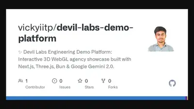</a> <b><a href="https://github.com/vickyiitp/devil-labs-demo-platform">devil-labs-demo-platform</a></b> <a href="https://github.com/vickyiitp">vickyiitp</a> MIT · <a href="https://github.com/vickyiitp/devil-labs-demo-platform">代码</a> · <a href="https://huggingface.co/datasets/AI-Terrarium/terrarium-open-works/tree/main/scenes/devil-labs-demo-platform">文件</a></td>
</tr>
<tr>
<td width="25%" valign="top"><a href="https://haruka8846.github.io/dive-game/">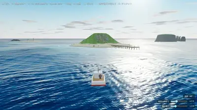</a> <b><a href="https://haruka8846.github.io/dive-game/">dive-game</a></b> <a href="https://github.com/haruka8846">haruka8846</a> MIT · <a href="https://github.com/haruka8846/dive-game">代码</a> · <a href="https://huggingface.co/datasets/AI-Terrarium/terrarium-open-works/tree/main/scenes/dive-game">文件</a></td>
<td width="25%" valign="top"> <b><a href="https://dji-osmo-pocket-4-3d.vercel.app">dji-osmo-pocket-4-3d</a></b> <a href="https://github.com/DavitiKvaratskhelia">DavitiKvaratskhelia</a> 许可证未知 · <a href="https://github.com/DavitiKvaratskhelia/dji-osmo-pocket-4-3d">代码</a></td>
<td width="25%" valign="top"> <b><a href="https://drealabs.com">drealabs</a></b> <a href="https://github.com/andrea-antal">andrea-antal</a> MIT · <a href="https://github.com/andrea-antal/drealabs">代码</a> · <a href="https://huggingface.co/datasets/AI-Terrarium/terrarium-open-works/tree/main/scenes/drealabs">文件</a></td>
<td width="25%" valign="top"> <b><a href="https://arad1367-dreamy-threejs-spacemusic.static.hf.space/index.html">Dreamy THreeJS SpaceMusic</a></b> <a href="https://huggingface.co/arad1367">Pejman</a> MIT · <a href="https://huggingface.co/spaces/arad1367/Dreamy-THreeJS-SpaceMusic">代码</a> · <a href="https://huggingface.co/datasets/AI-Terrarium/terrarium-open-works/tree/main/scenes/dreamy-threejs-spacemusic">文件</a></td>
</tr>
<tr>
<td width="25%" valign="top"><a href="http://earth.maao.cc/">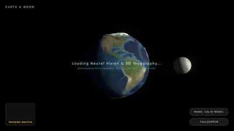</a> <b><a href="http://earth.maao.cc/">EARTH &amp; MOON - 3D Ultra</a></b> <a href="https://github.com/maoawa">Mars</a> MIT · <a href="https://github.com/maoawa/earth-moon">代码</a> · <a href="https://huggingface.co/datasets/AI-Terrarium/terrarium-open-works/tree/main/scenes/earth-moon-3d-ultra">文件</a></td>
<td width="25%" valign="top"> <b><a href="https://neurorich.ru/projects/claude-fable-5-2-proekty/">Earth: Neuro Rich</a></b> Нейро Рич 许可证未知 · <a href="https://neurorich.ru/files/claude-fable-5-2-proekty.zip">代码</a></td>
<td width="25%" valign="top"> <b><a href="https://earth-whole-story.pages.dev/">Earth: The Whole Story</a></b> <a href="https://github.com/arpitpatel25">arpitpatel25</a> 许可证未知 · <a href="https://github.com/arpitpatel25/earth-whole-story">代码</a></td>
<td width="25%" valign="top"> <b><a href="https://elvenwood-five.vercel.app">elvenwood</a></b> <a href="https://github.com/huntsyea">huntsyea</a> 许可证未知 · <a href="https://github.com/huntsyea/elvenwood">代码</a></td>
</tr>
<tr>
<td width="25%" valign="top"> <b><a href="https://github.com/NineTigers/emberfall-forge-claude-fable-5.2">Emberfall Forge</a></b> <a href="https://github.com/NineTigers">NineTigers</a> MIT · <a href="https://github.com/NineTigers/emberfall-forge-claude-fable-5.2">代码</a> · <a href="https://huggingface.co/datasets/AI-Terrarium/terrarium-open-works/tree/main/scenes/emberfall-forge">文件</a></td>
<td width="25%" valign="top"> <b><a href="https://tatir-fable-5-boeing-747.static.hf.space/index.html">Fable 5 Boeing 747</a></b> <a href="https://huggingface.co/tatir">tatir</a> 许可证未知 · <a href="https://huggingface.co/spaces/tatir/fable-5-boeing-747">代码</a></td>
<td width="25%" valign="top"> <b><a href="https://victor-fable-5-boeing-747.static.hf.space/index.html">Fable 5 Boeing 747</a></b> <a href="https://huggingface.co/victor">victor</a> 许可证未知 · <a href="https://huggingface.co/spaces/victor/fable-5-boeing-747">代码</a></td>
<td width="25%" valign="top"><a href="https://quanghuynt14-fable-5-watch-movement.static.hf.space/index.html">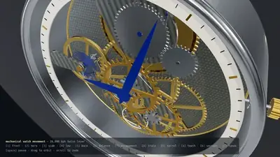</a> <b><a href="https://quanghuynt14-fable-5-watch-movement.static.hf.space/index.html">Fable 5 Watch Movement</a></b> <a href="https://huggingface.co/quanghuynt14">quanghuynt14</a> 许可证未知 · <a href="https://huggingface.co/spaces/quanghuynt14/fable-5-watch-movement">代码</a></td>
</tr>
<tr>
<td width="25%" valign="top"> <b><a href="https://victor-fable-5-1-boeing-747.static.hf.space/index.html">Fable 5.1 Boeing 747</a></b> <a href="https://huggingface.co/victor">victor</a> 许可证未知 · <a href="https://huggingface.co/spaces/victor/fable-5-1-boeing-747">代码</a></td>
<td width="25%" valign="top"> <b><a href="https://nikhil0100kumar.github.io/fable-3d-luxury/">fable-3d-luxury</a></b> <a href="https://github.com/nikhil0100kumar">nikhil0100kumar</a> 许可证未知 · <a href="https://github.com/nikhil0100kumar/fable-3d-luxury">代码</a></td>
<td width="25%" valign="top"><a href="https://github.com/beese54/fable-5.1-aquascape-gallery">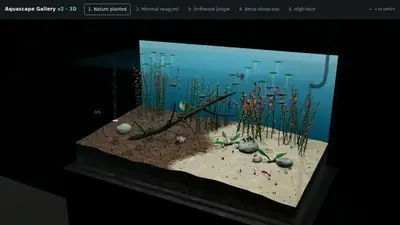</a> <b><a href="https://github.com/beese54/fable-5.1-aquascape-gallery">fable-5.1-aquascape-gallery</a></b> <a href="https://github.com/beese54">beese54</a> 许可证未知 · <a href="https://github.com/beese54/fable-5.1-aquascape-gallery">代码</a></td>
<td width="25%" valign="top"><a href="https://thequantling.github.io/fable-5.2-tests/">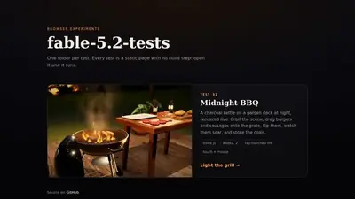</a> <b><a href="https://thequantling.github.io/fable-5.2-tests/">fable-5.2-tests</a></b> <a href="https://github.com/thequantling">thequantling</a> MIT · <a href="https://github.com/thequantling/fable-5.2-tests">代码</a> · <a href="https://huggingface.co/datasets/AI-Terrarium/terrarium-open-works/tree/main/scenes/fable-5-2-tests">文件</a></td>
</tr>
<tr>
<td width="25%" valign="top"><a href="https://alanmaizon.github.io/fable-butterfly/">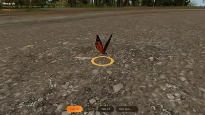</a> <b><a href="https://alanmaizon.github.io/fable-butterfly/">fable-butterfly</a></b> <a href="https://github.com/alanmaizon">alanmaizon</a> 许可证未知 · <a href="https://github.com/alanmaizon/fable-butterfly">代码</a></td>
<td width="25%" valign="top"> <b><a href="https://unbeauvoyage.github.io/fable-composed/">fable-composed</a></b> <a href="https://github.com/unbeauvoyage">unbeauvoyage</a> MIT · <a href="https://github.com/unbeauvoyage/fable-composed">代码</a> · <a href="https://huggingface.co/datasets/AI-Terrarium/terrarium-open-works/tree/main/scenes/fable-composed">文件</a></td>
<td width="25%" valign="top"><a href="https://unbeauvoyage.github.io/fable-experiment/">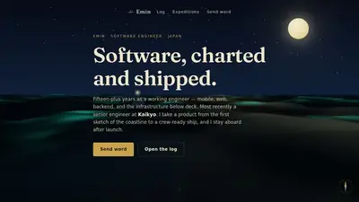</a> <b><a href="https://unbeauvoyage.github.io/fable-experiment/">fable-experiment</a></b> <a href="https://github.com/unbeauvoyage">unbeauvoyage</a> 许可证未知 · <a href="https://github.com/unbeauvoyage/fable-experiment">代码</a></td>
<td width="25%" valign="top"><a href="https://fable-station.vercel.app">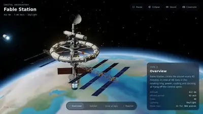</a> <b><a href="https://fable-station.vercel.app">fable-station</a></b> <a href="https://github.com/JacintoDesign">JacintoDesign</a> 许可证未知 · <a href="https://github.com/JacintoDesign/fable-station">代码</a></td>
</tr>
<tr>
<td width="25%" valign="top"> <b><a href="https://github.com/Khalidabdi1/factory">Factory Yard</a></b> <a href="https://github.com/Khalidabdi1">Khalidabdi1</a> MIT · <a href="https://github.com/Khalidabdi1/factory">代码</a> · <a href="https://huggingface.co/datasets/AI-Terrarium/terrarium-open-works/tree/main/scenes/factory-yard">文件</a></td>
<td width="25%" valign="top"> <b><a href="https://az9713.github.io/opus-5.5-open-world-game/feltworld/">Felt World</a></b> <a href="https://github.com/az9713">az9713</a> MIT · <a href="https://github.com/az9713/opus-5.5-open-world-game">代码</a> · <a href="https://huggingface.co/datasets/AI-Terrarium/terrarium-open-works/tree/main/scenes/felt-world">文件</a></td>
<td width="25%" valign="top"> <b><a href="https://archypiragkov.itch.io/fever-dreams-experiments">Fever dreams experiments</a></b> <a href="https://archypiragkov.itch.io">archypiragkov</a> 许可证未知 · <a href="https://archypiragkov.itch.io/fever-dreams-experiments">代码</a></td>
<td width="25%" valign="top"> <b><a href="https://yinchao-jack.github.io/fish-on-screen/">fish-on-screen</a></b> <a href="https://github.com/yinchao-jack">yinchao-jack</a> 许可证未知 · <a href="https://github.com/yinchao-jack/fish-on-screen">代码</a></td>
</tr>
<tr>
<td width="25%" valign="top"> <b><a href="https://ginipick-3d-game.static.hf.space/index.html">Forest Explorer</a></b> <a href="https://huggingface.co/ginipick">ginipick</a> MIT · <a href="https://huggingface.co/spaces/ginipick/3D-GAME">代码</a> · <a href="https://huggingface.co/datasets/AI-Terrarium/terrarium-open-works/tree/main/scenes/forest-explorer-ginipick">文件</a></td>
<td width="25%" valign="top"><a href="https://kimhyunwoo-3d-game.static.hf.space/index.html">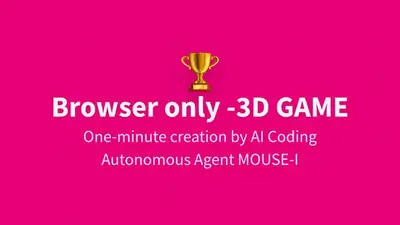</a> <b><a href="https://kimhyunwoo-3d-game.static.hf.space/index.html">Forest Explorer</a></b> <a href="https://huggingface.co/kimhyunwoo">kimhyunwoo</a> MIT · <a href="https://huggingface.co/spaces/kimhyunwoo/3D-GAME">代码</a> · <a href="https://huggingface.co/datasets/AI-Terrarium/terrarium-open-works/tree/main/scenes/forest-explorer-kimhyunwoo">文件</a></td>
<td width="25%" valign="top"> <b><a href="https://www.reddit.com/r/aigamedev/comments/1xs8rut/fable_52_is_improving_this_significantly_but_sooo/">Friendly Dragon Ride</a></b> Chetan Ankola (u/Efficient_Ad8214) 许可证未知</td>
<td width="25%" valign="top"> <b><a href="https://madebysourasith-sudo.github.io/gaming-pc-teardown/">gaming-pc-teardown</a></b> <a href="https://github.com/madebysourasith-sudo">madebysourasith-sudo</a> 许可证未知 · <a href="https://github.com/madebysourasith-sudo/gaming-pc-teardown">代码</a></td>
</tr>
<tr>
<td width="25%" valign="top"> <b><a href="https://sigco3111.github.io/gemini_experience/">Gemini 3.0 경험 — 안티그래비티</a></b> <a href="https://github.com/sigco3111">sigco3111</a> 合集，13 个作品 MIT · <a href="https://github.com/sigco3111/gemini_experience">代码</a> · <a href="https://huggingface.co/datasets/AI-Terrarium/terrarium-open-works/tree/main/scenes/gemini-experience">文件</a></td>
<td width="25%" valign="top"><a href="https://github.com/marcelomiyake/geotoon">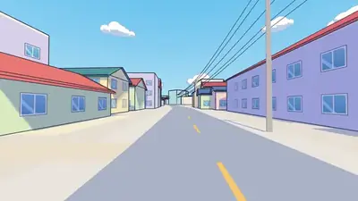</a> <b><a href="https://github.com/marcelomiyake/geotoon">GeoToon</a></b> <a href="https://github.com/marcelomiyake">Marcelo Miyake</a> MIT · <a href="https://github.com/marcelomiyake/geotoon">代码</a> · <a href="https://huggingface.co/datasets/AI-Terrarium/terrarium-open-works/tree/main/scenes/geotoon">文件</a></td>
<td width="25%" valign="top"> <b><a href="https://evals.ag/outputs/out_0BWDH0HCNWJS6N6YM8G21C6GYF">Golden Gate Bridge 3D</a></b> tamburins / Evals 许可证未知 · <a href="https://evals.ag/api/v1/media/assets/ast_6YQT3XG14P12EYXJPWY7PG68V0/content">代码</a></td>
<td width="25%" valign="top"> <b><a href="https://github.com/Afapoid/gpt-6-xhigh-aquarium">gpt-6-xhigh-aquarium</a></b> <a href="https://github.com/Afapoid">Afapoid</a> MIT · <a href="https://github.com/Afapoid/gpt-6-xhigh-aquarium">代码</a> · <a href="https://huggingface.co/datasets/AI-Terrarium/terrarium-open-works/tree/main/scenes/gpt-6-xhigh-aquarium">文件</a></td>
</tr>
<tr>
<td width="25%" valign="top"> <b><a href="https://hehecat.github.io/gummy-bears-3d/">gummy-bears-3d</a></b> <a href="https://github.com/hehecat">hehecat</a> 许可证未知 · <a href="https://github.com/hehecat/gummy-bears-3d">代码</a></td>
<td width="25%" valign="top"><a href="https://halcyon.billpwchan.art/">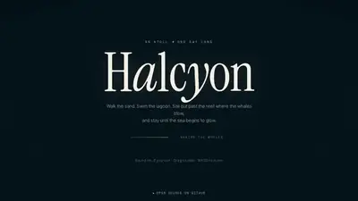</a> <b><a href="https://halcyon.billpwchan.art/">halcyon</a></b> <a href="https://github.com/billpwchan">billpwchan</a> MIT · <a href="https://github.com/billpwchan/halcyon">代码</a> · <a href="https://huggingface.co/datasets/AI-Terrarium/terrarium-open-works/tree/main/scenes/halcyon">文件</a></td>
<td width="25%" valign="top"> <b><a href="https://wquguru.github.io/fable52-fps-repro/demos/03-models/">Hard-Surface Modeling Studio</a></b> <a href="https://github.com/wquguru">wquguru</a> MIT · <a href="https://github.com/wquguru/fable52-fps-repro/blob/main/demos/03-models/index.html">代码</a> · <a href="https://huggingface.co/datasets/AI-Terrarium/terrarium-open-works/tree/main/scenes/hard-surface-modeling-studio">文件</a></td>
<td width="25%" valign="top"> <b><a href="https://fable-5-sphere-test.vercel.app">HELIOS FURY — orbit of a dying star</a></b> <a href="https://github.com/grp06">George Pickett</a> MIT · <a href="https://github.com/grp06/Fable-5-sphere-test">代码</a> · <a href="https://huggingface.co/datasets/AI-Terrarium/terrarium-open-works/tree/main/scenes/helios-fury-orbit-of-a-dying-star">文件</a></td>
</tr>
<tr>
<td width="25%" valign="top"><a href="https://hisamikurita.github.io/ice-stairs/">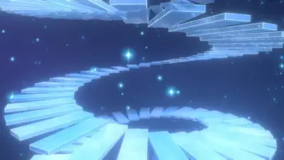</a> <b><a href="https://hisamikurita.github.io/ice-stairs/">ice-stairs</a></b> <a href="https://github.com/hisamikurita">hisamikurita</a> 许可证未知 · <a href="https://github.com/hisamikurita/ice-stairs">代码</a></td>
<td width="25%" valign="top"> <b><a href="https://patch.gg/games/blendi/impossible-spaces">Impossible Spaces</a></b> Blendi Byl MIT · <a href="https://git.patch.gg/blendi/impossible-spaces/raw/a9db30c95ad7bf7805848c85c362d9ecf0c9133a/src/lib/portals.ts">代码</a> · <a href="https://huggingface.co/datasets/AI-Terrarium/terrarium-open-works/tree/main/scenes/impossible-spaces">文件</a></td>
<td width="25%" valign="top"> <b><a href="https://iphone-17-pro-max-3d.vercel.app">iphone-17-pro-max-3d</a></b> <a href="https://github.com/DavitiKvaratskhelia">DavitiKvaratskhelia</a> 许可证未知 · <a href="https://github.com/DavitiKvaratskhelia/iphone-17-pro-max-3d">代码</a></td>
<td width="25%" valign="top"><a href="https://fable-jerusalem.vercel.app/">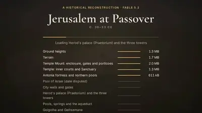</a> <b><a href="https://fable-jerusalem.vercel.app/">Jerusalem at Passover</a></b> Katie Parrott 许可证未知 · <a href="https://fable-jerusalem.vercel.app/">代码</a></td>
</tr>
<tr>
<td width="25%" valign="top"> <b><a href="https://karakoram-highway.vercel.app/">Karakoram Highway</a></b> Umair 许可证未知 · <a href="https://karakoram-highway.vercel.app/">代码</a></td>
<td width="25%" valign="top"> <b><a href="https://mutaafaziz.com/kin/">KIN — Living Worlds, Crossing Screens</a></b> <a href="https://github.com/mutaaf">Mutaaf Aziz</a> MIT · <a href="https://github.com/mutaaf/kin">代码</a> · <a href="https://huggingface.co/datasets/AI-Terrarium/terrarium-open-works/tree/main/scenes/kin-living-worlds-crossing-screens">文件</a></td>
<td width="25%" valign="top"><a href="https://github.com/kabadisameer09-gif/KLE-MILKY-WAY">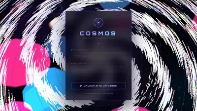</a> <b><a href="https://github.com/kabadisameer09-gif/KLE-MILKY-WAY">KLE-MILKY-WAY</a></b> <a href="https://github.com/kabadisameer09-gif">kabadisameer09-gif</a> MIT · <a href="https://github.com/kabadisameer09-gif/KLE-MILKY-WAY">代码</a> · <a href="https://huggingface.co/datasets/AI-Terrarium/terrarium-open-works/tree/main/scenes/kle-milky-way">文件</a></td>
<td width="25%" valign="top"> <b><a href="https://kelaiem.github.io/timesim/">Lever Escapement — 3D Mechanical Clock Simulation</a></b> <a href="https://github.com/kelaiem">kelaiem</a> Apache-2.0 · <a href="https://github.com/kelaiem/timesim">代码</a> · <a href="https://huggingface.co/datasets/AI-Terrarium/terrarium-open-works/tree/main/scenes/lever-escapement-3d-mechanical-clock-simulation">文件</a></td>
</tr>
<tr>
<td width="25%" valign="top"><a href="https://lets-be-strategic-here.github.io/low-poly-horse/">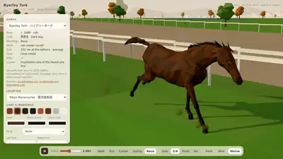</a> <b><a href="https://lets-be-strategic-here.github.io/low-poly-horse/">low-poly-horse</a></b> <a href="https://github.com/Lets-be-strategic-here">Lets-be-strategic-here</a> 许可证未知 · <a href="https://github.com/Lets-be-strategic-here/low-poly-horse">代码</a></td>
<td width="25%" valign="top"> <b><a href="https://matrix-vibe.whoopscope.workers.dev/">Matrix</a></b> <a href="https://github.com/tornikegomareli">Tornike Gomareli</a> 许可证未知 · <a href="https://github.com/tornikegomareli/Matrix">代码</a></td>
<td width="25%" valign="top"><a href="https://hisamikurita.github.io/mediapipe-hand-tracking/">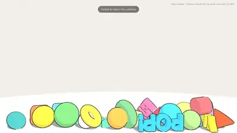</a> <b><a href="https://hisamikurita.github.io/mediapipe-hand-tracking/">mediapipe-hand-tracking</a></b> <a href="https://github.com/hisamikurita">hisamikurita</a> 许可证未知 · <a href="https://github.com/hisamikurita/mediapipe-hand-tracking">代码</a></td>
<td width="25%" valign="top"> <b><a href="https://github.com/Foxybotyy/midnight-ramen-alley">midnight-ramen-alley</a></b> <a href="https://github.com/Foxybotyy">Foxybotyy</a> 许可证未知 · <a href="https://github.com/Foxybotyy/midnight-ramen-alley">代码</a></td>
</tr>
<tr>
<td width="25%" valign="top"><a href="https://brianciou.github.io/milky-way-galaxy/">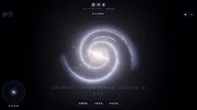</a> <b><a href="https://brianciou.github.io/milky-way-galaxy/">milky-way-galaxy</a></b> <a href="https://github.com/brianciou">brianciou</a> 许可证未知 · <a href="https://github.com/brianciou/milky-way-galaxy">代码</a></td>
<td width="25%" valign="top"> <b><a href="https://x.com/PorisRora/status/2120017467812778053">Minecraft-style floating islands</a></b> <a href="https://x.com/PorisRora">PorisRora</a> 许可证未知</td>
<td width="25%" valign="top"> <b><a href="https://irien-minicraft-responsive-voxel-sandbox.static.hf.space/index.html">MiniCraft — Responsive Voxel Sandbox</a></b> <a href="https://huggingface.co/Irien">Irien</a> 许可证未知 · <a href="https://huggingface.co/spaces/Irien/minicraft-responsive-voxel-sandbox">代码</a></td>
<td width="25%" valign="top"><a href="https://www.spawn.co/@mattshumer/earth?room=local">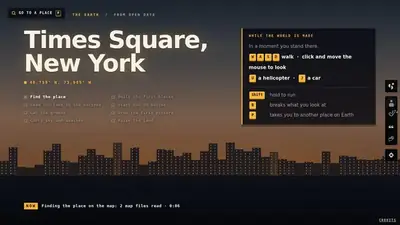</a> <b><a href="https://www.spawn.co/@mattshumer/earth?room=local">Mirror Earth</a></b> <a href="https://x.com/mattshumer_">Matt Shumer</a> 许可证未知</td>
</tr>
<tr>
<td width="25%" valign="top"> <b><a href="https://caiyingjun18-ai.github.io/moon-base-site-07/">moon-base-site-07</a></b> <a href="https://github.com/caiyingjun18-ai">caiyingjun18-ai</a> 许可证未知 · <a href="https://github.com/caiyingjun18-ai/moon-base-site-07">代码</a></td>
<td width="25%" valign="top"> <b><a href="https://phoebes-debug.github.io/murph-tesseract/">murph-tesseract</a></b> <a href="https://github.com/phoebes-debug">phoebes-debug</a> 许可证未知 · <a href="https://github.com/phoebes-debug/murph-tesseract">代码</a></td>
<td width="25%" valign="top"><a href="https://lukkaroshini.itch.io/myportfoliopark">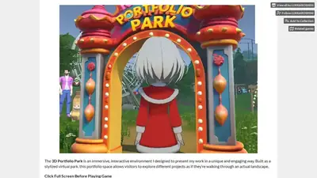</a> <b><a href="https://lukkaroshini.itch.io/myportfoliopark">MyPortflioPark</a></b> <a href="https://lukkaroshini.itch.io">lukkaroshini</a> 许可证未知 · <a href="https://lukkaroshini.itch.io/myportfoliopark">代码</a></td>
<td width="25%" valign="top"> <b><a href="https://github.com/RafiulM/mythos-minecraft">mythos-minecraft</a></b> <a href="https://github.com/RafiulM">RafiulM</a> 许可证未知 · <a href="https://github.com/RafiulM/mythos-minecraft">代码</a></td>
</tr>
<tr>
<td width="25%" valign="top"> <b><a href="https://24natel.com/">nathan-liu-portfolio</a></b> <a href="https://github.com/ncl9100">ncl9100</a> 许可证未知 · <a href="https://github.com/ncl9100/nathan-liu-portfolio">代码</a></td>
<td width="25%" valign="top"> <b><a href="https://yoyohuang1012.github.io/ncku-campus-3d/">ncku-campus-3d</a></b> <a href="https://github.com/yoyohuang1012">yoyohuang1012</a> 许可证未知 · <a href="https://github.com/yoyohuang1012/ncku-campus-3d">代码</a></td>
<td width="25%" valign="top"><a href="https://jeevannar16-web.github.io/Nepal-3d-portfolio/">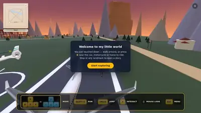</a> <b><a href="https://jeevannar16-web.github.io/Nepal-3d-portfolio/">Nepal-3d-portfolio</a></b> <a href="https://github.com/jeevannar16-web">jeevannar16-web</a> 许可证未知 · <a href="https://github.com/jeevannar16-web/Nepal-3d-portfolio">代码</a></td>
<td width="25%" valign="top"> <b><a href="https://nexus-indol-six.vercel.app">Nexus</a></b> <a href="https://github.com/vineetsharma96">vineetsharma96</a> MIT · <a href="https://github.com/vineetsharma96/Nexus">代码</a> · <a href="https://huggingface.co/datasets/AI-Terrarium/terrarium-open-works/tree/main/scenes/nexus">文件</a></td>
</tr>
<tr>
<td width="25%" valign="top"> <b><a href="https://kostikoneuro.github.io/gemini-carbon-vs-fable-5-2/">Night Market: Fable build</a></b> <a href="https://github.com/KostiKoNeuro">KostiKoNeuro</a> 许可证未知 · <a href="https://github.com/KostiKoNeuro/gemini-carbon-vs-fable-5-2/tree/main/2-diorama/fable">代码</a></td>
<td width="25%" valign="top"> <b><a href="https://x.com/sprinntt/status/2119906202330988961">Night Tokyo 04: Ramen Stall</a></b> <a href="https://x.com/sprinntt">sprinntt</a> 许可证未知</td>
<td width="25%" valign="top"><a href="https://jeiel85.github.io/nimbus-ring/">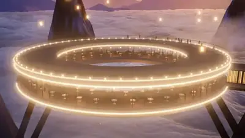</a> <b><a href="https://jeiel85.github.io/nimbus-ring/">NIMBUS RING</a></b> <a href="https://github.com/jeiel85">jeiel85</a> MIT · <a href="https://github.com/jeiel85/nimbus-ring">代码</a> · <a href="https://huggingface.co/datasets/AI-Terrarium/terrarium-open-works/tree/main/scenes/nimbus-ring">文件</a></td>
<td width="25%" valign="top"> <b><a href="https://drcollect.github.io/ocean-drive/">Ocean Drive</a></b> <a href="https://github.com/drcollect">drcollect</a> MIT · <a href="https://github.com/drcollect/ocean-drive">代码</a> · <a href="https://huggingface.co/datasets/AI-Terrarium/terrarium-open-works/tree/main/scenes/ocean-drive">文件</a></td>
</tr>
<tr>
<td width="25%" valign="top"> <b><a href="https://ocean-os.vercel.app/#apps">OceanOS</a></b> <a href="https://github.com/ishaaqdev">Mohammed Ishaaq</a> 合集，5 个作品 MIT · <a href="https://github.com/ishaaqdev/OceanOS">代码</a> · <a href="https://huggingface.co/datasets/AI-Terrarium/terrarium-open-works/tree/main/scenes/oceanos">文件</a></td>
<td width="25%" valign="top"> <b><a href="https://odyssey-tau-three.vercel.app">odyssey</a></b> <a href="https://github.com/Abhinav-RM">Abhinav-RM</a> 许可证未知 · <a href="https://github.com/Abhinav-RM/odyssey">代码</a></td>
<td width="25%" valign="top"> <b><a href="https://patch.gg/blendi/oil-paint">Oil paint</a></b> Blendi Byl MIT · <a href="https://git.patch.gg/blendi/oil-paint.git">代码</a> · <a href="https://huggingface.co/datasets/AI-Terrarium/terrarium-open-works/tree/main/scenes/oil-paint">文件</a></td>
<td width="25%" valign="top"> <b><a href="https://nipale-ai.github.io/opus-5-5-overnight-builds/">opus-5-5-overnight-builds</a></b> <a href="https://github.com/Nipale-ai">Nipale-ai</a> 许可证未知 · <a href="https://github.com/Nipale-ai/opus-5-5-overnight-builds">代码</a></td>
</tr>
<tr>
<td width="25%" valign="top"> <b><a href="https://akashmakesdesigns.github.io/fable-sites/">Oriel 38</a></b> <a href="https://github.com/akashmakesdesigns">akashmakesdesigns</a> 许可证未知 · <a href="https://github.com/akashmakesdesigns/fable-sites/tree/main/sites/04-oriel">代码</a></td>
<td width="25%" valign="top"> <b><a href="https://akbarov-labs.github.io/paper-boat-voyage/">paper-boat-voyage</a></b> <a href="https://github.com/akbarov-labs">akbarov-labs</a> 许可证未知 · <a href="https://github.com/akbarov-labs/paper-boat-voyage">代码</a></td>
<td width="25%" valign="top"> <b><a href="https://github.com/MiaAI-Lab/Claude-Fable-5.2-HTML-Files/blob/369dae7fe4102988676f07f147c4bbaefee3ff3a/064-par-avion.txt">Par Avion: The Journey of One Letter</a></b> <a href="https://github.com/MiaAI-Lab">MiaAI-Lab collection; individual creator unknown</a> 许可证未知 · <a href="https://github.com/MiaAI-Lab/Claude-Fable-5.2-HTML-Files/blob/369dae7fe4102988676f07f147c4bbaefee3ff3a/064-par-avion.html">代码</a></td>
<td width="25%" valign="top"><a href="https://100rabhsg.github.io/Particles/">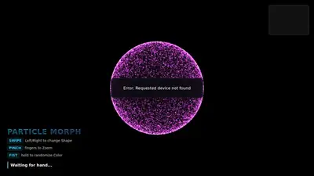</a> <b><a href="https://100rabhsg.github.io/Particles/">Particles</a></b> <a href="https://github.com/100rabhSG">100rabhSG</a> 许可证未知 · <a href="https://github.com/100rabhSG/Particles">代码</a></td>
</tr>
<tr>
<td width="25%" valign="top"> <b><a href="https://niaonao.github.io/pelecanus/">Pelecanus</a></b> <a href="https://github.com/niaonao">niaonao</a> 合集，21 个作品 Apache-2.0 · <a href="https://github.com/niaonao/pelecanus">代码</a> · <a href="https://huggingface.co/datasets/AI-Terrarium/terrarium-open-works/tree/main/scenes/pelecanus">文件</a></td>
<td width="25%" valign="top"> <b><a href="https://github.com/Joseberseker/perseverancia">perseverancia</a></b> <a href="https://github.com/Joseberseker">Joseberseker</a> 许可证未知 · <a href="https://github.com/Joseberseker/perseverancia">代码</a></td>
<td width="25%" valign="top"> <b><a href="https://lillliant.github.io/pigeon-world/">pigeon-world</a></b> <a href="https://github.com/Lillliant">Lillliant</a> Apache-2.0 · <a href="https://github.com/Lillliant/pigeon-world">代码</a> · <a href="https://huggingface.co/datasets/AI-Terrarium/terrarium-open-works/tree/main/scenes/pigeon-world">文件</a></td>
<td width="25%" valign="top"> <b><a href="https://github.com/MiaAI-Lab/Claude-Fable-5.2-HTML-Files/blob/369dae7fe4102988676f07f147c4bbaefee3ff3a/051-pinscreen.txt">Pinscreen</a></b> <a href="https://github.com/MiaAI-Lab">MiaAI-Lab collection; individual creator unknown</a> 许可证未知 · <a href="https://github.com/MiaAI-Lab/Claude-Fable-5.2-HTML-Files/blob/369dae7fe4102988676f07f147c4bbaefee3ff3a/051-pinscreen.html">代码</a></td>
</tr>
<tr>
<td width="25%" valign="top"> <b><a href="https://portals-endless-worlds.netlify.app/">Portals</a></b> <a href="https://github.com/emollick">Ethan Mollick</a> CC-BY-NC-SA-4.0 · <a href="https://github.com/emollick/ai-portals">代码</a> · <a href="https://huggingface.co/datasets/AI-Terrarium/terrarium-open-works/tree/main/scenes/portals">文件</a></td>
<td width="25%" valign="top"> <b><a href="https://www.sambitbiswas.me">Portfolio</a></b> <a href="https://github.com/Sambit1110">Sambit1110</a> All rights reserved · <a href="https://github.com/Sambit1110/Portfolio">代码</a></td>
<td width="25%" valign="top"> <b><a href="https://xunnychen.github.io/qingdao-badaguan-threejs/">qingdao-badaguan-threejs</a></b> <a href="https://github.com/xunnychen">xunnychen</a> 许可证未知 · <a href="https://github.com/xunnychen/qingdao-badaguan-threejs">代码</a></td>
<td width="25%" valign="top"><a href="https://recursive-self-improving.github.io/qingdao-badaguan-threejs-fable-5-2-max-cc/">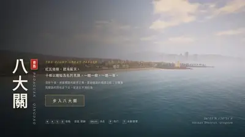</a> <b><a href="https://recursive-self-improving.github.io/qingdao-badaguan-threejs-fable-5-2-max-cc/">qingdao-badaguan-threejs-fable-5-2-max-cc</a></b> <a href="https://github.com/Recursive-Self-Improving">Recursive-Self-Improving</a> 许可证未知 · <a href="https://github.com/Recursive-Self-Improving/qingdao-badaguan-threejs-fable-5-2-max-cc">代码</a></td>
</tr>
<tr>
<td width="25%" valign="top"><a href="https://www.aivi.fyi/games/qingming.html">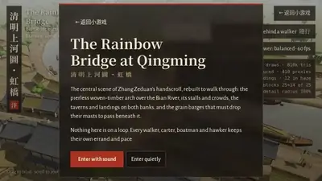</a> <b><a href="https://www.aivi.fyi/games/qingming.html">Qingming: Rainbow Bridge</a></b> AI超元域 许可证未知 · <a href="https://www.aivi.fyi/games/qingming.html">代码</a></td>
<td width="25%" valign="top"><a href="https://wquguru.github.io/fable52-fps-repro/demos/02-materials/">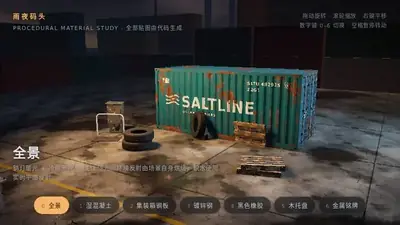</a> <b><a href="https://wquguru.github.io/fable52-fps-repro/demos/02-materials/">Rainy Dock Materials</a></b> <a href="https://github.com/wquguru">wquguru</a> MIT · <a href="https://github.com/wquguru/fable52-fps-repro/blob/main/demos/02-materials/index.html">代码</a> · <a href="https://huggingface.co/datasets/AI-Terrarium/terrarium-open-works/tree/main/scenes/rainy-dock-materials">文件</a></td>
<td width="25%" valign="top"> <b><a href="https://mdhasibul35.github.io/ripple-pond/">ripple-pond</a></b> <a href="https://github.com/mdhasibul35">mdhasibul35</a> 许可证未知 · <a href="https://github.com/mdhasibul35/ripple-pond">代码</a></td>
<td width="25%" valign="top"> <b><a href="https://yinchao-jack.github.io/roadster-flight-experience/">ROADSTER · The Flight Experience</a></b> <a href="https://github.com/yinchao-jack">YC Jack</a> 许可证未知 · <a href="https://github.com/yinchao-jack/roadster-flight-experience">代码</a> · <a href="https://huggingface.co/datasets/AI-Terrarium/terrarium-open-works/tree/main/scenes/roadster-the-flight-experience">文件</a></td>
</tr>
<tr>
<td width="25%" valign="top"><a href="https://fable-rome.surge.sh/">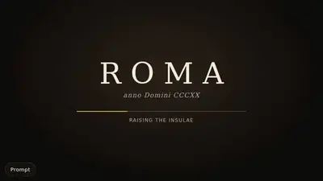</a> <b><a href="https://fable-rome.surge.sh/">Rome, AD 320</a></b> Peter Gostev 许可证未知 · <a href="https://fable-rome.surge.sh/">代码</a></td>
<td width="25%" valign="top"> <b><a href="https://room.piabrota.art">room</a></b> <a href="https://github.com/piabrota">piabrota</a> MPL-2.0 · <a href="https://github.com/piabrota/room">代码</a> · <a href="https://huggingface.co/datasets/AI-Terrarium/terrarium-open-works/tree/main/scenes/room">文件</a></td>
<td width="25%" valign="top"><a href="https://garfieldhuang.github.io/sakura-river/">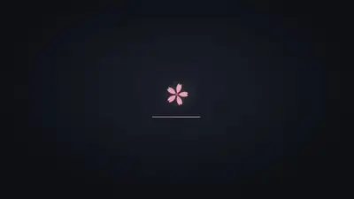</a> <b><a href="https://garfieldhuang.github.io/sakura-river/">Sakura River</a></b> <a href="https://github.com/GarfieldHuang">Garfield</a> MIT · <a href="https://github.com/GarfieldHuang/sakura-river">代码</a> · <a href="https://huggingface.co/datasets/AI-Terrarium/terrarium-open-works/tree/main/scenes/sakura-river">文件</a></td>
<td width="25%" valign="top"><a href="https://yhyu13.github.io/saltline-dock-look/">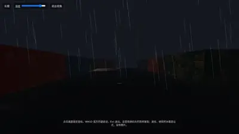</a> <b><a href="https://yhyu13.github.io/saltline-dock-look/">saltline-dock-look</a></b> <a href="https://github.com/yhyu13">yhyu13</a> 许可证未知 · <a href="https://github.com/yhyu13/saltline-dock-look">代码</a></td>
</tr>
<tr>
<td width="25%" valign="top"><a href="https://sam1983aing.github.io/senna-800kg/">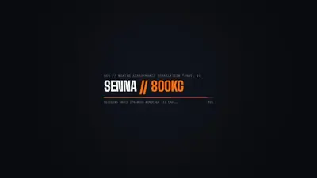</a> <b><a href="https://sam1983aing.github.io/senna-800kg/">Senna 800KG</a></b> <a href="https://github.com/Sam1983Aing">Sam1983Aing</a> MIT · <a href="https://github.com/Sam1983Aing/senna-800kg">代码</a> · <a href="https://huggingface.co/datasets/AI-Terrarium/terrarium-open-works/tree/main/scenes/senna-800kg">文件</a></td>
<td width="25%" valign="top"> <b><a href="https://github.com/Zenojz/shibuya-rain-walk">shibuya-rain-walk</a></b> <a href="https://github.com/Zenojz">Zenojz</a> MIT · <a href="https://github.com/Zenojz/shibuya-rain-walk">代码</a> · <a href="https://huggingface.co/datasets/AI-Terrarium/terrarium-open-works/tree/main/scenes/shibuya-rain-walk">文件</a></td>
<td width="25%" valign="top"><a href="https://tekano.github.io/shoreline/">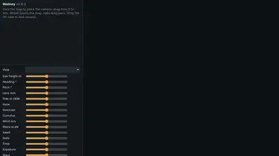</a> <b><a href="https://tekano.github.io/shoreline/">shoreline</a></b> <a href="https://github.com/tekano">tekano</a> MIT · <a href="https://github.com/tekano/shoreline">代码</a> · <a href="https://huggingface.co/datasets/AI-Terrarium/terrarium-open-works/tree/main/scenes/shoreline">文件</a></td>
<td width="25%" valign="top"><a href="https://github.com/MiaAI-Lab/Claude-Fable-5.2-HTML-Files/blob/369dae7fe4102988676f07f147c4bbaefee3ff3a/023-walnut-turntable.txt">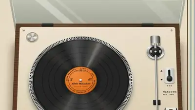</a> <b><a href="https://github.com/MiaAI-Lab/Claude-Fable-5.2-HTML-Files/blob/369dae7fe4102988676f07f147c4bbaefee3ff3a/023-walnut-turntable.txt">Side A: A Turntable in CSS</a></b> <a href="https://github.com/MiaAI-Lab">MiaAI-Lab collection; individual creator unknown</a> 许可证未知 · <a href="https://github.com/MiaAI-Lab/Claude-Fable-5.2-HTML-Files/blob/369dae7fe4102988676f07f147c4bbaefee3ff3a/023-walnut-turntable.html">代码</a></td>
</tr>
<tr>
<td width="25%" valign="top"><a href="https://github.com/maximilianocarrau123-debug/site-3d-claude-blender">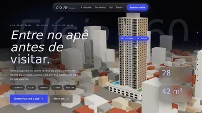</a> <b><a href="https://github.com/maximilianocarrau123-debug/site-3d-claude-blender">site-3d-claude-blender</a></b> <a href="https://github.com/maximilianocarrau123-debug">maximilianocarrau123-debug</a> 许可证未知 · <a href="https://github.com/maximilianocarrau123-debug/site-3d-claude-blender">代码</a></td>
<td width="25%" valign="top"> <b><a href="https://x.com/higgsfield_ai/status/2119908486880342326">Sketch to 3D café</a></b> <a href="https://x.com/higgsfield_ai">Higgsfield</a> 许可证未知</td>
<td width="25%" valign="top"> <b><a href="https://evals.ag/outputs/out_0HV7B4DPJ948R8NQRHHRKHAM0A">Snow Globe</a></b> tamburins / Evals 许可证未知 · <a href="https://evals.ag/api/v1/media/assets/ast_4FK7HPGSDT7WEGHDGDWXZ0738W/content">代码</a></td>
<td width="25%" valign="top"> <b><a href="https://github.com/vickyiitp/sora-immersive-hospitality-experience">sora-immersive-hospitality-experience</a></b> <a href="https://github.com/vickyiitp">vickyiitp</a> 许可证未知 · <a href="https://github.com/vickyiitp/sora-immersive-hospitality-experience">代码</a></td>
</tr>
<tr>
<td width="25%" valign="top"> <b><a href="https://seawolf0.github.io/Spectra/">Spectra</a></b> <a href="https://github.com/Seawolf0">Seawolf0</a> 许可证未知 · <a href="https://github.com/Seawolf0/Spectra">代码</a></td>
<td width="25%" valign="top"> <b><a href="https://ss-040-fable-game-dev-practice-02.vercel.app">ss-040-fable-game-dev-practice-02</a></b> <a href="https://github.com/wjb127">wjb127</a> 许可证未知 · <a href="https://github.com/wjb127/ss-040-fable-game-dev-practice-02">代码</a></td>
<td width="25%" valign="top"> <b><a href="https://desertcache.github.io/starship/">starship</a></b> <a href="https://github.com/desertcache">desertcache</a> 许可证未知 · <a href="https://github.com/desertcache/starship">代码</a></td>
<td width="25%" valign="top"> <b><a href="https://meltthemanual.github.io/stonehenge-solstice/">Stonehenge Solstice</a></b> <a href="https://github.com/MeltTheManual">u/Miyamoto_-_Musashi</a> MIT · <a href="https://github.com/MeltTheManual/stonehenge-solstice">代码</a> · <a href="https://huggingface.co/datasets/AI-Terrarium/terrarium-open-works/tree/main/scenes/stonehenge-solstice">文件</a></td>
</tr>
<tr>
<td width="25%" valign="top"> <b><a href="https://github.com/MiaAI-Lab/Claude-Fable-5.2-HTML-Files/blob/369dae7fe4102988676f07f147c4bbaefee3ff3a/069-strange-attractors.txt">Strange Attractors</a></b> <a href="https://github.com/MiaAI-Lab">MiaAI-Lab collection; individual creator unknown</a> 许可证未知 · <a href="https://github.com/MiaAI-Lab/Claude-Fable-5.2-HTML-Files/blob/369dae7fe4102988676f07f147c4bbaefee3ff3a/069-strange-attractors.html">代码</a></td>
<td width="25%" valign="top"> <b><a href="https://anshdadhich-stylized-pirate-ocean-threejs.static.hf.space/index.html">Stylized Pirate Ocean Threejs</a></b> <a href="https://huggingface.co/anshdadhich">anshdadhich</a> 许可证未知 · <a href="https://huggingface.co/spaces/anshdadhich/stylized-pirate-ocean-threejs">代码</a></td>
<td width="25%" valign="top"> <b><a href="https://sfxnz.github.io/supercar-challenge/">supercar-challenge</a></b> <a href="https://github.com/sfxnz">sfxnz</a> 许可证未知 · <a href="https://github.com/sfxnz/supercar-challenge">代码</a></td>
<td width="25%" valign="top"> <b><a href="https://akashmakesdesigns.github.io/fable-sites/">Tacta 75</a></b> <a href="https://github.com/akashmakesdesigns">akashmakesdesigns</a> 许可证未知 · <a href="https://github.com/akashmakesdesigns/fable-sites/tree/main/sites/05-tacta">代码</a></td>
</tr>
<tr>
<td width="25%" valign="top"> <b><a href="https://teacher.limbo101.win">teacher-day</a></b> <a href="https://github.com/limboinf">limboinf</a> MIT · <a href="https://github.com/limboinf/teacher-day">代码</a> · <a href="https://huggingface.co/datasets/AI-Terrarium/terrarium-open-works/tree/main/scenes/teacher-day">文件</a></td>
<td width="25%" valign="top"> <b><a href="https://paslan-threejs-teleport-landing-ring.static.hf.space/index.html">Teleport landing ring</a></b> <a href="https://huggingface.co/paslan">paslan</a> 许可证未知 · <a href="https://huggingface.co/spaces/paslan/threejs-teleport-landing-ring">代码</a></td>
<td width="25%" valign="top"> <b><a href="https://theusefulstack.itch.io/tessera-wilds">Tessera Wilds — an AI-built voxel world (Claude Opus 5.5)</a></b> <a href="https://theusefulstack.itch.io">theusefulstack</a> MIT · <a href="https://theusefulstack.itch.io/tessera-wilds">代码</a></td>
<td width="25%" valign="top"> <b><a href="https://github.com/MiaAI-Lab/Claude-Fable-5.2-HTML-Files/blob/369dae7fe4102988676f07f147c4bbaefee3ff3a/063-the-astrolabe.txt">The Astrolabe</a></b> <a href="https://github.com/MiaAI-Lab">MiaAI-Lab collection; individual creator unknown</a> 许可证未知 · <a href="https://github.com/MiaAI-Lab/Claude-Fable-5.2-HTML-Files/blob/369dae7fe4102988676f07f147c4bbaefee3ff3a/063-the-astrolabe.html">代码</a></td>
</tr>
<tr>
<td width="25%" valign="top"> <b><a href="https://github.com/MiaAI-Lab/Claude-Fable-5.2-HTML-Files/blob/369dae7fe4102988676f07f147c4bbaefee3ff3a/066-night-diner.txt">The Comet Diner, 3 A.M.</a></b> <a href="https://github.com/MiaAI-Lab">MiaAI-Lab collection; individual creator unknown</a> 许可证未知 · <a href="https://github.com/MiaAI-Lab/Claude-Fable-5.2-HTML-Files/blob/369dae7fe4102988676f07f147c4bbaefee3ff3a/066-night-diner.html">代码</a></td>
<td width="25%" valign="top"> <b><a href="https://therovingoffice.com/office/TEST-0000">The Roving Office</a></b> <a href="https://github.com/atlassian-labs">Atlassian Labs</a> Apache-2.0 · <a href="https://github.com/atlassian-labs/roving-office">代码</a> · <a href="https://huggingface.co/datasets/AI-Terrarium/terrarium-open-works/tree/main/scenes/the-roving-office">文件</a></td>
<td width="25%" valign="top"> <b><a href="https://cyb3rcricket.github.io/the-wizard/">the-wizard</a></b> <a href="https://github.com/cyb3rcricket">cyb3rcricket</a> 许可证未知 · <a href="https://github.com/cyb3rcricket/the-wizard">代码</a></td>
<td width="25%" valign="top"> <b><a href="https://az9713.github.io/fable-5.2-typewriter-demos/?setting=a">Three Writing Desks</a></b> <a href="https://github.com/az9713">az9713</a> 许可证未知 · <a href="https://github.com/az9713/fable-5.2-typewriter-demos">代码</a></td>
</tr>
<tr>
<td width="25%" valign="top"> <b><a href="https://asamiiiii-threejs-laser-impact-wall.static.hf.space/index.html">Three.js laser impact wall</a></b> <a href="https://huggingface.co/Asamiiiii">Asamiiiii</a> 许可证未知 · <a href="https://huggingface.co/spaces/Asamiiiii/threejs-laser-impact-wall">代码</a></td>
<td width="25%" valign="top"> <b><a href="https://three-js-t-34-viewer.vercel.app">three.js-T-34-viewer</a></b> <a href="https://github.com/AstVel">AstVel</a> 许可证未知 · <a href="https://github.com/AstVel/three.js-T-34-viewer">代码</a></td>
<td width="25%" valign="top"> <b><a href="https://three-js-t-34-viewer-raycasting.vercel.app">three.js-T-34-viewer-raycasting</a></b> <a href="https://github.com/AstVel">AstVel</a> 许可证未知 · <a href="https://github.com/AstVel/three.js-T-34-viewer-raycasting">代码</a></td>
<td width="25%" valign="top"> <b><a href="https://realcodebear.github.io/threejs-fable-5.2-all-effort-koi-pond/">threejs-fable-5.2-all-effort-koi-pond</a></b> <a href="https://github.com/realcodebear">realcodebear</a> MIT · <a href="https://github.com/realcodebear/threejs-fable-5.2-all-effort-koi-pond">代码</a> · <a href="https://huggingface.co/datasets/AI-Terrarium/terrarium-open-works/tree/main/scenes/threejs-fable-5-2-all-effort-koi-pond">文件</a></td>
</tr>
<tr>
<td width="25%" valign="top"> <b><a href="https://alebrito124356.github.io/threejs-hero-collection/">threejs-hero-collection</a></b> <a href="https://github.com/AleBrito124356">Alejandro Brito</a> 合集，4 个作品 MIT · <a href="https://github.com/AleBrito124356/threejs-hero-collection">代码</a> · <a href="https://huggingface.co/datasets/AI-Terrarium/terrarium-open-works/tree/main/scenes/threejs-hero-collection">文件</a></td>
<td width="25%" valign="top"> <b><a href="https://choephix.github.io/threejs-lab/">threejs-lab</a></b> <a href="https://github.com/choephix">choephix</a> 许可证未知 · <a href="https://github.com/choephix/threejs-lab">代码</a></td>
<td width="25%" valign="top"> <b><a href="https://starknightt.github.io/tiny-planet/">Tiny Planet</a></b> <a href="https://github.com/StarKnightt">Prasenjit</a> MIT · <a href="https://github.com/StarKnightt/tiny-planet">代码</a> · <a href="https://huggingface.co/datasets/AI-Terrarium/terrarium-open-works/tree/main/scenes/tiny-planet">文件</a></td>
<td width="25%" valign="top"> <b><a href="https://build-small-hackathon-toy-room-v3.hf.space/toy-v3">Tiny Toybox — Fire Boy</a></b> <a href="https://github.com/sanjuhs">Sanjay Prasad H S</a> MIT · <a href="https://github.com/sanjuhs/tiny-toybox-fireboy-minicpm">代码</a> · <a href="https://huggingface.co/datasets/AI-Terrarium/terrarium-open-works/tree/main/scenes/tiny-toybox-fire-boy">文件</a></td>
</tr>
<tr>
<td width="25%" valign="top"> <b><a href="https://github.com/vladi21k/3DSceneRenderer">Tramline — Cab Ride</a></b> <a href="https://github.com/vladi21k">vladi21k</a> MIT · <a href="https://github.com/vladi21k/3DSceneRenderer">代码</a> · <a href="https://huggingface.co/datasets/AI-Terrarium/terrarium-open-works/tree/main/scenes/tramline-cab-ride">文件</a></td>
<td width="25%" valign="top"> <b><a href="https://orodmorais.github.io/trip-map-3d/">trip-map-3d</a></b> <a href="https://github.com/orodmorais">Rodrigo Morais</a> MIT · <a href="https://github.com/orodmorais/trip-map-3d">代码</a> · <a href="https://huggingface.co/datasets/AI-Terrarium/terrarium-open-works/tree/main/scenes/trip-map-3d">文件</a></td>
<td width="25%" valign="top"> <b><a href="https://atostudios.github.io/Universal-A.T.O/">Universal A.T.O. 🌌</a></b> <a href="https://github.com/ATOStudios">Batuhan Kadioglu</a> MIT · <a href="https://github.com/ATOStudios/Universal-A.T.O">代码</a> · <a href="https://huggingface.co/datasets/AI-Terrarium/terrarium-open-works/tree/main/scenes/universal-a-t-o">文件</a></td>
<td width="25%" valign="top"> <b><a href="https://github.com/evangel2022/Urban-FPV-Drone-Simulator">Urban FPV Drone Simulator</a></b> <a href="https://github.com/evangel2022">evangel2022</a> MIT · <a href="https://github.com/evangel2022/Urban-FPV-Drone-Simulator">代码</a> · <a href="https://huggingface.co/datasets/AI-Terrarium/terrarium-open-works/tree/main/scenes/urban-fpv-drone-simulator">文件</a></td>
</tr>
<tr>
<td width="25%" valign="top"> <b><a href="https://github.com/Platinum04/vibe-coded-xr-biology-lab">Vibe Coded XR Biology Lab</a></b> <a href="https://github.com/Platinum04">Awodi Abdulmujeeb</a> MIT · <a href="https://github.com/Platinum04/vibe-coded-xr-biology-lab">代码</a> · <a href="https://huggingface.co/datasets/AI-Terrarium/terrarium-open-works/tree/main/scenes/vibe-coded-xr-biology-lab">文件</a></td>
<td width="25%" valign="top"> <b><a href="https://bramtechs.github.io/vibe-beach/">vibe-beach</a></b> <a href="https://github.com/bramtechs">bramtechs</a> GPL-3.0 · <a href="https://github.com/bramtechs/vibe-beach">代码</a> · <a href="https://huggingface.co/datasets/AI-Terrarium/terrarium-open-works/tree/main/scenes/vibe-beach">文件</a></td>
<td width="25%" valign="top"> <b><a href="https://github.com/Cheng-1023-web/vibe-coding">vibe-coding</a></b> <a href="https://github.com/Cheng-1023-web">Cxmcxm1023</a> 合集，2 个作品 MIT · <a href="https://github.com/Cheng-1023-web/vibe-coding">代码</a> · <a href="https://huggingface.co/datasets/AI-Terrarium/terrarium-open-works/tree/main/scenes/vibe-coding">文件</a></td>
<td width="25%" valign="top"> <b><a href="https://y-migita.github.io/villa-savoye-fable/">Villa Savoye — サヴォア邸 3D 再現</a></b> <a href="https://github.com/y-migita">右田 優希</a> MIT · <a href="https://github.com/y-migita/villa-savoye-fable">代码</a> · <a href="https://huggingface.co/datasets/AI-Terrarium/terrarium-open-works/tree/main/scenes/villa-savoye-3d">文件</a></td>
</tr>
<tr>
<td width="25%" valign="top"> <b><a href="https://foshowithit.github.io/village-above-the-clouds/">village-above-the-clouds</a></b> <a href="https://github.com/Foshowithit">Foshowithit</a> 许可证未知 · <a href="https://github.com/Foshowithit/village-above-the-clouds">代码</a></td>
<td width="25%" valign="top"> <b><a href="https://foshowithit.github.io/village-above-the-clouds-omp/">village-above-the-clouds-omp</a></b> <a href="https://github.com/Foshowithit">Foshowithit</a> 许可证未知 · <a href="https://github.com/Foshowithit/village-above-the-clouds-omp">代码</a></td>
<td width="25%" valign="top"> <b><a href="https://zhao-hanbo.github.io/virtual-slush-venue/">virtual-slush-venue</a></b> <a href="https://github.com/zhao-hanbo">zhao-hanbo</a> MIT · <a href="https://github.com/zhao-hanbo/virtual-slush-venue">代码</a> · <a href="https://huggingface.co/datasets/AI-Terrarium/terrarium-open-works/tree/main/scenes/virtual-slush-venue">文件</a></td>
<td width="25%" valign="top"> <b><a href="https://kimhyunwoo-voxel.static.hf.space/index.html">Voxel</a></b> <a href="https://huggingface.co/kimhyunwoo">kimhyunwoo</a> 许可证未知 · <a href="https://huggingface.co/spaces/kimhyunwoo/voxel">代码</a></td>
</tr>
<tr>
<td width="25%" valign="top"> <b><a href="https://akhaliq-voxel-art-magistral.static.hf.space/index.html">Voxel Art Magistral</a></b> <a href="https://huggingface.co/akhaliq">akhaliq</a> 许可证未知 · <a href="https://huggingface.co/spaces/akhaliq/voxel-art-magistral">代码</a></td>
<td width="25%" valign="top"> <b><a href="https://www.spawn.co/@mattshumer/voxel-engine">Voxel Engine</a></b> <a href="https://x.com/mattshumer_">Matt Shumer</a> 许可证未知</td>
<td width="25%" valign="top"> <b><a href="https://akhaliq-voxel-gemini-latest.static.hf.space/index.html">Voxel Gemini Latest</a></b> <a href="https://huggingface.co/akhaliq">akhaliq</a> 许可证未知 · <a href="https://huggingface.co/spaces/akhaliq/voxel-gemini-latest">代码</a></td>
<td width="25%" valign="top"> <b><a href="https://coder36.github.io/trainset/">Voxel Train Yard</a></b> <a href="https://github.com/coder36">Mark Middleton</a> 合集，2 个作品 MIT · <a href="https://github.com/coder36/trainset">代码</a> · <a href="https://huggingface.co/datasets/AI-Terrarium/terrarium-open-works/tree/main/scenes/voxel-train-yard">文件</a></td>
</tr>
<tr>
<td width="25%" valign="top"> <b><a href="https://fl3xchilli-voxel-visionary.static.hf.space/index.html">Voxel Visionary 🎨</a></b> <a href="https://huggingface.co/FL3Xchilli">FL3Xchilli</a> 许可证未知 · <a href="https://huggingface.co/spaces/FL3Xchilli/voxel-visionary">代码</a></td>
<td width="25%" valign="top"> <b><a href="https://lukasbialozor.github.io/warszawa-na-sieci-demo/">Warszawa na sieci</a></b> <a href="https://github.com/LukasBialozor">LukasBialozor</a> MIT · <a href="https://github.com/LukasBialozor/warszawa-na-sieci-demo">代码</a> · <a href="https://huggingface.co/datasets/AI-Terrarium/terrarium-open-works/tree/main/scenes/warszawa-na-sieci">文件</a></td>
<td width="25%" valign="top"> <b><a href="https://youtu.be/bzIDhRAtwtg">web-atifs-vault-3d-museum</a></b> <a href="https://github.com/atifmahmoodai">atifmahmoodai</a> CC0-1.0 · <a href="https://github.com/atifmahmoodai/web-atifs-vault-3d-museum">代码</a> · <a href="https://huggingface.co/datasets/AI-Terrarium/terrarium-open-works/tree/main/scenes/web-atifs-vault-3d-museum">文件</a></td>
<td width="25%" valign="top"> <b><a href="https://red-reddington.github.io/web-demos/">web-demos</a></b> <a href="https://github.com/red-reddington">red-reddington</a> 许可证未知 · <a href="https://github.com/red-reddington/web-demos">代码</a></td>
</tr>
<tr>
<td width="25%" valign="top"> <b><a href="https://severian-webgl-demo.static.hf.space/index.html">Webgl Demo</a></b> <a href="https://huggingface.co/Severian">Severian</a> 许可证未知 · <a href="https://huggingface.co/spaces/Severian/webgl_demo">代码</a></td>
<td width="25%" valign="top"> <b><a href="https://github.com/luiscleto/weherd">weherd</a></b> <a href="https://github.com/luiscleto">luiscleto</a> 许可证未知 · <a href="https://github.com/luiscleto/weherd">代码</a></td>
<td width="25%" valign="top"> <b><a href="https://what-the-water-keeps.vercel.app/">What the Water Keeps</a></b> Kevin Ngo 许可证未知 · <a href="https://what-the-water-keeps.vercel.app/">代码</a></td>
<td width="25%" valign="top"> <b><a href="https://github.com/nevasini1/willowbrook-threejs">Willowbrook — Generative AI World Simulation</a></b> <a href="https://github.com/nevasini1">nevasini1</a> MIT · <a href="https://github.com/nevasini1/willowbrook-threejs">代码</a> · <a href="https://huggingface.co/datasets/AI-Terrarium/terrarium-open-works/tree/main/scenes/willowbrook-generative-ai-world-simulation">文件</a></td>
</tr>
<tr>
<td width="25%" valign="top"> <b><a href="https://theuws.com/games/cosmos-2026/play/">Zorp&#x27;s Universe</a></b> <a href="https://github.com/RichardTheuws">Richard Theuws</a> MIT · <a href="https://github.com/RichardTheuws/cosmos-2026">代码</a> · <a href="https://huggingface.co/datasets/AI-Terrarium/terrarium-open-works/tree/main/scenes/zorp-s-universe">文件</a></td>
<td width="25%" valign="top"> <b><a href="https://tanuu5.github.io/futari-no-ie/">ふたりの家 — A House for Two</a></b> <a href="https://github.com/tanuu5">たぬ（tanu）</a> MIT · <a href="https://github.com/tanuu5/futari-no-ie">代码</a> · <a href="https://huggingface.co/datasets/AI-Terrarium/terrarium-open-works/tree/main/scenes/a-house-for-two">文件</a></td>
<td width="25%" valign="top"> <b><a href="https://tanuu5.github.io/sawagani-aquaterrarium/">サワガニ水槽</a></b> <a href="https://github.com/tanuu5">たぬ（tanu）</a> MIT · <a href="https://github.com/tanuu5/sawagani-aquaterrarium">代码</a> · <a href="https://huggingface.co/datasets/AI-Terrarium/terrarium-open-works/tree/main/scenes/sawagani-aquaterrarium">文件</a></td>
<td width="25%" valign="top"> <b><a href="https://tanuu5.github.io/sofa-ga-aru/">ソファーがある。 — There Is a Sofa.</a></b> <a href="https://github.com/tanuu5">たぬ（tanu）</a> MIT · <a href="https://github.com/tanuu5/sofa-ga-aru">代码</a> · <a href="https://huggingface.co/datasets/AI-Terrarium/terrarium-open-works/tree/main/scenes/there-is-a-sofa">文件</a></td>
</tr>
<tr>
<td width="25%" valign="top"> <b><a href="https://amgainprabesh.github.io/nan-lian-garden-voxel/">南蓮園池 · Nan Lian Garden — Voxel Edition</a></b> <a href="https://github.com/amgainprabesh">Prabesh Amgain</a> MIT · <a href="https://github.com/amgainprabesh/nan-lian-garden-voxel">代码</a> · <a href="https://huggingface.co/datasets/AI-Terrarium/terrarium-open-works/tree/main/scenes/nan-lian-garden-voxel-edition">文件</a></td>
<td width="25%" valign="top"> <b><a href="https://3d.dingxiaopi.com/cottage-build/">田园小屋搭建</a></b> <a href="https://github.com/dingxiaopi">丁小屁</a> MIT · <a href="https://github.com/dingxiaopi/3d-pages">代码</a> · <a href="https://huggingface.co/datasets/AI-Terrarium/terrarium-open-works/tree/main/scenes/3d-pages">文件</a></td>
<td width="25%" valign="top"> <b><a href="https://tanuu5.github.io/autumn-castle/">秋ノ古城 — The Castle in Autumn</a></b> <a href="https://github.com/tanuu5">たぬ（tanu）</a> MIT · <a href="https://github.com/tanuu5/autumn-castle">代码</a> · <a href="https://huggingface.co/datasets/AI-Terrarium/terrarium-open-works/tree/main/scenes/the-castle-in-autumn">文件</a></td>
<td width="25%" valign="top"> <b><a href="https://tanuu5.github.io/madobe-no-umi/">窓辺の海 — finestra sul mare</a></b> <a href="https://github.com/tanuu5">たぬ（tanu）</a> MIT · <a href="https://github.com/tanuu5/madobe-no-umi">代码</a> · <a href="https://huggingface.co/datasets/AI-Terrarium/terrarium-open-works/tree/main/scenes/finestra-sul-mare">文件</a></td>
</tr>
<tr>
<td width="25%" valign="top"> <b><a href="https://github.com/zhangyu-gif/particle-planet">粒子星球 · 手势交互 (Particle Planet)</a></b> <a href="https://github.com/zhangyu-gif">zhangyu-gif</a> MIT · <a href="https://github.com/zhangyu-gif/particle-planet">代码</a> · <a href="https://huggingface.co/datasets/AI-Terrarium/terrarium-open-works/tree/main/scenes/particle-planet">文件</a></td>
<td width="25%" valign="top"> <b><a href="https://claude.ai/artifact/L6dDhAnGZur167TMmp6hdM">鳩の目、京都。</a></b> <a href="https://github.com/kai-kou">kai kou</a> MIT · <a href="https://github.com/kai-kou/hato-no-me-kyoto">代码</a> · <a href="https://huggingface.co/datasets/AI-Terrarium/terrarium-open-works/tree/main/scenes/hato-no-me-kyoto">文件</a></td>
<td width="25%" valign="top"> <b><a href="https://github.com/sidoyu/gaze-cathedral-codex-astra">고요의 성당 · The Still Cathedral</a></b> <a href="https://github.com/sidoyu">sidoyu</a> MIT · <a href="https://github.com/sidoyu/gaze-cathedral-codex-astra">代码</a> · <a href="https://huggingface.co/datasets/AI-Terrarium/terrarium-open-works/tree/main/scenes/the-still-cathedral">文件</a></td>
<td width="25%" valign="top"> <b><a href="https://github.com/sidoyu/gaze-cathedral-claude-fable-5.2">눈을 돌린 사이</a></b> <a href="https://github.com/sidoyu">sidoyu</a> MIT · <a href="https://github.com/sidoyu/gaze-cathedral-claude-fable-5.2">代码</a> · <a href="https://huggingface.co/datasets/AI-Terrarium/terrarium-open-works/tree/main/scenes/gaze-cathedral-claude-fable-5-2">文件</a></td>
</tr>
<tr>
<td width="25%" valign="top"> <b><a href="https://github.com/NineTigers/quiet-forge-codex-astra">불과 쇠 — The quiet forge</a></b> <a href="https://github.com/NineTigers">Yin-Goo Yim</a> MIT · <a href="https://github.com/NineTigers/quiet-forge-codex-astra">代码</a> · <a href="https://huggingface.co/datasets/AI-Terrarium/terrarium-open-works/tree/main/scenes/the-quiet-forge">文件</a></td>
<td width="25%" valign="top"> <b><a href="https://jesusgalindez.github.io/threejs-ocean-simulator-skills/">🌊 three.js Ocean Simulator</a></b> <a href="https://github.com/JesusGalindez">JesusGalindez</a> MIT · <a href="https://github.com/JesusGalindez/threejs-ocean-simulator-skills">代码</a> · <a href="https://huggingface.co/datasets/AI-Terrarium/terrarium-open-works/tree/main/scenes/three-js-ocean-simulator">文件</a></td>
<td width="25%" valign="top"> <b><a href="https://hubshashwat.github.io/flowers/">🌸 Flowers For You</a></b> <a href="https://github.com/hubshashwat">Shashwat</a> 合集，50 个作品 MIT · <a href="https://github.com/hubshashwat/flowers">代码</a> · <a href="https://huggingface.co/datasets/AI-Terrarium/terrarium-open-works/tree/main/scenes/flowers">文件</a></td>
<td width="25%" valign="top"> <b><a href="https://soheyltaheri.github.io/modern-house-3d/">🏡 Modern House 3D Exploration</a></b> <a href="https://github.com/soheyltaheri">Soheyl Taheri</a> MIT · <a href="https://github.com/soheyltaheri/modern-house-3d">代码</a> · <a href="https://huggingface.co/datasets/AI-Terrarium/terrarium-open-works/tree/main/scenes/modern-house-3d-exploration">文件</a></td>
</tr>
</table>

没有预览图的作品：

<table>

<tr><th align="left">作品</th><th align="left">作者</th><th align="left">许可证</th><th align="left">链接</th></tr>

<tr><td><a href="https://github.com/codewithmuh/fable5-websites">Fable 5 · 3D Website Showcase</a> 合集，11 个作品</td><td><a href="https://github.com/codewithmuh">Muhammad Rashid</a></td><td>MIT</td><td><a href="https://github.com/codewithmuh/fable5-websites">代码</a> · <a href="https://huggingface.co/datasets/AI-Terrarium/terrarium-open-works/tree/main/scenes/fable-5-3d-website-showcase">文件</a></td></tr>

<tr><td><a href="https://github.com/hahaliu1029/house-3d">House 3D · GPT6 与 Fable 效果对比</a> 合集，2 个作品</td><td><a href="https://github.com/hahaliu1029">刘哈哈</a></td><td>Apache-2.0</td><td><a href="https://github.com/hahaliu1029/house-3d">代码</a> · <a href="https://huggingface.co/datasets/AI-Terrarium/terrarium-open-works/tree/main/scenes/house-3d-gpt6-fable">文件</a></td></tr>

<tr><td><a href="https://github.com/AnonymousUser1331/Fireworks">Interactive 3D Fireworks &amp; Festive Light Engine</a> 合集，3 个作品</td><td><a href="https://github.com/AnonymousUser1331">AnonymousUser1331</a></td><td>MIT</td><td><a href="https://github.com/AnonymousUser1331/Fireworks">代码</a> · <a href="https://huggingface.co/datasets/AI-Terrarium/terrarium-open-works/tree/main/scenes/interactive-3d-fireworks-festive-light-engine">文件</a></td></tr>

<tr><td><a href="https://orb-mocha.vercel.app">orb</a></td><td><a href="https://github.com/ghaisansyams">ghaisansyams</a></td><td>许可证未知</td><td><a href="https://github.com/ghaisansyams/orb">代码</a></td></tr>

<tr><td><a href="https://github.com/Richi2293/palm-royal">Palm Royal</a> 合集，2 个作品</td><td><a href="https://github.com/Richi2293">Riccardo</a></td><td>MIT</td><td><a href="https://github.com/Richi2293/palm-royal">代码</a> · <a href="https://huggingface.co/datasets/AI-Terrarium/terrarium-open-works/tree/main/scenes/palm-royal">文件</a></td></tr>

<tr><td><a href="https://mysafecode-threejsglbandvoxels.static.hf.space/index.html">ThreejsGLBandVoxels</a></td><td><a href="https://huggingface.co/MySafeCode">MySafeCode</a></td><td>许可证未知</td><td><a href="https://huggingface.co/spaces/MySafeCode/threejsGLBandVoxels">代码</a></td></tr>

<tr><td><a href="https://github.com/MasterOfVFX2070/xray-mirror">X-Ray Mirror</a></td><td>MasterOfVFX2070</td><td>许可证未知</td><td><a href="https://github.com/MasterOfVFX2070/xray-mirror">代码</a></td></tr>

</table>

<!-- CATALOG:END -->

---

 <a href="../docs/i18n/README.zh-CN.md">首页</a> · <a href="../games/README.zh-CN.md">游戏</a> · <a href="README.zh-CN.md">世界与场景</a> · <a href="../videos/README.zh-CN.md">视频</a> · <a href="../tools/README.zh-CN.md">工具</a> · <a href="../visualizations/README.zh-CN.md">可视化</a> · <a href="../wallpapers/README.zh-CN.md">壁纸</a> · <a href="#top">返回顶部</a> 目录数据：2026-11-28

