

<b>Terrarium</b>

<a href="README.md">English</a> · <a href="README.zh-CN.md">简体中文</a> · <a href="README.zh-TW.md">繁體中文</a> · <a href="README.ja.md">日本語</a> · <a href="README.ko.md">한국어</a> · <b>Español</b> · <a href="README.pt-BR.md">Português</a> · <a href="README.fr.md">Français</a> · <a href="README.de.md">Deutsch</a> · <a href="README.ru.md">Русский</a>

<a href="../docs/i18n/README.es.md#trending">Popular</a> · <a href="../docs/i18n/README.es.md#latest">Novedades</a> · <a href="../docs/i18n/README.es.md#contents">Contenido</a>

<h1 align="center">Herramientas</h1>

53 entradas. Aplicaciones 3D para crear, explorar, simular y realizar tareas.

<!-- CATALOG:START -->

<table>
<tr>
<td width="25%" valign="top"><a href="https://baselashraf81.github.io/aero-kinetix/">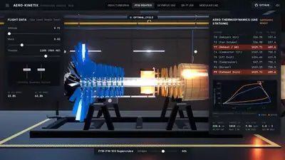</a> <b><a href="https://baselashraf81.github.io/aero-kinetix/">Aero-Kinetix</a></b> <a href="https://github.com/BaselAshraf81">Basel Ashraf</a> MIT · <a href="https://github.com/BaselAshraf81/aero-kinetix">Código</a> · <a href="https://huggingface.co/datasets/awesome-fable-5-2/terrarium-open-works/tree/main/tools/aero-kinetix">Archivos</a></td>
<td width="25%" valign="top"> <b><a href="https://aurelion.be-ai-curator.com/">Agent 360</a></b> <a href="https://github.com/Nelsen0717">Nelsen Chen</a> MIT · <a href="https://github.com/Nelsen0717/agent-360">Código</a> · <a href="https://huggingface.co/datasets/awesome-fable-5-2/terrarium-open-works/tree/main/tools/agent-360">Archivos</a></td>
<td width="25%" valign="top"><a href="https://poligle.github.io/ascsat/">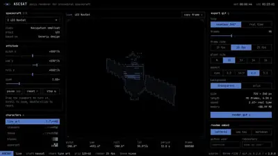</a> <b><a href="https://poligle.github.io/ascsat/">ASCSAT</a></b> <a href="https://github.com/poligle">Pol Iglesias</a> MIT · <a href="https://github.com/poligle/ascsat">Código</a> · <a href="https://huggingface.co/datasets/awesome-fable-5-2/terrarium-open-works/tree/main/tools/ascsat">Archivos</a></td>
<td width="25%" valign="top"><a href="https://kanaworksai-hue.github.io/book-page-flip-generator/">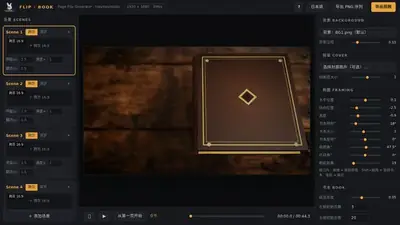</a> <b><a href="https://kanaworksai-hue.github.io/book-page-flip-generator/">Book Page Flip Generator</a></b> <a href="https://github.com/kanaworksai-hue">KANA</a> MIT · <a href="https://github.com/kanaworksai-hue/book-page-flip-generator">Código</a> · <a href="https://huggingface.co/datasets/awesome-fable-5-2/terrarium-open-works/tree/main/tools/book-page-flip-generator">Archivos</a></td>
</tr>
<tr>
<td width="25%" valign="top"><a href="https://royfactory.net/claude-office/">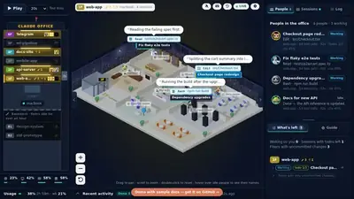</a> <b><a href="https://royfactory.net/claude-office/">claude-office</a></b> <a href="https://github.com/royfactory">Royfactory</a> MIT · <a href="https://github.com/royfactory/claude-office">Código</a> · <a href="https://huggingface.co/datasets/awesome-fable-5-2/terrarium-open-works/tree/main/tools/claude-office">Archivos</a></td>
<td width="25%" valign="top"><a href="https://ghostoman.github.io/coin-jackpot/">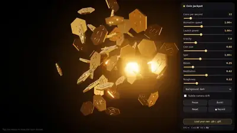</a> <b><a href="https://ghostoman.github.io/coin-jackpot/">Coin Jackpot</a></b> <a href="https://github.com/ghostoman">Serhii Dovhyi</a> MIT · <a href="https://github.com/ghostoman/coin-jackpot">Código</a> · <a href="https://huggingface.co/datasets/awesome-fable-5-2/terrarium-open-works/tree/main/tools/coin-jackpot">Archivos</a></td>
<td width="25%" valign="top"><a href="https://context-brain.pages.dev">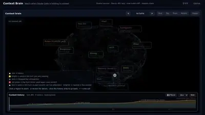</a> <b><a href="https://context-brain.pages.dev">Context Brain</a></b> <a href="https://github.com/workdd">최재강</a> MIT · <a href="https://github.com/workdd/context-brain">Código</a> · <a href="https://huggingface.co/datasets/awesome-fable-5-2/terrarium-open-works/tree/main/tools/context-brain">Archivos</a></td>
<td width="25%" valign="top"><a href="https://github.com/fmhc/coverwatch">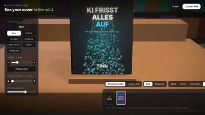</a> <b><a href="https://github.com/fmhc/coverwatch">📚 Coverwatch</a></b> <a href="https://github.com/fmhc">fmhc</a> MIT · <a href="https://github.com/fmhc/coverwatch">Código</a> · <a href="https://huggingface.co/datasets/awesome-fable-5-2/terrarium-open-works/tree/main/tools/coverwatch">Archivos</a></td>
</tr>
<tr>
<td width="25%" valign="top"><a href="https://sarowarsuman.github.io/EduMind_3D_Platform_for_Child/">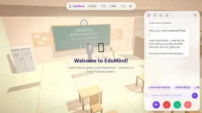</a> <b><a href="https://sarowarsuman.github.io/EduMind_3D_Platform_for_Child/">EduMind</a></b> <a href="https://github.com/SarowarSuman">Sarowar Suman</a> MIT · <a href="https://github.com/SarowarSuman/EduMind_3D_Platform_for_Child">Código</a> · <a href="https://huggingface.co/datasets/awesome-fable-5-2/terrarium-open-works/tree/main/tools/edumind">Archivos</a></td>
<td width="25%" valign="top"> <b><a href="https://github.com/bigerbigernerd/fiat-ludus">Fiat Ludus · 言出法随</a></b> <a href="https://github.com/bigerbigernerd">bigerbigernerd</a> MIT · <a href="https://github.com/bigerbigernerd/fiat-ludus">Código</a> · <a href="https://huggingface.co/datasets/awesome-fable-5-2/terrarium-open-works/tree/main/tools/fiat-ludus">Archivos</a></td>
<td width="25%" valign="top"><a href="https://floss-and-hoop.pages.dev">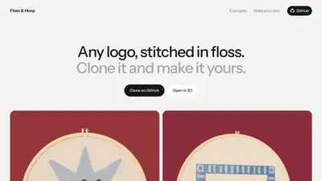</a> <b><a href="https://floss-and-hoop.pages.dev">Floss &amp; Hoop</a></b> <a href="https://github.com/adam-orsin">Adam Aldred</a> MIT · <a href="https://github.com/adam-orsin/floss-and-hoop">Código</a> · <a href="https://huggingface.co/datasets/awesome-fable-5-2/terrarium-open-works/tree/main/tools/floss-hoop">Archivos</a></td>
<td width="25%" valign="top"><a href="https://tanuu5.github.io/clawd-flow-desk/">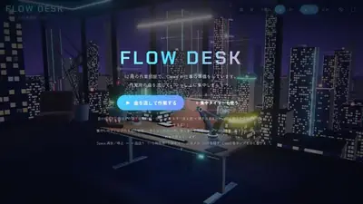</a> <b><a href="https://tanuu5.github.io/clawd-flow-desk/">Flow Desk — Clawd の作業部屋</a></b> <a href="https://github.com/tanuu5">たぬ（tanu）</a> MIT · <a href="https://github.com/tanuu5/clawd-flow-desk">Código</a> · <a href="https://huggingface.co/datasets/awesome-fable-5-2/terrarium-open-works/tree/main/tools/flow-desk-clawd">Archivos</a></td>
</tr>
<tr>
<td width="25%" valign="top"> <b><a href="https://e-nicko.github.io/focal-plane/">Focal Plane</a></b> <a href="https://github.com/e-Nicko">Nickolai Yegorov</a> MIT · <a href="https://github.com/e-Nicko/focal-plane">Código</a> · <a href="https://huggingface.co/datasets/awesome-fable-5-2/terrarium-open-works/tree/main/tools/focal-plane">Archivos</a></td>
<td width="25%" valign="top"><a href="https://chapeee.github.io/GRIDCITY/demo/">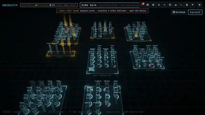</a> <b><a href="https://chapeee.github.io/GRIDCITY/demo/">GRIDCITY</a></b> <a href="https://github.com/chapeee">Raj</a> MIT · <a href="https://github.com/chapeee/GRIDCITY">Código</a> · <a href="https://huggingface.co/datasets/awesome-fable-5-2/terrarium-open-works/tree/main/tools/gridcity">Archivos</a></td>
<td width="25%" valign="top"> <b><a href="https://khanmjk.github.io/Fable51_Hourglass/">Hourglass · Digital Twin</a></b> <a href="https://github.com/khanmjk">khanmjk</a> MIT · <a href="https://github.com/khanmjk/Fable51_Hourglass">Código</a> · <a href="https://huggingface.co/datasets/awesome-fable-5-2/terrarium-open-works/tree/main/tools/hourglass-digital-twin">Archivos</a></td>
<td width="25%" valign="top"><a href="https://jarvis.pateldhananjay.com/">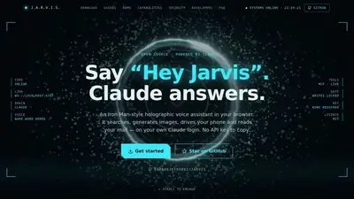</a> <b><a href="https://jarvis.pateldhananjay.com/">J.A.R.V.I.S.</a></b> <a href="https://github.com/dhananjay09892">Dhananjay Patel</a> MIT · <a href="https://github.com/dhananjay09892/JARVIS">Código</a> · <a href="https://huggingface.co/datasets/awesome-fable-5-2/terrarium-open-works/tree/main/tools/j-a-r-v-i-s">Archivos</a></td>
</tr>
<tr>
<td width="25%" valign="top"><a href="https://github.com/Samvit-Govindani/kinegen-prosthetic-designer-">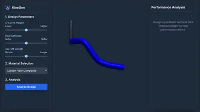</a> <b><a href="https://github.com/Samvit-Govindani/kinegen-prosthetic-designer-">KineGen — Dynamic Prosthetic Foot Designer</a></b> <a href="https://github.com/Samvit-Govindani">Samvit Govindani</a> MIT · <a href="https://github.com/Samvit-Govindani/kinegen-prosthetic-designer-">Código</a> · <a href="https://huggingface.co/datasets/awesome-fable-5-2/terrarium-open-works/tree/main/tools/kinegen-dynamic-prosthetic-foot-designer">Archivos</a></td>
<td width="25%" valign="top"><a href="https://github.com/yusen-dev/living-ascii">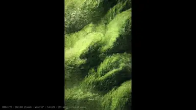</a> <b><a href="https://github.com/yusen-dev/living-ascii">Living ASCII</a></b> <a href="https://github.com/yusen-dev">Yusen</a> MIT · <a href="https://github.com/yusen-dev/living-ascii">Código</a> · <a href="https://huggingface.co/datasets/awesome-fable-5-2/terrarium-open-works/tree/main/tools/living-ascii">Archivos</a></td>
<td width="25%" valign="top"><a href="https://maschinenraum.pages.dev">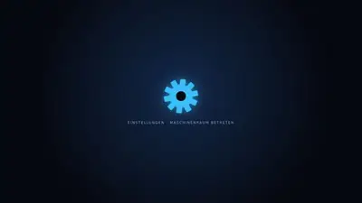</a> <b><a href="https://maschinenraum.pages.dev">Maschinenraum</a></b> <a href="https://github.com/PieperStefan">PieperStefan</a> MIT · <a href="https://github.com/PieperStefan/maschinenraum">Código</a> · <a href="https://huggingface.co/datasets/awesome-fable-5-2/terrarium-open-works/tree/main/tools/maschinenraum">Archivos</a></td>
<td width="25%" valign="top"><a href="https://zohaibmahar234.github.io/matchgrid-stadium-ops/">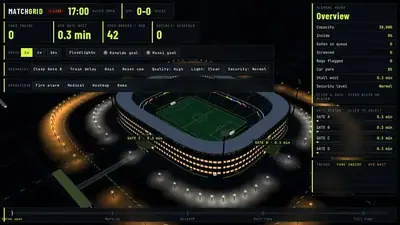</a> <b><a href="https://zohaibmahar234.github.io/matchgrid-stadium-ops/">Matchgrid · Aldmere Arena</a></b> <a href="https://github.com/zohaibmahar234">ZOHAIB MAHAR</a> MIT · <a href="https://github.com/zohaibmahar234/matchgrid-stadium-ops">Código</a> · <a href="https://huggingface.co/datasets/awesome-fable-5-2/terrarium-open-works/tree/main/tools/matchgrid-aldmere-arena">Archivos</a></td>
</tr>
<tr>
<td width="25%" valign="top"><a href="https://harleycoops.github.io/Math-To-Manim/">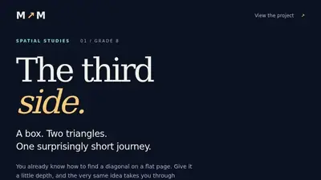</a> <b><a href="https://harleycoops.github.io/Math-To-Manim/">Math To Manim</a></b> <a href="https://github.com/HarleyCoops">Christian Harley Cooper</a> MIT · <a href="https://github.com/HarleyCoops/Math-To-Manim">Código</a> · <a href="https://huggingface.co/datasets/awesome-fable-5-2/terrarium-open-works/tree/main/tools/math-to-manim">Archivos</a></td>
<td width="25%" valign="top"> <b><a href="https://github.com/harshitkhandelwal208/3D-engine-Visualiser">MgCO₂ V6 Compression Engine — Interactive 3D Viewer</a></b> <a href="https://github.com/harshitkhandelwal208">Harshit Khandelwal</a> MIT · <a href="https://github.com/harshitkhandelwal208/3D-engine-Visualiser">Código</a> · <a href="https://huggingface.co/datasets/awesome-fable-5-2/terrarium-open-works/tree/main/tools/mgco2-v6-compression-engine-interactive-3d-viewer">Archivos</a></td>
<td width="25%" valign="top"><a href="https://khanh020905.github.io/my-office/">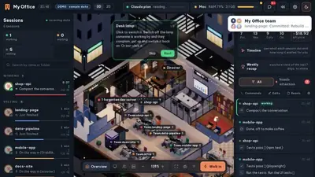</a> <b><a href="https://khanh020905.github.io/my-office/">My Office</a></b> <a href="https://github.com/khanh020905">Lê Nguyên Quốc Khánh</a> MIT · <a href="https://github.com/khanh020905/my-office">Código</a> · <a href="https://huggingface.co/datasets/awesome-fable-5-2/terrarium-open-works/tree/main/tools/my-office">Archivos</a></td>
<td width="25%" valign="top"><a href="https://orion.arnav.network">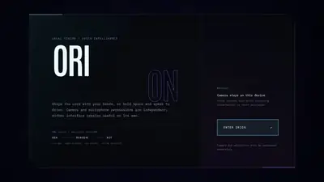</a> <b><a href="https://orion.arnav.network">Orion</a></b> <a href="https://github.com/arnavgupta00">Arnav Gupta</a> MIT · <a href="https://github.com/arnavgupta00/orion">Código</a> · <a href="https://huggingface.co/datasets/awesome-fable-5-2/terrarium-open-works/tree/main/tools/orion">Archivos</a></td>
</tr>
<tr>
<td width="25%" valign="top"><a href="https://mrpawelcz.github.io/planwalk/">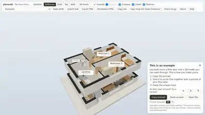</a> <b><a href="https://mrpawelcz.github.io/planwalk/">planwalk</a></b> <a href="https://github.com/MrPawelCz">MrPawelCz</a> MIT · <a href="https://github.com/MrPawelCz/planwalk">Código</a> · <a href="https://huggingface.co/datasets/awesome-fable-5-2/terrarium-open-works/tree/main/tools/planwalk">Archivos</a></td>
<td width="25%" valign="top"><a href="http://leereilly.net/rubiks-rubrics/">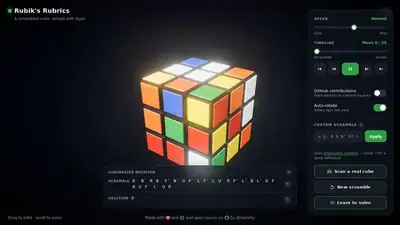</a> <b><a href="http://leereilly.net/rubiks-rubrics/">Rubik&#x27;s Rubrics</a></b> <a href="https://github.com/leereilly">Lee Reilly</a> MIT · <a href="https://github.com/leereilly/rubiks-rubrics">Código</a> · <a href="https://huggingface.co/datasets/awesome-fable-5-2/terrarium-open-works/tree/main/tools/rubik-s-rubrics">Archivos</a></td>
<td width="25%" valign="top"><a href="https://jeffhuber.github.io/rubiks-solver/">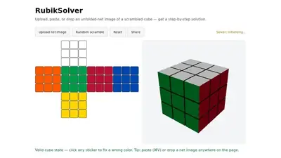</a> <b><a href="https://jeffhuber.github.io/rubiks-solver/">RubikSolver</a></b> <a href="https://github.com/jeffhuber">Jeff Huber</a> MIT · <a href="https://github.com/jeffhuber/rubiks-solver">Código</a> · <a href="https://huggingface.co/datasets/awesome-fable-5-2/terrarium-open-works/tree/main/tools/rubiksolver">Archivos</a></td>
<td width="25%" valign="top"><a href="https://skyborne.dev">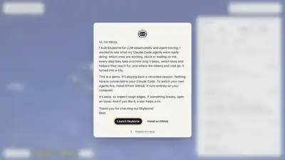</a> <b><a href="https://skyborne.dev">Skyborne</a></b> <a href="https://github.com/ishraq21">Mirza Ishraq</a> Apache-2.0 · <a href="https://github.com/ishraq21/skyborne">Código</a> · <a href="https://huggingface.co/datasets/awesome-fable-5-2/terrarium-open-works/tree/main/tools/skyborne">Archivos</a></td>
</tr>
<tr>
<td width="25%" valign="top"><a href="https://github.com/fokrulanthro16-eng/spatial-mindstudio-ai">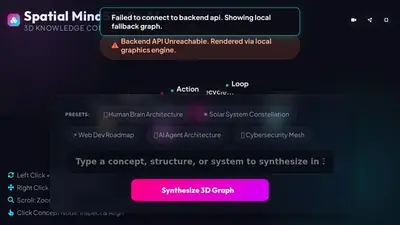</a> <b><a href="https://github.com/fokrulanthro16-eng/spatial-mindstudio-ai">Spatial MindStudio AI</a></b> <a href="https://github.com/fokrulanthro16-eng">FOKRUL ISLAM</a> MIT · <a href="https://github.com/fokrulanthro16-eng/spatial-mindstudio-ai">Código</a> · <a href="https://huggingface.co/datasets/awesome-fable-5-2/terrarium-open-works/tree/main/tools/spatial-mindstudio-ai">Archivos</a></td>
<td width="25%" valign="top"><a href="https://usespatialisapp.vercel.app/Simulator/">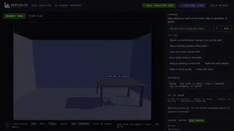</a> <b><a href="https://usespatialisapp.vercel.app/Simulator/">Spatialis</a></b> <a href="https://github.com/mrnetwork0001">Onwo Ifeanyichukwu Emmanuel</a> Apache-2.0 · <a href="https://github.com/mrnetwork0001/Spatialis">Código</a> · <a href="https://huggingface.co/datasets/awesome-fable-5-2/terrarium-open-works/tree/main/tools/spatialis">Archivos</a></td>
<td width="25%" valign="top"><a href="https://felixgollnhuber.github.io/t3-office/">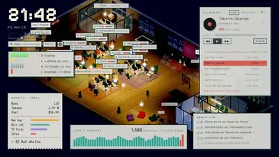</a> <b><a href="https://felixgollnhuber.github.io/t3-office/">T3 Office</a></b> <a href="https://github.com/felixgollnhuber">Felix Gollnhuber</a> MIT · <a href="https://github.com/felixgollnhuber/t3-office">Código</a> · <a href="https://huggingface.co/datasets/awesome-fable-5-2/terrarium-open-works/tree/main/tools/t3-office">Archivos</a></td>
<td width="25%" valign="top"><a href="https://wag-me.github.io/vibeship/">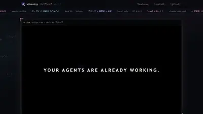</a> <b><a href="https://wag-me.github.io/vibeship/">Vibeship</a></b> <a href="https://github.com/wag-me">Giacomo Paolini</a> MIT · <a href="https://github.com/wag-me/vibeship">Código</a> · <a href="https://huggingface.co/datasets/awesome-fable-5-2/terrarium-open-works/tree/main/tools/vibeship">Archivos</a></td>
</tr>
<tr>
<td width="25%" valign="top"><a href="https://mindplottech.github.io/growing-reach/">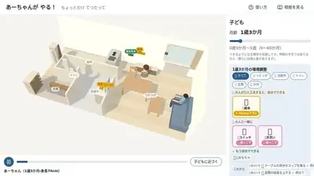</a> <b><a href="https://mindplottech.github.io/growing-reach/">あーちゃんが やる！ — Growing Reach</a></b> <a href="https://github.com/mindplottech">mindplottech</a> MIT · <a href="https://github.com/mindplottech/growing-reach">Código</a> · <a href="https://huggingface.co/datasets/awesome-fable-5-2/terrarium-open-works/tree/main/tools/growing-reach">Archivos</a></td>
<td width="25%" valign="top"> <b><a href="https://anois.github.io/tarot/">塔罗 · 3D 占卜</a></b> <a href="https://github.com/anois">今朝</a> MIT · <a href="https://github.com/anois/tarot">Código</a> · <a href="https://huggingface.co/datasets/awesome-fable-5-2/terrarium-open-works/tree/main/tools/3d">Archivos</a></td>
<td width="25%" valign="top"><a href="https://www.modelscope.cn/studios/c8iolab/time-simulator">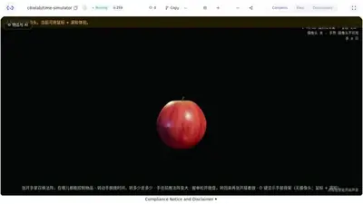</a> <b><a href="https://www.modelscope.cn/studios/c8iolab/time-simulator">时间模拟器</a></b> <a href="https://github.com/diw35688-sketch">diw35688-sketch</a> MIT · <a href="https://github.com/diw35688-sketch/time-simulator">Código</a> · <a href="https://huggingface.co/datasets/awesome-fable-5-2/terrarium-open-works/tree/main/tools/time-simulator">Archivos</a></td>
<td width="25%" valign="top"><a href="https://smart-warehouse-wine.vercel.app">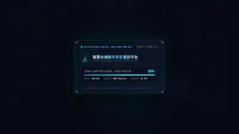</a> <b><a href="https://smart-warehouse-wine.vercel.app">智慧仓储数字孪生平台 (smart-warehouse)</a></b> <a href="https://github.com/Xxcool">Xxcool</a> MIT · <a href="https://github.com/Xxcool/smart-warehouse">Código</a> · <a href="https://huggingface.co/datasets/awesome-fable-5-2/terrarium-open-works/tree/main/tools/smart-warehouse">Archivos</a></td>
</tr>
<tr>
<td width="25%" valign="top"><a href="https://github.com/stanlee7/robot-arm-3d-lab">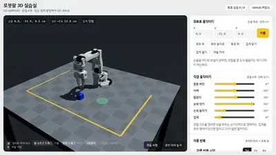</a> <b><a href="https://github.com/stanlee7/robot-arm-3d-lab">로봇팔 3D 실습실 · robot-arm-3d-lab</a></b> <a href="https://github.com/stanlee7">stanlee tam</a> Colección de 4 obras Apache-2.0 · <a href="https://github.com/stanlee7/robot-arm-3d-lab">Código</a> · <a href="https://huggingface.co/datasets/awesome-fable-5-2/terrarium-open-works/tree/main/tools/robot-arm-3d-lab">Archivos</a></td>
<td width="25%"></td>
<td width="25%"></td>
<td width="25%"></td>
</tr>
</table>

Obras sin imagen de vista previa:

<table>
<tr><th align="left">Obra</th><th align="left">Creador</th><th align="left">Licencia</th><th align="left">Enlaces</th></tr>
<tr><td><a href="https://github.com/abhinavbolla/3d-maker">3D Maker</a></td><td><a href="https://github.com/abhinavbolla">Abhinav Bolla</a></td><td>MIT</td><td><a href="https://github.com/abhinavbolla/3d-maker">Código</a> · <a href="https://huggingface.co/datasets/awesome-fable-5-2/terrarium-open-works/tree/main/tools/3d-maker">Archivos</a></td></tr>
<tr><td><a href="https://manuelportugalreis.com/agent-office/">Agent Office</a></td><td><a href="https://github.com/manuelportugalreis">Manuel Reis</a></td><td>MIT</td><td><a href="https://github.com/manuelportugalreis/agent-office">Código</a> · <a href="https://huggingface.co/datasets/awesome-fable-5-2/terrarium-open-works/tree/main/tools/agent-office">Archivos</a></td></tr>
<tr><td><a href="https://github.com/falshaw/ai-command-center">AI Command Center</a></td><td><a href="https://github.com/falshaw">Nick Falshaw</a></td><td>MIT</td><td><a href="https://github.com/falshaw/ai-command-center">Código</a> · <a href="https://huggingface.co/datasets/awesome-fable-5-2/terrarium-open-works/tree/main/tools/ai-command-center">Archivos</a></td></tr>
<tr><td><a href="https://github.com/demartinogiuseppe/AnimaPage">AnimaPage</a></td><td><a href="https://github.com/demartinogiuseppe">demartinogiuseppe</a></td><td>MIT</td><td><a href="https://github.com/demartinogiuseppe/AnimaPage">Código</a> · <a href="https://huggingface.co/datasets/awesome-fable-5-2/terrarium-open-works/tree/main/tools/animapage">Archivos</a></td></tr>
<tr><td><a href="https://0marm0.github.io/ApartmentScout/demo/">ApartmentScout</a></td><td><a href="https://github.com/0marm0">Omar Motala</a></td><td>MIT</td><td><a href="https://github.com/0marm0/ApartmentScout">Código</a> · <a href="https://huggingface.co/datasets/awesome-fable-5-2/terrarium-open-works/tree/main/tools/apartmentscout">Archivos</a></td></tr>
<tr><td><a href="https://axonis22-auto-si-webgl2.static.hf.space/index.html">Auto-SI WebGL2</a></td><td><a href="https://huggingface.co/axonis22">Paul Buckingham</a></td><td>MIT</td><td><a href="https://huggingface.co/spaces/axonis22/auto-si-webgl2">Código</a> · <a href="https://huggingface.co/datasets/awesome-fable-5-2/terrarium-open-works/tree/main/tools/auto-si-webgl2">Archivos</a></td></tr>
<tr><td><a href="https://buddywrites.vercel.app/app">Buddy</a></td><td><a href="https://github.com/akshatgg">Akshat Gupta</a></td><td>MIT</td><td><a href="https://github.com/akshatgg/Buddy">Código</a> · <a href="https://huggingface.co/datasets/awesome-fable-5-2/terrarium-open-works/tree/main/tools/buddy">Archivos</a></td></tr>
<tr><td><a href="https://github.com/abhinavv9/gemini-3d-model-viewer">Build a 3D Gemini Model Viewer with Three.js</a></td><td><a href="https://github.com/abhinavv9">Abhinav Verma</a></td><td>MIT</td><td><a href="https://github.com/abhinavv9/gemini-3d-model-viewer">Código</a> · <a href="https://huggingface.co/datasets/awesome-fable-5-2/terrarium-open-works/tree/main/tools/build-a-3d-gemini-model-viewer-with-three-js">Archivos</a></td></tr>
<tr><td><a href="https://github.com/silexened-create/IAstronaut">IAstronaut: Mentor Virtual Multimodal</a> · Colección de 3 obras</td><td><a href="https://github.com/silexened-create">silexened-create</a></td><td>MIT</td><td><a href="https://github.com/silexened-create/IAstronaut">Código</a> · <a href="https://huggingface.co/datasets/awesome-fable-5-2/terrarium-open-works/tree/main/tools/iastronaut">Archivos</a></td></tr>
<tr><td><a href="https://github.com/Qialet/kolo">Kolo</a></td><td><a href="https://github.com/Qialet">Qialet</a></td><td>MIT</td><td><a href="https://github.com/Qialet/kolo">Código</a> · <a href="https://huggingface.co/datasets/awesome-fable-5-2/terrarium-open-works/tree/main/tools/kolo">Archivos</a></td></tr>
<tr><td><a href="https://public.mihai-safta.dev/lcars-demo/index.html">LCARS · Deck</a></td><td><a href="https://github.com/saftacatalinmihai">Safta Catalin Mihai</a></td><td>MIT</td><td><a href="https://github.com/saftacatalinmihai/lcars">Código</a> · <a href="https://huggingface.co/datasets/awesome-fable-5-2/terrarium-open-works/tree/main/tools/lcars-deck">Archivos</a></td></tr>
<tr><td><a href="https://necromaniac.vercel.app">NECROMANIAC</a></td><td><a href="https://github.com/aravindh99">Aravindh S</a></td><td>MIT</td><td><a href="https://github.com/aravindh99/necromaniac">Código</a> · <a href="https://huggingface.co/datasets/awesome-fable-5-2/terrarium-open-works/tree/main/tools/necromaniac">Archivos</a></td></tr>
<tr><td><a href="https://planta-do-ape.web.app">Roomprint</a></td><td><a href="https://github.com/porcherm">Arthur Porcher</a></td><td>MIT</td><td><a href="https://github.com/porcherm/planta-casa">Código</a> · <a href="https://huggingface.co/datasets/awesome-fable-5-2/terrarium-open-works/tree/main/tools/roomprint">Archivos</a></td></tr>
<tr><td><a href="https://projectss-mauve.vercel.app">🛡️ ShieldAI — Industrial Safety Intelligence</a></td><td><a href="https://github.com/shdra06">shdra06</a></td><td>MIT</td><td><a href="https://github.com/shdra06/ShieldAI-Industrial-Safety-Intelligence">Código</a> · <a href="https://huggingface.co/datasets/awesome-fable-5-2/terrarium-open-works/tree/main/tools/shieldai-industrial-safety-intelligence">Archivos</a></td></tr>
<tr><td><a href="https://github.com/ripa1993/vibe-interiors">vibe-interiors</a></td><td><a href="https://github.com/ripa1993">Simone Ripamonti</a></td><td>MIT</td><td><a href="https://github.com/ripa1993/vibe-interiors">Código</a> · <a href="https://huggingface.co/datasets/awesome-fable-5-2/terrarium-open-works/tree/main/tools/vibe-interiors">Archivos</a></td></tr>
<tr><td><a href="https://github.com/harukaappscreate/Voxel-Lab">Voxel-Lab 🧊✨</a></td><td><a href="https://github.com/harukaappscreate">haruka_apps</a></td><td>MIT</td><td><a href="https://github.com/harukaappscreate/Voxel-Lab">Código</a> · <a href="https://huggingface.co/datasets/awesome-fable-5-2/terrarium-open-works/tree/main/tools/voxel-lab">Archivos</a></td></tr>
</table>

<!-- CATALOG:END -->

---

 <a href="../docs/i18n/README.es.md">Inicio</a> · <a href="../games/README.es.md">Juegos</a> · <a href="../scenes/README.es.md">Mundos y escenas</a> · <a href="../videos/README.es.md">Vídeos</a> · <a href="README.es.md">Herramientas</a> · <a href="../visualizations/README.es.md">Visualizaciones</a> · <a href="../wallpapers/README.es.md">Fondos de pantalla</a> · <a href="#top">Volver arriba</a> Datos del catálogo: 2026-11-14

