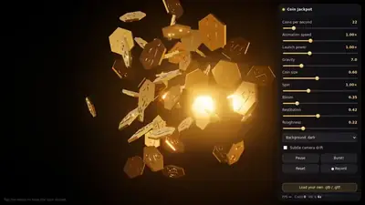
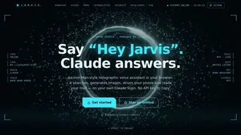
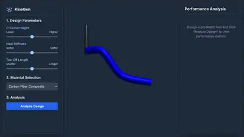
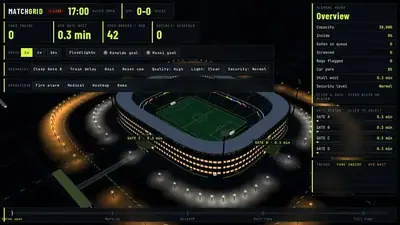
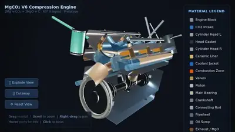
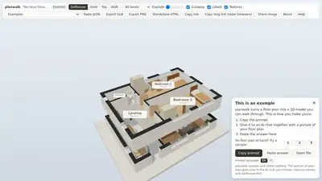
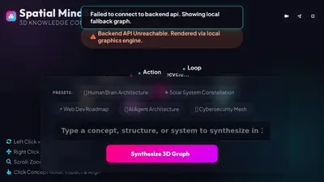

<a href="../README.zh-CN.md"><picture><source media="(prefers-color-scheme: dark)" srcset="../assets/logo-dark.svg"></picture></a>

<b>Open 3D Worlds Made with Code</b>

<a href="../README.zh-CN.md">首页</a> · <a href="../games/README.zh-CN.md">游戏</a> · <a href="../videos/README.zh-CN.md">视频</a> · <a href="../scenes/README.zh-CN.md">场景</a> · <a href="../wallpapers/README.zh-CN.md">壁纸</a> · <b>工具</b> · <a href="../visualizations/README.zh-CN.md">可视化</a> <a href="README.md">English</a> · <b>简体中文</b>

<h1 align="center">工具</h1>

53 个条目。用 3D 画面做一件具体事情的小应用，例如查看户型、求解魔方和计时。

<table>
<tr>
<td width="25%" valign="top"> <b><a href="https://baselashraf81.github.io/aero-kinetix/">Aero-Kinetix</a></b> <a href="https://github.com/BaselAshraf81">Basel Ashraf</a> MIT · <a href="https://github.com/BaselAshraf81/aero-kinetix">代码</a> · <a href="https://huggingface.co/datasets/awesome-fable-5-2/terrarium-open-works/tree/main/tools/aero-kinetix">文件</a></td>
<td width="25%" valign="top"> <b><a href="https://aurelion.be-ai-curator.com/">Agent 360</a></b> <a href="https://github.com/Nelsen0717">Nelsen Chen</a> MIT · <a href="https://github.com/Nelsen0717/agent-360">代码</a> · <a href="https://huggingface.co/datasets/awesome-fable-5-2/terrarium-open-works/tree/main/tools/agent-360">文件</a></td>
<td width="25%" valign="top"> <b><a href="https://poligle.github.io/ascsat/">ASCSAT</a></b> <a href="https://github.com/poligle">Pol Iglesias</a> MIT · <a href="https://github.com/poligle/ascsat">代码</a> · <a href="https://huggingface.co/datasets/awesome-fable-5-2/terrarium-open-works/tree/main/tools/ascsat">文件</a></td>
<td width="25%" valign="top"> <b><a href="https://kanaworksai-hue.github.io/book-page-flip-generator/">Book Page Flip Generator</a></b> <a href="https://github.com/kanaworksai-hue">KANA</a> MIT · <a href="https://github.com/kanaworksai-hue/book-page-flip-generator">代码</a> · <a href="https://huggingface.co/datasets/awesome-fable-5-2/terrarium-open-works/tree/main/tools/book-page-flip-generator">文件</a></td>
</tr>
<tr>
<td width="25%" valign="top"> <b><a href="https://royfactory.net/claude-office/">claude-office</a></b> <a href="https://github.com/royfactory">Royfactory</a> MIT · <a href="https://github.com/royfactory/claude-office">代码</a> · <a href="https://huggingface.co/datasets/awesome-fable-5-2/terrarium-open-works/tree/main/tools/claude-office">文件</a></td>
<td width="25%" valign="top"> <b><a href="https://ghostoman.github.io/coin-jackpot/">Coin Jackpot</a></b> <a href="https://github.com/ghostoman">Serhii Dovhyi</a> MIT · <a href="https://github.com/ghostoman/coin-jackpot">代码</a> · <a href="https://huggingface.co/datasets/awesome-fable-5-2/terrarium-open-works/tree/main/tools/coin-jackpot">文件</a></td>
<td width="25%" valign="top"> <b><a href="https://context-brain.pages.dev">Context Brain</a></b> <a href="https://github.com/workdd">최재강</a> MIT · <a href="https://github.com/workdd/context-brain">代码</a> · <a href="https://huggingface.co/datasets/awesome-fable-5-2/terrarium-open-works/tree/main/tools/context-brain">文件</a></td>
<td width="25%" valign="top"> <b><a href="https://github.com/fmhc/coverwatch">📚 Coverwatch</a></b> <a href="https://github.com/fmhc">fmhc</a> MIT · <a href="https://github.com/fmhc/coverwatch">代码</a> · <a href="https://huggingface.co/datasets/awesome-fable-5-2/terrarium-open-works/tree/main/tools/coverwatch">文件</a></td>
</tr>
<tr>
<td width="25%" valign="top"> <b><a href="https://sarowarsuman.github.io/EduMind_3D_Platform_for_Child/">EduMind</a></b> <a href="https://github.com/SarowarSuman">Sarowar Suman</a> MIT · <a href="https://github.com/SarowarSuman/EduMind_3D_Platform_for_Child">代码</a> · <a href="https://huggingface.co/datasets/awesome-fable-5-2/terrarium-open-works/tree/main/tools/edumind">文件</a></td>
<td width="25%" valign="top"> <b><a href="https://github.com/bigerbigernerd/fiat-ludus">Fiat Ludus · 言出法随</a></b> <a href="https://github.com/bigerbigernerd">bigerbigernerd</a> MIT · <a href="https://github.com/bigerbigernerd/fiat-ludus">代码</a> · <a href="https://huggingface.co/datasets/awesome-fable-5-2/terrarium-open-works/tree/main/tools/fiat-ludus">文件</a></td>
<td width="25%" valign="top"> <b><a href="https://floss-and-hoop.pages.dev">Floss &amp; Hoop</a></b> <a href="https://github.com/adam-orsin">Adam Aldred</a> MIT · <a href="https://github.com/adam-orsin/floss-and-hoop">代码</a> · <a href="https://huggingface.co/datasets/awesome-fable-5-2/terrarium-open-works/tree/main/tools/floss-hoop">文件</a></td>
<td width="25%" valign="top"> <b><a href="https://tanuu5.github.io/clawd-flow-desk/">Flow Desk — Clawd の作業部屋</a></b> <a href="https://github.com/tanuu5">たぬ（tanu）</a> MIT · <a href="https://github.com/tanuu5/clawd-flow-desk">代码</a> · <a href="https://huggingface.co/datasets/awesome-fable-5-2/terrarium-open-works/tree/main/tools/flow-desk-clawd">文件</a></td>
</tr>
<tr>
<td width="25%" valign="top"> <b><a href="https://e-nicko.github.io/focal-plane/">Focal Plane</a></b> <a href="https://github.com/e-Nicko">Nickolai Yegorov</a> MIT · <a href="https://github.com/e-Nicko/focal-plane">代码</a> · <a href="https://huggingface.co/datasets/awesome-fable-5-2/terrarium-open-works/tree/main/tools/focal-plane">文件</a></td>
<td width="25%" valign="top"> <b><a href="https://chapeee.github.io/GRIDCITY/demo/">GRIDCITY</a></b> <a href="https://github.com/chapeee">Raj</a> MIT · <a href="https://github.com/chapeee/GRIDCITY">代码</a> · <a href="https://huggingface.co/datasets/awesome-fable-5-2/terrarium-open-works/tree/main/tools/gridcity">文件</a></td>
<td width="25%" valign="top"> <b><a href="https://khanmjk.github.io/Fable51_Hourglass/">Hourglass · Digital Twin</a></b> <a href="https://github.com/khanmjk">khanmjk</a> MIT · <a href="https://github.com/khanmjk/Fable51_Hourglass">代码</a> · <a href="https://huggingface.co/datasets/awesome-fable-5-2/terrarium-open-works/tree/main/tools/hourglass-digital-twin">文件</a></td>
<td width="25%" valign="top"> <b><a href="https://jarvis.pateldhananjay.com/">J.A.R.V.I.S.</a></b> <a href="https://github.com/dhananjay09892">Dhananjay Patel</a> MIT · <a href="https://github.com/dhananjay09892/JARVIS">代码</a> · <a href="https://huggingface.co/datasets/awesome-fable-5-2/terrarium-open-works/tree/main/tools/j-a-r-v-i-s">文件</a></td>
</tr>
<tr>
<td width="25%" valign="top"> <b><a href="https://github.com/Samvit-Govindani/kinegen-prosthetic-designer-">KineGen — Dynamic Prosthetic Foot Designer</a></b> <a href="https://github.com/Samvit-Govindani">Samvit Govindani</a> MIT · <a href="https://github.com/Samvit-Govindani/kinegen-prosthetic-designer-">代码</a> · <a href="https://huggingface.co/datasets/awesome-fable-5-2/terrarium-open-works/tree/main/tools/kinegen-dynamic-prosthetic-foot-designer">文件</a></td>
<td width="25%" valign="top"> <b><a href="https://github.com/yusen-dev/living-ascii">Living ASCII</a></b> <a href="https://github.com/yusen-dev">Yusen</a> MIT · <a href="https://github.com/yusen-dev/living-ascii">代码</a> · <a href="https://huggingface.co/datasets/awesome-fable-5-2/terrarium-open-works/tree/main/tools/living-ascii">文件</a></td>
<td width="25%" valign="top"> <b><a href="https://maschinenraum.pages.dev">Maschinenraum</a></b> <a href="https://github.com/PieperStefan">PieperStefan</a> MIT · <a href="https://github.com/PieperStefan/maschinenraum">代码</a> · <a href="https://huggingface.co/datasets/awesome-fable-5-2/terrarium-open-works/tree/main/tools/maschinenraum">文件</a></td>
<td width="25%" valign="top"> <b><a href="https://zohaibmahar234.github.io/matchgrid-stadium-ops/">Matchgrid · Aldmere Arena</a></b> <a href="https://github.com/zohaibmahar234">ZOHAIB MAHAR</a> MIT · <a href="https://github.com/zohaibmahar234/matchgrid-stadium-ops">代码</a> · <a href="https://huggingface.co/datasets/awesome-fable-5-2/terrarium-open-works/tree/main/tools/matchgrid-aldmere-arena">文件</a></td>
</tr>
<tr>
<td width="25%" valign="top"> <b><a href="https://harleycoops.github.io/Math-To-Manim/">Math To Manim</a></b> <a href="https://github.com/HarleyCoops">Christian Harley Cooper</a> MIT · <a href="https://github.com/HarleyCoops/Math-To-Manim">代码</a> · <a href="https://huggingface.co/datasets/awesome-fable-5-2/terrarium-open-works/tree/main/tools/math-to-manim">文件</a></td>
<td width="25%" valign="top"> <b><a href="https://github.com/harshitkhandelwal208/3D-engine-Visualiser">MgCO₂ V6 Compression Engine — Interactive 3D Viewer</a></b> <a href="https://github.com/harshitkhandelwal208">Harshit Khandelwal</a> MIT · <a href="https://github.com/harshitkhandelwal208/3D-engine-Visualiser">代码</a> · <a href="https://huggingface.co/datasets/awesome-fable-5-2/terrarium-open-works/tree/main/tools/mgco2-v6-compression-engine-interactive-3d-viewer">文件</a></td>
<td width="25%" valign="top"> <b><a href="https://khanh020905.github.io/my-office/">My Office</a></b> <a href="https://github.com/khanh020905">Lê Nguyên Quốc Khánh</a> MIT · <a href="https://github.com/khanh020905/my-office">代码</a> · <a href="https://huggingface.co/datasets/awesome-fable-5-2/terrarium-open-works/tree/main/tools/my-office">文件</a></td>
<td width="25%" valign="top"> <b><a href="https://orion.arnav.network">Orion</a></b> <a href="https://github.com/arnavgupta00">Arnav Gupta</a> MIT · <a href="https://github.com/arnavgupta00/orion">代码</a> · <a href="https://huggingface.co/datasets/awesome-fable-5-2/terrarium-open-works/tree/main/tools/orion">文件</a></td>
</tr>
<tr>
<td width="25%" valign="top"> <b><a href="https://mrpawelcz.github.io/planwalk/">planwalk</a></b> <a href="https://github.com/MrPawelCz">MrPawelCz</a> MIT · <a href="https://github.com/MrPawelCz/planwalk">代码</a> · <a href="https://huggingface.co/datasets/awesome-fable-5-2/terrarium-open-works/tree/main/tools/planwalk">文件</a></td>
<td width="25%" valign="top"> <b><a href="http://leereilly.net/rubiks-rubrics/">Rubik&#x27;s Rubrics</a></b> <a href="https://github.com/leereilly">Lee Reilly</a> MIT · <a href="https://github.com/leereilly/rubiks-rubrics">代码</a> · <a href="https://huggingface.co/datasets/awesome-fable-5-2/terrarium-open-works/tree/main/tools/rubik-s-rubrics">文件</a></td>
<td width="25%" valign="top"> <b><a href="https://jeffhuber.github.io/rubiks-solver/">RubikSolver</a></b> <a href="https://github.com/jeffhuber">Jeff Huber</a> MIT · <a href="https://github.com/jeffhuber/rubiks-solver">代码</a> · <a href="https://huggingface.co/datasets/awesome-fable-5-2/terrarium-open-works/tree/main/tools/rubiksolver">文件</a></td>
<td width="25%" valign="top"> <b><a href="https://skyborne.dev">Skyborne</a></b> <a href="https://github.com/ishraq21">Mirza Ishraq</a> Apache-2.0 · <a href="https://github.com/ishraq21/skyborne">代码</a> · <a href="https://huggingface.co/datasets/awesome-fable-5-2/terrarium-open-works/tree/main/tools/skyborne">文件</a></td>
</tr>
<tr>
<td width="25%" valign="top"> <b><a href="https://github.com/fokrulanthro16-eng/spatial-mindstudio-ai">Spatial MindStudio AI</a></b> <a href="https://github.com/fokrulanthro16-eng">FOKRUL ISLAM</a> MIT · <a href="https://github.com/fokrulanthro16-eng/spatial-mindstudio-ai">代码</a> · <a href="https://huggingface.co/datasets/awesome-fable-5-2/terrarium-open-works/tree/main/tools/spatial-mindstudio-ai">文件</a></td>
<td width="25%" valign="top"> <b><a href="https://usespatialisapp.vercel.app/Simulator/">Spatialis</a></b> <a href="https://github.com/mrnetwork0001">Onwo Ifeanyichukwu Emmanuel</a> Apache-2.0 · <a href="https://github.com/mrnetwork0001/Spatialis">代码</a> · <a href="https://huggingface.co/datasets/awesome-fable-5-2/terrarium-open-works/tree/main/tools/spatialis">文件</a></td>
<td width="25%" valign="top"> <b><a href="https://felixgollnhuber.github.io/t3-office/">T3 Office</a></b> <a href="https://github.com/felixgollnhuber">Felix Gollnhuber</a> MIT · <a href="https://github.com/felixgollnhuber/t3-office">代码</a> · <a href="https://huggingface.co/datasets/awesome-fable-5-2/terrarium-open-works/tree/main/tools/t3-office">文件</a></td>
<td width="25%" valign="top"> <b><a href="https://wag-me.github.io/vibeship/">Vibeship</a></b> <a href="https://github.com/wag-me">Giacomo Paolini</a> MIT · <a href="https://github.com/wag-me/vibeship">代码</a> · <a href="https://huggingface.co/datasets/awesome-fable-5-2/terrarium-open-works/tree/main/tools/vibeship">文件</a></td>
</tr>
<tr>
<td width="25%" valign="top"> <b><a href="https://mindplottech.github.io/growing-reach/">あーちゃんが やる！ — Growing Reach</a></b> <a href="https://github.com/mindplottech">mindplottech</a> MIT · <a href="https://github.com/mindplottech/growing-reach">代码</a> · <a href="https://huggingface.co/datasets/awesome-fable-5-2/terrarium-open-works/tree/main/tools/growing-reach">文件</a></td>
<td width="25%" valign="top"> <b><a href="https://anois.github.io/tarot/">塔罗 · 3D 占卜</a></b> <a href="https://github.com/anois">今朝</a> MIT · <a href="https://github.com/anois/tarot">代码</a> · <a href="https://huggingface.co/datasets/awesome-fable-5-2/terrarium-open-works/tree/main/tools/3d">文件</a></td>
<td width="25%" valign="top"> <b><a href="https://www.modelscope.cn/studios/c8iolab/time-simulator">时间模拟器</a></b> <a href="https://github.com/diw35688-sketch">diw35688-sketch</a> MIT · <a href="https://github.com/diw35688-sketch/time-simulator">代码</a> · <a href="https://huggingface.co/datasets/awesome-fable-5-2/terrarium-open-works/tree/main/tools/time-simulator">文件</a></td>
<td width="25%" valign="top"> <b><a href="https://smart-warehouse-wine.vercel.app">智慧仓储数字孪生平台 (smart-warehouse)</a></b> <a href="https://github.com/Xxcool">Xxcool</a> MIT · <a href="https://github.com/Xxcool/smart-warehouse">代码</a> · <a href="https://huggingface.co/datasets/awesome-fable-5-2/terrarium-open-works/tree/main/tools/smart-warehouse">文件</a></td>
</tr>
<tr>
<td width="25%" valign="top"> <b><a href="https://github.com/stanlee7/robot-arm-3d-lab">로봇팔 3D 실습실 · robot-arm-3d-lab</a></b> <a href="https://github.com/stanlee7">stanlee tam</a> 合集，4 个作品 Apache-2.0 · <a href="https://github.com/stanlee7/robot-arm-3d-lab">代码</a> · <a href="https://huggingface.co/datasets/awesome-fable-5-2/terrarium-open-works/tree/main/tools/robot-arm-3d-lab">文件</a></td>
<td width="25%"></td>
<td width="25%"></td>
<td width="25%"></td>
</tr>
</table>

没有预览图的作品：

<table>
<tr><th align="left">作品</th><th align="left">作者</th><th align="left">许可证</th><th align="left">链接</th></tr>
<tr><td><a href="https://github.com/abhinavbolla/3d-maker">3D Maker</a></td><td><a href="https://github.com/abhinavbolla">Abhinav Bolla</a></td><td>MIT</td><td><a href="https://github.com/abhinavbolla/3d-maker">代码</a> · <a href="https://huggingface.co/datasets/awesome-fable-5-2/terrarium-open-works/tree/main/tools/3d-maker">文件</a></td></tr>
<tr><td><a href="https://manuelportugalreis.com/agent-office/">Agent Office</a></td><td><a href="https://github.com/manuelportugalreis">Manuel Reis</a></td><td>MIT</td><td><a href="https://github.com/manuelportugalreis/agent-office">代码</a> · <a href="https://huggingface.co/datasets/awesome-fable-5-2/terrarium-open-works/tree/main/tools/agent-office">文件</a></td></tr>
<tr><td><a href="https://github.com/falshaw/ai-command-center">AI Command Center</a></td><td><a href="https://github.com/falshaw">Nick Falshaw</a></td><td>MIT</td><td><a href="https://github.com/falshaw/ai-command-center">代码</a> · <a href="https://huggingface.co/datasets/awesome-fable-5-2/terrarium-open-works/tree/main/tools/ai-command-center">文件</a></td></tr>
<tr><td><a href="https://github.com/demartinogiuseppe/AnimaPage">AnimaPage</a></td><td><a href="https://github.com/demartinogiuseppe">demartinogiuseppe</a></td><td>MIT</td><td><a href="https://github.com/demartinogiuseppe/AnimaPage">代码</a> · <a href="https://huggingface.co/datasets/awesome-fable-5-2/terrarium-open-works/tree/main/tools/animapage">文件</a></td></tr>
<tr><td><a href="https://0marm0.github.io/ApartmentScout/demo/">ApartmentScout</a></td><td><a href="https://github.com/0marm0">Omar Motala</a></td><td>MIT</td><td><a href="https://github.com/0marm0/ApartmentScout">代码</a> · <a href="https://huggingface.co/datasets/awesome-fable-5-2/terrarium-open-works/tree/main/tools/apartmentscout">文件</a></td></tr>
<tr><td><a href="https://axonis22-auto-si-webgl2.static.hf.space/index.html">Auto-SI WebGL2</a></td><td><a href="https://huggingface.co/axonis22">Paul Buckingham</a></td><td>MIT</td><td><a href="https://huggingface.co/spaces/axonis22/auto-si-webgl2">代码</a> · <a href="https://huggingface.co/datasets/awesome-fable-5-2/terrarium-open-works/tree/main/tools/auto-si-webgl2">文件</a></td></tr>
<tr><td><a href="https://buddywrites.vercel.app/app">Buddy</a></td><td><a href="https://github.com/akshatgg">Akshat Gupta</a></td><td>MIT</td><td><a href="https://github.com/akshatgg/Buddy">代码</a> · <a href="https://huggingface.co/datasets/awesome-fable-5-2/terrarium-open-works/tree/main/tools/buddy">文件</a></td></tr>
<tr><td><a href="https://github.com/abhinavv9/gemini-3d-model-viewer">Build a 3D Gemini Model Viewer with Three.js</a></td><td><a href="https://github.com/abhinavv9">Abhinav Verma</a></td><td>MIT</td><td><a href="https://github.com/abhinavv9/gemini-3d-model-viewer">代码</a> · <a href="https://huggingface.co/datasets/awesome-fable-5-2/terrarium-open-works/tree/main/tools/build-a-3d-gemini-model-viewer-with-three-js">文件</a></td></tr>
<tr><td><a href="https://github.com/silexened-create/IAstronaut">IAstronaut: Mentor Virtual Multimodal</a> · 合集，3 个作品</td><td><a href="https://github.com/silexened-create">silexened-create</a></td><td>MIT</td><td><a href="https://github.com/silexened-create/IAstronaut">代码</a> · <a href="https://huggingface.co/datasets/awesome-fable-5-2/terrarium-open-works/tree/main/tools/iastronaut">文件</a></td></tr>
<tr><td><a href="https://github.com/Qialet/kolo">Kolo</a></td><td><a href="https://github.com/Qialet">Qialet</a></td><td>MIT</td><td><a href="https://github.com/Qialet/kolo">代码</a> · <a href="https://huggingface.co/datasets/awesome-fable-5-2/terrarium-open-works/tree/main/tools/kolo">文件</a></td></tr>
<tr><td><a href="https://public.mihai-safta.dev/lcars-demo/index.html">LCARS · Deck</a></td><td><a href="https://github.com/saftacatalinmihai">Safta Catalin Mihai</a></td><td>MIT</td><td><a href="https://github.com/saftacatalinmihai/lcars">代码</a> · <a href="https://huggingface.co/datasets/awesome-fable-5-2/terrarium-open-works/tree/main/tools/lcars-deck">文件</a></td></tr>
<tr><td><a href="https://necromaniac.vercel.app">NECROMANIAC</a></td><td><a href="https://github.com/aravindh99">Aravindh S</a></td><td>MIT</td><td><a href="https://github.com/aravindh99/necromaniac">代码</a> · <a href="https://huggingface.co/datasets/awesome-fable-5-2/terrarium-open-works/tree/main/tools/necromaniac">文件</a></td></tr>
<tr><td><a href="https://planta-do-ape.web.app">Roomprint</a></td><td><a href="https://github.com/porcherm">Arthur Porcher</a></td><td>MIT</td><td><a href="https://github.com/porcherm/planta-casa">代码</a> · <a href="https://huggingface.co/datasets/awesome-fable-5-2/terrarium-open-works/tree/main/tools/roomprint">文件</a></td></tr>
<tr><td><a href="https://projectss-mauve.vercel.app">🛡️ ShieldAI — Industrial Safety Intelligence</a></td><td><a href="https://github.com/shdra06">shdra06</a></td><td>MIT</td><td><a href="https://github.com/shdra06/ShieldAI-Industrial-Safety-Intelligence">代码</a> · <a href="https://huggingface.co/datasets/awesome-fable-5-2/terrarium-open-works/tree/main/tools/shieldai-industrial-safety-intelligence">文件</a></td></tr>
<tr><td><a href="https://github.com/ripa1993/vibe-interiors">vibe-interiors</a></td><td><a href="https://github.com/ripa1993">Simone Ripamonti</a></td><td>MIT</td><td><a href="https://github.com/ripa1993/vibe-interiors">代码</a> · <a href="https://huggingface.co/datasets/awesome-fable-5-2/terrarium-open-works/tree/main/tools/vibe-interiors">文件</a></td></tr>
<tr><td><a href="https://github.com/harukaappscreate/Voxel-Lab">Voxel-Lab 🧊✨</a></td><td><a href="https://github.com/harukaappscreate">haruka_apps</a></td><td>MIT</td><td><a href="https://github.com/harukaappscreate/Voxel-Lab">代码</a> · <a href="https://huggingface.co/datasets/awesome-fable-5-2/terrarium-open-works/tree/main/tools/voxel-lab">文件</a></td></tr>
</table>

---

<a href="../README.zh-CN.md">首页</a> · <a href="../games/README.zh-CN.md">游戏</a> · <a href="../videos/README.zh-CN.md">视频</a> · <a href="../scenes/README.zh-CN.md">场景</a> · <a href="../wallpapers/README.zh-CN.md">壁纸</a> · <a href="../tools/README.zh-CN.md">工具</a> · <a href="../visualizations/README.zh-CN.md">可视化</a> · <a href="#top">回到页首</a> Terrarium: Open 3D Worlds Made with Code · 数据日期：2026-11-14

