

<b>Terrarium</b>

<a href="README.md">English</a> · <b>简体中文</b> · <a href="README.zh-TW.md">繁體中文</a> · <a href="README.ja.md">日本語</a> · <a href="README.ko.md">한국어</a> · <a href="README.es.md">Español</a> · <a href="README.pt-BR.md">Português</a> · <a href="README.fr.md">Français</a> · <a href="README.de.md">Deutsch</a> · <a href="README.ru.md">Русский</a>

<a href="../docs/i18n/README.zh-CN.md#trending">最热</a> · <a href="../docs/i18n/README.zh-CN.md#latest">最新</a> · <a href="../docs/i18n/README.zh-CN.md#contents">目录</a>

<h1 align="center">工具</h1>

115 个条目。 用于创作、查看、模拟和日常任务的 3D 小应用。

<!-- CATALOG:START -->

<table>
<tr>
<td width="25%" valign="top"> <b><a href="https://github.com/abhinavbolla/3d-maker">3D Maker</a></b> <a href="https://github.com/abhinavbolla">Abhinav Bolla</a> MIT · <a href="https://github.com/abhinavbolla/3d-maker">代码</a> · <a href="https://huggingface.co/datasets/AI-Terrarium/terrarium-open-works/tree/main/tools/3d-maker">文件</a></td>
<td width="25%" valign="top"><a href="https://github.com/ABDELLK-ai/3d-CAD-IA">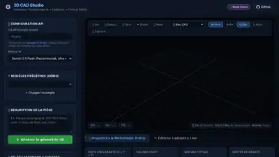</a> <b><a href="https://github.com/ABDELLK-ai/3d-CAD-IA">3d-CAD-IA</a></b> <a href="https://github.com/ABDELLK-ai">ABDELLK-ai</a> 许可证未知 · <a href="https://github.com/ABDELLK-ai/3d-CAD-IA">代码</a></td>
<td width="25%" valign="top"> <b><a href="https://project-kanon.vercel.app">3D-OS</a></b> <a href="https://github.com/smitamw">smitamw</a> 许可证未知 · <a href="https://github.com/smitamw/3D-OS">代码</a></td>
<td width="25%" valign="top"> <b><a href="https://github.com/NadavRosenberg/3DAgent">3DAgent</a></b> <a href="https://github.com/NadavRosenberg">NadavRosenberg</a> 许可证未知 · <a href="https://github.com/NadavRosenberg/3DAgent">代码</a></td>
</tr>
<tr>
<td width="25%" valign="top"> <b><a href="https://baselashraf81.github.io/aero-kinetix/">Aero-Kinetix</a></b> <a href="https://github.com/BaselAshraf81">Basel Ashraf</a> MIT · <a href="https://github.com/BaselAshraf81/aero-kinetix">代码</a> · <a href="https://huggingface.co/datasets/AI-Terrarium/terrarium-open-works/tree/main/tools/aero-kinetix">文件</a></td>
<td width="25%" valign="top"> <b><a href="https://aethereye.vercel.app/">AetherEye</a></b> <a href="https://github.com/expertX221">expertX221</a> 许可证未知 · <a href="https://github.com/expertX221/AetherEye">代码</a></td>
<td width="25%" valign="top"> <b><a href="https://aurelion.be-ai-curator.com/">Agent 360</a></b> <a href="https://github.com/Nelsen0717">Nelsen Chen</a> MIT · <a href="https://github.com/Nelsen0717/agent-360">代码</a> · <a href="https://huggingface.co/datasets/AI-Terrarium/terrarium-open-works/tree/main/tools/agent-360">文件</a></td>
<td width="25%" valign="top"> <b><a href="https://manuelportugalreis.com/agent-office/">Agent Office</a></b> <a href="https://github.com/manuelportugalreis">Manuel Reis</a> MIT · <a href="https://github.com/manuelportugalreis/agent-office">代码</a> · <a href="https://huggingface.co/datasets/AI-Terrarium/terrarium-open-works/tree/main/tools/agent-office">文件</a></td>
</tr>
<tr>
<td width="25%" valign="top"><a href="https://github.com/falshaw/ai-command-center">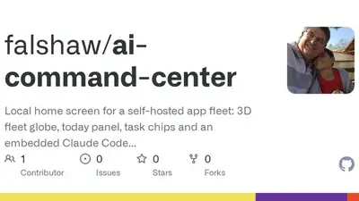</a> <b><a href="https://github.com/falshaw/ai-command-center">AI Command Center</a></b> <a href="https://github.com/falshaw">Nick Falshaw</a> MIT · <a href="https://github.com/falshaw/ai-command-center">代码</a> · <a href="https://huggingface.co/datasets/AI-Terrarium/terrarium-open-works/tree/main/tools/ai-command-center">文件</a></td>
<td width="25%" valign="top"> <b><a href="https://ai-8ball.vercel.app">ai-8ball</a></b> <a href="https://github.com/snjvkthrvn">snjvkthrvn</a> 许可证未知 · <a href="https://github.com/snjvkthrvn/ai-8ball">代码</a></td>
<td width="25%" valign="top"> <b><a href="https://ai-on-core.vercel.app">AiOn-Core</a></b> <a href="https://github.com/ErinRusevTheOne">ErinRusevTheOne</a> 许可证未知 · <a href="https://github.com/ErinRusevTheOne/AiOn-Core">代码</a></td>
<td width="25%" valign="top"><a href="https://demartinogiuseppe.github.io/AnimaPage/">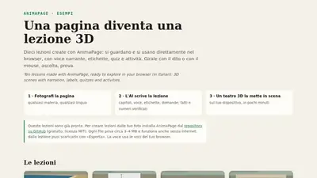</a> <b><a href="https://demartinogiuseppe.github.io/AnimaPage/">AnimaPage</a></b> <a href="https://github.com/demartinogiuseppe">demartinogiuseppe</a> MIT · <a href="https://github.com/demartinogiuseppe/AnimaPage">代码</a> · <a href="https://huggingface.co/datasets/AI-Terrarium/terrarium-open-works/tree/main/tools/animapage">文件</a></td>
</tr>
<tr>
<td width="25%" valign="top"> <b><a href="https://0marm0.github.io/ApartmentScout/demo/">ApartmentScout</a></b> <a href="https://github.com/0marm0">Omar Motala</a> MIT · <a href="https://github.com/0marm0/ApartmentScout">代码</a> · <a href="https://huggingface.co/datasets/AI-Terrarium/terrarium-open-works/tree/main/tools/apartmentscout">文件</a></td>
<td width="25%" valign="top"> <b><a href="https://outliner-coach.github.io/aquagarden-bench/">aquagarden-bench</a></b> <a href="https://github.com/outliner-coach">outliner-coach</a> 许可证未知 · <a href="https://github.com/outliner-coach/aquagarden-bench">代码</a></td>
<td width="25%" valign="top"> <b><a href="https://github.com/thequy/archi-graph">archi-graph</a></b> <a href="https://github.com/thequy">thequy</a> 许可证未知 · <a href="https://github.com/thequy/archi-graph">代码</a></td>
<td width="25%" valign="top"> <b><a href="https://cziter15.github.io/archvis-webgl/">archvis-webgl</a></b> <a href="https://github.com/cziter15">cziter15</a> GPL-3.0 · <a href="https://github.com/cziter15/archvis-webgl">代码</a> · <a href="https://huggingface.co/datasets/AI-Terrarium/terrarium-open-works/tree/main/tools/archvis-webgl">文件</a></td>
</tr>
<tr>
<td width="25%" valign="top"> <b><a href="https://poligle.github.io/ascsat/">ASCSAT</a></b> <a href="https://github.com/poligle">Pol Iglesias</a> MIT · <a href="https://github.com/poligle/ascsat">代码</a> · <a href="https://huggingface.co/datasets/AI-Terrarium/terrarium-open-works/tree/main/tools/ascsat">文件</a></td>
<td width="25%" valign="top"> <b><a href="https://axonis22-auto-si-webgl2.static.hf.space/index.html">Auto-SI WebGL2</a></b> <a href="https://huggingface.co/axonis22">Paul Buckingham</a> MIT · <a href="https://huggingface.co/spaces/axonis22/auto-si-webgl2">代码</a> · <a href="https://huggingface.co/datasets/AI-Terrarium/terrarium-open-works/tree/main/tools/auto-si-webgl2">文件</a></td>
<td width="25%" valign="top"> <b><a href="https://github.com/hikmetbozkurt/AutoMind-AI">AutoMind-AI</a></b> <a href="https://github.com/hikmetbozkurt">hikmetbozkurt</a> 许可证未知 · <a href="https://github.com/hikmetbozkurt/AutoMind-AI">代码</a></td>
<td width="25%" valign="top"> <b><a href="https://kanaworksai-hue.github.io/book-page-flip-generator/">Book Page Flip Generator</a></b> <a href="https://github.com/kanaworksai-hue">KANA</a> MIT · <a href="https://github.com/kanaworksai-hue/book-page-flip-generator">代码</a> · <a href="https://huggingface.co/datasets/AI-Terrarium/terrarium-open-works/tree/main/tools/book-page-flip-generator">文件</a></td>
</tr>
<tr>
<td width="25%" valign="top"><a href="https://100founts.github.io/brief-to-3d-video-pipeline/">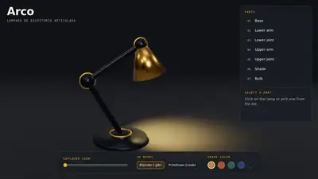</a> <b><a href="https://100founts.github.io/brief-to-3d-video-pipeline/">brief-to-3d-video-pipeline</a></b> <a href="https://github.com/100FOUNTS">100FOUNTS</a> MIT · <a href="https://github.com/100FOUNTS/brief-to-3d-video-pipeline">代码</a> · <a href="https://huggingface.co/datasets/AI-Terrarium/terrarium-open-works/tree/main/tools/brief-to-3d-video-pipeline">文件</a></td>
<td width="25%" valign="top"> <b><a href="https://buddywrites.vercel.app/app">Buddy</a></b> <a href="https://github.com/akshatgg">Akshat Gupta</a> MIT · <a href="https://github.com/akshatgg/Buddy">代码</a> · <a href="https://huggingface.co/datasets/AI-Terrarium/terrarium-open-works/tree/main/tools/buddy">文件</a></td>
<td width="25%" valign="top"><a href="https://github.com/abhinavv9/gemini-3d-model-viewer">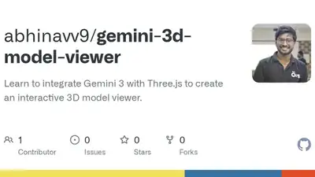</a> <b><a href="https://github.com/abhinavv9/gemini-3d-model-viewer">Build a 3D Gemini Model Viewer with Three.js</a></b> <a href="https://github.com/abhinavv9">Abhinav Verma</a> MIT · <a href="https://github.com/abhinavv9/gemini-3d-model-viewer">代码</a> · <a href="https://huggingface.co/datasets/AI-Terrarium/terrarium-open-works/tree/main/tools/build-a-3d-gemini-model-viewer-with-three-js">文件</a></td>
<td width="25%" valign="top"> <b><a href="https://github.com/thebuggeddev/carriage">carriage</a></b> <a href="https://github.com/thebuggeddev">thebuggeddev</a> 许可证未知 · <a href="https://github.com/thebuggeddev/carriage">代码</a></td>
</tr>
<tr>
<td width="25%" valign="top"> <b><a href="https://royfactory.net/claude-office/">claude-office</a></b> <a href="https://github.com/royfactory">Royfactory</a> MIT · <a href="https://github.com/royfactory/claude-office">代码</a> · <a href="https://huggingface.co/datasets/AI-Terrarium/terrarium-open-works/tree/main/tools/claude-office">文件</a></td>
<td width="25%" valign="top"> <b><a href="https://ghostoman.github.io/coin-jackpot/">Coin Jackpot</a></b> <a href="https://github.com/ghostoman">Serhii Dovhyi</a> MIT · <a href="https://github.com/ghostoman/coin-jackpot">代码</a> · <a href="https://huggingface.co/datasets/AI-Terrarium/terrarium-open-works/tree/main/tools/coin-jackpot">文件</a></td>
<td width="25%" valign="top"> <b><a href="https://context-brain.pages.dev">Context Brain</a></b> <a href="https://github.com/workdd">최재강</a> MIT · <a href="https://github.com/workdd/context-brain">代码</a> · <a href="https://huggingface.co/datasets/AI-Terrarium/terrarium-open-works/tree/main/tools/context-brain">文件</a></td>
<td width="25%" valign="top"> <b><a href="https://crowd-iq-sigma.vercel.app/">CrowdIQ</a></b> <a href="https://github.com/MuskaanTimbadiya">MuskaanTimbadiya</a> 许可证未知 · <a href="https://github.com/MuskaanTimbadiya/CrowdIQ">代码</a></td>
</tr>
<tr>
<td width="25%" valign="top"><a href="https://github.com/JeeeeenkaOW/D20-dice-roller">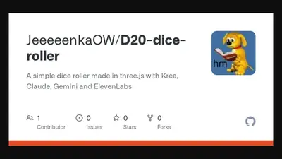</a> <b><a href="https://github.com/JeeeeenkaOW/D20-dice-roller">D20-dice-roller</a></b> <a href="https://github.com/JeeeeenkaOW">JeeeeenkaOW</a> 许可证未知 · <a href="https://github.com/JeeeeenkaOW/D20-dice-roller">代码</a></td>
<td width="25%" valign="top"> <b><a href="https://sultanpeyek.github.io/dagodao-claude-code-for-creatives-demo/">dagodao-claude-code-for-creatives-demo</a></b> <a href="https://github.com/sultanpeyek">sultanpeyek</a> MIT · <a href="https://github.com/sultanpeyek/dagodao-claude-code-for-creatives-demo">代码</a> · <a href="https://huggingface.co/datasets/AI-Terrarium/terrarium-open-works/tree/main/tools/dagodao-claude-code-for-creatives-demo">文件</a></td>
<td width="25%" valign="top"><a href="https://mcgregory99.github.io/downlink/">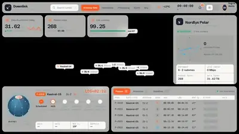</a> <b><a href="https://mcgregory99.github.io/downlink/">downlink</a></b> <a href="https://github.com/McGregory99">McGregory99</a> 许可证未知 · <a href="https://github.com/McGregory99/downlink">代码</a></td>
<td width="25%" valign="top"><a href="https://sarowarsuman.github.io/EduMind_3D_Platform_for_Child/">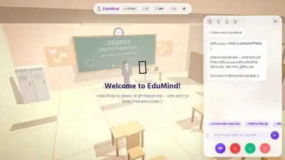</a> <b><a href="https://sarowarsuman.github.io/EduMind_3D_Platform_for_Child/">EduMind</a></b> <a href="https://github.com/SarowarSuman">Sarowar Suman</a> MIT · <a href="https://github.com/SarowarSuman/EduMind_3D_Platform_for_Child">代码</a> · <a href="https://huggingface.co/datasets/AI-Terrarium/terrarium-open-works/tree/main/tools/edumind">文件</a></td>
</tr>
<tr>
<td width="25%" valign="top"> <b><a href="https://github.com/bigerbigernerd/fiat-ludus">Fiat Ludus · 言出法随</a></b> <a href="https://github.com/bigerbigernerd">bigerbigernerd</a> MIT · <a href="https://github.com/bigerbigernerd/fiat-ludus">代码</a> · <a href="https://huggingface.co/datasets/AI-Terrarium/terrarium-open-works/tree/main/tools/fiat-ludus">文件</a></td>
<td width="25%" valign="top"> <b><a href="https://wally869.github.io/Floraison/">Floraison</a></b> <a href="https://github.com/Wally869">Wally869</a> MIT · <a href="https://github.com/Wally869/Floraison">代码</a> · <a href="https://huggingface.co/datasets/AI-Terrarium/terrarium-open-works/tree/main/tools/floraison">文件</a></td>
<td width="25%" valign="top"><a href="https://regala-flores-amarillas.pages.dev">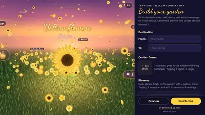</a> <b><a href="https://regala-flores-amarillas.pages.dev">flores-amarillas</a></b> <a href="https://github.com/jarlh19">jarlh19</a> 许可证未知 · <a href="https://github.com/jarlh19/flores-amarillas">代码</a></td>
<td width="25%" valign="top"> <b><a href="https://floss-and-hoop.pages.dev">Floss &amp; Hoop</a></b> <a href="https://github.com/adam-orsin">Adam Aldred</a> MIT · <a href="https://github.com/adam-orsin/floss-and-hoop">代码</a> · <a href="https://huggingface.co/datasets/AI-Terrarium/terrarium-open-works/tree/main/tools/floss-hoop">文件</a></td>
</tr>
<tr>
<td width="25%" valign="top"> <b><a href="https://tanuu5.github.io/clawd-flow-desk/">Flow Desk — Clawd の作業部屋</a></b> <a href="https://github.com/tanuu5">たぬ（tanu）</a> MIT · <a href="https://github.com/tanuu5/clawd-flow-desk">代码</a> · <a href="https://huggingface.co/datasets/AI-Terrarium/terrarium-open-works/tree/main/tools/flow-desk-clawd">文件</a></td>
<td width="25%" valign="top"> <b><a href="https://e-nicko.github.io/focal-plane/">Focal Plane</a></b> <a href="https://github.com/e-Nicko">Nickolai Yegorov</a> MIT · <a href="https://github.com/e-Nicko/focal-plane">代码</a> · <a href="https://huggingface.co/datasets/AI-Terrarium/terrarium-open-works/tree/main/tools/focal-plane">文件</a></td>
<td width="25%" valign="top"><a href="https://ahmadsaleh22.github.io/footprint-to-ifc/">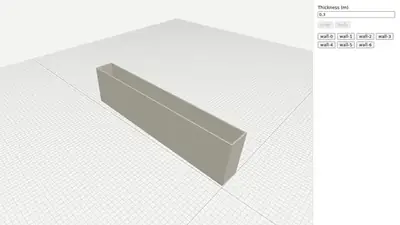</a> <b><a href="https://ahmadsaleh22.github.io/footprint-to-ifc/">footprint-to-ifc</a></b> <a href="https://github.com/AhmadSaleh22">AhmadSaleh22</a> 许可证未知 · <a href="https://github.com/AhmadSaleh22/footprint-to-ifc">代码</a></td>
<td width="25%" valign="top"><a href="https://robin-senpai.github.io/fpv-drone/">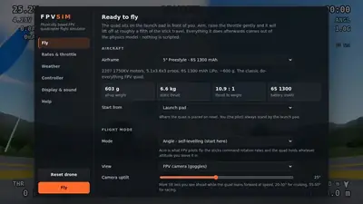</a> <b><a href="https://robin-senpai.github.io/fpv-drone/">fpv-drone</a></b> <a href="https://github.com/ROBIN-SENPAI">ROBIN-SENPAI</a> 许可证未知 · <a href="https://github.com/ROBIN-SENPAI/fpv-drone">代码</a></td>
</tr>
<tr>
<td width="25%" valign="top"> <b><a href="https://tobiasosborne.github.io/freescape-studio/">freescape-studio</a></b> <a href="https://github.com/tobiasosborne">tobiasosborne</a> MIT · <a href="https://github.com/tobiasosborne/freescape-studio">代码</a> · <a href="https://huggingface.co/datasets/AI-Terrarium/terrarium-open-works/tree/main/tools/freescape-studio">文件</a></td>
<td width="25%" valign="top"> <b><a href="https://github.com/moonarce/gemini_max">gemini_max</a></b> <a href="https://github.com/moonarce">moonarce</a> 许可证未知 · <a href="https://github.com/moonarce/gemini_max">代码</a></td>
<td width="25%" valign="top"> <b><a href="https://github.com/sujitha-2306/GeoMind-AI">GeoMind-AI</a></b> <a href="https://github.com/sujitha-2306">sujitha-2306</a> 许可证未知 · <a href="https://github.com/sujitha-2306/GeoMind-AI">代码</a></td>
<td width="25%" valign="top"><a href="https://gloriashang.github.io/">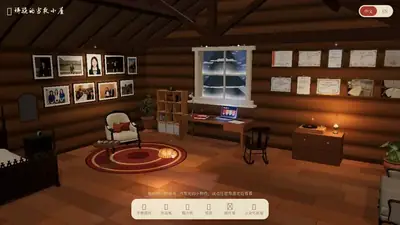</a> <b><a href="https://gloriashang.github.io/">GloriaShang.github.io</a></b> <a href="https://github.com/GloriaShang">GloriaShang</a> 许可证未知 · <a href="https://github.com/GloriaShang/GloriaShang.github.io">代码</a></td>
</tr>
<tr>
<td width="25%" valign="top"> <b><a href="https://chapeee.github.io/GRIDCITY/demo/">GRIDCITY</a></b> <a href="https://github.com/chapeee">Raj</a> MIT · <a href="https://github.com/chapeee/GRIDCITY">代码</a> · <a href="https://huggingface.co/datasets/AI-Terrarium/terrarium-open-works/tree/main/tools/gridcity">文件</a></td>
<td width="25%" valign="top"> <b><a href="https://sam1983aing.github.io/ticket-tear/">gsb-660-ba577a35fb6ee2e4</a></b> <a href="https://github.com/cxb2523">cxb2523</a> MIT · <a href="https://github.com/cxb2523/gsb-660-ba577a35fb6ee2e4">代码</a> · <a href="https://huggingface.co/datasets/AI-Terrarium/terrarium-open-works/tree/main/tools/gsb-660-ba577a35fb6ee2e4">文件</a></td>
<td width="25%" valign="top"> <b><a href="https://habitat-opal.vercel.app">habitat</a></b> <a href="https://github.com/surafel58">surafel58</a> 许可证未知 · <a href="https://github.com/surafel58/habitat">代码</a></td>
<td width="25%" valign="top"> <b><a href="https://holodeck-five.vercel.app">holodeck</a></b> <a href="https://github.com/maqbool-dev">maqbool-dev</a> 许可证未知 · <a href="https://github.com/maqbool-dev/holodeck">代码</a></td>
</tr>
<tr>
<td width="25%" valign="top"><a href="https://github.com/knuc18/home-network-3d-map">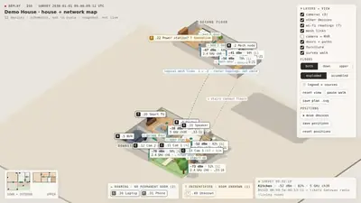</a> <b><a href="https://github.com/knuc18/home-network-3d-map">home-network-3d-map</a></b> <a href="https://github.com/knuc18">knuc18</a> MIT · <a href="https://github.com/knuc18/home-network-3d-map">代码</a> · <a href="https://huggingface.co/datasets/AI-Terrarium/terrarium-open-works/tree/main/tools/home-network-3d-map">文件</a></td>
<td width="25%" valign="top"> <b><a href="https://khanmjk.github.io/Fable51_Hourglass/">Hourglass · Digital Twin</a></b> <a href="https://github.com/khanmjk">khanmjk</a> MIT · <a href="https://github.com/khanmjk/Fable51_Hourglass">代码</a> · <a href="https://huggingface.co/datasets/AI-Terrarium/terrarium-open-works/tree/main/tools/hourglass-digital-twin">文件</a></td>
<td width="25%" valign="top"><a href="https://maxbol.github.io/house-visualizer/">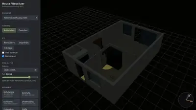</a> <b><a href="https://maxbol.github.io/house-visualizer/">house-visualizer</a></b> <a href="https://github.com/maxbol">maxbol</a> 许可证未知 · <a href="https://github.com/maxbol/house-visualizer">代码</a></td>
<td width="25%" valign="top"> <b><a href="https://8533502-dev.github.io/image-particle-fx/">image-particle-fx</a></b> <a href="https://github.com/8533502-dev">8533502-dev</a> MIT · <a href="https://github.com/8533502-dev/image-particle-fx">代码</a> · <a href="https://huggingface.co/datasets/AI-Terrarium/terrarium-open-works/tree/main/tools/image-particle-fx">文件</a></td>
</tr>
<tr>
<td width="25%" valign="top"> <b><a href="https://github.com/abhinavv9/interactive-3d-gemini-chatbot">interactive-3d-gemini-chatbot</a></b> <a href="https://github.com/abhinavv9">abhinavv9</a> 许可证未知 · <a href="https://github.com/abhinavv9/interactive-3d-gemini-chatbot">代码</a></td>
<td width="25%" valign="top"> <b><a href="https://jarvis.pateldhananjay.com/">J.A.R.V.I.S.</a></b> <a href="https://github.com/dhananjay09892">Dhananjay Patel</a> MIT · <a href="https://github.com/dhananjay09892/JARVIS">代码</a> · <a href="https://huggingface.co/datasets/AI-Terrarium/terrarium-open-works/tree/main/tools/j-a-r-v-i-s">文件</a></td>
<td width="25%" valign="top"><a href="https://github.com/IMINABO1/Janus">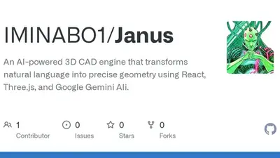</a> <b><a href="https://github.com/IMINABO1/Janus">Janus</a></b> <a href="https://github.com/IMINABO1">IMINABO1</a> 许可证未知 · <a href="https://github.com/IMINABO1/Janus">代码</a></td>
<td width="25%" valign="top"><a href="https://github.com/IMINABO1/Janus_new">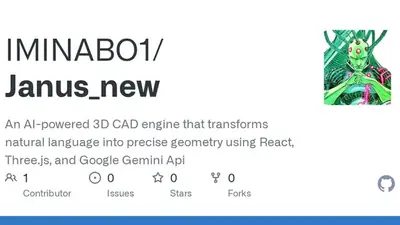</a> <b><a href="https://github.com/IMINABO1/Janus_new">Janus_new</a></b> <a href="https://github.com/IMINABO1">IMINABO1</a> 许可证未知 · <a href="https://github.com/IMINABO1/Janus_new">代码</a></td>
</tr>
<tr>
<td width="25%" valign="top"> <b><a href="https://github.com/Samvit-Govindani/kinegen-prosthetic-designer-">KineGen — Dynamic Prosthetic Foot Designer</a></b> <a href="https://github.com/Samvit-Govindani">Samvit Govindani</a> MIT · <a href="https://github.com/Samvit-Govindani/kinegen-prosthetic-designer-">代码</a> · <a href="https://huggingface.co/datasets/AI-Terrarium/terrarium-open-works/tree/main/tools/kinegen-dynamic-prosthetic-foot-designer">文件</a></td>
<td width="25%" valign="top"><a href="https://github.com/Qialet/kolo">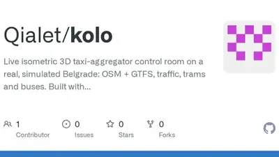</a> <b><a href="https://github.com/Qialet/kolo">Kolo</a></b> <a href="https://github.com/Qialet">Qialet</a> MIT · <a href="https://github.com/Qialet/kolo">代码</a> · <a href="https://huggingface.co/datasets/AI-Terrarium/terrarium-open-works/tree/main/tools/kolo">文件</a></td>
<td width="25%" valign="top"> <b><a href="https://public.mihai-safta.dev/lcars-demo/index.html">LCARS · Deck</a></b> <a href="https://github.com/saftacatalinmihai">Safta Catalin Mihai</a> MIT · <a href="https://github.com/saftacatalinmihai/lcars">代码</a> · <a href="https://huggingface.co/datasets/AI-Terrarium/terrarium-open-works/tree/main/tools/lcars-deck">文件</a></td>
<td width="25%" valign="top"> <b><a href="https://github.com/yusen-dev/living-ascii">Living ASCII</a></b> <a href="https://github.com/yusen-dev">Yusen</a> MIT · <a href="https://github.com/yusen-dev/living-ascii">代码</a> · <a href="https://huggingface.co/datasets/AI-Terrarium/terrarium-open-works/tree/main/tools/living-ascii">文件</a></td>
</tr>
<tr>
<td width="25%" valign="top"> <b><a href="https://maschinenraum.pages.dev">Maschinenraum</a></b> <a href="https://github.com/PieperStefan">PieperStefan</a> MIT · <a href="https://github.com/PieperStefan/maschinenraum">代码</a> · <a href="https://huggingface.co/datasets/AI-Terrarium/terrarium-open-works/tree/main/tools/maschinenraum">文件</a></td>
<td width="25%" valign="top"> <b><a href="https://zohaibmahar234.github.io/matchgrid-stadium-ops/">Matchgrid · Aldmere Arena</a></b> <a href="https://github.com/zohaibmahar234">ZOHAIB MAHAR</a> MIT · <a href="https://github.com/zohaibmahar234/matchgrid-stadium-ops">代码</a> · <a href="https://huggingface.co/datasets/AI-Terrarium/terrarium-open-works/tree/main/tools/matchgrid-aldmere-arena">文件</a></td>
<td width="25%" valign="top"><a href="https://harleycoops.github.io/Math-To-Manim/">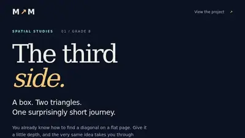</a> <b><a href="https://harleycoops.github.io/Math-To-Manim/">Math To Manim</a></b> <a href="https://github.com/HarleyCoops">Christian Harley Cooper</a> MIT · <a href="https://github.com/HarleyCoops/Math-To-Manim">代码</a> · <a href="https://huggingface.co/datasets/AI-Terrarium/terrarium-open-works/tree/main/tools/math-to-manim">文件</a></td>
<td width="25%" valign="top"> <b><a href="https://github.com/harshitkhandelwal208/3D-engine-Visualiser">MgCO₂ V6 Compression Engine — Interactive 3D Viewer</a></b> <a href="https://github.com/harshitkhandelwal208">Harshit Khandelwal</a> MIT · <a href="https://github.com/harshitkhandelwal208/3D-engine-Visualiser">代码</a> · <a href="https://huggingface.co/datasets/AI-Terrarium/terrarium-open-works/tree/main/tools/mgco2-v6-compression-engine-interactive-3d-viewer">文件</a></td>
</tr>
<tr>
<td width="25%" valign="top"><a href="https://0x6r1an0y.github.io/minecraft-head-viewer/">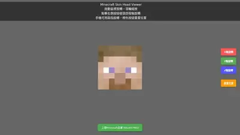</a> <b><a href="https://0x6r1an0y.github.io/minecraft-head-viewer/">minecraft-head-viewer</a></b> <a href="https://github.com/0x6r1an0y">0x6r1an0y</a> GPL-3.0 · <a href="https://github.com/0x6r1an0y/minecraft-head-viewer">代码</a> · <a href="https://huggingface.co/datasets/AI-Terrarium/terrarium-open-works/tree/main/tools/minecraft-head-viewer">文件</a></td>
<td width="25%" valign="top"> <b><a href="https://github.com/Abdullahijamilu/Motion-s">Motion-s</a></b> <a href="https://github.com/Abdullahijamilu">Abdullahijamilu</a> Apache-2.0 · <a href="https://github.com/Abdullahijamilu/Motion-s">代码</a> · <a href="https://huggingface.co/datasets/AI-Terrarium/terrarium-open-works/tree/main/tools/motion-s">文件</a></td>
<td width="25%" valign="top"> <b><a href="https://khanh020905.github.io/my-office/">My Office</a></b> <a href="https://github.com/khanh020905">Lê Nguyên Quốc Khánh</a> MIT · <a href="https://github.com/khanh020905/my-office">代码</a> · <a href="https://huggingface.co/datasets/AI-Terrarium/terrarium-open-works/tree/main/tools/my-office">文件</a></td>
<td width="25%" valign="top"><a href="https://necromaniac.vercel.app">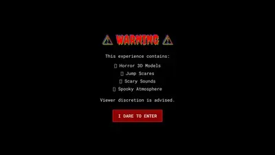</a> <b><a href="https://necromaniac.vercel.app">NECROMANIAC</a></b> <a href="https://github.com/aravindh99">Aravindh S</a> MIT · <a href="https://github.com/aravindh99/necromaniac">代码</a> · <a href="https://huggingface.co/datasets/AI-Terrarium/terrarium-open-works/tree/main/tools/necromaniac">文件</a></td>
</tr>
<tr>
<td width="25%" valign="top"> <b><a href="https://not-coders.vercel.app">NOT-CODERS</a></b> <a href="https://github.com/Rohit-Chaugle">Rohit-Chaugle</a> 许可证未知 · <a href="https://github.com/Rohit-Chaugle/NOT-CODERS">代码</a></td>
<td width="25%" valign="top"><a href="https://github.com/bruce12-glitch/Nullvoid.ai">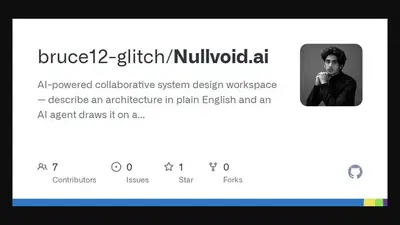</a> <b><a href="https://github.com/bruce12-glitch/Nullvoid.ai">Nullvoid.ai</a></b> <a href="https://github.com/bruce12-glitch">bruce12-glitch</a> 许可证未知 · <a href="https://github.com/bruce12-glitch/Nullvoid.ai">代码</a></td>
<td width="25%" valign="top"> <b><a href="https://orion.arnav.network">Orion</a></b> <a href="https://github.com/arnavgupta00">Arnav Gupta</a> MIT · <a href="https://github.com/arnavgupta00/orion">代码</a> · <a href="https://huggingface.co/datasets/AI-Terrarium/terrarium-open-works/tree/main/tools/orion">文件</a></td>
<td width="25%" valign="top"> <b><a href="https://github.com/KevanSoon/PathLens">PathLens</a></b> <a href="https://github.com/KevanSoon">KevanSoon</a> 许可证未知 · <a href="https://github.com/KevanSoon/PathLens">代码</a></td>
</tr>
<tr>
<td width="25%" valign="top"><a href="https://plan2world.vercel.app">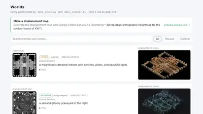</a> <b><a href="https://plan2world.vercel.app">plan2world</a></b> <a href="https://github.com/yeme-oss">yeme-oss</a> 许可证未知 · <a href="https://github.com/yeme-oss/plan2world">代码</a></td>
<td width="25%" valign="top"> <b><a href="https://mrpawelcz.github.io/planwalk/">planwalk</a></b> <a href="https://github.com/MrPawelCz">MrPawelCz</a> MIT · <a href="https://github.com/MrPawelCz/planwalk">代码</a> · <a href="https://huggingface.co/datasets/AI-Terrarium/terrarium-open-works/tree/main/tools/planwalk">文件</a></td>
<td width="25%" valign="top"> <b><a href="https://ibitlab.github.io/pub-hooks-for-pictures/">pub-hooks-for-pictures</a></b> <a href="https://github.com/ibitlab">ibitlab</a> CC-BY-NC-SA-4.0 · <a href="https://github.com/ibitlab/pub-hooks-for-pictures">代码</a> · <a href="https://huggingface.co/datasets/AI-Terrarium/terrarium-open-works/tree/main/tools/pub-hooks-for-pictures">文件</a></td>
<td width="25%" valign="top"><a href="https://github.com/ray-o-0509/robot-secretary">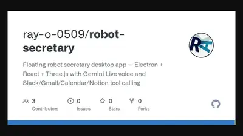</a> <b><a href="https://github.com/ray-o-0509/robot-secretary">robot-secretary</a></b> <a href="https://github.com/ray-o-0509">ray-o-0509</a> MIT · <a href="https://github.com/ray-o-0509/robot-secretary">代码</a> · <a href="https://huggingface.co/datasets/AI-Terrarium/terrarium-open-works/tree/main/tools/robot-secretary">文件</a></td>
</tr>
<tr>
<td width="25%" valign="top"> <b><a href="https://roomcraft-ivory.vercel.app">roomcraft</a></b> <a href="https://github.com/SD1920">SD1920</a> 许可证未知 · <a href="https://github.com/SD1920/roomcraft">代码</a></td>
<td width="25%" valign="top"> <b><a href="https://planta-do-ape.web.app">Roomprint</a></b> <a href="https://github.com/porcherm">Arthur Porcher</a> MIT · <a href="https://github.com/porcherm/planta-casa">代码</a> · <a href="https://huggingface.co/datasets/AI-Terrarium/terrarium-open-works/tree/main/tools/roomprint">文件</a></td>
<td width="25%" valign="top"> <b><a href="http://leereilly.net/rubiks-rubrics/">Rubik&#x27;s Rubrics</a></b> <a href="https://github.com/leereilly">Lee Reilly</a> MIT · <a href="https://github.com/leereilly/rubiks-rubrics">代码</a> · <a href="https://huggingface.co/datasets/AI-Terrarium/terrarium-open-works/tree/main/tools/rubik-s-rubrics">文件</a></td>
<td width="25%" valign="top"><a href="https://jeffhuber.github.io/rubiks-solver/">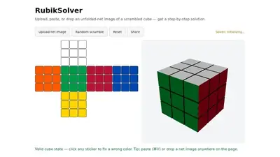</a> <b><a href="https://jeffhuber.github.io/rubiks-solver/">RubikSolver</a></b> <a href="https://github.com/jeffhuber">Jeff Huber</a> MIT · <a href="https://github.com/jeffhuber/rubiks-solver">代码</a> · <a href="https://huggingface.co/datasets/AI-Terrarium/terrarium-open-works/tree/main/tools/rubiksolver">文件</a></td>
</tr>
<tr>
<td width="25%" valign="top"> <b><a href="https://github.com/Fiki-io/samp-ai-map-editor">samp-ai-map-editor</a></b> <a href="https://github.com/Fiki-io">Fiki-io</a> MIT · <a href="https://github.com/Fiki-io/samp-ai-map-editor">代码</a> · <a href="https://huggingface.co/datasets/AI-Terrarium/terrarium-open-works/tree/main/tools/samp-ai-map-editor">文件</a></td>
<td width="25%" valign="top"> <b><a href="https://skyborne.dev">Skyborne</a></b> <a href="https://github.com/ishraq21">Mirza Ishraq</a> Apache-2.0 · <a href="https://github.com/ishraq21/skyborne">代码</a> · <a href="https://huggingface.co/datasets/AI-Terrarium/terrarium-open-works/tree/main/tools/skyborne">文件</a></td>
<td width="25%" valign="top"><a href="https://github.com/ChengZzz0904/solo-fm">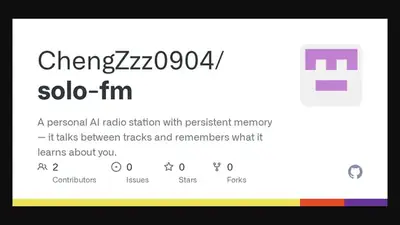</a> <b><a href="https://github.com/ChengZzz0904/solo-fm">solo-fm</a></b> <a href="https://github.com/ChengZzz0904">ChengZzz0904</a> MIT · <a href="https://github.com/ChengZzz0904/solo-fm">代码</a> · <a href="https://huggingface.co/datasets/AI-Terrarium/terrarium-open-works/tree/main/tools/solo-fm">文件</a></td>
<td width="25%" valign="top"> <b><a href="https://github.com/fokrulanthro16-eng/spatial-mindstudio-ai">Spatial MindStudio AI</a></b> <a href="https://github.com/fokrulanthro16-eng">FOKRUL ISLAM</a> MIT · <a href="https://github.com/fokrulanthro16-eng/spatial-mindstudio-ai">代码</a> · <a href="https://huggingface.co/datasets/AI-Terrarium/terrarium-open-works/tree/main/tools/spatial-mindstudio-ai">文件</a></td>
</tr>
<tr>
<td width="25%" valign="top"><a href="https://usespatialisapp.vercel.app/Simulator/">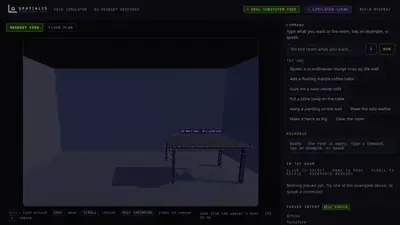</a> <b><a href="https://usespatialisapp.vercel.app/Simulator/">Spatialis</a></b> <a href="https://github.com/mrnetwork0001">Onwo Ifeanyichukwu Emmanuel</a> Apache-2.0 · <a href="https://github.com/mrnetwork0001/Spatialis">代码</a> · <a href="https://huggingface.co/datasets/AI-Terrarium/terrarium-open-works/tree/main/tools/spatialis">文件</a></td>
<td width="25%" valign="top"> <b><a href="https://github.com/GaspardCoche/synthcrew-mcp-game">synthcrew-mcp-game</a></b> <a href="https://github.com/GaspardCoche">GaspardCoche</a> 许可证未知 · <a href="https://github.com/GaspardCoche/synthcrew-mcp-game">代码</a></td>
<td width="25%" valign="top"> <b><a href="https://affan-ahmed-ghouri.github.io/T-Shirt-Customizer/">T-Shirt-Customizer</a></b> <a href="https://github.com/Affan-Ahmed-Ghouri">Affan-Ahmed-Ghouri</a> GPL-3.0 · <a href="https://github.com/Affan-Ahmed-Ghouri/T-Shirt-Customizer">代码</a> · <a href="https://huggingface.co/datasets/AI-Terrarium/terrarium-open-works/tree/main/tools/t-shirt-customizer">文件</a></td>
<td width="25%" valign="top"> <b><a href="https://felixgollnhuber.github.io/t3-office/">T3 Office</a></b> <a href="https://github.com/felixgollnhuber">Felix Gollnhuber</a> MIT · <a href="https://github.com/felixgollnhuber/t3-office">代码</a> · <a href="https://huggingface.co/datasets/AI-Terrarium/terrarium-open-works/tree/main/tools/t3-office">文件</a></td>
</tr>
<tr>
<td width="25%" valign="top"> <b><a href="https://sam1983aing.github.io/ticket-tear/">ticket-tear</a></b> <a href="https://github.com/Sam1983Aing">Sam1983Aing</a> MIT · <a href="https://github.com/Sam1983Aing/ticket-tear">代码</a> · <a href="https://huggingface.co/datasets/AI-Terrarium/terrarium-open-works/tree/main/tools/ticket-tear">文件</a></td>
<td width="25%" valign="top"><a href="https://github.com/ripa1993/vibe-interiors">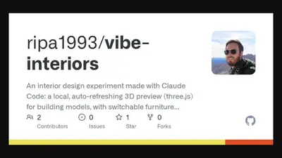</a> <b><a href="https://github.com/ripa1993/vibe-interiors">vibe-interiors</a></b> <a href="https://github.com/ripa1993">Simone Ripamonti</a> MIT · <a href="https://github.com/ripa1993/vibe-interiors">代码</a> · <a href="https://huggingface.co/datasets/AI-Terrarium/terrarium-open-works/tree/main/tools/vibe-interiors">文件</a></td>
<td width="25%" valign="top"> <b><a href="https://wag-me.github.io/vibeship/">Vibeship</a></b> <a href="https://github.com/wag-me">Giacomo Paolini</a> MIT · <a href="https://github.com/wag-me/vibeship">代码</a> · <a href="https://huggingface.co/datasets/AI-Terrarium/terrarium-open-works/tree/main/tools/vibeship">文件</a></td>
<td width="25%" valign="top"> <b><a href="https://realestateapp-rose.vercel.app">volume-study</a></b> <a href="https://github.com/vzwtim">vzwtim</a> 许可证未知 · <a href="https://github.com/vzwtim/volume-study">代码</a></td>
</tr>
<tr>
<td width="25%" valign="top"> <b><a href="https://huggingface.co/spaces/Miguelpef/voxel-viewer">Voxel Model Viewer</a></b> <a href="https://huggingface.co/Miguelpef">Miguelpef</a> 许可证未知 · <a href="https://huggingface.co/spaces/Miguelpef/voxel-viewer">代码</a></td>
<td width="25%" valign="top"> <b><a href="https://github.com/harukaappscreate/Voxel-Lab">Voxel-Lab 🧊✨</a></b> <a href="https://github.com/harukaappscreate">haruka_apps</a> MIT · <a href="https://github.com/harukaappscreate/Voxel-Lab">代码</a> · <a href="https://huggingface.co/datasets/AI-Terrarium/terrarium-open-works/tree/main/tools/voxel-lab">文件</a></td>
<td width="25%" valign="top"> <b><a href="https://github.com/theotherkoala/warehouse-llm-simulator">warehouse-llm-simulator</a></b> <a href="https://github.com/theotherkoala">theotherkoala</a> 许可证未知 · <a href="https://github.com/theotherkoala/warehouse-llm-simulator">代码</a></td>
<td width="25%" valign="top"><a href="https://dpappo.github.io/workbench/">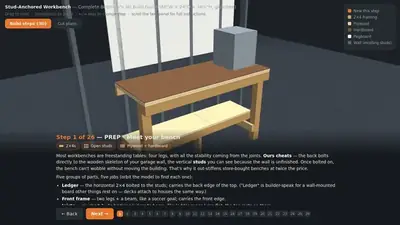</a> <b><a href="https://dpappo.github.io/workbench/">workbench</a></b> <a href="https://github.com/dpappo">dpappo</a> 许可证未知 · <a href="https://github.com/dpappo/workbench">代码</a></td>
</tr>
<tr>
<td width="25%" valign="top"> <b><a href="https://mindplottech.github.io/growing-reach/">あーちゃんが やる！ — Growing Reach</a></b> <a href="https://github.com/mindplottech">mindplottech</a> MIT · <a href="https://github.com/mindplottech/growing-reach">代码</a> · <a href="https://huggingface.co/datasets/AI-Terrarium/terrarium-open-works/tree/main/tools/growing-reach">文件</a></td>
<td width="25%" valign="top"><a href="https://anois.github.io/tarot/">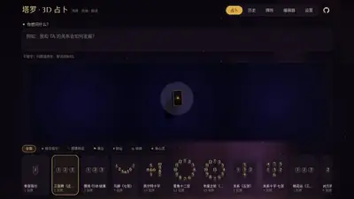</a> <b><a href="https://anois.github.io/tarot/">塔罗 · 3D 占卜</a></b> <a href="https://github.com/anois">今朝</a> MIT · <a href="https://github.com/anois/tarot">代码</a> · <a href="https://huggingface.co/datasets/AI-Terrarium/terrarium-open-works/tree/main/tools/3d">文件</a></td>
<td width="25%" valign="top"> <b><a href="https://www.modelscope.cn/studios/c8iolab/time-simulator">时间模拟器</a></b> <a href="https://github.com/diw35688-sketch">diw35688-sketch</a> MIT · <a href="https://github.com/diw35688-sketch/time-simulator">代码</a> · <a href="https://huggingface.co/datasets/AI-Terrarium/terrarium-open-works/tree/main/tools/time-simulator">文件</a></td>
<td width="25%" valign="top"> <b><a href="https://smart-warehouse-wine.vercel.app">智慧仓储数字孪生平台 (smart-warehouse)</a></b> <a href="https://github.com/Xxcool">Xxcool</a> MIT · <a href="https://github.com/Xxcool/smart-warehouse">代码</a> · <a href="https://huggingface.co/datasets/AI-Terrarium/terrarium-open-works/tree/main/tools/smart-warehouse">文件</a></td>
</tr>
<tr>
<td width="25%" valign="top"><a href="https://stanlee7.github.io/robot-arm-3d-lab/">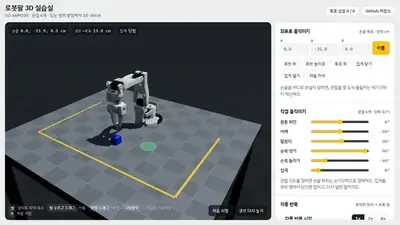</a> <b><a href="https://stanlee7.github.io/robot-arm-3d-lab/">로봇팔 3D 실습실 · robot-arm-3d-lab</a></b> <a href="https://github.com/stanlee7">stanlee tam</a> 合集，4 个作品 Apache-2.0 · <a href="https://github.com/stanlee7/robot-arm-3d-lab">代码</a> · <a href="https://huggingface.co/datasets/AI-Terrarium/terrarium-open-works/tree/main/tools/robot-arm-3d-lab">文件</a></td>
<td width="25%" valign="top"> <b><a href="https://github.com/fmhc/coverwatch">📚 Coverwatch</a></b> <a href="https://github.com/fmhc">fmhc</a> MIT · <a href="https://github.com/fmhc/coverwatch">代码</a> · <a href="https://huggingface.co/datasets/AI-Terrarium/terrarium-open-works/tree/main/tools/coverwatch">文件</a></td>
<td width="25%" valign="top"><a href="https://projectss-mauve.vercel.app">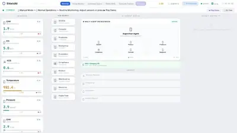</a> <b><a href="https://projectss-mauve.vercel.app">🛡️ ShieldAI — Industrial Safety Intelligence</a></b> <a href="https://github.com/shdra06">shdra06</a> MIT · <a href="https://github.com/shdra06/ShieldAI-Industrial-Safety-Intelligence">代码</a> · <a href="https://huggingface.co/datasets/AI-Terrarium/terrarium-open-works/tree/main/tools/shieldai-industrial-safety-intelligence">文件</a></td>
<td width="25%"></td>
</tr>
</table>

没有预览图的作品：

<table>

<tr><th align="left">作品</th><th align="left">作者</th><th align="left">许可证</th><th align="left">链接</th></tr>

<tr><td><a href="https://github.com/721abhay/-ai-lab-partner">-ai-lab-partner</a></td><td><a href="https://github.com/721abhay">721abhay</a></td><td>许可证未知</td><td><a href="https://github.com/721abhay/-ai-lab-partner">代码</a></td></tr>

<tr><td><a href="https://github.com/Akshatsrii/3d-tshirt-ai-designer">3d-tshirt-ai-designer</a></td><td><a href="https://github.com/Akshatsrii">Akshatsrii</a></td><td>许可证未知</td><td><a href="https://github.com/Akshatsrii/3d-tshirt-ai-designer">代码</a></td></tr>

<tr><td><a href="https://github.com/rightgo09/ai-3d-generator">ai-3d-generator</a></td><td><a href="https://github.com/rightgo09">rightgo09</a></td><td>MIT</td><td><a href="https://github.com/rightgo09/ai-3d-generator">代码</a> · <a href="https://huggingface.co/datasets/AI-Terrarium/terrarium-open-works/tree/main/tools/ai-3d-generator">文件</a></td></tr>

<tr><td><a href="https://github.com/daksh473/AntiGravity-particle-ai">AntiGravity-particle-ai</a></td><td><a href="https://github.com/daksh473">daksh473</a></td><td>许可证未知</td><td><a href="https://github.com/daksh473/AntiGravity-particle-ai">代码</a></td></tr>

<tr><td><a href="https://github.com/greasyjoe91/danggui-3d-courseware">danggui-3d-courseware</a></td><td><a href="https://github.com/greasyjoe91">greasyjoe91</a></td><td>许可证未知</td><td><a href="https://github.com/greasyjoe91/danggui-3d-courseware">代码</a></td></tr>

<tr><td><a href="https://github.com/112zjw/HoloEarth">HoloEarth</a></td><td><a href="https://github.com/112zjw">112zjw</a></td><td>MIT</td><td><a href="https://github.com/112zjw/HoloEarth">代码</a> · <a href="https://huggingface.co/datasets/AI-Terrarium/terrarium-open-works/tree/main/tools/holoearth">文件</a></td></tr>

<tr><td><a href="https://iastronaut.onrender.com/index.html">IAstronaut: Mentor Virtual Multimodal</a> 合集，3 个作品</td><td><a href="https://github.com/silexened-create">silexened-create</a></td><td>MIT</td><td><a href="https://github.com/silexened-create/IAstronaut">代码</a> · <a href="https://huggingface.co/datasets/AI-Terrarium/terrarium-open-works/tree/main/tools/iastronaut">文件</a></td></tr>

<tr><td><a href="https://github.com/Bryan2517/neuralsign">neuralsign</a></td><td><a href="https://github.com/Bryan2517">Bryan2517</a></td><td>MIT</td><td><a href="https://github.com/Bryan2517/neuralsign">代码</a> · <a href="https://huggingface.co/datasets/AI-Terrarium/terrarium-open-works/tree/main/tools/neuralsign">文件</a></td></tr>

<tr><td><a href="https://github.com/rengbas99/storycraft-3d">storycraft-3d</a></td><td><a href="https://github.com/rengbas99">rengbas99</a></td><td>许可证未知</td><td><a href="https://github.com/rengbas99/storycraft-3d">代码</a></td></tr>

<tr><td><a href="https://github.com/PrincessHemen/threejs">threejs</a></td><td><a href="https://github.com/PrincessHemen">PrincessHemen</a></td><td>MIT</td><td><a href="https://github.com/PrincessHemen/threejs">代码</a> · <a href="https://huggingface.co/datasets/AI-Terrarium/terrarium-open-works/tree/main/tools/threejs">文件</a></td></tr>

<tr><td><a href="https://github.com/NewTurn2017/vibe-draw">vibe-draw</a></td><td><a href="https://github.com/NewTurn2017">NewTurn2017</a></td><td>AGPL-3.0</td><td><a href="https://github.com/NewTurn2017/vibe-draw">代码</a> · <a href="https://huggingface.co/datasets/AI-Terrarium/terrarium-open-works/tree/main/tools/vibe-draw">文件</a></td></tr>

<tr><td><a href="https://github.com/utpal1kumar/ziupra--store">ziupra--store</a></td><td><a href="https://github.com/utpal1kumar">utpal1kumar</a></td><td>MIT</td><td><a href="https://github.com/utpal1kumar/ziupra--store">代码</a> · <a href="https://huggingface.co/datasets/AI-Terrarium/terrarium-open-works/tree/main/tools/ziupra-store">文件</a></td></tr>

</table>

<!-- CATALOG:END -->

---

 <a href="../docs/i18n/README.zh-CN.md">首页</a> · <a href="../games/README.zh-CN.md">游戏</a> · <a href="../scenes/README.zh-CN.md">世界与场景</a> · <a href="../videos/README.zh-CN.md">视频</a> · <a href="README.zh-CN.md">工具</a> · <a href="../visualizations/README.zh-CN.md">可视化</a> · <a href="../wallpapers/README.zh-CN.md">壁纸</a> · <a href="#top">返回顶部</a> 目录数据：2026-11-23

