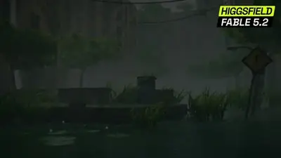
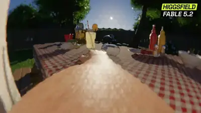
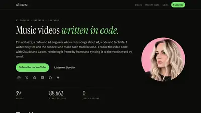
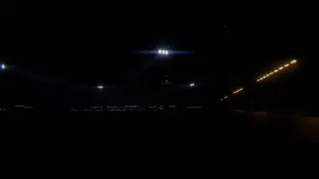
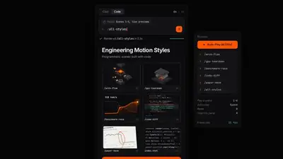
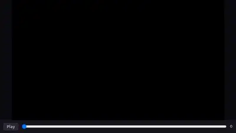
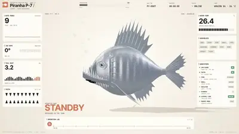
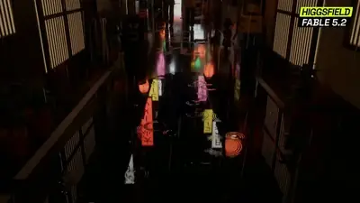
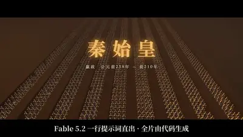
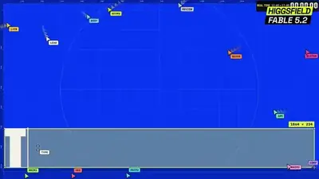

<b>Terrarium</b>

<a href="README.md">English</a> · <a href="README.zh-CN.md">简体中文</a> · <a href="README.zh-TW.md">繁體中文</a> · <a href="README.ja.md">日本語</a> · <a href="README.ko.md">한국어</a> · <a href="README.es.md">Español</a> · <a href="README.pt-BR.md">Português</a> · <b>Français</b> · <a href="README.de.md">Deutsch</a> · <a href="README.ru.md">Русский</a>

<a href="../docs/i18n/README.fr.md#trending">Populaires</a> · <a href="../docs/i18n/README.fr.md#latest">Nouveautés</a> · <a href="../docs/i18n/README.fr.md#contents">Sommaire</a>

<h1 align="center">Vidéos</h1>

17 entrées. Courts métrages, animations et expériences visuelles rendus par du code.

<!-- CATALOG:START -->

<table>
<tr>
<td width="25%" valign="top"> <b><a href="https://x.com/higgsfield_ai/status/2119904269235277978">A cat wakes an old robot</a></b> <a href="https://x.com/higgsfield_ai">Higgsfield</a> Licence inconnue</td>
<td width="25%" valign="top"> <b><a href="https://x.com/higgsfield_ai/status/2119907841599496421">A fly&#x27;s-eye picnic</a></b> <a href="https://x.com/higgsfield_ai">Higgsfield</a> Licence inconnue</td>
<td width="25%" valign="top"> <b><a href="https://github.com/aditazzz/Suno-YouTube-aditazzz-Music">aditazzz music videos, made in code</a></b> <a href="https://github.com/aditazzz">Adita Zeqollari</a> Collection de 21 œuvres MIT · <a href="https://github.com/aditazzz/Suno-YouTube-aditazzz-Music">Code</a> · <a href="https://huggingface.co/datasets/awesome-fable-5-2/terrarium-open-works/tree/main/videos/suno-youtube-aditazzz-music">Fichiers</a></td>
<td width="25%" valign="top"> <b><a href="https://x.com/danteeonsol/status/2119887623070077213">Area 51 UFO visit</a></b> <a href="https://x.com/danteeonsol">danteeonsol</a> Licence inconnue</td>
</tr>
<tr>
<td width="25%" valign="top"> <b><a href="https://github.com/anstapnever/colossus">COLOSSUS · 巨像</a></b> <a href="https://github.com/anstapnever">anstap</a> MIT · <a href="https://github.com/anstapnever/colossus">Code</a> · <a href="https://huggingface.co/datasets/awesome-fable-5-2/terrarium-open-works/tree/main/videos/colossus">Fichiers</a></td>
<td width="25%" valign="top"> <b><a href="https://github.com/NightlyBuildHQ/slash-motion">Motion Studio</a></b> <a href="https://github.com/NightlyBuildHQ">NightlyBuild</a> Collection de 4 œuvres MIT · <a href="https://github.com/NightlyBuildHQ/slash-motion">Code</a> · <a href="https://huggingface.co/datasets/awesome-fable-5-2/terrarium-open-works/tree/main/videos/slash-motion">Fichiers</a></td>
<td width="25%" valign="top"> <b><a href="https://github.com/anstapnever/one-sweep">ONE SWEEP · 一掃</a></b> <a href="https://github.com/anstapnever">anstap</a> MIT · <a href="https://github.com/anstapnever/one-sweep">Code</a> · <a href="https://huggingface.co/datasets/awesome-fable-5-2/terrarium-open-works/tree/main/videos/one-sweep">Fichiers</a></td>
<td width="25%" valign="top"> <b><a href="https://x.com/fuoeba/status/2119906486017307074">Path-traced voxel creature</a></b> <a href="https://x.com/fuoeba">fuoeba</a> Licence inconnue</td>
</tr>
<tr>
<td width="25%" valign="top"> <b><a href="https://x.com/Scratcherrrr/status/2119909780269785332">Piranha P-7</a></b> <a href="https://x.com/Scratcherrrr">Scratcherrrr</a> Licence inconnue</td>
<td width="25%" valign="top"> <b><a href="https://x.com/higgsfield_ai/status/2119905141822484595">Rainy Tokyo alley</a></b> <a href="https://x.com/higgsfield_ai">Higgsfield</a> Licence inconnue</td>
<td width="25%" valign="top"> <b><a href="https://x.com/rileybrown/status/2119902109709537708">The Edge</a></b> <a href="https://x.com/rileybrown">Riley Brown</a> Licence inconnue</td>
<td width="25%" valign="top"> <b><a href="https://www.bilibili.com/video/BV1ByWM6mE1D/">The Life of Qin Shi Huang</a></b> 卡其ya_ Licence inconnue</td>
</tr>
<tr>
<td width="25%" valign="top"> <b><a href="https://x.com/higgsfield_ai/status/2120007830065614926">TORQK</a></b> <a href="https://x.com/higgsfield_ai">Higgsfield</a> Licence inconnue</td>
<td width="25%"></td>
<td width="25%"></td>
<td width="25%"></td>
</tr>
</table>

Œuvres sans image d’aperçu :

<table>
<tr><th align="left">Œuvre</th><th align="left">Créateur</th><th align="left">Licence</th><th align="left">Liens</th></tr>
<tr><td><a href="https://github.com/Infatoshi/ai-video">ai-video</a> · Collection de 7 œuvres</td><td><a href="https://github.com/Infatoshi">Elliot Arledge</a></td><td>MIT</td><td><a href="https://github.com/Infatoshi/ai-video">Code</a> · <a href="https://huggingface.co/datasets/awesome-fable-5-2/terrarium-open-works/tree/main/videos/ai-video">Fichiers</a></td></tr>
<tr><td><a href="https://github.com/anstapnever/blackout">BLACKOUT · 停電</a></td><td><a href="https://github.com/anstapnever">anstap</a></td><td>MIT</td><td><a href="https://github.com/anstapnever/blackout">Code</a> · <a href="https://huggingface.co/datasets/awesome-fable-5-2/terrarium-open-works/tree/main/videos/blackout">Fichiers</a></td></tr>
<tr><td><a href="https://github.com/Leonxlnx/golden-temple/releases/latest">Golden Temple</a></td><td><a href="https://github.com/Leonxlnx">Leon Lin</a></td><td>MIT</td><td><a href="https://github.com/Leonxlnx/golden-temple">Code</a> · <a href="https://huggingface.co/datasets/awesome-fable-5-2/terrarium-open-works/tree/main/videos/golden-temple">Fichiers</a></td></tr>
<tr><td><a href="https://github.com/pj4533/pnn">PNN: Pre News Network</a></td><td><a href="https://github.com/pj4533">PJ Gray</a></td><td>MIT</td><td><a href="https://github.com/pj4533/pnn">Code</a> · <a href="https://huggingface.co/datasets/awesome-fable-5-2/terrarium-open-works/tree/main/videos/pnn-pre-news-network">Fichiers</a></td></tr>
</table>

<!-- CATALOG:END -->

---

 <a href="../docs/i18n/README.fr.md">Accueil</a> · <a href="../games/README.fr.md">Jeux</a> · <a href="../scenes/README.fr.md">Mondes et scènes</a> · <a href="README.fr.md">Vidéos</a> · <a href="../tools/README.fr.md">Outils</a> · <a href="../visualizations/README.fr.md">Visualisations</a> · <a href="../wallpapers/README.fr.md">Fonds d’écran</a> · <a href="#top">Retour en haut</a> Données du catalogue : 2026-11-14

