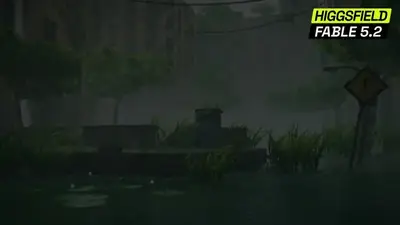
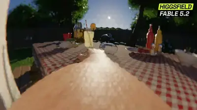
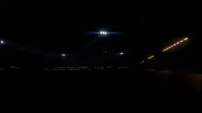
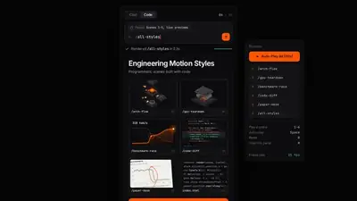
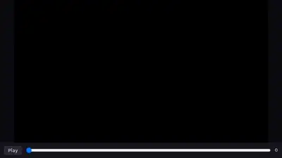
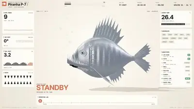
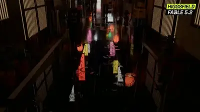
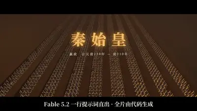
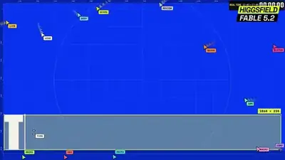

<b>Terrarium</b>

<a href="README.md">English</a> · <a href="README.zh-CN.md">简体中文</a> · <a href="README.zh-TW.md">繁體中文</a> · <b>日本語</b> · <a href="README.ko.md">한국어</a> <a href="README.es.md">Español</a> · <a href="README.pt-BR.md">Português</a> · <a href="README.fr.md">Français</a> · <a href="README.de.md">Deutsch</a> · <a href="README.ru.md">Русский</a>

<a href="../README.ja.md#trending">人気</a> · <a href="../README.ja.md#latest">新着</a> · <a href="../README.ja.md#contents">目次</a>

<h1 align="center">動画</h1>

17 件。 コードで描かれた短編映像、アニメーション、ビジュアル実験。

<!-- CATALOG:START -->

<table>
<tr>
<td width="25%" valign="top"> <b><a href="https://x.com/higgsfield_ai/status/2119904269235277978">A cat wakes an old robot</a></b> <a href="https://x.com/higgsfield_ai">Higgsfield</a> ライセンス不明</td>
<td width="25%" valign="top"> <b><a href="https://x.com/higgsfield_ai/status/2119907841599496421">A fly&#x27;s-eye picnic</a></b> <a href="https://x.com/higgsfield_ai">Higgsfield</a> ライセンス不明</td>
<td width="25%" valign="top"> <b><a href="https://github.com/aditazzz/Suno-YouTube-aditazzz-Music">aditazzz music videos, made in code</a></b> <a href="https://github.com/aditazzz">Adita Zeqollari</a> コレクション・21 作品 MIT · <a href="https://github.com/aditazzz/Suno-YouTube-aditazzz-Music">ソース</a> · <a href="https://huggingface.co/datasets/awesome-fable-5-2/terrarium-open-works/tree/main/videos/suno-youtube-aditazzz-music">ファイル</a></td>
<td width="25%" valign="top"> <b><a href="https://x.com/danteeonsol/status/2119887623070077213">Area 51 UFO visit</a></b> <a href="https://x.com/danteeonsol">danteeonsol</a> ライセンス不明</td>
</tr>
<tr>
<td width="25%" valign="top"> <b><a href="https://github.com/anstapnever/colossus">COLOSSUS · 巨像</a></b> <a href="https://github.com/anstapnever">anstap</a> MIT · <a href="https://github.com/anstapnever/colossus">ソース</a> · <a href="https://huggingface.co/datasets/awesome-fable-5-2/terrarium-open-works/tree/main/videos/colossus">ファイル</a></td>
<td width="25%" valign="top"> <b><a href="https://github.com/NightlyBuildHQ/slash-motion">Motion Studio</a></b> <a href="https://github.com/NightlyBuildHQ">NightlyBuild</a> コレクション・4 作品 MIT · <a href="https://github.com/NightlyBuildHQ/slash-motion">ソース</a> · <a href="https://huggingface.co/datasets/awesome-fable-5-2/terrarium-open-works/tree/main/videos/slash-motion">ファイル</a></td>
<td width="25%" valign="top"> <b><a href="https://github.com/anstapnever/one-sweep">ONE SWEEP · 一掃</a></b> <a href="https://github.com/anstapnever">anstap</a> MIT · <a href="https://github.com/anstapnever/one-sweep">ソース</a> · <a href="https://huggingface.co/datasets/awesome-fable-5-2/terrarium-open-works/tree/main/videos/one-sweep">ファイル</a></td>
<td width="25%" valign="top"> <b><a href="https://x.com/fuoeba/status/2119906486017307074">Path-traced voxel creature</a></b> <a href="https://x.com/fuoeba">fuoeba</a> ライセンス不明</td>
</tr>
<tr>
<td width="25%" valign="top"> <b><a href="https://x.com/Scratcherrrr/status/2119909780269785332">Piranha P-7</a></b> <a href="https://x.com/Scratcherrrr">Scratcherrrr</a> ライセンス不明</td>
<td width="25%" valign="top"> <b><a href="https://x.com/higgsfield_ai/status/2119905141822484595">Rainy Tokyo alley</a></b> <a href="https://x.com/higgsfield_ai">Higgsfield</a> ライセンス不明</td>
<td width="25%" valign="top"> <b><a href="https://x.com/rileybrown/status/2119902109709537708">The Edge</a></b> <a href="https://x.com/rileybrown">Riley Brown</a> ライセンス不明</td>
<td width="25%" valign="top"> <b><a href="https://www.bilibili.com/video/BV1ByWM6mE1D/">The Life of Qin Shi Huang</a></b> 卡其ya_ ライセンス不明</td>
</tr>
<tr>
<td width="25%" valign="top"> <b><a href="https://x.com/higgsfield_ai/status/2120007830065614926">TORQK</a></b> <a href="https://x.com/higgsfield_ai">Higgsfield</a> ライセンス不明</td>
<td width="25%"></td>
<td width="25%"></td>
<td width="25%"></td>
</tr>
</table>

プレビュー画像のない作品：

<table>
<tr><th align="left">作品</th><th align="left">作者</th><th align="left">ライセンス</th><th align="left">リンク</th></tr>
<tr><td><a href="https://github.com/Infatoshi/ai-video">ai-video</a> · コレクション・7 作品</td><td><a href="https://github.com/Infatoshi">Elliot Arledge</a></td><td>MIT</td><td><a href="https://github.com/Infatoshi/ai-video">ソース</a> · <a href="https://huggingface.co/datasets/awesome-fable-5-2/terrarium-open-works/tree/main/videos/ai-video">ファイル</a></td></tr>
<tr><td><a href="https://github.com/anstapnever/blackout">BLACKOUT · 停電</a></td><td><a href="https://github.com/anstapnever">anstap</a></td><td>MIT</td><td><a href="https://github.com/anstapnever/blackout">ソース</a> · <a href="https://huggingface.co/datasets/awesome-fable-5-2/terrarium-open-works/tree/main/videos/blackout">ファイル</a></td></tr>
<tr><td><a href="https://github.com/Leonxlnx/golden-temple/releases/latest">Golden Temple</a></td><td><a href="https://github.com/Leonxlnx">Leon Lin</a></td><td>MIT</td><td><a href="https://github.com/Leonxlnx/golden-temple">ソース</a> · <a href="https://huggingface.co/datasets/awesome-fable-5-2/terrarium-open-works/tree/main/videos/golden-temple">ファイル</a></td></tr>
<tr><td><a href="https://github.com/pj4533/pnn">PNN: Pre News Network</a></td><td><a href="https://github.com/pj4533">PJ Gray</a></td><td>MIT</td><td><a href="https://github.com/pj4533/pnn">ソース</a> · <a href="https://huggingface.co/datasets/awesome-fable-5-2/terrarium-open-works/tree/main/videos/pnn-pre-news-network">ファイル</a></td></tr>
</table>

<!-- CATALOG:END -->

---

 <a href="../README.ja.md">ホーム</a> · <a href="../games/README.ja.md">ゲーム</a> · <a href="../scenes/README.ja.md">ワールドとシーン</a> · <a href="../videos/README.ja.md">動画</a> · <a href="../tools/README.ja.md">ツール</a> · <a href="../visualizations/README.ja.md">可視化</a> · <a href="../wallpapers/README.ja.md">壁紙</a> · <a href="#top">トップへ</a> カタログのデータ：2026-11-14

