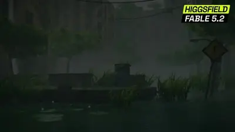
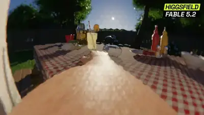
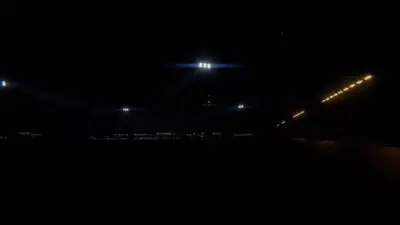
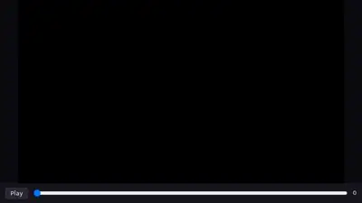
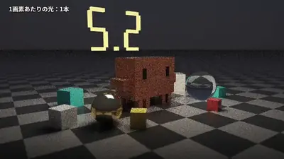
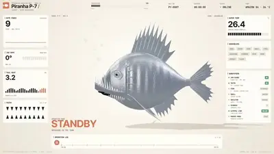
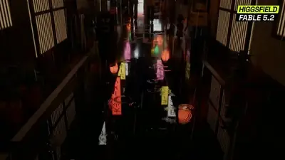
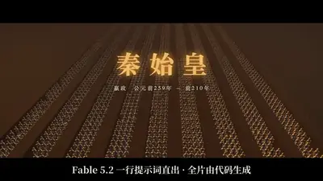
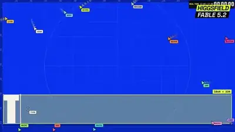

<b>Terrarium</b>

<a href="README.md">English</a> · <a href="README.zh-CN.md">简体中文</a> · <a href="README.zh-TW.md">繁體中文</a> · <a href="README.ja.md">日本語</a> · <b>한국어</b> · <a href="README.es.md">Español</a> · <a href="README.pt-BR.md">Português</a> · <a href="README.fr.md">Français</a> · <a href="README.de.md">Deutsch</a> · <a href="README.ru.md">Русский</a>

<a href="../docs/i18n/README.ko.md#trending">인기</a> · <a href="../docs/i18n/README.ko.md#latest">최신</a> · <a href="../docs/i18n/README.ko.md#contents">목차</a>

<h1 align="center">영상</h1>

17개 항목. 코드로 렌더링한 단편 영상, 애니메이션과 시각 실험.

<!-- CATALOG:START -->

<table>
<tr>
<td width="25%" valign="top"> <b><a href="https://x.com/higgsfield_ai/status/2119904269235277978">A cat wakes an old robot</a></b> <a href="https://x.com/higgsfield_ai">Higgsfield</a> 라이선스 미확인</td>
<td width="25%" valign="top"> <b><a href="https://x.com/higgsfield_ai/status/2119907841599496421">A fly&#x27;s-eye picnic</a></b> <a href="https://x.com/higgsfield_ai">Higgsfield</a> 라이선스 미확인</td>
<td width="25%" valign="top"> <b><a href="https://github.com/aditazzz/Suno-YouTube-aditazzz-Music">aditazzz music videos, made in code</a></b> <a href="https://github.com/aditazzz">Adita Zeqollari</a> 모음집 · 작품 21개 MIT · <a href="https://github.com/aditazzz/Suno-YouTube-aditazzz-Music">코드</a> · <a href="https://huggingface.co/datasets/awesome-fable-5-2/terrarium-open-works/tree/main/videos/suno-youtube-aditazzz-music">파일</a></td>
<td width="25%" valign="top"> <b><a href="https://x.com/danteeonsol/status/2119887623070077213">Area 51 UFO visit</a></b> <a href="https://x.com/danteeonsol">danteeonsol</a> 라이선스 미확인</td>
</tr>
<tr>
<td width="25%" valign="top"> <b><a href="https://github.com/anstapnever/colossus">COLOSSUS · 巨像</a></b> <a href="https://github.com/anstapnever">anstap</a> MIT · <a href="https://github.com/anstapnever/colossus">코드</a> · <a href="https://huggingface.co/datasets/awesome-fable-5-2/terrarium-open-works/tree/main/videos/colossus">파일</a></td>
<td width="25%" valign="top"> <b><a href="https://github.com/NightlyBuildHQ/slash-motion">Motion Studio</a></b> <a href="https://github.com/NightlyBuildHQ">NightlyBuild</a> 모음집 · 작품 4개 MIT · <a href="https://github.com/NightlyBuildHQ/slash-motion">코드</a> · <a href="https://huggingface.co/datasets/awesome-fable-5-2/terrarium-open-works/tree/main/videos/slash-motion">파일</a></td>
<td width="25%" valign="top"> <b><a href="https://github.com/anstapnever/one-sweep">ONE SWEEP · 一掃</a></b> <a href="https://github.com/anstapnever">anstap</a> MIT · <a href="https://github.com/anstapnever/one-sweep">코드</a> · <a href="https://huggingface.co/datasets/awesome-fable-5-2/terrarium-open-works/tree/main/videos/one-sweep">파일</a></td>
<td width="25%" valign="top"> <b><a href="https://x.com/fuoeba/status/2119906486017307074">Path-traced voxel creature</a></b> <a href="https://x.com/fuoeba">fuoeba</a> 라이선스 미확인</td>
</tr>
<tr>
<td width="25%" valign="top"> <b><a href="https://x.com/Scratcherrrr/status/2119909780269785332">Piranha P-7</a></b> <a href="https://x.com/Scratcherrrr">Scratcherrrr</a> 라이선스 미확인</td>
<td width="25%" valign="top"> <b><a href="https://x.com/higgsfield_ai/status/2119905141822484595">Rainy Tokyo alley</a></b> <a href="https://x.com/higgsfield_ai">Higgsfield</a> 라이선스 미확인</td>
<td width="25%" valign="top"> <b><a href="https://x.com/rileybrown/status/2119902109709537708">The Edge</a></b> <a href="https://x.com/rileybrown">Riley Brown</a> 라이선스 미확인</td>
<td width="25%" valign="top"> <b><a href="https://www.bilibili.com/video/BV1ByWM6mE1D/">The Life of Qin Shi Huang</a></b> 卡其ya_ 라이선스 미확인</td>
</tr>
<tr>
<td width="25%" valign="top"> <b><a href="https://x.com/higgsfield_ai/status/2120007830065614926">TORQK</a></b> <a href="https://x.com/higgsfield_ai">Higgsfield</a> 라이선스 미확인</td>
<td width="25%"></td>
<td width="25%"></td>
<td width="25%"></td>
</tr>
</table>

미리보기 이미지가 없는 작품:

<table>
<tr><th align="left">작품</th><th align="left">창작자</th><th align="left">라이선스</th><th align="left">링크</th></tr>
<tr><td><a href="https://github.com/Infatoshi/ai-video">ai-video</a> · 모음집 · 작품 7개</td><td><a href="https://github.com/Infatoshi">Elliot Arledge</a></td><td>MIT</td><td><a href="https://github.com/Infatoshi/ai-video">코드</a> · <a href="https://huggingface.co/datasets/awesome-fable-5-2/terrarium-open-works/tree/main/videos/ai-video">파일</a></td></tr>
<tr><td><a href="https://github.com/anstapnever/blackout">BLACKOUT · 停電</a></td><td><a href="https://github.com/anstapnever">anstap</a></td><td>MIT</td><td><a href="https://github.com/anstapnever/blackout">코드</a> · <a href="https://huggingface.co/datasets/awesome-fable-5-2/terrarium-open-works/tree/main/videos/blackout">파일</a></td></tr>
<tr><td><a href="https://github.com/Leonxlnx/golden-temple/releases/latest">Golden Temple</a></td><td><a href="https://github.com/Leonxlnx">Leon Lin</a></td><td>MIT</td><td><a href="https://github.com/Leonxlnx/golden-temple">코드</a> · <a href="https://huggingface.co/datasets/awesome-fable-5-2/terrarium-open-works/tree/main/videos/golden-temple">파일</a></td></tr>
<tr><td><a href="https://github.com/pj4533/pnn">PNN: Pre News Network</a></td><td><a href="https://github.com/pj4533">PJ Gray</a></td><td>MIT</td><td><a href="https://github.com/pj4533/pnn">코드</a> · <a href="https://huggingface.co/datasets/awesome-fable-5-2/terrarium-open-works/tree/main/videos/pnn-pre-news-network">파일</a></td></tr>
</table>

<!-- CATALOG:END -->

---

 <a href="../docs/i18n/README.ko.md">홈</a> · <a href="../games/README.ko.md">게임</a> · <a href="../scenes/README.ko.md">월드와 장면</a> · <a href="README.ko.md">영상</a> · <a href="../tools/README.ko.md">도구</a> · <a href="../visualizations/README.ko.md">시각화</a> · <a href="../wallpapers/README.ko.md">배경화면</a> · <a href="#top">맨 위로</a> 목록 데이터: 2026-11-14

