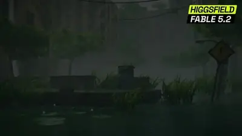
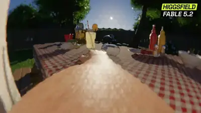
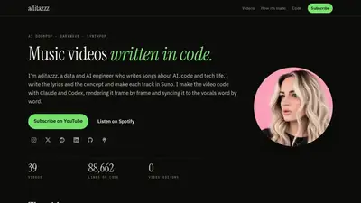
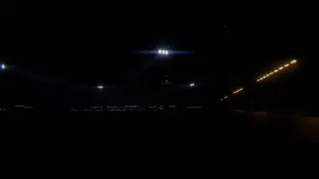
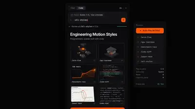
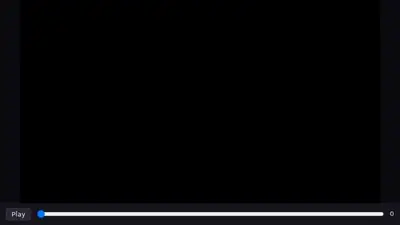
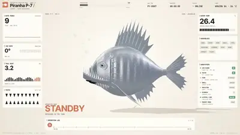
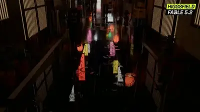
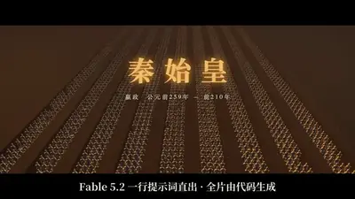
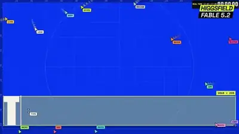

<a href="../README.md"><picture><source media="(prefers-color-scheme: dark)" srcset="../assets/logo-dark.svg"></picture></a>

<b>Open 3D Worlds Made with Code</b>

<a href="../README.md">Home</a> · <a href="../games/README.md">Games</a> · <b>Videos</b> · <a href="../scenes/README.md">Scenes</a> · <a href="../wallpapers/README.md">Wallpapers</a> · <a href="../tools/README.md">Tools</a> · <a href="../visualizations/README.md">Visualizations</a> <b>English</b> · <a href="README.zh-CN.md">简体中文</a>

<h1 align="center">Videos</h1>

17 entries. Works whose main content is one video, such as a short film rendered by code.

<table>
<tr>
<td width="25%" valign="top"> <b><a href="https://x.com/higgsfield_ai/status/2119904269235277978">A cat wakes an old robot</a></b> <a href="https://x.com/higgsfield_ai">Higgsfield</a> License unknown</td>
<td width="25%" valign="top"> <b><a href="https://x.com/higgsfield_ai/status/2119907841599496421">A fly&#x27;s-eye picnic</a></b> <a href="https://x.com/higgsfield_ai">Higgsfield</a> License unknown</td>
<td width="25%" valign="top"> <b><a href="https://github.com/aditazzz/Suno-YouTube-aditazzz-Music">aditazzz music videos, made in code</a></b> <a href="https://github.com/aditazzz">Adita Zeqollari</a> Collection of 21 works MIT · <a href="https://github.com/aditazzz/Suno-YouTube-aditazzz-Music">Code</a> · <a href="https://huggingface.co/datasets/awesome-fable-5-2/terrarium-open-works/tree/main/videos/suno-youtube-aditazzz-music">Files</a></td>
<td width="25%" valign="top"> <b><a href="https://x.com/danteeonsol/status/2119887623070077213">Area 51 UFO visit</a></b> <a href="https://x.com/danteeonsol">danteeonsol</a> License unknown</td>
</tr>
<tr>
<td width="25%" valign="top"> <b><a href="https://github.com/anstapnever/colossus">COLOSSUS · 巨像</a></b> <a href="https://github.com/anstapnever">anstap</a> MIT · <a href="https://github.com/anstapnever/colossus">Code</a> · <a href="https://huggingface.co/datasets/awesome-fable-5-2/terrarium-open-works/tree/main/videos/colossus">Files</a></td>
<td width="25%" valign="top"> <b><a href="https://github.com/NightlyBuildHQ/slash-motion">Motion Studio</a></b> <a href="https://github.com/NightlyBuildHQ">NightlyBuild</a> Collection of 4 works MIT · <a href="https://github.com/NightlyBuildHQ/slash-motion">Code</a> · <a href="https://huggingface.co/datasets/awesome-fable-5-2/terrarium-open-works/tree/main/videos/slash-motion">Files</a></td>
<td width="25%" valign="top"> <b><a href="https://github.com/anstapnever/one-sweep">ONE SWEEP · 一掃</a></b> <a href="https://github.com/anstapnever">anstap</a> MIT · <a href="https://github.com/anstapnever/one-sweep">Code</a> · <a href="https://huggingface.co/datasets/awesome-fable-5-2/terrarium-open-works/tree/main/videos/one-sweep">Files</a></td>
<td width="25%" valign="top"> <b><a href="https://x.com/fuoeba/status/2119906486017307074">Path-traced voxel creature</a></b> <a href="https://x.com/fuoeba">fuoeba</a> License unknown</td>
</tr>
<tr>
<td width="25%" valign="top"> <b><a href="https://x.com/Scratcherrrr/status/2119909780269785332">Piranha P-7</a></b> <a href="https://x.com/Scratcherrrr">Scratcherrrr</a> License unknown</td>
<td width="25%" valign="top"> <b><a href="https://x.com/higgsfield_ai/status/2119905141822484595">Rainy Tokyo alley</a></b> <a href="https://x.com/higgsfield_ai">Higgsfield</a> License unknown</td>
<td width="25%" valign="top"> <b><a href="https://x.com/rileybrown/status/2119902109709537708">The Edge</a></b> <a href="https://x.com/rileybrown">Riley Brown</a> License unknown</td>
<td width="25%" valign="top"> <b><a href="https://www.bilibili.com/video/BV1ByWM6mE1D/">The Life of Qin Shi Huang</a></b> 卡其ya_ License unknown</td>
</tr>
<tr>
<td width="25%" valign="top"> <b><a href="https://x.com/higgsfield_ai/status/2120007830065614926">TORQK</a></b> <a href="https://x.com/higgsfield_ai">Higgsfield</a> License unknown</td>
<td width="25%"></td>
<td width="25%"></td>
<td width="25%"></td>
</tr>
</table>

Works without a preview image:

<table>
<tr><th align="left">Work</th><th align="left">Creator</th><th align="left">License</th><th align="left">Links</th></tr>
<tr><td><a href="https://github.com/Infatoshi/ai-video">ai-video</a> · Collection of 7 works</td><td><a href="https://github.com/Infatoshi">Elliot Arledge</a></td><td>MIT</td><td><a href="https://github.com/Infatoshi/ai-video">Code</a> · <a href="https://huggingface.co/datasets/awesome-fable-5-2/terrarium-open-works/tree/main/videos/ai-video">Files</a></td></tr>
<tr><td><a href="https://github.com/anstapnever/blackout">BLACKOUT · 停電</a></td><td><a href="https://github.com/anstapnever">anstap</a></td><td>MIT</td><td><a href="https://github.com/anstapnever/blackout">Code</a> · <a href="https://huggingface.co/datasets/awesome-fable-5-2/terrarium-open-works/tree/main/videos/blackout">Files</a></td></tr>
<tr><td><a href="https://github.com/Leonxlnx/golden-temple/releases/latest">Golden Temple</a></td><td><a href="https://github.com/Leonxlnx">Leon Lin</a></td><td>MIT</td><td><a href="https://github.com/Leonxlnx/golden-temple">Code</a> · <a href="https://huggingface.co/datasets/awesome-fable-5-2/terrarium-open-works/tree/main/videos/golden-temple">Files</a></td></tr>
<tr><td><a href="https://github.com/pj4533/pnn">PNN: Pre News Network</a></td><td><a href="https://github.com/pj4533">PJ Gray</a></td><td>MIT</td><td><a href="https://github.com/pj4533/pnn">Code</a> · <a href="https://huggingface.co/datasets/awesome-fable-5-2/terrarium-open-works/tree/main/videos/pnn-pre-news-network">Files</a></td></tr>
</table>

---

<a href="../README.md">Home</a> · <a href="../games/README.md">Games</a> · <a href="../videos/README.md">Videos</a> · <a href="../scenes/README.md">Scenes</a> · <a href="../wallpapers/README.md">Wallpapers</a> · <a href="../tools/README.md">Tools</a> · <a href="../visualizations/README.md">Visualizations</a> · <a href="#top">Back to top</a> Terrarium: Open 3D Worlds Made with Code · Data as of 2026-11-14

