

<b>Terrarium</b>

<a href="README.md">English</a> · <b>简体中文</b> · <a href="README.zh-TW.md">繁體中文</a> · <a href="README.ja.md">日本語</a> · <a href="README.ko.md">한국어</a> · <a href="README.es.md">Español</a> · <a href="README.pt-BR.md">Português</a> · <a href="README.fr.md">Français</a> · <a href="README.de.md">Deutsch</a> · <a href="README.ru.md">Русский</a>

<a href="../docs/i18n/README.zh-CN.md#trending">最热</a> · <a href="../docs/i18n/README.zh-CN.md#latest">最新</a> · <a href="../docs/i18n/README.zh-CN.md#contents">目录</a>

<h1 align="center">视频</h1>

32 个条目。 用代码渲染的短片、动画与视觉实验。

<!-- CATALOG:START -->

<table>
<tr>
<td width="25%" valign="top"><a href="https://yitachen.github.io/3d-battle-documentaries/">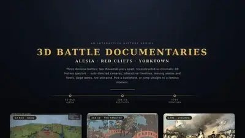</a> <b><a href="https://yitachen.github.io/3d-battle-documentaries/">3d-battle-documentaries</a></b> <a href="https://github.com/YiTaChen">YiTaChen</a> 许可证未知 · <a href="https://github.com/YiTaChen/3d-battle-documentaries">代码</a></td>
<td width="25%" valign="top"><a href="https://x.com/higgsfield_ai/status/2119904269235277978">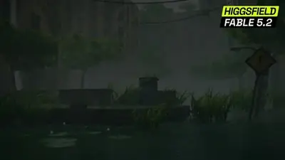</a> <b><a href="https://x.com/higgsfield_ai/status/2119904269235277978">A cat wakes an old robot</a></b> <a href="https://x.com/higgsfield_ai">Higgsfield</a> 许可证未知</td>
<td width="25%" valign="top"><a href="https://x.com/higgsfield_ai/status/2119907841599496421">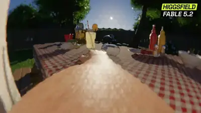</a> <b><a href="https://x.com/higgsfield_ai/status/2119907841599496421">A fly&#x27;s-eye picnic</a></b> <a href="https://x.com/higgsfield_ai">Higgsfield</a> 许可证未知</td>
<td width="25%" valign="top"><a href="https://aditazzz.github.io">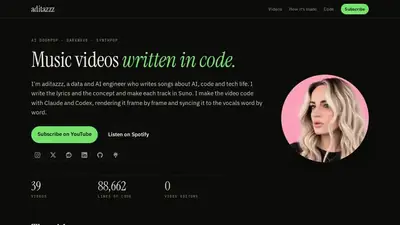</a> <b><a href="https://aditazzz.github.io">aditazzz music videos, made in code</a></b> <a href="https://github.com/aditazzz">Adita Zeqollari</a> 合集，21 个作品 MIT · <a href="https://github.com/aditazzz/Suno-YouTube-aditazzz-Music">代码</a> · <a href="https://huggingface.co/datasets/AI-Terrarium/terrarium-open-works/tree/main/videos/suno-youtube-aditazzz-music">文件</a></td>
</tr>
<tr>
<td width="25%" valign="top"><a href="https://derprito64bit.github.io/aether-graph-prompting-design-test/">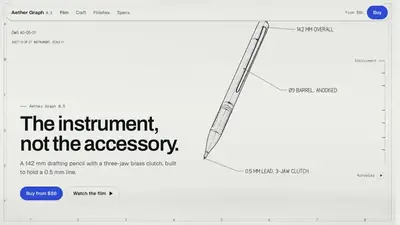</a> <b><a href="https://derprito64bit.github.io/aether-graph-prompting-design-test/">aether-graph-prompting-design-test</a></b> <a href="https://github.com/derprito64bit">derprito64bit</a> MIT · <a href="https://github.com/derprito64bit/aether-graph-prompting-design-test">代码</a> · <a href="https://huggingface.co/datasets/AI-Terrarium/terrarium-open-works/tree/main/videos/aether-graph-prompting-design-test">文件</a></td>
<td width="25%" valign="top"><a href="https://muse-spark-testing.vercel.app">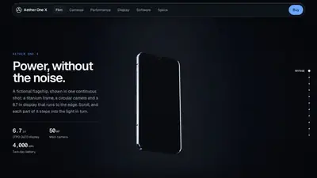</a> <b><a href="https://muse-spark-testing.vercel.app">aether-one-x-capability-test</a></b> <a href="https://github.com/derprito64bit">derprito64bit</a> MIT · <a href="https://github.com/derprito64bit/aether-one-x-capability-test">代码</a> · <a href="https://huggingface.co/datasets/AI-Terrarium/terrarium-open-works/tree/main/videos/aether-one-x-capability-test">文件</a></td>
<td width="25%" valign="top"><a href="https://x.com/danteeonsol/status/2119887623070077213">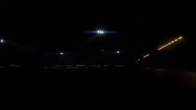</a> <b><a href="https://x.com/danteeonsol/status/2119887623070077213">Area 51 UFO visit</a></b> <a href="https://x.com/danteeonsol">danteeonsol</a> 许可证未知</td>
<td width="25%" valign="top"><a href="https://github.com/anstapnever/blackout">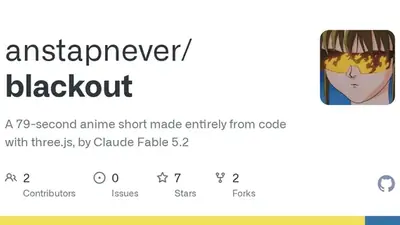</a> <b><a href="https://github.com/anstapnever/blackout">BLACKOUT · 停電</a></b> <a href="https://github.com/anstapnever">anstap</a> MIT · <a href="https://github.com/anstapnever/blackout">代码</a> · <a href="https://huggingface.co/datasets/AI-Terrarium/terrarium-open-works/tree/main/videos/blackout">文件</a></td>
</tr>
<tr>
<td width="25%" valign="top"> <b><a href="https://github.com/anstapnever/colossus">COLOSSUS · 巨像</a></b> <a href="https://github.com/anstapnever">anstap</a> MIT · <a href="https://github.com/anstapnever/colossus">代码</a> · <a href="https://huggingface.co/datasets/AI-Terrarium/terrarium-open-works/tree/main/videos/colossus">文件</a></td>
<td width="25%" valign="top"><a href="https://github.com/Leonxlnx/golden-temple/releases/latest">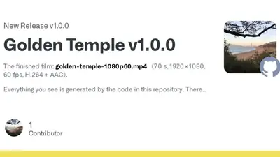</a> <b><a href="https://github.com/Leonxlnx/golden-temple/releases/latest">Golden Temple</a></b> <a href="https://github.com/Leonxlnx">Leon Lin</a> MIT · <a href="https://github.com/Leonxlnx/golden-temple">代码</a> · <a href="https://huggingface.co/datasets/AI-Terrarium/terrarium-open-works/tree/main/videos/golden-temple">文件</a></td>
<td width="25%" valign="top"> <b><a href="https://github.com/0xCodez/leviathan">leviathan</a></b> <a href="https://github.com/0xCodez">0xCodez</a> MIT · <a href="https://github.com/0xCodez/leviathan">代码</a> · <a href="https://huggingface.co/datasets/AI-Terrarium/terrarium-open-works/tree/main/videos/leviathan">文件</a></td>
<td width="25%" valign="top"><a href="https://github.com/NightlyBuildHQ/slash-motion">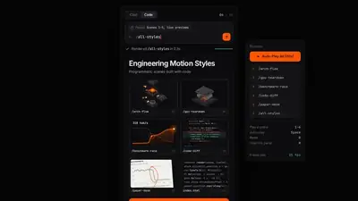</a> <b><a href="https://github.com/NightlyBuildHQ/slash-motion">Motion Studio</a></b> <a href="https://github.com/NightlyBuildHQ">NightlyBuild</a> 合集，4 个作品 MIT · <a href="https://github.com/NightlyBuildHQ/slash-motion">代码</a> · <a href="https://huggingface.co/datasets/AI-Terrarium/terrarium-open-works/tree/main/videos/slash-motion">文件</a></td>
</tr>
<tr>
<td width="25%" valign="top"><a href="https://idea-to-app.vercel.app">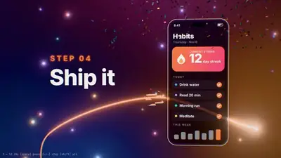</a> <b><a href="https://idea-to-app.vercel.app">motion3js</a></b> <a href="https://github.com/fancellu">fancellu</a> 许可证未知 · <a href="https://github.com/fancellu/motion3js">代码</a></td>
<td width="25%" valign="top"><a href="https://nextlevel.patchnotes.ca">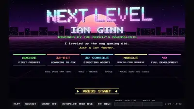</a> <b><a href="https://nextlevel.patchnotes.ca">nextlevel</a></b> <a href="https://github.com/trmytelabs">trmytelabs</a> CC0-1.0 · <a href="https://github.com/trmytelabs/nextlevel">代码</a> · <a href="https://huggingface.co/datasets/AI-Terrarium/terrarium-open-works/tree/main/videos/nextlevel">文件</a></td>
<td width="25%" valign="top"><a href="https://github.com/anstapnever/one-sweep">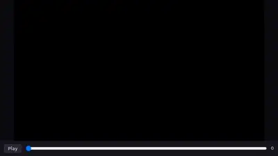</a> <b><a href="https://github.com/anstapnever/one-sweep">ONE SWEEP · 一掃</a></b> <a href="https://github.com/anstapnever">anstap</a> MIT · <a href="https://github.com/anstapnever/one-sweep">代码</a> · <a href="https://huggingface.co/datasets/AI-Terrarium/terrarium-open-works/tree/main/videos/one-sweep">文件</a></td>
<td width="25%" valign="top"><a href="https://mister030.github.io/ophaalbrug-diorama/">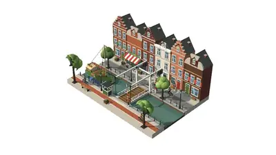</a> <b><a href="https://mister030.github.io/ophaalbrug-diorama/">ophaalbrug-diorama</a></b> <a href="https://github.com/Mister030">Mister030</a> 许可证未知 · <a href="https://github.com/Mister030/ophaalbrug-diorama">代码</a></td>
</tr>
<tr>
<td width="25%" valign="top"> <b><a href="https://x.com/fuoeba/status/2119906486017307074">Path-traced voxel creature</a></b> <a href="https://x.com/fuoeba">fuoeba</a> 许可证未知</td>
<td width="25%" valign="top"><a href="https://permadeath-making-of.vercel.app">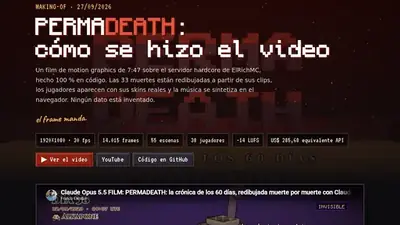</a> <b><a href="https://permadeath-making-of.vercel.app">permadeath-film</a></b> <a href="https://github.com/FrancoEscob">FrancoEscob</a> 许可证未知 · <a href="https://github.com/FrancoEscob/permadeath-film">代码</a></td>
<td width="25%" valign="top"><a href="https://x.com/Scratcherrrr/status/2119909780269785332">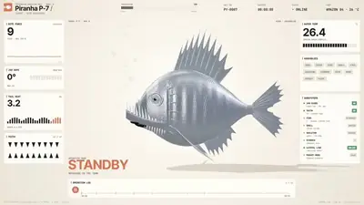</a> <b><a href="https://x.com/Scratcherrrr/status/2119909780269785332">Piranha P-7</a></b> <a href="https://x.com/Scratcherrrr">Scratcherrrr</a> 许可证未知</td>
<td width="25%" valign="top"><a href="https://github.com/pj4533/pnn">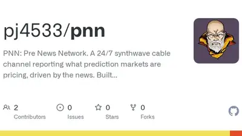</a> <b><a href="https://github.com/pj4533/pnn">PNN: Pre News Network</a></b> <a href="https://github.com/pj4533">PJ Gray</a> MIT · <a href="https://github.com/pj4533/pnn">代码</a> · <a href="https://huggingface.co/datasets/AI-Terrarium/terrarium-open-works/tree/main/videos/pnn-pre-news-network">文件</a></td>
</tr>
<tr>
<td width="25%" valign="top"><a href="https://x.com/higgsfield_ai/status/2119905141822484595">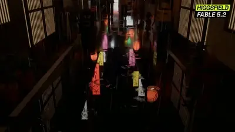</a> <b><a href="https://x.com/higgsfield_ai/status/2119905141822484595">Rainy Tokyo alley</a></b> <a href="https://x.com/higgsfield_ai">Higgsfield</a> 许可证未知</td>
<td width="25%" valign="top"><a href="https://screensaver-rouge.vercel.app">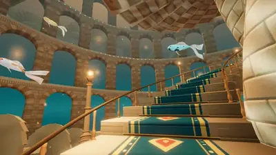</a> <b><a href="https://screensaver-rouge.vercel.app">screensaver</a></b> <a href="https://github.com/miklosme">miklosme</a> 许可证未知 · <a href="https://github.com/miklosme/screensaver">代码</a></td>
<td width="25%" valign="top"> <b><a href="https://github.com/0xCodez/sunshower">sunshower</a></b> <a href="https://github.com/0xCodez">0xCodez</a> MIT · <a href="https://github.com/0xCodez/sunshower">代码</a> · <a href="https://huggingface.co/datasets/AI-Terrarium/terrarium-open-works/tree/main/videos/sunshower">文件</a></td>
<td width="25%" valign="top"><a href="https://mooonster.github.io/tamkang-bridge-3d/">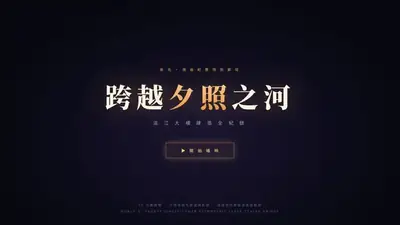</a> <b><a href="https://mooonster.github.io/tamkang-bridge-3d/">tamkang-bridge-3d</a></b> <a href="https://github.com/mooonster">mooonster</a> 许可证未知 · <a href="https://github.com/mooonster/tamkang-bridge-3d">代码</a></td>
</tr>
<tr>
<td width="25%" valign="top"> <b><a href="https://x.com/rileybrown/status/2119902109709537708">The Edge</a></b> <a href="https://x.com/rileybrown">Riley Brown</a> 许可证未知</td>
<td width="25%" valign="top"><a href="https://www.bilibili.com/video/BV1ByWM6mE1D/">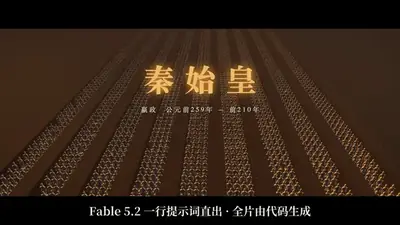</a> <b><a href="https://www.bilibili.com/video/BV1ByWM6mE1D/">The Life of Qin Shi Huang</a></b> 卡其ya_ 许可证未知</td>
<td width="25%" valign="top"><a href="https://x.com/higgsfield_ai/status/2120007830065614926">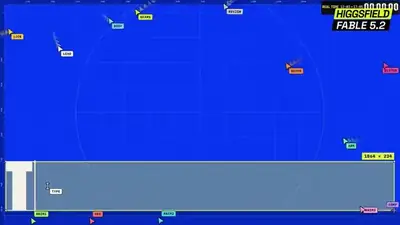</a> <b><a href="https://x.com/higgsfield_ai/status/2120007830065614926">TORQK</a></b> <a href="https://x.com/higgsfield_ai">Higgsfield</a> 许可证未知</td>
<td width="25%" valign="top"> <b><a href="https://aemtti.github.io/udder-walk-cyborg/">udder-walk-cyborg</a></b> <a href="https://github.com/aemtti">aemtti</a> MIT · <a href="https://github.com/aemtti/udder-walk-cyborg">代码</a> · <a href="https://huggingface.co/datasets/AI-Terrarium/terrarium-open-works/tree/main/videos/udder-walk-cyborg">文件</a></td>
</tr>
<tr>
<td width="25%" valign="top"><a href="https://alpha34727.github.io/world_execute_me_web/">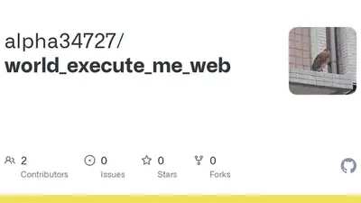</a> <b><a href="https://alpha34727.github.io/world_execute_me_web/">world_execute_me_web</a></b> <a href="https://github.com/alpha34727">alpha34727</a> MIT · <a href="https://github.com/alpha34727/world_execute_me_web">代码</a> · <a href="https://huggingface.co/datasets/AI-Terrarium/terrarium-open-works/tree/main/videos/world-execute-me-web">文件</a></td>
<td width="25%"></td>
<td width="25%"></td>
<td width="25%"></td>
</tr>
</table>

没有预览图的作品：

<table>

<tr><th align="left">作品</th><th align="left">作者</th><th align="left">许可证</th><th align="left">链接</th></tr>

<tr><td><a href="https://github.com/Infatoshi/ai-video">ai-video</a> 合集，7 个作品</td><td><a href="https://github.com/Infatoshi">Elliot Arledge</a></td><td>MIT</td><td><a href="https://github.com/Infatoshi/ai-video">代码</a> · <a href="https://huggingface.co/datasets/AI-Terrarium/terrarium-open-works/tree/main/videos/ai-video">文件</a></td></tr>

<tr><td><a href="https://finderchangchang.github.io/cloud-stunt-3d/">Cloud Stunt 3D</a></td><td>@jev_chat</td><td>许可证未知</td><td><a href="https://github.com/Finderchangchang/cloud-stunt-3d">代码</a></td></tr>

<tr><td><a href="https://loktar00.github.io/llm-test-pages/fable52-dino-chase/">Thunder Valley dino chase</a></td><td>@loktar00</td><td>许可证未知</td><td><a href="https://github.com/loktar00/llm-test-pages/tree/main/fable52-dino-chase">代码</a></td></tr>

</table>

<!-- CATALOG:END -->

---

 <a href="../docs/i18n/README.zh-CN.md">首页</a> · <a href="../games/README.zh-CN.md">游戏</a> · <a href="../scenes/README.zh-CN.md">世界与场景</a> · <a href="README.zh-CN.md">视频</a> · <a href="../tools/README.zh-CN.md">工具</a> · <a href="../visualizations/README.zh-CN.md">可视化</a> · <a href="../wallpapers/README.zh-CN.md">壁纸</a> · <a href="#top">返回顶部</a> 目录数据：2026-11-21

