

<b>Terrarium</b>

<a href="README.md">English</a> · <b>简体中文</b> · <a href="README.zh-TW.md">繁體中文</a> · <a href="README.ja.md">日本語</a> · <a href="README.ko.md">한국어</a> · <a href="README.es.md">Español</a> · <a href="README.pt-BR.md">Português</a> · <a href="README.fr.md">Français</a> · <a href="README.de.md">Deutsch</a> · <a href="README.ru.md">Русский</a>

<a href="../docs/i18n/README.zh-CN.md#trending">最热</a> · <a href="../docs/i18n/README.zh-CN.md#latest">最新</a> · <a href="../docs/i18n/README.zh-CN.md#contents">目录</a>

<h1 align="center">可视化</h1>

33 个条目。 用交互式 3D 探索科学、数据与抽象概念。

<!-- CATALOG:START -->

<table>
<tr>
<td width="25%" valign="top"> <b><a href="https://atoomnetmarc.github.io/3D-Sorting-Algorithm-Visualizer/">3D Sorting Algorithm Visualizer</a></b> <a href="https://github.com/atoomnetmarc">Marc Ketel</a> Apache-2.0 · <a href="https://github.com/atoomnetmarc/3D-Sorting-Algorithm-Visualizer">代码</a> · <a href="https://huggingface.co/datasets/awesome-fable-5-2/terrarium-open-works/tree/main/visualizations/3d-sorting-algorithm-visualizer">文件</a></td>
<td width="25%" valign="top"> <b><a href="https://agent-atoll.pages.dev">Agent Atoll</a></b> <a href="https://github.com/djfumberger">David Fumberger</a> MIT · <a href="https://github.com/djfumberger/agent-atoll">代码</a> · <a href="https://huggingface.co/datasets/awesome-fable-5-2/terrarium-open-works/tree/main/visualizations/agent-atoll">文件</a></td>
<td width="25%" valign="top"><a href="https://github.com/satsuki-c6s/ai-3d-explainers">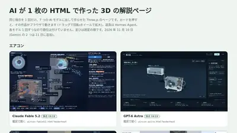</a> <b><a href="https://github.com/satsuki-c6s/ai-3d-explainers">AI が 1 枚の HTML で作った 3D の解説ページ (エアコン・量子コンピューター)</a></b> <a href="https://github.com/satsuki-c6s">satsuki-c6s</a> 合集，14 个作品 MIT · <a href="https://github.com/satsuki-c6s/ai-3d-explainers">代码</a> · <a href="https://huggingface.co/datasets/awesome-fable-5-2/terrarium-open-works/tree/main/visualizations/ai-3d-explainers">文件</a></td>
<td width="25%" valign="top"> <b><a href="https://mylesdebastion.github.io/ascii-visualizer/">ASCII//VIZ</a></b> <a href="https://github.com/mylesdebastion">Myles de Bastion</a> MIT · <a href="https://github.com/mylesdebastion/ascii-visualizer">代码</a> · <a href="https://huggingface.co/datasets/awesome-fable-5-2/terrarium-open-works/tree/main/visualizations/ascii-viz">文件</a></td>
</tr>
<tr>
<td width="25%" valign="top"><a href="https://jasperntc.github.io/claude-constellation/">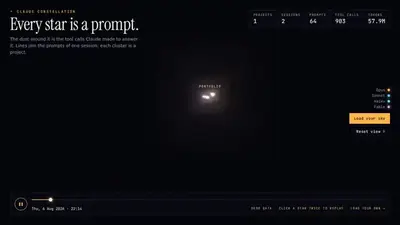</a> <b><a href="https://jasperntc.github.io/claude-constellation/">Claude Constellation</a></b> <a href="https://github.com/jasperntc">Jasper Ng</a> MIT · <a href="https://github.com/jasperntc/claude-constellation">代码</a> · <a href="https://huggingface.co/datasets/awesome-fable-5-2/terrarium-open-works/tree/main/visualizations/claude-constellation">文件</a></td>
<td width="25%" valign="top"><a href="https://winchxyz.github.io/crunch-time/">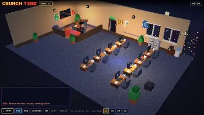</a> <b><a href="https://winchxyz.github.io/crunch-time/">CRUNCH TIME</a></b> <a href="https://github.com/winchxyz">winch</a> MIT · <a href="https://github.com/winchxyz/crunch-time">代码</a> · <a href="https://huggingface.co/datasets/awesome-fable-5-2/terrarium-open-works/tree/main/visualizations/crunch-time">文件</a></td>
<td width="25%" valign="top"> <b><a href="https://github.com/AralimNGA/cube-physics-simulation">Cube Physics Simulation</a></b> <a href="https://github.com/AralimNGA">Aralim</a> MIT · <a href="https://github.com/AralimNGA/cube-physics-simulation">代码</a> · <a href="https://huggingface.co/datasets/awesome-fable-5-2/terrarium-open-works/tree/main/visualizations/cube-physics-simulation">文件</a></td>
<td width="25%" valign="top"><a href="https://mtbba8-afk.github.io/engine-map/">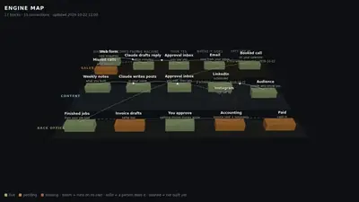</a> <b><a href="https://mtbba8-afk.github.io/engine-map/">Engine Map</a></b> <a href="https://github.com/mtbba8-afk">Tounkara Group</a> MIT · <a href="https://github.com/mtbba8-afk/engine-map">代码</a> · <a href="https://huggingface.co/datasets/awesome-fable-5-2/terrarium-open-works/tree/main/visualizations/engine-map">文件</a></td>
</tr>
<tr>
<td width="25%" valign="top"> <b><a href="https://codexparadise.github.io/insects/">ENTOMIA // 3D MICRO-MORPHOLOGY</a></b> <a href="https://github.com/codeXparadise">Vishal Prajapati</a> MIT · <a href="https://github.com/codeXparadise/insects">代码</a> · <a href="https://huggingface.co/datasets/awesome-fable-5-2/terrarium-open-works/tree/main/visualizations/entomia-3d-micro-morphology">文件</a></td>
<td width="25%" valign="top"> <b><a href="https://github.com/MuhammadaliMS/glassbook">Glassbook</a></b> <a href="https://github.com/MuhammadaliMS">MuhammadaliMS</a> 合集，4 个作品 MIT · <a href="https://github.com/MuhammadaliMS/glassbook">代码</a> · <a href="https://huggingface.co/datasets/awesome-fable-5-2/terrarium-open-works/tree/main/visualizations/glassbook">文件</a></td>
<td width="25%" valign="top"><a href="https://markleary.github.io/highway-traffic-simulator/">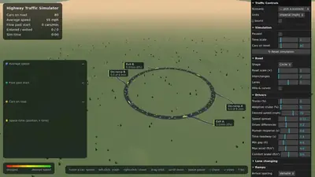</a> <b><a href="https://markleary.github.io/highway-traffic-simulator/">Highway Traffic Simulator</a></b> <a href="https://github.com/markleary">Mark Leary</a> MIT · <a href="https://github.com/markleary/highway-traffic-simulator">代码</a> · <a href="https://huggingface.co/datasets/awesome-fable-5-2/terrarium-open-works/tree/main/visualizations/highway-traffic-simulator">文件</a></td>
<td width="25%" valign="top"><a href="https://github.com/khanmjk/Hourglass_Fable5">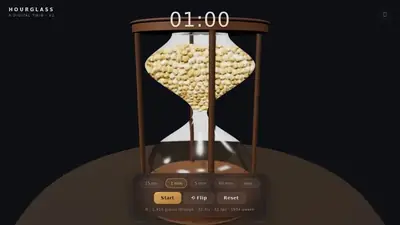</a> <b><a href="https://github.com/khanmjk/Hourglass_Fable5">Hourglass — A Digital Twin Timer</a></b> <a href="https://github.com/khanmjk">khanmjk</a> 合集，5 个作品 MIT · <a href="https://github.com/khanmjk/Hourglass_Fable5">代码</a> · <a href="https://huggingface.co/datasets/awesome-fable-5-2/terrarium-open-works/tree/main/visualizations/hourglass-fable5">文件</a></td>
</tr>
<tr>
<td width="25%" valign="top"> <b><a href="https://codewithbehnam.github.io/ISS-edu/">ISS-edu</a></b> <a href="https://github.com/CodeWithBehnam">Behnam</a> MIT · <a href="https://github.com/CodeWithBehnam/ISS-edu">代码</a> · <a href="https://huggingface.co/datasets/awesome-fable-5-2/terrarium-open-works/tree/main/visualizations/iss-edu">文件</a></td>
<td width="25%" valign="top"> <b><a href="https://k8s-skyrealm.pages.dev">Kubernetes Skyrealm</a></b> <a href="https://github.com/ZaafirRizwan">Zaafir Rizwan</a> MIT · <a href="https://github.com/ZaafirRizwan/k8s-skyrealm">代码</a> · <a href="https://huggingface.co/datasets/awesome-fable-5-2/terrarium-open-works/tree/main/visualizations/kubernetes-skyrealm">文件</a></td>
<td width="25%" valign="top"><a href="https://life.petruha.ge">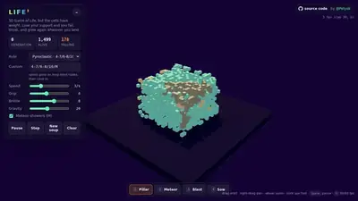</a> <b><a href="https://life.petruha.ge">LIFE³</a></b> <a href="https://github.com/Petyok">Petruha</a> MIT · <a href="https://github.com/Petyok/life3d">代码</a> · <a href="https://huggingface.co/datasets/awesome-fable-5-2/terrarium-open-works/tree/main/visualizations/life3">文件</a></td>
<td width="25%" valign="top"> <b><a href="https://ohagent.ai/">Oh Agent</a></b> <a href="https://github.com/Oh-Agent-AI">Oh Agent AI</a> MIT · <a href="https://github.com/Oh-Agent-AI/oh-agent">代码</a> · <a href="https://huggingface.co/datasets/awesome-fable-5-2/terrarium-open-works/tree/main/visualizations/oh-agent">文件</a></td>
</tr>
<tr>
<td width="25%" valign="top"><a href="https://overhang-ebon.vercel.app">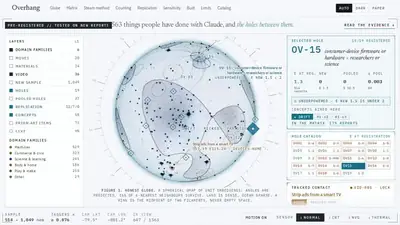</a> <b><a href="https://overhang-ebon.vercel.app">Overhang</a></b> <a href="https://github.com/BaileyPillon">Bailey Pillon</a> MIT · <a href="https://github.com/BaileyPillon/overhang">代码</a> · <a href="https://huggingface.co/datasets/awesome-fable-5-2/terrarium-open-works/tree/main/visualizations/overhang">文件</a></td>
<td width="25%" valign="top"> <b><a href="https://neon-ninja.github.io/pythagoras/">Pythagorean Theorem with Fluid Dynamics</a></b> <a href="https://github.com/neon-ninja">Nick Young</a> MIT · <a href="https://github.com/neon-ninja/pythagoras">代码</a> · <a href="https://huggingface.co/datasets/awesome-fable-5-2/terrarium-open-works/tree/main/visualizations/pythagorean-theorem-with-fluid-dynamics">文件</a></td>
<td width="25%" valign="top"> <b><a href="https://maximilianfeix.github.io/repoville/r/facebook/react/">repoville</a></b> <a href="https://github.com/maximilianfeix">Maxi</a> MIT · <a href="https://github.com/maximilianfeix/repoville">代码</a> · <a href="https://huggingface.co/datasets/awesome-fable-5-2/terrarium-open-works/tree/main/visualizations/repoville">文件</a></td>
<td width="25%" valign="top"><a href="https://claude.ai/artifact/Wu4Ji88Un1RRmnfFDRnV2Q">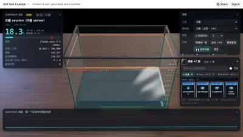</a> <b><a href="https://claude.ai/artifact/Wu4Ji88Un1RRmnfFDRnV2Q">skill-tank</a></b> <a href="https://github.com/ooropuloo">ooropuloo</a> MIT · <a href="https://github.com/ooropuloo/skill-tank">代码</a> · <a href="https://huggingface.co/datasets/awesome-fable-5-2/terrarium-open-works/tree/main/visualizations/skill-tank">文件</a></td>
</tr>
<tr>
<td width="25%" valign="top"><a href="https://app.solarexplorer.co/">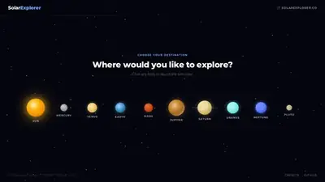</a> <b><a href="https://app.solarexplorer.co/">Solar System Explorer</a></b> <a href="https://github.com/kyle-itprojectmgmt">Kyle Ewing</a> MIT · <a href="https://github.com/kyle-itprojectmgmt/Solar-System-Explorer">代码</a> · <a href="https://huggingface.co/datasets/awesome-fable-5-2/terrarium-open-works/tree/main/visualizations/solar-system-explorer">文件</a></td>
<td width="25%" valign="top"><a href="https://anujyadav-dev.github.io/Solar-System-3D/">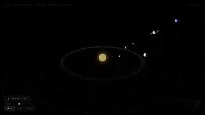</a> <b><a href="https://anujyadav-dev.github.io/Solar-System-3D/">🌌 Solar-System-3D</a></b> <a href="https://github.com/AnujYadav-Dev">Anuj Kumar Yadav</a> MIT · <a href="https://github.com/AnujYadav-Dev/Solar-System-3D">代码</a> · <a href="https://huggingface.co/datasets/awesome-fable-5-2/terrarium-open-works/tree/main/visualizations/solar-system-3d">文件</a></td>
<td width="25%" valign="top"><a href="https://thefolahan.github.io/sombrero-galaxy/">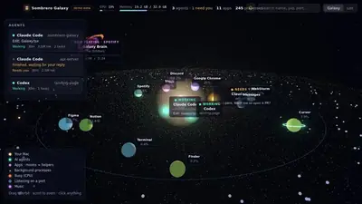</a> <b><a href="https://thefolahan.github.io/sombrero-galaxy/">Sombrero Galaxy</a></b> <a href="https://github.com/thefolahan">Omisakin Joshua</a> MIT · <a href="https://github.com/thefolahan/sombrero-galaxy">代码</a> · <a href="https://huggingface.co/datasets/awesome-fable-5-2/terrarium-open-works/tree/main/visualizations/sombrero-galaxy">文件</a></td>
<td width="25%" valign="top"> <b><a href="https://shayaniqbal2008-svg.github.io/token-skyline/">Token Skyline</a></b> <a href="https://github.com/shayaniqbal2008-svg">Shayan Iqbal</a> MIT · <a href="https://github.com/shayaniqbal2008-svg/token-skyline">代码</a> · <a href="https://huggingface.co/datasets/awesome-fable-5-2/terrarium-open-works/tree/main/visualizations/token-skyline">文件</a></td>
</tr>
<tr>
<td width="25%" valign="top"><a href="https://tanuu5.github.io/trailscape/">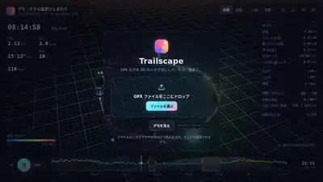</a> <b><a href="https://tanuu5.github.io/trailscape/">Trailscape（トレイルスケープ）</a></b> <a href="https://github.com/tanuu5">たぬ（tanu）</a> MIT · <a href="https://github.com/tanuu5/trailscape">代码</a> · <a href="https://huggingface.co/datasets/awesome-fable-5-2/terrarium-open-works/tree/main/visualizations/trailscape">文件</a></td>
<td width="25%" valign="top"><a href="https://yojoxsn.github.io/vault-3d/">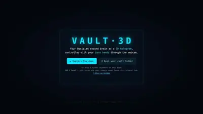</a> <b><a href="https://yojoxsn.github.io/vault-3d/">VAULT·3D</a></b> <a href="https://github.com/YojoxSn">Jonas SLEIMAN</a> MIT · <a href="https://github.com/YojoxSn/vault-3d">代码</a> · <a href="https://huggingface.co/datasets/awesome-fable-5-2/terrarium-open-works/tree/main/visualizations/vault3d">文件</a></td>
<td width="25%" valign="top"><a href="https://tanuu5.github.io/earthquake-monitor-3d/">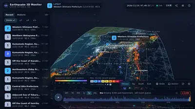</a> <b><a href="https://tanuu5.github.io/earthquake-monitor-3d/">地震3Dモニター JAPAN SEISMIC 3D</a></b> <a href="https://github.com/tanuu5">たぬ（tanu）</a> MIT · <a href="https://github.com/tanuu5/earthquake-monitor-3d">代码</a> · <a href="https://huggingface.co/datasets/awesome-fable-5-2/terrarium-open-works/tree/main/visualizations/3d-japan-seismic-3d">文件</a></td>
<td width="25%"></td>
</tr>
</table>

没有预览图的作品：

<table>
<tr><th align="left">作品</th><th align="left">作者</th><th align="left">许可证</th><th align="left">链接</th></tr>
<tr><td><a href="https://github.com/Aurumdev952/claude-hackathon">Early Signals</a></td><td><a href="https://github.com/Aurumdev952">Benjamin</a></td><td>MIT</td><td><a href="https://github.com/Aurumdev952/claude-hackathon">代码</a> · <a href="https://huggingface.co/datasets/awesome-fable-5-2/terrarium-open-works/tree/main/visualizations/early-signals">文件</a></td></tr>
<tr><td><a href="https://boardgaminghub.com/EclipsePredictor.html">Eclipse Predictor</a></td><td><a href="https://github.com/mf4633">Hydro Engineer</a></td><td>MIT</td><td><a href="https://github.com/mf4633/eclipse-predictor">代码</a> · <a href="https://huggingface.co/datasets/awesome-fable-5-2/terrarium-open-works/tree/main/visualizations/eclipse-predictor">文件</a></td></tr>
<tr><td><a href="https://github.com/pj4533/election_night">Election Night</a></td><td><a href="https://github.com/pj4533">PJ Gray</a></td><td>MIT</td><td><a href="https://github.com/pj4533/election_night">代码</a> · <a href="https://huggingface.co/datasets/awesome-fable-5-2/terrarium-open-works/tree/main/visualizations/election-night">文件</a></td></tr>
<tr><td><a href="https://guildhall.codestz.dev">Guildhall</a></td><td><a href="https://github.com/Codestz">Esteban Estrada</a></td><td>MIT</td><td><a href="https://github.com/Codestz/guildhall">代码</a> · <a href="https://huggingface.co/datasets/awesome-fable-5-2/terrarium-open-works/tree/main/visualizations/guildhall">文件</a></td></tr>
<tr><td><a href="https://orbital-congestion.vercel.app">Orbital Congestion Simulator</a></td><td><a href="https://github.com/muhammet842">Muhammet Emin Ballı</a></td><td>MIT</td><td><a href="https://github.com/muhammet842/orbital-congestion-simulator-premium">代码</a> · <a href="https://huggingface.co/datasets/awesome-fable-5-2/terrarium-open-works/tree/main/visualizations/orbital-congestion-simulator">文件</a></td></tr>
<tr><td><a href="https://huggingface.co/spaces/nc8304/voxel-stitch">voxel_stitch — Chizimi fold simulator</a></td><td><a href="https://huggingface.co/nc8304">Nicole</a></td><td>MIT</td><td><a href="https://huggingface.co/spaces/nc8304/voxel-stitch">代码</a> · <a href="https://huggingface.co/datasets/awesome-fable-5-2/terrarium-open-works/tree/main/visualizations/voxel-stitch-chizimi-fold-simulator">文件</a></td></tr>
</table>

<!-- CATALOG:END -->

---

 <a href="../docs/i18n/README.zh-CN.md">首页</a> · <a href="../games/README.zh-CN.md">游戏</a> · <a href="../scenes/README.zh-CN.md">世界与场景</a> · <a href="../videos/README.zh-CN.md">视频</a> · <a href="../tools/README.zh-CN.md">工具</a> · <a href="README.zh-CN.md">可视化</a> · <a href="../wallpapers/README.zh-CN.md">壁纸</a> · <a href="#top">返回顶部</a> 目录数据：2026-11-14

