

<b>Terrarium</b>

<a href="README.md">English</a> · <b>简体中文</b> · <a href="README.zh-TW.md">繁體中文</a> · <a href="README.ja.md">日本語</a> · <a href="README.ko.md">한국어</a> · <a href="README.es.md">Español</a> · <a href="README.pt-BR.md">Português</a> · <a href="README.fr.md">Français</a> · <a href="README.de.md">Deutsch</a> · <a href="README.ru.md">Русский</a>

<a href="../docs/i18n/README.zh-CN.md#trending">最热</a> · <a href="../docs/i18n/README.zh-CN.md#latest">最新</a> · <a href="../docs/i18n/README.zh-CN.md#contents">目录</a>

<h1 align="center">可视化</h1>

99 个条目。 用交互式 3D 探索科学、数据与抽象概念。

<!-- CATALOG:START -->

<table>
<tr>
<td width="25%" valign="top"> <b><a href="https://atoomnetmarc.github.io/3D-Sorting-Algorithm-Visualizer/">3D Sorting Algorithm Visualizer</a></b> <a href="https://github.com/atoomnetmarc">Marc Ketel</a> Apache-2.0 · <a href="https://github.com/atoomnetmarc/3D-Sorting-Algorithm-Visualizer">代码</a> · <a href="https://huggingface.co/datasets/AI-Terrarium/terrarium-open-works/tree/main/visualizations/3d-sorting-algorithm-visualizer">文件</a></td>
<td width="25%" valign="top"> <b><a href="https://github.com/ysohaarsh/3d-cell-tour">3d-cell-tour</a></b> <a href="https://github.com/ysohaarsh">ysohaarsh</a> 许可证未知 · <a href="https://github.com/ysohaarsh/3d-cell-tour">代码</a></td>
<td width="25%" valign="top"> <b><a href="https://github.com/singhshatabdi/3d-planetary">3d-planetary</a></b> <a href="https://github.com/singhshatabdi">singhshatabdi</a> 许可证未知 · <a href="https://github.com/singhshatabdi/3d-planetary">代码</a></td>
<td width="25%" valign="top"><a href="https://aether-solar-system.vercel.app">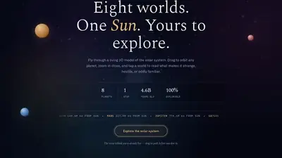</a> <b><a href="https://aether-solar-system.vercel.app">aether-solar-system</a></b> <a href="https://github.com/rajyadav-dev">rajyadav-dev</a> 许可证未知 · <a href="https://github.com/rajyadav-dev/aether-solar-system">代码</a></td>
</tr>
<tr>
<td width="25%" valign="top"> <b><a href="https://agent-atoll.pages.dev">Agent Atoll</a></b> <a href="https://github.com/djfumberger">David Fumberger</a> MIT · <a href="https://github.com/djfumberger/agent-atoll">代码</a> · <a href="https://huggingface.co/datasets/AI-Terrarium/terrarium-open-works/tree/main/visualizations/agent-atoll">文件</a></td>
<td width="25%" valign="top"> <b><a href="https://satsuki-c6s.github.io/ai-3d-explainers/">AI が 1 枚の HTML で作った 3D の解説ページ (エアコン・量子コンピューター)</a></b> <a href="https://github.com/satsuki-c6s">satsuki-c6s</a> 合集，14 个作品 MIT · <a href="https://github.com/satsuki-c6s/ai-3d-explainers">代码</a> · <a href="https://huggingface.co/datasets/AI-Terrarium/terrarium-open-works/tree/main/visualizations/ai-3d-explainers">文件</a></td>
<td width="25%" valign="top"><a href="https://github.com/AndrewVoirol/ais-isoglobe-weather">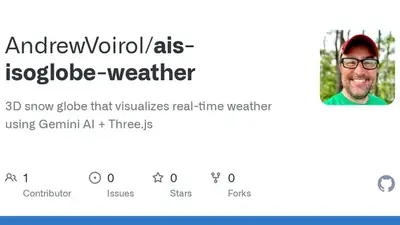</a> <b><a href="https://github.com/AndrewVoirol/ais-isoglobe-weather">ais-isoglobe-weather</a></b> <a href="https://github.com/AndrewVoirol">AndrewVoirol</a> 许可证未知 · <a href="https://github.com/AndrewVoirol/ais-isoglobe-weather">代码</a></td>
<td width="25%" valign="top"><a href="https://mylesdebastion.github.io/ascii-visualizer/">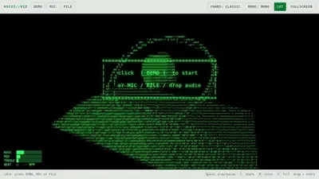</a> <b><a href="https://mylesdebastion.github.io/ascii-visualizer/">ASCII//VIZ</a></b> <a href="https://github.com/mylesdebastion">Myles de Bastion</a> MIT · <a href="https://github.com/mylesdebastion/ascii-visualizer">代码</a> · <a href="https://huggingface.co/datasets/AI-Terrarium/terrarium-open-works/tree/main/visualizations/ascii-viz">文件</a></td>
</tr>
<tr>
<td width="25%" valign="top"> <b><a href="https://rj45010.github.io/black-hole/">black-hole</a></b> <a href="https://github.com/rj45010">rj45010</a> 许可证未知 · <a href="https://github.com/rj45010/black-hole">代码</a></td>
<td width="25%" valign="top"> <b><a href="https://bodyrx.vercel.app/">bodyflow</a></b> <a href="https://github.com/riz007">riz007</a> CC-BY-SA-2.1 · <a href="https://github.com/riz007/bodyflow">代码</a> · <a href="https://huggingface.co/datasets/AI-Terrarium/terrarium-open-works/tree/main/visualizations/bodyflow">文件</a></td>
<td width="25%" valign="top"><a href="https://wil-pe.github.io/c204-dossier-scientifique/">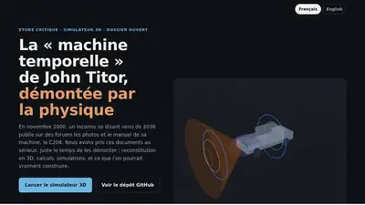</a> <b><a href="https://wil-pe.github.io/c204-dossier-scientifique/">c204-dossier-scientifique</a></b> <a href="https://github.com/wil-pe">wil-pe</a> 许可证未知 · <a href="https://github.com/wil-pe/c204-dossier-scientifique">代码</a></td>
<td width="25%" valign="top"> <b><a href="https://jasperntc.github.io/claude-constellation/">Claude Constellation</a></b> <a href="https://github.com/jasperntc">Jasper Ng</a> MIT · <a href="https://github.com/jasperntc/claude-constellation">代码</a> · <a href="https://huggingface.co/datasets/AI-Terrarium/terrarium-open-works/tree/main/visualizations/claude-constellation">文件</a></td>
</tr>
<tr>
<td width="25%" valign="top"> <b><a href="https://eval-forge.github.io/claude-battle/">claude-battle</a></b> <a href="https://github.com/eval-forge">eval-forge</a> 许可证未知 · <a href="https://github.com/eval-forge/claude-battle">代码</a></td>
<td width="25%" valign="top"> <b><a href="https://nonojin99.github.io/constellation-voyage/">constellation-voyage</a></b> <a href="https://github.com/nonojin99">nonojin99</a> 许可证未知 · <a href="https://github.com/nonojin99/constellation-voyage">代码</a></td>
<td width="25%" valign="top"> <b><a href="https://winchxyz.github.io/crunch-time/">CRUNCH TIME</a></b> <a href="https://github.com/winchxyz">winch</a> MIT · <a href="https://github.com/winchxyz/crunch-time">代码</a> · <a href="https://huggingface.co/datasets/AI-Terrarium/terrarium-open-works/tree/main/visualizations/crunch-time">文件</a></td>
<td width="25%" valign="top"> <b><a href="https://ancient903.itch.io/cube-fold">Cube Fold</a></b> <a href="https://ancient903.itch.io">ancient903</a> 许可证未知 · <a href="https://ancient903.itch.io/cube-fold">代码</a></td>
</tr>
<tr>
<td width="25%" valign="top"> <b><a href="https://github.com/AralimNGA/cube-physics-simulation">Cube Physics Simulation</a></b> <a href="https://github.com/AralimNGA">Aralim</a> MIT · <a href="https://github.com/AralimNGA/cube-physics-simulation">代码</a> · <a href="https://huggingface.co/datasets/AI-Terrarium/terrarium-open-works/tree/main/visualizations/cube-physics-simulation">文件</a></td>
<td width="25%" valign="top"> <b><a href="https://crlsyajie.github.io/CYF-Moonbase/">CYF-Moonbase</a></b> <a href="https://github.com/crlsyajie">crlsyajie</a> 许可证未知 · <a href="https://github.com/crlsyajie/CYF-Moonbase">代码</a></td>
<td width="25%" valign="top"><a href="https://bluongov.github.io/drone-swarm-c2/">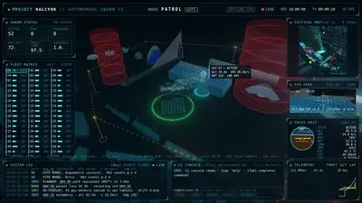</a> <b><a href="https://bluongov.github.io/drone-swarm-c2/">drone-swarm-c2</a></b> <a href="https://github.com/bluongov">bluongov</a> 许可证未知 · <a href="https://github.com/bluongov/drone-swarm-c2">代码</a></td>
<td width="25%" valign="top"> <b><a href="https://github.com/Aurumdev952/claude-hackathon">Early Signals</a></b> <a href="https://github.com/Aurumdev952">Benjamin</a> MIT · <a href="https://github.com/Aurumdev952/claude-hackathon">代码</a> · <a href="https://huggingface.co/datasets/AI-Terrarium/terrarium-open-works/tree/main/visualizations/early-signals">文件</a></td>
</tr>
<tr>
<td width="25%" valign="top"> <b><a href="https://boardgaminghub.com/EclipsePredictor.html">Eclipse Predictor</a></b> <a href="https://github.com/mf4633">Hydro Engineer</a> MIT · <a href="https://github.com/mf4633/eclipse-predictor">代码</a> · <a href="https://huggingface.co/datasets/AI-Terrarium/terrarium-open-works/tree/main/visualizations/eclipse-predictor">文件</a></td>
<td width="25%" valign="top"> <b><a href="https://github.com/hseinb/ecommerce-ai-recosys">ecommerce-ai-recosys</a></b> <a href="https://github.com/hseinb">hseinb</a> 许可证未知 · <a href="https://github.com/hseinb/ecommerce-ai-recosys">代码</a></td>
<td width="25%" valign="top"><a href="https://github.com/pj4533/election_night">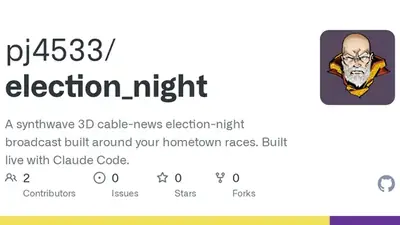</a> <b><a href="https://github.com/pj4533/election_night">Election Night</a></b> <a href="https://github.com/pj4533">PJ Gray</a> MIT · <a href="https://github.com/pj4533/election_night">代码</a> · <a href="https://huggingface.co/datasets/AI-Terrarium/terrarium-open-works/tree/main/visualizations/election-night">文件</a></td>
<td width="25%" valign="top"> <b><a href="https://mtbba8-afk.github.io/engine-map/">Engine Map</a></b> <a href="https://github.com/mtbba8-afk">Tounkara Group</a> MIT · <a href="https://github.com/mtbba8-afk/engine-map">代码</a> · <a href="https://huggingface.co/datasets/AI-Terrarium/terrarium-open-works/tree/main/visualizations/engine-map">文件</a></td>
</tr>
<tr>
<td width="25%" valign="top"> <b><a href="https://codexparadise.github.io/insects/">ENTOMIA // 3D MICRO-MORPHOLOGY</a></b> <a href="https://github.com/codeXparadise">Vishal Prajapati</a> MIT · <a href="https://github.com/codeXparadise/insects">代码</a> · <a href="https://huggingface.co/datasets/AI-Terrarium/terrarium-open-works/tree/main/visualizations/entomia-3d-micro-morphology">文件</a></td>
<td width="25%" valign="top"> <b><a href="https://explore-spac-eer.vercel.app">ExploreSPACEer</a></b> <a href="https://github.com/pragadishts">pragadishts</a> 许可证未知 · <a href="https://github.com/pragadishts/ExploreSPACEer">代码</a></td>
<td width="25%" valign="top"><a href="https://az9713.github.io/fable-5.2-demos/">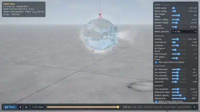</a> <b><a href="https://az9713.github.io/fable-5.2-demos/">fable-5.2-demos</a></b> <a href="https://github.com/az9713">az9713</a> 许可证未知 · <a href="https://github.com/az9713/fable-5.2-demos">代码</a></td>
<td width="25%" valign="top"><a href="https://schteppe.github.io/cannon.js/">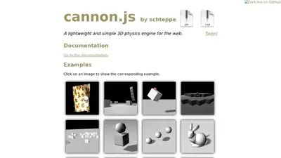</a> <b><a href="https://schteppe.github.io/cannon.js/">fidget.gantlett.io</a></b> <a href="https://github.com/mgantlett">mgantlett</a> 许可证未知 · <a href="https://github.com/mgantlett/fidget.gantlett.io">代码</a></td>
</tr>
<tr>
<td width="25%" valign="top"> <b><a href="https://github.com/ir272/fishbowl">fishbowl</a></b> <a href="https://github.com/ir272">ir272</a> 许可证未知 · <a href="https://github.com/ir272/fishbowl">代码</a></td>
<td width="25%" valign="top"> <b><a href="https://github.com/ArndRosemeier/FracVibe">FracVibe</a></b> <a href="https://github.com/ArndRosemeier">ArndRosemeier</a> 许可证未知 · <a href="https://github.com/ArndRosemeier/FracVibe">代码</a></td>
<td width="25%" valign="top"> <b><a href="https://galaxia-chi.vercel.app">Galaxia</a></b> <a href="https://github.com/ronronnie">ronronnie</a> 许可证未知 · <a href="https://github.com/ronronnie/Galaxia">代码</a></td>
<td width="25%" valign="top"> <b><a href="https://nipale-ai.github.io/galaxy/">galaxy</a></b> <a href="https://github.com/Nipale-ai">Nipale-ai</a> 许可证未知 · <a href="https://github.com/Nipale-ai/galaxy">代码</a></td>
</tr>
<tr>
<td width="25%" valign="top"><a href="https://www.gitworld.dev/">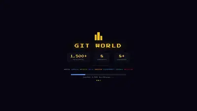</a> <b><a href="https://www.gitworld.dev/">Git-World</a></b> <a href="https://github.com/AshuSriwastav07">AshuSriwastav07</a> AGPL-3.0 · <a href="https://github.com/AshuSriwastav07/Git-World">代码</a> · <a href="https://huggingface.co/datasets/AI-Terrarium/terrarium-open-works/tree/main/visualizations/git-world">文件</a></td>
<td width="25%" valign="top"> <b><a href="https://vuthevinh2125.github.io/giza-pyramid-3d/">giza-pyramid-3d</a></b> <a href="https://github.com/vuthevinh2125">vuthevinh2125</a> 许可证未知 · <a href="https://github.com/vuthevinh2125/giza-pyramid-3d">代码</a></td>
<td width="25%" valign="top"><a href="https://zerowing.in/glassbook">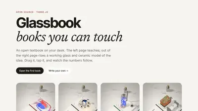</a> <b><a href="https://zerowing.in/glassbook">Glassbook</a></b> <a href="https://github.com/MuhammadaliMS">MuhammadaliMS</a> 合集，4 个作品 MIT · <a href="https://github.com/MuhammadaliMS/glassbook">代码</a> · <a href="https://huggingface.co/datasets/AI-Terrarium/terrarium-open-works/tree/main/visualizations/glassbook">文件</a></td>
<td width="25%" valign="top"> <b><a href="https://deuaj-dotcom.github.io/Gravite/">Gravite</a></b> <a href="https://github.com/deuaj-dotcom">deuaj-dotcom</a> 许可证未知 · <a href="https://github.com/deuaj-dotcom/Gravite">代码</a></td>
</tr>
<tr>
<td width="25%" valign="top"> <b><a href="https://guildhall.codestz.dev">Guildhall</a></b> <a href="https://github.com/Codestz">Esteban Estrada</a> MIT · <a href="https://github.com/Codestz/guildhall">代码</a> · <a href="https://huggingface.co/datasets/AI-Terrarium/terrarium-open-works/tree/main/visualizations/guildhall">文件</a></td>
<td width="25%" valign="top"><a href="https://jojoey-spec.github.io/gyrate-simulation/">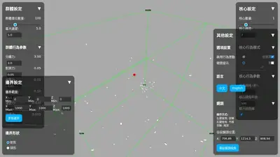</a> <b><a href="https://jojoey-spec.github.io/gyrate-simulation/">gyrate-simulation</a></b> <a href="https://github.com/jojoey-spec">jojoey-spec</a> 许可证未知 · <a href="https://github.com/jojoey-spec/gyrate-simulation">代码</a></td>
<td width="25%" valign="top"> <b><a href="https://talhaasalman.github.io/Hand-Sync-3D-Particle-System/">Hand-Sync-3D-Particle-System</a></b> <a href="https://github.com/talhaaSalman">talhaaSalman</a> MIT · <a href="https://github.com/talhaaSalman/Hand-Sync-3D-Particle-System">代码</a> · <a href="https://huggingface.co/datasets/AI-Terrarium/terrarium-open-works/tree/main/visualizations/hand-sync-3d-particle-system">文件</a></td>
<td width="25%" valign="top"><a href="https://talhahSalman.github.io/Hand-Sync-3D-Particle-System/">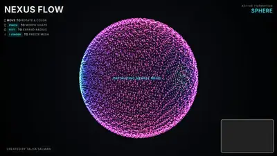</a> <b><a href="https://talhahSalman.github.io/Hand-Sync-3D-Particle-System/">Hand-Sync-3D-Particle-System</a></b> <a href="https://github.com/talhahSalman">talhahSalman</a> 许可证未知 · <a href="https://github.com/talhahSalman/Hand-Sync-3D-Particle-System">代码</a></td>
</tr>
<tr>
<td width="25%" valign="top"> <b><a href="https://markleary.github.io/highway-traffic-simulator/">Highway Traffic Simulator</a></b> <a href="https://github.com/markleary">Mark Leary</a> MIT · <a href="https://github.com/markleary/highway-traffic-simulator">代码</a> · <a href="https://huggingface.co/datasets/AI-Terrarium/terrarium-open-works/tree/main/visualizations/highway-traffic-simulator">文件</a></td>
<td width="25%" valign="top"> <b><a href="https://github.com/jkobierczynski/Hologram-Interference-Bench">Hologram-Interference-Bench</a></b> <a href="https://github.com/jkobierczynski">jkobierczynski</a> GPL-3.0 · <a href="https://github.com/jkobierczynski/Hologram-Interference-Bench">代码</a> · <a href="https://huggingface.co/datasets/AI-Terrarium/terrarium-open-works/tree/main/visualizations/hologram-interference-bench">文件</a></td>
<td width="25%" valign="top"> <b><a href="https://khanmjk.github.io/Hourglass_Fable5/">Hourglass — A Digital Twin Timer</a></b> <a href="https://github.com/khanmjk">khanmjk</a> 合集，5 个作品 MIT · <a href="https://github.com/khanmjk/Hourglass_Fable5">代码</a> · <a href="https://huggingface.co/datasets/AI-Terrarium/terrarium-open-works/tree/main/visualizations/hourglass-fable5">文件</a></td>
<td width="25%" valign="top"><a href="https://viral2525.github.io/Interactive-3D-Particle-System/Index.html">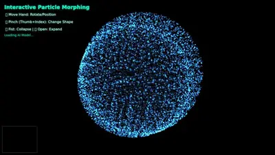</a> <b><a href="https://viral2525.github.io/Interactive-3D-Particle-System/Index.html">Interactive-3D-Particle-System</a></b> <a href="https://github.com/Viral2525">Viral2525</a> 许可证未知 · <a href="https://github.com/Viral2525/Interactive-3D-Particle-System">代码</a></td>
</tr>
<tr>
<td width="25%" valign="top"> <b><a href="https://zeeshan020dev.github.io/Interactive-3D-Particle-System/Index.html">Interactive-3D-Particle-System</a></b> <a href="https://github.com/zeeshan020dev">zeeshan020dev</a> MIT · <a href="https://github.com/zeeshan020dev/Interactive-3D-Particle-System">代码</a> · <a href="https://huggingface.co/datasets/AI-Terrarium/terrarium-open-works/tree/main/visualizations/interactive-3d-particle-system-zeeshan020dev">文件</a></td>
<td width="25%" valign="top"><a href="https://codewithbehnam.github.io/ISS-edu/">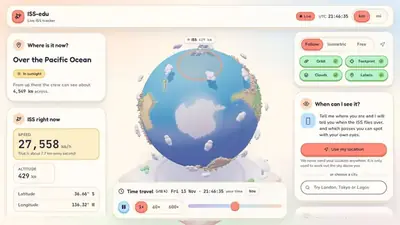</a> <b><a href="https://codewithbehnam.github.io/ISS-edu/">ISS-edu</a></b> <a href="https://github.com/CodeWithBehnam">Behnam</a> MIT · <a href="https://github.com/CodeWithBehnam/ISS-edu">代码</a> · <a href="https://huggingface.co/datasets/AI-Terrarium/terrarium-open-works/tree/main/visualizations/iss-edu">文件</a></td>
<td width="25%" valign="top"> <b><a href="https://github.com/Imjungjuna/jev-face">jev-face</a></b> <a href="https://github.com/Imjungjuna">Imjungjuna</a> MIT · <a href="https://github.com/Imjungjuna/jev-face">代码</a> · <a href="https://huggingface.co/datasets/AI-Terrarium/terrarium-open-works/tree/main/visualizations/jev-face">文件</a></td>
<td width="25%" valign="top"> <b><a href="https://kessler-syndrome-fable-sim.vercel.app">kessler-syndrome-fable-sim</a></b> <a href="https://github.com/me-how-m">me-how-m</a> 许可证未知 · <a href="https://github.com/me-how-m/kessler-syndrome-fable-sim">代码</a></td>
</tr>
<tr>
<td width="25%" valign="top"><a href="https://k8s-skyrealm.pages.dev">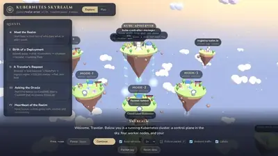</a> <b><a href="https://k8s-skyrealm.pages.dev">Kubernetes Skyrealm</a></b> <a href="https://github.com/ZaafirRizwan">Zaafir Rizwan</a> MIT · <a href="https://github.com/ZaafirRizwan/k8s-skyrealm">代码</a> · <a href="https://huggingface.co/datasets/AI-Terrarium/terrarium-open-works/tree/main/visualizations/kubernetes-skyrealm">文件</a></td>
<td width="25%" valign="top"> <b><a href="https://davidvuillet.fr/voyage/">le-releve</a></b> <a href="https://github.com/labskull-33">labskull-33</a> MIT · <a href="https://github.com/labskull-33/le-releve">代码</a> · <a href="https://huggingface.co/datasets/AI-Terrarium/terrarium-open-works/tree/main/visualizations/le-releve">文件</a></td>
<td width="25%" valign="top"> <b><a href="https://life.petruha.ge">LIFE³</a></b> <a href="https://github.com/Petyok">Petruha</a> MIT · <a href="https://github.com/Petyok/life3d">代码</a> · <a href="https://huggingface.co/datasets/AI-Terrarium/terrarium-open-works/tree/main/visualizations/life3">文件</a></td>
<td width="25%" valign="top"><a href="http://motorvisuales.site/">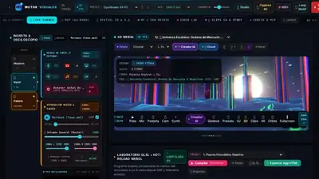</a> <b><a href="http://motorvisuales.site/">lyai-motorvisuales-site</a></b> <a href="https://github.com/LyAi-labs">LyAi-labs</a> 许可证未知 · <a href="https://github.com/LyAi-labs/lyai-motorvisuales-site">代码</a></td>
</tr>
<tr>
<td width="25%" valign="top"><a href="https://allocsys.github.io/madmcp-orchestration-viz/">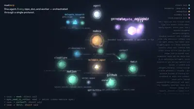</a> <b><a href="https://allocsys.github.io/madmcp-orchestration-viz/">madmcp-orchestration-viz</a></b> <a href="https://github.com/allocsys">allocsys</a> 许可证未知 · <a href="https://github.com/allocsys/madmcp-orchestration-viz">代码</a></td>
<td width="25%" valign="top"><a href="https://shabanihamidu19-cell.github.io/magic-solar-system/">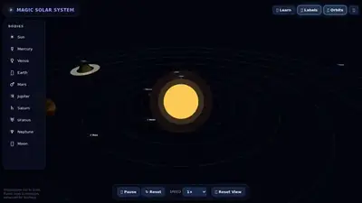</a> <b><a href="https://shabanihamidu19-cell.github.io/magic-solar-system/">magic-solar-system</a></b> <a href="https://github.com/shabanihamidu19-cell">shabanihamidu19-cell</a> 许可证未知 · <a href="https://github.com/shabanihamidu19-cell/magic-solar-system">代码</a></td>
<td width="25%" valign="top"><a href="https://github.com/wonjyou/morphing-particle-swarm">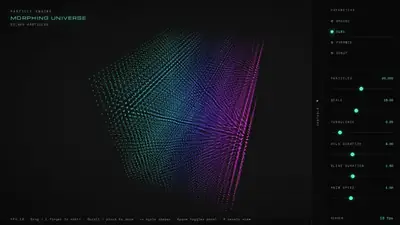</a> <b><a href="https://github.com/wonjyou/morphing-particle-swarm">morphing-particle-swarm</a></b> <a href="https://github.com/wonjyou">wonjyou</a> 许可证未知 · <a href="https://github.com/wonjyou/morphing-particle-swarm">代码</a></td>
<td width="25%" valign="top"> <b><a href="https://dieci02.github.io/Non-ferrous-metals/">Non-ferrous-metals</a></b> <a href="https://github.com/Dieci02">Dieci02</a> MIT · <a href="https://github.com/Dieci02/Non-ferrous-metals">代码</a> · <a href="https://huggingface.co/datasets/AI-Terrarium/terrarium-open-works/tree/main/visualizations/non-ferrous-metals">文件</a></td>
</tr>
<tr>
<td width="25%" valign="top"><a href="https://ohagent.ai/">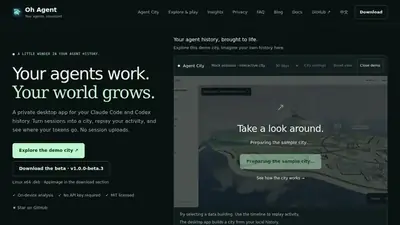</a> <b><a href="https://ohagent.ai/">Oh Agent</a></b> <a href="https://github.com/Oh-Agent-AI">Oh Agent AI</a> MIT · <a href="https://github.com/Oh-Agent-AI/oh-agent">代码</a> · <a href="https://huggingface.co/datasets/AI-Terrarium/terrarium-open-works/tree/main/visualizations/oh-agent">文件</a></td>
<td width="25%" valign="top"><a href="https://orbital-a97.pages.dev/">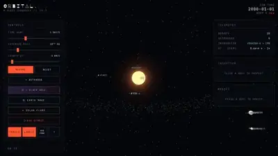</a> <b><a href="https://orbital-a97.pages.dev/">orbital</a></b> <a href="https://github.com/emr-dev1">emr-dev1</a> 许可证未知 · <a href="https://github.com/emr-dev1/orbital">代码</a></td>
<td width="25%" valign="top"><a href="https://orbital-congestion.vercel.app">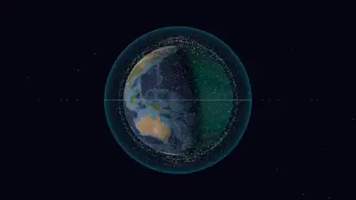</a> <b><a href="https://orbital-congestion.vercel.app">Orbital Congestion Simulator</a></b> <a href="https://github.com/muhammet842">Muhammet Emin Ballı</a> MIT · <a href="https://github.com/muhammet842/orbital-congestion-simulator-premium">代码</a> · <a href="https://huggingface.co/datasets/AI-Terrarium/terrarium-open-works/tree/main/visualizations/orbital-congestion-simulator">文件</a></td>
<td width="25%" valign="top"> <b><a href="https://overhang-ebon.vercel.app">Overhang</a></b> <a href="https://github.com/BaileyPillon">Bailey Pillon</a> MIT · <a href="https://github.com/BaileyPillon/overhang">代码</a> · <a href="https://huggingface.co/datasets/AI-Terrarium/terrarium-open-works/tree/main/visualizations/overhang">文件</a></td>
</tr>
<tr>
<td width="25%" valign="top"> <b><a href="https://soundraysshingo3.github.io/parallel-universe/">parallel-universe</a></b> <a href="https://github.com/SoundRaysSHINGO3">SoundRaysSHINGO3</a> 许可证未知 · <a href="https://github.com/SoundRaysSHINGO3/parallel-universe">代码</a></td>
<td width="25%" valign="top"><a href="https://jesusemans.github.io/pcubensis/">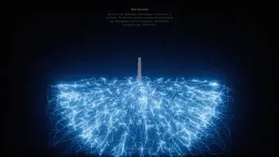</a> <b><a href="https://jesusemans.github.io/pcubensis/">pcubensis</a></b> <a href="https://github.com/jesusemans">jesusemans</a> 许可证未知 · <a href="https://github.com/jesusemans/pcubensis">代码</a></td>
<td width="25%" valign="top"><a href="https://nullthrone.github.io/primacy/">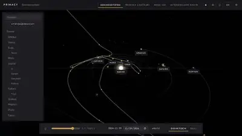</a> <b><a href="https://nullthrone.github.io/primacy/">primacy</a></b> <a href="https://github.com/nullthrone">nullthrone</a> MIT · <a href="https://github.com/nullthrone/primacy">代码</a> · <a href="https://huggingface.co/datasets/AI-Terrarium/terrarium-open-works/tree/main/visualizations/primacy">文件</a></td>
<td width="25%" valign="top"><a href="https://anushkadas-coder.github.io/psilocybe_cubensis/">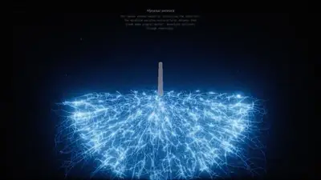</a> <b><a href="https://anushkadas-coder.github.io/psilocybe_cubensis/">psilocybe_cubensis</a></b> <a href="https://github.com/anushkadas-coder">anushkadas-coder</a> MIT · <a href="https://github.com/anushkadas-coder/psilocybe_cubensis">代码</a> · <a href="https://huggingface.co/datasets/AI-Terrarium/terrarium-open-works/tree/main/visualizations/psilocybe-cubensis">文件</a></td>
</tr>
<tr>
<td width="25%" valign="top"><a href="https://neon-ninja.github.io/pythagoras/">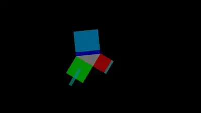</a> <b><a href="https://neon-ninja.github.io/pythagoras/">Pythagorean Theorem with Fluid Dynamics</a></b> <a href="https://github.com/neon-ninja">Nick Young</a> MIT · <a href="https://github.com/neon-ninja/pythagoras">代码</a> · <a href="https://huggingface.co/datasets/AI-Terrarium/terrarium-open-works/tree/main/visualizations/pythagorean-theorem-with-fluid-dynamics">文件</a></td>
<td width="25%" valign="top"> <b><a href="https://reactor-sim-ashy.vercel.app">reactor-sim</a></b> <a href="https://github.com/ethanfann">ethanfann</a> 许可证未知 · <a href="https://github.com/ethanfann/reactor-sim">代码</a></td>
<td width="25%" valign="top"><a href="https://maximilianfeix.github.io/repoville/r/facebook/react/">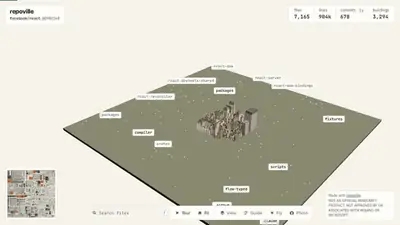</a> <b><a href="https://maximilianfeix.github.io/repoville/r/facebook/react/">repoville</a></b> <a href="https://github.com/maximilianfeix">Maxi</a> MIT · <a href="https://github.com/maximilianfeix/repoville">代码</a> · <a href="https://huggingface.co/datasets/AI-Terrarium/terrarium-open-works/tree/main/visualizations/repoville">文件</a></td>
<td width="25%" valign="top"> <b><a href="https://github.com/TholeG/saltline-field-archive">saltline-field-archive</a></b> <a href="https://github.com/TholeG">TholeG</a> 许可证未知 · <a href="https://github.com/TholeG/saltline-field-archive">代码</a></td>
</tr>
<tr>
<td width="25%" valign="top"> <b><a href="https://science-lab-teal.vercel.app">science-lab</a></b> <a href="https://github.com/biiinsb">biiinsb</a> 许可证未知 · <a href="https://github.com/biiinsb/science-lab">代码</a></td>
<td width="25%" valign="top"> <b><a href="https://bbuf.github.io/sglang-rings/">sglang-rings</a></b> <a href="https://github.com/BBuf">BBuf</a> 许可证未知 · <a href="https://github.com/BBuf/sglang-rings">代码</a></td>
<td width="25%" valign="top"> <b><a href="https://claude.ai/artifact/Wu4Ji88Un1RRmnfFDRnV2Q">skill-tank</a></b> <a href="https://github.com/ooropuloo">ooropuloo</a> MIT · <a href="https://github.com/ooropuloo/skill-tank">代码</a> · <a href="https://huggingface.co/datasets/AI-Terrarium/terrarium-open-works/tree/main/visualizations/skill-tank">文件</a></td>
<td width="25%" valign="top"><a href="https://github.com/switchfire6/Slopstroid-Opus">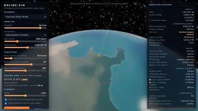</a> <b><a href="https://github.com/switchfire6/Slopstroid-Opus">Slopstroid-Opus</a></b> <a href="https://github.com/switchfire6">switchfire6</a> 许可证未知 · <a href="https://github.com/switchfire6/Slopstroid-Opus">代码</a></td>
</tr>
<tr>
<td width="25%" valign="top"><a href="https://v-mkrtumy-threejs-smoke-plume-study.static.hf.space/index.html">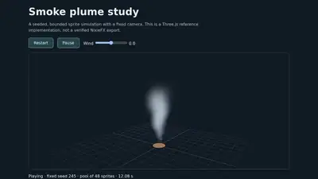</a> <b><a href="https://v-mkrtumy-threejs-smoke-plume-study.static.hf.space/index.html">Smoke Plume Reference</a></b> <a href="https://huggingface.co/v-mkrtumy">v-mkrtumy</a> 许可证未知 · <a href="https://huggingface.co/spaces/v-mkrtumy/threejs-smoke-plume-study">代码</a></td>
<td width="25%" valign="top"> <b><a href="https://app.solarexplorer.co/">Solar System Explorer</a></b> <a href="https://github.com/kyle-itprojectmgmt">Kyle Ewing</a> MIT · <a href="https://github.com/kyle-itprojectmgmt/Solar-System-Explorer">代码</a> · <a href="https://huggingface.co/datasets/AI-Terrarium/terrarium-open-works/tree/main/visualizations/solar-system-explorer">文件</a></td>
<td width="25%" valign="top"> <b><a href="https://github.com/jkobierczynski/Solar-Eclipse-Browser">Solar-Eclipse-Browser</a></b> <a href="https://github.com/jkobierczynski">jkobierczynski</a> GPL-3.0 · <a href="https://github.com/jkobierczynski/Solar-Eclipse-Browser">代码</a> · <a href="https://huggingface.co/datasets/AI-Terrarium/terrarium-open-works/tree/main/visualizations/solar-eclipse-browser">文件</a></td>
<td width="25%" valign="top"> <b><a href="https://solar-sistem-pop.vercel.app">solar-sistem-pop</a></b> <a href="https://github.com/Ber254">Ber254</a> 许可证未知 · <a href="https://github.com/Ber254/solar-sistem-pop">代码</a></td>
</tr>
<tr>
<td width="25%" valign="top"> <b><a href="https://github.com/kilroyroboto/solar-system-3d">solar-system-3d</a></b> <a href="https://github.com/kilroyroboto">kilroyroboto</a> MIT · <a href="https://github.com/kilroyroboto/solar-system-3d">代码</a> · <a href="https://huggingface.co/datasets/AI-Terrarium/terrarium-open-works/tree/main/visualizations/solar-system-3d-kilroyroboto">文件</a></td>
<td width="25%" valign="top"><a href="https://github.com/ZombieCoder3000/solar-system-interactive">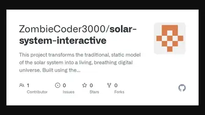</a> <b><a href="https://github.com/ZombieCoder3000/solar-system-interactive">solar-system-interactive</a></b> <a href="https://github.com/ZombieCoder3000">ZombieCoder3000</a> 许可证未知 · <a href="https://github.com/ZombieCoder3000/solar-system-interactive">代码</a></td>
<td width="25%" valign="top"><a href="https://vibe-peng.github.io/solar-system-webgl/">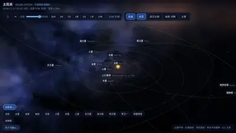</a> <b><a href="https://vibe-peng.github.io/solar-system-webgl/">solar-system-webgl</a></b> <a href="https://github.com/vibe-peng">vibe-peng</a> MIT · <a href="https://github.com/vibe-peng/solar-system-webgl">代码</a> · <a href="https://huggingface.co/datasets/AI-Terrarium/terrarium-open-works/tree/main/visualizations/solar-system-webgl">文件</a></td>
<td width="25%" valign="top"> <b><a href="https://thefolahan.github.io/sombrero-galaxy/">Sombrero Galaxy</a></b> <a href="https://github.com/thefolahan">Omisakin Joshua</a> MIT · <a href="https://github.com/thefolahan/sombrero-galaxy">代码</a> · <a href="https://huggingface.co/datasets/AI-Terrarium/terrarium-open-works/tree/main/visualizations/sombrero-galaxy">文件</a></td>
</tr>
<tr>
<td width="25%" valign="top"><a href="https://sonovia.netlify.app">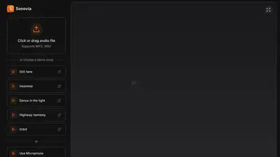</a> <b><a href="https://sonovia.netlify.app">sonovia</a></b> <a href="https://github.com/lakbychance">lakbychance</a> 许可证未知 · <a href="https://github.com/lakbychance/sonovia">代码</a></td>
<td width="25%" valign="top"><a href="https://github.com/oplosy/space">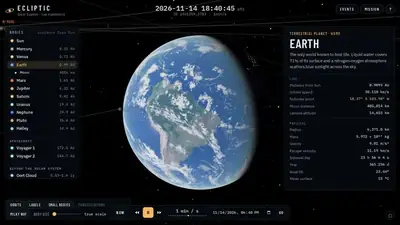</a> <b><a href="https://github.com/oplosy/space">space</a></b> <a href="https://github.com/oplosy">oplosy</a> MIT · <a href="https://github.com/oplosy/space">代码</a> · <a href="https://huggingface.co/datasets/AI-Terrarium/terrarium-open-works/tree/main/visualizations/space">文件</a></td>
<td width="25%" valign="top"> <b><a href="https://vignesh2027.github.io/TERRANOVA/">TERRANOVA</a></b> <a href="https://github.com/vignesh2027">vignesh2027</a> 许可证未知 · <a href="https://github.com/vignesh2027/TERRANOVA">代码</a></td>
<td width="25%" valign="top"> <b><a href="https://threat-pulse-mu.vercel.app">Threat-Pulse</a></b> <a href="https://github.com/youssef-110">youssef-110</a> 许可证未知 · <a href="https://github.com/youssef-110/Threat-Pulse">代码</a></td>
</tr>
<tr>
<td width="25%" valign="top"> <b><a href="https://shayaniqbal2008-svg.github.io/token-skyline/">Token Skyline</a></b> <a href="https://github.com/shayaniqbal2008-svg">Shayan Iqbal</a> MIT · <a href="https://github.com/shayaniqbal2008-svg/token-skyline">代码</a> · <a href="https://huggingface.co/datasets/AI-Terrarium/terrarium-open-works/tree/main/visualizations/token-skyline">文件</a></td>
<td width="25%" valign="top"> <b><a href="https://tanuu5.github.io/trailscape/">Trailscape（トレイルスケープ）</a></b> <a href="https://github.com/tanuu5">たぬ（tanu）</a> MIT · <a href="https://github.com/tanuu5/trailscape">代码</a> · <a href="https://huggingface.co/datasets/AI-Terrarium/terrarium-open-works/tree/main/visualizations/trailscape">文件</a></td>
<td width="25%" valign="top"> <b><a href="https://utkarsh-ai-design.github.io/UNIVERSE-Xplorer/">UNIVERSE-Xplorer</a></b> <a href="https://github.com/UTKARSH-ai-design">UTKARSH-ai-design</a> 许可证未知 · <a href="https://github.com/UTKARSH-ai-design/UNIVERSE-Xplorer">代码</a></td>
<td width="25%" valign="top"> <b><a href="https://yojoxsn.github.io/vault-3d/">VAULT·3D</a></b> <a href="https://github.com/YojoxSn">Jonas SLEIMAN</a> MIT · <a href="https://github.com/YojoxSn/vault-3d">代码</a> · <a href="https://huggingface.co/datasets/AI-Terrarium/terrarium-open-works/tree/main/visualizations/vault3d">文件</a></td>
</tr>
<tr>
<td width="25%" valign="top"> <b><a href="https://jimmcq.github.io/vibescape/">vibescape</a></b> <a href="https://github.com/jimmcq">jimmcq</a> 许可证未知 · <a href="https://github.com/jimmcq/vibescape">代码</a></td>
<td width="25%" valign="top"> <b><a href="https://farrel492.github.io/Visualisasi_Data_Center/">Visualisasi_Data_Center</a></b> <a href="https://github.com/Farrel492">Farrel492</a> 许可证未知 · <a href="https://github.com/Farrel492/Visualisasi_Data_Center">代码</a></td>
<td width="25%" valign="top"> <b><a href="https://huggingface.co/spaces/nc8304/voxel-stitch">voxel_stitch — Chizimi fold simulator</a></b> <a href="https://huggingface.co/nc8304">Nicole</a> MIT · <a href="https://huggingface.co/spaces/nc8304/voxel-stitch">代码</a> · <a href="https://huggingface.co/datasets/AI-Terrarium/terrarium-open-works/tree/main/visualizations/voxel-stitch-chizimi-fold-simulator">文件</a></td>
<td width="25%" valign="top"> <b><a href="https://github.com/NirussVn0/world-anatomy">world-anatomy</a></b> <a href="https://github.com/NirussVn0">NirussVn0</a> MIT · <a href="https://github.com/NirussVn0/world-anatomy">代码</a> · <a href="https://huggingface.co/datasets/AI-Terrarium/terrarium-open-works/tree/main/visualizations/world-anatomy">文件</a></td>
</tr>
<tr>
<td width="25%" valign="top"> <b><a href="https://tanuu5.github.io/earthquake-monitor-3d/">地震3Dモニター JAPAN SEISMIC 3D</a></b> <a href="https://github.com/tanuu5">たぬ（tanu）</a> MIT · <a href="https://github.com/tanuu5/earthquake-monitor-3d">代码</a> · <a href="https://huggingface.co/datasets/AI-Terrarium/terrarium-open-works/tree/main/visualizations/3d-japan-seismic-3d">文件</a></td>
<td width="25%" valign="top"> <b><a href="https://anujyadav-dev.github.io/Solar-System-3D/">🌌 Solar-System-3D</a></b> <a href="https://github.com/AnujYadav-Dev">Anuj Kumar Yadav</a> MIT · <a href="https://github.com/AnujYadav-Dev/Solar-System-3D">代码</a> · <a href="https://huggingface.co/datasets/AI-Terrarium/terrarium-open-works/tree/main/visualizations/solar-system-3d">文件</a></td>
<td width="25%"></td>
<td width="25%"></td>
</tr>
</table>

没有预览图的作品：

<table>

<tr><th align="left">作品</th><th align="left">作者</th><th align="left">许可证</th><th align="left">链接</th></tr>

<tr><td><a href="https://github.com/xr-e16ai/AI--Traffic-simmulation">AI--Traffic-simmulation</a></td><td><a href="https://github.com/xr-e16ai">xr-e16ai</a></td><td>许可证未知</td><td><a href="https://github.com/xr-e16ai/AI--Traffic-simmulation">代码</a></td></tr>

<tr><td><a href="https://github.com/phalla-doll/cosmic-scroll">cosmic-scroll</a></td><td><a href="https://github.com/phalla-doll">phalla-doll</a></td><td>许可证未知</td><td><a href="https://github.com/phalla-doll/cosmic-scroll">代码</a></td></tr>

<tr><td><a href="https://github.com/mire403/Cosmos-Explorer-3D">Cosmos-Explorer-3D</a></td><td><a href="https://github.com/mire403">mire403</a></td><td>许可证未知</td><td><a href="https://github.com/mire403/Cosmos-Explorer-3D">代码</a></td></tr>

<tr><td><a href="https://github.com/sushanshetty2601-pixel/deep-time-mirror">deep-time-mirror</a></td><td><a href="https://github.com/sushanshetty2601-pixel">sushanshetty2601-pixel</a></td><td>许可证未知</td><td><a href="https://github.com/sushanshetty2601-pixel/deep-time-mirror">代码</a></td></tr>

<tr><td><a href="https://github.com/sorryhumans/roost">roost</a></td><td><a href="https://github.com/sorryhumans">sorryhumans</a></td><td>MIT</td><td><a href="https://github.com/sorryhumans/roost">代码</a></td></tr>

</table>

<!-- CATALOG:END -->

---

 <a href="../docs/i18n/README.zh-CN.md">首页</a> · <a href="../games/README.zh-CN.md">游戏</a> · <a href="../scenes/README.zh-CN.md">世界与场景</a> · <a href="../videos/README.zh-CN.md">视频</a> · <a href="../tools/README.zh-CN.md">工具</a> · <a href="README.zh-CN.md">可视化</a> · <a href="../wallpapers/README.zh-CN.md">壁纸</a> · <a href="#top">返回顶部</a> 目录数据：2026-11-25

