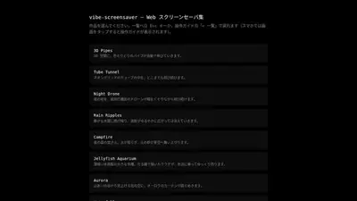

<b>Terrarium</b>

<a href="README.md">English</a> · <b>简体中文</b> · <a href="README.zh-TW.md">繁體中文</a> · <a href="README.ja.md">日本語</a> · <a href="README.ko.md">한국어</a> <a href="README.es.md">Español</a> · <a href="README.pt-BR.md">Português</a> · <a href="README.fr.md">Français</a> · <a href="README.de.md">Deutsch</a> · <a href="README.ru.md">Русский</a>

<a href="../README.zh-CN.md#trending">最热</a> · <a href="../README.zh-CN.md#latest">最新</a> · <a href="../README.zh-CN.md#contents">目录</a>

<h1 align="center">壁纸</h1>

3 个条目。 屏幕保护程序、桌面伙伴与氛围感 3D 画面。

<!-- CATALOG:START -->

<table>
<tr>
<td width="25%" valign="top"> <b><a href="https://github.com/Sabrina-creater/claude-pet">Claude Pet 🐾</a></b> <a href="https://github.com/Sabrina-creater">Sabrina-creater</a> MIT · <a href="https://github.com/Sabrina-creater/claude-pet">代码</a> · <a href="https://huggingface.co/datasets/awesome-fable-5-2/terrarium-open-works/tree/main/wallpapers/claude-pet">文件</a></td>
<td width="25%" valign="top"> <b><a href="https://github.com/yohhoy/vibe-screensaver">vibe-screensaver — Web スクリーンセーバ集</a></b> <a href="https://github.com/yohhoy">yoh</a> 合集，14 个作品 MIT · <a href="https://github.com/yohhoy/vibe-screensaver">代码</a> · <a href="https://huggingface.co/datasets/awesome-fable-5-2/terrarium-open-works/tree/main/wallpapers/vibe-screensaver">文件</a></td>
<td width="25%"></td>
<td width="25%"></td>
</tr>
</table>

没有预览图的作品：

<table>
<tr><th align="left">作品</th><th align="left">作者</th><th align="left">许可证</th><th align="left">链接</th></tr>
<tr><td><a href="https://biswajitdasb4-oss.github.io/prompt-paws/">Prompt Paws</a></td><td><a href="https://github.com/biswajitdasb4-oss">biswajitdasb4-oss</a></td><td>MIT</td><td><a href="https://github.com/biswajitdasb4-oss/prompt-paws">代码</a> · <a href="https://huggingface.co/datasets/awesome-fable-5-2/terrarium-open-works/tree/main/wallpapers/prompt-paws">文件</a></td></tr>
</table>

<!-- CATALOG:END -->

---

 <a href="../README.zh-CN.md">首页</a> · <a href="../games/README.zh-CN.md">游戏</a> · <a href="../scenes/README.zh-CN.md">世界与场景</a> · <a href="../videos/README.zh-CN.md">视频</a> · <a href="../tools/README.zh-CN.md">工具</a> · <a href="../visualizations/README.zh-CN.md">可视化</a> · <a href="../wallpapers/README.zh-CN.md">壁纸</a> · <a href="#top">返回顶部</a> 目录数据：2026-11-14

